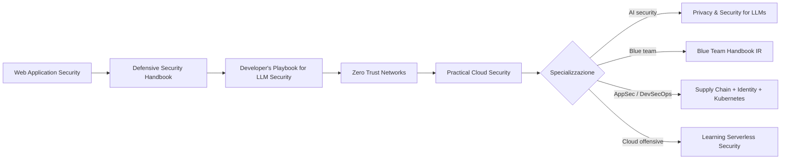

# Libri da leggere per Cybersec

> [!abstract]
> Reading list per la specializzazione in cybersecurity durante la magistrale in Computer Science & AI.
> La prima parte riguarda i **20 libri O'Reilly in `cybersecurity libri/`**, ordinati per priorità. Per ogni libro: copertina, argomento, livello e perché vale la pena leggerlo. Le descrizioni vengono dalle schede dell'editore e dalle recensioni online, non dalla lettura completa dei libri.
> La seconda parte contiene i **classici che mancano nella cartella** (web hacking, reverse engineering, crittografia…), che coprono il lato offensivo e a basso livello.

## Come ho scelto le priorità

I criteri, in ordine di peso:

1. **Tecnico prima che manageriale**: all'inizio contano le competenze pratiche. I libri di governance e risk management servono più avanti, quando si gestisce un team o un programma di sicurezza.
2. **Fondamenta ampie prima che nicchie**: prima i libri che danno una mappa del settore (web, difesa, reti, cloud), poi quelli verticali (Kubernetes, serverless, hybrid cloud).
3. **AI + security**: è il punto in cui il tuo percorso (CS & AI) dà un vantaggio raro, quindi i libri sulla sicurezza degli LLM salgono in classifica.
4. **Collegamento con i corsi**: Ethical Hacking, Cybersecurity, Malware Analysis, Machine Learning.

| Priorità | Libro | Area | Livello | Pagine |
|---|---|---|---|---|
| 🥇 1 | Web Application Security (2ª ed.) | Web, offensive + defensive | Intermedio | 444 |
| 🥇 2 | Defensive Security Handbook (2ª ed.) | Blue team, infrastruttura | Base → intermedio | 363 |
| 🥇 3 | The Developer's Playbook for LLM Security | AI security | Intermedio | 200 |
| 🥇 4 | Zero Trust Networks (2ª ed.) | Network security, architettura | Intermedio | 335 |
| 🥇 5 | Practical Cloud Security (2ª ed.) | Cloud | Base → intermedio | 231 |
| 🥈 6 | Privacy and Security for Large Language Models | AI security, privacy | Intermedio → avanzato | 318 |
| 🥈 7 | Software Supply Chain Security | AppSec, DevSecOps | Intermedio | 243 |
| 🥈 8 | Blue Team Handbook: Incident Response | DFIR, SOC | Intermedio → avanzato | 359 |
| 🥈 9 | Cybersecurity Ops with bash | Tooling, command line | Base → intermedio | 306 |
| 🥈 10 | Identity Security for Software Development | IAM, secrets | Intermedio | 208 |
| 🥈 11 | Kubernetes Security and Observability | Container security | Intermedio → avanzato | 195 |
| 🥈 12 | Learning Serverless Security | Cloud, offensive + defensive | Intermedio → avanzato | 534 |
| 🥉 13 | Cloud Native Security Cookbook | Cloud (ricette) | Intermedio | 516 |
| 🥉 14 | Security as Code | DevSecOps su AWS | Intermedio | 122 |
| 🥉 15 | Security Architecture for Hybrid Cloud | Security architecture | Avanzato | 477 |
| 🥉 16 | Learning Cloud Security | Cloud (CCSP) | Intermedio → avanzato | 353 |
| 🥉 17 | Inside Cyber Warfare (3ª ed.) | Geopolitica, cyber warfare | Divulgativo | 161 |
| 🥉 18 | Intelligent Continuous Security | DevSecOps + AI, strategia | Intermedio (manageriale) | 317 |
| 📁 19 | Building a Cyber Risk Management Program | GRC, risk management | Manageriale | 223 |
| 📁 20 | The Cybersecurity Manager's Guide | Leadership | Manageriale | 179 |

> [!tip] Percorso consigliato
> Leggi i 🥇 nell'ordine indicato: insieme danno una mappa completa (web, difesa, AI, rete, cloud).
> Dei 🥈 scegli quelli della direzione che ti interessa di più:
> - **offensive / pentest** → Learning Serverless Security, Cybersecurity Ops with bash;
> - **blue team / SOC** → Blue Team Handbook, Cybersecurity Ops with bash;
> - **AppSec / DevSecOps** → Software Supply Chain Security, Identity Security, Kubernetes;
> - **AI security** → Privacy and Security for LLMs.
>
> I 🥉 si consultano quando servono. I 📁 aspettano il primo ruolo da lead o manager.

---

## 🥇 Priorità alta: da leggere per primi

### 1. Web Application Security (2ª edizione)

![[cover-webapplicationsecurity2ndedition.jpg|160]]

**Andrew Hoffman** · O'Reilly, 2024 · *Exploitation and Countermeasures for Modern Web Applications*

Il libro è diviso in tre parti: **Recon** (mappare un'applicazione web: API, sottodomini, framework, dipendenze), **Offense** (XSS, CSRF, XXE, injection, deserializzazione, attacchi a GraphQL e alle API REST) e **Defense** (secure architecture, code review, threat modeling, mitigazioni per ogni attacco). La 2ª edizione aggiunge API moderne, SPA e cloud. Ogni vulnerabilità viene vista sia da attaccante sia da difensore.

> [!note] Perché è primo
> Il web resta la superficie d'attacco più grande. Il libro si collega direttamente a Ethical Hacking e a [[#Altri libri consigliati (non presenti nella cartella)|PortSwigger Web Security Academy]], ed è leggibile senza esperienza professionale.

### 2. Defensive Security Handbook (2ª edizione)

![[cover-defensivesecurityhandbook2ndedition.jpg|160]]

**Amanda Berlin, Lee Brotherston, William F. Reyor III** · O'Reilly, 2024 · *Best Practices for Securing Infrastructure*

È una panoramica completa del lavoro di **blue team**: asset management, policy, vulnerability management, segmentazione di rete, hardening di Windows e Linux, gestione di password e identità, logging e monitoraggio, incident response, purple teaming. La 2ª edizione aggiunge cloud, zero trust e la gestione del personale. Ogni capitolo è breve e pratico ("cosa fare lunedì mattina").

> [!note] Perché leggerlo
> Fa capire **come lavora davvero un'organizzazione per difendersi**. Da attaccante serve per sapere cosa si trova davanti, da difensore è la checklist di base. È il libro più "fondazionale" della cartella.

### 3. The Developer's Playbook for Large Language Model Security

![[cover-developersplaybookforlargelanguagemodelsecurity.jpg|160]]

**Steve Wilson** · O'Reilly, 2024 · *Building Secure AI Applications*

L'autore guida il progetto **OWASP Top 10 for LLM Applications**. Il libro tratta prompt injection (diretta e indiretta), data poisoning, sensitive information disclosure, insecure output handling, eccesso di autonomia degli agenti (*excessive agency*), supply chain dei modelli e allucinazioni come problema di sicurezza. Propone anche un framework (RAISE) per costruire applicazioni LLM sicure.

> [!important] Perché è così in alto
> È il punto d'incontro tra il tuo percorso AI e la cybersecurity, un campo nuovo con pochi esperti. È breve (200 pagine) e scritto per chi sviluppa. Si collega al corso di Machine Learning e ad Artificial Intelligence.

### 4. Zero Trust Networks (2ª edizione)

![[cover-zerotrustnetworks2ndedition.jpg|160]]

**Razi Rais, Christina Morillo, Evan Gilman, Doug Barth** · O'Reilly, 2024 · *Building Secure Systems in Untrusted Networks*

Il modello **zero trust** ("never trust, always verify") abbandona l'idea di un perimetro fidato: ogni richiesta va autenticata e autorizzata in base a identità, dispositivo e contesto. Il libro spiega i principi, il control plane e il data plane, la fiducia in utenti, dispositivi, applicazioni e traffico, e gli standard (NIST SP 800-207, BeyondCorp di Google). La 2ª edizione aggiunge casi di studio e scenari reali.

> [!note] Perché leggerlo
> Oggi zero trust è il modello di riferimento per l'architettura di sicurezza delle reti. Rivede in chiave moderna i concetti di rete della triennale (Telecomunicazioni, Lab Architetture Software e Sicurezza).

### 5. Practical Cloud Security (2ª edizione)

![[cover-practicalcloudsecurity2ndedition.jpg|160]]

**Chris Dotson** · O'Reilly, 2023 · *A Guide for Secure Design and Deployment*

È un'introduzione **indipendente dal provider** (AWS, Azure, GCP) alla sicurezza del cloud: shared responsibility model, asset management, IAM, vulnerability management, cifratura e gestione delle chiavi, sicurezza di rete nel cloud, logging e incident response. È breve e organizzato per priorità: prima le cose che fanno più danni se sbagliate.

> [!note] Perché leggerlo
> Quasi tutto gira sul cloud, e la maggior parte degli incidenti nasce da configurazioni sbagliate. È anche il libro di base che serve prima dei 7 libri di cloud più specialistici della cartella.

---

## 🥈 Priorità media: in base alla specializzazione

### 6. Privacy and Security for Large Language Models

![[cover-privacyandsecurityforlargelanguagemodels.jpg|160]]

**Baihan Lin** · O'Reilly, 2026 · *Hands-On Privacy-Preserving Techniques for Personalized AI*

Più rigoroso e "da ricercatore" rispetto al Playbook di Wilson. Tratta tecniche di **privacy-preserving ML**: differential privacy, federated learning, homomorphic encryption, fine-tuning sicuro per la personalizzazione, deployment sicuro, bias e trasparenza, con casi di studio in sanità e finanza.

> [!tip] Per chi
> Leggilo dopo il Playbook, se ti interessa l'**AI security** come ricerca o tesi. Richiede basi di ML, che hai.

### 7. Software Supply Chain Security

![[cover-softwaresupplychainsecurity.jpg|160]]

**Cassie Crossley** · O'Reilly, 2024 · *Securing the End-to-End Supply Chain for Software, Firmware, and Hardware*

Dopo SolarWinds e Log4Shell la **supply chain** è diventata uno dei vettori d'attacco principali. Il libro copre SBOM (Software Bill of Materials), framework come SLSA e NIST SSDF, sicurezza delle build e delle pipeline CI/CD, dipendenze open source, firmware e hardware, e i requisiti normativi.

> [!note] Per chi
> Essenziale per **AppSec e DevSecOps**. È un tema molto attuale anche nella ricerca.

### 8. Blue Team Handbook: Incident Response

![[cover-blueteamhandbook_incidentresponse.jpg|160]]

**Don Murdoch** · O'Reilly, 2026 (nuova edizione aggiornata)

È un manuale operativo per chi fa **incident response** e lavora in un **SOC**: fasi dell'IR (preparazione, identificazione, contenimento, eradicazione, recovery, lessons learned), raccolta delle evidenze, analisi di log e traffico, comandi utili per Windows e Linux, workflow pronti da usare.

> [!note] Per chi
> Utile se ti interessa la carriera **blue team / DFIR**. Si abbina bene con Malware Analysis e con il Defensive Security Handbook.

### 9. Cybersecurity Ops with bash

![[cover-cybersecurityopswithbash.jpg|160]]

**Paul Troncone, Carl Albing** · O'Reilly, 2019 · *Attack, Defend, and Analyze from the Command Line*

Insegna a usare **bash e gli strumenti Unix** (grep, awk, sed, curl…) per la sicurezza: raccolta dati, analisi dei log, monitoraggio in tempo reale, network scanning, malware analysis di base, penetration testing, scripting di tool. È pratico, con esercizi a fine capitolo.

> [!tip] Perché è utile anche se "vecchio"
> La command line non invecchia. È una competenza trasversale che usi in ogni CTF, su HackTheBox e in qualsiasi lavoro tecnico. Si legge velocemente.

### 10. Identity Security for Software Development

![[cover-identitysecurityforsoftwaredevelopment.jpg|160]]

**John Walsh, Uzi Ailon, Matt Barker** · O'Reilly, 2025 · *Best Practices That Every Developer Must Know*

Si concentra su un aspetto spesso trascurato: **secrets, credenziali e machine identity** (identità non umane come servizi, pipeline, container). Copre autenticazione, autorizzazione, gestione dei segreti in CI/CD, Kubernetes, ambienti multicloud e IoT.

> [!note] Per chi
> Utile per AppSec e cloud. Molti breach nascono da una API key finita su GitHub o da un service account con troppi permessi.

### 11. Kubernetes Security and Observability

![[cover-kubernetessecurityandobservability.jpg|160]]

**Brendan Creane, Amit Gupta** · O'Reilly, 2021 · *A Holistic Approach to Securing Containers and Cloud Native Applications*

Sicurezza dell'intero ciclo di vita di un'applicazione su **Kubernetes**: build delle immagini, deploy, runtime, network policy, cifratura del traffico, threat defense e **observability** come strumento di sicurezza. Gli autori lavorano in Tigera (Calico), quindi alcuni esempi usano quello strumento.

> [!note] Per chi
> Da leggere quando lavori con container e cloud native. Presuppone che tu conosca già Kubernetes.

### 12. Learning Serverless Security

![[cover-learningserverlesssecurity.jpg|160]]

**Joshua Arvin Lat** · O'Reilly, 2026 · *Hacking and Securing Serverless Cloud Applications on AWS, Azure, and Google Cloud*

È uno dei pochi libri **offensivi** della cartella. Costruisce laboratori vulnerabili *by design* su AWS Lambda, Azure Functions e Google Cloud Functions, li attacca (privilege escalation, abuso di IAM, injection) e poi li mette in sicurezza. Molto pratico, passo per passo.

> [!tip] Per chi
> Ideale se ti interessa il **cloud pentesting**. È lungo (534 pagine), ma si può leggere per capitoli seguendo un solo provider.

---

## 🥉 Priorità bassa: consultazione e approfondimenti

### 13. Cloud Native Security Cookbook

![[cover-cloudnativesecuritycookbook.jpg|160]]

**Josh Armitage** · O'Reilly, 2022 · *Recipes for a Secure Cloud*

È un **ricettario**: ogni capitolo è nella forma problema → soluzione in **Terraform** per AWS, Azure e GCP (gestione dei segreti, logging centralizzato, networking sicuro, IAM, compliance). Non si legge dall'inizio alla fine: si consulta quando serve una soluzione concreta.

### 14. Security as Code

![[cover-securityascode.jpg|160]]

**BK Sarthak Das, Virginia Chu** · O'Reilly, 2023 · *DevSecOps Patterns with AWS*

È un libro breve (122 pagine) su come portare la sicurezza dentro la pipeline: infrastructure as code, policy as code, controlli automatici, threat modeling, logging e monitoraggio, il tutto su **AWS**. Si legge in un paio di sere, ma è legato a un solo provider.

### 15. Security Architecture for Hybrid Cloud

![[cover-securityarchitectureforhybridcloud.jpg|160]]

**Mark Buckwell, Stefaan Van daele, Carsten Horst** · O'Reilly, 2024 · *A Practical Method for Designing Security Using Zero Trust Principles*

Gli autori sono security architect di IBM. Il libro propone un **metodo strutturato per progettare l'architettura di sicurezza** di un sistema ibrido (on-premise + cloud): requisiti, contesto, threat modeling, decisioni architetturali, documentazione. È molto rigoroso, ma pensato per il ruolo di *security architect*, che arriva più avanti nella carriera.

### 16. Learning Cloud Security

![[cover-learningcloudsecurity.jpg|160]]

**Ric Messier** · O'Reilly, 2026 · *Cloud Computing and Security Architecture Essentials*

È strutturato sui domini della certificazione **CCSP** (Certified Cloud Security Professional): architetture cloud, risk management e compliance, controlli di sicurezza, zero trust, con oltre 100 domande di esercitazione. Con Practical Cloud Security nei 🥇 c'è molta sovrapposizione: serve soprattutto se un giorno prepari la CCSP (che però richiede anni di esperienza lavorativa).

### 17. Inside Cyber Warfare (3ª edizione)

![[cover-insidecyberwarfare3rdedition.jpg|160]]

**Jeffrey Caruso** · O'Reilly, 2024 · *Mapping the Cyber Underworld*

È un libro **divulgativo** su cyber warfare, operazioni statali, cybercrime e attribuzione degli attacchi, con casi recenti (guerra in Ucraina, attacchi a infrastrutture critiche) e una parte sulla responsabilità legale. Non insegna competenze tecniche: dà il contesto geopolitico. È adatto alla lettura "leggera".

### 18. Intelligent Continuous Security

![[cover-intelligentcontinuoussecurity.jpg|160]]

**Marc Hornbeek** · O'Reilly, 2025 · *AI-Enabled Transformation for Seamless Protection*

Propone un approccio unificato alla sicurezza lungo tutto il ciclo di vita del software, unendo **DevSecOps e SecOps** e usando l'AI per automazione, metriche e compliance. Il taglio è **strategico e organizzativo**: si rivolge a DevOps engineer, IT leader e decision maker più che a chi deve imparare la parte tecnica.

---

## 📁 Manageriali: per più avanti

### 19. Building a Cyber Risk Management Program

![[cover-buildingacyberriskmanagementprogram.jpg|160]]

**Brian Allen, Brandon Bapst, Terry Allan Hicks** · O'Reilly, 2023 · *Evolving Security for the Digital Age*

Spiega come costruire un programma di **cyber risk management** in azienda: governance, framework (NIST CSF, ISO 27001), identificazione e valutazione del rischio, comunicazione con il board. È lato **GRC** (Governance, Risk & Compliance): utile se ti interessa la consulenza, ma non tecnico.

### 20. The Cybersecurity Manager's Guide

![[cover-cybersecuritymanagersguide.jpg|160]]

**Todd Barnum** · O'Reilly, 2021 · *The Art of Building Your Security Program*

Consigli pratici per chi diventa **responsabile della sicurezza** (CISO o security manager): costruire relazioni con le altre funzioni aziendali, assumere e guidare un team, ottenere budget, definire le priorità. Ha valore solo quando si arriva a gestire persone.

---

## Altri libri consigliati (non presenti nella cartella)

> [!warning] Cosa manca nella cartella
> I 20 libri O'Reilly sono quasi tutti **difensivi, cloud e organizzativi**. Mancano reti a basso livello, reverse engineering, binary exploitation e crittografia, che sono il cuore tecnico della disciplina. Per queste aree valgono i consigli qui sotto.

Avere una visione d'insieme su più domini è il modo migliore per costruire un'architettura mentale solida, specialmente quando dovrai integrare la sicurezza nello sviluppo software o nella progettazione di modelli intelligenti.

Ecco una selezione dei migliori testi tecnici moderni, perfetti per chi ha già basi di programmazione e architetture dei calcolatori e vuole scendere a basso livello.

### 1. Sicurezza Web (Web Application Security)

Il web è il vettore di attacco principale oggi. Questa branca si concentra sulle vulnerabilità del software che gira sui server e nei browser (come SQL Injection, XSS, CSRF e problemi di logica di business).

- **Il classico:** _The Web Application Hacker's Handbook_ (Dafydd Stuttard, Marcus Pinto). Anche se la seconda edizione è del 2011, la metodologia di base e la spiegazione delle vulnerabilità logiche rimangono insuperate. Gli autori sono i creatori di Burp Suite.
- **L'alternativa moderna:** _Bug Bounty Bootcamp_ (Vickie Li). Molto più recente e orientato alla pratica, copre le vulnerabilità moderne che si trovano nei programmi di bug bounty odierni.
- **Risorsa pratica (Gratuita):** Più che un libro, devi esplorare la **Web Security Academy di PortSwigger**. È il successore spirituale del _Web Application Hacker's Handbook_, costantemente aggiornato e con laboratori interattivi reali.

### 2. Sicurezza di Rete (Network & Infrastructure Security)

Qui si scende al livello dei protocolli (TCP/IP, DNS, BGP), delle architetture di rete, dei firewall e dei sistemi di rilevamento delle intrusioni.

- **L'essenziale per l'analisi:** _Practical Packet Analysis_ (Chris Sanders). Non puoi difendere o attaccare una rete se non sai leggere esattamente cosa viaggia sui cavi. Questo libro ti insegna a usare Wireshark per sezionare il traffico di rete e individuare anomalie.
- **Per l'attacco:** _Network Security Assessment_ (Chris McNab). Un ottimo manuale metodologico su come mappare ed exploitare i servizi di rete esposti.

### 3. Reverse Engineering e Binary Exploitation

Questa è la branca più a basso livello. Riguarda lo smontaggio del software compilato (spesso malware o eseguibili di cui non si ha il codice sorgente) per capire come funziona, o la ricerca di vulnerabilità nella gestione della memoria (Buffer Overflow, ROP chains).

- **L'opera omnia:** _Practical Malware Analysis_ (Michael Sikorski, Andrew Honig). È la "bibbia" assoluta per capire come disassemblare ed eseguire il debug del codice maligno in ambienti controllati.
- **L'approfondimento crudo:** _Reverse Engineering for Beginners_ (Dennis Yurichev). Un testo massiccio e gratuito (disponibile online) che ti guida dal linguaggio Assembly C/C++ fino alla comprensione profonda di come i compilatori traducono il codice.

### 4. AI Security & Machine Learning

Un campo in esplosione e cruciale per chi progetta sistemi intelligenti. Si divide in due filoni: usare il Machine Learning per la sicurezza (es. rilevamento delle intrusioni) e proteggere i modelli di Machine Learning dagli attacchi (Adversarial ML, Data Poisoning).

- **Il testo di riferimento:** _Machine Learning and Security_ (Clarence Chio, David Freeman). Ottimo per capire come applicare algoritmi di ML per risolvere problemi di sicurezza reali, come l'analisi dei log e il rilevamento di malware.
- **Sulla sicurezza dei modelli:** Al momento, i testi tradizionali faticano a stare al passo con la ricerca sull'Adversarial Machine Learning e le vulnerabilità degli LLM (Prompt Injection). Su questo fronte, ti consiglio di seguire direttamente i framework di OWASP, come l'**OWASP Top 10 for Large Language Models**, e i paper accademici recenti.

> [!note] Aggiornamento
> Su questo punto ora ci sono due libri nella cartella: *The Developer's Playbook for LLM Security* (scritto proprio dal responsabile dell'OWASP Top 10 for LLM) e *Privacy and Security for Large Language Models*. Vedi i punti 3 e 6 sopra.

### 5. Crittografia Applicata (Bonus)

Non puoi fare sicurezza senza capire la crittografia, non tanto per inventare nuovi algoritmi, ma per capire come quelli esistenti vengono implementati (e spesso implementati male).

- **Il libro definitivo:** _Serious Cryptography_ (Jean-Philippe Aumasson). Scritto da un crittografo di fama mondiale, spiega i concetti moderni (come la crittografia quantistica e le funzioni di hash) in modo matematicamente rigoroso ma accessibile.

Leggere manuali tecnici in inglese è tra l'altro un ottimo modo per assimilare il lessico corretto senza rischiare di "italianizzare" i termini tecnici quando dovrai scrivere documentazione o interfacciarti con team internazionali.

---

## Fonti

- Schede dei libri sul sito O'Reilly (oreilly.com/library), ad esempio [Intelligent Continuous Security](https://www.oreilly.com/library/view/intelligent-continuous-security/9798341615908/), [Learning Cloud Security](https://www.oreilly.com/library/view/-/9781098179410/), [Learning Serverless Security](https://www.oreilly.com/library/view/-/9781098149000/), [Blue Team Handbook](https://www.oreilly.com/library/view/blue-team-handbook/9798341649767), [Identity Security for Software Development](https://www.oreilly.com/library/view/-/9781098158026)
- [Privacy and Security for Large Language Models (Coles Books)](https://coles-books.co.uk/privacy-and-security-for-large-language-models-by-baihan-lin)
- Metadati dei PDF (autori, numero di pagine); copertine estratte dalla prima pagina di ogni PDF.
