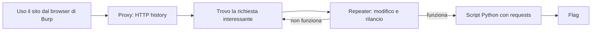

# Recupero Web e Burp Suite

> [!abstract]
> Piano per recuperare la parte iniziale del CyberBootcamp e arrivare pronto al modulo web: ripasso della settimana 1, setup, flusso di lavoro con Burp e `requests`, laboratori in ordine di difficoltà. La teoria web è già nel vault, in [[Burp Suite]], [[HTTP]], [[Session Management]], [[Authorization]], [[SQL Injection]] e [[XSS]]: qui c'è la pratica.

> [!warning] Questa nota non è il riassunto della lezione
> Non ho avuto accesso a slide o registrazione. Gli argomenti vengono dal programma del sito e dai compiti assegnati, Burp e `requests`. Quando recuperi il materiale ufficiale, ha la precedenza su questa nota.

## Programma del corso

| Settimana | Modulo | Argomenti |
|---|---|---|
| 1 | Metodo e ambienti | Introduzione a cybersecurity ed ethical hacking; Linux, shell, servizi e prime evidenze; regole d'uso e ambienti autorizzati |
| 2 | Web security | HTTP, sessioni e autenticazione; autorizzazioni e input validation; analisi del bug e verifica controllata |
| 3 | Crittografia | Hash e cifratura simmetrica; chiavi pubbliche e protocolli; segreti, configurazioni e verifiche |
| 4 | Reverse engineering | Formati, assembly e analisi statica; debugging e flusso di esecuzione; individuazione di funzioni e comportamenti |
| 4 | Software exploitation | Stack e gestione della memoria; mitigazioni e superfici d'attacco; exploit controllati e verifica dell'impatto |

> [!warning] Da chiarire: quando inizia il modulo web
> Secondo il programma il web è in settimana 2, mentre il messaggio Telegram annuncia la «prima lezione di web» per il giorno dopo. La data del messaggio dice se la lezione persa era quella su metodo e ambienti e se il web è già iniziato.

## Ripasso della settimana 1

Controlla di saper fare queste cose senza cercarle:

| Obiettivo | Comandi |
|---|---|
| Muoversi e cercare | `ls -la`, `find`, `grep -r`, `cat`, `less` |
| Permessi e utenti | `id`, `chmod`, `chown`, `sudo -l` |
| Processi e servizi | `ps aux`, `systemctl status`, `ss -ltnp`, `journalctl -u` |
| Parlare con un servizio | `curl -i`, `nc`, `ssh` |
| Concatenare comandi | pipe, `>`, `2>&1`, `sort`, `uniq`, `cut` |
| Conservare le prove | Annota comando, output e conclusione, così che altri possano riprodurre il risultato |

Il metodo indicato dal programma è osservare, formulare un'ipotesi e verificarla in modo riproducibile: è lo stesso ciclo di [[#Il flusso di lavoro]].

## Cosa chiedere nel gruppo

- C'è una registrazione o ci sono le slide della lezione persa?
- Quando è iniziato, o quando inizia, il modulo web?
- Dove si trovano le regole d'uso degli ambienti e come si accede alle piattaforme?
- Su quale piattaforma sono le challenge? Quali sono state assegnate?
- Bisogna consegnare qualcosa o c'è una scadenza?

## Setup

| Compito | Stato al 4 novembre 2026 | Cosa resta da fare |
|---|---|---|
| Burp Community | Installato in `~/BurpSuite`, versione 2026.4.3, più recente di quella linkata. Il proxy risponde su `127.0.0.1:8080` | Aprire **Proxy → Intercept → Open browser** e caricare una pagina |
| `requests` | Installato in `~/cbb/.venv`, versione 2.34.2 | Attivare l'ambiente quando serve |

```bash
source ~/cbb/.venv/bin/activate
```

> [!warning] Se il browser di Burp non si apre
> Il browser integrato usa Chromium. Se parte e si chiude subito, prova **Settings → Tools → Burp's browser → Allow Burp's browser to run without a sandbox**. In alternativa usa Firefox con il proxy manuale su `127.0.0.1:8080`, come indicato nel messaggio del corso.

## Il flusso di lavoro



1. **Osserva.** Usa il sito come un utente normale e leggi le richieste in **Proxy → HTTP history**. Intercept può restare spento: la history registra comunque tutto.
2. **Isola.** Cerca parametri, cookie e header che il server sembra usare per decidere qualcosa. Manda quella richiesta al Repeater con `Ctrl+R`.
3. **Sperimenta.** Cambia un elemento alla volta e confronta le risposte: status code, lunghezza, testo.
4. **Automatizza.** Quando l'attacco ha più passaggi, o va ripetuto molte volte, riscrivilo in Python.

> [!tip] La domanda da farsi
> Per ogni valore che parte dal browser, chiediti: *cosa succede se lo cambio, dato che lo controllo io?* Il client non è affidabile, perché tutto quello che invia può essere manipolato. Quasi tutte le vulnerabilità di logica e di controllo degli accessi nascono da qui.

## Dal Repeater allo script

Questo schema è quello che userai più spesso. L'ho provato facendolo passare dal proxy di Burp, contro un piccolo server locale: login, cookie modificato, estrazione della flag.

```python
import re
import requests
import urllib3

urllib3.disable_warnings(urllib3.exceptions.InsecureRequestWarning)

BASE = "http://127.0.0.1:5000"       # URL della challenge
BURP = "http://127.0.0.1:8080"

s = requests.Session()               # conserva i cookie tra le richieste
s.proxies = {"http": BURP, "https": BURP}   # lo script compare in HTTP history
s.verify = False                     # Burp riscrive i certificati HTTPS

r = s.post(f"{BASE}/login", data={"username": "guest", "password": "guest"})
print(r.status_code, s.cookies.get_dict())

s.cookies.set("role", "admin")       # manomissione del cookie
r = s.get(f"{BASE}/admin")
print(r.status_code, re.search(r"flag\{[^}]+\}", r.text).group(0))
```

Il formato `flag{...}` è solo un esempio: adatta la regex a quello delle challenge. Se Burp è chiuso, togli le righe di `proxies` e `verify`, altrimenti lo script va in errore.

| Nella richiesta | Con `requests` |
|---|---|
| Query string `?id=1` | `s.get(url, params={"id": 1})` |
| Form `a=1&b=2` | `s.post(url, data={"a": 1, "b": 2})` |
| Body JSON | `s.post(url, json={"a": 1})` |
| Header | `s.get(url, headers={"X-Foo": "bar"})` |
| Vedere un redirect senza seguirlo | `s.post(url, data=d, allow_redirects=False)` |

> [!warning] Errori frequenti
> - **Lo script resta bloccato:** Intercept è attivo e la richiesta aspetta in Burp. Spegnilo.
> - **Perdi il login:** stai usando `requests.get` invece della sessione `s`, quindi il cookie non viene inviato.
> - **Non vedi il `Set-Cookie`:** la risposta è un redirect già seguito. Usa `allow_redirects=False` per leggerla.
> - **Il pacchetto non si trova:** l'ambiente virtuale non è attivo.

## Laboratori

Servono un account gratuito su PortSwigger e il browser di Burp. Sono ordinati per costruire il metodo un passo alla volta. Le ultime due colonne dicono dove guardare, non la soluzione: prova da solo prima di aprirla.

| # | Laboratorio | Strumento | Da dove partire |
|---|---|---|---|
| 1 | [Unprotected admin functionality](https://portswigger.net/web-security/access-control/lab-unprotected-admin-functionality) | Browser | I file pubblici che elencano i percorsi del sito |
| 2 | [User role controlled by request parameter](https://portswigger.net/web-security/access-control/lab-user-role-controlled-by-request-parameter) | Proxy | I cookie dopo il login |
| 3 | [User ID controlled by request parameter](https://portswigger.net/web-security/access-control/lab-user-id-controlled-by-request-parameter) | Repeater | L'URL della pagina account |
| 4 | [Excessive trust in client-side controls](https://portswigger.net/web-security/logic-flaws/examples/lab-logic-flaws-excessive-trust-in-client-side-controls) | Proxy, Repeater | Cosa viene inviato quando aggiungi al carrello |
| 5 | [Simple path traversal](https://portswigger.net/web-security/file-path-traversal/lab-simple) | Repeater | Come vengono caricate le immagini |
| 6 | [SQLi: retrieve hidden data](https://portswigger.net/web-security/sql-injection/lab-retrieve-hidden-data) | Repeater | Il filtro per categoria |
| 7 | [SQLi: login bypass](https://portswigger.net/web-security/sql-injection/lab-login-bypass) | Repeater | Il campo username |
| 8 | [Reflected XSS](https://portswigger.net/web-security/cross-site-scripting/reflected/lab-html-context-nothing-encoded) | Browser | Dove ricompare il testo cercato |
| 9 | [Username enumeration](https://portswigger.net/web-security/authentication/password-based/lab-username-enumeration-via-different-responses) | Python, oppure Intruder | Le differenze tra le risposte ai login falliti |

| Argomento del programma | Laboratori |
|---|---|
| HTTP, sessioni e autenticazione | 2, 9 |
| Autorizzazioni | 1, 2, 3 |
| Input validation | 4, 5, 6, 7, 8 |

Per l'ultimo argomento, *analisi del bug e verifica controllata*, alla fine di ogni laboratorio scrivi in due righe qual è l'errore, che impatto ha e come hai dimostrato che esiste.

> [!example] Esercizio finale
> Risolvi il laboratorio 9 con uno script `requests` invece che con Intruder. Nella Community, Intruder è rallentato, e nelle CTF lo script è di solito la strada più comoda.

> [!important] Solo su bersagli autorizzati
> Usa queste tecniche su laboratori, challenge e sistemi per cui hai il permesso. I laboratori PortSwigger esistono per questo. Prima di testare un bersaglio, leggi il regolamento della piattaforma.

## Se hai poco tempo

| Tempo disponibile | Cosa fare |
|---|---|
| 30 minuti | Prova il browser di Burp, chiedi il materiale nel gruppo, fai i laboratori 1 e 2 |
| 2 ore | Aggiungi i laboratori 3, 4 e 6 |
| Mezza giornata | Completa la tabella e scrivi lo script dell'esercizio finale |

> [!summary] Pronto per la prossima lezione se
> - sai trovare una richiesta in HTTP history e rilanciarla modificata dal Repeater;
> - sai riscriverla in Python mantenendo la sessione;
> - sai spiegare perché cambiare un cookie o un ID può dare accesso a dati altrui.
