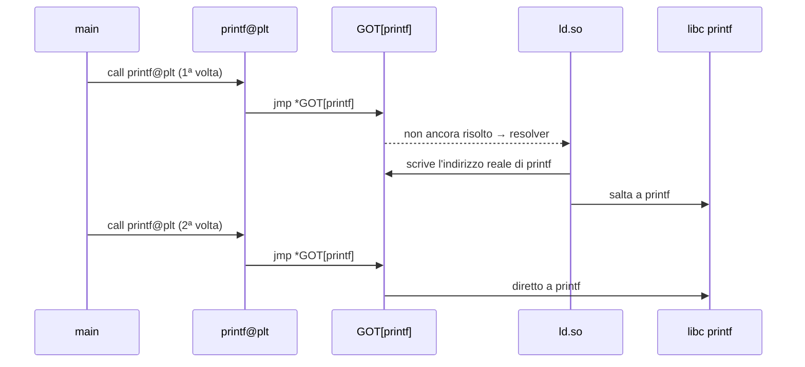
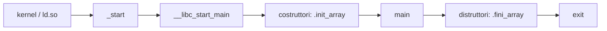

# Reverse Engineering 1

> [!abstract]
> Prima lezione del modulo di reverse engineering del CyberBootCamp (CyberChallenge.IT): *How programs run*. Si parte da cosa c'è dentro un eseguibile Linux (**ELF**: magic number, header, sezioni e segmenti), si vede come un programma chiama funzioni di librerie esterne (**dynamic linking**, **GOT e PLT**), quali strumenti da riga di comando danno informazioni in pochi secondi (`file`, `strings`, `binwalk`) e poi si passa a **IDA**: scorciatoie, codice eseguito fuori da `main` (`.init_array` / `.fini_array`), esportazione dei dati e definizione di **struct**. Chiude con un accenno al reversing dinamico (debugging), che sarà il tema successivo.
> Lezione precedente: [[01 - CB - Web Insecurity 1]]. Mappa del corso: [[MOC - CyberBootCamp]].

> [!note] Collegamenti con altri corsi
> Gli stessi temi, dal lato Windows/PE, sono in Malware Analysis: [[3 - MA - Basic Static Analysis]] (strumenti statici, linking), [[6 - MA - Advanced Static Analysis]] (IDA e costrutti C) e [[IDA Debugger]]. Per il dettaglio di ELF e del linking dinamico su Linux: [[ELF]] e [[Dynamic Linking]].

## Cos'è il reverse engineering

Il **reverse engineering** di un programma consiste nel capire cosa fa partendo dal **binario compilato**, senza il codice sorgente. Il compilatore ha trasformato il C in istruzioni macchina, perdendo nomi di variabili, tipi, commenti e struttura: il lavoro del reverser è ricostruirli. Nelle CTF il caso tipico è un binario che chiede una password o una flag e la controlla in qualche modo: bisogna capire il controllo e invertirlo.

Le slide introduttive (*About Us*, *Rev – The Fun Side*) presentano il team e mostrano che il reversing non serve solo per i malware: si possono smontare anche giochi e applicazioni per capirne i meccanismi.

## Executable and Linkable Format

Vedi [[ELF]].

**ELF** è il formato degli eseguibili, delle librerie condivise (`.so`) e dei file oggetto (`.o`) su Linux. È l'equivalente del formato PE di Windows.

### Magic number

Ogni file ELF inizia con 4 byte fissi:

| Binario | Esadecimale | ASCII |
|---|---|---|
| `0b01111111 0b01000101 0b01001100 0b01000110` | `0x7f 0x45 0x4c 0x46` | `\x7f` `E` `L` `F` |

Questi byte si chiamano **magic number**: servono al sistema operativo (e a strumenti come `file`) per riconoscere il tipo di file senza fidarsi dell'estensione. Anche altri formati ne hanno uno: `MZ` per i PE di Windows, `\x89PNG` per le immagini PNG, `%PDF` per i PDF.

> [!warning] Correzione
> La slide scrive il primo byte come `0b00101110`, che vale `0x2e` (il carattere `.`). Il valore giusto di `0x7f` è `0b01111111`. Gli altri tre byte sono corretti.

### Leggere un ELF

![[CB-L02-p06.png]]

Aprendo un ELF con `cat` si vede soprattutto "spazzatura": il contenuto è in gran parte binario. Si riconoscono però alcune cose:

- all'inizio la stringa `ELF` (evidenziata nel riquadro), cioè il magic number;
- il percorso del **loader** dinamico `/lib64/ld-linux-x86-64.so.2`;
- nomi di librerie e di funzioni importate (`libseccomp.so.2`, `seccomp_init`, `puts`, `read`, `__libc_start_main`, `GLIBC_2.2.5`, …);
- le stringhe del programma (qui un testo che parla di *secure storage* e di una blacklist seccomp).

Questo è esattamente il motivo per cui esiste il comando [[#File, strings e binwalk|strings]]: estrae solo le sequenze leggibili.

### Assembly e codice macchina

![[CB-L02-p07.png]]

Le **istruzioni sono byte** che corrispondono uno a uno a istruzioni assembly. `objdump -d 0xfile` *disassembla* il file, cioè traduce i byte in assembly:

```
0000000000400648 <_init>:
  400648:  48 83 ec 08            sub    $0x8,%rsp
  40064c:  48 8b 05 a5 09 20 00   mov    0x2009a5(%rip),%rax   # 600ff8 <__gmon_start__>
  400653:  48 85 c0               test   %rax,%rax
  400656:  74 02                  je     40065a <_init+0x12>
  400658:  ff d0                  call   *%rax
  40065a:  48 83 c4 08            add    $0x8,%rsp
  40065e:  c3                     ret
```

Le tre colonne sono: indirizzo, byte dell'istruzione, istruzione in assembly (sintassi AT&T, con `%` davanti ai registri e sorgente prima della destinazione). Per esempio `c3` è sempre `ret`, e `74 02` è `je` di 2 byte in avanti. Questa funzione `_init` controlla se il simbolo `__gmon_start__` (profiling) è presente e, se sì, lo chiama.

Più in basso si vede l'inizio della sezione `.plt`, con istruzioni `push`/`jmp` che puntano a `_GLOBAL_OFFSET_TABLE_+0x8` e `+0x10`: è il meccanismo [[#GOT e PLT]] spiegato più avanti. Per la sintassi x86: [[2 - MA - X86 Assembly]].

### Cosa c'è in un binario

![[CB-L02-p08.png]]

Un ELF è organizzato così:

| Parte | Contenuto | Chi la usa |
|---|---|---|
| **ELF header** | magic number, architettura, entry point, posizione delle due tabelle | tutti |
| **Program header table** | elenco dei **segmenti** | il loader, a runtime |
| **Segmenti** | informazioni per l'esecuzione: cosa caricare in memoria, dove, con quali permessi (R/W/X). Un segmento può contenere più sezioni | il kernel / loader |
| **Sezioni** (`.text`, `.rodata`, `.data`, …) | dati per il linking e la rilocazione | linker, debugger, disassembler |
| **Section header table** | elenco delle sezioni | linker, strumenti di analisi |

Vedi [[Sezioni e Segmenti ELF]].

Le sezioni principali:

- `.text`: il codice;
- `.rodata`: dati di sola lettura (stringhe costanti);
- `.data`: variabili globali inizializzate;
- `.bss`: variabili globali non inizializzate (occupano spazio solo in memoria, non nel file).

> [!tip]
> Sezioni e segmenti sono due **viste** dello stesso file: le sezioni servono a chi costruisce e analizza il programma, i segmenti a chi lo esegue. Un binario può non avere la section header table (*stripped* in modo aggressivo) e funzionare lo stesso.

## Dynamic linking

Vedi [[Dynamic Linking]].

![[CB-L02-p09.png]]

Il luogo comune barrato nella slide è *"il compilatore aggiunge il codice della libreria al mio programma"*. Non è così (almeno di default): un `hello_world` che chiama `printf` **non contiene** `printf`.

Lo si vede con `nm`, che elenca i simboli:

```
$ nm hello_world.o            # file oggetto, prima del linking
0000000000000000 T main
                 U printf

$ nm hello_world              # eseguibile finale
0000000000001149 T main
                 U printf@GLIBC_2.2.5
00000000000010c0 t register_tm_clones
```

- `T` = simbolo definito nella sezione di testo (codice): `main` c'è.
- `U` = **undefined**: il simbolo è usato ma non definito in questo file.

Anche nell'eseguibile finale `printf` resta `U`: il linker ha solo annotato che verrà dalla libreria `glibc` (versione `GLIBC_2.2.5`). L'indirizzo vero viene trovato **a runtime** dal **dynamic linker** `ld.so`, quando la libreria è stata caricata in memoria. Il vantaggio: una sola copia di libc in memoria per tutti i processi, e aggiornamenti di libc senza ricompilare i programmi.

## GOT e PLT

Vedi [[GOT e PLT]].

Il programma non sa in anticipo a quale indirizzo verrà caricata libc (con ASLR cambia a ogni esecuzione). Per chiamare `printf` servono quindi due tabelle:

- **Global Offset Table (GOT)**: tabella di **dati**, scrivibile, che contiene gli indirizzi delle funzioni esterne;
- **Procedure Linkage Table (PLT)**: piccoli frammenti di **codice** (*stub*), uno per funzione esterna, che saltano all'indirizzo scritto nella GOT.

![[CB-L02-p10.png]]

Ogni chiamata a una funzione esterna è compilata come chiamata alla PLT. Nel riquadro, il disassemblato di `main`:

```asm
lea  rax, [rip + 0xeac]   ; indirizzo della stringa
mov  rdi, rax             ; primo argomento di printf
mov  eax, 0
call printf@plt           ; non printf, ma il suo stub nella PLT
```

Lo stub funziona così (pseudocodice della slide):

```
if GOT.func != empty:
    jump to lib[GOT.func.addr]
else:
    coordina con ld.so (dynamic linker) per ottenere l'indirizzo
    GOT.func.addr <- address
    jump to lib[GOT.func.addr]
```

Cioè: la **prima** chiamata risolve l'indirizzo e lo salva nella GOT; le successive saltano direttamente. Questa strategia si chiama **lazy binding**.



> [!note] Due precisazioni
> - La slide dice che la PLT contiene "indirizzi della GOT": più precisamente la PLT contiene **codice** che legge un indirizzo dalla GOT e ci salta (`jmp *GOT[n]`).
> - La GOT non è mai davvero "empty": prima della risoluzione la voce punta all'istruzione successiva dello stub PLT, che fa `push` dell'indice della funzione e salta al resolver (`_dl_runtime_resolve`). È quello che si vede nell'`objdump` della [[#Assembly e codice macchina|slide precedente]] (`push`/`jmp` verso `_GLOBAL_OFFSET_TABLE_+0x8` e `+0x10`). Con *Full RELRO* (`-z now`) tutto viene risolto all'avvio e la GOT diventa di sola lettura.

![[CB-L02-p11.png]]

La figura collega tutto in IDA: la `call _puts` nel codice salta allo stub `_puts` in `.plt`, che fa `jmp cs:off_601028`, cioè salta all'indirizzo contenuto nella voce `off_601028` di `.got.plt` (evidenziata). A sinistra la mappa della memoria di un processo: codice e dati statici in basso, heap che cresce verso l'alto, librerie condivise in mezzo, stack che cresce verso il basso, kernel in cima.

> [!important] Perché interessa in sicurezza
> La GOT è una tabella di puntatori a funzione **scrivibile**. Se un bug permette di scrivere in memoria, sovrascrivere `GOT[puts]` con un altro indirizzo devia la prossima chiamata a `puts`: è la tecnica del **GOT overwrite**, che tornerà nel modulo di software exploitation.

Per approfondire, la slide rimanda a <https://www.cprogramming.com/tutorial/shared-libraries-linux-gcc.html>.

## File, strings e binwalk

Vedi [[strings e binwalk]].

![[CB-L02-p12.png]]

Prima di aprire un disassembler conviene usare tre strumenti da riga di comando, che danno informazioni in pochi secondi:

| Comando | Cosa fa |
|---|---|
| `file elf` | riconosce il tipo dal magic number: architettura, linking statico/dinamico, se è *stripped* |
| `strings elf \| grep -i flag` | estrae le sequenze di caratteri stampabili (di default lunghe almeno 4) e cerca "flag" ignorando maiuscole/minuscole |
| `binwalk --dd='.*' elf` | cerca file **incorporati** dentro il binario (dalle loro firme) e con `--dd='.*'` li estrae tutti |

Nell'esempio (challenge `where_banana`), `strings` mostra loader, import (`__cxa_finalize`, `__libc_start_main`, `puts`) e qualche frammento casuale, ma nessuna flag in chiaro. `binwalk` invece trova dentro l'ELF:

| Offset (decimale) | Offset (hex) | Contenuto |
|---|---|---|
| 0 | `0x0` | ELF 64-bit LSB shared object, x86-64 |
| 12423 | `0x3087` | immagine JPEG (JFIF 1.01) |
| 4528640 | `0x451A00` | immagine GIF 89a, 500 × 500 |

Quindi il binario nasconde due immagini: con `--dd` vengono estratte e si possono aprire.

### Come lavora binwalk

`binwalk` non conosce la struttura dell'ELF: scorre il file **byte per byte** e confronta ogni posizione con un database di **firme** (i magic number dei formati: `FF D8 FF` per JPEG, `GIF89a`, `PK\x03\x04` per zip, `1F 8B` per gzip, …). Ogni corrispondenza diventa una riga della tabella. Ne seguono due cose:

- trova file **appesi o incollati** dentro un altro file, anche se il programma non li usa mai: in una challenge sono un modo semplice per nascondere la flag;
- può dare **falsi positivi**: una sequenza di pochi byte può capitare per caso nel codice. Una riga ha senso se il contenuto descritto è plausibile (dimensioni sensate, offset coerenti) e se l'estrazione produce un file valido.

Le dimensioni dei file incorporati si deducono dagli offset: il JPEG parte da 12423 e la riga successiva è a 4528640, quindi il JPEG occupa al massimo 4528640 − 12423 = 4516217 byte; la GIF va da 4528640 fino alla fine del file.

> [!example] Estrarre a mano con `dd`
> Se `binwalk` non estrae (o si vuole un solo pezzo), bastano gli offset:
> ```bash
> dd if=elf of=banana.jpg bs=1 skip=12423 count=4516217
> dd if=elf of=banana.gif bs=1 skip=4528640
> file banana.jpg banana.gif
> ```
> I visualizzatori di immagini ignorano i byte in più dopo la fine del file, quindi anche un `count` approssimato di solito funziona.

| Opzione (binwalk 2.x) | Cosa fa |
|---|---|
| *(nessuna)* | scansione delle firme: elenca offset e tipo |
| `-e` | estrae i formati noti in `_elf.extracted/`, decomprimendo gli archivi |
| `-M` | *matryoshka*: ripete la scansione sui file estratti (archivio dentro archivio) |
| `--dd='tipo'` | estrae con `dd` i blocchi il cui tipo corrisponde all'espressione regolare (`'.*'` = tutto, `'jpeg'` = solo JPEG) |
| `-E` | calcola l'**entropia** a blocchi: zone vicine a 1 sono dati compressi o cifrati |
| `-R '\x7fELF'` | cerca una sequenza di byte scelta da noi |
| `-A` | cerca istruzioni tipiche di varie architetture (utile su firmware di cui non si conosce la CPU) |
| `-W a b` | confronto esadecimale tra due file |

> [!warning] binwalk 3
> Dalla versione 3 binwalk è stato riscritto in Rust e alcune opzioni della 2.x, tra cui `--dd`, `-R` e `-A`, non esistono più. Restano la scansione, `-e` (estrazione), `-M` (ricorsione) ed `-E` (entropia). Con binwalk 3 il comando delle slide diventa `binwalk -e elf`. Controllare la versione con `binwalk --help`.

> [!tip] Altri strumenti per lo stesso scopo
> - `foremost` e `scalpel`: *file carving*, estraggono file riconoscendo intestazione e chiusura;
> - `xxd elf | less` o un editor esadecimale: per guardare con i propri occhi cosa c'è a un offset;
> - `exiftool` e `steghide`/`zsteg`: una volta estratta l'immagine, la flag potrebbe essere nei metadati o nascosta con steganografia.

Lo stesso strumento è il punto di partenza nell'analisi dei **firmware** (router, dispositivi IoT): un'immagine firmware è spesso un bootloader seguito da un kernel compresso e da un filesystem (squashfs, cramfs, jffs2), e `binwalk -Me` li separa ed estrae tutti.

## IDA

Leggere assembly è già meglio dei byte grezzi, ma:

- l'assembly non è comodo da leggere;
- funzioni complesse possono richiedere ore;
- qualcuno ha già risolto il problema: **IDA** (*Interactive DisAssembler*).

Le slide giocano sul nome con *Nonna Ida* e con il ritratto della dama: IDA è un **decompilatore** con un'interfaccia semplice (*"meh"*):

- disassembla il binario e ricostruisce funzioni, salti e riferimenti;
- con il plugin Hex-Rays genera **pseudocodice C equivalente** dall'assembly;
- la versione completa (IDA Pro con i decompilatori) costa molto, nell'ordine delle decine di migliaia di dollari;
- esiste una **versione gratuita** (IDA Free), che include un decompilatore cloud per x86/x64 ed è sufficiente per le challenge;
- *"Does not cook on Sundays"*.

Alternative gratuite citate spesso: Ghidra, Binary Ninja (a pagamento, con versione free), radare2/Cutter.

> [!note] IDA Free e IDA Pro
> L'interfaccia e le scorciatoie sono le stesse; cambiano le funzioni disponibili:
>
> | | IDA Free | IDA Pro |
> |---|---|---|
> | Uso | solo non commerciale | anche commerciale |
> | Architetture | x86/x64 | decine (ARM, MIPS, PowerPC, …) |
> | Decompilatore | cloud, serve internet | cloud o locale, a seconda del piano |
> | Script | solo IDC | IDC e IDAPython, SDK per i plugin |
> | Debugger | locale x86/x64 | locale e remoto |
>
> Per le challenge del bootcamp (ELF x86-64) IDA Free basta. Dettagli in [[Scorciatoie IDA#IDA Free e IDA Pro]].

### L'interfaccia

![[CB-L02-p16.png]]

| Zona | Contenuto |
|---|---|
| **Functions** (a sinistra) | elenco delle funzioni trovate; quelle senza simboli si chiamano `sub_<indirizzo>` |
| **Main window** (al centro) | il disassemblato (grafo o testo) oppure lo pseudocodice |
| **NavBar** / schede | viste aggiuntive: Structures, Hex view, Strings |

La barra colorata in alto mostra il binario per intero: blu = codice, grigio/marrone = dati, rosa = funzioni importate.

### Scorciatoie (TagliCorts)

Vedi [[Scorciatoie IDA]].

| Tasto | Azione |
|---|---|
| `Tab` | passa tra assembly e pseudocodice |
| `F5` | decompila / aggiorna lo pseudocodice |
| `Shift+F12` | finestra delle stringhe |
| `N` | rinomina variabile o funzione |
| `Y` | imposta il tipo (es. `int *`, `char[32]`, una struct) |
| `H` | mostra una costante in decimale (alterna con hex) |
| `A` | interpreta i byte come stringa |
| `R` | mostra una costante come carattere (`0x41` → `'A'`) |
| `X` | elenca i **cross reference**: chi usa questa funzione/variabile |
| `Shift+F7` | elenco dei segmenti |
| `C` | definisci come codice |
| `U` | annulla la definizione (torna a byte grezzi) |

Lista completa: <https://www.hex-rays.com/products/ida/support/freefiles/IDA_Pro_Shortcuts.pdf>.

> [!tip] Altre scorciatoie
> Le slide coprono solo le essenziali. In [[Scorciatoie IDA]] ci sono anche navigazione (`G`, `Esc`, `Ctrl+P`), ricerca (`Alt+T`, `Alt+B`, `Alt+I`), commenti (`:`, `;`, `/`), rappresentazione dei numeri (`Q`, `B`, `O`, `M`, `T`), definizione di funzioni (`P`), patching, debugger (`F2`, `F7`, `F8`, `F9`) e script (`Shift+F2`).

> [!tip] Il flusso di lavoro tipico
> `Shift+F12` → trovo una stringa interessante (es. `"Wrong password"`) → `X` per vedere quale funzione la usa → `F5` per leggerla in pseudocodice → `N` e `Y` per rinominare e tipizzare finché il codice non è leggibile.

## Codice fuori da main

Fin dal primo corso di programmazione ci hanno detto che `main` è la prima e unica funzione eseguita quando si lancia un programma. *Well yes, but actually no.*

In realtà l'**entry point** di un ELF è `_start`, che chiama `__libc_start_main`, che a sua volta inizializza libc, chiama `main` e alla fine termina il processo.

Vedi [[Avvio di un Binario ELF]].



### Costruttori e distruttori globali

Vedi [[init_array e fini_array]].

Per standard, i file ELF hanno due sezioni, `.init_array` e `.fini_array`, che contengono una lista di **puntatori a funzione** chiamati rispettivamente **prima** e **dopo** `main`.

Questi array possono puntare a qualsiasi funzione del programma: contengono sia il costruttore e il distruttore di default di libc, sia eventuale codice personalizzato. In C si aggiunge una funzione con gli attributi di GCC:

```c
void init() __attribute__((constructor));   // finisce in .init_array, eseguita prima di main
void fini() __attribute__((destructor));    // finisce in .fini_array, eseguita dopo main
```

> [!warning] Correzione
> Le slide scrivono i nomi come `._init_array` e `._fini_array`. I nomi corretti delle sezioni sono `.init_array` e `.fini_array`, come si vede nello screenshot di IDA della slide successiva.

### In pratica

![[CB-L02-p20.png]]

Di default c'è una sola funzione in ciascun array:

- in `.init_array`: `frame_dummy` (voce `__frame_dummy_init_array_entry`);
- in `.fini_array`: `__do_global_dtors_aux` (voce `__do_global_dtors_aux_fini_array_entry`).

Se ce ne sono altre… qualcuno ce le ha messe! In una challenge di reversing è un posto classico dove nascondere il vero controllo della flag, o codice che modifica i dati prima che `main` li usi: chi legge solo `main` non lo vede.

In IDA: `Ctrl+S` (salta a un segmento) → `.init_array`, e si controllano i puntatori presenti.

## Estrarre i dati

Vedi [[Esportare Dati da IDA]].

![[CB-L02-p21.png]]

Spesso la flag è codificata in un array di dati nel binario (qui `matrix`, in `.data`), e per risolvere la challenge bisogna riusare quei dati in uno script Python. Ma IDA li mostra come una lista di `db` in esadecimale, spesso spezzati in byte singoli e `dup(0)`: copiarli a mano è lento e soggetto a errori (*"and we do not like HEX"*).

selezionando una variabile in geenrale, e quindi anche un array come questo, posso cambaire quindi il tipo di array ed inoltre su edit/export, possiamo esportare dati. Ad esempio la hcallenge 15+18 possiamo prendere i dati delle matrici espressi in interi e poi importarli su python per fare fare delle moltiplicazioni matriciali. 
### Primo passo: tipo, dimensione, array

![[CB-L02-p22.png]]

Prima si dice a IDA come interpretare i byte:

| Tasto | Azione |
|---|---|
| `Y` | imposta il tipo giusto (es. `int matrix[104]`) |
| `D` | imposta la dimensione giusta: ciclo byte → word → dword → qword (`db`/`dw`/`dd`/`dq`) |
| `*` | converte in array |

E ricorda: `H` alterna decimale/hex, `R` alterna carattere/hex.

Nella figura, dopo aver impostato `int matrix[104]` i byte diventano una lista di `dd` (dword, 4 byte): `0Ah, 7Eh, 13h, 3Eh, …`.

### Secondo passo: esportare

![[CB-L02-p23.png]]

Poi:

- `Shift+E` → **Export data**;
- formato **initialized C variable**;
- si copia il risultato dall'anteprima (**Preview**) oppure lo si salva su file.

L'anteprima mostra `int matrix[104] = { 10, 126, … };`, che si incolla direttamente in C o, con poche modifiche, in Python. Le altre opzioni (hex string, string literal, C unsigned char array, raw bytes) servono per altri formati di dati.

### Hands on

La slide *Hands on* ("where banana") rimanda all'esercizio pratico sulla challenge vista con [[#File, strings e binwalk|binwalk]].

## Struct

Vedi [[Struct in IDA]].

Le **struct** raggruppano in un unico oggetto più variabili correlate, anche di tipi diversi, e servono a modellare dati complessi:

```c
struct Brooom {
    char brand[50];
    char model[50];
    int year;
};
```

In memoria i campi sono consecutivi: `brand` all'offset 0, `model` all'offset 50, `year` all'offset 100 (`sizeof` = 104 byte su x86-64, perché `int` va allineato a 4 e 100 è già multiplo di 4).

### Struct in IDA

![[CB-L02-p26.png]]

Il compilatore cancella i nomi dei campi: nel binario restano solo accessi del tipo "indirizzo base + offset" (`*(v1 + 100)`). IDA **non riconosce le struct** nello pseudocodice, quindi bisogna definirle a mano e poi assegnarle come tipo alla variabile (`Y`).

Nella finestra *Structures*, `INS` crea una nuova struttura (finestra *Create structure/union*, dove si dà il nome).

![[CB-L02-p27.png]]

Poi si aggiungono i campi:

| Tasto | Dove | Azione |
|---|---|---|
| `D` | sulla struct | crea un nuovo campo |
| `D` | su un campo | cambia dimensione: byte → word → dword → qword |
| `Shift + *` | su un campo | converte in array (finestra *Convert to array*, qui 50 elementi) |

Il risultato nella figura è la struttura `Brooom` con `brand db 50 dup(?)`, `model db 50 dup(?)`, `year dd ?`. Assegnata la struct alla variabile, lo pseudocodice passa da `*(v1 + 100)` a `v1->year`.

> [!note] Versioni recenti di IDA
> Da IDA 9 la finestra *Structures* è stata unificata in *Local Types*: lì si può anche scrivere direttamente la definizione C della struct, che è spesso più rapido.

La seconda slide *Hands on* rimanda all'esercizio (una challenge con un tastierino *Enter password*).

## E il reversing dinamico?

La lezione si chiude con una domanda: *"What about dynamic reversing? Can we handle it? (probably)"*. Lo screenshot mostra un errore di decompilazione di IDA (lo stack frame di una funzione è troppo grande): a volte l'analisi statica non basta. E se potessimo **eseguire e fare debugging** del codice che stiamo guardando? È il tema della prossima lezione (debugger, breakpoint, flusso di esecuzione). Per un'anteprima: [[4 - MA - Basic Dynamic Analysis]] e [[IDA Debugger]].

*Stop talking, go flagging*: l'obiettivo pratico è risolvere le challenge per ottenere il *binary badge*.

## Riepilogo

> [!summary]
> - Un ELF si riconosce dal magic number `\x7f ELF`; contiene header, segmenti (per eseguire) e sezioni (per linkare e analizzare).
> - Le funzioni di libreria non sono nel binario: si chiamano attraverso la **PLT**, che salta all'indirizzo salvato nella **GOT**, risolto a runtime da `ld.so`.
> - Prima di IDA: `file`, `strings | grep -i flag`, `binwalk --dd='.*'`.
> - `main` non è l'inizio: `_start` → `__libc_start_main` → `.init_array` → `main` → `.fini_array`.
> - In IDA: `F5` per lo pseudocodice, `N`/`Y` per rinominare e tipizzare, `X` per i riferimenti, `Shift+E` per esportare i dati, struct definite a mano.
