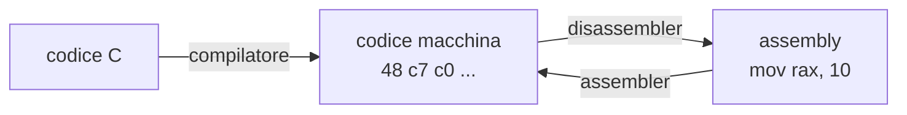
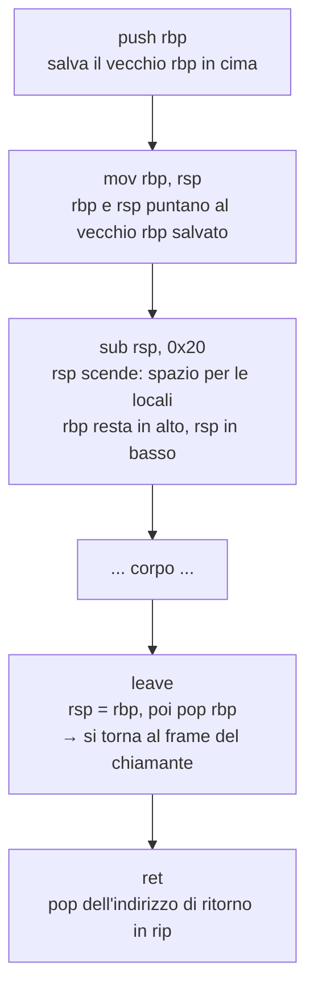

# Assembly 101

> [!abstract]
> Seconda lezione del modulo di reverse engineering del CyberBootCamp (CyberChallenge.IT): dopo aver visto *com'è fatto* un binario ([[02 - CB - Reverse Engineering 1]]), qui si impara a **leggere il linguaggio in cui è scritto**: l'**assembly x86-64**. Si parte da cosa fa una CPU (esegue *codice macchina*) e perché l'assembly esiste (codice macchina leggibile, convertibile avanti e indietro con assembler/disassembler), poi si vedono **registri**, **istruzioni** (aritmetiche, accesso alla memoria, `movzx`/`movsx`), **controllo di flusso** (come si costruisce un `if` o un `while` senza averli), lo **stack** e le **calling convention** (dove vanno parametri e valore di ritorno, chi salva i registri). Chiude con le due sintassi (Intel e AT&T) e con l'uso del decompilatore **IDA**, che riprende e completa quanto già visto nella lezione 2.
> Lezione precedente: [[02 - CB - Reverse Engineering 1]]. Lezione successiva: [[04 - CB - Binary Exploitation 1]]. Mappa del corso: [[MOC - CyberBootCamp]].

> [!note] Collegamenti con altri corsi
> L'assembly x86 è trattato anche in Sistemi di Calcolo ([[MOC - Sistemi di Calcolo]], dal lato architettura) e in Malware Analysis: [[2 - MA - X86 Assembly]]. Per il formato del binario: [[ELF]], e la lezione [[02 - CB - Reverse Engineering 1]]. Questo è il linguaggio su cui si fonderà tutto il modulo di **binary exploitation** ([[04 - CB - Binary Exploitation 1]], [[05 - CB - Binary Exploitation 2]]).

## Dal codice macchina all'assembly

Vedi [[Codice Macchina e Assembly]].

Un file ELF, aperto con un editor esadecimale, è illeggibile: *"Have you ever tried reading an elf? Usually looks like this... not very readable, we aren't machines"*. Il punto di partenza è proprio questo: i byte di un eseguibile non sono pensati per gli umani, ma per la **CPU**.

> [!example]- Figure delle slide 4–8
>
> ![[CB-L03-p04.png]]
>
> **Slide 4.** Un editor esadecimale mostra i byte del file ELF accanto a una loro interpretazione come caratteri. Solo alcune zone contengono testo leggibile.
>
> ![[CB-L03-p05.png]]
>
> **Slide 5.** Python converte la stringa in byte con encode(), poi in cifre esadecimali con hex(). Applicando le conversioni inverse si recupera la stringa.
>
> ![[CB-L03-p06.png]]
>
> **Slide 6.** fromhex() accetta la sequenza perché ogni coppia rappresenta un byte. decode() fallisce perché quei byte non formano una sequenza UTF-8 valida.
>
> ![[CB-L03-p07.png]]
>
> **Slide 7.** Per il valore 0x12345678, all’indirizzo più basso si trova 0x12 in big-endian e 0x78 in little-endian. Cambia l’ordine dei byte in memoria.
>
> ![[CB-L03-p08.png]]
>
> **Slide 8.** AA BB vale 43707 se il primo byte è il più significativo. Invertendo i byte e mantenendo la lettura big-endian si ottiene 48042.

Cosa fa una CPU? Ignorando una montagna di dettagli, **esegue codice macchina**: una sequenza di byte che codificano istruzioni. Esistono molte architetture, ognuna con il proprio insieme di istruzioni (*instruction set*):

- **x86(-64)** — la maggior parte dei PC;
- **ARM** — smartphone, Apple Silicon, embedded;
- **RISC-V**;
- …

> [!example]- Figure delle slide 10
>
> ![[CB-L03-p10.png]]
>
> **Slide 10.** Nel ciclo di istruzione il processore preleva i byte dalla memoria, decodifica l’istruzione e la esegue prima di proseguire.

Durante tutto il corso ci si concentra su **x86-64** (detta anche *amd64*): la versione a 64 bit. La variante a 32 bit si chiama **x86**.

### Perché l'assembly

Scrivere codice macchina a mano è *"stupidly hard"*: è codice binario, non pensato per le persone. Per esempio l'istruzione «metti 10 in `rax`» si codifica con i byte:

```
48 c7 c0 0a 00 00 00
```

L'**assembly** è la stessa cosa resa **leggibile**: ogni istruzione macchina ha una forma testuale (*mnemonico*). Un programma chiamato **assembler** traduce l'assembly in codice macchina:

```
mov rax, 10   ──assembler──►   48 c7 c0 0a 00 00 00
```

La cosa fondamentale per il reversing è che **l'operazione è invertibile**: un **disassembler** fa il percorso inverso, da byte a istruzioni leggibili.



Quindi dato un binario possiamo sempre **disassemblarlo** e vedere l'assembly che esegue. Da lì, un **decompilatore** cerca di risalire fino a uno pseudo-C: ne parliamo alla fine.

> [!example]- Figure delle slide 13–17
>
> ![[CB-L03-p13.png]]
>
> **Slide 13.** L’assembler traduce il mnemonico e i suoi operandi nella sequenza di byte mostrata a destra.
>
> ![[CB-L03-p14.png]]
>
> **Slide 14.** La freccia inversa rappresenta il disassemblaggio degli stessi byte.
>
> ![[CB-L03-p15.png]]
>
> **Slide 15.** Il percorso di compilazione parte dal sorgente e arriva al file eseguibile attraverso rappresentazioni intermedie.
>
> ![[CB-L03-p16.png]]
>
> **Slide 16.** Partendo dall’eseguibile, il disassemblatore ricostruisce istruzioni leggibili. I nomi e i commenti del sorgente possono essere già andati persi.
>
> ![[CB-L03-p17.png]]
>
> **Slide 17.** Ogni riga del disassemblato accosta indirizzo, byte e mnemonico. Il numero di byte può cambiare da una riga alla successiva.

## Cosa c'è in un binario

Un ELF disassemblato è organizzato in parti che abbiamo già visto nella lezione precedente (vedi [[02 - CB - Reverse Engineering 1#Cosa c'è in un binario|Lezione 2 — Cosa c'è in un binario]] e [[Sezioni e Segmenti ELF]]):

- **Program header**: elenca i **segmenti** usati;
- **Segmenti**: le informazioni necessarie all'**esecuzione** a runtime;
- **Sezioni**: i dati per **linking** e **rilocazione**;
- **Section header**: elenca l'insieme delle sezioni.

> [!example]- Figure delle slide 18
>
> ![[CB-L03-p18.png]]
>
> **Slide 18.** Le intestazioni dell’ELF permettono di individuare le sezioni del file e i segmenti che il sistema deve caricare.

### Il binario durante l'esecuzione

Quando il programma gira, la sua memoria è divisa in aree diverse:

| Area | Contenuto |
|---|---|
| **Stack** | dati locali delle funzioni (variabili, indirizzi di ritorno) |
| **Shared libs** | librerie condivise caricate (es. `libc`) |
| **Heap** | memoria allocata dinamicamente (`malloc`, `calloc`) |
| **BSS** | dati globali **non** inizializzati |
| **Data** | dati globali **inizializzati** |
| **Rodata** | dati in sola lettura (costanti, stringhe) |
| **Text** | il codice del programma (le istruzioni) |

> [!example]- Figure delle slide 19
>
> ![[CB-L03-p19.png]]
>
> **Slide 19.** Nello spazio virtuale del processo si distinguono codice, dati, heap, librerie condivise e stack. Le loro posizioni nel disegno sono schematiche.

> [!tip] Perché conta
> Nel binary exploitation la domanda ricorrente sarà «dove si trova questo dato / questa istruzione?»: nello stack, nell'heap, nel `.text`, in una libreria? Saperlo distinguere è metà del lavoro. Vedi [[Avvio di un Binario ELF]].

## Registri

Vedi [[Registri x86-64]].

La CPU tiene i valori su cui lavora in un piccolo insieme di **registri** velocissimi. In x86-64 lo stesso registro si può nominare in modi diversi a seconda di **quanti bit** interessano: i 64 bit interi (`RAX`), i 32 bit bassi (`EAX`), i 16 bassi (`AX`), gli 8 bassi (`AL`) o il secondo byte (`AH`).

![[CB-L03-p21.png]]

L'immagine mostra `RAX` come una barra di 64 bit (dai bit 63 a 0): `EAX` è la metà bassa (bit 31–0), `AX` i 16 bit bassi, e dentro `AX` ci sono `AH` (bit 15–8) e `AL` (bit 7–0). Solo i primi quattro registri storici hanno un nome per i bit 15–8: `AH`, `BH`, `CH` e `DH`. Per esempio, `R8B` indica il byte basso di `R8`. Scrivere su `EAX` tocca i 32 bit bassi (e azzera i 32 alti di `RAX`), scrivere su `AL` tocca solo il byte più basso.

> [!example]- Figure delle slide 22
>
> ![[CB-L03-p22.png]]
>
> **Slide 22.** La tabella affianca i nomi delle diverse porzioni dei registri. Il riquadro evidenzia i registri aggiuntivi disponibili in modalità a 64 bit.

La tabella completa dei registri x86-64, con i nomi nelle varie dimensioni e il loro ruolo convenzionale:

| 64 bit | 32 bit | 16 bit | 8 bit | Scopo per le funzioni | Dopo una `call` |
|---|---|---|---|---|---|
| `rax` | `eax` | `ax` | `ah,al` | valore di ritorno | può cambiare *(caller-saved)* |
| `rbx` | `ebx` | `bx` | `bh,bl` | — | preservato *(callee-saved)* |
| `rcx` | `ecx` | `cx` | `ch,cl` | 4° argomento | può cambiare |
| `rdx` | `edx` | `dx` | `dh,dl` | 3° argomento | può cambiare |
| `rsi` | `esi` | `si` | `sil` | 2° argomento | può cambiare |
| `rdi` | `edi` | `di` | `dil` | 1° argomento | può cambiare |
| `rbp` | `ebp` | `bp` | `bpl` | *frame pointer* | preservato |
| `rsp` | `esp` | `sp` | `spl` | *stack pointer* | preservato |
| `r8` | `r8d` | `r8w` | `r8b` | 5° argomento | può cambiare |
| `r9` | `r9d` | `r9w` | `r9b` | 6° argomento | può cambiare |
| `r10`–`r11` | `r10d`… | `r10w`… | `r10b`… | — | può cambiare |
| `r12`–`r15` | `r12d`… | `r12w`… | `r12b`… | — | preservato |
| | | | | `rip` | *instruction pointer* (istruzione corrente) |

> [!note]
> `r8`–`r15` esistono **solo** in 64 bit. I registri a virgola mobile e quelli più larghi di 64 bit non sono in tabella. La colonna «Dopo una `call`» anticipa i concetti di [[Registri Caller-saved e Callee-saved|caller/callee-saved]], spiegati più avanti.

## Istruzioni aritmetiche, logiche e di spostamento

Vedi [[Istruzioni x86-64]].

Le istruzioni base lavorano su un **destinatario** (`dst`) e una **sorgente** (`src`):

- `mov <dst>, <src>` — copia `src` in `dst`;
- `add <dst>, <src>` — `dst = dst + src`;
- `sub <dst>, <src>` — `dst = dst - src`;
- `and <dst>, <src>`, `or`, `xor`, …

Dove `<src>` può essere un **registro**, un **immediato** (un valore costante) o una **locazione di memoria**; `<dst>` può essere un registro o una memoria.

> [!important] Al massimo un operando in memoria
> Nelle forme di `mov`, `add` e delle altre istruzioni a due operandi espliciti elencate qui, al massimo un operando può essere in memoria. Per copiare fra due celle si può usare un registro intermedio. Le istruzioni di stringa, come `movsb`, accedono invece a sorgente e destinazione in memoria tramite registri impliciti.

Esempi:

```asm
mov rax, 10       ; rax = 10
add rdi, rsi      ; rdi = rdi + rsi
sub rsp, 0x20     ; rsp = rsp - 0x20  (tipico: alloca spazio nello stack)
and rsi, rax
xor rax, rax      ; idioma per azzerare rax (rax = 0)
```

### Accesso alla memoria

Per leggere o scrivere in memoria si usano le parentesi quadre, con una sintassi di indirizzamento molto flessibile:

```
<TYPE> PTR [<reg_base> + <reg_index>*<scale> + <offset>]
```

- `<TYPE>` è la dimensione dell'accesso: `BYTE` (1), `WORD` (2), `DWORD` (4), `QWORD` (8 byte);
- `<scale>` è un immediato tra 1, 2, 4, 8 (utile per indicizzare array di elementi di quella dimensione);
- `<offset>` è un altro immediato.

Esempi:

```asm
mov rdi, QWORD PTR [rdi + rsi*8]   ; legge 8 byte dall'indirizzo rdi+rsi*8  (array[rsi])
add DWORD PTR [rax+rsi], 10        ; somma 10 al DWORD all'indirizzo rax+rsi
lea rax, [rsi + rdi*4 + 6]         ; rax = rsi + rdi*4 + 6  (NESSUN accesso in memoria!)
```

> [!tip] `lea` non legge la memoria
> `lea` (*load effective address*) calcola l'indirizzo e lo mette nel registro **senza leggere** la cella: `rax` diventa il *puntatore* a quella posizione, non il contenuto. È anche un modo compatto per fare aritmetica (`lea rax, [rsi+rdi*4+6]` è una somma con moltiplicazione in un colpo solo).

### `movzx` e `movsx`

Quando si copia un valore da un registro **piccolo** a uno con **più bit**, bisogna decidere come riempire lo spazio in più:

- `movzx <dst>, <src>` — *zero extend*: riempie con zeri;
- `movsx <dst>, <src>` — *sign extend*: estende il **segno** (riempie con tanti `1` se `src` è negativo).

```asm
mov eax, edi        ; rax = 0x00000000_<edi>
movsxd rax, edi     ; se edi >= 0: rax = 0x00000000_<edi>
                    ; se edi <  0: rax = 0xFFFFFFFF_<edi>
```

> [!warning] Correzione
> La slide 26 propone `movzx rax, edi`. Per estendere da 32 a 64 bit con zeri basta scrivere in `eax`: la CPU azzera la metà alta di `rax`. Per estendere con segno si usa `movsxd rax, edi`. Con una sorgente a 8 bit, invece, sono valide entrambe le forme `movzx rax, dil` e `movsx rax, dil`.

L’estensione scelta aiuta a capire come il programma interpreta quel valore in quel punto. Il tipo dichiarato nel sorgente può essere diverso per effetto di conversioni e ottimizzazioni.

## Controllo di flusso

Vedi [[Controllo di Flusso in Assembly]].

In assembly **non esistono** `if` e `while`: si costruiscono con istruzioni più semplici.

- `jmp <label>` — salto incondizionato;
- `cmp <op1>, <op2>` — confronta (calcola `op1 - op2` e aggiorna i *flag*, senza salvare il risultato);
- `je / jne` — salta se uguale / diverso;
- `jl / jle / jg / jge` — salta se minore / minore-uguale / maggiore / maggiore-uguale nel confronto con segno. Per interi senza segno si usano rispettivamente `jb / jbe / ja / jae`;
- `jnz` — salta se non zero;
- …

Un salto condizionato (`je`, `jl`, …) decide in base ai flag impostati dalla `cmp` (o da un'operazione aritmetica) che lo precede.

### Un `if / else`

```asm
    cmp rdi, rsi
    jl  then        ; if (rdi < rsi) goto then
    jmp else
then:
    ...             ; corpo del ramo "then"
    jmp endif
else:
    ...             ; corpo del ramo "else"
endif:
    ...
```

### Un `while`

```asm
while:
    cmp rdi, rsi
    jl  do          ; while (rdi < rsi)
    jmp end_while
do:
    ...             ; corpo del ciclo
    jmp while
end_while:
    ...
```

Il ciclo è semplicemente un `if` che, alla fine del corpo, **salta indietro** alla condizione.

## Lo stack

Vedi [[Stack Frame x86-64]].

Lo **stack** è un'area di memoria gestita come una pila, tramite il registro `rsp` (*stack pointer*), che punta alla **cima**.

- `push <op>` — mette `op` in cima allo stack (e decrementa `rsp`);
- `pop <op>` — toglie il valore in cima e lo mette in `op` (e incrementa `rsp`).

> [!note] Lo stack cresce verso il basso
> In x86-64 lo stack **cresce verso indirizzi più bassi**: `push` *diminuisce* `rsp`, `pop` lo *aumenta*. La «cima» è quindi l'indirizzo più basso tra quelli occupati.

### Chiamare funzioni

- `call <func>` — salta a `<func>` e **mette sullo stack l'indirizzo dell'istruzione successiva** (l'indirizzo di ritorno);
- `ret` — prende l'indirizzo in cima allo stack, lo toglie e ci salta (ritorna al chiamante);
- `leave` — smonta il frame corrente e ripristina il frame precedente (equivale a `mov rsp, rbp` ; `pop rbp`);
- `enter` — l'opposto di `leave`; non viene quasi mai usato per motivi di prestazioni.

Il meccanismo preciso di `call`/`ret` tramite lo stack è il cuore del buffer overflow: vedi [[04 - CB - Binary Exploitation 1#Come funzionano call e ret|Lezione 4 — call e ret]] e [[call e ret]].

### Lo stack frame

Lo stack contiene le variabili locali di tutte le funzioni **non ancora terminate**, più gli indirizzi di ritorno e, a volte, i parametri. Ogni funzione in corso alloca un **frame** che «vive» sullo stack e verrà cancellato al ritorno. I due registri che lo delimitano sono `rbp` (base del frame) e `rsp` (cima).

> [!example]- Figure delle slide 32
>
> ![[CB-L03-p32.png]]
>
> **Slide 32.** I frame del disegno appartengono a chiamate ancora attive. Nel frame illustrato, rbp fornisce un riferimento stabile mentre rsp indica la cima corrente.

La forma tipica di una funzione (prologo + epilogo):

```asm
func:
    push rbp         ; salva il vecchio rbp (del chiamante)
    mov  rbp, rsp    ; nuovo frame: rbp = cima attuale
    sub  rsp, 0x20   ; alloca 0x20 byte per le variabili locali
    ...              ; corpo della funzione
    leave            ; rsp e rbp tornano al frame precedente
    ret              ; la funzione termina
```

![[CB-L03-p34.png]]

All’ingresso della funzione, il disegno distingue il puntatore di frame ereditato dal chiamante dalla cima corrente dello stack. _(slide 34)_

![[CB-L03-p35.png]]

`push rbp` salva il valore del chiamante. La cima scende di otto byte. _(slide 35)_

![[CB-L03-p36.png]]

`mov rbp, rsp` fa coincidere i due puntatori. La cella a cui puntano contiene il vecchio `rbp`. _(slide 36)_

![[CB-L03-p37.png]]

`sub rsp, 0x20` riserva 32 byte. Il riferimento stabile per le variabili locali è ora `rbp`. _(slide 37)_

![[CB-L03-p38.png]]

Durante il corpo della funzione lo spazio riservato resta disponibile per le variabili locali. _(slide 38)_

![[CB-L03-p39.png]]

`leave` rilascia lo spazio locale e recupera il valore di `rbp` del chiamante. _(slide 39)_

![[CB-L03-p40.png]]

`ret` consuma l’indirizzo di ritorno. L’esecuzione riprende nel chiamante. _(slide 40)_

Passo per passo, l'evoluzione dello stack:



## Parametri e valore di ritorno

Vedi [[Calling Convention]].

Una **calling convention** stabilisce *dove* mettere i parametri e il valore di ritorno, così che chiamante e chiamato si capiscano:

- In System V AMD64, i primi sei argomenti interi o puntatori di una parola usano, in ordine, `rdi`, `rsi`, `rdx`, `rcx`, `r8`, `r9`. Gli altri argomenti di questa classe passano sullo stack. Un risultato intero di una parola torna in `rax`. I parametri scalari `float` e `double` usano una sequenza indipendente da `xmm0` a `xmm7`: in `double f(int n, double x)`, `n` entra in `edi`, `x` entra in `xmm0` e il risultato torna in `xmm0`.
- **cdecl** (Linux 32 bit): ritorno in `eax`; parametri **tutti sullo stack**.

Esempio di chiamata a `func(param1, param2)`:

```asm
; System V (64 bit)
push rdi              ; salva rdi (se serve conservarlo)
mov  rdi, <param 1>
mov  rsi, <param 2>
call func
...                   ; rax contiene il valore di ritorno

; cdecl (32 bit) — parametri in ordine INVERSO sullo stack
push edi              ; salva edi
push <param 2>
push <param 1>
call func
...                   ; eax contiene il valore di ritorno
```

### Caller-saved e callee-saved

Vedi [[Registri Caller-saved e Callee-saved]].

Dopo una `call`, l'esecuzione deve riprendere correttamente. Chi è responsabile di salvare i valori dei registri attraverso la chiamata? La convenzione li divide in due gruppi:

- **callee-saved**: si può dare per scontato che restino **invariati** dopo una `call`. È il *chiamato* a doverli salvare (sullo stack) all'inizio e ripristinarli prima del `ret`, se li usa.
- **caller-saved**: possono cambiare durante la chiamata. È il *chiamante* a doverli salvare **prima** della `call`, se gli servono dopo.

| Caller-saved (volatili) | Callee-saved (preservati) |
|---|---|
| `rax`, `rcx`, `rdx`, `rdi`, `rsi`, `r8`–`r11` | `rbx`, `rbp`, `rsp`, `r12`–`r15` |

## Due sintassi: Intel e AT&T

Vedi [[Sintassi Intel e AT&T]].

Fin qui abbiamo usato la sintassi **Intel**, ma esiste anche la sintassi **AT&T**. Le istruzioni sono le stesse, cambia il modo di scriverle:

| | Intel | AT&T |
|---|---|---|
| Ordine operandi | `add rdi, 8` (`dst, src`) | `add $8, %rdi` (`src, dst`) |
| Registri | `rdi` | `%rdi` |
| Immediati | `8` | `$8` |
| Accesso memoria | `[base + index*scale + off]` | `off(base, index, scale)` |
| Dimensione | nel tipo (`DWORD PTR …`) | suffisso sull'istruzione: `b` (1), `w` (2), `l` (4), `q` (8 byte) |

- **AT&T è il default** di molti strumenti GNU. Per usare Intel in un sorgente assembly si aggiunge `.intel_syntax noprefix` prima del codice.
- `objdump -d` usa AT&T; con `objdump -d -M intel` si ottiene Intel.
> [!warning] Correzione
> La slide 47 dice «gdb and most decompilers use Intel syntax». Su x86, GDB usa AT&T nella configurazione predefinita. `show disassembly-flavor` mostra la sintassi attiva e `set disassembly-flavor intel` seleziona Intel.

## Dal disassemblato al C: i decompilatori e IDA

Scenario CTF: ti danno `crackme.bin` e vuoi capire cosa fa. Leggere direttamente l'assembly è possibile ma **lento**: funzioni complesse possono richiedere ore. Per fortuna esistono i **decompilatori**, che da assembly ricostruiscono uno pseudo-C molto più leggibile. Lo strumento di riferimento è **IDA**:

- decompilatore con un'interfaccia essenziale;
- genera un C-equivalente di ottima qualità a partire dall'assembly;
- la versione completa costa ~40 000 $, ma esiste una **versione gratuita** (*"does not cook on Sundays"*).

> [!example]- Figure delle slide 49–54
>
> ![[CB-L03-p49.png]]
>
> **Slide 49.** Prima della decompilazione il punto di arrivo è un elenco di istruzioni assembly.
>
> ![[CB-L03-p50.png]]
>
> **Slide 50.** Il decompilatore aggiunge una rappresentazione in pseudocodice. Tipi e nomi ricostruiti richiedono interpretazione.
>
> ![[CB-L03-p54.png]]
>
> **Slide 54.** La finestra delle funzioni e la vista del disassemblato permettono di passare dal nome di una funzione alle sue istruzioni.

L'uso di IDA — interfaccia, scorciatoie, esportazione dei dati, codice eseguito fuori da `main` (`.init_array`), definizione di *struct* — è già stato trattato nel dettaglio nella lezione precedente. Qui si riprende come applicazione naturale di quanto visto sull'assembly:

- interfaccia e scorciatoie: [[02 - CB - Reverse Engineering 1#L'interfaccia|Lezione 2 — L'interfaccia]] e [[02 - CB - Reverse Engineering 1#Scorciatoie (TagliCorts)|le scorciatoie]], riassunte in [[Scorciatoie IDA]];
- estrarre i dati trovati (tipo con `Y`, dimensione con `D`, array con `Shift + *`, poi *Export Data* / `Shift + E` come *initialized C variable*): [[02 - CB - Reverse Engineering 1#Estrarre i dati|Lezione 2 — Estrarre i dati]] e [[Esportare Dati da IDA]];
- codice eseguito **fuori da `main`** (`_start` → `__libc_start_main` → `main`; costruttori/distruttori in `.init_array` / `.fini_array`): [[02 - CB - Reverse Engineering 1#Codice fuori da main|Lezione 2 — Codice fuori da main]], [[Avvio di un Binario ELF]] e [[init_array e fini_array]];
- **struct** che «rompono» lo pseudocodice e vanno definite nei *Local types* (poi `Y` per assegnare il tipo): [[02 - CB - Reverse Engineering 1#Struct|Lezione 2 — Struct]] e [[Struct in IDA]].

> [!example]- Figure delle slide 57–67
>
> ![[CB-L03-p57.png]]
>
> **Slide 57.** La vista dati mostra byte contigui. La loro rappresentazione dipende dal tipo assegnato.
>
> ![[CB-L03-p58.png]]
>
> **Slide 58.** Raggruppare gli elementi in un array rende visibile la loro continuità logica.
>
> ![[CB-L03-p59.png]]
>
> **Slide 59.** Il dialogo di esportazione permette di rappresentare i dati selezionati come inizializzatore C.
>
> ![[CB-L03-p61.png]]
>
> **Slide 61.** Gli esempi di costruttore e distruttore collegano le funzioni alle fasi di avvio e terminazione.
>
> ![[CB-L03-p62.png]]
>
> **Slide 62.** La vista dei dati mostra voci che fanno riferimento alle funzioni di inizializzazione o terminazione.
>
> ![[CB-L03-p63.png]]
>
> **Slide 63.** La dichiarazione C raggruppa campi di tipi diversi nello stesso oggetto.
>
> ![[CB-L03-p64.png]]
>
> **Slide 64.** Senza il tipo della struttura il decompilatore rappresenta gli accessi ai campi con operazioni sugli indirizzi.
>
> ![[CB-L03-p65.png]]
>
> **Slide 65.** Local Types raccoglie le definizioni di tipo disponibili nel database di analisi.
>
> ![[CB-L03-p66.png]]
>
> **Slide 66.** La dichiarazione aggiunta descrive i campi della struttura usata dalla funzione.
>
> ![[CB-L03-p67.png]]
>
> **Slide 67.** Assegnando il tipo alla variabile, i campi diventano riconoscibili nel nuovo pseudocodice.

> [!summary] In sintesi
> L'assembly è il ponte tra i byte del binario e la logica del programma. Da qui in poi il corso usa questi mattoni — registri, stack, `call`/`ret`, calling convention — per **attaccare** i binari: il prossimo passo è vedere cosa succede quando si scrive più del dovuto sullo stack. Continua con [[04 - CB - Binary Exploitation 1]].
