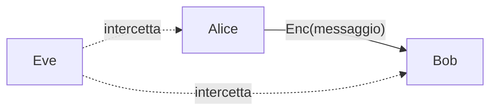
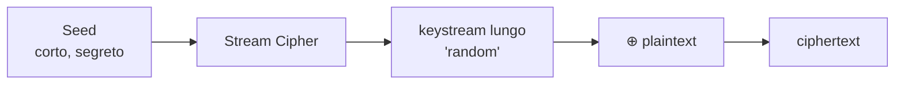

# Crypto 1

> [!abstract]
> Prima lezione del modulo di **crittografia** del CyberBootCamp (CyberChallenge.IT): *how math protects data*. Si parte dagli obiettivi della crittografia — **confidenzialità** (Eve non capisce il messaggio) e **autenticazione** (Eve non può spacciarsi per Alice) — e dalla distinzione tra crittografia **simmetrica** (chiave privata condivisa) e **asimmetrica** (chiave pubblica). Il resto è tutto sui **cifrari simmetrici**: il **One Time Pad** (XOR con una chiave lunga quanto il messaggio), perché è un *cifrario perfetto* ma anche perché **non va riusata la chiave**; i **cifrari a flusso** (RC4), che generano un flusso pseudo-casuale da un seme corto; e i **cifrari a blocchi** (AES, DES) con i loro **modi di operazione** (ECB, CBC, CTR), dove si vede perché ECB è insicuro — il famoso «pinguino».
> Lezione precedente: [[05 - CB - Binary Exploitation 2]]. Mappa del corso: [[MOC - CyberBootCamp]].

> [!note] Collegamenti con altri corsi
> Gli stessi temi sono trattati, più in profondità, nel corso di **Cybersecurity**: [[Stream Cipher]], [[Block Cipher]], [[AES]], [[DES]], [[ECB]], [[CBC]], [[CTR]]. Qui l'ottica è quella delle CTF: capire *quando un cifrario si rompe* e come sfruttarlo.
>
> Per usare questi cifrari in uno script (AES in ECB, CBC e CTR) vedi [[pycryptodome]].

## Cos'è la crittografia

Vedi [[Symmetric Encryption]] (corso Cybersecurity).

La crittografia dà due garanzie diverse, da non confondere:

- **Confidenzialità**: Alice manda un messaggio a Bob; **Eve**, che intercetta il canale, vede solo byte apparentemente casuali (`ASDFGHJKLQWERTYUIOP`) e non capisce il contenuto (`"meowww X3"`).
- **Autenticazione**: Bob vuole essere sicuro che un messaggio firmato *"- Alice"* venga **davvero** da Alice, e che Eve non possa falsificarlo.



Questa lezione si concentra sulla **confidenzialità**.

### Encryption e decryption

Formalmente servono due funzioni, che usano una **chiave segreta**:

- `Encryption(plaintext, key) → ciphertext`: dati dei byte e una chiave, produce byte **apparentemente casuali**;
- `Decryption(ciphertext, key) → plaintext`: fa l'inverso.

La proprietà fondamentale (correttezza) è che decifrare annulla cifrare:

$$\text{plaintext} = \text{Dec}(\text{Enc}(\text{plaintext}, k), k)$$

### Due classi di crittografia

Vedi [[Symmetric Encryption]] e [[Asymmetric Encryption]].

- **Crittografia a chiave privata** (*simmetrica*): la **stessa** chiave segreta cifra e decifra; Alice e Bob devono averla condivisa prima.
- **Crittografia a chiave pubblica** (*asimmetrica*): due chiavi diverse (una pubblica per cifrare, una privata per decifrare).

Tutto il resto della lezione riguarda la crittografia **simmetrica**: Alice cifra `Enc("meow", k) = B9fkQ9`, Bob decifra `Dec(B9fkQ9, k) = "meow"`, Eve vede solo `B9fkQ9`.

## One Time Pad

Vedi [[One-Time Pad (OTP)]].

Il cifrario simmetrico più semplice: si fa lo **XOR** bit a bit tra plaintext e chiave.

$$\text{Enc}(P) = P \oplus K \qquad \text{Dec}(C) = C \oplus K$$

Funziona perché lo XOR è l'inverso di sé stesso: `(P ⊕ K) ⊕ K = P`. Tabella di verità dello XOR:

| A | B | A ⊕ B |
|---|---|---|
| 0 | 0 | 0 |
| 0 | 1 | 1 |
| 1 | 0 | 1 |
| 1 | 1 | 0 |

Esempio (XOR carattere per carattere tra il plaintext e la chiave):

```
P:  I  L  i  k  e  T  o  M  e  o  w  w  w  w  :  3
K:  5  U  P  3  R  _  5  3  C  R  3  T  _  K  3  Y
C:  |  19 9  X  7  0b Z  ~  &  =  D  #  (  <  09 j
```

### Proprietà e perché è «perfetto»

Vedi [[Perfect Cipher]].

- la chiave serve per **un solo** plaintext (*one-time*);
- `Size(key) ≥ Size(plaintext)`: la chiave è lunga almeno quanto il messaggio;
- è un **cifrario perfetto**: dato il ciphertext `C`, non si ricava **nessuna** informazione sul plaintext `P`. Formalmente $\Pr[P \mid C] = \Pr[P]$.

Intuizione: dato `C = 0x12345678`, il messaggio può essere **qualsiasi** stringa di 4 caratteri. Esiste una chiave `K1` per cui `C ⊕ K1 = "miao"` e una `K2` per cui `C ⊕ K2 = "bauu"`, e così via. Senza la chiave, ogni plaintext è ugualmente possibile.

> [!tip] «END OF CRYPTO»? Ok, forse no
> Se è un cifrario perfetto, perché non usarlo sempre? Perché la perfezione vale **solo** se la chiave è casuale, lunga quanto il messaggio e **usata una sola volta**. Sono proprio questi vincoli a renderlo poco pratico — e pericolosissimo se violati.

### Attacco: non riusare la chiave

Vedi [[Attacco al One Time Pad]].

Il peccato capitale è **riusare** la stessa chiave `K` per due messaggi. Se Eve ha due ciphertext cifrati con la **stessa** chiave:

$$C_1 = P_1 \oplus K \qquad C_2 = P_2 \oplus K$$

allora facendo lo XOR dei due ciphertext la chiave **sparisce**:

$$C_1 \oplus C_2 = (P_1 \oplus K) \oplus (P_2 \oplus K) = P_1 \oplus P_2$$

Eve ottiene lo XOR dei due **plaintext**. E poiché i testi reali hanno **pattern** (lettere frequenti, spazi, parole comuni), da `P1 ⊕ P2` si risale ai due messaggi (*crib dragging*). Con **molti** messaggi riusati (*many-time pad*) l'attacco è ancora più facile — esistono tool pronti come [MTP](https://github.com/CameronLonsdale/MTP).

> [!warning] La regola
> OTP richiede chiavi **lunghe** e **sempre diverse**. Ma le chiavi che abbiamo sono limitate: da qui nascono i cifrari a flusso.

## Cifrari a flusso

Vedi [[Stream Cipher]].

L'idea: *«possiamo fingere la casualità»*. Un **cifrario a flusso** (*stream cipher*) prende un **seme** (seed) segreto di lunghezza fissa e genera un **flusso** (keystream) pseudo-casuale di lunghezza arbitraria, che si usa poi come chiave di un OTP.



Tre proprietà:

- **Deterministico**: lo stesso seme dà sempre lo stesso flusso (così Bob può rigenerarlo);
- **Casuale**: senza il seme non si può prevedere nessuna parte del flusso;
- **Non invertibile**: dal flusso non si recupera il seme.

### RC4

Vedi [[2 CS  Lower Level - Stream Ciphers#RC-4|RC4]] (corso Cybersecurity).

**RC4** è lo stream cipher storico. Lavora su uno stato `S` di 256 byte, in due fasi.

**Key Scheduling Algorithm (KSA)** — inizializza e mescola `S` in base alla chiave:

```text
for i = 0 to 255:
    S[i] = i
j = 0
for i = 0 to 255:
    j = (j + S[i] + key[i mod keylength]) mod 256
    swap(S[i], S[j])
```

**Encryption / Decryption (PRGA)** — genera il keystream e lo mette in XOR con l'input (cifrare e decifrare sono la **stessa** operazione):

```text
i = 0, j = 0
for k = 0 to len(input):
    i = (i + 1) mod 256
    j = (j + S[i]) mod 256
    swap(S[i], S[j])
    out[k] = S[(S[i] + S[j]) mod 256] XOR in[k]
```

## Cifrari a blocchi

Vedi [[Block Cipher]].

Un **cifrario a blocchi** (*block cipher*) cifra blocchi di dimensione fissa `N` con una chiave di `K` bit:

| Cifrario | Blocco `N` | Chiave `K` |
|---|---|---|
| **AES** | 128 bit | 128 / 192 / 256 bit |
| **3DES** | 64 bit | 168 bit |

Vedi [[AES]] e [[DES]]. Il cuore è una funzione `E` (e la sua inversa `D`) che si comporta come una **PRP**.

### PRF e PRP

Vedi [[PRF (Pseudorandom Function)]].

- Una **PRF** (*Pseudo Random Function*) `F: K × M → N` ha un algoritmo efficiente per calcolare `F(k,m)`, e per chi non conosce `k` l'output è **indistinguibile** da casuale.
- Una **PRP** (*Pseudo Random Permutation*) è una PRF **invertibile** `K × M → M`: una permutazione dei possibili blocchi, «mescolata» in base alla chiave. È ciò che serve per poter **decifrare**.

| Input | PRF output | | Input | PRP output |
|---|---|---|---|---|
| `"hello"` | `0x121f1abf5e` | | `00` | `11` |
| `"world"` | `0xfb6ef1527a` | | `01` | `10` |
| `"meoww"` | `0x4f62bc1988` | | `10` | `00` |

> [!important] Un blocco solo non basta
> Una PRP cifra **esattamente** `N` bit (es. 16 byte per AES). *«E se il messaggio è più lungo di N bit?»* → servono i **modi di operazione**.

## Modi di operazione

Come usare un cifrario a blocchi su messaggi più lunghi di un blocco? Si spezza il messaggio in blocchi `M1, M2, M3, …` e si decide **come combinarli**.

### ECB — Electronic Codebook

Vedi [[ECB]].

Il modo più ingenuo: si cifra **ogni blocco indipendentemente** con la stessa chiave.

$$\text{Enc}(K, M) = F_k(M_1) \parallel F_k(M_2) \parallel F_k(M_3) \parallel \dots$$

In codice, e la dimostrazione del problema:

```python
def PRP_ECB(key, msg):
    blocks = [msg[i:i+16] for i in range(0, len(msg), 16)]
    return b''.join(PRP(key, block) for block in blocks)

K  = b'YELLOW SUBMARINE'
M1 = b'16 bytes message'
M2 = b'another 16-b msg'

PRP_ECB(K, M1).hex()        # 3c19892b47fa369d7301dd1928eb06ca
PRP_ECB(K, M2).hex()        # 9d28a90864f1f26a7feb218af64dd51a
PRP_ECB(K, M1 + M2).hex()   # 3c19892b...06ca  9d28a9...dd51a  ← concatenazione!
```

Il problema: **blocchi di plaintext uguali danno blocchi di ciphertext uguali**. La struttura del messaggio **trapela**. L'esempio classico è un'immagine cifrata con ECB:

![[CB-L06-p38.png]]

L'immagine mostra il pinguino di Linux (Tux) cifrato in ECB: le aree di colore uniforme diventano blocchi identici, quindi la sagoma del pinguino **resta perfettamente visibile** nel ciphertext. ECB non nasconde i pattern: **non va usato per la confidenzialità**.

### CBC — Cipher Block Chaining

Vedi [[CBC]].

Per rompere i pattern, ogni blocco di plaintext viene messo in **XOR con il ciphertext precedente** prima di essere cifrato; il primo blocco usa un **vettore di inizializzazione (IV)**, `C0`.

$$\text{Enc}(K, M) = F_k(M_1 \oplus C_0) \parallel F_k(M_2 \oplus C_1) \parallel \dots$$
$$\text{Dec}(K, C) = \big(F^{-1}_k(C_1) \oplus C_0\big) \parallel \big(F^{-1}_k(C_2) \oplus C_1\big) \parallel \dots$$

![[CB-L06-p39.png]]

Lo schema mostra il concatenamento: il plaintext del primo blocco va in XOR con l'**IV**, il risultato entra nel cifrario a blocchi (con la chiave) e produce il primo ciphertext; questo ciphertext diventa l'input dello XOR del blocco successivo, e così via. In questo modo lo **stesso** blocco di plaintext, in posizioni diverse, dà ciphertext diversi.

> [!important] L'IV deve essere casuale ogni volta
> Il vettore di inizializzazione `C0` **deve essere casuale a ogni cifratura**. Se è fisso (o riusato con la stessa chiave), due messaggi che iniziano uguali producono primi blocchi di ciphertext uguali — si ricade in un problema simile a ECB per il primo blocco.

Lo stesso pinguino cifrato in CBC:

![[CB-L06-p41.png]]

Qui il ciphertext è **rumore completo**: nessuna traccia della sagoma. Il concatenamento ha distrutto ogni pattern — questo è il comportamento che ci aspettiamo da un cifrario sicuro.

### CTR — Counter

Vedi [[CTR]].

Un'altra soluzione: trasformare il cifrario a blocchi in un **cifrario a flusso**. Si cifra un **contatore** `N+i` (nonce + indice) e si mette il risultato in XOR con il blocco di plaintext:

$$\text{Enc}(K, M) = \big(F_k(N{+}0) \oplus M_1\big) \parallel \big(F_k(N{+}1) \oplus M_2\big) \parallel \dots$$
$$\text{Dec}(K, C) = \big(F_k(N{+}0) \oplus C_1\big) \parallel \big(F_k(N{+}1) \oplus C_2\big) \parallel \dots$$

Anche qui il **nonce** `N` deve essere diverso a ogni cifratura. Vantaggio: i blocchi si possono cifrare/decifrare **in parallelo** e non serve la funzione inversa `F⁻¹` (si usa sempre `Fk` in avanti).

> [!summary] In sintesi
> I cifrari simmetrici proteggono la confidenzialità, ma **solo se usati bene**: chiave mai riusata nell'OTP, keystream pseudo-casuale negli stream cipher, e un modo di operazione che rompa i pattern (CBC/CTR, **mai** ECB) con IV/nonce casuali. Nelle CTF le vulnerabilità nascono quasi sempre dalla violazione di uno di questi vincoli. Mappa del corso: [[MOC - CyberBootCamp]].
