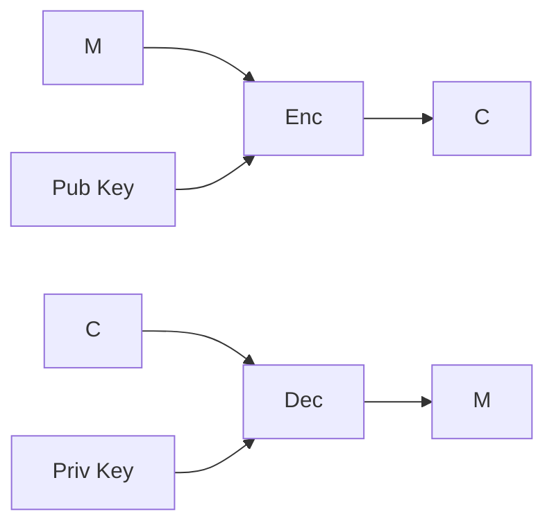
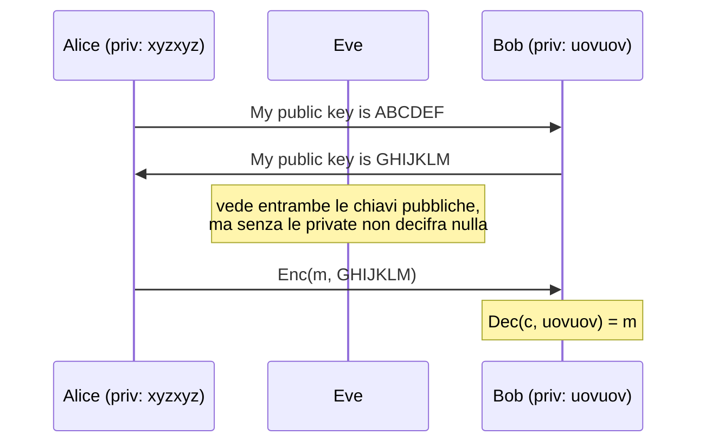
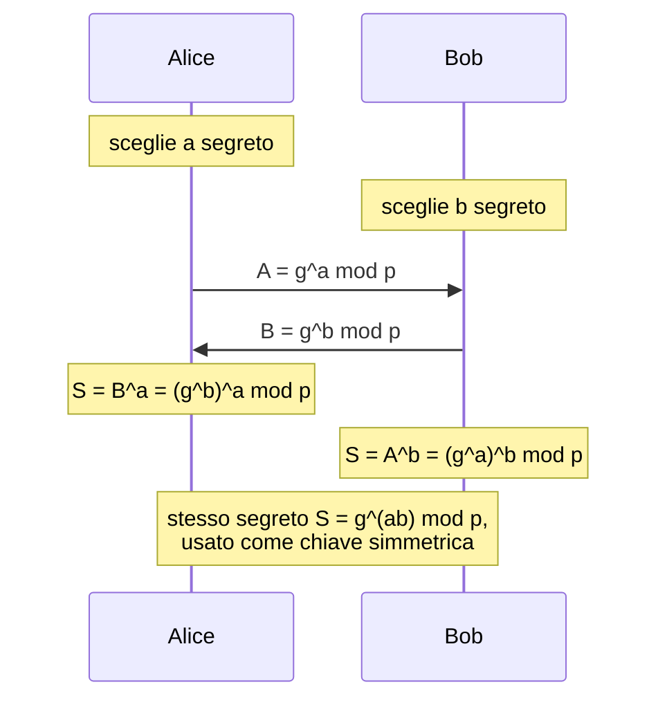
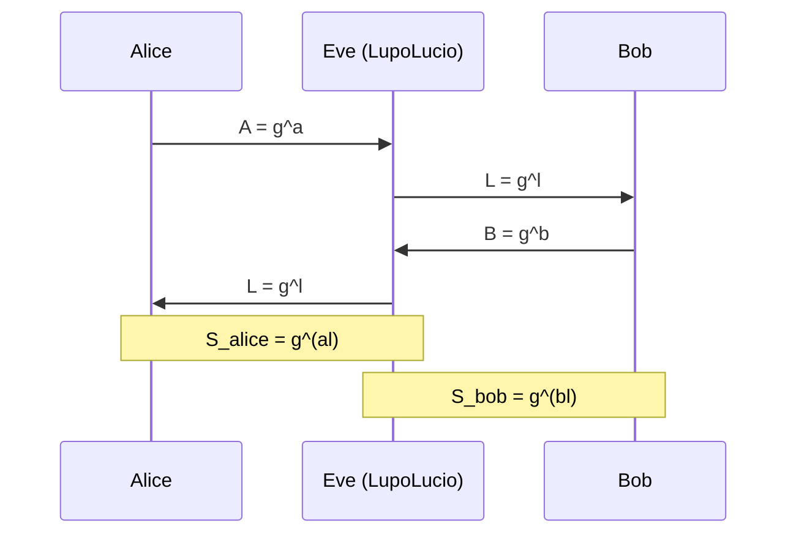

# Crypto 2

> [!abstract]
> Seconda lezione del modulo di **crittografia** del CyberBootCamp (CyberChallenge.IT). La [[06 - CB - Crypto 1|lezione precedente]] si chiudeva con un problema aperto: la crittografia simmetrica funziona, ma Alice e Bob devono **già condividere** una chiave. Qui si risolve il problema con la **crittografia asimmetrica**. Prima serve la matematica: **gruppi e campi**, **aritmetica modulare**, i teoremi di **Eulero** e **Fermat** e l'**esponenziazione modulare veloce** (*square and multiply*). Poi si costruisce **RSA**, e si passa la maggior parte del tempo a **romperlo**: modulo piccolo, `p` e `q` vicini, fattori in comune, esponente piccolo, stesso messaggio con esponenti o moduli diversi (Teorema Cinese del Resto), malleabilità. Infine **Diffie-Hellman**: perché la sua sicurezza dipende dal gruppo, il **logaritmo discreto**, l'attacco di **Pohlig–Hellman**, il **Man in the Middle** e il problema **Decisional Diffie-Hellman** con i residui quadratici.
> Lezione precedente: [[06 - CB - Crypto 1]]. Mappa del corso: [[MOC - CyberBootCamp]].

> [!note] Collegamenti con altri corsi
> La teoria di RSA e Diffie-Hellman è trattata in modo più completo nel corso di **Cybersecurity**: [[Asymmetric Encryption]], [[RSA]], [[Diffie-Hellman Key Exchange]], [[PKCS1]], [[RSA-OAEP]], [[Man-in-the-Middle (MITM)]]. Le definizioni matematiche sono in `Magistrale/Extra/Mathematical definitions`: [[Modular Arithmetic]], [[Euler's totient function]], [[Euler's Theorem]], [[Fermat's Little Theorem]], [[Modular Exponentiation]], [[Discrete Logarithm (DL) Problem]], [[Factorize a Number]]. RSA compare anche in Telecomunicazioni: [[Algoritmo RSA]].
> Qui l'ottica è quella delle CTF: **quando** questi schemi si rompono e **con quali comandi** (soprattutto [[SageMath]]).

## Ripasso: i limiti della crittografia simmetrica

Dalla lezione precedente:

- la crittografia serve per **confidenzialità** e **autenticazione**;
- il [[One-Time Pad (OTP)|One Time Pad]] è perfetto ma *one time*: la chiave non si può riusare (vedi [[Attacco al One Time Pad]]);
- la crittografia simmetrica non è perfetta, ma è **utile** e veloce.

Della crittografia simmetrica si ricordano tre caratteristiche:

- le parti devono **condividere una chiave segreta**;
- è considerata più "sicura" (in senso pratico: più studiata e con chiavi più corte a parità di sicurezza) della crittografia asimmetrica;
- la sua sicurezza si basa su concetti semplici (permutazioni, XOR, PRP).

Il problema è il primo punto. Nella slide Alice e Bob si scambiano la chiave di persona, nascosti nel bosco, con Eve dietro un muro. Funziona, ma non è pratico: due computer che si parlano su Internet per la prima volta non hanno un canale sicuro per accordarsi su una chiave.

> [!question] *What if we don't like trees?*
> Non serve andare nel bosco per scambiarsi una chiave. Serve la **matematica**.

## Crittografia asimmetrica

Vedi [[Asymmetric Encryption]] (corso Cybersecurity).

Nella **crittografia asimmetrica** (o *a chiave pubblica*) ogni persona ha **due** chiavi:

- una **chiave pubblica**, che manda in chiaro sul canale pubblico: chiunque può usarla per **cifrare** un messaggio per lei;
- una **chiave privata**, che non lascia mai il suo computer: solo chi ce l'ha può **decifrare**.



Nello scenario della slide Alice annuncia *"My Public Key is ABCDEF"*, Bob risponde *"My public key is GHIJKLM"*. Le chiavi private (`xyzxyz` e `uovuov`) restano nella testa di ciascuno. Eve vede passare entrambe le chiavi pubbliche, ma non può farci niente (`???`): con la chiave pubblica di Bob può solo cifrare messaggi per Bob, non leggere quelli che gli manda Alice.



Perché una cosa del genere sia possibile serve una funzione **facile da calcolare e difficile da invertire**, a meno di conoscere un'informazione segreta (una *trapdoor*). Queste funzioni vengono dall'aritmetica modulare.

## Gruppi, anelli e campi

Vedi [[Gruppi, Anelli e Campi]].

Le strutture algebriche danno un nome alle "regole del gioco" di un insieme di numeri con le sue operazioni. Servono a sapere **quali operazioni si possono fare** (per esempio: ogni elemento ha un inverso? posso dividere?), e quindi quali attacchi o calcoli sono possibili.

### Gruppi

Un insieme $G$ con un'operazione binaria $\cdot : G \times G \to G$ è un **gruppo** $(G, \cdot)$ se valgono:

| Proprietà | Definizione |
|---|---|
| **Chiusura** | per ogni $a, b \in G$: $a \cdot b \in G$ |
| **Associatività** | per ogni $a, b, c \in G$: $(a \cdot b) \cdot c = a \cdot (b \cdot c)$ |
| **Identità** | esiste $e \in G$ tale che $a \cdot e = e \cdot a = a$ per ogni $a$ |
| **Inverso** | per ogni $a \in G$ esiste $b \in G$ tale che $a \cdot b = b \cdot a = e$ |

Se in più $a \cdot b = b \cdot a$, l'operazione è **commutativa** e il gruppo si dice **abeliano**. A volte si usa la notazione additiva: $+$ al posto di $\cdot$, e $na$ (cioè $a + a + \dots + a$) al posto di $a^n$. Questo dettaglio tornerà con [[#La sicurezza dipende dal gruppo|Diffie-Hellman]]: "elevare a potenza" in un gruppo additivo vuol dire solo moltiplicare.

Esempi della slide:

| Insieme e operazione | Tipo secondo la slide |
|---|---|
| Interi con l'addizione $(\mathbb{Z}, +)$ | gruppo abeliano |
| Interi non nulli con la moltiplicazione $(\mathbb{Z}^*, \cdot)$ | gruppo abeliano |
| "Interi" non nulli con la moltiplicazione $(\mathbb{R}^*, \cdot)$ | gruppo abeliano |
| Spazio vettoriale con la somma $(\mathbb{R}^n, +)$ | gruppo abeliano |
| Curve ellittiche con le loro operazioni | gruppo non abeliano |

> [!warning] Correzione
> Tre righe della tabella non sono corrette:
> - **$(\mathbb{Z}\setminus\{0\}, \cdot)$ non è un gruppo**: manca l'inverso. L'inverso di $2$ dovrebbe essere $1/2$, che non è un intero. È un gruppo invece $(\mathbb{Z}_p^*, \cdot)$, gli interi **modulo un primo** $p$ senza lo zero, ed è probabilmente quello che si intendeva (è il gruppo usato da Diffie-Hellman).
> - $\mathbb{R}^*$ sono i **reali** non nulli, non gli interi: con questa correzione la riga è giusta.
> - **Le curve ellittiche formano un gruppo abeliano**, non "non abeliano": la somma di due punti non dipende dall'ordine ($P + Q = Q + P$).

### Campi e anelli

Un insieme $F$ con **due** operazioni $(F, +, \cdot)$ è un **campo** se:

- $(F, +)$ è un gruppo commutativo con identità $0$;
- $(F \setminus \{0\}, \cdot)$ è un gruppo commutativo con identità $1$;
- vale la **distributività**: $a(b + c) = ab + ac$.

In un campo si può sommare, sottrarre, moltiplicare e **dividere** per qualunque elemento non nullo. Un **anello** è "un campo senza l'assioma dell'inverso moltiplicativo": si può moltiplicare, ma non sempre dividere. Ogni campo è un anello, non ogni anello è un campo ($\mathbb{Z}$ è un anello: $2$ non ha inverso).

> [!note]
> La slide scrive "A set G with binary operation ⋅ is a field": per un campo l'insieme si chiama $F$ e le operazioni sono **due**. È solo un residuo copiato dalla slide dei gruppi.

## Aritmetica modulare

Vedi [[Modular Arithmetic]].

### Congruenze

$$a \equiv b \pmod n$$

si legge "$a$ è congruo a $b$ modulo $n$" e vuol dire che $a$ e $b$ hanno lo **stesso resto** nella divisione per $n$. L'operazione `mod` restituisce proprio quel resto. La stessa relazione si scrive anche come

$$a = b + kn \quad \text{per qualche intero } k$$

una notazione **molto utile**: trasforma una congruenza in un'equazione normale fra interi, ed è il modo in cui si ragiona negli attacchi.

L'esempio è l'orologio: $10 \equiv 22 \pmod{12}$, perché le 22 sono le 10 di sera ($22 = 10 + 1 \cdot 12$).

### Proprietà

- Gli interi **modulo un primo** $p$ formano un **campo** ($\mathbb{Z}_p$): ogni elemento non nullo ha un inverso.
- Gli interi modulo un $n$ **non primo** formano solo un **anello** ($\mathbb{Z}_n$): alcuni elementi non hanno inverso.

> [!note]
> La slide dice "Ring (Group without inverse axiom)": la parentesi va letta come "senza l'inverso **moltiplicativo**". $\mathbb{Z}_n$ con la somma resta un gruppo; è la moltiplicazione che perde gli inversi.

Le congruenze si comportano bene con le operazioni (scriviamo $\equiv_n$ per $\equiv \pmod n$):

- $a \equiv_n b \Rightarrow ac \equiv_n bc$
- $a \equiv_n b \Rightarrow a + c \equiv_n b + c$
- $a \equiv_n b$ e $b \equiv_n c \Rightarrow a \equiv_n c$
- $a \equiv_n b \Rightarrow a^c \equiv_n b^c$

In pratica: si può ridurre modulo $n$ **in qualsiasi momento** durante somme e prodotti, e anche la **base** di una potenza. Non l'**esponente**: è il tema di [[#Esponenti: l'errore classico|più avanti]].

### Inverso modulare

L'**inverso** di $a$ modulo $n$ è il numero $a^{-1}$ tale che

$$a \cdot a^{-1} \equiv 1 \pmod n$$

ed **esiste solo se** $\gcd(a, n) = 1$, cioè se $a$ e $n$ sono **coprimi**.

Esempio: esiste l'inverso di $7$ modulo $15$? $\gcd(7, 15) = 1$, quindi sì. È $13$: $7 \cdot 13 = 91 = 6 \cdot 15 + 1$, quindi $7 \cdot 13 \equiv 1 \pmod{15}$.

L'inverso si calcola con l'algoritmo di Euclide esteso (in Python: `pow(7, -1, 15)`). È il passaggio chiave per costruire la chiave privata di [[#Costruzione delle chiavi|RSA]].

### Aritmetica modulare in Sage

Vedi [[SageMath]].

**SageMath** è un sistema di calcolo simbolico basato su Python, molto usato nelle CTF di crittografia. `Zmod(n)` crea l'anello degli interi modulo `n`, e i suoi elementi fanno da soli la riduzione modulo `n`:

```python
sage: Zn = Zmod(5)
sage: Zn
Ring of integers modulo 5
sage: Zn(7)
2
sage: Zn(8) == Zn(13)   # 8 ≡ 13 (mod 5)
True
```

Moltiplicazione e inverso: se un operando è un elemento di `Zn`, anche l'intero normale viene convertito.

```python
sage: Zn = Zmod(5)
sage: Zn(3) * Zn(2)     # 3*2 mod 5
1
sage: Zn(3) * 2
1
sage: 1 / Zn(3)         # inverso di 3 mod 5
2
sage: Zn(3) ^ -1        # stessa cosa
2
sage: pow(3, -1, 5)     # anche in Python puro
2
```

La **divisione** è il prodotto per l'inverso:

```python
sage: Zn = Zmod(11)
sage: Zn(7) / 3         # 7 * 3^-1 mod 11
6
sage: Zn(3) ^ -1        # inverso di 3 mod 11
4
sage: Zn(7) * 4 == Zn(7) / 3
True
```

Controllo: $3 \cdot 4 = 12 \equiv 1 \pmod{11}$, e $7 \cdot 4 = 28 = 2 \cdot 11 + 6$.

Se l'inverso non esiste, Sage lo dice:

```python
sage: Zn = Zmod(10)
sage: Zn(6) ^ -1
ZeroDivisionError: inverse of Mod(6, 10) does not exist
```

Infatti $\gcd(6, 10) = 2 \neq 1$: $6x$ è sempre pari, quindi non può mai valere $1$ modulo $10$.

> [!tip] Senza Sage
> | Sage | Python puro |
> |---|---|
> | `Zmod(n)(a)` | `a % n` |
> | `1 / Zmod(n)(a)` | `pow(a, -1, n)` (Python ≥ 3.8) |
> | `Zmod(n)(a)^b` | `pow(a, b, n)` |
> | `xgcd(a, b)` | Euclide esteso a mano, oppure `sympy.gcdex` |
> | `crt(vals, mods)` | `sympy.ntheory.modular.crt(mods, vals)` (attenzione: ordine invertito) |

### Esponenti: l'errore classico

Visto che si può ridurre modulo $n$ ovunque, viene la tentazione di ridurre anche l'esponente:

$$
\begin{aligned}
(17 \cdot 8) \bmod 5 &= (17 \bmod 5)\cdot(8 \bmod 5) \bmod 5 = 2 \cdot 3 \bmod 5 = 1 \quad ✓\\
17^8 \bmod 5 &= (17 \bmod 5)^{(8 \bmod 5)} \bmod 5 = 2^3 \bmod 5 = 3 \quad ✗
\end{aligned}
$$

La seconda riga è **sbagliata**: Sage dà `(17 ^ 8) % 5 = 1`. Infatti $17^8 \equiv 2^8 = 256 \equiv 1 \pmod 5$. Ridurre la base va bene (è la proprietà $a \equiv_n b \Rightarrow a^c \equiv_n b^c$), ridurre l'esponente modulo $n$ no.

Per capire cosa succede agli esponenti si guardano le potenze di $3$ modulo $5$:

| $k$ | 0 | 1 | 2 | 3 | 4 | 5 | 6 | 7 | 8 | 9 | 10 | 11 |
|---|---|---|---|---|---|---|---|---|---|---|---|---|
| $3^k \bmod 5$ | 1 | 3 | 4 | 2 | 1 | 3 | 4 | 2 | 1 | 3 | 4 | 2 |

La sequenza si ripete ogni **4**: sull'esponente si lavora **modulo 4**, non modulo 5. Con le potenze di $5$ modulo $7$:

| $k$ | 0 | 1 | 2 | 3 | 4 | 5 | 6 | 7 | 8 | … |
|---|---|---|---|---|---|---|---|---|---|---|
| $5^k \bmod 7$ | 1 | 5 | 4 | 6 | 2 | 3 | 1 | 5 | 4 | … |

si ripete ogni **6**: modulo 6 sull'esponente. Sembrerebbe che la regola sia "esponente modulo $n-1$":

$$a^x \bmod n = a^{x \bmod (n-1)} \bmod n \quad\text{— quasi!}$$

Funziona negli esempi perché $5$ e $7$ sono **primi**. Per un $n$ qualunque il numero giusto non è $n - 1$, ma $\varphi(n)$.

### Teorema di Eulero

Vedi [[Euler's Theorem]] e [[Euler's totient function]].

> [!important] Teorema di Eulero
> Se $\gcd(a, n) = 1$, allora
> $$a^{\varphi(n)} \equiv 1 \pmod n$$

dove $\varphi$ è la **funzione toziente di Eulero**: $\varphi(n)$ conta gli interi positivi fino a $n$ che sono **coprimi** con $n$.

Per noi la conseguenza importante è che, visto che $a^{\varphi(n)} = 1$, ogni blocco di $\varphi(n)$ nell'esponente "sparisce":

$$a^b \bmod n = a^{\,b \bmod \varphi(n)} \bmod n$$

cioè si lavora **modulo $\varphi(n)$ sull'esponente**.

> [!warning] Attenzione all'ipotesi
> La regola vale quando $\gcd(a, n) = 1$. La slide la scrive senza ipotesi. Per RSA va comunque bene: con $N = pq$ e $p \neq q$ la decifratura funziona per **ogni** messaggio, anche quelli non coprimi con $N$ (la dimostrazione passa dal Teorema Cinese del Resto).

**Come si calcola $\varphi(n)$.** Si prendono i fattori primi di $n$, $p_1, \dots, p_k$:

$$\varphi(n) = (p_1 - 1)(p_2 - 1)\cdots(p_k - 1)$$

Vale se i fattori sono tutti **distinti** (ogni primo compare una sola volta). La formula completa, valida per qualunque $n$, è

$$\varphi(n) = n \prod_{p \mid n}\left(1 - \frac{1}{p}\right) \qquad \text{es. } \varphi(p^k) = p^k - p^{k-1}$$

Esempi:

- $\varphi(3) = 3 - 1 = 2$
- $\varphi(7) = 7 - 1 = 6$ (per un primo, $\varphi(p) = p - 1$: è il "modulo 6" della tabella sopra)
- $\varphi(21) = (7 - 1)(3 - 1) = 12$

Conseguenza:

$$4^{109} \bmod 21 = 4^{\,109 \bmod 12} \bmod 21 = 4^1 \bmod 21 = 4$$

($109 = 9 \cdot 12 + 1$, e $\gcd(4, 21) = 1$.)

> [!tip] La chiave di RSA
> Calcolare $\varphi(n)$ è **facile se conosci i fattori** di $n$, e (per quanto si sa) **difficile se non li conosci**. RSA si regge esattamente su questa asimmetria.

### Piccolo teorema di Fermat

Vedi [[Fermat's Little Theorem]].

> [!important] Piccolo teorema di Fermat
> Se $p$ è primo (e $p$ non divide $a$):
> $$a^{p-1} \equiv 1 \pmod p$$

È un caso particolare di Eulero: $\varphi(p) = p - 1$, quindi

$$a^{p-1} \bmod p = a^{(p-1) \bmod \varphi(p)} \bmod p = a^0 \bmod p = 1$$

Spiega il "quasi" di prima: per $n$ primo la regola "esponente modulo $n-1$" è giusta.

## Esponenziazione modulare

Vedi [[Modular Exponentiation]].

In crittografia si calcolano potenze con esponenti enormi (centinaia di cifre). Il modo in cui si scrive il calcolo fa la differenza:

```python
sage: 2 ^ 21902188147 % 215      # Very slow!
sage: pow(2, 21902188147, 215)   # OK!
sage: Zmod(215)(2)^21902188147   # OK!
```

La prima riga calcola **prima** $2^{21902188147}$ come intero esatto (un numero con circa 22 miliardi di bit, cioè quasi 3 GB) e **solo dopo** fa il modulo. Le altre due riducono modulo 215 a ogni passaggio e non superano mai numeri piccoli.

### Metodo ingenuo

```python
def noob_power_mod(a, b, n):
    result = 1
    for i in range(b):
        result *= a
        result %= n
    return result
```

Riduce a ogni passo, quindi i numeri restano piccoli, ma fa **$b$ moltiplicazioni**. Con $b \approx 2^{2048}$ (un esponente RSA) non finirebbe mai.

### Square and multiply

```python
def square_and_multiply(a, b, n):
    result = 1
    a = a % n
    while b > 0:
        if b % 2 == 1:
            result = (result * a) % n
        a = (a * a) % n
        b //= 2
    return result
```

Il ciclo scorre i bit dell'esponente dal meno significativo: a ogni giro `a` viene **elevato al quadrato** (diventa $a^1, a^2, a^4, a^8, \dots$), e quando il bit corrente di `b` è 1 lo si **moltiplica** nel risultato. Le iterazioni sono tante quanti i bit di $b$: circa $\log_2 b$ invece di $b$. Per un esponente di 2048 bit, circa 4000 moltiplicazioni invece di $2^{2048}$.

L'idea si vede bene scrivendo l'esponente **in binario**:

- elevare al quadrato **raddoppia** l'esponente, cioè aggiunge uno `0` in fondo: $(a^{1})^2 = a^{10_2}$, $(a^{110_2})^2 = a^{1100_2}$;
- moltiplicare per $a$ **aggiunge 1**, cioè trasforma lo `0` finale in `1`: $a^{110_2} \cdot a = a^{111_2}$.

Quindi si costruisce l'esponente bit per bit, da sinistra, con quadrati (`s`) e moltiplicazioni (`m`). Esempio: $3^{45}$, con $45 = 101101_2$:

$$
3^{1} \xrightarrow{s} 3^{10} \xrightarrow{s} 3^{100} \xrightarrow{m} 3^{101} \xrightarrow{s} 3^{1010} \xrightarrow{m} 3^{1011} \xrightarrow{s} 3^{10110} \xrightarrow{s} 3^{101100} \xrightarrow{m} 3^{101101}
$$

(esponenti in binario). Dopo ogni quadrato o moltiplicazione si riduce modulo $n$. Il codice sopra fa la stessa cosa scorrendo i bit nell'ordine opposto (da destra a sinistra).

## RSA

Vedi [[RSA]] (corso Cybersecurity) e [[Algoritmo RSA]] (Telecomunicazioni).

### Costruzione delle chiavi

1. Si generano due **numeri primi grandi** $p$ e $q$.
2. Si calcola $N = p \cdot q$.
3. Si calcola $\varphi(N) = (p - 1)(q - 1)$.
4. Si sceglie l'esponente pubblico $e$, **coprimo** con $\varphi(N)$.
5. Si calcola l'esponente privato $d$ tale che $e \cdot d \equiv 1 \pmod{\varphi(N)}$, cioè $d = e^{-1} \bmod \varphi(N)$.

La **chiave pubblica** è $(N, e)$; la **chiave privata** è $d$ (e vanno tenuti segreti anche $p$, $q$ e $\varphi(N)$). Il punto 4 serve al punto 5: $d$ esiste solo se $e$ è invertibile modulo $\varphi(N)$, quindi solo se $\gcd(e, \varphi(N)) = 1$.

### Cifratura e decifratura

$$\text{Cifratura: } C = M^e \bmod N \qquad \text{Decifratura: } M = C^d \bmod N$$

In Python: `c = pow(m, e, N)` e `m = pow(c, d, N)`.

**Perché funziona.** Si applica Eulero sull'esponente:

$$C^d \equiv (M^e)^d = M^{ed} \pmod N$$
$$M^{ed} \bmod N = M^{\,ed \bmod \varphi(N)} \bmod N$$

ma $d$ è stato scelto proprio perché $e \cdot d \bmod \varphi(N) = 1$, quindi

$$M^{\,ed \bmod \varphi(N)} \bmod N = M^1 \bmod N = M$$

(supponendo $M < N$: il messaggio, convertito in intero, deve essere più piccolo del modulo).

### Esempio giocattolo

| Valore | Calcolo | Visibilità |
|---|---|---|
| $p = 11$, $q = 17$ | — | segreti |
| $N$ | $11 \cdot 17 = 187$ | pubblico |
| $\varphi$ | $(11-1)(17-1) = 10 \cdot 16 = 160$ | segreto |
| $e$ | $7$ (coprimo con 160) | pubblico |
| $d$ | $7^{-1} \bmod 160 = 23$ | segreto |

Verifica: $23 \cdot 7 = 161 = 160 + 1 \equiv 1 \pmod{160}$.

- Cifratura: $C = M^7 \bmod 187$.
- Decifratura: $(M^7)^{23} \bmod 187 = M^{7 \cdot 23 \bmod 160} \bmod 187 = M^1 = M$.

Per esempio, con $M = 2$: $C = 2^7 = 128$, e `pow(128, 23, 187)` restituisce $2$.

```python
from Crypto.Util.number import getPrime, bytes_to_long, long_to_bytes
# (sul PC di Simone: from Cryptodome.Util.number import ...)

p, q = getPrime(512), getPrime(512)
N, phi = p * q, (p - 1) * (q - 1)
e = 65537
d = pow(e, -1, phi)

m = bytes_to_long(b"ccit{toy}")
c = pow(m, e, N)
print(long_to_bytes(pow(c, d, N)))   # b'ccit{toy}'
```

`bytes_to_long` e `long_to_bytes` trasformano il messaggio in un intero e viceversa: RSA lavora su numeri, non su byte. Vedi [[pycryptodome]] per il problema `Crypto` / `Cryptodome`.

### Ipotesi di sicurezza

La sicurezza di RSA è una catena:


$N = p \cdot q$ è una **funzione trapdoor**: moltiplicare è facile, invertire (fattorizzare) è difficile.

- **Problema difficile**: dato solo $N$, l'approccio ovvio è provare tutti i divisori da $2$ a $\sqrt N$. Per $N$ di 2048 bit sono circa $2^{1024}$ tentativi.
- **Facile se conosci un fattore**: se si conosce $p$, allora $q = N / p$, e da lì $\varphi(N)$ e $d$.

Quasi tutti gli attacchi che seguono sono modi per ottenere la fattorizzazione, o per non averne bisogno, sfruttando chiavi generate o usate male.

## Attacchi a RSA

Le CTF di RSA sono quasi sempre una di queste situazioni. Riconoscerla è metà del lavoro.

### Fattorizzare N

Vedi [[Fattorizzare il Modulo RSA]] e [[Factorize a Number]].

#### N troppo piccolo

Se $N$ ha **512 bit o meno**, si fattorizza in tempi ragionevoli (512 bit è stato fattorizzato con un cluster già nel 1999; oggi bastano ore su un cloud).

- **[factordb.com](http://factordb.com)**: database di numeri già fattorizzati. Il primo tentativo da fare, perché molte challenge riusano moduli noti.
- Gli **algoritmi di fattorizzazione** di Sage:

| Comando | Quando conviene |
|---|---|
| `factor(N, algorithm='pari')` | $N$ piccolo |
| `factor(N, algorithm='ecm')` | $N$ con molti fattori, o un fattore piccolo |
| `factor(N, algorithm='qsieve')` | $N$ grande (fino a un centinaio di cifre) |

`ecm` (*Elliptic Curve Method*) trova un fattore in un tempo che dipende dalla dimensione del **fattore più piccolo**, non di $N$: è la scelta giusta per un "multi-prime RSA" con tanti primi piccoli.

#### p e q troppo vicini

Esempio della slide:

```
p = 596235247266061472209064294263315773366507721893694333210441
q = 596235247266061472209064294263315773366507721893694333210543
```

I due primi condividono quasi tutte le cifre. Allora $\sqrt N$ è vicinissima a entrambi: basta partire da $\lceil\sqrt N\rceil$ e cercare lì intorno. Il modo sistematico è la **fattorizzazione di Fermat**: si scrive

$$N = a^2 - b^2 = (a - b)(a + b), \qquad a = \frac{p+q}{2},\; b = \frac{q-p}{2}$$

e si prova $a = \lceil\sqrt N\rceil, \lceil\sqrt N\rceil + 1, \dots$ finché $a^2 - N$ è un quadrato perfetto. Se $p$ e $q$ sono vicini, $b$ è piccolo e $a$ è quasi uguale a $\sqrt N$: bastano pochissimi tentativi.

```python
from math import isqrt

def fermat(N):
    a = isqrt(N)
    if a * a < N:
        a += 1
    while True:
        b2 = a * a - N
        b = isqrt(b2)
        if b * b == b2:
            return a - b, a + b
        a += 1
```

Con i numeri della slide, $\lfloor\sqrt N\rfloor$ finisce con `...210491`, e $a = $`...210492`, $b = 51$ al **primo** tentativo: $a - b = $`...210441` $= p$ e $a + b = $`...210543` $= q$.

#### Fattori comuni tra moduli diversi

Se due chiavi diverse sono state generate con un generatore di numeri casuali difettoso, possono avere **un primo in comune**. Allora il $\gcd$, che si calcola in un istante, li fattorizza entrambi:

$$N_1 = 863 \cdot 829 = 715427 \qquad N_2 = 613 \cdot 863 = 529019$$
$$\gcd(715427, 529019) = 863$$

e da lì $829 = N_1 / 863$ e $613 = N_2 / 863$.

![[CB-L07-p45.png]]

La slide mostra il paper *"Ron was wrong, Whit is right"* (Lenstra, Hughes, Augier, Bos, Kleinjung, Wachter, 2012). Gli autori hanno raccolto milioni di chiavi pubbliche da Internet e calcolato i $\gcd$ a coppie: una parte non trascurabile delle chiavi RSA condivideva un fattore con un'altra chiave, quindi era rotta. Il titolo è una battuta: Ron Rivest (la R di RSA) contro Whitfield Diffie (Diffie-Hellman), perché i sistemi con un solo segreto casuale come DH soffrono meno di questo problema.

> [!warning] Correzione
> La slide scrive in rosso *"3 keys out of 1000 shares a factor"*. L'abstract del paper, visibile nella stessa immagine, dice *"two out of every one thousand RSA moduli that we collected offer no security"*: circa **2 su 1000** (0,2%), non 3.

Nelle CTF: se una challenge dà **più moduli**, la prima cosa da provare è il $\gcd$ fra tutte le coppie.

#### q dipende da p

Se $q$ è calcolato **a partire da $p$** con una formula nota, l'equazione $p \cdot q = N$ ha una sola incognita. Esempio:

$$q = 3p + 1 \;\Rightarrow\; N = p(3p + 1) = 3p^2 + p$$

È un'equazione di secondo grado in $p$: $3p^2 + p - N = 0$, si risolve con la formula (con `isqrt` per restare negli interi) o con `solve` di Sage.

Se la relazione è complicata ma $f(p) = p \cdot q(p)$ è **monotona** (cresce sempre al crescere di $p$), funziona la **ricerca binaria**: si prova un $p$ a metà intervallo, se $f(p) > N$ si cerca a sinistra, altrimenti a destra. L'esempio della slide è $q = (3p^5 + 4p^3 + p)/p^5$.

![[CB-L07-p47.png]]

Il grafico mostra la curva $p \cdot q(p)$ (verde, crescente) e la retta orizzontale $N = p \cdot q$ (blu). Le linee verticali sono i tentativi della ricerca binaria: ognuno dimezza l'intervallo, e si convergono sul punto in cui la curva incrocia $N$, cioè sul vero $p$.

```python
def binsearch(N, f, lo, hi):
    while lo <= hi:
        mid = (lo + hi) // 2
        v = f(mid)
        if v == N:  return mid
        if v < N:   lo = mid + 1
        else:       hi = mid - 1
```

> [!warning] Correzione
> Nella slide la formula di $q$ ha $4p^3$, mentre l'etichetta del grafico scrive $p \cdot q = (3x^5 + 4x^4 + x)/x^5 \cdot x$, con $x^4$. È solo un'incoerenza dell'esempio: il metodo (ricerca binaria su una funzione monotona) non cambia.

Se nessuno dei due metodi funziona, la slide suggerisce: *"Math. Internet."*. Si studia la relazione o si cerca se qualcuno l'ha già rotta.

#### Leak di p + q

Se la challenge rivela anche $S = p + q$ (o un'altra combinazione), si hanno **due equazioni in due incognite**:

$$p \cdot q = N, \qquad p + q = S$$

Sage le risolve direttamente:

```python
p, q = var('p q')
eq1 = p * q == N
eq2 = p + q == S
solve([eq1, eq2], p, q)
```

A mano: $p$ e $q$ sono le radici di $x^2 - Sx + N = 0$. In più, $\varphi(N) = (p-1)(q-1) = N - S + 1$: per decifrare non serve nemmeno trovare $p$ e $q$.

### Stesso messaggio, esponenti diversi

Vedi [[RSA Common Modulus Attack]].

Lo **stesso** messaggio $m$ viene cifrato con lo **stesso modulo** $n$ ma con **due esponenti** diversi:

$$m^{e_1} \bmod n = c_1, \qquad m^{e_2} \bmod n = c_2$$

Esempio intuitivo: con $e_1 = 4$ ed $e_2 = 3$ si ha $c_1 \cdot c_2^{-1} = m^4 \cdot m^{-3} = m$. Il messaggio esce senza conoscere nessuna chiave privata.

In generale:

1. si trovano $a, b$ tali che $a \cdot e_1 + b \cdot e_2 = 1$;
2. si calcolano $c_1^a$ e $c_2^b$;
3. $m = c_1^a \cdot c_2^b \bmod n$.

Perché funziona:

$$c_1^a \cdot c_2^b = (m^{e_1})^a (m^{e_2})^b = m^{e_1 a + e_2 b} = m^1 = m$$

$a$ e $b$ esistono **se $\gcd(e_1, e_2) = 1$**, e li dà l'**algoritmo di Euclide esteso**: in Sage `xgcd(e1, e2)` restituisce la tripla $(g, a, b)$ con $g = a e_1 + b e_2$.

```python
sage: xgcd(67, 60)
(1, -17, 19)
sage: -17*67 + 19*60
1
```

Uno dei due coefficienti è negativo (qui $a = -17$): $c_1^{-17}$ vuol dire $(c_1^{-1})^{17}$, quindi serve l'inverso di $c_1$ modulo $n$. In Python 3.8+ `pow(c1, -17, n)` lo fa da solo.

### Esponente piccolo

Vedi [[RSA con Esponente Piccolo]].

Se $e$ è piccolo (tipicamente $e = 3$) e anche il messaggio è corto, può succedere che $m^e < N$. Allora

$$m^e \bmod N = m^e$$

il modulo **non viene mai usato**: è "RSA senza mod" (la slide lo illustra con il meme di Winnie the Pooh elegante). Il ciphertext è semplicemente $m^e$ come intero, e basta la radice $e$-esima **intera**:

$$m = c^{1/e}$$

Non si può usare `c ** (1/e)` in virgola mobile: con numeri da centinaia di cifre si perde precisione. Servono radici intere: `gmpy2.iroot(c, e)`, oppure in Sage `Integer(c).nth_root(e)`.

### Stesso messaggio, moduli diversi: Teorema Cinese del Resto

Vedi [[Håstad Broadcast Attack]] e [[Teorema Cinese del Resto]].

Lo **stesso** messaggio viene mandato a $e$ destinatari diversi, tutti con lo **stesso esponente** $e$ piccolo ma **moduli diversi**:

$$m^e \bmod n_1 = c_1, \quad m^e \bmod n_2 = c_2, \quad \dots, \quad m^e \bmod n_e = c_e$$

Si può trovare $m$? Sì, con il **Teorema Cinese del Resto** (CRT, *Chinese Remainder Theorem*): dati moduli $n_1, \dots, n_k$ a due a due coprimi e resti $a_1, \dots, a_k$, il sistema

$$x \equiv a_1 \pmod{n_1}, \quad \dots, \quad x \equiv a_k \pmod{n_k}$$

ha **una sola soluzione** modulo $n_1 n_2 \cdots n_k$. Esempio:

$$x \bmod 3 = 1, \quad x \bmod 5 = 0, \quad x \bmod 7 = 3 \;\Rightarrow\; x \bmod 105 = ?$$

```python
sage: mods = [3, 5, 7]
sage: vals = [1, 0, 3]
sage: crt(vals, mods)
10
```

Controllo: $10 = 3 \cdot 3 + 1$, $10 = 2 \cdot 5$, $10 = 7 + 3$. ✓

Applicato a RSA: il CRT ricostruisce $m^e \bmod (N_1 N_2 \cdots N_e) = K$. Siccome $m < N_i$ per ogni $i$, vale $m^e < N_1 N_2 \cdots N_e$: anche qui il modulo non fa nulla, $K = m^e$ esattamente, e

$$m = K^{1/e}$$

come nell'[[#Esponente piccolo|attacco precedente]]. Servono almeno $e$ ciphertext (3 se $e = 3$).

> [!warning] Correzione
> Nella slide del CRT applicato a RSA tutti i resti sono scritti $c_1$ ($m^e \% N_1 = c_1$, $m^e \% N_2 = c_1$, …). Devono essere **diversi**: $c_1, c_2, \dots, c_e$, come nella slide precedente. Con lo stesso resto ovunque il sistema avrebbe un altro significato.

### Malleabilità

Vedi [[Malleabilità di RSA]].

RSA "da manuale" (*textbook RSA*) è **moltiplicativo**:

$$C_1 \equiv m_1^e, \quad C_2 \equiv m_2^e \pmod n \;\Rightarrow\; C_1 \cdot C_2 \equiv (m_1 m_2)^e \pmod n$$

Moltiplicando due ciphertext si ottiene il ciphertext del **prodotto** dei messaggi (la "fusione" del meme di Dragon Ball). Chiunque può quindi trasformare un ciphertext in un altro con una relazione nota, senza conoscere la chiave: lo schema è **malleabile**.

> [!example] Uso tipico in una CTF
> Il server decifra qualunque ciphertext **tranne** quello della flag $c$. Si manda $c' = c \cdot 2^e \bmod n$: è diverso da $c$, quindi il server lo decifra, e restituisce $2m \bmod n$. Si divide per 2 (cioè si moltiplica per $2^{-1} \bmod n$) e si ottiene la flag.

## Problemi di RSA e padding

Riassumendo, RSA "nudo" ha tre problemi:

- è **molto lento** rispetto alla crittografia simmetrica (SKE, *Symmetric Key Encryption*): esponenziazioni su numeri da migliaia di bit contro operazioni su blocchi da 16 byte;
- **non è randomizzato**: lo stesso messaggio con la stessa chiave dà sempre lo stesso ciphertext, quindi chi indovina il messaggio può verificarlo cifrandolo;
- *"everything leads to disaster"*: esponente piccolo, messaggi corti, malleabilità, chiavi condivise. Come si è visto, ogni dettaglio sbagliato apre un attacco.

La soluzione è che RSA **non si usa mai da solo**: prima di cifrare, il messaggio viene **paddato** con uno schema standard, che aggiunge byte casuali e struttura.

![[CB-L07-p60.png]]

La slide mostra i due schemi principali (vedi [[PKCS1]] e [[RSA-OAEP]]):

- **PKCS#1 v1.5** (a sinistra): il blocco lungo quanto $N$ è `0x00 | 0x02 | byte casuali non nulli | 0x00 | dati`. I byte casuali rendono la cifratura randomizzata, e il padding fa sì che il messaggio occupi tutto il modulo (quindi niente $m^e < N$).
- **OAEP** (*Optimal Asymmetric Encryption Padding*, a destra): il messaggio $m$ con un blocco di zeri (`000`) e un valore casuale $r$ passano in una struttura a due rami, simile a una rete di Feistel, con due funzioni hash $G$ e $H$; l'output è $X \| Y$. Il risultato è indistinguibile da casuale e non malleabile in modo utile: è lo schema raccomandato oggi.

> [!note] Hands on
> La parte su RSA si chiude con una sessione pratica (*Hands on*) sulle challenge della piattaforma.

## Diffie-Hellman

Vedi [[Diffie-Hellman Key Exchange]] (corso Cybersecurity).

Problema: Alice e Bob vogliono usare la crittografia **simmetrica** (veloce), ma non hanno una chiave in comune. RSA permetterebbe di cifrarne una e spedirla; **Diffie-Hellman** fa di meglio: permette a entrambi di **calcolare la stessa chiave** scambiandosi solo valori pubblici.

### Il protocollo

Parametri pubblici: un gruppo $G$, un **generatore** $g$ e un primo $p$.



Alice e Bob ottengono lo stesso $S$ perché $(g^b)^a = (g^a)^b = g^{ab}$. Poi usano $S$ (di solito passato in una funzione hash) come chiave di un cifrario simmetrico, perché è **veloce**. Chi ascolta vede $g$, $p$, $A$ e $B$, ma per ottenere $S$ dovrebbe ricavare $a$ da $A$ o $b$ da $B$.

### La sicurezza dipende dal gruppo

Diffie-Hellman è sicuro? **Dipende dal gruppo.** La scrittura $A = g^a$ vuol dire "applica l'operazione del gruppo a $g$ con sé stesso $a$ volte", e quanto sia difficile tornare indietro dipende da qual è l'operazione.

| Gruppo | $A = g^a$ significa | Ricavare $a$ |
|---|---|---|
| $\mathbb{Z}_p$ con l'**addizione** | $g + g + \dots + g = a \cdot g \bmod p$ | **facile**: $a = A \cdot g^{-1} \bmod p$ |
| $\mathbb{Z}_p^*$ con il **prodotto** | $g \cdot g \cdots g = g^a \bmod p$ | ritenuto **difficile** (logaritmo discreto) |
| **curve ellittiche** | somma di punti ripetuta | ritenuto **difficile** ("operazioni strane che non vedremo, almeno per questa settimana") |

Nel gruppo additivo l'"esponenziazione" è una moltiplicazione, e si inverte con una divisione modulare. Nel gruppo moltiplicativo bisogna risolvere il **logaritmo discreto**.

### Il logaritmo discreto

Vedi [[Discrete Logarithm (DL) Problem]].

Se fosse $A = G^a$ **senza modulo**, basterebbe un logaritmo:

$$2^x = 8192 \;\Rightarrow\; x = \log_2 8192 = 13$$

Con il modulo è un disastro.

![[CB-L07-p68.png]]

I due grafici mostrano perché. A sinistra $2^x$ senza modulo: una curva liscia e crescente, quindi si può "risalire" da $y$ a $x$ (è esattamente quello che fa il logaritmo, o una ricerca binaria). A destra $2^x \bmod 101$: i punti sono sparsi senza alcun ordine visibile tra 0 e 100. Sapere che $2^x \bmod 101 = 12$ non dice se $x$ è grande o piccolo, quindi non c'è una direzione in cui cercare.

Trovare $a$ dato $A = g^a \bmod p$ può quindi essere difficile (dipende da $p$): il miglior algoritmo noto per un $p$ ben scelto è, a grandi linee, simile a provare tutti i valori. Per $p$ piccoli o deboli Sage lo fa direttamente:

```python
sage: Zn = Zmod(101)
sage: Zn(12).log(2)      # x tale che 2^x mod 101 = 12
71
sage: Zn(2)^71
12
```

### Quando il logaritmo discreto è facile: Pohlig–Hellman

Vedi [[Pohlig-Hellman]].

Se $p - 1$ ha **solo fattori piccoli** ($p$ si dice allora **smooth**), il logaritmo discreto si spezza: si risolve un logaritmo discreto **piccolo per ogni fattore** di $p - 1$ (algoritmo di **Pohlig–Hellman**) e poi si ricombinano i risultati con il [[Teorema Cinese del Resto|CRT]].

Perché $p$ sia sicuro per DH, $p - 1$ deve avere un fattore primo grande: la slide chiede che $p$ sia un **strong prime**, cioè $p - 1 = 2q$ con $q$ primo.

> [!warning] Correzione
> Un primo con $p - 1 = 2q$ ($q$ primo) si chiama **safe prime** (e $q$ è un *primo di Sophie Germain*). "Strong prime" in crittografia indica di solito un'altra cosa: un primo per cui $p - 1$ e $p + 1$ hanno entrambi fattori primi grandi (un requisito storico per i primi di RSA). Il concetto della slide è giusto, il nome è quello sbagliato.

Il codice della slide:

```python
def pohlig_hellman(g, A, p, factors):
    crt_array = []
    for p_i in factors:
        g_i = g ^ ((p - 1) // p_i)
        h_i = A ^ ((p - 1) // p_i)
        x_i = bruteforce(g_i, h_i, (0, p_i))
        crt_array += [x_i]
    return crt(crt_array, factors)
```

Per ogni fattore $p_i$ di $p - 1$, si eleva **sia $g$ sia $A$** alla $(p-1)/p_i$. Se $g^x \equiv A$, allora anche $(g^x)^z \equiv A^z$ per qualsiasi $z$. Con $z = (p-1)/p_i$, il nuovo generatore $g_i$ ha ordine $p_i$: le sue potenze si ripetono ogni $p_i$, quindi l'equazione $g_i^{x} \equiv h_i$ dice solo **quanto vale $x \bmod p_i$**, e si risolve provando i $p_i$ valori possibili. Alla fine il CRT mette insieme tutti gli $x \bmod p_i$.

**Esempio** ($g = 3$, $A = 22$, $p = 31$, $p - 1 = 30 = 2 \cdot 3 \cdot 5$):

| $p_i$ | $z = 30/p_i$ | equazione | soluzione |
|---|---|---|---|
| 2 | 15 | $3^{15x} \equiv 22^{15} \pmod{31}$ | $x \bmod 2 = 1$ |
| 3 | 10 | $3^{10x} \equiv 22^{10} \pmod{31}$ | $x \bmod 3 = 2$ |
| 5 | 6 | $3^{6x} \equiv 22^{6} \pmod{31}$ | $x \bmod 5 = 2$ |

Il CRT di $\{x \equiv 1 \bmod 2,\; x \equiv 2 \bmod 3,\; x \equiv 2 \bmod 5\}$ dà $x = 17$. Controllo: `pow(3, 17, 31) == 22`. ✓

> [!note] Due precisazioni sulla slide
> - Gli intervalli scritti accanto alle equazioni ("$x$ is in $[1,2)$", "$[1,3)$", "$[1,5)$") vanno letti come "$x \bmod p_i$ sta in $[0, p_i)$", che è anche quello che fa il codice con `(0, p_i)`.
> - Il codice funziona così com'è solo se i fattori di $p - 1$ compaiono **una volta sola** (qui $30 = 2 \cdot 3 \cdot 5$). Con una potenza $p_i^k$ si lavora modulo $p_i^k$ e servono un passo in più o un brute force su $p_i^k$ valori.

### Man in the Middle

Vedi [[Man-in-the-Middle (MITM)]].

Il protocollo base di Diffie-Hellman **non autentica** nessuno: Alice non ha modo di sapere che $B$ arriva davvero da Bob.

![[CB-L07-p72.png]]

Lo schema mostra Eve (nella slide si chiama *LupoLucio*) in mezzo al canale. Intercetta $A = g^a \bmod p$ di Alice e le risponde con il proprio $L = g^l \bmod p$; fa lo stesso con Bob. Alla fine:

- Alice condivide con Eve $S_{alice} = A^l \bmod p$, convinta di parlare con Bob;
- Bob condivide con Eve $S_{bob} = B^l \bmod p$, convinto di parlare con Alice.

Eve può **decifrare** ogni messaggio con una chiave e **ricifrarlo** con l'altra, senza che nessuno se ne accorga. La difesa è autenticare i valori scambiati (firme digitali, certificati), come fa TLS.



## Decisional Diffie-Hellman

Il problema "classico" (*Computational Diffie-Hellman*) chiede di **calcolare** $g^{ab}$ da $g^a$ e $g^b$. Il **Decisional Diffie-Hellman** (DDH) chiede una cosa più debole: **distinguere** $g^{ab}$ da un numero casuale.

Il gioco: Alice manda a Eve $G, g, p$, $g^x$, $g^y$ e un valore $z$, che può essere **casuale** oppure **uguale a $g^{xy}$**. Eve deve dire quale dei due. Se ci riesce con probabilità sensibilmente migliore del 50%, il gruppo "fa trapelare" informazione sul segreto condiviso, anche se Eve non sa calcolarlo.

Vedi [[Residui Quadratici]].

DDH **non è difficile in ogni gruppo**. In $\mathbb{Z}_p^*$ è facile, grazie ai **residui quadratici**.

### Residui quadratici

Un numero $a$ è un **residuo quadratico** (QR) modulo $n$ se esiste un intero $x$ tale che

$$x^2 \equiv a \pmod n$$

cioè se $a$ ha una "radice quadrata" modulo $n$.

- Modulo un primo $p$, **metà** dei numeri non nulli sono residui quadratici e metà no.
- Per sapere se $a$ è un residuo quadratico modulo un primo $p$ c'è il **criterio di Eulero**:
$$a^{(p-1)/2} \equiv 1 \pmod p \iff a \text{ è un QR}$$
(altrimenti il risultato è $-1$). È una sola esponenziazione modulare, quindi è veloce.

In Sage:

```python
sage: a = Zmod(101)(30)
sage: sqrt(a, all=True)
[38, 63]
```

$30$ è un QR modulo 101: $38^2 = 1444 = 14 \cdot 101 + 30$, e $63 = 101 - 38$ è l'altra radice.

### DDH in Zp* si rompe

Se $g$ genera $\mathbb{Z}_p^*$, allora $g^k$ è un residuo quadratico **se e solo se $k$ è pari**. Quindi:

- se $z = g^{ab}$: $z$ è QR quando $ab$ è pari, cioè quando $a$ **o** $b$ è pari:
  - se $g^a$ è QR, anche $z$ è QR;
  - se $g^b$ è QR, anche $z$ è QR;
  - se né $g^a$ né $g^b$ sono QR, allora $z$ non lo è.

  In totale $z$ è QR con probabilità **75%** (3 casi su 4 delle parità di $a$ e $b$);
- se $z$ è **casuale**, è QR con probabilità **50%**.

Eve controlla con il criterio di Eulero se $g^a$, $g^b$ e $z$ sono QR. Se il risultato non è coerente con le regole qui sopra (per esempio $g^a$ è QR ma $z$ no), $z$ è sicuramente casuale. Così distingue con probabilità migliore del 50%, e DDH in $\mathbb{Z}_p^*$ **non vale**. Per questo nella pratica si lavora nel **sottogruppo dei residui quadratici** (di ordine $q$, con $p = 2q + 1$ safe prime) o sulle curve ellittiche.

```python
def is_qr(a, p):
    return pow(a, (p - 1) // 2, p) == 1

def guess(gA, gB, z, p):
    expected = is_qr(gA, p) or is_qr(gB, p)
    return "g^ab" if is_qr(z, p) == expected else "random"
```

> [!summary] In sintesi
> La crittografia asimmetrica risolve lo scambio di chiavi grazie a funzioni facili da calcolare e difficili da invertire: la **fattorizzazione** per RSA, il **logaritmo discreto** per Diffie-Hellman. Entrambe poggiano sull'aritmetica modulare, in particolare sul **teorema di Eulero** (esponenti modulo $\varphi(n)$) e sull'**esponenziazione veloce**. Nelle CTF gli schemi si rompono quando sono generati o usati male: $N$ piccolo, primi vicini o condivisi, esponente piccolo, stesso messaggio cifrato più volte, RSA senza padding, $p - 1$ smooth, nessuna autenticazione in DH, gruppi in cui DDH è facile. Mappa del corso: [[MOC - CyberBootCamp]].
