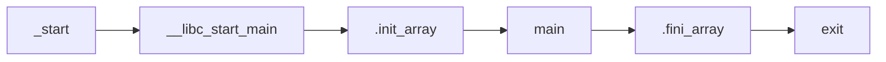

# Avvio di un Binario ELF

> [!summary] In breve
> `main` non è la prima funzione eseguita: l'entry point è `_start`, che passa il controllo a `__libc_start_main`.

- L'entry point è scritto nell'ELF header (`readelf -h`).
- Codice nei costruttori gira **prima** di `main`: vedi [[init_array e fini_array]].

## Collegamenti

- **Concetti correlati**: [[init_array e fini_array]] · [[GOT e PLT]]
- **Mappa**: [[MOC - CyberBootCamp]]

> [!info] Approfondimento
> - [[02 - CB - Reverse Engineering 1#Codice fuori da main|Lezione 2 — Codice fuori da main]]
