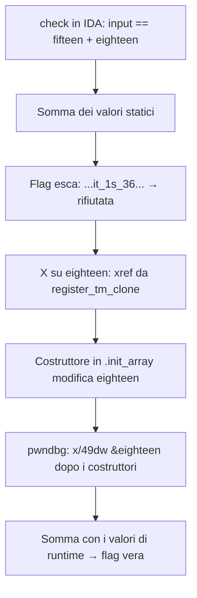

# Challenge 15+18

> [!abstract] In breve
> Crackme ELF x86-64: la flag è la somma, elemento per elemento, di due array globali di `int`, `fifteen` ed `eighteen`. Sommando i valori **statici** che IDA mostra in `.data` si ottiene una flag leggibile ma **sbagliata**: un costruttore nascosto in [[init_array e fini_array|.init_array]] (`register_tm_clone`) modifica `eighteen` prima di `main`. La flag vera si ottiene leggendo l'array **a runtime** con [[pwndbg]]. È lo stesso schema di Sn4k3 in [[Reimplementare codice decompilato in Python]]: dati in `.data`, funzione dal nome ingannevole, flag esca.

| | |
|---|---|
| Categoria | Reverse, Medium |
| Descrizione | `HOW MUCH IS IT???` |
| Allegato | `15+18` (ELF x86-64, PIE) |
| Strumenti | IDA, pwndbg, gcc (o Python) |



## 1. La funzione `check`

L'input finisce nella funzione `check`. Il pseudocodice di Hex-Rays (`F5`) è:

```c
__int64 __fastcall check(const char *a1)
{
  int v3, i, j, k, m;
  _DWORD v8[50];

  if ( strlen(a1) == 49 )
  {
    v3 = 0;
    for ( i = 0; i <= 6; ++i )
      for ( j = 0; j <= 6; ++j )
        v8[7 * i + j] = a1[v3++];          // copia l'input in una "matrice" 7×7
    for ( k = 0; k <= 6; ++k )
      for ( m = 0; m <= 6; ++m )
        if ( v8[7 * k + m] != fifteen[7 * k + m] + eighteen[7 * k + m] )
        {
          puts("c0j0n!");
          return 0xFFFFFFFFLL;
        }
    return 0;
  }
  puts("c0j0n!");
  return 0xFFFFFFFFLL;
}
```

- La flag è lunga **49** caratteri (= 7×7).
- `7*i + j` con `i, j` da 0 a 6 percorre gli indici 0…48 **in ordine**: la "matrice" è solo un modo contorto di scrivere un ciclo da 0 a 48.
- La condizione dice che `flag[i] = fifteen[i] + eighteen[i]`. Il programma non trasforma l'input, quindi non serve invertire nulla: basta **rifare la somma**.
- `return 0xFFFFFFFFLL` è `-1` mostrato come `__int64`. Con `Y` sulla firma e tipo di ritorno `int` diventa `return -1;`.

> [!note] I commenti `// [rsp+1Ch] [rbp-E4h]`
> Accanto alle variabili locali Hex-Rays scrive la loro posizione nello stack, sempre in esadecimale (non c'è un'opzione per passarli in decimale). `v8` sta a `rbp-0xD0` = `rbp-208` e occupa 50 × 4 = 200 byte, fino a `rbp-8`, dove c'è il canary `v9`.

## 2. I dati globali

Doppio clic su `fifteen` (o `G` → `fifteen`) porta alla IDA View, in `.data`:

```text
; _DWORD fifteen[56]
fifteen   dd 0D4h, 52h, 99h, 0, 20h, 2 dup(0ABh), 0D8h, 0A6h, 60h
          ...
          dd 6Bh, 59h, 97h, 0F9h, 12h, 0FAh, 6Ch, 2 dup(0EFh), 7 dup(0)
; _DWORD eighteen[49]
eighteen  dd 0FFFFFF8Fh, 11h, 0FFFFFFD0h, 't', '[', 0FFFFFF9Eh, 0FFFFFFB4h
          ...                       ; DATA XREF: register_tm_clone+C2↑o
                                    ;            register_tm_clone+21D↑o
```

| Array | Cosa sono davvero |
|---|---|
| `fifteen` | 49 `int` tra 0 e 255. IDA dice `[56]` perché ha inglobato `7 dup(0)`, che è solo **padding** fino all'inizio di `eighteen`. Si corregge con `Y` → `int fifteen[49];` |
| `eighteen` | 49 `int` **con segno**: `0FFFFFF8Fh` è −113 in complemento a 2. `'t'`, `'['` sono numeri che IDA mostra come caratteri perché cadono nel range ASCII stampabile |

> [!tip] Leggere i numeri esadecimali
> - IDA scrive l'hex con il suffisso `h` (`1Ch`), Python con il prefisso `0x` (`0x1C`): `print(1Ch)` e `print(0x1Ch)` danno `SyntaxError`. Se il valore è una stringa copiata da IDA: `int("1Ch".rstrip("h"), 16)`.
> - Da DWORD senza segno a `int` con segno: `x - (1 << 32) if x & 0x80000000 else x`. In IDA, `_` (*Change sign*) sull'operando mostra direttamente il negativo.
> - Nel pseudocodice, `H` alterna hex e decimale su una costante.

> [!important] `.data` e non `.rodata`
> Gli array sono in `.data`, cioè **scrivibili**. Un array di "costanti" in `.data` invece che in `.rodata` è sospetto: se l'autore lo ha lasciato modificabile, probabilmente qualcosa lo modifica. Vedi [[Sezioni e Segmenti ELF]].
>
> | Sezione | Contenuto | Permessi |
> |---|---|---|
> | `.rodata` | globali inizializzate **costanti**, stringhe letterali | `R` |
> | `.data` | globali inizializzate **modificabili** | `RW` |
> | `.bss` | globali non inizializzate o a zero (nessuno spazio nel file) | `RW` |

## 3. L'esca

Sommando i valori statici si ottiene una flag di 49 caratteri, coerente e plausibile:

```text
ccit{I_th1nk_1t_1s_36_b3c4us3_15+16=34__15+17=35}
```

Il sito la **rifiuta**. Il contenuto stesso è un indizio: 15 + 18 fa 33, non 36, e la descrizione chiede proprio `HOW MUCH IS IT???`.

## 4. Il costruttore nascosto

Le xref di `eighteen` (visibili accanto ai dati, o con `X`) puntano a **`register_tm_clone`**, senza la *s*. Nella lista delle funzioni ci sono entrambe:

| Funzione | Cos'è |
|---|---|
| `register_tm_clones` | funzione standard aggiunta da GCC, da ignorare |
| `register_tm_clone` | funzione dell'autore, con un nome scelto per confondersi con quella standard |

Registrata in `.init_array`, viene eseguita **prima di `main`** e riscrive `eighteen` (si controlla con `Ctrl+S` → `.init_array`). I valori statici di `eighteen` sono quindi diversi da quelli che `check` confronta davvero; quelli di `fifteen` restano uguali. I primi 5 valori di `eighteen` non cambiano, per questo anche la flag esca inizia con `ccit{`.

## 5. Leggere i valori a runtime

Invece di ricostruire a mano cosa fa `register_tm_clone`, si lascia che il programma la esegua e si legge l'array dopo:

```text
$ gdb ./15+18
pwndbg> break check
pwndbg> run AAAAAAAAAAAAAAAAAAAAAAAAAAAAAAAAAAAAAAAAAAAAAAAAA     # 49 caratteri: passa lo strlen
pwndbg> x/49dw &eighteen
pwndbg> x/49dw &fifteen
```

Arrivati a `check`, i costruttori sono già stati eseguiti. Se il binario non avesse simboli, al posto di `&eighteen` si usa l'indirizzo letto in IDA più la base del PIE (`piebase` in pwndbg).

> [!note] `x/NFU indirizzo`
> `x` (*examine*) legge la memoria: `N` = quante unità, `F` = formato, `U` = dimensione. `x/49dw` legge 49 unità da 4 byte e le mostra in decimale con segno, cioè esattamente un `int[49]`.
>
> | `U` | Byte | IDA | | `F` | Mostra |
> |---|---|---|---|---|---|
> | `b` | 1 | `db` | | `x` | hex |
> | `h` | 2 | `dw` | | `d` / `u` | decimale con / senza segno |
> | `w` | 4 | `dd` | | `c` / `s` | carattere / stringa |
> | `g` | 8 | `dq` | | `i` | istruzioni |
>
> Attenzione: in gdb una *word* è di **4** byte, mentre in IDA (terminologia Intel) `WORD` = 2 byte e `DWORD` = 4.

## 6. Soluzione

```c
#include <stdio.h>

/* fifteen: invariato a runtime (uguale a .data in IDA) */
int fifteen[49] = {
    212,  82, 153,   0,  32, 171, 171, 216, 166,  96,
    248, 185, 147,  23, 211, 209, 145, 163, 229,   1,
    253,  46, 223, 123, 102,  91, 112, 139,  83,  24,
    135, 218, 200, 198,  77, 180, 226,  61, 113, 106,
    107,  89, 151, 249,  18, 250, 108, 239, 239
};

/* eighteen: valori letti con pwndbg DOPO i costruttori (x/49dw &eighteen) */
int eighteen[49] = {
    -113,   17,  -48,  116,   91,  -76,  -67, -165,  -71,   23,
    -196,  -70,  -52,   92,  -99, -158,  -93,  -56, -124,  109,
    -150,   49, -107,  -19,  -51,    4,  -36,  -87,   27,   79,
     -18, -166,  -97, -147,   18,  -69, -124,   34,    3,   -2,
     -56,    6,  -48, -201,   82, -135,  -13, -144, -114
};

int main(void) {
    char flag[50];                         /* 49 caratteri + '\0' */
    for (int i = 0; i < 49; ++i)
        flag[i] = (char)(fifteen[i] + eighteen[i]);
    flag[49] = '\0';

    printf("the flag is %s\n", flag);
    return 0;
}
```

```text
$ gcc -Wall -Wextra solve.c -o solve && ./solve
the flag is ccit{_h3_w4s_sp34king_th3_L4ngu4g3_of_th3_g0ds__}
```

Lo stesso in Python:

```python
print("".join(chr(a + b) for a, b in zip(fifteen, eighteen)))
```

Per verificarla senza inviarla: `./15+18 'ccit{...}'` non deve stampare `c0j0n!`. Le virgolette singole servono perché la shell non interpreti `{` e `}`.

## Errori fatti strada facendo

| Errore | Perché è sbagliato | Correzione |
|---|---|---|
| `for` e `printf` scritti fuori da ogni funzione | fuori da una funzione (*file scope*) il C accetta solo dichiarazioni: gcc dà `expected identifier or '(' before 'for'` | mettere le istruzioni dentro `int main(void) { ... }`; gli array possono restare globali |
| `int flag[49]` stampato con `%s` | `%s` legge byte fino al primo `\0`; ogni `int` è `63 00 00 00`, quindi si stampa solo `c` | `char flag[50]` |
| `i <= 49` | 50 iterazioni: legge `fifteen[49]` ed `eighteen[49]`, fuori dagli array | `i < 49` |
| `char flag[49]` con `flag[49] = '\0'` | scrive un byte oltre la fine dell'array | `char flag[50]` |
| primo ciclo che copia `"thirthytree"` (11 caratteri) in `v8` per 49 posizioni | legge oltre la fine della stringa (*undefined behavior*), e comunque `v8` viene sovrascritto | eliminarlo: per calcolare la flag l'input non serve |
| `printf("%s", v3)` | `v3` è un `int` (vale 49), `%s` vuole un puntatore | passare l'array `flag` |

> [!note] `int` assegnato a `char`
> `flag[i] = fifteen[i] + eighteen[i]` somma due `int` e assegna il risultato a un `char`: è una **conversione implicita**, legale in C. Se il valore sta nel range del `char` (qui sono tutti ASCII stampabili, 32…126) non si perde nulla; altrimenti si tengono solo gli 8 bit bassi. Il cast `(char)(...)` fa la stessa cosa, ma rende esplicito che la conversione è voluta (e zittisce `-Wconversion`).

## Cosa portarsi via

- Una flag che "si legge bene" già nei dati statici è spesso un'**esca**: controllare sempre le **xref** dei dati con `X`.
- I nomi quasi uguali a quelli di sistema (`register_tm_clone` vs `register_tm_clones`) sono un classico per nascondere codice in [[init_array e fini_array|.init_array]].
- Dati "costanti" in `.data` invece che in `.rodata` = probabilmente modificati a runtime.
- Quando la trasformazione dei dati è lunga, è più veloce leggerli **dopo** in un debugger che ricostruirla: analisi statica per capire *cosa* leggere, dinamica per leggerlo.

## Collegamenti

- **Concetti correlati**: [[init_array e fini_array]] · [[Sezioni e Segmenti ELF]] · [[Scorciatoie IDA]] · [[Esportare Dati da IDA]] · [[pwndbg]] · [[Reimplementare codice decompilato in Python]]
- **Mappa**: [[MOC - CyberBootCamp]]

> [!info] Approfondimento
> [[02 - CB - Reverse Engineering 1#Codice fuori da main|Lezione 2 — Codice fuori da main]]
