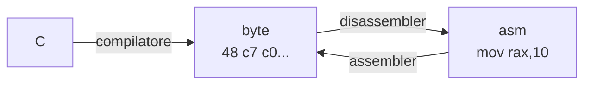

# Codice Macchina e Assembly

> [!summary] In breve
> Il **codice macchina** sono i byte che la CPU esegue; l'**assembly** è la sua forma leggibile. Un **assembler** traduce assembly→byte, un **disassembler** fa l'inverso: per questo ogni binario si può disassemblare.

- La CPU esegue solo codice macchina, specifico dell'**architettura** (x86-64, ARM, RISC-V…). Il corso usa **x86-64** (32 bit = x86).
- Esempio: `mov rax, 10` ⇄ `48 c7 c0 0a 00 00 00`.
- L'operazione è **invertibile**: disassembler per leggere l'assembly, **decompilatore** (IDA) per risalire a uno pseudo-C.

## Collegamenti

- **Concetti correlati**: [[Registri x86-64]] · [[Sintassi Intel e AT&T]] · [[ELF]]
- **Mappa**: [[MOC - CyberBootCamp]]

> [!info] Approfondimento
> - [[03 - CB - Assembly 101#Dal codice macchina all'assembly|Lezione 3 — Dal codice macchina all'assembly]]
