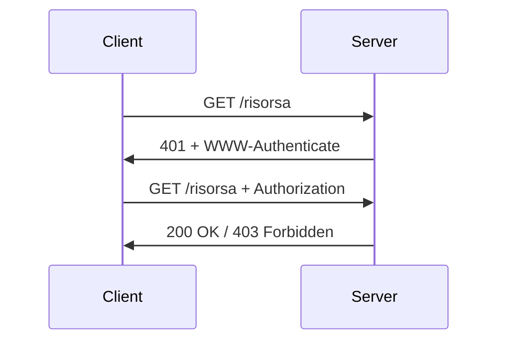

# HTTP Authentication

> [!summary] In breve
> Meccanismo standard di HTTP: il server risponde `401` con `WWW-Authenticate`, il client ripete la richiesta con l'header `Authorization`.

| Tipo | Header | Note |
|---|---|---|
| Basic | `Basic base64(user:pass)` | codifica, non cifratura |
| Digest | `Digest …` | MD5 con `realm` e `nonce` |
| Bearer | `Bearer <token>` | OAuth 2.0, spesso JWT |

- `401` = non autenticato; `403` = autenticato ma non autorizzato.

## Collegamenti

- **Concetti correlati**: [[HTTP]] · [[Cookie]] · [[Authorization]]
- **Mappa**: [[MOC - CyberBootCamp]]

> [!info] Approfondimento
> - [[01 - CB - Web Insecurity 1#HTTP authentication|Lezione 1 — HTTP authentication]]
> - [[01 - CB - Web Insecurity 1#Tipi principali|Lezione 1 — Tipi principali]]
