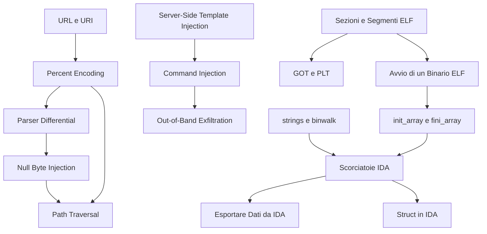

# MOC - CyberBootCamp

> [!abstract]
> Mappa del CyberBootCamp (CyberChallenge.IT, Sapienza): lezioni, concetti di ripasso e collegamenti con gli altri corsi del vault. Le note in `Concetti/` sono riassunti per il ripasso; i concetti già trattati altrove nel vault (HTTP, cookie, path traversal, ELF, …) sono collegati direttamente alle note esistenti.

## Lezioni

| # | Lezione | Argomenti |
|---|---|---|
| 1 | [[01 - CB - Web Insecurity 1]] | standard web, URL/URI, HTTP, cookie, autenticazione; IDOR, path traversal, SSTI, command injection |
| 2 | [[02 - CB - Reverse Engineering 1]] | ELF, dynamic linking, GOT/PLT, `strings`/`binwalk`, IDA, `.init_array`, export dei dati, struct |

## Concetti

### Web: fondamenti
- [[URL e URI]] · [[Percent Encoding]] · [[HTTP Authentication]]
- Nel vault: [[HTTP]] · [[Cookie]] · [[DNS]] · [[Session Management]] · [[Authorization]] · [[Burp Suite]]

### Web: vulnerabilità
- [[Parser Differential]] · [[Null Byte Injection]] · [[Server-Side Template Injection]] · [[Out-of-Band Exfiltration]]
- Nel vault: [[Insecure Direct Object Reference]] · [[Path Traversal]] · [[Command Injection]] · [[SQL Injection]] · [[XSS]]

### Reverse: formato e linking
- [[Sezioni e Segmenti ELF]] · [[GOT e PLT]] · [[Avvio di un Binario ELF]] · [[init_array e fini_array]]
- Nel vault: [[ELF]] · [[Dynamic Linking]]

### Reverse: strumenti
- [[strings e binwalk]] · [[Scorciatoie IDA]] · [[Esportare Dati da IDA]] · [[Struct in IDA]]
- Nel vault: [[IDA Debugger]] · [[3 - MA - Basic Static Analysis]] · [[6 - MA - Advanced Static Analysis]]

## Percorsi trasversali

- **Aggirare i filtri sui percorsi**: [[URL e URI]] → [[Percent Encoding]] → [[Parser Differential]] → [[Null Byte Injection]] → [[Path Traversal]]
- **Dall'input all'esecuzione di comandi**: [[Server-Side Template Injection]] → [[Command Injection]] → [[Out-of-Band Exfiltration]]
- **Come parte un binario**: [[Sezioni e Segmenti ELF]] → [[Avvio di un Binario ELF]] → [[init_array e fini_array]] → [[GOT e PLT]]
- **Risolvere una challenge di reversing**: [[strings e binwalk]] → [[Scorciatoie IDA]] → [[Struct in IDA]] → [[Esportare Dati da IDA]]
