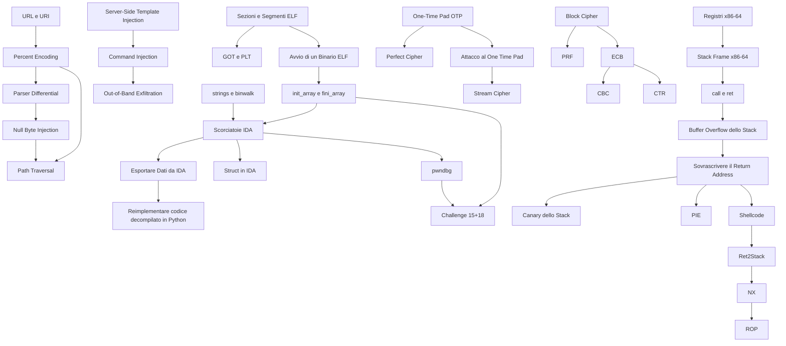

# MOC - CyberBootCamp

> [!abstract]
> Mappa del CyberBootCamp (CyberChallenge.IT, Sapienza): lezioni, concetti di ripasso e collegamenti con gli altri corsi del vault. Le note in `Concetti/` sono riassunti per il ripasso; i concetti già trattati altrove nel vault (HTTP, cookie, path traversal, ELF, …) sono collegati direttamente alle note esistenti.

## Lezioni

| # | Lezione | Argomenti |
|---|---|---|
| 1 | [[01 - CB - Web Insecurity 1]] | standard web, URL/URI, HTTP, cookie, autenticazione; IDOR, path traversal, SSTI, command injection |
| 2 | [[02 - CB - Reverse Engineering 1]] | ELF, dynamic linking, GOT/PLT, `strings`/`binwalk`, IDA, `.init_array`, export dei dati, struct |
| 3 | [[03 - CB - Assembly 101]] | assembly x86-64: registri, istruzioni, accesso memoria, controllo di flusso, stack frame, calling convention, caller/callee-saved, sintassi Intel/AT&T |
| 4 | [[04 - CB - Binary Exploitation 1]] | pwntools, `call`/`ret` e lo stack, buffer overflow, sovrascrittura del return address (ret2win) |
| 5 | [[05 - CB - Binary Exploitation 2]] | mitigazioni: stack canary, PIE, NX; workaround: leak, shellcode e Ret2Stack, ROP e gadget (`ropper`) |
| 6 | [[06 - CB - Crypto 1]] | confidenzialità/autenticazione, simmetrica vs asimmetrica; One Time Pad e cifrario perfetto, riuso della chiave; stream cipher e RC4; block cipher (AES/DES), PRF/PRP, modi ECB/CBC/CTR |

## Concetti

### Web: fondamenti
- [[URL e URI]] · [[Percent Encoding]] · [[HTTP Authentication]]
- Nel vault: [[HTTP]] · [[Cookie]] · [[DNS]] · [[Session Management]] · [[Authorization]] · [[Burp Suite]]

### Web: vulnerabilità
- [[Parser Differential]] · [[Null Byte Injection]] · [[Server-Side Template Injection]] · [[Out-of-Band Exfiltration]]
- Nel vault: [[Insecure Direct Object Reference]] · [[Path Traversal]] · [[Command Injection]] · [[SQL Injection]] · [[XSS]]

### Reverse: formato e linking
- [[Sezioni e Segmenti ELF]] · [[GOT e PLT]] · [[Avvio di un Binario ELF]] · [[init_array e fini_array]]
- Nel vault: [[ELF]] · [[Dynamic Linking]]

### Reverse: strumenti
- [[strings e binwalk]] · [[Scorciatoie IDA]] · [[Esportare Dati da IDA]] · [[Struct in IDA]] · [[pwndbg]] · [[Reimplementare codice decompilato in Python]]
- Nel vault: [[GDB]] · [[IDA Debugger]] · [[3 - MA - Basic Static Analysis]] · [[6 - MA - Advanced Static Analysis]]

### Assembly x86-64
- [[Codice Macchina e Assembly]] · [[Registri x86-64]] · [[Istruzioni x86-64]] · [[Controllo di Flusso in Assembly]] · [[Stack Frame x86-64]] · [[Calling Convention]] · [[Registri Caller-saved e Callee-saved]] · [[Sintassi Intel e AT&T]]
- Nel vault: [[2 - MA - X86 Assembly]] · [[Stack Frame]]

### Binary exploitation: le basi
- [[pwntools]] · [[call e ret]] · [[Buffer Overflow dello Stack]] · [[Sovrascrivere il Return Address]]
- Nel vault: [[Buffer Overflow]]

### Binary exploitation: mitigazioni e workaround
- [[Canary dello Stack]] · [[PIE]] · [[NX]] · [[Shellcode]] · [[Ret2Stack]] · [[ROP]]
- Nel vault: [[Stack Canary]]

### Crittografia (Crypto 1)
> I concetti di crittografia sono trattati a fondo nel corso **Cybersecurity**: le note qui sotto rimandano direttamente a quelle, per non duplicarle. L'unica nota propria del CyberBootCamp è l'attacco OTP in ottica CTF.
- Taglio CTF: [[Attacco al One Time Pad]] · [[pycryptodome]] (AES in Python: ECB, CBC, CTR)
- Fondamenti (Cybersecurity): [[Symmetric Encryption]] · [[Asymmetric Encryption]] · [[One-Time Pad (OTP)]] · [[Perfect Cipher]]
- Cifrari (Cybersecurity): [[Stream Cipher]] · [[PRF (Pseudorandom Function)]] · [[Block Cipher]] · [[AES]] · [[DES]] · [[ECB]] · [[CBC]] · [[CTR]]

## Challenge

| Challenge | Categoria | Tecniche |
|---|---|---|
| [[Challenge 15+18]] | Reverse, Medium | flag come somma di due array globali, esca statica, costruttore nascosto in `.init_array`, lettura a runtime con pwndbg |
| Sn4k3 (in [[Reimplementare codice decompilato in Python#Esempio completo: Sn4k3\|Reimplementare codice decompilato]]) | Reverse | costruttore nascosto, tipi corretti con `Y`, reimplementazione in Python |
| GuessThePlaintext (in [[pycryptodome#GuessThePlaintext · AES in ECB, CBC e CTR con chiave scelta da te\|pycryptodome]]) | Crypto | AES in ECB, CBC e CTR con pycryptodome, conversione hex → byte, prompt con pwntools |
| BitCrypt (in [[Attacco al One Time Pad#BitCrypt · OTP con chiave riusata tra i tuoi messaggi e la flag\|Attacco al One Time Pad]]) | Crypto | OTP con chiave riusata, known-plaintext (`K = P ⊕ C`), conversioni str / bytes / hex, lettura del menu con pwntools |
| countme (in [[Attacco al One Time Pad#countme · AES-CTR con nonce fisso, cioè OTP con keystream riusato\|Attacco al One Time Pad]]) | Crypto | AES-CTR con chiave e nonce fissi → keystream riusato, `C_F ⊕ C_M ⊕ M = F`, prompt di `input()` senza `\n` |

## Percorsi trasversali

- **Aggirare i filtri sui percorsi**: [[URL e URI]] → [[Percent Encoding]] → [[Parser Differential]] → [[Null Byte Injection]] → [[Path Traversal]]
- **Dall'input all'esecuzione di comandi**: [[Server-Side Template Injection]] → [[Command Injection]] → [[Out-of-Band Exfiltration]]
- **Come parte un binario**: [[Sezioni e Segmenti ELF]] → [[Avvio di un Binario ELF]] → [[init_array e fini_array]] → [[GOT e PLT]]
- **Risolvere una challenge di reversing**: [[strings e binwalk]] → [[Scorciatoie IDA]] → [[Struct in IDA]] → [[Esportare Dati da IDA]] → [[Reimplementare codice decompilato in Python]]
- **Dati modificati prima di main**: [[Sezioni e Segmenti ELF]] → [[init_array e fini_array]] → [[pwndbg]] → [[Challenge 15+18]]
- **Leggere l'assembly**: [[Codice Macchina e Assembly]] → [[Registri x86-64]] → [[Istruzioni x86-64]] → [[Controllo di Flusso in Assembly]] → [[Stack Frame x86-64]] → [[Calling Convention]]
- **Dallo stack all'exploit**: [[Stack Frame x86-64]] → [[call e ret]] → [[Buffer Overflow dello Stack]] → [[Sovrascrivere il Return Address]]
- **Aggirare le mitigazioni**: [[Sovrascrivere il Return Address]] → [[Canary dello Stack]] → [[PIE]] → [[Shellcode]] → [[Ret2Stack]] → [[NX]] → [[ROP]]
- **Dal One Time Pad ai cifrari reali** (Cybersecurity): [[One-Time Pad (OTP)]] → [[Perfect Cipher]] → [[Attacco al One Time Pad]] → [[Stream Cipher]]
- **Cifrari a blocchi e modi** (Cybersecurity): [[Block Cipher]] → [[PRF (Pseudorandom Function)]] → [[ECB]] → [[CBC]] → [[CTR]]
