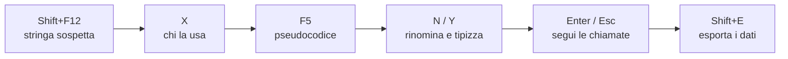

# Scorciatoie IDA

> [!summary] In breve
> I tasti per muoversi in IDA e trasformare l'assembly in pseudocodice leggibile, divisi per scopo. Quelli in **grassetto** sono quelli visti a lezione; gli altri sono aggiunte utili per le challenge. I tasti sono gli stessi in IDA Free e IDA Pro: cambia cosa c'è dietro (vedi sotto). Legenda: ☁️ in Free funziona solo online, 🔒 non disponibile in Free.

> [!note] Versioni
> I tasti sono quelli predefiniti di IDA 8/9 (Pro e Free). Si possono cambiare da **Options → Shortcuts**, e la *command palette* `Ctrl+Shift+P` cerca qualsiasi comando per nome, mostrando anche il suo tasto: utile quando non ricordi una scorciatoia.

## IDA Free e IDA Pro

Le scorciatoie sono identiche, perché l'interfaccia è la stessa. Le differenze stanno nelle funzioni a cui i tasti danno accesso:

| | IDA Free | IDA Pro |
|---|---|---|
| Licenza | gratuita, solo uso non commerciale | a pagamento (esiste anche IDA Home, non commerciale, a prezzo ridotto) |
| Architetture | solo x86/x64 | tutte quelle supportate (ARM, MIPS, PowerPC, …) |
| Decompilatore (`F5`) | ☁️ cloud, solo x86/x64: serve la connessione, il codice viene inviato ai server di Hex-Rays, mancano alcune funzioni avanzate | in base al piano: cloud (Essential) o **locale** (Expert, Ultimate), per più architetture |
| Script (`Shift+F2`, `Alt+F7`) | solo **IDC**, il linguaggio di script interno | IDC e **IDAPython** |
| Plugin e SDK | 🔒 no SDK C++ né IDAPython, quindi niente plugin Python | sì, più `idalib` per usare IDA senza interfaccia (script, CI) |
| Debugger (`F9`, `F7`, `F8`, …) | solo **locale** x86/x64 | locale e **remoto** (debugger server, GDB server) |

> [!tip] Per il CyberBootCamp
> Le challenge di questo modulo sono ELF x86-64, quindi IDA Free basta: decompilatore cloud, debugger locale su Linux e tutte le scorciatoie di questa nota. I limiti si sentono quando servono script Python, un binario ARM o il debug di un ELF da una macchina Windows, che richiede il debugger remoto. In questi casi le alternative gratuite sono **Ghidra** (con scripting in Java e Python) e **gdb** con estensioni come pwndbg o GEF.

## Navigazione

| Tasto | Azione |
|---|---|
| `G` | salta a un indirizzo o a un nome (es. `main`, `0x401136`) |
| `Enter` / doppio clic | segue il riferimento sotto il cursore (funzione, variabile, salto) |
| `Esc` | torna indietro alla posizione precedente |
| `Ctrl+Enter` | va avanti (annulla l'`Esc`) |
| `Ctrl+P` | elenco delle funzioni con ricerca, per saltarci |
| `Ctrl+L` | elenco dei nomi, per saltarci |
| **`Ctrl+S`** | salta a un segmento/sezione (`.init_array`, `.data`, …) |
| `Ctrl+E` | salta a un entry point |
| `Alt+M` / `Ctrl+M` | segna la posizione corrente / torna a una posizione segnata |
| `Space` | alterna vista a grafo e vista testuale del disassemblato |

> [!tip]
> `Esc` è il tasto che si usa di più: si segue una chiamata con `Enter`, si guarda, e si torna con `Esc`, come il "indietro" del browser.

## Finestre

| Tasto | Finestra |
|---|---|
| **`Tab`** | alterna disassemblato e pseudocodice della stessa funzione ☁️ |
| **`F5`** | apre (o rigenera) lo pseudocodice ☁️ |
| **`Shift+F12`** | Strings: tutte le stringhe trovate nel binario |
| **`Shift+F7`** | Segments: sezioni con indirizzi e permessi |
| `Shift+F3` | Functions |
| `Shift+F4` | Names: tutti i nomi (funzioni, dati, import) |
| `Shift+F1` | Local Types: definizione di tipi e struct (da IDA 9 sostituisce Structures ed Enums) |
| `Shift+F9` | Structures (fino a IDA 8) |
| `Shift+F11` | Type libraries: librerie di tipi caricate (es. tipi di libc) |
| `Ctrl+1` | Quick view: menu per aprire qualsiasi finestra |

> [!tip] Gli import
> La finestra **Imports** non ha un tasto di default (si apre da **View → Open subviews → Imports**), ma è tra le prime da guardare: le funzioni di libreria usate (`strcmp`, `memcmp`, `fopen`, `ptrace`, …) dicono molto su cosa fa il programma.

## Riferimenti incrociati

| Tasto | Azione |
|---|---|
| **`X`** | elenca chi usa la funzione/variabile sotto il cursore (*xrefs to*) |
| `Ctrl+X` | elenca i riferimenti all'**indirizzo corrente** (mentre `X` usa l'operando sotto il cursore) |

Nella finestra delle xref, il tipo indica come viene usato l'elemento: `p` = chiamata (*procedure*), `j` = salto, `r` = lettura, `w` = scrittura, `o` = offset (preso l'indirizzo).

## Ricerca

| Tasto | Azione | Successivo |
|---|---|---|
| `Alt+T` | cerca testo (nel listato) | `Ctrl+T` |
| `Alt+B` | cerca sequenza di byte (es. `7F 45 4C 46` o `"flag"`) | `Ctrl+B` |
| `Alt+I` | cerca un valore immediato (costante usata nelle istruzioni, es. `0x539`) | `Ctrl+I` |

> [!example]
> Se un controllo confronta l'input con una costante magica, `Alt+I` con quel valore trova tutte le istruzioni che la usano. Per costanti note di algoritmi (es. `0x67452301` di MD5/SHA-1) dice subito quale algoritmo c'è nel binario.

## Rinominare, tipizzare, commentare

| Tasto | Dove | Azione |
|---|---|---|
| **`N`** | ovunque | rinomina funzione, variabile, indirizzo |
| **`Y`** | ovunque | imposta il tipo (prototipo di funzione, `char *`, `int[32]`, una struct) |
| `:` | disassemblato | commento sulla riga |
| `;` | disassemblato | commento *ripetibile*: compare ovunque si faccia riferimento a quell'indirizzo |
| `/` | pseudocodice ☁️ | commento sulla riga |
| `Ins` / `Shift+Ins` | disassemblato | commento su una riga sopra / sotto l'istruzione |
| `=` | pseudocodice ☁️ | unisce due variabili che sono in realtà la stessa (*map to another variable*) |
| `\` | pseudocodice ☁️ | nasconde/mostra i cast |

> [!tip] Rinominare paga
> Rinominare `v3` in `input_len` e `sub_401136` in `check_flag` richiede un secondo e rende leggibile tutto il resto: i nuovi nomi si propagano in ogni funzione che li usa.

## Rappresentare i numeri

| Tasto | Rappresentazione | Esempio |
|---|---|---|
| **`H`** | decimale (alterna con hex) | `41h` ↔ `65` |
| `Q` | esadecimale | `65` → `41h` |
| `B` | binario | `41h` → `1000001b` |
| **`R`** | carattere (alterna con hex) | `41h` ↔ `'A'` |
| `O` | offset (il numero è un indirizzo) | `401136h` → `offset main` |
| `M` | costante simbolica di un enum | `2` → `O_RDWR` |
| `T` | offset in una struct | `[rax+64h]` → `[rax+Car.year]` |

> [!example]
> Un controllo come `if ( v4 == 0x7B67616C66 )` diventa leggibile con `R`: IDA mostra `'{galf'`, cioè `"flag{"` al contrario, perché in memoria i byte sono in little endian (`66 6C 61 67 7B` = `f l a g {`).

## Definire codice e dati

| Tasto | Azione |
|---|---|
| **`C`** | interpreta i byte come codice |
| **`U`** | annulla la definizione (torna a byte grezzi) |
| `P` | crea una funzione a partire dall'indirizzo corrente |
| `Alt+P` | modifica i confini e gli attributi di una funzione |
| **`D`** | interpreta come dato; premuto più volte cicla `db` → `dw` → `dd` → `dq` |
| **`A`** | interpreta come stringa |
| `Alt+A` | sceglie il tipo di stringa (C, UTF-16, Pascal, …) |
| **`*`** | converte in array (chiede numero di elementi) |
| `Alt+Q` | applica una struct alla posizione corrente |
| `Shift+E` | esporta i dati selezionati (vedi [[Esportare Dati da IDA]]) |

> [!warning] Codice non riconosciuto
> Con offuscamento o *anti-disassembly* IDA a volte interpreta del codice come dati (byte rossi o `db` dove dovrebbero esserci istruzioni). Si risolve con `U` sulla zona sbagliata, poi `C` dal punto giusto e `P` per ricreare la funzione.

## Patching

Si fa dalla vista **Hex** o da **Edit → Patch program**:

| Tasto | Dove | Azione |
|---|---|---|
| `F2` | Hex view | inizia a modificare i byte; `F2` di nuovo per applicare |
| — | Edit → Patch program → Assemble | riscrive un'istruzione in assembly (es. `jz` → `jnz`) |
| — | Edit → Patch program → Apply patches to input file | salva le modifiche sul file eseguibile |

Le modifiche restano nel database finché non le si applica al file con l'ultimo comando.

## Debugger

In IDA Free il debugger è solo locale x86/x64: su Linux si fa il debug degli ELF, su Windows dei PE. Il debug remoto (es. un ELF eseguito in una VM Linux da IDA su Windows) è 🔒.

| Tasto | Azione |
|---|---|
| `F2` | (nel listato) imposta/rimuove un breakpoint |
| `F9` | avvia / continua l'esecuzione |
| `F7` | *step into*: entra nelle chiamate |
| `F8` | *step over*: esegue la chiamata senza entrarci |
| `F4` | esegue fino alla riga del cursore |
| `Ctrl+F7` | esegue fino al ritorno dalla funzione corrente |
| `Ctrl+F2` | termina il processo |

Per il debugger di IDA in dettaglio: [[IDA Debugger]].

## Database e script

| Tasto | Azione |
|---|---|
| `Ctrl+W` | salva il database (`.i64`) |
| `Ctrl+Z` / `Ctrl+Shift+Z` | annulla / ripeti (da IDA 7.3) |
| `Shift+F2` | esegue uno script scritto al momento (IDC; Python 🔒) |
| `Alt+F7` | esegue un file di script (`.idc`; `.py` 🔒) |

> [!tip] Leggere i dati con uno script
> Con `Shift+F2` si possono leggere i dati direttamente, in alternativa a `Shift+E`.
> - **IDA Pro / Home (IDAPython)**: `idc.get_bytes(0x404060, 104*4)` restituisce i byte dell'array, pronti per lo script del solver.
> - **IDA Free (IDC)**: un ciclo con `get_wide_dword` stampa i valori uno per uno:
>   ```c
>   auto i; for (i = 0; i < 104; i++) msg("%d, ", get_wide_dword(0x404060 + i*4));
>   ```

## Flusso di lavoro tipico



Oltre a `main`: `Ctrl+S` → `.init_array` per i costruttori nascosti ([[init_array e fini_array]]).

Lista ufficiale completa: <https://www.hex-rays.com/products/ida/support/freefiles/IDA_Pro_Shortcuts.pdf>.

## Collegamenti

- **Concetti correlati**: [[Esportare Dati da IDA]] · [[Struct in IDA]] · [[IDA Debugger]] · [[init_array e fini_array]]
- **Mappa**: [[MOC - CyberBootCamp]]

> [!info] Approfondimento
> - [[02 - CB - Reverse Engineering 1#Scorciatoie (TagliCorts)|Lezione 2 — Scorciatoie (TagliCorts)]]
> - [[02 - CB - Reverse Engineering 1#L'interfaccia|Lezione 2 — L'interfaccia]]
