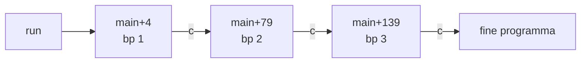
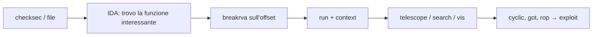

# pwndbg

> [!summary] In breve
> **pwndbg** (*pwn* + *dbg*, si legge "pown-debug") è un **plugin Python per GDB**, non un debugger separato: sotto gira sempre [[GDB]]. Rende GDB adatto al reversing e all'exploitation: a ogni stop mostra registri, disassembly, stack e backtrace. In più segue automaticamente i puntatori (*dereferencing*) e offre comandi per memoria, protezioni, ROP e soprattutto **heap glibc**.

> [!warning] Nome
> Si scrive **pwndbg**: la parte finale è *dbg* come in *debug*. Scritture come "pwngdb" o "pwndgb" sono refusi.

## Perché serve

GDB da solo è potente, ma dopo ogni `stepi` mostra soltanto la riga corrente: registri, stack e istruzioni successive vanno stampati a mano (`info registers`, `x/20gx $rsp`, `x/10i $rip`, …). Nel reversing dinamico serve vedere tutto questo **a ogni passo**. Serve anche sapere a cosa punta ogni indirizzo: stack, heap, codice o una stringa.

È il passo successivo all'analisi statica: quando IDA non basta (offuscamento, valori calcolati a runtime, decompilazione che fallisce), si esegue il binario e lo si osserva mentre gira. Vedi [[02 - CB - Reverse Engineering 1#E il reversing dinamico?|Lezione 2 — E il reversing dinamico?]].

## pwndbg, GEF e PEDA

| | GDB "nudo" | PEDA | GEF | pwndbg |
|---|---|---|---|---|
| Cos'è | il debugger | plugin (storico, poco mantenuto) | plugin in un unico file `.py` | plugin con dipendenze (progetto più grande) |
| Vista a ogni stop | no | sì | sì | sì |
| Punti forti | — | — | facile da installare, molte architetture | heap glibc, emulazione delle istruzioni successive, comandi in stile WinDbg |

> [!important] Uno alla volta
> I tre plugin si caricano tutti da `~/.gdbinit` e **vanno in conflitto** se attivi insieme. Tieni una sola riga `source` attiva, oppure crea degli alias come quelli qui sotto.

## Installazione

```bash
git clone https://github.com/pwndbg/pwndbg
cd pwndbg
./setup.sh          # installa le dipendenze e aggiunge "source .../gdbinit.py" a ~/.gdbinit
```

Il README ufficiale offre anche pacchetti e versioni *portable* pronte all'uso. Per passare da un plugin all'altro senza modificare `~/.gdbinit`:

```bash
# in ~/.zshrc o ~/.bashrc
alias gdb-pwndbg='gdb -nx -ix ~/pwndbg/gdbinit.py'
alias gdb-gef='gdb -nx -ix ~/.gdbinit-gef.py'
```

`-nx` dice a GDB di non leggere `~/.gdbinit`, mentre `-ix` carica il file indicato prima del binario.

## Primo utilizzo: una sessione d'esempio

Un piccolo crackme che chiede una password e la confronta con `strcmp`:

```c
// chall.c
#include <stdio.h>
#include <string.h>

int main(void) {
    char buf[32];
    printf("Password: ");
    fgets(buf, sizeof buf, stdin);
    buf[strcspn(buf, "\n")] = 0;          // toglie il '\n' finale
    if (strcmp(buf, "s3cr3t") == 0)
        puts("flag{debugger_ftw}");
    else
        puts("Wrong!");
    return 0;
}
```

```bash
gcc -o chall chall.c      # niente -g: come in una challenge, senza sorgente
gdb -q ./chall            # -q toglie il banner; se pwndbg è attivo il prompt diventa "pwndbg>"
```

**1. Prima occhiata al binario**, senza eseguirlo:

```text
pwndbg> checksec          # protezioni: PIE, NX, canary, RELRO
pwndbg> info functions    # funzioni con un nome (main, strcmp@plt, ...)
pwndbg> disass main       # disassembly di main
```

**2. Avvio fino a `main`**:

```text
pwndbg> start
```

`start` mette un breakpoint temporaneo su `main` ed esegue. Al primo stop compare il context, con registri, `DISASM` (freccia `►` sull'istruzione corrente), `STACK` e `BACKTRACE`. Se il binario è *stripped* e `main` non si trova, si usa `entry`.

**3. Arrivare al confronto**. Invece di contare le istruzioni con `ni`, si salta da una `call` all'altra:

```text
pwndbg> nextcall          # si ferma prima della prossima call (printf)
pwndbg> nextcall          # fgets: alla prossima esecuzione il programma aspetta l'input
pwndbg> ni                # esegue fgets → scrivo "ciao" e premo Invio
pwndbg> nextcall          # strcspn
pwndbg> nextcall          # strcmp
```

Fermo sulla `call strcmp`, il `DISASM` mostra già gli argomenti risolti. L'output è abbreviato:

```text
 ► 0x5555555551d4 <main+107>    call   strcmp@plt
        s1: 0x7fffffffdf90 ◂— 'ciao'
        s2: 0x555555556013 ◂— 's3cr3t'
```

La password si legge qui: è il secondo argomento, in `rsi`. Si può verificare anche a mano:

```text
pwndbg> x/s $rdi          # → "ciao"
pwndbg> x/s $rsi          # → "s3cr3t"
pwndbg> telescope $rsp 8  # lo stack, con il buffer e i puntatori seguiti
```

**4. Cambiare il risultato** (patch a runtime), invece di rilanciare con la password giusta:

```text
pwndbg> ni                # esegue strcmp
pwndbg> p $eax            # ≠ 0: le stringhe sono diverse
pwndbg> set $eax = 0      # faccio credere al programma che siano uguali
pwndbg> c                 # continue → stampa "flag{debugger_ftw}"
```

**5. Rilanciare con un input preparato**, senza digitarlo ogni volta:

```text
pwndbg> run < input.txt               # stdin da file
pwndbg> run arg1 arg2                 # argomenti da riga di comando
pwndbg> run < <(python3 -c 'print("A"*40)')   # input generato al volo
```

> [!tip] Se il binario è PIE
> In questo esempio gli indirizzi iniziano con `0x5555...`: GDB disattiva l'ASLR, quindi la base del binario PIE è sempre `0x555555554000`. Per mettere un breakpoint su un indirizzo visto in IDA (es. `0x11d4`) si usa `breakrva 0x11d4`, senza calcolare la somma a mano.

## La vista *context*

A ogni stop (breakpoint, `stepi`, `nexti`, …) pwndbg stampa il **context**, diviso in sezioni:

| Sezione     | Cosa mostra                                                                                                                                    |
| ----------- | ---------------------------------------------------------------------------------------------------------------------------------------------- |
| `LEGEND`    | i colori usati: **STACK**, **HEAP**, **CODE**, **DATA**, **RWX**, **RODATA**                                                                   |
| `REGISTERS` | i registri, con i puntatori seguiti fino al valore finale (catena `→`); i registri cambiati sono evidenziati                                   |
| `DISASM`    | le istruzioni attorno a `rip`. Grazie all'emulazione (Unicorn) mostra se un salto condizionale verrà preso e annota gli argomenti delle `call` |
| `SOURCE`    | il codice sorgente, se il binario ha i simboli di debug                                                                                        |
| `STACK`     | le prime parole dello stack, dereferenziate                                                                                                    |
| `BACKTRACE` | la catena delle chiamate                                                                                                                       |

```text
 RAX  0x401136 (main) ◂— push rbp
 RDI  0x7fffffffe0b8 —▸ 0x7fffffffe3f1 ◂— '/home/user/chall'
```

`—▸` indica "punta a", `◂—` il valore contenuto all'indirizzo. Il colore dice in quale regione di memoria si trova l'indirizzo.

```text
context                       # ristampa il context
set context-sections "regs disasm stack"   # mostra solo queste sezioni
contextoutput stack /dev/pts/3 true        # manda una sezione su un altro terminale (comodo con tmux)
config / theme                # elenca e cambia le opzioni
```

## Comandi essenziali

### Eseguire e muoversi

| Comando | Cosa fa |
|---|---|
| `start` / `entry` | si ferma su `main`, oppure sull'*entry point* (utile se il binario è *stripped* e `main` non ha nome) |
| `break *0x401136`, `b main` | breakpoint (comandi GDB normali) |
| `breakrva 0x1234` (`brva`) | breakpoint a un offset relativo alla base, per binari **PIE** |
| `si` / `ni` | un'istruzione, entrando o meno nelle `call` |
| `nextcall` / `nextret` / `nextsyscall` | prosegue fino alla prossima `call`, `ret` o syscall |
| `stepret` | prosegue fino all'uscita dalla funzione corrente |
| `xuntil 0x401200` | prosegue fino a un indirizzo, senza lasciare un breakpoint |

### Come funzionano i breakpoint

Un **breakpoint** è un segnaposto su un'istruzione che dice al debugger: "quando il programma sta per eseguire questa istruzione, fermalo e dammi il controllo". Senza breakpoint il programma gira a velocità piena fino alla fine; con i breakpoint si sceglie **dove** fermarlo per guardare registri, stack e memoria in quel momento.

> [!important] Due regole
> 1. Si ferma **prima** di eseguire l'istruzione: con un breakpoint su `call strcmp`, al momento dello stop `strcmp` non è ancora stata chiamata.
> 2. Scatta solo se quell'indirizzo viene **eseguito**. Su un dato (stringa, variabile) non scatta mai, e neanche su codice da cui il programma non passa (es. il ramo `else` di un `if` non preso).

**In pratica**:

```text
pwndbg> b *main+79        # 1. metto il breakpoint (numero 1)
pwndbg> run               # 2. il programma gira normalmente...
                          #    ...arriva a main+79 → si FERMA, vedo il context
pwndbg> ni / si / ...     # 3. vado avanti a mano, un'istruzione alla volta
pwndbg> c                 # 4. riparte a velocità piena fino al prossimo breakpoint
                          #    (o fino alla fine, se non ce ne sono altri)
```

Con più breakpoint, `c` si ferma sul **primo che il programma incontra eseguendo**, non sul prossimo per numero: il numero indica solo l'ordine di creazione.



Un breakpoint dentro un ciclo scatta **a ogni giro**: per questo esistono `ignore N 5` (salta 5 giri) e `condition` (fermati solo se…).

#### Dietro le quinte: `int3`

Un breakpoint software **modifica il codice del programma in memoria**:

1. Con `b *0x401136`, GDB salva il primo byte dell'istruzione a quell'indirizzo e lo sostituisce con **`0xCC`**, l'istruzione `int3` di x86.
2. Il programma gira. Quando la CPU arriva a `0x401136` esegue `int3`, che genera un'eccezione: il kernel ferma il processo e avvisa il debugger con un `SIGTRAP`.
3. GDB rimette il byte originale e riporta `rip` indietro di 1, all'inizio dell'istruzione vera. Poi mostra il prompt.
4. Con `c`, GDB esegue **una sola** istruzione (quella originale), rimette `0xCC` e lascia correre il programma: il breakpoint resta attivo per il passaggio successivo.

```text
prima:   0x401136:  55        push rbp
con bp:  0x401136:  CC        int3        ← il programma "inciampa" qui
```

Per questo l'indirizzo deve essere l'**inizio** di un'istruzione: a metà, `0xCC` rovina l'istruzione e il programma si comporta in modo strano o crasha.

> [!note] Anti-debugging
> Siccome il breakpoint è un `0xCC` scritto nel codice, un malware può accorgersene leggendo i propri byte o calcolandone un checksum. I breakpoint hardware (sotto) non lasciano questa traccia. Vedi [[5 - MA - Malware Evasion]].

#### Tipi di breakpoint

| Tipo | Comando | Come funziona | Quando usarlo |
|---|---|---|---|
| Software | `b`, `break` | `0xCC` nel codice | il caso normale, numero illimitato |
| Temporaneo | `tbreak` | come sopra, ma si cancella dopo il primo stop | "fermati qui una volta" (`start` fa proprio questo su `main`) |
| Hardware | `hbreak` | registri di debug della CPU (DR0–DR3), il codice non viene toccato | codice che si controlla da solo, ROM. Al massimo 4 |
| Watchpoint | `watch` / `rwatch` / `awatch` | registri di debug sulla **memoria** | fermarsi quando un dato viene scritto / letto / letto o scritto: è il "breakpoint sui dati" |

> [!example] Breakpoint su un dato
> Per un dato come `[rip+0x19d0]` il breakpoint giusto è un watchpoint: `rwatch *(long*)0x555555557010` si ferma quando qualcuno **legge** quell'indirizzo, `watch` quando qualcuno lo **scrive**.

#### Breakpoint e PIE

Se il binario è PIE e si mette `b *0x11d4` (indirizzo di IDA) **prima** di `run`, il breakpoint finisce nel posto sbagliato: a runtime il codice sta a `0x555555554000 + 0x11d4`. Le soluzioni sono due:
- fare prima `start`, poi mettere i breakpoint con gli indirizzi veri;
- usare `breakrva 0x11d4`, che fa la somma da solo.

I breakpoint su **nomi** (`b main`, `b strcmp`) funzionano sempre, perché GDB ricalcola l'indirizzo quando il programma parte.

### Gestire più breakpoint

Ogni breakpoint ha un **numero**, e i comandi che agiscono su un breakpoint specifico vogliono quel numero:

```text
pwndbg> info breakpoints      # oppure: i b
Num  Type        Disp Enb Address            What
1    breakpoint  keep y   0x0000555555555189 <main+4>
2    breakpoint  keep y   0x00005555555551d4 <main+79>
3    breakpoint  keep y   0x0000555555555210 <main+139>
```

`Enb` dice se il breakpoint è attivo (`y`/`n`); `Disp` è `keep` per un breakpoint normale e `del` per uno temporaneo (`tbreak`).

| Comando | Cosa fa |
|---|---|
| `disable 2` / `enable 2` | lo disattiva o lo riattiva, senza cancellarlo |
| `delete 2` | lo cancella (`delete` da solo li cancella tutti) |
| `enable once 2` | si ferma lì una volta sola, poi si disattiva |
| `ignore 2 5` | salta i prossimi 5 passaggi (utile nei cicli) |
| `condition 2 $rax == 0x10` | si ferma solo se la condizione è vera (`condition 2` da solo la toglie) |
| `disable 1 3` / `disable 1-3` | più breakpoint insieme |

> [!example] Arrivare solo al breakpoint 3
> GDB non ha un comando "vai al breakpoint N", ma si ottiene così:
> ```text
> pwndbg> disable        # disattiva tutti
> pwndbg> enable 3       # riattiva solo il 3
> pwndbg> c              # si ferma al 3
> pwndbg> enable         # poi li riattiva tutti
> ```
> Senza toccare i breakpoint: `advance *<addr>` (GDB) o `xuntil <addr>` (pwndbg) proseguono fino a un indirizzo, ma si fermano prima se incontrano un altro breakpoint attivo.

> [!tip] PIE e indirizzi di IDA
> Con PIE il binario viene caricato a una base casuale (vedi [[ASLR]]), quindi gli indirizzi di IDA non coincidono con quelli a runtime. `piebase` stampa la base, `breakrva <offset IDA>` mette il breakpoint e `$rebase(0x1234)` converte l'offset in un'espressione: `x/s $rebase(0x2004)`.

### Saltare, uscire dalle funzioni, chiamarle

Con un debugger si controlla completamente il processo: lo si può spostare, far uscire da una funzione o fargli chiamare funzioni che il programma non chiamerebbe mai. Tecnicamente GDB è un processo separato che usa la system call **`ptrace`**: il kernel gli permette di fermare il processo e di leggerne e scriverne registri e memoria.

#### Arrivare a un punto: eseguire o saltare?

| Voglio… | Comando | Le istruzioni in mezzo |
|---|---|---|
| arrivare a un indirizzo **eseguendo** tutto | `advance *<addr>`, `xuntil <addr>`, `c` | vengono eseguite |
| spostarmi **senza eseguire** nulla | `set $rip = <addr>` | vengono saltate |
| spostarmi e **ripartire subito** | `jump *<addr>` | vengono saltate |

> [!warning] `jump` riparte
> `jump *addr` non si limita a spostare `rip`: fa ripartire il programma, come un `c` da quel punto. Senza un breakpoint più avanti, il programma arriva fino alla fine. Quindi:
> ```text
> tbreak *0x5555555551e0      # prima un breakpoint temporaneo sulla destinazione
> jump *0x5555555551e0        # salta e si ferma subito lì
> # oppure, più semplice:
> set $rip = 0x5555555551e0   # sposta e basta; riparti tu con ni / c
> ```
> Vanno bene anche nomi e offset: `jump *mySecretFunction`, `set $rip = main+42`, `set $rip = $rebase(0x2400)`.

> [!example] Saltare un controllo
> ```text
>    0x...1d4   call   strcmp
>    0x...1d9   test   eax, eax
>  ► 0x...1db   jne    0x...1f0       ← password sbagliata → "Wrong!"
>    0x...1dd   lea    rdi, [rip+...] ← "flag{...}"
> ```
> Fermo sul `jne`, tre modi equivalenti per prendere il ramo giusto:
> ```text
> set $rip = 0x5555555551dd    # salto oltre il jne
> set $eflags |= 0x40          # accendo lo Zero Flag (bit 6) → jne non salta
> set $eax = 0                 # prima del test: cambio il risultato di strcmp
> ```
> `je`/`jne` guardano lo **Zero Flag** (`0x40` in `eflags`): `|= 0x40` lo accende, `&= ~0x40` lo spegne.

**Quando non saltare.** `jump` e `set $rip` cambiano **solo** `rip`: stack e registri restano com'erano.
- dentro la stessa funzione, per saltare un `if`, un controllo anti-debug o uno `sleep`: va bene;
- verso un'altra funzione: quasi sempre crash, perché lo stack frame non corrisponde e il `ret` torna nel posto sbagliato (per chiamare una funzione si usa `call`, sotto);
- a metà di un'istruzione: il processore esegue byte senza senso;
- dentro codice protetto da una **VM** (VMProtect e simili): l'interprete ha uno stato suo (puntatore al bytecode, registri virtuali) che, se salti a caso, non è stato preparato. Gli unici punti sicuri sono l'inizio della funzione protetta e il codice non offuscato (`xinfo <addr>` / `vmmap` dicono dove si trova un indirizzo).

#### Uscire dalla funzione corrente

| Voglio… | Comando | Dove mi fermo | Il resto viene eseguito? |
|---|---|---|---|
| finire la funzione e tornare al chiamante | `finish` | dopo la `call`, nel chiamante (stampa anche il valore di ritorno) | sì |
| vedere lo stato prima del `ret` | `stepret` / `nextret` (pwndbg) | sul `ret`, ancora dentro | sì |
| uscire subito, saltando il resto | `return` / `return 0` | dopo la `call`, nel chiamante (`return 0` mette 0 in `rax`) | **no** |

- `finish` è il più usato, per esempio quando si è entrati con `si` in una funzione che non interessa. Non funziona in `main` (*"not meaningful in the outermost frame"*): lì si usa `stepret`.
- `stepret` è il momento giusto per controllare un buffer overflow: `x/gx $rsp` mostra l'indirizzo su cui il `ret` sta per saltare.
- `return` "disattiva" una funzione (es. un `check_license()` fatto restituire 1), ma, come `jump`, può lasciare lo stato a metà.

> [!important] `ret` non vuol dire "esci dalla funzione"
> `ret` equivale a `pop rip`: salta all'indirizzo in cima allo stack. Di solito è l'indirizzo di ritorno messo da `call`, ma è solo una convenzione. Gli offuscatori usano `ret` come **salto mascherato**, con una destinazione calcolata a runtime che IDA non può seguire:
> ```text
> add   qword ptr [rsp+8], 0x20500b   ; calcola la destinazione sullo stack
> push  qword ptr [rsp]               ; ┐
> popfq                               ; ├ ripristina i flag e toglie un valore
> lea   rsp, [rsp+8]                  ; ┘
> ret                                 ; = jmp all'indirizzo calcolato
> push  -0x4639                       ; ┐ tipico ingresso in una VM:
> call  0x555555633b0b                ; ┘ valore per l'interprete + chiamata all'interprete
> ```
> Dopo un `ret` così si è ancora dentro la funzione, e anche il `BACKTRACE` diventa inaffidabile (frame con indirizzi dello stack invece che di codice).

#### Chiamare una funzione: `call`

Si può chiamare **qualsiasi funzione presente nel processo**, del programma o di libc, quando il processo è fermo (dopo `start` o su un breakpoint):

```text
call (void)mySecretFunction()          # una funzione del programma
call (int)check_password("s3cr3t")     # con argomenti (anche stringhe)
call (int)puts("ciao")                 # libc
call (int)getpid()
call (long)strlen($rdi)                # argomenti presi dai registri
p (int)check_password("s3cr3t")        # p funziona come call
call ((void(*)())$rebase(0x1234))()    # binario stripped: chiamata tramite indirizzo (offset IDA)
```

**Come funziona**: GDB fa eseguire la funzione al processo stesso.
1. Salva tutti i registri.
2. Prepara gli argomenti secondo la calling convention x86-64 (`rdi`, `rsi`, `rdx`, `rcx`, `r8`, `r9`) e copia le eventuali stringhe nella memoria del processo.
3. Mette sullo stack un indirizzo di ritorno con un suo breakpoint e imposta `rip` all'inizio della funzione.
4. Lascia correre il processo. Al `ret` finisce sul breakpoint: GDB legge `rax`, rimette i registri e restituisce il prompt.

> [!warning] Limiti di `call`
> - **Gli effetti sono reali**: memoria, variabili globali, `free`, file scritti restano modificati. GDB ripristina solo i registri.
> - **Senza simboli di debug serve il cast** (`(int)`, `(void)`, `(char*)`), altrimenti GDB non conosce il tipo di ritorno e non chiama.
> - **Gli argomenti devono avere senso**: un puntatore `0` dove serve una stringa fa crashare la funzione.
> - **Lo stato conta**: una funzione che usa globali inizializzate da `main` va chiamata dopo quell'inizializzazione.
> - **Se si ferma a metà** (un breakpoint o un crash dentro la funzione), GDB lascia lì con *"The program being debugged stopped while in a function called from GDB"*. Si continua con `c`/`finish` o si abbandona con `return`. Con `set unwindonsignal on`, se c'è un crash GDB torna da solo allo stato di prima.
> - **Output**: se la funzione stampa con `printf` e non si vede nulla, l'output è nel buffer: `call (int)fflush(0)`.

> [!tip] Funzione protetta da una VM: trattarla come scatola nera
> Seguire una VM con `si` richiede giorni. Conviene guardare solo cosa entra e cosa esce:
> - già dentro la funzione (es. con un breakpoint all'inizio): **`finish`** la fa eseguire tutta, VM compresa, e si ferma al ritorno vero nel chiamante. È il modo più rapido: l'offuscamento protegge dalla *lettura* del codice, non dalla sua *esecuzione*;
> - entrati con `call`: basta `c`, perché GDB si ferma da solo sul ritorno vero;
> - entrati con `jump`/`set $rip`: fermarsi quando la funzione produce qualcosa, con `catch syscall write`, `b puts`, `b printf`. Poi `x/s $rdi` (puts) o `x/s $rsi` (write);
> - nessun output: valore di ritorno (`p/x $rax`, `x/s $rax`) oppure `search` del prefisso della flag in memoria.

#### Tornare indietro nel tempo

`set $rip = <indirizzo precedente>` **sposta** l'esecuzione ma **non annulla** nulla: registri, memoria, file e output restano come adesso. Per tornare indietro davvero:

| Strumento | Comandi | Note |
|---|---|---|
| `record` (GDB) | `record`, poi `reverse-stepi` (`rsi`), `reverse-continue` (`rc`), `reverse-finish` | registra ogni istruzione; lentissimo, non supporta alcune istruzioni (es. AVX in libc); per tratti brevi |
| `checkpoint` (GDB) | `checkpoint`, `info checkpoints`, `restart N` | una "foto" del processo (con `fork()`) a cui tornare: utile per provare input diversi dallo stesso punto |
| `rr` (Mozilla) | `rr record ./chall`, poi `rr replay` | registra l'intera esecuzione e la riapre in GDB, avanti e indietro, sempre identica: il più comodo |

### Memoria

| Comando | Cosa fa |
|---|---|
| `telescope $rsp 20` (`tele`) | 20 parole a partire dall'indirizzo, ciascuna dereferenziata a catena |
| `stack 20` | come `telescope` ma parte da `rsp` |
| `hexdump $rsp 64` | dump esadecimale con ASCII |
| `dq`, `dd`, `dw`, `db` | dump in stile WinDbg (qword, dword, word, byte) |
| `vmmap` | mappa della memoria del processo: regioni, permessi, file. Come `/proc/<pid>/maps` |
| `xinfo <addr>` | in quale regione si trova l'indirizzo e a che offset dalla base |
| `distance a b` | distanza tra due indirizzi |
| `search flag{` | cerca una stringa in tutta la memoria (`-t string` è il default; `-t qword 0xdeadbeef` per un valore, `-x` per byte esadecimali). **Attenzione**: `-s` non vuol dire "stringa" ma `--step` |
| `nearpc` / `pdisass` | disassembly attorno a un indirizzo |

### Stampare un valore: `p` o `x`?

Con un'espressione come `$rax+0x2` bisogna decidere cosa si vuole:

| Voglio… | Comando | Equivale in assembly a |
|---|---|---|
| il **numero** `rax + 2` | `p/x $rax+2` | `rax + 2` (`lea`) |
| il **contenuto della memoria** all'indirizzo `rax + 2` | `x/gx $rax+2` | `[rax+2]` (`mov`) |

**`p` (*print*)** calcola un'espressione: `p/d $rax+2` in decimale, `p/x $rax+2` in esadecimale, `p/u` senza segno, `p/c` come carattere ASCII, `p/t` in binario. `/s` vale solo per le stringhe: su un numero viene ignorato.

> [!warning] `p` senza formato
> Senza formato, `p` usa la **base di output predefinita**. In GDB "nudo" è 10, ma con pwndbg (o un `~/.gdbinit` che la cambia) può essere 16: allora `p 0x2a` stampa `0x2a`, mentre `p/d 0x2a` stampa `42`. `show output-radix` mostra la base attuale, `set output-radix 10` la cambia. Meglio indicare sempre il formato (`p/d`, `p/x`), così il risultato non dipende dalla configurazione.

**`x` (*examine*)** legge la memoria con la sintassi `x/<quanti><formato><dimensione> <indirizzo>`:

| Lettera | Significato |
|---|---|
| formato: `x` `d` `u` `c` `s` `i` | esadecimale, decimale con segno, senza segno, carattere, stringa, istruzione |
| dimensione: `b` `h` `w` `g` | 1, 2, 4, 8 byte (*byte, halfword, word, giant*) |

```text
x/gx $rax+2          # 8 byte in esadecimale
x/wx $rax+2          # 4 byte
x/bx $rax+2          # 1 byte
x/4gx $rax+2         # 4 qword di seguito
x/s  $rax+2          # stringa
x/5i $rip            # 5 istruzioni
```

Alternativa con un cast in stile C: `p/x *(long*)($rax+2)` (8 byte), `*(int*)` (4 byte), `*(char*)` (1 byte). Con pwndbg, `telescope $rax+2 4` legge 4 qword e segue i puntatori.

> [!tip] Vederlo a ogni passo
> `display/x $rax+2` (o `display/gx $rax+2` per la memoria) ristampa il valore dopo ogni `si`/`ni`. `info display` elenca i display attivi, `undisplay N` ne rimuove uno.

> [!warning] Esadecimale
> `0x0002` vale 2, ma `0x10` vale 16. In GDB un numero senza `0x` è decimale: `x/gx $rsp+16` e `x/gx $rsp+0x10` sono la stessa cosa.

> [!warning] Errori comuni
> | Scritto così | Errore | Corretto |
> |---|---|---|
> | `print rax` | *No symbol table is loaded* | `p $rax`: i registri vogliono il **`$`**. Senza, GDB cerca una variabile del programma chiamata `rax` (e un binario stripped non ne ha) |
> | `file rax` | *No such file* | `file` carica un **binario**, non stampa nulla: il suggerimento "Use the file command" porta fuori strada |
> | `break [rip+0x19d0]` | *Function "[rip+0x19d0]" not defined* | GDB non capisce le `[ ]` dell'assembly Intel: usa espressioni C, `break *($rip+0x19d0)` |
> | `search -s 'flag{'` | *argument -s/--step* | `search flag{`: `-s` è il passo, non "stringa" |
> | qualsiasi comando su registri/memoria prima di `run` | *The program has no registers now* | prima `start`, `starti` o `entry` |
>
> **`[rip+X]` non va calcolato a mano**: nell'indirizzamento relativo `rip` vale l'indirizzo dell'istruzione *successiva*, e `$rip` cambia a ogni passo. Il `DISASM` di pwndbg mostra già l'indirizzo risolto e il contenuto a destra dell'istruzione (`lea rdi, [rip + 0x19d0]  ◂— 'Password: '`). Di solito è un **dato** (stringa, variabile globale): un breakpoint lì non scatta mai, perché i breakpoint fermano solo quando un indirizzo viene *eseguito*. Per i dati si usa `x/s` o un `watch`.

### Output troppo lungo: filtrare o salvare su file

Comandi come `info functions` stampano centinaia di righe, quasi tutte di libc o voci `@plt`.

```text
info functions check                       # filtra con una regex (solo nomi con "check")
set pagination off                         # niente "--Type <RET> for more--"
| info functions | grep -v "@plt"          # pipe verso la shell (GDB ≥ 10)
| info functions | cat > funzioni.txt      # salva su file
```

```bash
# da shell, senza entrare in GDB
gdb -q -batch -ex "info functions" ./chall > funzioni.txt
```

Per salvare l'output di **tutti** i comandi di una sessione:

```text
set logging file sessione.txt
set logging redirect on        # solo nel file, non anche a terminale
set logging enabled on         # GDB vecchi: set logging on
...                            # comandi
set logging enabled off
```

### Binario e protezioni

| Comando | Cosa fa |
|---|---|
| `checksec` | protezioni del binario: RELRO, canary, NX, PIE |
| `got` / `plt` | contenuto della GOT e voci della PLT (vedi [[GOT e PLT]]) |
| `elfsections` | sezioni dell'ELF con gli indirizzi a runtime (vedi [[Sezioni e Segmenti ELF]]) |
| `canary` | valore dello *stack canary* e dove si trova sullo stack (vedi [[Stack Canary]]) |
| `retaddr` | indirizzi di ritorno salvati sullo stack |
| `rop --grep "pop rdi"` | cerca gadget ROP (usa ROPgadget) |
| `aslr on/off` | attiva o disattiva l'ASLR per le prossime esecuzioni |

### Exploitation dello stack

```text
cyclic 200                 # genera una sequenza di De Bruijn di 200 byte
run                        # passa la sequenza come input, il programma crasha
cyclic -l 0x6161616c       # o cyclic -l laaa: offset del valore finito in rip/rsp
```

È la stessa idea di `pattern create` / `pattern offset` di GEF: ogni sottosequenza di 4 (o 8) byte compare una sola volta, quindi il valore che sovrascrive l'indirizzo di ritorno indica di quanto si è sforato il buffer. Vedi [[Buffer Overflow]].

### Heap glibc

È il punto in cui pwndbg si distingue di più.

| Comando | Cosa fa |
|---|---|
| `heap` | elenca i chunk dell'heap con dimensioni e flag |
| `vis_heap_chunks` (`vis`) | disegna i chunk colorati byte per byte: si vedono header, dati e puntatori `fd`/`bk` |
| `bins` | stato di tutti i bin: tcache, fast, unsorted, small, large |
| `tcachebins`, `fastbins`, `unsortedbin`, … | un solo tipo di bin |
| `arena` / `p main_arena` | la `malloc_state` dell'arena principale |
| `malloc_chunk <addr>` | interpreta l'indirizzo come un chunk |
| `find_fake_fast <addr>` | cerca vicino a un target un chunk "finto" con una size valida per un fastbin (es. per sovrascrivere `__malloc_hook`) |
| `try_free <addr>` | simula una `free` e dice quali controlli di glibc fallirebbero |

> [!example] Seguire un double free
> Dopo `free(a); free(b); free(a);` un `fastbins` mostra lo stesso chunk due volte nella lista (`0x20: a → b → a`), e `vis` mostra i puntatori `fd` che si richiudono. Vedi [[Double Free]] e [[ETHL 0x09 — Intro to glibc Heap Exploitation]].

## Lista dei comandi (cheat sheet)

Tutti i comandi in un unico blocco, da tenere aperto durante una challenge. I primi gruppi sono di GDB e funzionano anche senza plugin; il resto è di pwndbg. Per l'elenco completo: `pwndbg` (o `pwndbg <parola>` per filtrare) e `help <comando>`.

```text
# --- avvio e uscita (GDB) ---
gdb -q ./chall             apre il binario
gdb -q -p <pid>            si attacca a un processo già in esecuzione
run / r [args] [< file]    esegue (con argomenti / stdin da file)
start                      esegue e si ferma su main
entry                      esegue e si ferma sull'entry point (binari stripped)
kill                       termina il processo
quit / q                   esce

# --- breakpoint (GDB) ---
b main                     breakpoint su una funzione
b *0x401136                breakpoint su un indirizzo
b *main+42                 breakpoint su main + offset
breakrva 0x11d4            breakpoint su offset IDA (PIE)           [pwndbg]
tbreak <x>                 breakpoint temporaneo (una sola volta)
watch *0x404040            si ferma quando quella memoria cambia
info breakpoints / i b     elenca i breakpoint con il loro numero N
delete N / delete          cancella il breakpoint N / tutti
disable N / enable N       disattiva / riattiva il breakpoint N
disable 1-3                più breakpoint insieme
enable once N              si ferma su N una volta sola
ignore N 5                 salta i prossimi 5 passaggi su N (cicli)
condition N $rax == 0x10   si ferma su N solo se la condizione è vera
disable; enable N; c       arriva solo al breakpoint N, saltando gli altri
advance *<addr>            prosegue fino a un indirizzo (GDB)

# --- esecuzione passo passo ---
c                          continue fino al prossimo breakpoint
si / ni                    un'istruzione (entra / non entra nelle call)
finish                     esce dalla funzione corrente
nextcall                   fino alla prossima call                  [pwndbg]
nextret                    fino alla prossima ret                   [pwndbg]
nextsyscall                fino alla prossima syscall               [pwndbg]
stepret                    fino all'uscita dalla funzione           [pwndbg]
xuntil <addr>              fino a un indirizzo                      [pwndbg]
set $rip = <addr>          si sposta senza eseguire né ripartire
tbreak *<a>; jump *<a>     si sposta e riparte (fermandosi lì)
return [valore]            esce subito dalla funzione, senza eseguire il resto
set $eflags |= 0x40        accende ZF (je salta, jne no); &= ~0x40 lo spegne

# --- chiamare funzioni ---
call (void)func()          chiama una funzione del processo (cast obbligatorio senza simboli)
call (int)func(1, "abc")   con argomenti
call (int)puts("ciao")     anche funzioni di libc
set unwindonsignal on      se la funzione chiamata crasha, torna allo stato di prima
catch syscall write        si ferma quando il processo scrive (output)

# --- tornare indietro ---
record / rsi / rc          registra, poi reverse-stepi / reverse-continue
checkpoint / restart N     foto del processo / torna alla foto N

# --- leggere registri e memoria ---
context                    ristampa la vista completa               [pwndbg]
regs                       solo i registri                          [pwndbg]
p/d $rax / p/x $rax        stampa un valore (decimale / esadecimale)
p/c 0x2a                   come carattere ASCII: $1 = 42 '*' ($1 = cronologia)
printf "%c\n", 0x2a        solo il carattere: *
printf "%s\n", $rdi        solo la stringa all'indirizzo
show output-radix          base usata da p senza formato (10 o 16)
p/x $rax+2                 il numero rax + 2
x/gx $rax+2                la memoria all'indirizzo rax + 2 ([rax+2])
display/x $rax             ristampa il valore a ogni passo
x/s $rdi                   stringa all'indirizzo
x/20gx $rsp                20 qword in esadecimale
x/10i $rip                 10 istruzioni
telescope $rsp 20          memoria con i puntatori seguiti          [pwndbg]
stack 20                   telescope dallo stack pointer            [pwndbg]
hexdump <addr> 64          dump esadecimale + ASCII                 [pwndbg]
nearpc / pdisass           disassembly attorno a rip                [pwndbg]
search flag{               cerca una stringa in memoria (NON -s)    [pwndbg]
search -t qword 0x1337     cerca un valore                          [pwndbg]
info functions <regex>     funzioni filtrate per nome
| <cmd> | grep X           passa l'output di un comando alla shell
vmmap                      mappa della memoria                      [pwndbg]
xinfo <addr>               regione e offset di un indirizzo         [pwndbg]

# --- modificare ---
set $rax = 0               cambia un registro
set $rip = 0x401200        salta a un altro punto
set {int}0x404040 = 1      scrive in memoria
patch <addr> 'nop'         patcha istruzioni                        [pwndbg]

# --- binario e protezioni ---
checksec                   RELRO, canary, NX, PIE                   [pwndbg]
piebase                    base del binario PIE                     [pwndbg]
got / plt                  GOT e PLT                                [pwndbg]
canary                     valore dello stack canary                [pwndbg]
retaddr                    indirizzi di ritorno sullo stack         [pwndbg]
rop --grep "pop rdi"       gadget ROP                               [pwndbg]
cyclic 200 / cyclic -l X   pattern per l'offset di un overflow      [pwndbg]

# --- heap glibc ---
heap                       elenca i chunk                           [pwndbg]
vis                        disegna i chunk                          [pwndbg]
bins                       tutti i bin (tcache, fast, unsorted, …)  [pwndbg]
find_fake_fast <addr>      chunk finti vicino a un target           [pwndbg]
```

## Con pwntools

Negli script di exploit si apre pwndbg direttamente da Python:

```python
from pwn import *

p = gdb.debug("./chall", gdbscript="""
breakrva 0x1234
continue
""")
# oppure, su un processo già avviato:
# p = process("./chall"); gdb.attach(p, gdbscript="b *main+42")
```

`gdb.debug` avvia il binario sotto GDB, con il plugin caricato da `~/.gdbinit`, in un nuovo terminale. Va impostato `context.terminal = ["tmux", "splitw", "-h"]` (o il proprio terminale) se quello predefinito non funziona.

## Flusso tipico in una challenge



## Collegamenti

- **Concetti correlati**: [[Scorciatoie IDA]] · [[strings e binwalk]] · [[GOT e PLT]] · [[Sezioni e Segmenti ELF]]
- **Nel vault**: [[GDB]] (comandi base di GDB, Sistemi di Calcolo) · [[Buffer Overflow]] · [[Stack Canary]] · [[ASLR]] · [[Double Free]] · [[ETHL 0x07 — Binary Exploitation p1]] · [[4 - MA - Basic Dynamic Analysis]] · [[IDA Debugger]]
- **Mappa**: [[MOC - CyberBootCamp]]
