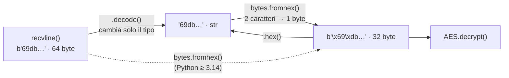

# pycryptodome

> [!abstract] A cosa serve pycryptodome
> Nelle challenge crypto il server cifra qualcosa con un algoritmo standard (AES, DES, RC4…) e il problema è **decifrarlo** o **rompere** il modo in cui è usato. pycryptodome è la libreria Python che implementa quegli algoritmi: con poche righe ricrei lo stesso cifrario del server e ci fai passare i dati. Il dialogo con il server, invece, resta compito di [[pwntools]].
> La teoria (cosa sono [[Block Cipher]], [[AES]], [[ECB]], [[CBC]], [[CTR]]) è nel corso Cybersecurity e nella [[06 - CB - Crypto 1|lezione 6]]: qui c'è solo il lato pratico.

## Quale libreria importi davvero

Esistono tre pacchetti con nomi quasi uguali, e sul PC di Simone ce ne sono due installati insieme:

| Pacchetto | Import | Stato |
|---|---|---|
| **PyCrypto** 2.6.1 | `from Crypto.Cipher import AES` | Vecchio (2013), abbandonato. Installato **di sistema** in `/usr/lib64/python3.14/`. |
| **pycryptodome** | `from Crypto.Cipher import AES` | Successore moderno, **stesso nome di import** di PyCrypto: i due si sovrascrivono. Non installato. |
| **pycryptodomex** 3.23 | `from Cryptodome.Cipher import AES` | Stessa libreria di pycryptodome, ma con un nome di import diverso proprio per convivere con PyCrypto. **Installato.** |

> [!warning] Usa `Cryptodome`, non `Crypto`
> Con `from Crypto...` sul PC di Simone si carica **PyCrypto**. Per ECB e CBC funziona lo stesso, ma in CTR non conosce l'argomento `nonce=` (`TypeError: ... unexpected keyword argument 'nonce'`) e vuole un oggetto `Counter` costruito a mano. Si controlla così:
> ```python
> import Crypto; print(Crypto.__version__, Crypto.__file__)   # 2.6.1 → è PyCrypto
> ```
> Tutti gli esempi di questa nota usano `from Cryptodome.Cipher import AES`. La [documentazione](https://pycryptodome.readthedocs.io/en/latest/src/cipher/classic.html) è la stessa per pycryptodome e pycryptodomex.

## Testo hex, `str` e byte veri

Quasi tutti i server CTF mandano chiavi, IV e ciphertext **in esadecimale**: è un modo di *scrivere* byte qualsiasi (anche non stampabili, come `0xdb`) usando solo i caratteri `0-9a-f`, così passano su una connessione di testo. Ogni byte diventa **due caratteri**.

Lo stesso ciphertext può quindi trovarsi in tre forme:

| Forma | Esempio | Lunghezza | Cos'è |
|---|---|---|---|
| Testo hex ricevuto | `b'69db...'` | 64 | i codici ASCII dei caratteri `'6'`, `'9'`, `'d'`… (`0x36 0x39 0x64`…) |
| Testo hex come `str` | `'69db...'` | 64 | gli stessi caratteri, solo con tipo `str` |
| Byte veri | `b'\x69\xdb...'` | 32 | il ciphertext vero e proprio |



```python
riga = b"Here is the encrypted text (hex): 69db9409...0873\n"

ct_hex = riga.split()[-1]          # b'69db9409...0873': l'ultima parola, senza prefisso né \n
ct     = bytes.fromhex(ct_hex.decode())
assert len(ct) == 32               # 64 caratteri hex → 32 byte
```

> [!important] AES non interpreta niente
> `decrypt()` riceve una sequenza di byte e la rimescola con la chiave: non sa cosa sia l'hex e non lo riconosce. Se gli passi il **testo** hex (`b'69db...'`, 64 byte) decifra fedelmente i codici ASCII `0x36 0x39 …` e restituisce 64 byte di spazzatura. La traduzione hex → byte la fai sempre tu, prima. Indizio tipico dell'errore: il plaintext è lungo il **doppio** del previsto.

> [!warning] Correzione · `bytes.fromhex()` accetta anche `bytes`, da Python 3.14
> Durante la challenge è stato detto che `bytes.fromhex()` vuole per forza una `str`, e quindi che il `.decode()` è obbligatorio. È vero fino a Python 3.13. Da **Python 3.14** (quello installato) accetta anche `bytes` ASCII: `bytes.fromhex(b"4142") == b"AB"`. Il `.decode()` non fa danni e rende lo script compatibile con le versioni precedenti; in alternativa `binascii.unhexlify(b"4142")` accetta `bytes` su qualunque versione.

Nella direzione opposta, per mandare una chiave al server che la chiede in hex: `key.hex()` dà una `str`, quindi `key.hex().encode()` se vuoi evitare il `BytesWarning` di pwntools.

### Schema delle conversioni str, bytes e hex

Il punto che fa sbagliare è che `b"Ciao"` (byte veri di un testo) e `b"4369616f"` (testo hex che li *scrive*) hanno **lo stesso tipo**, `bytes`. Python non può accorgersi se li scambi: la differenza la devi tenere a mente tu.

Lo stesso dato ha tre forme. I calcoli si fanno sempre in quella **centrale**:

```
   "Ciao"   ── .encode() ──►   b"Ciao"   ── .hex() ──────────►  "4369616f"
    str     ◄── .decode() ──    bytes    ◄── bytes.fromhex() ──    hex
  (testo)                    (byte veri)                     (testo che
                       ← QUI fai XOR, AES, confronti →       rappresenta byte)
```

| Da → a | Funzione | Esempio |
|---|---|---|
| `str` → `bytes` | `s.encode()` | `"AB".encode() == b"AB"` |
| `bytes` → `str` | `b.decode()` | `b"AB".decode() == "AB"` |
| `bytes` → hex | `b.hex()` | `b"AB".hex() == "4142"` |
| hex → `bytes` | `bytes.fromhex(h)` | `bytes.fromhex("4142") == b"AB"` |

Ogni script di una challenge crypto ha quindi tre passi:

1. **Verso il centro**: quello che il server stampa in hex passa per `bytes.fromhex`. Quello che scrivi tu come testo passa per `.encode()`.
2. **Calcolo** sui byte veri.
3. **Verso fuori**: `.hex()` se il server vuole hex, `.decode()` se vuoi leggere il risultato.

> [!tip] La domanda da farsi a ogni riga
> *"Questa variabile contiene i byte del messaggio, o la scrittura hex dei byte?"* Se non lo sai, `print(type(x), len(x), x)`. Un testo hex contiene solo `0-9a-f` ed è lungo **il doppio** del dato.
> Per non doverlo ricordare, metti la forma nel nome: `ct_hex` per quello che arriva dal server, `ct` dopo `fromhex`. Così un `xor(flag_hex, key)` si vede a occhio.

Indicizzare dei `bytes` dà un **intero**, non un carattere né dei bit: `b"AB"[0] == 65`. Per questo lo XOR tra due sequenze di byte si scrive con `^` sugli interi:

```python
def xor(a, b):
    return bytes(x ^ y for x, y in zip(a, b))   # zip si ferma alla più corta
```

> [!warning] Errori tipici di conversione (visti in BitCrypt)
> - `AttributeError: 'str' object has no attribute 'decode'`: hai chiamato `.decode()` su qualcosa che era già `str`. Ad esempio, `bytes.hex(...)` restituisce una `str`.
> - `ValueError: non-hexadecimal number found in fromhex()`: hai passato a `fromhex` dei byte veri (`b"Succhiami..."`) invece di un testo hex.
> - `a[i] != b[i]` **non** è uno XOR: confronta due interi e dice solo se l'intero byte è diverso. Lo XOR è `a[i] ^ b[i]`.

## AES nelle tre modalità

La chiave AES deve essere di **16, 24 o 32 byte** (AES-128/192/256), cioè 32, 48 o 64 caratteri hex. Il blocco è sempre di **16 byte**.

| Modalità | Cosa serve oltre alla chiave | Costruttore | Vincolo sull'input |
|---|---|---|---|
| [[ECB]] | niente | `AES.new(key, AES.MODE_ECB)` | multiplo di 16 byte |
| [[CBC]] | **IV** di 16 byte | `AES.new(key, AES.MODE_CBC, iv)` | multiplo di 16 byte |
| [[CTR]] | **nonce** (di solito 8 byte) | `AES.new(key, AES.MODE_CTR, nonce=nonce)` | qualunque lunghezza |

```python
from Cryptodome.Cipher import AES

pt = AES.new(key, AES.MODE_ECB).decrypt(ct)
pt = AES.new(key, AES.MODE_CBC, iv).decrypt(ct)
pt = AES.new(key, AES.MODE_CTR, nonce=nonce).decrypt(ct)
```

- **ECB** decifra ogni blocco da solo: chi ha la chiave ha tutto.
- **CBC** mette ogni blocco decifrato in XOR con il blocco di ciphertext precedente; il primo usa l'IV. Senza l'IV giusto **solo il primo blocco** esce sbagliato, i successivi no: è un buon indizio di un IV sbagliato.
- **CTR** cifra un contatore che parte dal nonce e mette il risultato (il *keystream*) in XOR con il ciphertext. Per questo non ha bisogno di padding e decifrare equivale a cifrare.

> [!warning] Se dimentichi IV o nonce non ottieni un errore
> `AES.new(key, AES.MODE_CBC)` e `AES.new(key, AES.MODE_CTR)` senza IV/nonce **funzionano**: la libreria ne genera uno **casuale** (16 byte per CBC, 8 per CTR). Il risultato è semplicemente sbagliato, senza alcun avviso. Per decifrare devi passare sempre i valori del server.

> [!tip] Nonce da 16 byte
> Se il server manda un "nonce" lungo **16** byte, probabilmente è l'intero blocco iniziale del contatore e non il nonce in senso stretto. In quel caso: `AES.new(key, AES.MODE_CTR, nonce=b"", initial_value=blocco16)`. Vedi la [sezione CTR della documentazione](https://pycryptodome.readthedocs.io/en/latest/src/cipher/classic.html#ctr-mode).

### Padding

Se il plaintext non è multiplo di 16 byte, ECB e CBC richiedono un **padding**, quasi sempre PKCS#7. In decifratura va tolto:

```python
from Cryptodome.Util.Padding import pad, unpad

ct = AES.new(key, AES.MODE_CBC, iv).encrypt(pad(pt, 16))
pt = unpad(AES.new(key, AES.MODE_CBC, iv).decrypt(ct), 16)
```

Se il plaintext decifrato finisce con byte come `\x04\x04\x04\x04`, è il padding che non hai tolto. Se invece è già multiplo di 16 e leggibile (come nelle challenge sotto), non c'è padding: `unpad` solleverebbe `ValueError`.

### Errori tipici e cosa significano

| Errore | Causa probabile |
|---|---|
| `Incorrect AES key length (7 bytes)` | la chiave non è di 16/24/32 byte |
| `Data must be aligned to block boundary in ECB mode` (PyCrypto: `Input strings must be a multiple of 16 in length`) | stai decifrando un pezzo tagliato male: controlla lo slice e `len(ct)` |
| `TypeError: Object type <class 'str'> cannot be passed to C code` | hai passato una `str` a `decrypt()`: vuole `bytes` |
| `unexpected keyword argument 'nonce'` | stai usando PyCrypto: importa da `Cryptodome` |
| plaintext lungo il doppio | hai decifrato il testo hex invece dei byte |
| plaintext illeggibile della lunghezza giusta | modalità, chiave, IV o nonce sbagliati (o la variabile sbagliata, vedi sotto) |

## Challenge

### GuessThePlaintext · AES in ECB, CBC e CTR con chiave scelta da te

Server: `cyberchallenge.diag.uniroma1.it` (la porta cambia tra le istanze). Script: `exercices/crypto/GuessThePlaintext/solve.py`.

Tre livelli in sequenza sulla stessa connessione:

1. **ECB.** Il server chiede una chiave in hex, cifra un plaintext casuale di 32 caratteri e manda il ciphertext. Bisogna rimandargli il plaintext. La chiave la sceglie l'utente, quindi basta decifrare con la stessa.
2. **CBC.** Uguale, ma il server manda anche l'**IV** su una riga a parte.
3. **CTR.** Il server non chiede più la chiave: manda **chiave**, **nonce** e **flag cifrata**. Basta decifrare e la flag è il plaintext.

Il "trucco" è che non c'è nessun attacco: la challenge allena a **usare correttamente** i tre modi e a convertire i dati tra hex e byte. Il formato delle righe:

```
Enter a key (hex):
Here is the iv (hex): 9d5d7a6b7a9f50fddaa7919abffa98dd
Here is the encrypted text (hex): 723bf577...49ad
Send the plaintext pls:
Here's the key (hex): 2839933229b6d96c9ca310e47d5a9fb7
Here's the nonce (hex): 8a2c878413511543
Here is the encrypted flag (hex): 23d3c742...451b
```

Versione ripulita dello script (quella originale, con gli slice a indici fissi, è in `solve.py`):

```python
from pwn import *
from Cryptodome.Cipher import AES

def leggi_hex(p):
    # l'hex è sempre l'ultima parola della riga
    return bytes.fromhex(p.recvline().split()[-1].decode())

p = remote("cyberchallenge.diag.uniroma1.it", 5128)
key = b"A" * 16

# --- Challenge 1: ECB ---
p.sendlineafter(b"(hex): ", key.hex().encode())
ct = leggi_hex(p)
p.sendlineafter(b"pls: ", AES.new(key, AES.MODE_ECB).decrypt(ct))

# --- Challenge 2: CBC ---
p.sendlineafter(b"(hex): ", key.hex().encode())
iv = leggi_hex(p)
ct = leggi_hex(p)
p.sendlineafter(b"pls: ", AES.new(key, AES.MODE_CBC, iv).decrypt(ct))

# --- Challenge 3: CTR, la flag ---
p.recvuntil(b"CTR mode.\n")
key   = leggi_hex(p)
nonce = leggi_hex(p)
ct    = leggi_hex(p)
print(AES.new(key, AES.MODE_CTR, nonce=nonce).decrypt(ct))   # ccit{...}
```

> [!warning] Correzione · gli errori incontrati lungo la strada
> - **Chiave di 7 byte.** La prima chiave provata a mano, `"ciccion"`, era lunga 7 byte. AES vuole 16/24/32 byte: `b"A"*16` è la più semplice.
> - **`recvuntil(":")` si ferma al primo `:`.** Il primo `:` è quello di `Challenge 1:`, non quello del prompt della chiave. Il resto del messaggio resta nel buffer e la `recvline()` successiva restituisce l'avanzo `" Can you guess the plaintext?"` invece del ciphertext. Il delimitatore deve essere unico: `b"(hex): "`. Vedi [[pwntools#Prontuario di lettura e scrittura|pwntools]].
> - **Decifrare il testo hex.** Passare `b'69db...'` a `decrypt()` senza convertirlo dà 64 byte di spazzatura. Indizio nel debug di pwntools: `Sent 0x41 bytes` (64 + `\n`) invece di `0x21` (32 + `\n`).
> - **`cypherboy` e `cipherboy`.** Il cifrario CBC veniva creato in `cypherboy`, ma si decifrava con `cipherboy`, che era ancora quello ECB della challenge 1. Python non segnala nulla: un nome diverso è solo un'altra variabile.
> - **Slice `[24:16]` e `[34:44]`.** In `x[inizio:fine]` il secondo numero è una **posizione**, non una lunghezza: `[24:16]` è vuoto (nonce `b''`) e `[34:44]` tiene solo 10 caratteri (5 byte di flag). La regola è `fine = inizio + lunghezza`, ma `split()[-1]` evita del tutto di contare.

## Ripasso

- **Il server chiede la chiave in hex e tu hai `key = b"A"*16`. Cosa mandi?** `key.hex()`, cioè `'4141…41'` (32 caratteri), con `sendline` perché il server legge una riga.
- **Il ciphertext ricevuto è lungo 64 caratteri hex. Quanto è lungo il plaintext in ECB?** 32 byte: due blocchi da 16. Se ne ottieni 64, hai decifrato il testo hex.
- **Cosa fa `.decode()` su `b'69db'`?** Cambia solo il tipo in `str`: i caratteri restano gli stessi. La conversione vera la fa `bytes.fromhex()`.
- **Hai decifrato in CBC e solo i primi 16 byte sono spazzatura. Cosa controlli?** L'IV: è usato solo per il primo blocco.
- **Crei un cifrario CTR senza `nonce=`. Che errore ottieni?** Nessuno: la libreria ne inventa uno casuale e il risultato è sbagliato in silenzio.
- **`from Crypto.Cipher import AES` funziona ma `nonce=` dà `TypeError`. Perché?** Stai usando la vecchia PyCrypto. Importa da `Cryptodome`.
- **Come estrai l'hex da `"Here's the nonce (hex): 8a2c…43\n"` senza contare i caratteri?** `riga.split()[-1]`.
- **Hai `pt = "AAAA"` scritto da te e `ct_hex` ricevuto dal server. Cosa converti prima dello XOR?** `pt.encode()` e `bytes.fromhex(ct_hex.decode())`. Il primo è testo, il secondo è hex: arrivano al centro per strade diverse.
- **Quanto vale `b"A"[0]`?** `65`, un intero. Per questo lo XOR si fa con `^` elemento per elemento.

## Collegamenti

- **Strumenti**: [[pwntools]] per il dialogo con il server
- **Teoria (Cybersecurity)**: [[Block Cipher]] · [[AES]] · [[ECB]] · [[CBC]] · [[CTR]] · [[Stream Cipher]]
- **Lezione**: [[06 - CB - Crypto 1]]
- **Mappa**: [[MOC - CyberBootCamp]]
