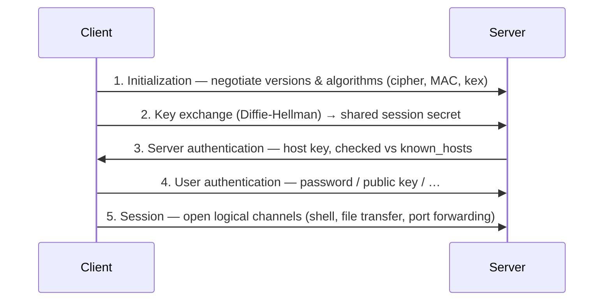

last lesson [[16 CS Lower Level - Firewall]]
# Secure Shell (SSH)

Course of Cybersecurity — Prof. F. d'Amore. See the map: [[MOC - Cybersecurity]].

SSH is where most of the Lower Level building blocks come together in one real protocol: [[Diffie-Hellman Key Exchange|key exchange]], [[Digital Signature|signatures]] for server authentication, [[HMAC]] for integrity, symmetric ciphers ([[AES]]/[[3DES]]) for confidentiality, and public-key [[13 CS Lower Level - Authentication based on public keys|user authentication]].

## The SSH protocol

A **network protocol** that lets data be exchanged over a **secure channel** between two networked devices. The channel is made secure through:

- **one- or two-way authentication** (always the server; optionally also the client);
- **data confidentiality** (encryption);
- **data integrity**.

### What SSH allows you to do

- **login to a shell** on a remote host (replacing the insecure *Telnet* and *rlogin*);
- **execute a single command** on a remote host (replacing *rsh*);
- **securely transfer files** (SCP/SFTP);
- **back up, copy and mirror** files efficiently and securely (together with *rsync*);
- **forward or tunnel a TCP/IP port** (see [[#SSH port forwarding]]);
- arrange a full-fledged encrypted **VPN** (OpenSSH only);
- **forward X11** from a remote host (possibly through multiple intermediate hosts);
- browse the Web through an encrypted **SOCKS proxy** with SSH clients that support it;
- **mount a remote directory** as a local filesystem using **SSHFS**.

---
## Overview and versions

- **SSH Communications Security (SCS)** — `www.ssh.com`, founded by **Tatu Ylönen** (author of SSH-1); "SSH" is a trademark of SCS.
- Open-source version from **OpenSSH** (`https://www.openssh.com/specs.html`). There is a long-running naming dispute between the commercial and open versions.

| Version | Year | Notes |
|---|---|---|
| **SSH1** | 1995 (Tatu Ylönen) | initial freeware then proprietary; several vulnerabilities |
| **SSH2** | 2006 | revised version (the one in use today) |
| **OpenSSH** | from 1999 | open-source, started from the last free SSH (1.2.12), supports 1.x and 2.0; widely used |

> [!note] Internet standard
> SSH is standardised by a set of IETF RFCs: **RFC 4250** (assigned numbers), **4251** (architecture), **4252** (authentication), **4253** (transport layer), **4254** (connection), **4255** (DNS key fingerprints), **4256** (keyboard-interactive), plus 4335/4344/4345. More recent RFCs (2006–2009) extend the basic set.

---
## Basic architecture

![[SSH-architecture.png]]

The diagram shows the keys involved on each side:

- **Client**: a list of **known-hosts** (public **host keys** of servers it has already seen), and the user's **user key** pair (public + private) kept in an *identity file* or in an **agent**;
- **Server**: its own **host key** pair (public + private), and, in the target account, an **authorization file** listing the user public keys allowed to log in;
- the two endpoints derive a shared **session key** and run the **SSH connection**, which carries several **channels** (interactive session, forwarded TCP port, remote key agent, …).

So SSH uses **two different key pairs**: the **host key** authenticates the *server* to the client (checked against `known_hosts`), and the **user key** authenticates the *user* to the server (checked against the server's authorization file, e.g. `authorized_keys`).

### The four protocols

SSH is formally divided into four major protocols, described in separate IETF documents and in principle independent of one another:

| Protocol | RFC | Role |
|---|---|---|
| **SSH-TRANS** (Transport Layer) | 4253 | initial key exchange, server authentication, sets up encryption, compression and integrity |
| **SSH-AUTH** (User Authentication) | 4252 | authenticates the **client** over the SSH-TRANS connection |
| **SSH-CONN** (Connection) | 4254 | multiplexes **multiple channels** over the single connection |
| **SSH-SFTP** (File Transfer) | — | file transfer and remote filesystem manipulation, over an SSH-CONN channel |

In short: **SSH-TRANS** gives encryption, integrity and server authentication; **SSH-AUTH** then authenticates the client; after that the client invokes **SSH-CONN** to manage logical channels; finally an application may use **SSH-SFTP** over a channel for file transfer.

---
## Protocol workflow



1. **Initialization**: client and server negotiate protocol versions and agree on algorithms (cipher, MAC, key exchange).
2. **Key exchange**: a shared secret is generated with **Diffie-Hellman** (or another mechanism), so that all further traffic is encrypted and eavesdropping is prevented.
3. **Server authentication**: the server sends its **host key**; the client checks it against its trusted database (`known_hosts`).
4. **User authentication**: the client authenticates itself with one of the supported methods (password, public key, …).
5. **Session establishment**: the connection layer sets up logical channels for shell sessions, file transfers or port forwarding.

### SSH-TRANS (RFC 4253)

Handles the initial key exchange and server authentication, and sets up encryption, compression and integrity verification. It exposes to the upper layer an interface for sending/receiving plaintext packets up to **32,768 bytes** each (more may be allowed by the implementation). It also arranges periodic **key re-exchange**, usually after **1 GB of data or 1 hour**.

### SSH-AUTH (RFC 4252)

Client authentication is **client-driven**. Widely used methods:

- **password**: straightforward password authentication (not implemented by every program);
- **publickey**: public-key authentication, usually supporting at least **DSA** or **RSA** key pairs, some implementations also **X.509** certificates;
- **keyboard-interactive** (RFC 4256): the server sends prompts, the client displays them and returns the typed responses (e.g. **one-time passwords**);
- **GSSAPI**: an extensible scheme to authenticate using external mechanisms such as **Kerberos 5** or NTLM, giving **single sign-on** to SSH sessions (see [[Kerberos]]).

### SSH-CONN (RFC 4254)

Defines **channels**, **channel requests** and **global requests**. A single connection can host **multiple channels** simultaneously, each carrying data in both directions. *Channel requests* relay out-of-band channel-specific data (e.g. a changed terminal-window size, or the exit code of a server-side process). Standard channel types include **shell** (terminal shells, SFTP and exec/SCP), **direct-TCP/IP** (client-to-server forwarding) and **forwarded-TCP/IP** (server-to-client forwarding).

---
## SSH-2 cryptographic algorithms

- **Key establishment** through **Diffie-Hellman** key exchange (a variety of groups supported);
- **Server authentication** via **RSA** or **DSS** signatures on nonces (and other fields);
- **HMAC** for the MAC algorithm;
- **3DES, RC4 or AES** for symmetric encryption;
- a **pseudo-random function** for key derivation.

> [!warning] SSH security — a reminder
> SSH secures the *channel*, not the *endpoints*. On 6 July 2017 WikiLeaks confirmed that the CIA had developed tools (**BothanSpy** for Windows, **Gyrfalcon** for Linux) installed on already-**compromised** machines to intercept SSH connections started from them. If the client or server host is owned, SSH cannot help.

---
## Basic client usage (OpenSSH)

```bash
ssh [options] <userid>@<hostaddress> [command]
```

Some options:

| Option | Meaning |
|---|---|
| `-v [-v [-v]]` | enable verbose modes (more `-v` = more detail) |
| `-C` | enable gzip compression |
| `-1`, `-2` | force protocol version 1 / 2 |
| `-4`, `-6` | force IPv4 / IPv6 addresses |

If you run just `ssh <userid>@<hostaddress>`, an interactive terminal session is established.

---
## SSH port forwarding

Recall that a **TCP port number "identifies" an application**. Port forwarding tunnels another service's traffic *inside* the SSH secure channel.

**Without SSH**, each application talks to its server directly and in clear (Telnet on 23, mail-in on 113, mail-out on 25):

![[SSH-port-forwarding-without.png]]

**With SSH**, the SSH client on the local machine:

- **intercepts** the traffic bound for the server;
- **translates** the standard TCP port numbers (e.g. `113 → 5113`);
- **sends** the packets to the SSH-enabled server through the **secure channel**.

The SSH-enabled server then **receives** the traffic, **re-translates** the ports (`5113 → 113`) and **forwards** it to the appropriate server over the internal network. All the formerly separate flows now travel inside one encrypted tunnel:

![[SSH-port-forwarding-with.png]]

The figure shows every application flow (green = Telnet 23, yellow = mail-in 113, red = mail-out 25) entering the single encrypted tunnel between the user machine *UM* and the SSH-enabled login server *LS*, which then dispatches each to the right internal server (*MI*, *MO*).

### Commands

To reach a "hidden" host *hostB*, on the same network as the SSH server *hostA*:

```bash
ssh -L portC:hostB:portB user@hostA
```

The local `portC` is forwarded to `hostB:portB` on the remote side, through `hostA`: a connection to `portC` on the client is carried over the secure channel, and from the remote machine a connection is opened to `hostB:portB`. **Only the superuser can forward privileged ports.**

```bash
# make the unreachable host 10.0.2.92:22 available on local port 54321
ssh -L 54321:10.0.2.92:22 damore@linuxserv.dis.uniroma1.it
ssh -N -L 54321:10.0.2.92:22 …     # -N: forwarding only, no remote command
ssh -f -N -L 54321:10.0.2.92:22 …  # -f: run ssh in the background
# good for two-hop sshfs:  sshfs -p 54321 user@localhost: mountdir
```

Using **`-R`** instead of `-L` **switches the roles** of client and server (remote port forwarded back to the local side). Forwardings can also be set in the configuration file.

### X11 forwarding

- **`-X`** enables X11 forwarding. Use with **caution**: a user who can bypass file permissions on the remote host can access the local X11 display through the forwarded connection and, for instance, perform **keystroke monitoring**. For this reason X11 forwarding is subject to the **X11 SECURITY** extension restrictions by default.
- **`-x`** disables X11 forwarding.
- **`-Y`** enables **trusted** X11 forwarding, *not* subject to the X11 SECURITY extension controls.

---
See the atomic note [[SSH]] for a compact recap. Next lesson [[18 CS Lower Level - Shamir's Secret Sharing]].
