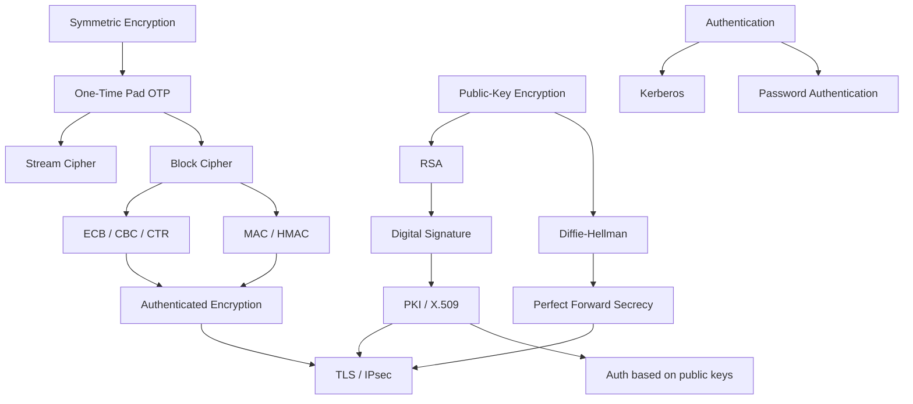

# MOC - Cybersecurity

> [!abstract]
> Map of Content for the **Cybersecurity** course (Sapienza, proff. F. d'Amore / L. Querzoni). Two modules: the **6 CFU "Lower Level"** part (cryptography, data integrity, public-key, authentication, PKI, TLS/IPsec, firewalls) and the **3 CFU "Application Level"** part (email, network, web, DNS, DoS). This note links the per-lesson notes and the atomic review notes (`6 CFU/otherInfo/`, `3 CFU/Extra/`), grouped by topic. Reference book for the 6 CFU part: [[0 CS Lower Level - BOOK - Network Security Private Communication in a Public World.pdf|Kaufman, Perlman, Speciner — Network Security]].

## 6 CFU — Lower Level

| # | Lesson | Topics |
|---|---|---|
| 1 | [[1 CS  Lower Level -  Introduction]] | security goals (CIA), attacker models, [[Kerckhoffs’s principle]], crypto vs security |
| 2 | [[2 CS  Lower Level - Stream Ciphers]] | secret-key crypto, [[One-Time Pad (OTP)]], [[Stream Cipher]]s, RC4 |
| 3 | [[3 CS  Lower Level - Block Ciphers]] | [[Block Cipher]]s, [[DES]]/[[3DES]], [[AES]], modes [[ECB]]/[[CBC]]/[[CTR]]/[[OFB]] |
| 4 | [[4 CS  Lower Level - Data Integrity - MAC, attacks and SHA-1]] | [[MAC]], [[CBC-MAC]]/[[CMAC]], [[HMAC]], length-extension, [[SHA-1]] |
| 5 | [[5 CS  Lower Level - Cryptographic Hash Functions - Design, Security, and Applications]] | [[Hashing]], [[Merkle–Damgård]], [[Keccak]]/[[SHA-3]], collision resistance |
| 6 | [[6 CS  Lower Level - Authenticated Encryption]] | [[AE]]/[[AEAD]], [[EtM]]/[[MtE]]/[[EaM]], [[AES-GCM]], [[ChaCha20-Poly1305]] |
| 7 | [[7 CS  Lower Level - Asymmetric encryption]] | [[Public-Key Encryption]], [[RSA]], [[Diffie-Hellman Key Exchange]], [[Elliptic Curve Cryptography - ECC]] |
| 8 | [[8 CS Lower Level - Random Number Generation]] | [[RNG (Random Number Generator)]], [[PRNG (Pseudo-Random Number Generator)]], [[CS-PRNG (Cryptographically Secure PRNG)]], [[Entropy]] |
| 9 | [[9 CS Lower Level - ElGamal and Digital Signature Standard (DSS)]] | ElGamal, [[Digital Signature]], [[Digital Signature Algorithm (DSA)]], [[ECDSA]] |
| 10 | [[10 CS Lower Level - Authentication - Introduction and Attacker Models]] | authentication scenarios, [[Mutual Authentication]], [[Needham-Schroeder (NS)]], [[Reflection Attack]] |
| 11 | [[11 CS Lower Level - Kerberos]] | [[Kerberos]], [[KDC (Key Distribution Center)]], [[TGS (Ticket-Granting Server)]]/[[TGT (Ticket-Granting Ticket)]] |
| 12 | [[12 CS Lower Level - Password Authentication]] | [[Salt (Cryptographic)]]/[[Pepper (Cryptography)]], [[PBKDF2]]/[[bcrypt]]/[[Argon2]], [[Dictionary Attack]]/[[Rainbow Table]] |
| 13 | [[13 CS Lower Level - Authentication based on public keys]] | public-key auth, X.509 certificates, [[SSH]] |
| 14 | [[14 CS Lowel Level - PKI]] | [[PKI]], [[Certification Authority (CA)]], [[CRL (Certificate Revocation List)]]/[[OCSP (Online Certificate Status Protocol)]] |
| 15 | [[15 CS Lower Level - TLS and IPSec]] | [[TLS]] 1.3, [[IPsec]], [[Perfect Forward Secrecy (PFS)]], [[Ephemeral DH (DHE)]] |
| 16 | [[16 CS Lower Level - Firewall]] | [[Firewall]], [[Packet Filtering]], [[Application-Level Gateway]], [[DMZ]], [[NAT (Network Address Translation)]] |
| 17 | [[17 CS Lower Level - Secure Shell (SSH)]] | [[SSH]], host/user keys, SSH-TRANS/AUTH/CONN/SFTP, port forwarding, X11 forwarding |
| 18 | [[18 CS Lower Level - Shamir's Secret Sharing]] | secret sharing, XOR *n*-of-*n* scheme, $(k,n)$ threshold, polynomial interpolation, Lagrange |

## 3 CFU — Application Level

| # | Lesson | Topics |
|---|---|---|
| 1 | [[1 - CS - Application Level - Email Security]] | SMTP/IMAP, SPF/DKIM/DMARC, phishing |
| 2 | [[2 - CS - Application Level - Network Security]] | IDS/IPS, SIEM, network flow, segmentation |
| 3 | [[3 - CS - Application Level - Web Technologies]] | HTTP(S), HTTP/2, QUIC, OAuth |
| 4 | [[4 -  CS - Application Level - Web Security]] | XSS, CSRF, SOP/CORS, CSP |
| 5 | [[5 - CS Application Level - Web Security Part II]] | injection, clickjacking, HSTS |
| 6 | [[6 - CS Application Level - DNS Security]] | DNSSEC, cache poisoning, tunneling, fast-flux |
| 7 | [[7 - CS Application Level - Denial of Service (DOS) Attacks]] | DoS/DDoS, amplification, SYN flood |

## Concepts (6 CFU) by theme

### Foundations and attacker models
- [[Symmetric Encryption]] · [[Asymmetric Encryption]] · [[Kerckhoffs’s principle]] · [[Adversary]]
- Security notions: [[IND-CPA]] · [[IND-CCA1]] · [[IND-CCA2]] · [[Differenza tra IND-CPA, IND-CCA1 e IND-CCA2]]
- Attack models: [[Ciphertext-only attack (COA)]] · [[Known-Plaintext Attack (KPA)]] · [[Chosen-Plaintext Attack (CPA)]] · [[Chosen-Ciphertext Attack (CCA)]] · [[Brute-force attack]] · [[Man-in-the-Middle (MITM)]] · [[Meet-in-the-Middle (MitM)]] · [[Replay attack]] · [[Side‑channel attack]]

### Symmetric ciphers
- [[One-Time Pad (OTP)]] · [[Perfect Cipher]] · [[Stream Cipher]] · [[Block Cipher]] · [[stream cipher vs block cipher]]
- Block ciphers: [[DES]] · [[2DES]] · [[3DES]] · [[AES]] · [[S-Box (Substitution Boxes)]] · [[Galois Field]]
- Modes: [[ECB]] · [[CBC]] · [[CTR]] · [[OFB]] · [[AES-CTR]]
- Stream: [[ChaCha20]]

### Data integrity, MAC and hashing
- MAC: [[MAC]] · [[CBC-MAC]] · [[CMAC]] · [[HMAC]] · [[HMAC-SHA256]] · [[GMAC]] · [[opad e ipad]] · [[naive metodi per keyed hashing]]
- Hash: [[Hashing]] · [[SHA]] · [[SHA-1]] · [[SHA-2]] · [[SHA-256]] · [[SHA-3]] · [[MD5]] · [[Keccak]] · [[Merkle–Damgård]] · [[Differenza strong e weak collision resistant]] · [[Horner Algorithm]]

### Authenticated encryption
- [[AE]] · [[AEAD]] · [[EtM]] · [[MtE]] · [[EaM]] · [[AES-GCM]] · [[GCM]] · [[GHASH]] · [[Galois Authentication]] · [[Poly1305]] · [[ChaCha20-Poly1305]] · [[differenza tra GHASH e HMAC]] · [[non usare la stessa chiave per autenticazione e cifratura]]

### Public-key encryption
- [[Public-Key Encryption]] · [[Hybrid Encryption]]
- RSA: [[RSA]] · [[Prerequisiti RSA]] · [[Problema della Fattorizzazione]] · [[RSAEP]] · [[RSADP]] · [[RSAES]] · [[RSAES-OAEP]] · [[RSA-OAEP]] · [[PKCS]] · [[PKCS1]]
- DH / ECC: [[Diffie-Hellman Key Exchange]] · [[RSA vs Diffie-Hellman Key Exchange]] · [[Elliptic Curve Cryptography - ECC]] · [[ECDH]] · [[ECDHE]] · [[ECDLP]] · [[Generatore g (radice primitiva)]]

### Digital signatures
- [[Digital Signature]] · [[Digital Signature Algorithm (DSA)]] · [[Digital Signature Standard (DSS)]] · [[ECDSA]] · [[Cos'è (r,s) in ECDSA]] · [[EdDSA (Edwards-curve Digital Signature Algorithm)]]
- RSA signatures: [[RSASSA]] · [[RSASSA-PSS]] · [[RSASP1]] · [[RSAVP1]] · [[EMSA (Encoding Method for Signature with Appendix)]] · [[EMSA-PKCS1-v1_5]] · [[EMSA-PSS]] · [[Mask Generation Function (MGF)]] · [[Differenza tra MGF e MGF1]] · [[Code-Signing]]

### Randomness
- [[RNG (Random Number Generator)]] · [[TRNG (True Random Number Generator)]] · [[PRNG (Pseudo-Random Number Generator)]] · [[CS-PRNG (Cryptographically Secure PRNG)]]
- CS-PRNG constructions: [[CS-PRNG based by BBS]] · [[CS-PRNG based by Cipher of a Counter]] · [[CS-PRNG based by CTR_DRBG (AES)]] · [[CS-PRNG based by RSA]]
- Related: [[Entropy]] · [[Seed]] · [[Nonce]] · [[PRF (Pseudorandom Function)]] · [[Differenza tra PRF e PRNG]]

### Key derivation
- [[KDF (Key Derivation Function)]] · [[HKDF (HMAC-based Key Derivation Function)]] · [[PBKDF]] · [[PBKDF1]] · [[PBKDF2]] · [[bcrypt]] · [[Argon2]]

### Authentication and passwords
- Protocols: [[Mutual Authentication]] · [[Needham-Schroeder (NS)]] · [[Reflection Attack]] · [[SRP (Secure Remote Password)]] · [[EKE (Encrypted Key Exchange)]] · [[MFA (Multi-Factor Authentication)]] · [[Single Sign-On (SSO)]]
- Kerberos: [[Kerberos]] · [[KDC (Key Distribution Center)]] · [[AS (Authentication Service)]] · [[TGS (Ticket-Granting Server)]] · [[TGT (Ticket-Granting Ticket)]] · [[Master Key]]
- Passwords: [[Salt (Cryptographic)]] · [[Pepper (Cryptography)]] · [[Salt + Pepper]] · [[Dictionary Attack]] · [[Rainbow Table]] · [[Lookup Table (LUT)]] · [[PC time vs Human time]]

### PKI and trust
- [[PKI]] · [[Certification Authority (CA)]] · [[CRL (Certificate Revocation List)]] · [[OCSP (Online Certificate Status Protocol)]] · [[Trusted Third Party (TTP)]] · [[Web of Trust (WoT)]] · [[Trust On First Use (TOFU)]]

### Secure channels: TLS, IPsec, SSH
- [[TLS]] · [[SSL]] · [[Il padre di SSL 3.0]] · [[IPsec]] · [[SSH]] · [[Perfect Forward Secrecy (PFS)]] · [[Ephemeral DH (DHE)]]

### Firewalls
- [[Firewall]] · [[Packet Filtering]] · [[Circuit-Level Gateway]] · [[Application-Level Gateway]] · [[Bastion Host]] · [[DMZ]] · [[NAT (Network Address Translation)]] · [[approfondimento firewall stati delle connessioni]] · [[Esemplificazione Firewall]]

### Tooling and standards
- [[Openssl comandi]] · [[EVP - OpenSSL API per C]] · [[I2OSP]] · [[OS2IP]] · [[NIST]] · [[IETF]] · [[Common Ports and Protocols]]

### Exam preparation
- [[CS 6cfu - Domande esame]] · per lezione: [[domande esame stream cipher]] · [[domande esame block cipher]] · [[domande esame data integrity e hashing]] · [[domande esame asymmetric encryption RSA]] · [[domande esame elgamal and dss]] · [[domande esame PRNG]] · [[domande esame autenticazione]] · [[domande esame auth pk]] · [[domande esame Kerberos]] · [[domande esame Password Auth]] · [[domande esame PKI]] · [[domande esame TLS e IPSEC]] · [[domande esame firewall]] · [[domande esame AEDA]]

## Concepts (3 CFU) by theme

### Email security (lesson 1)
- Overview: [[EMAIL SECURITY]] · [[Componenti Chiave del Sistema Email]]
- Agents: [[MUA]] · [[MSA]] · [[MTA]] · [[MDA]] · [[MS]] · [[MSH]]
- Protocols: [[SMTP]] · [[ESMTP]] · [[IMAP]] · [[POP]] · [[MIME]] · [[S-MIME]] · [[PGP]]
- Anti-spoofing & signing: [[SPF]] · [[DKIM]] · [[DMARC]] · [[ARC]] · [[Signatures (Cybersecurity)]]
- Header analysis & phishing: [[EMAIL - Difference between receivedFrom and ReturnPath]] · [[Email Message-ID problems]] · [[Spiegazione Phishing email1]] · [[Spiegazione Phishing email2]] · [[Spiegazione Phishing email3]]

### Network security (lesson 2)
- [[NETWORK SECURITY]] · [[IDS]] · [[SIEM]] · [[Network Flow]] · [[Event Logs]] · [[FPC]]
- Segmentation: [[Network Segmentation]] · [[VLAN]] · [[Trunk link]] · [[Zero Trust Architecture]] · [[Spiegazione Segmentazione Logica]] · [[spiegazione VLAN]] · [[Workload]]

### Web technologies (lesson 3)
- [[HTTP]] · [[HTTPS]] · [[HTTP-2]] · [[QUIC]] · [[OAuth]] · [[SOAP]] · [[JSON-P]]

### Web security (lessons 4–5)
- Attacks: [[XSS]] · [[Blind XSS]] · [[CSRF]] · [[Clickjacking]] · [[LFI - Local File Inclusion]] · [[SSL Stripping]] · [[Framing]]
- Defenses & policies: [[SOP]] · [[CORS]] · [[CSP]] · [[HSTS]] · [[Cookie]]
- Summaries & examples: [[4 - CS Applitcation Level - Sintesi Web Security Part I]] · [[5 - CS Applitcation Level - Sintesi Web Security Part II]] · [[Moodle Command Line Injection Example]]

### DNS security (lesson 6)
- [[DNSSEC]] · [[Stub Resolver]] · [[Open Resolvers]] · [[DNS Cache Poisoning]] · [[DNS Tunneling]] · [[DNS Fast-Fluxing]] · [[Spiegazione Fast Fluxing]] · [[Domain Generation Algorithm (DGA)]] · [[Spiegazione DGA]] · [[NXDOMAIN floods]] · [[Phantom Domain attacks]]

### Denial of Service (lesson 7)
- [[SYN Flood DOS]] · [[DDoS Amplification]] · [[Spigeazione  DDoS Amplification DNS]] · [[Botnet]] · [[Command-and-Control (C2)]]

### Encoding & misc
- [[ASCII]] · [[Base64]] · [[UTF-8]] · [[Encode]] · [[NTP]] · [[UNC Path]] · [[Double Free]]

## Cross-cutting paths

- **From secrecy to a secure channel**: [[Symmetric Encryption]] → [[Block Cipher]] → [[AES-GCM|Authenticated Encryption]] → [[TLS]]
- **From one-way functions to passwords**: [[Hashing]] → [[HMAC]] → [[PBKDF2]] → [[Salt + Pepper]]
- **From public keys to trust**: [[RSA]] → [[Digital Signature]] → [[PKI]] → [[Certification Authority (CA)]] → [[TLS]]
- **Key agreement with forward secrecy**: [[Diffie-Hellman Key Exchange]] → [[Ephemeral DH (DHE)]] → [[Perfect Forward Secrecy (PFS)]]

Application level (3 CFU):
- **Email trust chain**: [[SMTP]] → [[SPF]] → [[DKIM]] → [[DMARC]] → [[ARC]]
- **Browser same-origin model**: [[SOP]] → [[CORS]] → [[CSP]] → [[CSRF]] / [[XSS]]
- **DNS abuse**: [[DNS Cache Poisoning]] → [[DNSSEC]] · [[Domain Generation Algorithm (DGA)]] → [[DNS Fast-Fluxing]] → [[Command-and-Control (C2)]]
- **Volumetric attacks**: [[Botnet]] → [[SYN Flood DOS]] / [[DDoS Amplification]]

## Gaps

> [!done] Colmate
> Le due slide senza lezione sono state scritte da zero:
> - **SSH** (slide `14.cs.2024.pptx`) → [[17 CS Lower Level - Secure Shell (SSH)]];
> - **Shamir's Secret Sharing** (slide `16.cs.2024.pptx`) → [[18 CS Lower Level - Shamir's Secret Sharing]].
>
> Le altre 16 lezioni del modulo 6 CFU sono già complete (slide incollate a mano da Simone), quindi non sono state riscritte.

> [!note] 3 CFU — Application Level
> Tutte e 7 le lezioni sono presenti e complete, con 78 note atomiche in `3 CFU/Extra/` (ora mappate qui sopra). **Nessuna lezione mancante.** Le lezioni 6 (DNS) e 7 (DoS) **non hanno slide sorgente** nel repo (`pdf/` contiene solo Email, Network/IDS+SIEM, Web Technologies, Web Security I/II): sono state scritte da altro materiale, quindi non verificabili contro le slide. Le note 3 CFU sono **miste IT/EN** (es. lezione 6 in italiano): eventuali aggiunte vanno fatte nella lingua della singola lezione.

> [!done] Rifiniture completate
> - Sezioni "solo-immagine" di [[2 CS  Lower Level - Stream Ciphers]] (perfect cipher, probabilità condizionate, OTP, features, **prova del teorema di Shannon**): aggiunto il testo trascritto sotto ogni screenshot; rimossi i placeholder `# Slide 18/19`.
> - `08bis.cs.2024.pptx` (standard reali di firma: **PAdES/CAdES/XAdES/JAdES** + livelli B/T/C/X/XL/A) non era coperto da nessuna nota → aggiunta la sezione "Real-world digital signature standards (AdES)" in [[9 CS Lower Level - ElGamal and Digital Signature Standard (DSS)#7. Real-world digital signature standards (AdES)|lezione 9]].
> - [[1 CS  Lower Level -  Introduction]]: trascritte in testo le 8 slide-concetto che erano solo screenshot (Cryptography vs security, Model, Communication/Threat/Adversary model, Security goals con Kerckhoff/Shannon, Adversarial model).
>
> **Esito dell'analisi immagini (6 CFU):** l'unica lezione col vero problema "testo-come-immagine" era la 1 (+ le slide già sistemate in Stream Ciphers). Nelle altre lezioni ad alto conteggio immagini (TLS 17, Firewall, Data Integrity, Block Ciphers, AEAD) le immagini sono **diagrammi legittimi già spiegati dal testo** (handshake, pacchetti AH/ESP, pinguino ECB, matrice AES State, diagramma GCM, round SHA-1), quindi non vanno trascritte. In [[4 CS  Lower Level - Data Integrity - MAC, attacks and SHA-1]] aggiunta solo una didascalia col dato collisioni $N/m$.
