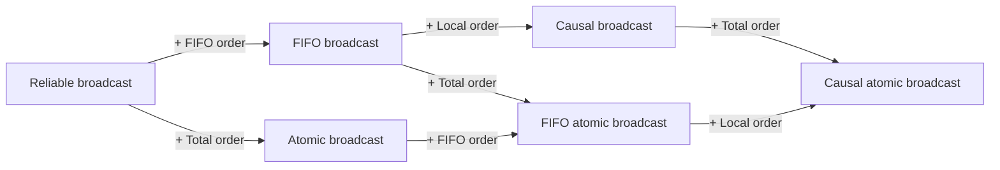

# Ordered Communications

> [!abstract] Purpose of this lecture
> The broadcast abstractions of [[7 - DDS - Broadcast Communications|lecture 8]] (BEB, RB, URB) say **which** messages are delivered, but nothing about **in which order**. This lecture adds ordering guarantees on top of reliable broadcast:
> - **FIFO order**: messages from the *same sender* are delivered in the order they were sent;
> - **causal order**: messages are delivered respecting the *happened-before* relation of [[4 - DDS - Logical Clocks#The happened-before relation|lecture 4]] (it includes FIFO);
> - **total order** (atomic broadcast): *all* processes deliver *all* messages in the *same* order, independently of senders and causality.
>
> For FIFO and causal order we see the implementations (sequence numbers, the *past* list, [[4 - DDS - Logical Clocks#Vector clock|vector clocks]]) and a correctness proof; total order is only specified here, and implemented in [[11 - DDS - Total Order Broadcast|the next lecture]] (it needs [[8 - DDS - Consensus|consensus]]).
>
> Course map: [[MOC - Dependable Distributed Systems]].

## The three orders

**Ordered communication** defines guarantees on the **order of deliveries** inside a group of processes. Three increasingly strong (but, as we'll see, not all comparable) properties:

| Order | Informal guarantee | Constrains |
|---|---|---|
| **FIFO order** | messages of the same sender are delivered in sending order | pairs of messages from the *same* sender |
| **Causal order** | if $m_1$ may have caused $m_2$, $m_1$ is delivered first | pairs of *causally related* messages |
| **Total order** (atomic) | every process delivers the messages in the same sequence | *every* pair of messages |

## Why ordered communication

Ordering is **orthogonal** to reliability: a reliable broadcast guarantees that all correct processes deliver the same *set* of messages, but each one can deliver them in any order. In many applications this produces anomalies.

![[DDS-L10-p03.png]]

The figure shows two classic anomalies:
- a client sends "*reserve a seat*" and then "*cancel my reservation*"; the channel reorders them and the server receives the cancellation first: **the server cancelled a reservation that was never made** (and then makes it). Two messages of the *same* sender were inverted → we need **FIFO**;
- a "*Prices 15% off*" announcement arriving out of order with respect to the requests it should affect: the meaning of a message depends on what was delivered before.

"**Reliable ordered communications**" are obtained by **adding one or more ordering properties to reliable communication** (RB or URB): the reliability properties stay exactly the same.

> [!quote] Dal libro — §3.9.1 (p. 101)
> The book uses a **replicated message board** with proposals and comments:
> - $p$ broadcasts a proposal $m_1$, then a modification $m_2$; with plain RB another participant $q$ may deliver $m_2$ before $m_1$ and not understand it → **FIFO** solves it (delay $m$ until all earlier messages of the same sender are delivered);
> - $p$ broadcasts a proposal $m_1$, $q$ delivers it and broadcasts a **comment** $m_2$; a third participant $r$ may deliver the comment before the proposal. FIFO doesn't help (different senders) → **causal order** solves it (delay $m_2$ until every $m_1 \to m_2$ is delivered).
>
> "These orderings are orthogonal to the reliability guarantees" (p. 100).

## FIFO Broadcast

Vedi [[FIFO Reliable Broadcast]].

### Specification

![[DDS-L10-p04.png]]

The module offers `Broadcast(m)` / `Deliver(m)` like a reliable broadcast. Its properties are:
- **the same properties as Reliable Broadcast** (validity, no duplication, no creation, agreement), or of **URB** for the *uniform* FIFO broadcast: FIFO broadcast can be **uniform or non-uniform**;
- plus **FIFO order**.

> [!quote] Dal libro — Module 3.8 (p. 102)
> **FRB1–FRB4**: same as RB1–RB4 of (regular) reliable broadcast.
> **FRB5 — FIFO delivery**: *if some process broadcasts message $m_1$ before it broadcasts message $m_2$, then no correct process delivers $m_2$ unless it has already delivered $m_1$.*
>
> The book notes that FIFO does **not** affect messages from **different** senders (p. 101).

> [!tip] Reading FRB5 carefully
> FRB5 does **not** say that if $m_2$ is delivered then $m_1$ must be delivered *eventually*: it says that $m_2$ cannot be delivered **unless $m_1$ was already delivered**. So "deliver $m_1$, then $m_2$" and "deliver nothing" are both fine; "deliver $m_2$ without $m_1$" is not. This is exactly what makes some of the following examples FIFO even if they are not reliable.

### Examples

Notation: the double arrow ↕ is a broadcast, the thick arrow ↑ a delivery, the star a crash. Process $p_1$ broadcasts $m_1$ then $m_2$, $p_3$ broadcasts $m_3$.

![[DDS-L10-p05.png]]

- **Top — FIFO Uniform Reliable.** $p_1$: $m_1, m_2, m_3$; $p_2$: $m_1, m_3, m_2$; $p_3$: $m_3, m_1, m_2$. Everybody delivers everything (reliable, even uniform since nobody crashes), and everybody delivers $m_1$ before $m_2$ (FIFO). The *relative* position of $m_3$ is free, because it comes from another sender.
- **Bottom — FIFO (Regular) Reliable.** $p_3$ delivers $m_3, m_1, m_2$ and **crashes**; $p_1$ and $p_2$ deliver only $m_1, m_2$. The correct processes agree on $\{m_1, m_2\}$, so regular RB holds; but a faulty process ($p_3$) delivered $m_3$ that no correct process delivers, so **uniform** agreement is violated. FIFO holds.

![[DDS-L10-p06.png]]

- **Top — FIFO (Regular) Reliable.** $p_1$ delivers $m_1, m_2, m_3$ and crashes; $p_2$ delivers $m_1, m_3$; $p_3$ delivers $m_3, m_1$. Correct processes ($p_2, p_3$) agree on $\{m_1, m_3\}$: $m_2$ was delivered only by the faulty $p_1$, which is allowed by regular (not uniform) agreement. FIFO holds: nobody delivers $m_2$ without $m_1$.
- **Bottom — Not Reliable, but FIFO.** $p_1$ crashes after delivering $m_1, m_2$; $p_2$ delivers $m_1, m_2$; $p_3$ delivers $m_3, m_1, m_2$. The correct $p_3$ broadcast $m_3$ and delivered it, but the correct $p_2$ **never delivers $m_3$**: agreement is violated → not reliable. The ordering, instead, is FIFO.

![[DDS-L10-p07.png]]

- **Top — Reliable Broadcast but not FIFO.** $p_1$ delivers $m_1, m_2, m_3$ and crashes; $p_2$ delivers $m_2, m_3$; $p_3$ delivers $m_3, m_2$. Correct processes agree on $\{m_2, m_3\}$ → RB is satisfied. But $p_2$ and $p_3$ **deliver $m_2$ without ever having delivered $m_1$**, and $m_1$ was broadcast before $m_2$ by $p_1$ → FIFO violated.
- **Bottom — Uniform Reliable Broadcast but not FIFO.** $p_1$ delivers $m_3, m_2$ and crashes, the others deliver $m_3, m_2$ too. *Every* process (faulty included) delivered the same set $\{m_2, m_3\}$ → URB holds ($m_1$ may be lost because its sender crashed). FIFO is violated again: $m_2$ is delivered without $m_1$.

> [!important] Takeaway
> Reliability (regular/uniform) and FIFO are **independent** properties: all four combinations "reliable/not reliable × FIFO/not FIFO" are possible. A FIFO *reliable* broadcast needs both.

### Implementation: Broadcast with Sequence Number

![[DDS-L10-p08.png]]

The FIFO broadcast is built **on top of a Reliable Broadcast** (RB): reliability is inherited, and the layer only adds ordering. The idea is the same as TCP sequence numbers:
- each sender numbers its messages with a **local sequence number** `lsn`;
- each receiver keeps, for every sender $s$, `next[s]` = the sequence number of the **next** message it expects from $s$;
- messages arriving "too early" wait in a buffer `pending`.

> [!quote] Dal libro — Algorithm 3.12 "Broadcast with Sequence Number" (p. 102)
> ```
> Implements: FIFOReliableBroadcast, instance frb.
> Uses: ReliableBroadcast, instance rb.
>
> upon event ⟨frb, Init⟩ do
>     lsn := 0;
>     pending := ∅;
>     next := [1]^N;
>
> upon event ⟨frb, Broadcast | m⟩ do
>     lsn := lsn + 1;
>     trigger ⟨rb, Broadcast | [DATA, self, m, lsn]⟩;
>
> upon event ⟨rb, Deliver | p, [DATA, s, m, sn]⟩ do
>     pending := pending ∪ {(s, m, sn)};
>     while exists (s, m', sn') ∈ pending such that sn' = next[s] do
>         next[s] := next[s] + 1;
>         pending := pending \ {(s, m', sn')};
>         trigger ⟨frb, Deliver | s, m'⟩;
> ```
> **Correctness**: FRB1–FRB4 come directly from the underlying RB; FIFO delivery from the per-sender sequence numbers and from the buffering. **Performance**: no extra messages, only a marginal increase of message size (p. 103).

> [!note] Why a `while` and not an `if`
> One rb-delivery can unblock **several** messages: if $m_3$ and $m_4$ of $s$ are waiting in `pending` and $m_2$ arrives, the loop delivers $m_2$, then $m_3$, then $m_4$.

#### Example 1 — messages delivered out of order

![[DDS-L10-p09.png]]

Initially every process has `lsn = 0`, `pending = {}`, `Next = [1,1,1]`. $p_1$ broadcasts $m_1$ (`lsn₁ = 1`, message `<P1, m1, 1>`) and then $m_2$ (`lsn₁ = 2`, `<P1, m2, 2>`).
- $p_1$ and $p_3$ receive the messages in order: each delivery makes `Next[1]` go $1 \to 2 \to 3$.
- $p_2$ receives `<P1, m2, 2>` **first**: $2 \neq$ `Next₂[1]` $= 1$, so $m_2$ is put in `pending = {<p1, m2, 2>}`. When `<P1, m1, 1>` arrives, the loop delivers $m_1$ (`Next₂ = [2,1,1]`), then finds $m_2$ in `pending` with the right number and delivers it (`Next₂ = [3,1,1]`, `pending = {}`).

#### Example 2 — sender crash, lost message

![[DDS-L10-p10.png]]

$p_1$ broadcasts $m_1$ but the copies towards $p_2$ and $p_3$ are **lost**, and $p_1$ then crashes after broadcasting $m_2$. $p_2$ and $p_3$ only receive `<P1, m2, 2>`, which stays forever in `pending` because `Next[1] = 1` and $m_1$ never arrives. Nobody delivers $m_2$ out of order: FIFO is respected.

> [!warning] Is this execution allowed?
> It is consistent with RB only because the sender $p_1$ **crashed**: if $p_1$ were correct, RB validity/agreement would force the eventual delivery of $m_1$ to everybody (in a real RB implementation the lost copies would be relayed or retransmitted). Note also that $p_1$ itself rb-delivered $m_1$ and $m_2$ before crashing: with a **regular** RB this is fine; with a uniform one $p_2$ and $p_3$ would be required to deliver them as well.

#### Example 3 — the last message is lost

![[DDS-L10-p11.png]]

Both copies of $m_2$ are lost and $p_1$ crashes; $p_2$ and $p_3$ only deliver $m_1$ (`Next = [2,1,1]`). Again a legal behaviour of RB with a faulty sender, and trivially FIFO.

## Causal Order Broadcast

Vedi [[Causal Order Broadcast]].

FIFO only relates messages of the same sender. But a message can depend on a message **of another process**: the reply to a question, the comment to a proposal. Causal order ensures that messages are delivered according to the **cause–effect relationships**, and it is an extension of the [[4 - DDS - Logical Clocks#The happened-before relation|happened-before relation]] to broadcast/deliver events.

### The causal relation between messages

![[DDS-L10-p12.png]]

A message $m_1$ **may have potentially caused** $m_2$, written $m_1 \to m_2$, if:
1. **(a)** some process $p$ broadcasts $m_1$ before it broadcasts $m_2$ (same sender → this is the **FIFO** part);
2. **(b)** some process $p$ delivers $m_1$ and subsequently broadcasts $m_2$ (what was received may have influenced what is sent → **local order**);
3. **(c)** there exists some message $m'$ such that $m_1 \to m'$ and $m' \to m_2$ (**transitivity**).

The figure (Fig. 3.8 of the book, p. 103) shows the three cases on processes $p, q, r$.

> [!note] "Potentially"
> The relation doesn't know whether $m_2$ *really* depends on $m_1$: it only knows that it **could**, because the information of $m_1$ was available to the sender of $m_2$. This is the same conservative approach of happened-before: everything that *may* matter is ordered.

### Specification

![[DDS-L10-p13.png]]

The module offers `CO_Broadcast(m)` / `CO_Deliver(m)`; properties: the same as Reliable Broadcast (URB for the uniform version) **plus causal order**. Also causal broadcast can be **uniform or non-uniform**.

> [!warning] Correzione
> The slide says "*(URB for Uniform FIFO Broadcast*" also in the causal-order specification: it is a copy-paste from the FIFO slide. Here it should read "URB for **Uniform Causal Order** Broadcast" (book, Module 3.10, p. 104).

> [!quote] Dal libro — Modules 3.9 and 3.10 (p. 104)
> **CRB1–CRB4**: same as RB1–RB4.
> **CRB5 — Causal delivery**: *for any message $m_1$ that potentially caused a message $m_2$, i.e., $m_1 \to m_2$, no process delivers $m_2$ unless it has already delivered $m_1$.*
>
> The uniform variant (Module 3.10, *CausalOrderUniformReliableBroadcast*) has CURB1–CURB4 = URB1–URB4 and CURB5 = CRB5. The book also says that a causal order **best-effort** broadcast would make little sense: as shown in an end-of-chapter exercise, it would inherently be reliable as well.

> [!tip] "No holes in the causal past"
> The book's way to say it (p. 103): when a message is delivered, **all messages that causally precede it have already been delivered**. Notice that CRB5 says "*no process*", not "no correct process": the ordering must be respected by faulty processes too.

### Causal = FIFO + Local order

- Causal Broadcast = Reliable Broadcast + Causal Order;
- **Causal Order ⟹ FIFO Order** (case (a) of the relation is exactly FIFO);
- but **FIFO Order ⇏ Causal Order**;
- **Causal Order = FIFO Order + Local Order**, where
  - **Local order**: *if a process delivers a message $m_a$ before sending a message $m_b$, then no correct process delivers $m_b$ if it has not already delivered $m_a$* (case (b)).

Transitivity (case (c)) needs no separate property: if both FIFO and local order hold on every pair, chains of dependencies are respected too.

### Examples

$p_1$ broadcasts $m_1$ and $m_2$; $p_3$ delivers $m_1$ and then broadcasts $m_3$. So $m_1 \to m_2$ (FIFO) and $m_1 \to m_3$ (local order), while $m_2$ and $m_3$ are **concurrent**.

![[DDS-L10-p15.png]]

**Example 1 — FIFO Reliable but not causal.** $p_1$ delivers $m_3, m_1, m_2$ (circled in red): $m_3$ is delivered **before** $m_1$, although $m_1 \to m_3$. FIFO is respected ($m_1$ before $m_2$ everywhere), local order is not.

![[DDS-L10-p16.png]]

**Example 2 — Causal Reliable.** $p_1$: $m_1, m_3, m_2$; $p_2$: $m_1, m_2, m_3$; $p_3$: $m_1, m_2, m_3$. The only constraints are $m_1$ first; $m_2$ and $m_3$ are concurrent, so both sequences **$m_1, m_2, m_3$** and **$m_1, m_3, m_2$** are causal. Different processes may choose differently: causal order is **not** total order.

![[DDS-L10-p17.png]]

**Example 3 — Causal Reliable.** Now $p_3$ delivers $m_1$ **and $m_2$** before broadcasting $m_3$: $m_1 \to m_2$ (FIFO) and $m_2 \to m_3$ (local order), so the causal order is a chain and the **only** admissible sequence is $m_1, m_2, m_3$.

### Implementation 1: Waiting Causal Broadcast

Vedi [[Waiting Causal Broadcast]].

![[DDS-L10-p18.png]]

The idea: summarize the causal past of a message with a [[4 - DDS - Logical Clocks#Vector clock|vector clock]] instead of carrying the messages themselves. The function `rank()` associates an entry of the vector to each process (it maps $\Pi$ onto $1 \dots N$).
- Each process keeps $V$, where $V[\text{rank}(q)]$ = **number of messages of $q$ it has delivered**, and `lsn` = number of messages it has broadcast.
- When broadcasting, it attaches $W$ = a copy of $V$ in which its **own entry is replaced by `lsn`** (the number of its own *previous* messages), then increments `lsn`.
- A message with vector $W$ can be delivered when $W \le V$ (component-wise): the receiver has already delivered **everything the sender had delivered** before sending, and all the **previous messages of the sender**.

> [!quote] Dal libro — Algorithm 3.15 "Waiting Causal Broadcast" (p. 108)
> ```
> Implements: CausalOrderReliableBroadcast, instance crb.
> Uses: ReliableBroadcast, instance rb.
>
> upon event ⟨crb, Init⟩ do
>     V := [0]^N;
>     lsn := 0;
>     pending := ∅;
>
> upon event ⟨crb, Broadcast | m⟩ do
>     W := V;
>     W[rank(self)] := lsn;
>     lsn := lsn + 1;
>     trigger ⟨rb, Broadcast | [DATA, W, m]⟩;
>
> upon event ⟨rb, Deliver | p, [DATA, W, m]⟩ do
>     pending := pending ∪ {(p, W, m)};
>     while exists (p', W', m') ∈ pending such that W' ≤ V do
>         pending := pending \ {(p', W', m')};
>         V[rank(p')] := V[rank(p')] + 1;
>         trigger ⟨crb, Deliver | p', m'⟩;
> ```
> $v \le w$ iff $v[i] \le w[i]$ for every $i$. "The difference at index rank(s) between the vectors tells process p how many messages are missing from process s" (pp. 108–109). The name *waiting* means that a process may have to wait before crb-delivering a message it already rb-delivered: "this is the price to pay for limiting the size of the messages" (p. 109).

> [!note] Why the own entry is `lsn` and not $V[\text{rank(self)}]$
> The sender delivers its own messages through rb as well, so $V[\text{rank(self)}]$ might lag behind the number of messages it has broadcast. Using `lsn` makes the $k$-th message of $p_i$ carry exactly $W[i] = k - 1$: "deliver me only after my $k-1$ previous messages". This is the observation used in the proof below.

#### Example

![[DDS-L10-p19.png]]

Vectors are drawn vertically, entries $[p_1, p_2, p_3]$ from top to bottom.
1. $p_1$ broadcasts $m_1$ with $W = [0,0,0]$. $p_1$ and $p_3$ deliver it immediately ($[0,0,0] \le [0,0,0]$) and their $V$ becomes $[1,0,0]$. The copy for $p_2$ is slow.
2. $p_3$, having delivered $m_1$, broadcasts $m_2$ with $W = [1,0,0]$ (own entry = `lsn` = 0).
3. $p_1$ delivers $m_2$ at once ($[1,0,0] \le [1,0,0]$) → $V_1 = [1,0,1]$; same for $p_3$.
4. $m_2$ reaches $p_2$ **before** $m_1$: $V_2 = [0,0,0]$ and $W = [1,0,0] \not\le V_2$ (entry 1: $1 > 0$), so $p_2$ puts it in `pending` and **delays the delivery**.
5. When $m_1$ arrives ($[0,0,0] \le V_2$), $p_2$ delivers it, $V_2 = [1,0,0]$, and the `while` loop now delivers $m_2$ too → $V_2 = [1,0,1]$.

> [!warning] Correzione
> The callout in the slide says "*When $m_2$ arrives $V_2 > m.VC$ then $p_2$ delays the delivery*". The condition is the opposite: the delivery is delayed because $m.VC \not\le V_2$, i.e. there is an entry where **$m.VC$ is greater** than $V_2$ (here $m.VC[1] = 1 > V_2[1] = 0$). If $V_2 \ge m.VC$, $p_2$ could deliver immediately.

The same scenario is Fig. 3.10 of the book (p. 109), with 4 processes $p, q, r, s$.

### Safety proof

**Property**: given two broadcast messages $m, m'$ with $\text{broadcast}(m) \to \text{broadcast}(m')$, every process delivers $m$ before $m'$.

**Observation**: if $m$ is the $k$-th message sent by $p_i$, then $m.VC[i] = k - 1$.

The proof is by **induction on the causal distance**.

**Definition (causal distance).** Two broadcast events $b \to b'$ have causal distance $k$ if there is a sequence of $k$ broadcast events $b_1, \dots, b_k$ such that
- $b \to b_1$ and $b_k \to b'$;
- for each $i \in \{1, \dots, k-1\}$: $b_i \to b_{i+1}$ and $\nexists\, m^*$ such that $b_i \to m^* \to b_{i+1}$ (consecutive events are "directly" related, with no broadcast in between).

Distance $0$ means that $b \to b'$ directly, with no intermediate broadcast.

> [!note] Transcription
> In the PDF the quantifiers of this definition are lost ($\forall$, $\wedge$, $\nexists$); the formula above is the reconstructed reading.

#### Base case ($k = 0$)

Take $m, m'$ with $\text{broadcast}(m) \to \text{broadcast}(m')$ and no $\text{broadcast}(m'')$ in between. Two cases.

**Case 1 — same process $p_i$.** Let $p_j$ be the receiver.
1. By the broadcast procedure, $m'.VC[i] = m.VC[i] + 1$: if $m$ is the $h$-th message of $p_i$, $m.VC[i] = h-1$ and $m'.VC[i] = h$.
2. $p_j$ delivers $m'$ only if $\forall x\colon m'.VC[x] \le V_j[x]$, in particular $m'.VC[i] = h \le V_j[i]$.
3. $V_j[i] \ge h$ iff $p_j$ has already delivered $h$ messages of $p_i$, among which the $h$-th one, i.e. $m$ (line 3 of the receive thread: $V$ is incremented only on delivery).
4. Hence $m'$ can be delivered only after $m$.

**Case 2 — distinct processes** $p_i$ (sends $m$) and $p_j$ (sends $m'$), receiver $p_k$.
1. $\text{broadcast}(m) \to \text{broadcast}(m')$ with distance 0 means that $p_j$ broadcast $m'$ **after delivering $m$**.
2. Let $m.VC[i] = h-1$ ($m$ is the $h$-th message of $p_i$). When $p_j$ delivered $m$, $V_j[i]$ became (at least) $h$, so $m'.VC[i] \ge h$ (the slide writes $= h$ using $k = 0$).
3. $p_k$ delivers $m'$ only if $m'.VC[i] \le V_k[i]$, i.e. $V_k[i] \ge h$.
4. As before, this means $p_k$ has already delivered the $h$-th message of $p_i$, which is $m$.

#### Inductive step ($k > 0$)

There is a chain $b \to b_1 \to \dots \to b_k \to b'$, with messages $m_1, \dots, m_k$.
- **Inductive hypothesis**: $m$ is delivered before $m_k$ (their distance is $k-1$).
- $m_k$ is delivered before $m'$: they are at distance 0, so it follows from the **base case**.
- By transitivity, $m$ is delivered before $m'$. ∎

### Liveness

**Property**: eventually each message is delivered. It is guaranteed by two assumptions:
- the number of broadcast events that precede a given event is **finite** (so a message waits for finitely many others);
- channels are **reliable** (in the algorithm: the underlying RB eventually delivers every message that a correct process needs, so every gap in `pending` gets filled).

> [!quote] Dal libro — correctness of Alg. 3.15 (p. 109)
> Validity: a correct sender rb-delivers its own $m$ with a vector taken from its own $V$, which can only have grown meanwhile, so $V \ge W$ and $m$ is crb-delivered immediately. No duplication and no creation come from rb. Agreement uses the agreement of rb plus the fact that every message preceding $m$ is eventually rb-delivered too.

### Implementation 2: No-Waiting Causal Broadcast

Vedi [[No-Waiting Causal Broadcast]].

![[DDS-L10-p26.png]]

Opposite trade-off: **never wait**, but **piggyback the causal past** on every message. Each process keeps a list `past` of all messages it has broadcast or delivered (in delivery order); each broadcast sends `[DATA, past, m]`. On receipt, the process first delivers, **in list order**, all the messages of `mpast` it has not yet delivered, and then $m$.

Notes in the slide:
- `append(L, x)` adds an element $x$ at the end of list $L$;
- *implicit assumption*: no two processes broadcast the same $m$ (messages are identified by their content);
- the `forall` scans `mpast` **by the order in the list**: this is what keeps the causal order among the past messages.

> [!quote] Dal libro — Algorithm 3.13 "No-Waiting Causal Broadcast" (p. 105)
> ```
> Implements: CausalOrderReliableBroadcast, instance crb.
> Uses: ReliableBroadcast, instance rb.
>
> upon event ⟨crb, Init⟩ do
>     delivered := ∅;
>     past := [];
>
> upon event ⟨crb, Broadcast | m⟩ do
>     trigger ⟨rb, Broadcast | [DATA, past, m]⟩;
>     append(past, (self, m));
>
> upon event ⟨rb, Deliver | p, [DATA, mpast, m]⟩ do
>     if m ∉ delivered then
>         forall (s, n) ∈ mpast do              // by the order in the list
>             if n ∉ delivered then
>                 trigger ⟨crb, Deliver | s, n⟩;
>                 delivered := delivered ∪ {n};
>                 if (s, n) ∉ past then
>                     append(past, (s, n));
>         trigger ⟨crb, Deliver | p, m⟩;
>         delivered := delivered ∪ {m};
>         if (p, m) ∉ past then
>             append(past, (p, m));
> ```
> **Correctness**: CRB1–CRB4 from rb; causal delivery because every message carries its causal past, delivered before the message itself. **Performance**: no extra steps or messages, but **message size grows linearly with time**: `past` may become extremely large (p. 106).

> [!note] Transcription
> In the text extracted from the PDF the symbols "∉" become "∈": in all three tests above the condition is **not** in.

#### Example

![[DDS-L10-p27.png]]

1. $p_1$ broadcasts $m_1$; $p_3$ delivers it and **adds $\langle p_1, m_1\rangle$ to `past`**. The copy to $p_2$ is very slow.
2. $p_3$ broadcasts $m_2$: **$\langle p_1, m_1\rangle$ is sent together with $m_2$**.
3. $p_1$ receives $m_2$: it **already knows $\langle p_1, m_1\rangle$**, so it just delivers $m_2$.
4. $p_2$ receives $m_2$ but doesn't know $m_1$ yet: it **gets it through $m_2$** and delivers **both $m_1$ and $m_2$**, in this order, without waiting.
5. When the original copy of $m_1$ finally reaches $p_2$, $p_2$ has already delivered it, so it **discards it**.

Compare with the waiting example: same scenario, but here $p_2$ never waits; it pays with bigger messages.

> [!quote] Dal libro — §3.9.6 Garbage collection of the causal past (pp. 106–107)
> (Not in the program: the slides explicitly exclude §3.9.6.) To keep `past` from growing forever, Algorithm 3.14 uses a **perfect failure detector**: every process rb-broadcasts an `ACK` for each delivered message, and a message is removed from `past` once it has been acknowledged by **all correct processes**. It needs strong accuracy for correctness; a violated completeness only keeps messages longer than needed.

| | Waiting (Alg. 3.15) | No-Waiting (Alg. 3.13) |
|---|---|---|
| Causal past represented by | vector clock ($N$ integers) | list of the past **messages** |
| Message size | $O(N)$ extra | grows with the execution |
| Delivery | may be **delayed** (`pending`) | immediate on rb-delivery |
| Uniform variant | replace rb with urb | replace rb with urb (p. 105) |

## Total Order Broadcast

Vedi [[Total Order Broadcast]].

### Causal order is not enough

![[DDS-L10-p28.png]]

A bank account $A = £100$ is **replicated** on two sites $R_1, R_2$. Two concurrent operations are broadcast: a **deposit of £20** and an **add 10% interest**.
- $R_1$ applies deposit then interest: $(100 + 20) \cdot 1.1 = £132$;
- $R_2$ applies interest then deposit: $100 \cdot 1.1 + 20 = £130$.

Same initial state, **different final state** at the two sites: the replicas diverge. The two operations are **concurrent** (no causal relation), so causal order allows both orders. To get the same final state, **the order of deliveries must be the same at each process**. Note that this requirement does **not** consider the sending order of the messages: it only asks that everybody agrees on *some* order.

> [!tip] Link with replication
> This is the core of **state machine replication**: if replicas are deterministic, start from the same state and apply the same operations **in the same order**, they stay identical. It will be the subject of [[12 - DDS - Software Replication|the replication lecture]].

### Specification

![[DDS-L10-p29.png]]

A **total-order (reliable) broadcast** orders **all** messages, even those from different senders and those that are not causally related.

$$\text{Total Order Broadcast} = \underbrace{\text{Reliable Broadcast}}_{\text{agree on the same set}} + \underbrace{\text{Total Order}}_{\text{agree on the same sequence}}$$

It is also called **atomic broadcast**: message delivery occurs *as if the broadcast were an indivisible "atomic" action*, i.e. the message is delivered **to all or to none** of the processes and, if it is delivered, **every other message is ordered either before or after it**.

The formal specification and the algorithm (based on consensus) are in [[11 - DDS - Total Order Broadcast|the next lecture]].

### Total order is orthogonal to FIFO and causal

Total order is **orthogonal** to FIFO and causal order. A computation in which $p_i$ sends $n$ messages to a group and **every** process delivers them in the **reverse** order of sending is totally ordered (everybody agrees on the same sequence), but it is **not FIFO**.

Conversely, causal (and FIFO) order allow different processes to deliver concurrent messages in different orders, so they are not total. This is why the specifications can be combined freely.

### Relationship between broadcast specifications

![[DDS-L10-p31.png]]

The figure combines the two independent dimensions:



| | no total order | total order |
|---|---|---|
| **no ordering** | Reliable broadcast | Atomic broadcast |
| **FIFO** | FIFO broadcast | FIFO atomic broadcast |
| **Causal** (= FIFO + local) | Causal broadcast | Causal atomic broadcast |

### Let's identify

![[DDS-L10-p32.png]]

A Venn diagram of the sets of executions: Reliable ⊃ FIFO Reliable ⊃ Causal Reliable, intersected by the set of the **Total Order** executions. The next four executions are placed in these regions:

| Execution | Reliable | FIFO | Causal | Total |
|---|---|---|---|---|
| 1 | ✓ | ✗ | ✗ | ✓ |
| 2 | ✓ | ✗ | ✗ | ✗ |
| 3 | ✓ | ✓ | ✗ | ✓ |
| 4 | ✓ | ✓ | ✓ | ✓ |

![[DDS-L10-p33.png]]

**Execution 1 — Reliable, Total, not FIFO.** $p_1$ broadcasts $m_1, m_2$; $p_3$ broadcasts $m_3, m_4$; FIFO requires $m_1 \to m_2$ and $m_3 \to m_4$. Every process delivers $m_2, m_1, m_4, m_3$: the same sequence (total), but both FIFO constraints are inverted.

![[DDS-L10-p34.png]]

**Execution 2 — Reliable, not Total, not FIFO.** $p_1, p_2$ deliver $m_2, m_1, m_4, m_3$, while $p_3$ delivers $m_4, m_3, m_2, m_1$: the sequences differ (not total), and FIFO is still violated.

![[DDS-L10-p35.png]]

**Execution 3 — Total, FIFO, not Causal.** $p_2$ delivers $m_1$, broadcasts $m_3$ and crashes; so $m_1 \to m_2$ (FIFO) and $m_1 \to m_3$ (local order). The correct processes deliver $m_3, m_1, m_2$: same sequence (total), $m_1$ before $m_2$ (FIFO), but $m_3$ before $m_1$ → **not causal**.

![[DDS-L10-p36.png]]

**Execution 4 — Total, FIFO, Causal.** Same relations; every process delivers $m_1, m_2, m_3$. The causal sequences would be $m_1, m_2, m_3$ and $m_1, m_3, m_2$; total order picks **one** of them for everybody.

> [!note] The crash in execution 3
> $p_2$ crashes, so total order (in its regular form) only constrains the correct processes $p_1, p_3$. $p_2$ delivered $m_1$ before broadcasting $m_3$, i.e. its own prefix starts with $m_1$, different from the others' $m_3, m_1, m_2$: this is admissible only for a **non-uniform** total order.

## Exercises

> [!example] Solutions
> The slides give no solutions: the ones below are proposed in these notes, reasoning on the constraints of the relation $\to$.

### Exercise 1 — Total and causal

![[DDS-L10-p37.png]]

*Provide all the delivery sequences such that both total order and causal order are satisfied.*

Events: $p_1$ broadcasts $m_1$; $p_2$ delivers $m_1$ and then broadcasts $m_2$; $p_3$ broadcasts $m_3$, then delivers $m_2$, then broadcasts $m_4$.

Causal relations:
- $m_1 \to m_2$ (local order at $p_2$);
- $m_2 \to m_4$ (local order at $p_3$) and $m_3 \to m_4$ (FIFO at $p_3$);
- hence $m_1 \to m_4$; $m_3$ is concurrent with $m_1$ and $m_2$.

Total + causal = **one** sequence for all, which is a linear extension of $m_1 < m_2 < m_4$, $m_3 < m_4$:
1. $m_1, m_2, m_3, m_4$
2. $m_1, m_3, m_2, m_4$
3. $m_3, m_1, m_2, m_4$

$m_4$ is always last. Sequence 3 requires $p_2$ to deliver $m_3$ *before* $m_1$, i.e. in the very short interval between the broadcast of $m_3$ and the drawn delivery of $m_1$: possible in principle, but tight with the drawing.

### Exercise 2 — Causal; FIFO but not causal

![[DDS-L10-p38.png]]

Events: $P_1$ broadcasts $m_1$, delivers $m_1$, broadcasts $m_2$, delivers $m_3$; $P_2$ delivers $m_2$ and broadcasts $m_4$; $P_3$ broadcasts $m_3$.

Relations: $m_1 \to m_2$ (FIFO), $m_2 \to m_4$ (local order at $P_2$), hence $m_1 \to m_4$. $m_3$ is concurrent with everything ($P_3$ delivered nothing before sending it, and $P_2$ hasn't delivered $m_3$ before sending $m_4$).

1. **Causal sequences**: linear extensions of $m_1 < m_2 < m_4$ with $m_3$ anywhere:
   - $m_3, m_1, m_2, m_4$
   - $m_1, m_3, m_2, m_4$
   - $m_1, m_2, m_3, m_4$
   - $m_1, m_2, m_4, m_3$

   For $P_1$ the first one is excluded, because it already delivered $m_1$ before $m_3$.
2. **FIFO but not causal**: violate local order while keeping FIFO per sender. For example $P_3$ delivers $m_4, m_1, m_2, m_3$: FIFO holds ($m_1$ before $m_2$, the other senders have only one message), but $m_4$ is delivered before $m_2$ although $m_2 \to m_4$.

### Exercise 3 — Total vs causal vs FIFO, with a crash

![[DDS-L10-p39.png]]

Events: $P_4$ broadcasts $m_1$; $P_3$ and $P_1$ deliver $m_1$; $P_2$ broadcasts $m_3$; $P_1$ broadcasts $m_2$; $P_3$ and $P_2$ deliver $m_2$; $P_2$ broadcasts $m_4$; $P_4$ delivers $m_3$ and $m_4$; $P_3$ **crashes**.

Relations: $m_1 \to m_2$ (local order at $P_1$), $m_2 \to m_4$ (local order at $P_2$), $m_3 \to m_4$ (FIFO at $P_2$); $m_3$ is concurrent with $m_1, m_2$.

1. **Total + causal**: as in exercise 1, $m_1, m_2, m_3, m_4$ / $m_1, m_3, m_2, m_4$ / $m_3, m_1, m_2, m_4$. If we also require the crashed $P_3$ to be consistent with the others (**uniform** total order), only $m_1, m_2, \dots$ remains, since $P_3$ delivered $m_1, m_2$ before anything else: $m_1, m_2, m_3, m_4$.
2. **Total but not causal**: among the correct processes, the drawn deliveries already force $m_1$ before $m_2$ ($P_1$), $m_2$ before $m_4$ ($P_2$) and $m_3$ before $m_4$ ($P_4$), so their common sequence is necessarily causal. The violation must therefore come from the **crashed** $P_3$, which (non-uniform) total order does not constrain: for example correct processes deliver $m_1, m_2, m_3, m_4$, while $P_3$ delivers $m_1, m_2, m_4$ before crashing, **without $m_3$** → causal order (which applies to *every* process) is violated by $m_3 \to m_4$.
3. **FIFO but not causal nor total**: the only FIFO constraint is $m_3$ before $m_4$. E.g. $P_4$: $m_3, m_2, m_4, m_1$ ($m_2$ before $m_1$: not causal); $P_1$: $m_1, m_2, m_3, m_4$; $P_2$: $m_3, m_1, m_2, m_4$. Sequences differ → not total; FIFO holds everywhere.

## References

C. Cachin, R. Guerraoui and L. Rodrigues, *Introduction to Reliable and Secure Distributed Programming*, Springer, 2011 — Chapter 3, from Section 3.9 (except 3.9.6), pp. 100–109.

## Core ideas to retain

| Concept | Key point |
|---|---|
| Ordering vs reliability | orthogonal: order properties are **added** to RB/URB |
| FIFO | same sender ⇒ sending order; `lsn` + `next[]` + `pending` |
| Causal relation | (a) same sender, (b) deliver-then-send, (c) transitivity |
| Causal order | = FIFO + **local order**; implies FIFO, not vice versa |
| Waiting causal | vector clock $W$, deliver when $W \le V$; small messages, may wait |
| No-waiting causal | piggyback `past`; never waits, messages grow |
| Total order | everyone delivers the **same sequence**; = atomic broadcast |
| Orthogonality | total ⟂ FIFO/causal → six combinations (lattice) |
| Why total | replicated state machines (bank account: 132 vs 130) |
