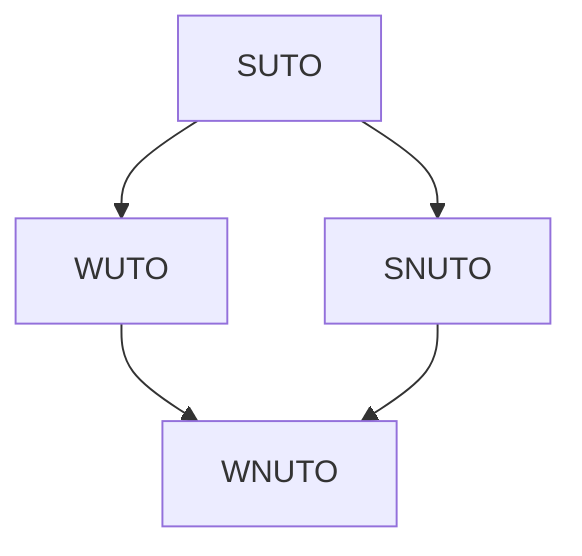
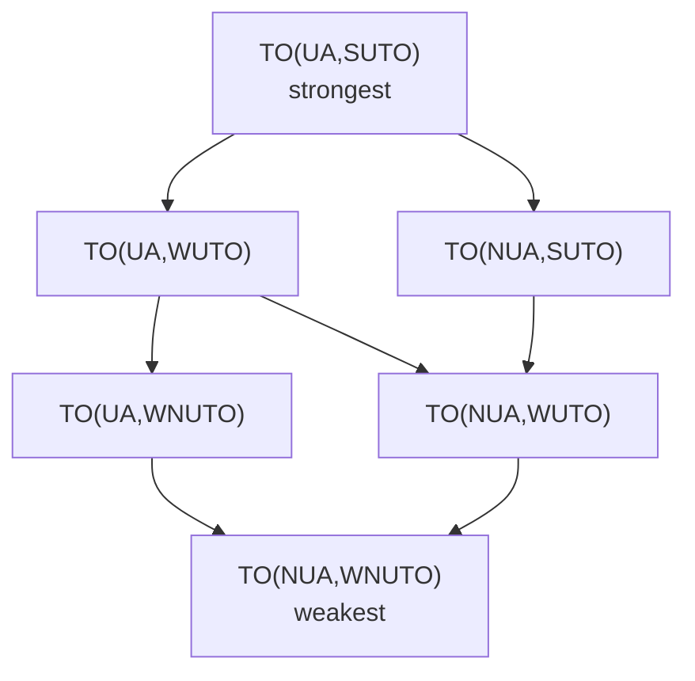

# Total Order Broadcast

> [!abstract] Purpose of this lecture
> [[10 - DDS - Ordered Communications#Total Order Broadcast|Lecture 12]] introduced total order broadcast (atomic broadcast) informally: all processes deliver the same messages in the same order. Here we make it precise and implement it.
> - **Specifications**: a TO specification is a combination of four properties (Validity, Integrity, Agreement, Order), each with a **uniform** or **non-uniform** formulation. Agreement can be UA/NUA, Order can be SUTO/WUTO/SNUTO/WNUTO: the combinations form a **hierarchy** of specifications, from the strongest TO(UA, SUTO) to the weakest TO(NUA, WNUTO).
> - **Implementation**: TO broadcast = [[7 - DDS - Broadcast Communications#(Regular) Reliable Broadcast (RB)|reliable broadcast]] to disseminate + a sequence of [[8 - DDS - Consensus|consensus]] instances to agree on the order.
> - Which specification we obtain **depends on whether RB and consensus are uniform**.
>
> Total order is the basis of [[12 - DDS - Software Replication|state machine replication]]. Course map: [[MOC - Dependable Distributed Systems]].

Vedi [[Total Order Broadcast]].

## System model

![[DDS-L11-p02.png]]

- A **static** set of processes $\Pi = \{p_1, \dots, p_n\}$.
- **Message passing over perfect channels**: messages exchanged between correct processes are reliably delivered.
- **Asynchronous** system.
- **Crash** fault model for processes.

The system is characterized in terms of its possible **runs** $R$: a run is a sequence of `TOcast(m)` / `TOdeliver(m)` events (and crashes) at the processes, like the one in the figure, where $m$ is TOcast by $p_1$ and TOdelivered by everybody, while $p_n$ crashes. A specification is then the **set of runs it allows**: a stronger specification allows fewer runs. This is the point of view of the paper by Cimmino, Marchetti and Baldoni, which the lecture follows (see [[#References]]).

## TO specifications

A total order specification is usually composed of four properties:

| Property | What it guarantees |
|---|---|
| **Validity** | messages sent by correct processes will eventually be delivered |
| **Integrity** | no spurious or duplicate messages are delivered |
| **Agreement** | constraints on the **set** of messages to be delivered |
| **Order** | constraints on the **sequence** of messages to be delivered |

We write $\text{Total Order Broadcast} = TO(V, I, A, O)$. **Distinct specifications arise from distinct formulations of each property**: uniform vs non-uniform.

> [!warning] Correzione
> The slide says "*A uniform property imposes restrictions on the behavior of (at least) correct processes*". This describes the **non-uniform** case. A **uniform** property constrains **all** processes, correct *and* faulty (e.g. "if *a process (correct or not)* delivers $m$…"); a **non-uniform** property only constrains the **correct** processes. This matches the "All / Correct processes" leaves of the next figure and the book's definition of uniformity (Module 6.2, p. 284).

![[DDS-L11-p05.png]]

The tree shows the design space: each of the four properties (Integrity, Validity, Agreement, Ordering) can be **uniform**, i.e. it applies to **all** processes, or **non-uniform**, i.e. it applies only to **correct processes**.

### Fixing Validity and Integrity

With **crash failures + perfect channels** two formulations are natural and are fixed once and for all:
- **NUV (non-uniform validity)**: *if a correct process TOCASTs a message $m$, then some correct process will eventually deliver $m$*. It only makes sense for correct senders: a sender that crashes may have sent its message to nobody.
- **UI (uniform integrity)**: *for any message $m$, every process $p$ delivers $m$ at most once and only if $m$ was previously TOCAST by some (correct or not) process*. With crashes (not Byzantine) even faulty processes don't invent or duplicate messages, so integrity can be uniform for free.

![[DDS-L11-p07.png]]

Since V = NUV and I = UI are fixed, the specification only depends on the remaining two properties: $TO(V, I, A, O) \Rightarrow TO(A, O)$.

> [!quote] Dal libro — Modules 6.1 and 6.2 (pp. 283–284)
> The book gives only two of the possible combinations.
> - **Regular total-order broadcast** (Module 6.1): TOB1–TOB4 = RB1–RB4 (validity, no duplication, no creation, agreement); **TOB5 Total order**: *let $m_1$ and $m_2$ be any two messages and suppose $p$ and $q$ are any two **correct** processes that deliver $m_1$ and $m_2$. If $p$ delivers $m_1$ before $m_2$, then $q$ delivers $m_1$ before $m_2$.*
> - **Uniform total-order broadcast** (Module 6.2): UTOB1–UTOB3 = TOB1–TOB3; **UTOB4 Uniform agreement** (any process, correct or faulty); **UTOB5 Uniform total order**: the same as TOB5, for any two processes "*whether correct or faulty*".
>
> In the lecture's notation: Module 6.1 ≈ TO(NUA, WNUTO), Module 6.2 ≈ TO(UA, WUTO). "Other combinations […] are possible and lead to slightly different specifications" (p. 283): this lecture explores exactly those.

## The Agreement property

![[DDS-L11-p08.png]]

| Uniform Agreement (UA) | Non-Uniform Agreement (NUA) |
|---|---|
| If a process (**correct or not**) TODelivers a message $m$, then **all correct** processes will eventually TODeliver $m$ | If a **correct** process TODelivers a message $m$, then all correct processes will eventually TODeliver $m$ |

Agreement **constrains the set of delivered messages**. In both cases the correct processes always deliver the same set $M$. Each faulty process $p$ delivers a set $M_p$:
- **UA**: $M_p \subseteq M$ (a faulty process can deliver *less*, never *something else*);
- **NUA**: $M_p$ can be such that $M_p \setminus M \neq \emptyset$ (a faulty process may deliver messages that the correct ones will never deliver).

![[DDS-L11-p09.png]]

- **UA**: $p_1$ and $p_2$ (correct) both deliver $\{m_1, m_2, m_3, m_4\}$ (in different orders: agreement doesn't care about order). The faulty $p_3$ delivers $m_1, m_4, m_3$ and **not** $m_2$ (crossed out) before crashing: its set is a subset of $M$, so UA holds.
- **NUA**: same, but $p_3$ also delivers $m_5$ (circled), which no correct process delivers. This is allowed by NUA only.

> [!tip] Why does it matter?
> A faulty process may act on the messages it delivered before crashing (write to disk, reply to a client). With NUA the outside world may observe effects of a message that the surviving system will never know about. It is the same reason we introduced [[7 - DDS - Broadcast Communications#Why RB is not enough|URB]].

## The Order property

![[DDS-L11-p10.png]]

| Strong Uniform Total Order (SUTO) | Weak Uniform Total Order (WUTO) |
|---|---|
| If **some process** TODelivers some message $m$ before message $m'$, then **a process TODelivers $m'$ only after it has TODelivered $m$** | If processes $p$ and $q$ **both** TODeliver messages $m$ and $m'$, then $p$ TODelivers $m$ before $m'$ **iff** $q$ TODelivers $m$ before $m'$ |
| same order; **same prefix** of the set of delivered messages; after an omission, **disjoint sets** of delivered messages | **no restrictions on the set** of delivered messages |

The difference:
- **SUTO** forbids "**holes**": if somebody delivered $m$ before $m'$, nobody can deliver $m'$ while skipping $m$. So the delivery sequences of any two processes are such that one is a prefix of the other, or they share a common prefix and then **diverge on disjoint sets** (if $p$ delivers $\dots, x$ and $q$ delivers $\dots, y$ with $x \ne y$ after the common prefix, then neither can later deliver the other's message, otherwise it would have skipped it).
- **WUTO** only constrains the **pairs** of messages delivered by **both** processes: holes are allowed, as long as the common messages appear in the same relative order.

![[DDS-L11-p11.png]]

- **SUTO**: the three processes share the prefix $m_1, m_2$ (dashed line); then $p_1$ delivers $m_3, m_6$, $p_2$ delivers $m_3, m_7$ and $p_3$ delivers $m_4, m_5$ (circled). After the point of divergence the sets are disjoint and nobody "fills in" the messages of the others.
- **WUTO**: $p_1$ delivers $m_1, m_2, m_3, m_6$; $p_2$ delivers $m_1, m_3, m_7$ (**skips $m_2$**); $p_3$ delivers $m_1, m_2, m_4, m_5$. The circled pairs show that every pair of common messages is delivered in the same relative order ($m_1$ before $m_2$, $m_1$ before $m_3$, …). $p_2$'s hole on $m_2$ violates SUTO but not WUTO.

> [!note] These figures only illustrate the order property
> In both figures the correct processes deliver different sets ($m_6$ vs $m_7$), which would violate agreement: the examples isolate the ordering property only. Agreement is combined with it in [[#Combining agreement and order]].

### Non-uniform counterparts

SUTO and WUTO are uniform (they constrain any process). Both have a non-uniform counterpart:

| Strong Non-Uniform Total Order (SNUTO) | Weak Non-Uniform Total Order (WNUTO) |
|---|---|
| If some **correct** process TODelivers some message $m$ before message $m'$, then a **correct** process TODelivers $m'$ only after it has TODelivered $m$ | If **correct** processes $p$ and $q$ both TODeliver messages $m$ and $m'$, then $p$ TODelivers $m$ before $m'$ iff $q$ TODelivers $m$ before $m'$ |

Faulty processes are now completely free in the order they deliver.

![[DDS-L11-p13.png]]

Implications: $\text{SUTO} \Rightarrow \text{WUTO}$ and $\text{SNUTO} \Rightarrow \text{WNUTO}$ (strong implies weak), and of course every uniform property implies its non-uniform counterpart.
- **SNUTO**: the correct $p_1, p_2$ share the prefix $m_1, m_2, m_3$ and then diverge; the faulty $p_3$ delivers **$m_2, m_1$** (circled), the opposite order: allowed, because only correct processes are constrained.
- **WNUTO**: moreover the correct $p_2$ **skips $m_2$** (crossed out): a hole, allowed by the weak formulation.



## Combining agreement and order

Choosing $A \in \{UA, NUA\}$ and $O \in \{SUTO, WUTO, WNUTO\}$ gives the specifications used in the course.

![[DDS-L11-p14.png]]

- **TO(UA, SUTO)** — *the strongest TO specification*: $p_1$ and $p_2$ deliver $m_1, m_2, m_3, m_6$; $p_3$ delivers the **prefix** $m_1, m_2$ and crashes. A faulty process delivers a **prefix** of the sequence of the correct ones.
- **TO(NUA, SUTO)**: like the previous one, but after the common prefix the faulty $p_3$ delivers $m_4, m_5$ (circled), which the correct processes never deliver: allowed by NUA, and still SUTO (disjoint sets after the divergence).

![[DDS-L11-p15.png]]

- **TO(UA, WUTO)**: the faulty $p_3$ delivers $m_1, m_3, m_4$, **skipping $m_2$**. Its set is a subset of the correct ones' (UA), the common pairs are in the same order (WUTO), but there is a hole (not SUTO).
- **TO(NUA, WUTO)**: $p_3$ skips $m_2$ *and* delivers $m_5$ (circled), which the correct ones don't deliver; the relative order of the common messages is still consistent.

![[DDS-L11-p16.png]]

- **TO(UA, WNUTO)**: the faulty $p_3$ skips $m_2$ and delivers **$m_4, m_3$** (circled) in the **opposite** order with respect to the correct processes. Allowed only because the order property is non-uniform.
- **TO(NUA, WNUTO)** — the weakest: $p_3$ skips $m_2$, inverts $m_3$ and $m_4$, **and** delivers the extra $m_5$.

The resulting hierarchy (an arrow means "is stronger than"):



> [!summary] How to classify a run
> 1. **Agreement**: do faulty processes deliver only messages that correct processes deliver too? Yes → UA, otherwise NUA.
> 2. **Order among the correct processes**: if they disagree, the run isn't TO at all.
> 3. **Order of faulty processes w.r.t. the others**:
>    - prefix, or common prefix followed by disjoint messages → SUTO;
>    - holes, but common pairs in the same order → WUTO;
>    - some pair inverted → only WNUTO.

## Total Order implementation

![[DDS-L11-p17.png]]

The `Total Order Broadcast` module is built from two blocks:
- **Reliable Broadcast** (`rbBroadcast(m)`, `rbDeliver(s_m, m)`) to **disseminate** the messages: every process ends up with them, but in an arbitrary order;
- **Consensus** (`propose(sn, list)`, `decide(sn, list)`) to **agree on the order**: a sequence of instances numbered $sn = 1, 2, \dots$, each deciding the next batch of messages to deliver.

This is the reason why total order broadcast needs consensus. The two problems are actually **equivalent**: with TO broadcast one can solve consensus by delivering the proposals and deciding the first one delivered. So TO broadcast **is not solvable in an asynchronous system with crashes** either ([[8 - DDS - Consensus#The FLP impossibility result|FLP]]), and in practice it is implemented with [[9 - DDS - Paxos|Paxos]]-like protocols.

### The algorithm

![[DDS-L11-p18.png]]

> [!quote] Dal libro — Algorithm 6.1 "Consensus-Based Total-Order Broadcast" (p. 285)
> ```
> Implements: TotalOrderBroadcast, instance tob.
> Uses: ReliableBroadcast, instance rb;
>       Consensus (multiple instances).
>
> upon event ⟨tob, Init⟩ do
>     unordered := ∅;
>     delivered := ∅;
>     round := 1;
>     wait := FALSE;
>
> upon event ⟨tob, Broadcast | m⟩ do
>     trigger ⟨rb, Broadcast | m⟩;
>
> upon event ⟨rb, Deliver | p, m⟩ do
>     if m ∉ delivered then
>         unordered := unordered ∪ {(p, m)};
>
> upon unordered ≠ ∅ ∧ wait = FALSE do
>     wait := TRUE;
>     Initialize a new instance c.round of consensus;
>     trigger ⟨c.round, Propose | unordered⟩;
>
> upon event ⟨c.r, Decide | decided⟩ such that r = round do
>     forall (s, m) ∈ sort(decided) do   // by the order in the resulting sorted list
>         trigger ⟨tob, Deliver | s, m⟩;
>     delivered := delivered ∪ decided;
>     unordered := unordered \ decided;
>     round := round + 1;
>     wait := FALSE;
> ```
> (In the extracted text "∉" and "≠" become "∈" and "=": the conditions are *not in* and *not empty*.)

How it works:
- each process keeps the messages rb-delivered but not yet to-delivered in `unordered`;
- as soon as `unordered` is non-empty and no round is in progress (`wait = FALSE`), the process **proposes its whole `unordered` set** to consensus instance number `round`;
- consensus decides **one** set for that round (the same for everybody); every process sorts it with a **deterministic** function `sort(·)` (e.g. by message identifier) and delivers the messages in that order;
- the decided messages are removed from `unordered` and the process moves to the next round. Messages proposed but not decided are proposed again in the following rounds.

> [!quote] Dal libro — correctness and performance (pp. 285–287)
> - **Total order**: if $m_1$ and $m_2$ are decided in the same round, every correct process sorts the same set in the same way; if $m_1$ is decided in an earlier round, every correct process decides that round's same set first, because rounds proceed sequentially.
> - **Validity**: by RB validity every correct process eventually rb-delivers $m$, so some round has $m$ in every correct proposal, and consensus validity puts it in a decision.
> - **Performance**: in failure-free runs, combining fail-stop RB and fail-stop consensus, **3 communication steps and $O(N)$ messages** per delivery.
> - **Variant**: "*by replacing the regular consensus abstraction with a uniform one, Algorithm 6.1 implements a uniform total-order broadcast abstraction*" (p. 287).

### Example

![[DDS-L11-p19.png]]

$p_1$ TOcasts $m_1$ and $p_4$ TOcasts $m_2$; both are disseminated with RB, with different delays. As soon as a process has something in `unordered`, **an instance of consensus is triggered**.

![[DDS-L11-p20.png]]

**Each process proposes its unordered buffer**: $p_1$ and $p_3$ propose $\{m_1\}$, $p_2$ proposes $\{m_2\}$, $p_4$ proposes $\{m_1, m_2\}$. The buffers are different, since RB gives no guarantee about *when* the messages arrive.

![[DDS-L11-p21.png]]

**Consensus returns $\{m_1\}$ and all processes deliver $m_1$**. $m_2$ stays in the buffers of the processes that had it, and is also delivered by RB to the others.

![[DDS-L11-p22.png]]

Meanwhile $p_2$ TOcasts $m_3$ and $p_3$ TOcasts $m_4$. A second consensus instance is triggered: $p_1$ and $p_2$ propose $\{m_2, m_3\}$, $p_3$ and $p_4$ propose $\{m_2\}$.

![[DDS-L11-p23.png]]

**Consensus returns $\{m_2, m_3\}$ and all processes deliver $m_2$ and then $m_3$** (sorted deterministically). $m_4$ will be ordered by the next instance.

> [!quote] Dal libro — Figure 6.1 (p. 286)
> The book shows the same mechanism with 4 processes $p, q, r, s$ and three rounds, which deliver $m_1$, then $m_2$, then $m_3, m_4$. Process $s$ proposes $m_2$ in round 1; since round 1 decides $m_1$, $s$ "resubmits" $m_2$ (with $m_3$) in round 2.

## Which TO specification does the algorithm satisfy?

![[DDS-L11-p24.png]]

**It depends on the assumptions about Reliable Broadcast and Consensus**: each can be uniform or non-uniform, giving a 2×2 table.

### Uniform Consensus (UC) and Uniform Reliable Broadcast (URB)

![[DDS-L11-p25.png]]

**Example 1**: $p_2$ crashes after the second delivery. It has delivered $m_1, m_2, m_3$, a prefix of the sequence $m_1, m_2, m_3, m_4$ of the correct processes.

![[DDS-L11-p26.png]]

**Example 2**: $p_2$ crashes **in the middle** of delivery 2, after delivering $m_2$ but before $m_3$: its sequence $m_1, m_2$ is still a prefix.

Assuming both consensus and reliable broadcast **uniform**, we get **TO(UA, SUTO)**. Proof:
- by URB all the processes (even the faulty ones) deliver the same set of messages;
  - so the unordered buffers contain the same messages at every process, and all processes will deliver the same set of messages (**UA**);
- by UC all processes (even the faulty ones) **decide the same list** of messages in each round;
- messages are sorted by a deterministic rule;
  - so all processes deliver the messages in the same order, and a faulty one can only stop earlier: its sequence is a **prefix** (**SUTO**).

### Non-Uniform Consensus (NUC) and URB

![[DDS-L11-p28.png]]

In consensus 2, the faulty $p_2$ **decides $\{m_2, m_3\}$**, delivers $m_2, m_3$ and crashes. A non-uniform consensus allows it: only the correct processes must agree, and they decide $\{m_3\}$. Then consensus 3 decides $\{m_2, m_4\}$. The correct processes deliver $m_1, m_3, m_2, m_4$, while $p_2$ delivered $m_1, m_2, m_3$: the same messages (UA), but **$m_2$ and $m_3$ in the opposite order**.

With NUC and URB we get **TO(UA, WNUTO)**. Proof:
- by URB all the processes (even the faulty ones) deliver the same set of messages, so the buffers contain the same set and all processes deliver the same set of messages (**UA**);
- by NUC all **correct** processes decide the same list, while faulty processes can decide differently;
  - so all correct processes deliver the messages in the same order;
  - faulty processes can deliver, just before a crash, a **different sequence** of messages (**WNUTO**).

> [!warning] Correzione
> In the proof slides for NUC+URB and for NUC+NURB the first sentence still says "*Assuming both Consensus and Reliable Broadcast uniform we have*" (copied from the UC+URB slide). The assumptions are respectively "non-uniform consensus and uniform RB" and "non-uniform consensus and non-uniform RB", as in the titles.

> [!note] Why UA and not NUA here
> One might worry that the faulty $p_2$ decided $\{m_2, m_3\}$ "alone". But the *messages* $m_2, m_3$ came from URB: since a process (even a faulty one) urb-delivered them, every correct process eventually urb-delivers them too, so they end up in some later decision of the correct processes. That's why $p_2$'s set is a subset of $M$.

### Non-Uniform Consensus (NUC) and Non-Uniform Reliable Broadcast (NURB)

![[DDS-L11-p30.png]]

The faulty $p_2$ decides $\{m_2, m_3, m_4\}$ in consensus 2 and delivers them, then crashes. The correct processes decide $\{m_4\}$, then $\{m_3\}$, then $\{m_5\}$: **$m_2$ is never delivered by a correct process** (with NURB only $p_2$ ever received it), and $m_3, m_4$ are in the opposite order.

With NUC and NURB we get **TO(NUA, WNUTO)**. Proof:
- by NURB the correct processes deliver the same set of messages, while faulty processes can deliver other messages;
  - so only the correct processes are guaranteed to deliver the same set (**NUA**);
- by NUC all correct processes decide the same list, while faulty ones can decide differently;
  - so the correct processes deliver in the same order, and the faulty ones can deliver, just before a crash, a different sequence (**WNUTO**).

### Summary and exercise

![[DDS-L11-p32.png]]

| Reliable Broadcast ↓ / Consensus → | Uniform | Non-Uniform |
|---|---|---|
| **Uniform** | UA, SUTO | UA, WNUTO |
| **Non-Uniform** | *exercise* | NUA, WNUTO |

> [!example] Exercise — which specification with UC and NURB?
> Answer proposed in these notes: **TO(UA, SUTO)**, the same as UC + URB.
> - **Order**: with UC every process, faulty included, decides the same list in each round and sorts it in the same way. So every process delivers a prefix of the same sequence → **SUTO**.
> - **Agreement**: a process only to-delivers messages contained in a **decision**. The decision is the same for everybody (UC) and contains the messages themselves, so every correct process will deliver them as well, even if it never rb-delivered them (NURB may lose them) → **UA**.
>
> The uniformity of the broadcast is therefore not needed: the decisive block is the consensus. This agrees with the book, where the variant with the regular reliable broadcast and a **uniform consensus** "implements a uniform total-order broadcast abstraction" (p. 287).

## Exercise

![[DDS-L11-p33.png]]

Run: $P_1$, $P_2$ and $P_4$ (correct) deliver $m_1, m_2, m_3, m_5$; $P_3$ delivers $m_1, m_2, m_4$ and crashes.

> [!example] Solutions proposed in these notes
> 1. **Which TO?** Agreement: the faulty $P_3$ delivered $m_4$, which no correct process delivers → **NUA** (not UA). Order: $P_3$ shares the prefix $m_1, m_2$ with the others and then diverges on a message nobody else delivers, with no holes and no inversions → **SUTO**. The run satisfies **TO(NUA, SUTO)**.
> 2. **TO(UA, WUTO) but not TO(UA, SUTO)**: remove the delivery of $m_4$ at $P_3$, so that $P_3$'s set is a subset (UA), and introduce a **hole**. E.g. $P_3$ delivers $m_1, m_3$ (skipping $m_2$) and then crashes: the common pairs keep the same order (WUTO), but $P_3$ delivered $m_3$ without $m_2$ (not SUTO).
> 3. **TO(NUA, WNUTO) but not TO(NUA, WUTO)**: let the faulty $P_3$ **invert** two messages delivered by the correct ones. E.g. $P_3$ delivers $m_2, m_1, m_4$: the correct processes still agree among themselves (WNUTO), $P_3$ delivers $m_2$ before $m_1$ (not WUTO), and $m_4$ keeps the run NUA.

## References

- C. Cachin, R. Guerraoui and L. Rodrigues, *Introduction to Reliable and Secure Distributed Programming*, Springer, 2011 — Chapter 6, Section 6.1 (pp. 281–287).
- S. Cimmino, C. Marchetti, R. Baldoni, "*A Guided Tour on Total Order Specifications*", WORDS Fall 2003: 187–194.

## Core ideas to retain

| Concept | Key point |
|---|---|
| TO(V, I, A, O) | with crash + perfect channels, V = NUV and I = UI are fixed → TO(A, O) |
| UA vs NUA | faulty processes deliver a **subset** of $M$ (UA) or possibly extra messages (NUA) |
| SUTO | same order, **no holes**: prefix, or common prefix then disjoint sets |
| WUTO | only common pairs in the same order; holes allowed |
| SNUTO / WNUTO | the same, restricted to **correct** processes |
| Hierarchy | TO(UA,SUTO) strongest … TO(NUA,WNUTO) weakest |
| Implementation | RB to disseminate + one **consensus** per round on the set of unordered messages + deterministic sort |
| Uniformity | UC ⇒ SUTO and UA (whatever the RB); NUC ⇒ WNUTO; NURB + NUC ⇒ NUA |
| TO ≡ consensus | equivalent problems: TO is impossible in async + crash (FLP) |
