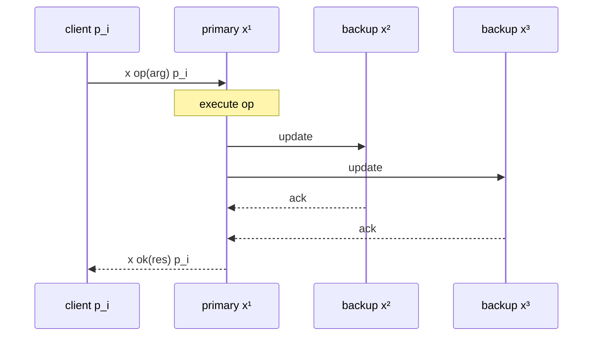
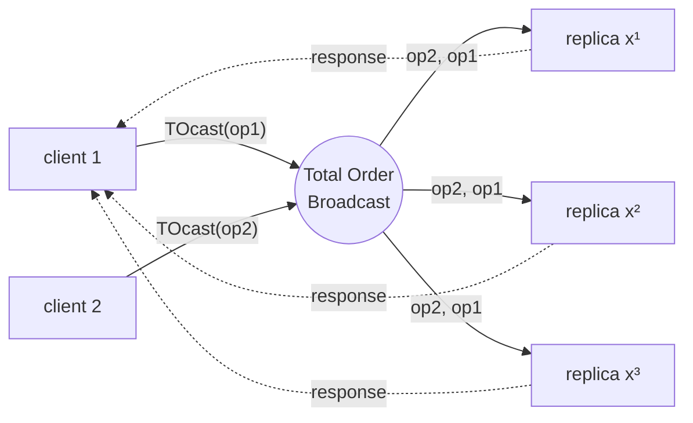

# Software Replication

> [!abstract] Purpose of this lecture
> So far we have built communication and agreement abstractions ([[7 - DDS - Broadcast Communications|broadcast]], [[8 - DDS - Consensus|consensus]], [[11 - DDS - Total Order Broadcast|total order]]). This lecture uses them for their main purpose: **making a service fault tolerant by replicating it**.
> - **Consistency criteria**: what result a replicated object must return. We focus on **linearizability**: the replicated object must behave like a single copy accessed atomically.
> - **Sufficient condition**: replicas agree on the **set** of invocations (atomicity) and on their **order** (ordering).
> - **Two techniques**:
>   - **primary-backup** (passive replication) uses a primary chosen by [[6 - DDS - Failure Detection and Leader Election#Leader election (LE)|leader election]];
>   - **active replication** uses [[Total Order Broadcast|total order broadcast]], which gives *state machine replication*.
>
> Course map: [[MOC - Dependable Distributed Systems]].

## Motivation

The goal is **fault tolerance**: guarantee the **availability** of a service (also called **object**) despite failures.
- If $p$ is the failure probability of an object $O$, the availability of $O$ is $1 - p$.
- If we replicate $O$ on $n$ nodes, each with failure probability $p$, and failures are **independent**, the object is unavailable only when *all* replicas fail:

$$\text{availability} = 1 - p^n$$

> [!example] Numbers
> With $p = 0.01$: one copy gives 99% availability; $n = 3$ replicas give $1 - 10^{-6} = 99.9999\%$.
> The independence assumption is crucial. Replicas in the same rack, with the same power supply or running the same buggy software, fail together, and the formula overestimates the availability.

The hard part is not creating the copies, but keeping them **consistent** while clients use them and some replicas crash. The rest of the lecture is about that.

## System model

- The system is composed of a set of processes (**clients**):
  - connected through **perfect point-to-point links**;
  - which may fail by **crash**.
- Processes interact with a set of **objects** $X$, located at different sites and managed by processes:
  - each object has a **state**, accessed through a set of **operations**;
  - an operation by a process $p_i$ on an object $x \in X$ is a pair **invocation/response**:
    - invocation: $[x\ op(arg)\ p_i]$, where $arg$ are the arguments of $op$;
    - response: $[x\ ok(res)\ p_i]$, where $res$ is the returned result;
    - the whole operation: $[x\ op(arg)/ok(res)\ p_i]$.
- After issuing an invocation a process is **blocked** until it receives the matching response, so each client has at most one pending operation.

An operation is therefore not instantaneous: it occupies an **interval** of time, from invocation to response. This is what makes the consistency criteria below non-trivial: operations of different clients can **overlap**.

## Replication: requirements

To tolerate process crash failures, a **logical object** must have several **physical replicas** located at different sites:
- the replicas of an object $x$ are noted $x^1, x^2, \dots, x^l$;
- the invocation of replica $x^j$, located on site $s$, is handled by a process $p_j$ also located on $s$;
- we assume that $p_j$ crashes exactly when $x^j$ crashes (a replica and its manager are the same failure unit).

**Replication is transparent** to the client processes: a client thinks it is talking to a single object $x$.

## Consistency criteria

A **consistency criterion** defines the result returned by an operation. It can be seen as a **contract** between the programmer and the system implementing replication: "if you use the object this way, you will see these results".

Three main criteria are defined in the literature:

| Criterion | Class | Intuition |
|---|---|---|
| **Linearizability** | strong | every operation appears to take effect **instantaneously** at some point between its invocation and its response; respects **real time** |
| **Sequential consistency** | strong | operations appear in **some** total order that respects the order **of each process**, not necessarily real time |
| **Causal consistency** | weak | only **causally related** operations are seen in the same order by everyone (as in [[10 - DDS - Ordered Communications#Causal Order Broadcast|causal broadcast]]) |

The three criteria differ in the definition of **the most recent state**, i.e. which writes a read must "see". Only linearizability is treated in detail in the lecture; the other two rows are added here for comparison.

## Linearizability

Vedi [[Linearizability]].

Consider two relations between operations:
- **precedence** $O_1 \prec O_2$: the response of $O_1$ happens **before** the invocation of $O_2$ (in real time);
- **concurrency** $O_1 \parallel O_2$: neither precedes the other (their intervals overlap).

> [!important] Definition
> An execution $E$ is **linearizable** if there exists a sequence $S$ including all operations of $E$ such that:
> 1. for any two operations $O_1$ and $O_2$ such that $O_1 \prec O_2$, $O_1$ appears before $O_2$ in $S$ (**real-time order is respected**);
> 2. the sequence $S$ is **legal**: for every object $x$, the subsequence of $S$ of the operations on $x$ belongs to the **sequential specification** of $x$ (i.e. it is a correct behaviour of a single, non-replicated copy of $x$).

Concurrent operations can be put in $S$ in any order: intuitively, each operation takes effect at a **linearization point** somewhere inside its interval.

> [!quote] Dal libro — Linearization (p. 160)
> The book introduces the same notion for $(N,N)$ atomic registers: "*a linearization of an execution is defined as a sequence of complete operations that appear atomically, one after the other, which contains at least all complete operations of the actual execution (and possibly some operations that were incomplete)*" such that (1) every read returns the last value written and (2) if $o$ precedes $o'$ in the actual execution, then $o$ appears before $o'$ in the linearization. Then atomicity becomes "*NNAR2': Every execution of the register is linearizable*". Condition (1) is the "legal" condition for the sequential specification of a register. Registers are the topic of [[13 - DDS - Registers|the next lectures]].

### Example: simple variable

![[DDS-L12-p07.png]]

1. **Linearizable**: $p_1$ writes $a$; then $p_2$ writes $b$; then $p_1$ reads and gets $b$. $S = write(a), write(b), read() \to b$ respects the real-time order and is legal (the read returns the last value written).
2. **Not linearizable**: same timing, but the read returns $a$. The operations are not concurrent: $write(a) \prec write(b) \prec read()$, so $S$ is forced to be exactly this order, and in it the read should return $b$. No legal $S$ exists.

> [!note] Linearizable vs sequentially consistent
> Execution 2 is **sequentially consistent**: the order $write(b), write(a), read() \to a$ respects the order of each process ($p_1$: write(a) then read; $p_2$: write(b)) and is legal. It only violates the real-time order between $write(b)$ and $write(a)$. This is exactly the difference between the two strong criteria.

### Example: FIFO queue

![[DDS-L12-p08.png]]

Four operations on a FIFO queue $x$:
- $O_1$: $p_i$ enqueues $a$;
- $O_2$: $p_j$ enqueues $b$, concurrently with $O_1$;
- $O_3$: $p_i$ dequeues and gets $b$;
- $O_4$: $p_j$ dequeues and gets $a$, concurrently with $O_3$.

The red dots are possible **linearization points**: $O_2$ takes effect before $O_1$, and $O_3$ before $O_4$. The sequence $S = \{O_2, O_1, O_3, O_4\}$, i.e. $enq(b), enq(a), deq() \to b, deq() \to a$, respects real time ($O_1, O_2 \prec O_3, O_4$) and is legal for a FIFO queue. So the execution is **linearizable**.

![[DDS-L12-p09.png]]

Same execution, but **both** dequeues return $b$. Whatever order we choose, $b$ is enqueued once and cannot be dequeued twice: no sequence is **legal** with respect to the sequential specification of a FIFO queue. So the execution is **not linearizable**.

## A sufficient condition for linearizability

> *Replicas must agree on the set of invocations they handle and on the order according to which they handle these invocations.*

- **Atomicity**: given an invocation $[x\ op(arg)\ p_i]$, if one replica of $x$ handles it, then **every correct replica** of $x$ also handles it.
- **Ordering**: given two invocations $[x\ op(arg)\ p_i]$ and $[x\ op(arg)\ p_j]$, if two replicas handle both, they handle them **in the same order**.

These two requirements are the **agreement** and **total order** properties of [[11 - DDS - Total Order Broadcast|total order broadcast]], applied to invocations. If all replicas start from the same state, are deterministic and apply the same invocations in the same order, they go through the same sequence of states, and they behave like a single copy.

## Replication techniques

Two main techniques implement linearizability:

| | **Primary-backup** (passive) | **Active replication** |
|---|---|---|
| Who executes the request | only the **primary** | **all** replicas |
| Role of replicas | asymmetric: primary + backups | symmetric: no coordinator |
| Determinism required | no (the primary sends the resulting **state**) | yes (every replica must compute the same result) |
| Ordering established by | the primary (order of arrival) | **total order broadcast** |
| On a crash | of the **primary**: election of a new primary, recovery actions | nothing to do: the other replicas keep answering |
| Responses to the client | one, from the primary | one from **each** replica |

## Passive replication: primary-backup

Vedi [[Primary-Backup Replication]].

- **Primary**:
  - receives the invocations from the clients and sends back the answers;
  - given an object $x$, $prim(x)$ returns the primary of $x$.
- **Backups**:
  - interact with $prim(x)$;
  - are used to guarantee fault tolerance by **replacing the primary when it crashes**.

> [!quote] Dal libro — Leader election and primary-backup (p. 52)
> The book motivates [[6 - DDS - Failure Detection and Leader Election#Leader election (LE)|leader election]] exactly with this scheme: "*a set of replica processes coordinate their activities to provide the illusion of a unique highly available service that tolerates faults of some processes. Among the set of replica processes, one is chosen as the leader. This leader process, sometimes called the primary, treats the requests submitted by the client processes on behalf of the other replicas, called backups. Before the leader returns a reply to a given client, it updates the backups. If the leader crashes, one of the backups is elected as the new leader.*"

### Scenario without crashes

![[DDS-L12-p14.png]]

The client $p_i$ sends the invocation $x\ op(arg)\ p_i$ to the primary (replica $x^1$), which executes it and sends an **update** to the backups (replicas $x^2$, $x^3$). The backups apply it and **ack**. Only then the primary sends the **response** $x\ ok(res)\ p_i$ to the client.

1. When update messages are received by the backups, they update their state and send back the ack to $prim(x)$.
2. $prim(x)$ waits for an ack message from **each correct backup** and then sends the answer $res$ to the client.

**How linearizability is guaranteed**: the order in which $prim(x)$ receives the clients' invocations defines the order of the operations on the object. The primary is a single serialization point. Waiting for the acks before answering guarantees that, when the client gets the response, every correct backup already has the new state. So a future primary will not "forget" an operation that some client has already seen.



> [!tip] Why "wait for each correct backup"?
> "Correct" is decided by a [[Perfect Failure Detector|perfect failure detector]]: the primary must not wait forever for a crashed backup, but must not skip a correct one either. Here the synchrony assumptions of [[6 - DDS - Failure Detection and Leader Election|Lecture 7]] come back.

### Presence of crashes

Three scenarios:
- **Scenario 1**: the primary fails after the client receives the answer;
- **Scenario 2**: the primary fails before sending the update messages;
- **Scenario 3**: the primary fails after sending the update messages and before receiving all the acks.

In all cases a **new primary must be elected** among the backups.

#### Scenario 1 — the primary fails after sending the answer

![[DDS-L12-p17.png]]

The primary crashes (red star) right after sending the response. Two cases:
1. The client **does not receive** the response. The client retransmits the request after a timeout.
2. The client receives the answer: everybody is happy (but the primary ☺).

The new primary will **recognize the request re-issued by the client as already processed** and send back the result without updating the replicas again. So requests need **unique identifiers** (e.g. client id + sequence number), and the replicas must store the last response for each client: otherwise a non-idempotent operation (e.g. "withdraw 100€") would be executed twice.

> [!warning] Correzione
> - The slide says the client does not receive the response "*due to perfect point-to-point link*". Perfect links guarantee delivery only when **both** sender and receiver are correct. Here the sender (the primary) crashes, so the response can be lost **despite** perfect links, not because of them.
> - The overview slide describes Scenario 1 as "*Primary fails after the client receives the answer*", while the scenario slide says "*after sending the answer*" and also covers the case in which the client does not receive it. The second formulation is the right one.

#### Scenario 2 — the primary fails before sending the updates

![[DDS-L12-p18.png]]

The primary crashes before the update leaves. No backup knows about the request, and the client does not get an answer: it **resends the request after a timeout**. The new primary will handle the request **as new**. Nothing was executed anywhere else, so this is safe: from the outside, the operation simply happens later.

#### Scenario 3 — the primary fails during the update

![[DDS-L12-p19.png]]

The primary crashes after sending the update messages but before receiving all the acks: some backups may have received the update and others not.

**How do we guarantee atomicity?** The update must be received **either by all or by no one** of the correct backups. Otherwise the new primary might be a backup that never saw the update, while another backup did, and the replicas would diverge.

When the primary fails, another primary must be elected **among the correct replicas**. The new primary must then:
- make sure the backups are consistent;
- then serve the client's retransmission as in Scenario 1 (already processed) or Scenario 2 (new).

> [!note] Which tools?
> "All or none, even if the sender crashes" is the property of [[7 - DDS - Broadcast Communications#(Regular) Reliable Broadcast (RB)|reliable broadcast]]: if one correct backup delivers the update, all correct ones do. Use **uniform** reliable broadcast if the delivery has external effects. The election uses the [[6 - DDS - Failure Detection and Leader Election#Leader election (LE)|leader election]] abstraction (with a perfect failure detector), or $\Omega$ in a partially synchronous system. Real systems with these ideas are *Viewstamped Replication* (Oki & Liskov 1988) and Raft.

## Active replication

Vedi [[Active Replication]].

- There is **no coordinator**: all replicas have the same role.
- Each replica is **deterministic**: if replicas start from the same state and receive the same input, they produce the same output.
- As a matter of fact, clients will receive **the same response from each replica** and can simply take the first one.

![[DDS-L12-p22.png]]

The client $p_i$ sends its invocation to **all** replicas $x^1, x^2, x^3$. Each one executes it (the bars have different lengths: the replicas are not synchronized) and answers. The client takes the first response, since they are all equal.

### How to guarantee linearizability

To ensure linearizability we need to preserve:
- **Atomicity**: if a replica executes an invocation, all correct replicas execute the same invocation;
- **Ordering**: (at least) no two correct replicas execute two invocations in a different order.

We need **TOTAL ORDER broadcast**, **including the clients!** The invocations are sent by the **clients**, so the clients must take part in the total order broadcast as senders (`TOcast` of the invocation). Ordering only the messages exchanged among replicas is not enough: two clients would send concurrent invocations directly to the replicas, and the replicas would receive them in different orders.

Which TO specification is needed? From [[11 - DDS - Total Order Broadcast#Combining agreement and order|Lecture 13]]: if a replica that later crashes could deliver a different sequence (WNUTO) or extra messages (NUA), it could answer a client with a result that the surviving replicas will never produce. A replica's response is visible to the outside, so the safe choice is the **uniform** specification. Uniform consensus gives it, as in the [[11 - DDS - Total Order Broadcast#Summary and exercise|summary table]].

> [!quote] Dal libro — State machine replication (p. 282; Module 6.12 and Algorithm 6.13, pp. 330–331)
> "*Total-order broadcast is the key abstraction for maintaining consistency among multiple replicas that implement one logical service, whose behavior can be captured by a deterministic state machine. […] A client broadcasts every method invocation on the object to all replicas using the total-order broadcast primitive. This will ensure that all replicas keep the same state and that all responses are equal.*" (p. 282)
>
> Module 6.12 specifies a **replicated state machine** (`rsm`) with the request `⟨Execute | command⟩` and the indication `⟨Output | response⟩`:
> - **RSM1 Agreement**: all correct processes obtain the same sequence of outputs;
> - **RSM2 Termination**: if a correct process executes a command, then the command eventually produces an output.
>
> Algorithm 6.13 (Solution of Exercise 6.8) uses a **uniform** total-order broadcast:
> ```
> upon event ⟨rsm, Init⟩ do
>     state := initial state;
> upon event ⟨rsm, Execute | command⟩ do
>     trigger ⟨utob, Broadcast | command⟩;
> upon event ⟨utob, Deliver | p, command⟩ do
>     (response, newstate) := execute(command, state);
>     state := newstate;
>     trigger ⟨rsm, Output | response⟩;
> ```
> Solution 6.9 (p. 330) describes the client side: clients give unique identifiers to their commands and send them to a replica, which broadcasts them. If no response arrives in time, the client resends the same identifier/command pair to another replica. This is the same duplicate handling as in Scenario 1 of primary-backup.



### Crash

Active replication **does not need any recovery action** upon the failure of a replica. The other replicas have executed the same invocations and keep answering, and the client simply receives one response fewer. The price is paid in failure-free runs: every invocation costs a total order broadcast, i.e. a consensus. Primary-backup is cheaper without failures but needs an election and a recovery protocol on a crash.

## References

- R. Guerraoui and A. Schiper, "*Fault-Tolerance by Replication in Distributed Systems*", Proceedings of the 1996 Ada-Europe International Conference on Reliable Software Technologies (Ada-Europe '96).
- C. Cachin, R. Guerraoui and L. Rodrigues, *Introduction to Reliable and Secure Distributed Programming*, Springer, 2011: §2.6.3 (leader election and primary-backup, p. 52), §4.4 (linearization, p. 160), §6.1 (p. 282), Exercises 6.8–6.9 with solutions (pp. 323, 329–331).

## Core ideas to retain

| Concept | Key point |
|---|---|
| Availability | $1 - p^n$ with $n$ replicas and independent failures |
| Linearizability | exists a **legal** sequence $S$ of all operations respecting **real-time precedence** |
| Sufficient condition | **atomicity** (same set of invocations) + **ordering** (same order) at the replicas |
| Primary-backup | primary orders and executes, updates the backups, waits for **all acks**, then answers; on a crash: **elect a new primary**, guarantee all-or-none updates, detect duplicate requests |
| Active replication | deterministic replicas, **TO broadcast including the clients**; no recovery on a crash |
| State machine replication | deterministic state machine + uniform TO broadcast of the commands (Alg. 6.13) |
