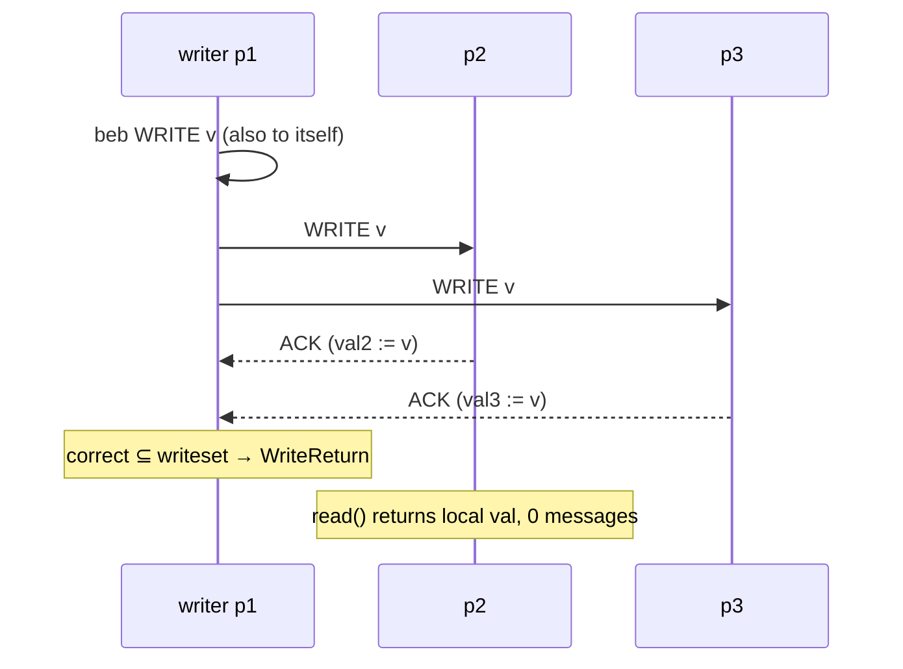
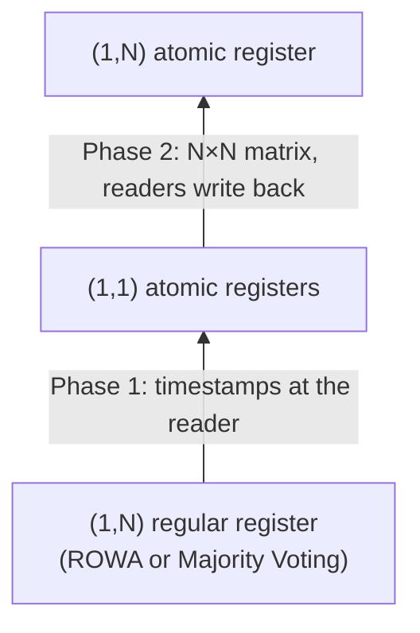
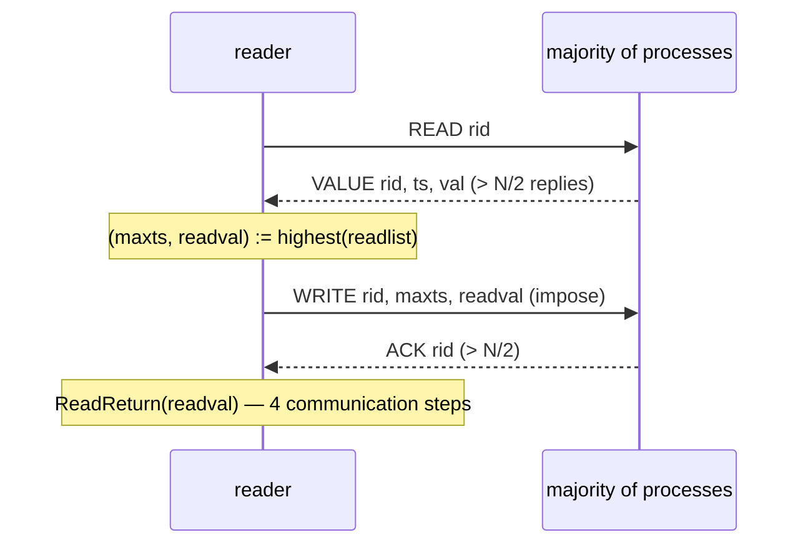
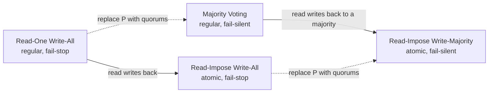

# Registers

> [!abstract]
> Up to now processes communicated by **exchanging messages** (links, broadcasts, consensus, total order). This lecture builds the opposite abstraction on top of message passing: a **shared register**, i.e. a variable that every process can `read()` and (some process can) `write()`, as if there were a shared memory. The key questions are *which value a read must return* when operations are concurrent or when processes crash, and *how to implement it* with messages.
> - Two semantics: **regular** (a read returns the last value written or one being written) and **atomic** (regular + no "new/old inversion" between reads).
> - Four algorithms for $(1,N)$ registers, two per failure model: **Read-One Write-All** and **Read-Impose Write-All** (fail-stop, perfect failure detector), **Majority Voting** and **Read-Impose Write-Majority** (fail-silent, majority of correct processes), plus a modular **regular → atomic transformation**.
> - It reuses [[7 - DDS - Broadcast Communications#Best Effort Broadcast (BEB)|BEB]], perfect links, the [[Perfect Failure Detector]] of [[6 - DDS - Failure Detection and Leader Election|Lecture 7]] and the majority-quorum idea of [[5 - DDS - Distributed Mutual Exclusion#Quorum-based algorithm — Maekawa's voting algorithm|Maekawa]] and [[9 - DDS - Paxos|Paxos]]. Atomicity is the register version of [[12 - DDS - Software Replication#Linearizability|linearizability]].
>
> Course map: [[MOC - Dependable Distributed Systems]]

## Register: definition

A **register** is a shared variable accessed by processes through `read` and `write` operations. It is the simplest possible shared object: no `increment`, no `compare-and-swap`, just "store a value" and "give me the value".

![[DDS-L13-p02.png]]

The slide shows the idea graphically: several processes point to one cell that they can read and write. Everything in this lecture is about giving a precise meaning to "*the* value of the cell" when the cell is in fact replicated on many machines.

## The register abstraction in distributed systems

![[DDS-L13-p03.png]]

The figure compares two worlds:

| | Multiprocessor machine | Distributed message-passing system |
|---|---|---|
| Physical shared memory | Yes: processes $p_1 \dots p_n$ share a **bus** and hardware registers | **No**: processes only exchange messages over a **network** |
| What the register is | A hardware register; the set of registers *is* the memory | An **abstraction**, emulated by an algorithm |
| Who pays the complexity | The hardware | The register algorithm (hidden from the programmer) |

The register abstraction supports the design of distributed solutions by **hiding the complexity of the underlying message-passing system and of the distribution of the data**: the programmer writes `x := read()` / `write(v)` and does not see messages, replicas or timeouts.

> [!quote] Dal libro
> "*Such an emulation is very appealing because programming with a shared memory is usually considered significantly easier than working with message exchanges, precisely because the programmer can ignore the consistency problems introduced by the distribution of data.*" The book also notes that the same algorithms are used to build **networked storage systems, distributed file systems and shared working spaces**: "*the abstraction of a distributed storage device that can be accessed through read and write operations is similar to the notion of a register.*" (Cachin et al., §4.1.1, p. 138)

## Register operations

A process accesses a register through:

- **Read**, `read() → v`: returns the "current" value $v$ of the register; it does **not modify** the content.
- **Write**, `write(v)`: writes $v$ in the register and returns `true` (a confirmation, *ack*) at the end of the operation.

Each operation starts with an **invocation** and terminates when the corresponding **response** is received. In event-based notation (the one used by the book and by the algorithms below): the invocations are $\langle Read \rangle$ and $\langle Write \mid v \rangle$, the responses are $\langle ReadReturn \mid v \rangle$ and $\langle WriteReturn \rangle$.

## Assumptions

- A register stores only positive integers and is initialized to $0$.
- **Each value written is univocally identified**: the same value is never written twice. This lets us say "the read returned the value of *that* write" without ambiguity.
- **Processes are sequential**: a process cannot invoke a new operation before the previous one it invoked (if any) has returned. Concurrency therefore only exists **between different processes**.

> [!warning] Correzione
> The slide says "*stores only positive integers and it is initialize to 0*": $0$ is not positive, so the domain should be **non-negative integers** (or "positive integers plus the initial value 0"). The book avoids the problem by allowing "*values from an arbitrary domain*" and initialising the register to a special value $\bot$ (Cachin et al., §4.1.2, p. 139). In these notes $0$ (slides) and $\bot$ (book) denote the same initial value.

## Notation: $(X,Y)$ registers

$(X,Y)$ denotes a register where **$X$ processes can write** and **$Y$ processes can read**:

- $(1,1)$: one process writes and one process reads; *who* writes and *who* reads is **known a priori**.
- $(1,N)$: a single, a-priori-known writer, and $N$ readers (all processes).
- $(N,N)$ would be the multi-writer case; it is **not** covered in this lecture (book §4.4).

All algorithms of this lecture are $(1,N)$, with one exception: Phase 1 of the atomic transformation builds a $(1,1)$ register as an intermediate step.

## Operations: complete and failed

![[DDS-L13-p07.png]]

Every operation is characterised by two events, **invocation** and **return** (a confirmation for the write, a value for the read). Each of these events occurs at a **single indivisible point of time**; in the figure they are the two ends of the bar `Op`.

- An operation is **complete** if both the invocation and the return events occurred.
- A **failed** operation is one invoked by a process $p_i$ that **crashes before obtaining a return** (the bar `Op'` in the figure is cut by `Crash`, it has no right end).

> [!note] Which "time"?
> The time axis is a **fictional global time** used only to *reason* about the specification; processes cannot read it. This is the same observer's point of view used for the consistent cuts of [[4 - DDS - Logical Clocks|Lecture 5]].
> > [!quote] Dal libro
> > "*Remember that these events occur at a single indivisible point in time, using a fictional notion of global time that only serves to reason about specifications and algorithms. This global time is not directly accessible to the processes.*" (Cachin et al., §4.1.3, p. 141)

## Precedence between operations

- The **execution** of an operation is the time interval between its invocation and its return.
- Given $o$ and $o'$, **$o$ precedes $o'$** if the response event of $o$ precedes the invocation event of $o'$.
- An operation $o$ invoked by $p$ can precede an operation $o'$ invoked by $p'$ **only if $o$ completes**: a failed operation has no response, so it precedes nothing.
- If no precedence can be established between two operations, they are **concurrent**.

![[DDS-L13-p09.png]]

Left: `Op1` (on $p_1$) ends before `Op2` (on $p_2$) starts, so **Op1 precedes Op2**. Right: the two bars overlap in time, so **Op1 is concurrent with Op2**.

> [!tip] Consequences worth remembering
> - Precedence is a **partial order**. For a single process it is total (processes are sequential).
> - A failed write is **concurrent with every operation that does not precede it**, including operations that start much later. This single rule explains almost all the "strange" scenarios below.
> > [!quote] Dal libro
> > "*If two operations are such that one precedes the other then we say that the operations are sequential. If neither one of two operations precedes the other then we say that they are concurrent. Basically, the execution of operations on a register defines a partial order on its read and write operations.*" (Cachin et al., §4.1.3, p. 142)

## Register semantics

The lecture builds the specification step by step, adding one difficulty at a time.

### Serial system, no failures

Assumptions: **serial access** (nobody invokes an operation while another one is in progress) and **no failures**. Then the natural **sequential specification** is enough:

- **Liveness**: each operation eventually terminates.
- **Safety**: each read returns the **last value written**.

![[DDS-L13-p10.png]]

$p_1$ writes 5; $p_2$ then reads 5; $p_2$ writes 8; $p_1$ then reads 8. All operations are disjoint in time, so "the last value written" is always well defined.

### Concurrency

Now several processes access the register **concurrently**, still with no failures.

![[DDS-L13-p11.png]]

In both diagrams `write(5)` by $p_1$ and `write(8)` by $p_2$ overlap, and a read overlaps with them. **Which value should the read return?** "The last value written" no longer makes sense, because there is no single "last" write: the overlapping writes have no order.

### Failures

Serial access, but processes can **crash**: after some point in time they stop running their algorithm forever.

![[DDS-L13-p12.png]]

$p_1$ completes `write(5)`; then $p_2$ invokes `write(8)` and **crashes in the middle** (a **failed operation**: the process fails between invocation and response); afterwards $p_1$ reads. Access is still serial (the dotted lines separate the operations), yet the question is again open: does the failed `write(8)` "count", so that the read returns 8, or does it return 5? In a replicated implementation the `write(8)` messages may have reached some replicas and not others.

### Concurrency and failures

![[DDS-L13-p13.png]]

$p_1$ writes 5, then invokes `write(8)` and crashes; $p_2$ reads after that. A process can invoke a write and crash before the response: the write **may or may not have taken place**. The specification must therefore allow a read to return **both**:

- the value written by the **last write that completed** (5 here), and
- the value given as input to the **last write invoked, even if that write fails** (8 here).

This is exactly the "last value written *or* value concurrently written" rule of the regular register, once we remember that a failed write is concurrent with all later reads.

## Register specifications: regular and atomic

### $(1,N)$ regular register

Vedi [[Regular Register]].

- **Termination** (ONRR1). If a correct process invokes an operation, the operation eventually receives the corresponding confirmation.
- **Validity** (ONRR2). A read returns the **last value written**, or the **value concurrently written**.

![[DDS-L13-p15.png]]

Left, **not regular**: the first `read() → 0` by $p_2$ starts *after* `write(5)` completed, so the last value written is 5 and 0 is not allowed. Right, **regular**: the read returning 0 is **concurrent** with `write(5)`, so either 0 (previous value) or 5 (value being written) is fine.

> [!quote] Dal libro
> Module 4.1 states validity more carefully: "*ONRR2: Validity: A read that is not concurrent with a write returns the last value written; a read that is concurrent with a write returns the last value written or the value concurrently written.*" And: "*the value returned by any read operation must be a value that some process has tried to write (even if the write was not complete), and it cannot be invented out of thin air.*" (Cachin et al., §4.2.1, pp. 142–143)
>
> The book also mentions a weaker abstraction, the **safe register**, obtained by dropping the condition on concurrent reads: "*When a read is concurrent with a write in a safe register, it may return an arbitrary value.*" (p. 143) So: safe ⊂ regular ⊂ atomic in terms of guarantees.

#### Regular register — a surprising scenario

![[DDS-L13-p16.png]]

$p_1$ writes 5 and then writes 6. $p_2$ performs three reads, **all concurrent with `write(6)`**, returning 5, 6, 5. Each read individually is valid (5 = last value written, 6 = value concurrently written), so the execution **is regular**.

> [!important] The "new/old inversion"
> In a regular register a process can read a value $v$ and *then* an older value $v'$, even though the writer wrote $v'$ before $v$, as long as the reads are concurrent with the write. For replicas this is natural: one read hits an updated replica, the next one a replica that has not received the update yet. This behaviour is **not allowed in an atomic register**.

### $(1,N)$ atomic register

Vedi [[Atomic Register]].

**Idea: regular register + ordering.**

- **Termination** and **Validity**: as for the regular register.
- **Ordering**: if a read returns $v_2$ after a read that precedes it has returned $v_1$, then $v_1$ cannot have been written after $v_2$.

> [!warning] Correzione
> The slide's wording ("*If a read returns v2 after a read that it precedes it has returned v1, then v1 cannot be written after v2*") is hard to parse. The book's formulation is cleaner: "*ONAR3: Ordering: If a read returns a value $v$ and a subsequent read returns a value $w$, then the write of $w$ does not precede the write of $v$.*" (Cachin et al., Module 4.2, p. 149). In words: **once some read has returned a value, no later read (by any process) may return an older value.**

> [!quote] Dal libro — why "atomic"
> The ordering property "*implies that every operation of an atomic register can be thought to occur at a single indivisible point in time, which lies between the invocation and the completion of the operation.*" Moreover, "*if the single writer process started to write some value v and crashed before completing this operation, the atomic register ensures that once any reader completes a read operation and returns v, then no subsequent read operation returns a different value.*" (Cachin et al., §4.3.1, p. 150). This "single point in time" view is precisely [[Linearizability]] (see [[12 - DDS - Software Replication#Linearizability|Lecture 14]]).

#### Atomic register scenarios

![[DDS-L13-p18.png]]

1. **Regular but not atomic.** `write(5)` precedes `write(6)`, but $p_2$ first reads 6 and then 5. Both reads are concurrent with `write(6)` (so validity holds), but the second read returns an older value than the first: ordering is violated.
2. **Atomic.** $p_2$ reads 5, then 6, then 6: values only move forward.

![[DDS-L13-p19.png]]

**Not atomic**: $p_2$ reads 6 and **afterwards** $p_3$ reads 5. The ordering property is about **all** reads, not only those of the same process: once *anybody* has seen 6, nobody may see 5 later.

### Exercises — regular or atomic

| Scenario | Diagram | Verdict | Why |
|---|---|---|---|
| 1 | ![[DDS-L13-p20.png]] | **Atomic and regular** | The only read (→5) is concurrent with `write(6)`; returning the previous value is valid, and there is no other read to invert. |
| 2 | ![[DDS-L13-p21.png]] | **Not atomic, not regular** | The read (→6) completes *before* `write(6)` is invoked: 6 was not yet written nor being written, so validity is violated (atomic implies regular, so it cannot be atomic either). |
| 3 | ![[DDS-L13-p22.png]] | **Atomic (and so regular)** | `write(5)` by $p_1$ fails, so it never completes and is concurrent with the read by $p_2$; returning 0 is valid, and there is a single read. |
| 4 | ![[DDS-L13-p23.png]] | **Regular, not atomic** | The failed `write(5)` is concurrent with both reads; $p_2$ reads 5 and **then** $p_3$ reads 0: an old value after a new one, ordering violated. |
| 5 | ![[DDS-L13-p24.png]] | **Atomic and regular** | $p_3$'s read (→5) ends before `write(6)` starts, so 5 is the last value written; $p_2$'s read (→6) is concurrent with `write(6)` and with $p_3$'s read, so no ordering constraint is violated. |

> [!tip] Quick test
> 1. For each read: is the returned value the last completed write, or a write concurrent with it? If not → **not regular**.
> 2. For each pair of reads $r_1 \to r_2$ ($r_1$ precedes $r_2$): is the value of $r_2$ written *before* the value of $r_1$? If yes → **not atomic**.

## Regular register implementation

### Interface

![[DDS-L13-p26.png]]

The $(1,N)$ regular register module offers two requests, `Read()` and `Write(v)`, and two indications, `ReadReturn(v)` and `WriteReturn()`. Algorithms below "implement" this box using lower-level modules.

### Fail-stop algorithm — Read-One Write-All

Vedi [[Read-One Write-All]].

**Fail-stop model**: processes can crash, but **crashes can be reliably detected** by all the other processes. Concretely:

- failure model: **crash**;
- a **perfect failure detector** $\mathcal{P}$ (see [[6 - DDS - Failure Detection and Leader Election#Lecture 7A — Failure detection|Lecture 7A]]):
  - **strong completeness**: the crash of a process is eventually detected by every correct process;
  - **strong accuracy**: no process is detected to have crashed until it has really crashed.

#### Communication primitives

- **Perfect point-to-point links**: *reliable delivery* (if neither $p_i$ nor $p_j$ crashes, a message sent by $p_i$ to $p_j$ is eventually delivered), *no duplication*, *no creation*.
- **Best-effort broadcast** ([[Best Effort Broadcast (BEB)]]): *best-effort validity* (if $p_i$ and $p_j$ are correct, every message broadcast by $p_i$ is eventually delivered by $p_j$), *no duplication*, *no creation*.

#### Algorithm idea

- Each process stores a **local copy** of the register (the register is replicated everywhere).
- **Read-One**: a read returns the value stored in the **local** copy.
- **Write-All**: a write updates the copy of **every process the writer considers not crashed**.
- A write completes when the writer receives an **ack from each process that has not crashed**.

![[DDS-L13-p30.png]]

The module stack: the regular register (top) uses **BeB** to send the new value, **$\mathcal{P}$** to learn about crashes (`Crash(p)`) and **pp2p** (perfect links) for the acks.

![[DDS-L13-p31.png]]

The slide shows Algorithm 4.1: the first handler is the whole read implementation; the others implement the write.

> [!quote] Dal libro — Algorithm 4.1: Read-One Write-All (p. 144)
> ```text
> Implements: (1,N)-RegularRegister, instance onrr.
> Uses: BestEffortBroadcast (beb); PerfectPointToPointLinks (pl); PerfectFailureDetector (P).
>
> upon event <onrr, Init> do
>     val := ⊥; correct := Π; writeset := ∅;
>
> upon event <P, Crash | p> do
>     correct := correct \ {p};
>
> upon event <onrr, Read> do
>     trigger <onrr, ReadReturn | val>;
>
> upon event <onrr, Write | v> do
>     trigger <beb, Broadcast | [WRITE, v]>;
>
> upon event <beb, Deliver | q, [WRITE, v]> do
>     val := v;
>     trigger <pl, Send | q, ACK>;
>
> upon event <pl, Deliver | p, ACK> do
>     writeset := writeset ∪ {p};
>
> upon correct ⊆ writeset do
>     writeset := ∅;
>     trigger <onrr, WriteReturn>;
> ```



The condition `correct ⊆ writeset` is the heart of the algorithm: the writer waits for the acks of everybody **except** those that $\mathcal{P}$ has declared crashed. Strong completeness makes sure the wait ends; strong accuracy makes sure nobody alive is skipped.

#### Examples

All examples have $\text{Correct} = \{p_1,p_2,p_3,p_4\}$, writer $p_1$, initial value 0.

![[DDS-L13-p32.png]]

**Write without failures.** $p_1$ broadcasts `<3>`; $p_2$, $p_4$, $p_3$ set their copy to 3 and ack, and the writeset grows $\{p_2\} \to \{p_2,p_4\} \to \{p_2,p_3,p_4,p_1\}$ ($p_1$ also delivers its own broadcast). When it contains all correct processes, `Write(3)` returns.

> [!warning] Correzione
> In the following examples (p. 33–35) the final writeset is written as $\{p_2,p_3,p_4\}$, without $p_1$, while the write still completes. With $\text{Correct}=\{p_1,\dots,p_4\}$ the condition `correct ⊆ writeset` requires $p_1$'s own ack too, as in the first example. It is just a drawing simplification: the writer's self-delivery is omitted.

![[DDS-L13-p33.png]]

**Reads concurrent with the write.** $p_3$ reads **0** because its read happens before `<3>` arrives; $p_4$ reads **3** because it already received it. Both reads overlap `Write(3)`, so both values are valid: regular.

![[DDS-L13-p34.png]]

**Read after the write.** $p_3$ reads after `Write(3)` completed: since the write waited for everybody's ack, $p_3$'s local copy is necessarily 3 → returns 3.

![[DDS-L13-p35.png]]

**One read before, one concurrent.** $p_4$ reads **0** *before* the write starts (correct: 0 is the last value written); $p_3$ reads **3** during the write (correct: value concurrently written).

![[DDS-L13-p36.png]]

**The writer crashes.** $p_1$ crashes after $p_2$ and $p_4$ received `<3>`, but $p_3$ never gets it. Later $p_2$ reads **3** and afterwards $p_3$ reads **0**. The failed write is concurrent with both reads, so the execution is **regular**, but it is **not atomic** (same pattern as [[#Exercises — regular or atomic|Scenario 4]]): a reader sees the new value and a later reader the old one.

![[DDS-L13-p37.png]]

**A reader crashes.** $p_4$ receives `<3>` and crashes before acking. $\mathcal{P}$ eventually notifies `Crash(p4)`, so $\text{correct} = \{p_1,p_2,p_3\}$ and the write can complete with the acks of $p_2,p_3$ (and the writer itself): the writer does not wait forever for a dead process. This is where **strong completeness** is needed.

#### Correctness and performance

- **Termination**
  - read: trivial, it is local;
  - write: from the properties of the communication primitives (every alive process gets the message and its ack arrives) and from the **completeness** of $\mathcal{P}$ (crashed processes are eventually removed from `correct`).
- **Validity**: thanks to the **strong accuracy** of $\mathcal{P}$, a write completes only after **all processes that did not crash** updated their copy. Hence:
  - a read **not concurrent** with the last write reads the last value written;
  - a read **concurrent** with the last write returns either the last value written or the one being written, the latter by the *no creation* property of the channels (values cannot come from nowhere).
- **Performance**: write → at most $2N$ messages ($N$ `WRITE` + $N$ `ACK`, 2 communication steps); read → **0 messages**, it is local.

> [!quote] Dal libro
> The book adds that the algorithm is **not atomic even without failures** (Fig. 4.5): "*during the second write operation of process p, the new value y is received and read by process q before it is received by process r. Before receiving the new value, r will continue to read the previous value x, even if its read operation occurs after the read by q.*" (Cachin et al., §4.3.1, p. 150)

#### Problem: the failure detector must be perfect

![[DDS-L13-p39.png]]

The algorithm **does not ensure validity if the failure detector is not perfect**. $p_1$ invokes `write(6)` and **falsely suspects** $p_2$. So $p_1$ completes the write **without waiting for $p_2$'s ack**, i.e. without being sure that 6 is in $p_2$'s copy. A later read by $p_2$, not concurrent with any write, returns 5, which is no longer the last value written → validity violated, even without any real crash.

> [!quote] Dal libro
> "*It is easy to see that if the failure detector is not perfect, the "Read-One Write-All" algorithm (Algorithm 4.1) may violate the validity property of the register. The execution illustrated in Fig. 4.3 shows how this could happen, even without concurrency and without any failure.*" (Cachin et al., §4.2.3, p. 146)

### Fail-silent algorithm — Majority Voting

Vedi [[Majority Voting Regular Register]].

**Fail-silent model**: "*process crashes can never be reliably detected*".

- Failure model: **crash**; **no** perfect failure detector.
- $N$ processes, one writer and $N$ readers.
- **A majority of correct processes** ($f < N/2$).
- Communication: perfect point-to-point links and best-effort broadcast.

#### Idea

- Each process locally stores a copy of the current value.
- Each written value is **univocally associated to a timestamp** (the writer counts its writes: 1, 2, 3, …).
- Writer and readers use a set of **witness processes** to track the last value written.
- **Quorum**: the intersection of any two sets of witnesses is never empty.
- "**Majority Voting**": each set is a **majority** of the processes. Two majorities of $N$ processes always intersect, because $\lfloor N/2\rfloor + 1 + \lfloor N/2\rfloor + 1 > N$.

Vedi [[Majority Quorum]].

> [!quote] Dal libro
> "*The witnesses must be chosen in such a way that at least one witness participates in any pair of such operations, and does not crash in the meantime. Every two such sets of witnesses must, therefore, overlap. In other words, they form quorums, a collection of sets such that the intersection of every two sets is not empty (Sect. 2.7.3).*" The book also leaves as an exercise to show "*that this majority assumption is actually needed, even when an eventually perfect failure detector can be used.*" (Cachin et al., §4.2.3, p. 146)

![[DDS-L13-p42.png]]

The stack is the same as before **without $\mathcal{P}$**: only BeB and perfect links. Instead of "wait for everyone alive" the algorithm waits for "**more than $N/2$**", which is always reachable because a majority is correct.

#### Write operation

![[DDS-L13-p43.png]]

- The writer increments `wts` and broadcasts `[WRITE, wts, v]`.
- A process that receives `[WRITE, ts', v']` **adopts it only if $ts' > ts$**, i.e. if it is newer than what it has, then acks with `[ACK, ts']`.
- The writer counts acks tagged with the current `wts`; when $acks > N/2$ the write returns.

#### Read operation

![[DDS-L13-p44.png]]

- The reader increments a request id `rid` and broadcasts `[READ, rid]`.
- Every process replies with `[VALUE, rid, ts, val]`, its current pair.
- When replies from **more than $N/2$** processes are collected, the reader returns `highestval(readlist)`: the value with the **largest timestamp**.

> [!quote] Dal libro — Algorithm 4.2: Majority Voting Regular Register (p. 147)
> ```text
> Implements: (1,N)-RegularRegister, instance onrr.
> Uses: BestEffortBroadcast (beb); PerfectPointToPointLinks (pl).
>
> upon event <onrr, Init> do
>     (ts, val) := (0, ⊥); wts := 0; acks := 0; rid := 0; readlist := [⊥]^N;
>
> upon event <onrr, Write | v> do
>     wts := wts + 1; acks := 0;
>     trigger <beb, Broadcast | [WRITE, wts, v]>;
>
> upon event <beb, Deliver | p, [WRITE, ts', v']> do
>     if ts' > ts then (ts, val) := (ts', v');
>     trigger <pl, Send | p, [ACK, ts']>;
>
> upon event <pl, Deliver | q, [ACK, ts']> such that ts' = wts do
>     acks := acks + 1;
>     if acks > N/2 then
>         acks := 0;
>         trigger <onrr, WriteReturn>;
>
> upon event <onrr, Read> do
>     rid := rid + 1; readlist := [⊥]^N;
>     trigger <beb, Broadcast | [READ, rid]>;
>
> upon event <beb, Deliver | p, [READ, r]> do
>     trigger <pl, Send | p, [VALUE, r, ts, val]>;
>
> upon event <pl, Deliver | q, [VALUE, r, ts', v']> such that r = rid do
>     readlist[q] := (ts', v');
>     if #(readlist) > N/2 then
>         v := highestval(readlist);
>         readlist := [⊥]^N;
>         trigger <onrr, ReadReturn | v>;
> ```

> [!note] Why the tags `wts` and `rid`?
> They make sure a late reply from an **old** operation is not counted towards the **current** one. The book stresses: "*Without these mechanisms, the algorithm may violate the validity property of the register.*" (p. 148). The test `ts' > ts` covers WRITE messages delivered out of order: a process that already adopted a newer value ignores an older one (and in that case it was not part of the majority of the older write anyway).

#### Functioning scenario

![[DDS-L13-p45.png]]

A $(1,3)$ regular register, $\Pi = \{p_1,p_2,p_3\}$, $p_1$ writer (I = invocation, R = response).

1. `write(5)` with $sn=1$: the **write quorum** is $\{p_1,p_2\}$ (2 > 3/2); $p_3$ receives the value later.
2. `read()` by $p_3$: the **read quorum** is $\{p_2,p_3\}$. $p_2$ answers $(5,1)$, so the reader returns 5 even if its own copy were still old: the two quorums intersect in $p_2$.
3. `write(6)` with $sn=2$: write quorum $\{p_1,p_3\}$; $p_2$ still holds $(5,1)$ for a while.

Each pair of majorities shares at least one process, which carries the most recent timestamp from one operation to the next.

#### Example with five processes

![[DDS-L13-p46.png]]

![[DDS-L13-p47.png]]

$N=5$, writer $p_1$, initial $\langle val, ts\rangle = \langle 0,0\rangle$.

- `Write(3)` is sent as $\langle 3,1\rangle$. $p_2$, $p_3$ and $p_4$ adopt it; with the writer's own copy the writer reaches $ack = 3 > 5/2$ and returns. The message to $p_5$ is **slow**.
- `Write(7)` is sent as $\langle 7,2\rangle$; $p_4$ and $p_5$ adopt it. When the old $\langle 3,1\rangle$ finally reaches $p_5$ it is **ignored**, because $1 < 2$: this is the `if ts' > ts` test at work.
- In the second slide a read (green bar, by $p_3$) runs **concurrently with `Write(7)`**. The black dots mark the moments when the members of its read quorum reply. Depending on whether at least one reply already carries timestamp 2, the reader returns 7 or 3. **Both are valid**: 3 is the last value written, 7 the one concurrently being written.

> [!note]
> This is my reading of the figure: the slide only draws the messages, without stating the returned value.

#### Correctness and performance

- **Termination**: from the properties of the communication primitives and the assumption of a **majority of correct processes** (a majority of acks or replies always arrives).
- **Validity**: from the **intersection property of quorums**. If the read is not concurrent with any write, the last write is stored with the largest timestamp `wts` at a majority, and the read quorum contains at least one member of it → returns the last value. If it is concurrent, the reader returns either the new pair or the previous one, both allowed.
- **Performance**: write → at most $2N$ messages; read → at most $2N$ messages (one roundtrip with a majority each).

> [!quote] Dal libro — not atomic either
> Majority Voting is also **not atomic even without failures** (Fig. 4.6): with $N=5$, "*process q has received replies from processes p, q, and s in its second read, and the replies already included timestamp 2 from the second write of p. On the other hand, process r has accessed processes r, s, and t, which have not yet received the WRITE message with timestamp 2 from p.*" So $q$ reads $y$ and later $r$ reads $x$. (Cachin et al., §4.3.1, p. 151)

## Atomic register implementation

### Interface

![[DDS-L13-p50.png]]

Same interface as the regular register (`Read`, `Write(v)`, `ReadReturn(v)`, `WriteReturn`): only the **guarantees** change. A user of the module cannot tell the two apart by the API, only by the executions they allow.

### From $(1,N)$ regular to $(1,N)$ atomic register

The transformation has **two phases**:

1. **Phase 1**: use a $(1,N)$ regular register to build a **$(1,1)$ atomic register**.
2. **Phase 2**: use a set of $(1,1)$ atomic registers to build a **$(1,N)$ atomic register**.

Notation: `rr` = regular register, `ra` = atomic register. The transformation uses **only registers** to communicate, no other messages: it is modular (it works on top of *any* regular register implementation, fail-stop or fail-silent) but not efficient.



### Phase 1: $(1,N)$ regular → $(1,1)$ atomic

Vedi [[Regular to Atomic Register Transformation]].

**Idea**

- $p_1$ is the writer and $p_2$ the reader of the $(1,1)$ atomic register we want to build.
- We use a $(1,N)$ regular register where $p_1$ is the writer and $p_2$ a reader.
- Each write on the atomic register writes the **pair (value, timestamp)** into the regular register.
- The reader **remembers the timestamp of the last value it read**, to avoid reading something older.

![[DDS-L13-p54.png]]

The stack: the $(1,1)$ atomic register (top) translates each `Write(v)` into a `Write((ts, v))` and each `Read()` into a `Read()` on the $(1,N)$ regular register below.

> [!quote] Dal libro — Algorithm 4.3: From (1,N) Regular to (1,1) Atomic Registers (p. 152)
> ```text
> Implements: (1,1)-AtomicRegister, instance ooar.
> Uses: (1,N)-RegularRegister, instance onrr.
>
> upon event <ooar, Init> do
>     (ts, val) := (0, ⊥); wts := 0;
>
> upon event <ooar, Write | v> do
>     wts := wts + 1;
>     trigger <onrr, Write | (wts, v)>;
>
> upon event <onrr, WriteReturn> do
>     trigger <ooar, WriteReturn>;
>
> upon event <ooar, Read> do
>     trigger <onrr, Read>;
>
> upon event <onrr, ReadReturn | (ts', v')> do
>     if ts' > ts then (ts, val) := (ts', v');
>     trigger <ooar, ReadReturn | val>;
> ```

The reader returns the regular register's value **only if it is newer** than what it already returned; otherwise it returns its stored `val`. With a single reader, this alone removes the new/old inversion of the [[#Regular register — a surprising scenario|regular scenario]].

![[DDS-L13-p56.png]]

**Example, first read.** Initially $\langle v, ts\rangle = \langle 0,0\rangle$ and $wts = 0$. $p_w$ invokes `Write(5)`: $wts_w = 1$, so it writes $\langle 5,1\rangle$ into the regular register. $p_r$'s `Read()` reads $\langle 5,1\rangle$ from the regular register; since $1 > 0$ it stores $\langle v,ts\rangle_r = \langle 5,1\rangle$ and returns 5.

![[DDS-L13-p57.png]]

**Example, second read.** $p_r$ reads again while the write is still in progress. The regular register is allowed to return the old $\langle 0,0\rangle$ (the read is concurrent with the write). But $0 < 1$, so the reader ignores it and returns its stored value: **5 again**. Without Phase 1 the read would have returned 0 after 5: exactly the violation of ordering.

#### Correctness and performance

- **Termination**: from the termination of the regular register.
- **Validity**: from the validity of the regular register (the stored timestamp can never exceed the one being written).
- **Ordering**: from validity and from the fact that the reader tracks the last value read and its timestamp: **a read always returns a value with a timestamp greater than or equal to that of the previously read value**.
- **Performance**: each atomic write = one regular write; each atomic read = one regular read. **No extra messages** compared to the regular register: only local computation on timestamps.

> [!important] Why only $(1,1)$?
> The trick uses the **reader's local memory**. With two readers $p_2$ and $p_3$, $p_2$ remembering that it saw 6 does not prevent $p_3$ from later reading 5 (the [[#Atomic register scenarios|second atomic scenario]]). Phase 2 solves this by making readers **tell each other** what they read.

### Phase 2: $(1,1)$ atomic → $(1,N)$ atomic

![[DDS-L13-p58.png]]

The $(1,N)$ atomic register is built on top of **many** $(1,1)$ atomic registers (the stacked boxes): **$N^2$ of them**, one for each ordered pair of processes.

> [!quote] Dal libro — the teacher and the i-boards
> "*Think of a teacher (the writer), who needs to communicate some information to a set of students (the readers), through the abstraction of a traditional blackboard. […] Assume now that the teacher cannot physically gather all students within the same classroom […]. Instead, this global board needs to be emulated with one or several individual boards (i-boards) that can also be written by one person but may only be read by one person.*" Writing to one i-board per student guarantees validity but not ordering: one student may read $y$ and another, later, still $x$. Hence "*whenever a student reads some information from the teacher, the student first writes this information to the i-board that is read by the other students, before returning the information. Of course, the student must in addition also read the i-boards on which the other students might have written newer information.*" (Cachin et al., §4.3.2, p. 153)

The registers are organised as an $N \times N$ matrix: register `ooar.q.r` is **written by $r$ and read by $q$**. The writer's registers `ooar.q.p` hold the written value; every reader also has a row of registers to tell the others what it read.

![[DDS-L13-p59.png]]

**Write.** The writer increments `ts`, sets `writing := TRUE` and writes $(ts, v)$ into `ooar.q.self` for **every** $q$. After $N$ `WriteReturn`s (`acks = N`) it returns `WriteReturn` (or, if it was writing back on behalf of a read, `ReadReturn(readval)`).

![[DDS-L13-p60.png]]

**Read.** The reader reads **all** registers `ooar.self.r` it is the reader of (one per writer $r$, i.e. the column "what everyone told me"). When all $N$ answers are in, it takes the pair with the highest timestamp, $(maxts, readval) = highest(readlist)$, and **writes it back** into `ooar.q.self` for every $q$. Only when these $N$ writes complete does it return `readval`.

> [!quote] Dal libro — Algorithm 4.4: From (1,1) Atomic to (1,N) Atomic Registers (p. 154)
> ```text
> Implements: (1,N)-AtomicRegister, instance onar.
> Uses: (1,1)-AtomicRegister (multiple instances).
>
> upon event <onar, Init> do
>     ts := 0; acks := 0; writing := FALSE; readval := ⊥; readlist := [⊥]^N;
>     forall q ∈ Π, r ∈ Π do
>         Initialize a new instance ooar.q.r of (1,1)-AtomicRegister
>         with writer r and reader q;
>
> upon event <onar, Write | v> do
>     ts := ts + 1; writing := TRUE;
>     forall q ∈ Π do trigger <ooar.q.self, Write | (ts, v)>;
>
> upon event <ooar.q.self, WriteReturn> do
>     acks := acks + 1;
>     if acks = N then
>         acks := 0;
>         if writing = TRUE then
>             trigger <onar, WriteReturn>; writing := FALSE;
>         else
>             trigger <onar, ReadReturn | readval>;
>
> upon event <onar, Read> do
>     forall r ∈ Π do trigger <ooar.self.r, Read>;
>
> upon event <ooar.self.r, ReadReturn | (ts', v')> do
>     readlist[r] := (ts', v');
>     if #(readlist) = N then
>         (maxts, readval) := highest(readlist);
>         readlist := [⊥]^N;
>         forall q ∈ Π do trigger <ooar.q.self, Write | (maxts, readval)>;
> ```

#### Examples

In the slides each row `a – b` is the $(1,1)$ register **written by $a$ and read by $b$**, and the table on the right is the matrix (row = writer, column = reader). $\Pi = \{p_w, p_{r1}, p_{r2}\}$.

![[DDS-L13-p61.png]]

**Write.** $p_w$ writes $\langle 5,1\rangle$ into `pw–pw`, `pw–pr1`, `pw–pr2`; each completion increments $Ack_w$ (1, 2, 3). With $Ack_w = 3 = N$ the write returns. The row $p_w$ of the matrix is now $\langle 5,1\rangle$ everywhere.

![[DDS-L13-p62.png]]

**Read after the write.** $p_{r2}$ reads its column: `pw–pr2` gives $\langle 5,1\rangle$, `pr1–pr2` and `pr2–pr2` still give $\langle 0,0\rangle$. The highest is $\langle 5,1\rangle$, so $\langle v,ts\rangle_{r2} = \langle 5,1\rangle$. Before returning, $p_{r2}$ writes $\langle 5,1\rangle$ into `pr2–pr2`, `pr2–pr1`, `pr2–pw` (row $p_{r2}$ of the table is filled). Only then it returns 5.

![[DDS-L13-p63.png]]

**Reads concurrent with the write — why the write-back matters.** $p_{r2}$ reads early, while `Write(5)` is in progress: it already finds $\langle 5,1\rangle$ in `pw–pr2`, writes it back to all, and returns 5. Later $p_{r1}$ reads: `pw–pr1` still returns the old $\langle 0,0\rangle$ (the writer has not reached that register yet), but `pr2–pr1` returns $\langle 5,1\rangle$, written back by $p_{r2}$. So $p_{r1}$ also returns **5**: no inversion between different readers. Without the write-back $p_{r1}$ would have returned 0 after $p_{r2}$ returned 5, as in the [[#Atomic register scenarios|non-atomic scenario]] with $p_2$ and $p_3$.

#### Correctness and performance

- **Termination**: from the termination of the $(1,1)$ atomic registers.
- **Validity**: from the validity of the $(1,1)$ atomic registers, plus choosing the value with the largest timestamp.
- **Ordering**: once a reader returned a value with timestamp $s$, it has written $(s, v)$ into a register read by **every** process; by the ordering of the $(1,1)$ atomic registers, every later read sees timestamp $\ge s$ in at least one register, so it cannot return an older value.
- **Performance**: write → $N$ writes on $(1,1)$ atomic registers; read → $N$ reads **and** $N$ writes on $(1,1)$ atomic registers.

> [!warning] Correzione
> The slide's ordering proof says: "*Consider a write operation w1 which writes value v1 with timestamp s1. Let w2 be a write which **precedes** w1. Let v2 and s2 (s1 < s2) be the value and the timestamp corresponding to w2*". This is inconsistent: if $w_2$ precedes $w_1$, then $s_2 < s_1$, not $s_1 < s_2$. The rest of the proof (a read returns $v_2$, so later reads have timestamp $\ge s_2$, "*then $s_1$ cannot be returned*") only works if **$w_1$ precedes $w_2$** ($s_1 < s_2$): the claim is that the *older* value $v_1$ cannot be read after the *newer* $v_2$. The book states it correctly: "*consider an onar-write operation of a value v with associated timestamp $ts_v$ that precedes an onar-write of value w with timestamp $ts_w$; this means that $ts_v < ts_w$*" (p. 155). Also, the slide's "$p_i$ has written $(s_2,v_2)$ in readers[r; i; j]" refers to the matrix of $(1,1)$ registers written by the reader, i.e. `ooar.j.r` in the book's notation.

## $(1,N)$ atomic register: fail-stop algorithm

### Read-Impose Write-All

Vedi [[Read-Impose Write-All]].

A modified version of [[#Fail-stop algorithm — Read-One Write-All|Read-One Write-All]]. **Idea: "the read operation writes."** The name comes from the fact that a read **imposes** on all correct processes to update their local copy with the value read, **unless they store a more recent value**. It is the Phase-2 write-back applied directly to messages, so it needs far fewer messages than the two-phase transformation.

![[DDS-L13-p67.png]]

Same stack as ROWA: BeB, $\mathcal{P}$ (`Crash(p)`) and perfect links.

![[DDS-L13-p68.png]]

- **Read**: set `reading := TRUE`, remember `readval := val` (the local value), and broadcast `[WRITE, ts, val]`: the read **writes its own value back** to everyone. When all correct processes acked, it returns `readval`.
- **Write**: broadcast `[WRITE, ts+1, v]`. When all correct processes acked, return.
- Every process adopts a `WRITE` only if `ts' > ts`, then acks. The flag `reading` tells whether the completed "write-all" belonged to a read or a write.

> [!quote] Dal libro — Algorithm 4.5: Read-Impose Write-All (p. 157)
> ```text
> Implements: (1,N)-AtomicRegister, instance onar.
> Uses: BestEffortBroadcast (beb); PerfectPointToPointLinks (pl); PerfectFailureDetector (P).
>
> upon event <onar, Init> do
>     (ts, val) := (0, ⊥); correct := Π; writeset := ∅; readval := ⊥; reading := FALSE;
>
> upon event <P, Crash | p> do
>     correct := correct \ {p};
>
> upon event <onar, Read> do
>     reading := TRUE; readval := val;
>     trigger <beb, Broadcast | [WRITE, ts, val]>;
>
> upon event <onar, Write | v> do
>     trigger <beb, Broadcast | [WRITE, ts + 1, v]>;
>
> upon event <beb, Deliver | p, [WRITE, ts', v']> do
>     if ts' > ts then (ts, val) := (ts', v');
>     trigger <pl, Send | p, [ACK]>;
>
> upon event <pl, Deliver | p, [ACK]> then
>     writeset := writeset ∪ {p};
>
> upon correct ⊆ writeset do
>     writeset := ∅;
>     if reading = TRUE then
>         reading := FALSE;
>         trigger <onar, ReadReturn | readval>;
>     else
>         trigger <onar, WriteReturn>;
> ```
> The book adds that the **test `ts' > ts` and the timestamps are both necessary**, and leaves the reason as an exercise: "*A process that is asked by another process to store an older value than the currently stored value does not modify its memory.*" (p. 156)

![[DDS-L13-p69.png]]

**Example.** $\text{Correct} = \{p_1,\dots,p_4\}$, initial $\langle 0,0\rangle$. $p_1$ writes $\langle 3,1\rangle$; $p_3$ receives it early and reads during the write: it imposes $\langle 3,1\rangle$ on everybody before returning 3. $p_4$ reads later and returns 3 too. Even if the writer's message to some process were slow, $p_3$'s write-back has already delivered $\langle 3,1\rangle$ to all correct processes, so no later read can return 0.

#### Correctness and performance

- **Termination** and **validity**: as for Read-One Write-All.
- **Ordering**: to complete a read, the reader must be sure that **every other process has in its copy a value with timestamp $\ge$ the one read**. Any later read (local!) therefore cannot return an older value.
- **Performance**: write → at most $2N$ messages; read → at most $2N$ messages (2 communication steps each). The read is no longer free: this is the price of atomicity.

## $(1,N)$ atomic register: fail-silent algorithm

### Read-Impose Write-Majority

Vedi [[Read-Impose Write-Majority]].

Failure model: crash, **a majority of correct processes**, no failure detector. A variation of [[#Fail-silent algorithm — Majority Voting|Majority Voting]]. **Idea: a read imposes the value read on a majority of processes** before returning.

![[DDS-L13-p73.png]]

Same stack as Majority Voting: only BeB and perfect links.

![[DDS-L13-p74.png]]

**Read, part 1 (query).** As in Majority Voting: broadcast `[READ, rid]`, collect `[VALUE, r, ts', v']` from more than $N/2$ processes, pick $(maxts, readval) = highest(readlist)$. But instead of returning, **broadcast `[WRITE, rid, maxts, readval]`** (the write-back).

![[DDS-L13-p75.png]]

**Write and write-back (part 2).** The write broadcasts `[WRITE, rid, wts, v]`. Every process adopts the pair if `ts' > ts` and acks with `[ACK, r]`. When more than $N/2$ acks for the current `rid` are in: if `reading` → `ReadReturn(readval)`, otherwise `WriteReturn`. The write-back of a read reuses exactly this code.

> [!quote] Dal libro — Algorithms 4.6–4.7: Read-Impose Write-Majority (pp. 158–159)
> ```text
> Implements: (1,N)-AtomicRegister, instance onar.
> Uses: BestEffortBroadcast (beb); PerfectPointToPointLinks (pl).
>
> upon event <onar, Init> do
>     (ts, val) := (0, ⊥); wts := 0; acks := 0; rid := 0;
>     readlist := [⊥]^N; readval := ⊥; reading := FALSE;
>
> upon event <onar, Read> do                         // part 1, read
>     rid := rid + 1; acks := 0; readlist := [⊥]^N; reading := TRUE;
>     trigger <beb, Broadcast | [READ, rid]>;
>
> upon event <beb, Deliver | p, [READ, r]> do
>     trigger <pl, Send | p, [VALUE, r, ts, val]>;
>
> upon event <pl, Deliver | q, [VALUE, r, ts', v']> such that r = rid do
>     readlist[q] := (ts', v');
>     if #(readlist) > N/2 then
>         (maxts, readval) := highest(readlist);
>         readlist := [⊥]^N;
>         trigger <beb, Broadcast | [WRITE, rid, maxts, readval]>;
>
> upon event <onar, Write | v> do                    // part 2, write and write-back
>     rid := rid + 1; wts := wts + 1; acks := 0;
>     trigger <beb, Broadcast | [WRITE, rid, wts, v]>;
>
> upon event <beb, Deliver | p, [WRITE, r, ts', v']> do
>     if ts' > ts then (ts, val) := (ts', v');
>     trigger <pl, Send | p, [ACK, r]>;
>
> upon event <pl, Deliver | q, [ACK, r]> such that r = rid do
>     acks := acks + 1;
>     if acks > N/2 then
>         acks := 0;
>         if reading = TRUE then
>             reading := FALSE;
>             trigger <onar, ReadReturn | readval>;
>         else
>             trigger <onar, WriteReturn>;
> ```



#### Correctness and performance

- **Termination** and **validity**: as for Majority Voting.
- **Ordering**: the read **imposes the value read on a majority**, and any later read queries a majority, which **intersects** it: the later read sees a timestamp $\ge$ the one returned, so it cannot return an older value.
- **Performance**: write → at most $2N$ messages (2 steps); read → at most **$4N$** messages (4 steps: two roundtrips with a majority).

> [!quote] Dal libro
> "*The 'Majority Voting' algorithm can be seen as the combination of the 'Read-Impose Write-Majority' algorithm with the two ideas that are found in the two-step transformation […]: first, the mechanism to store the value with the highest timestamp that was read so far, as in Algorithm 4.3; and, second, the approach of the read implementation to write the value to all other processes before it is returned, as in Algorithm 4.4.*" (Cachin et al., §4.3.4, p. 158)
>
> > [!warning] Correzione
> > The sentence has the two algorithms swapped: it is **Read-Impose Write-Majority** that is "Majority Voting + the ideas of the transformation" (the read write-back of Algorithm 4.4), not the other way round. The context of the paragraph, which introduces Read-Impose Write-Majority as an extension of Majority Voting, confirms it.

## Summary of the algorithms

| Algorithm | Register | Model | Needs | Write | Read |
|---|---|---|---|---|---|
| [[Read-One Write-All]] (Alg. 4.1) | $(1,N)$ regular | fail-stop | $\mathcal{P}$ | $\le 2N$ msgs, 2 steps | **0** msgs (local) |
| [[Majority Voting Regular Register]] (Alg. 4.2) | $(1,N)$ regular | fail-silent | majority correct | $\le 2N$, 2 steps | $\le 2N$, 2 steps |
| Phase 1 (Alg. 4.3) | $(1,1)$ atomic from $(1,N)$ regular | any | a regular register | 1 regular write | 1 regular read |
| Phase 2 (Alg. 4.4) | $(1,N)$ atomic from $N^2$ $(1,1)$ atomic | any | $(1,1)$ atomic registers | $N$ writes | $N$ reads + $N$ writes |
| [[Read-Impose Write-All]] (Alg. 4.5) | $(1,N)$ atomic | fail-stop | $\mathcal{P}$ | $\le 2N$, 2 steps | $\le 2N$, 2 steps |
| [[Read-Impose Write-Majority]] (Alg. 4.6–4.7) | $(1,N)$ atomic | fail-silent | majority correct | $\le 2N$, 2 steps | $\le 4N$, 4 steps |



> [!summary]
> - **Regular → atomic** always costs the same idea: **the reader writes back** what it read, with a timestamp, so that nobody can read an older value afterwards.
> - **Fail-stop → fail-silent** always costs the same idea: replace "wait for all non-suspected processes" (needs $\mathcal{P}$) with "**wait for a majority**" (needs $f < N/2$, quorums intersect).

## References

- C. Cachin, R. Guerraoui and L. Rodrigues, *Introduction to Reliable and Secure Distributed Programming*, Springer, 2011 — **Chapter 4, up to Section 4.3** (pp. 137–159).

## Core ideas to retain

- A register is a shared variable with `read`/`write`; in a distributed system it is an **abstraction emulated by message passing**.
- Operations are intervals; **precedence** = response before invocation; otherwise **concurrent**. A **failed write is concurrent with every later operation**.
- **Regular**: a read returns the last written value or a concurrently written one. **Atomic**: regular + **no read returns an older value than a preceding read** (by any process).
- **Read-One Write-All** needs a **perfect** failure detector (a false suspicion breaks validity); **Majority Voting** needs a **majority of correct processes** and timestamps.
- Neither regular algorithm is atomic, **even without failures**.
- Atomic = regular + **read write-back**: Phase 1 (timestamps at the reader, $(1,1)$), Phase 2 ($N^2$ registers, readers tell each other), or directly **Read-Impose Write-All** / **Read-Impose Write-Majority** (read: $2N$ / $4N$ messages).
