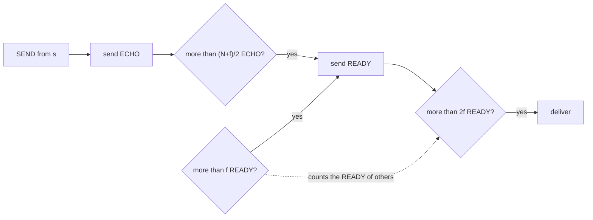

# Byzantine Broadcast

> [!abstract] Purpose of this lecture
> Every algorithm so far assumed that a faulty process simply **stops**. This lecture drops that assumption: a **Byzantine** process can lie, and in particular a faulty sender can tell different things to different processes. [[7 - DDS - Broadcast Communications|The broadcast algorithms of Lecture 7]] all break in this model, so we rebuild broadcast step by step:
> - **Authenticated perfect links**: a correct process cannot be impersonated on a link.
> - **Byzantine consistent broadcast** (Authenticated Echo): correct processes that deliver, deliver the *same* message, but some may deliver nothing.
> - **Byzantine reliable broadcast** (Authenticated Double-Echo): adds **totality**, so either all correct processes deliver or none does.
>
> The recurring tool is the **Byzantine quorum**, the fail-arbitrary version of the [[Majority Quorum]], and the recurring requirement is $N > 3f$.
>
> Course map: [[MOC - Dependable Distributed Systems]]. Book: Cachin, Guerraoui, Rodrigues, §2.4.6 (pp. 40–43), §3.10 (pp. 110–114, without §3.10.4), §3.11 (pp. 116–120).

## Recap on Byzantine processes

The failure model was introduced in [[2 - DDS - Modelling Distributed Systems and Abstracting Communications|Lecture 2]]. Byzantine (or *arbitrary-fault*) processes may:

1. **deviate arbitrarily** from the instructions that an algorithm assigns to them:
   - creating fake messages;
   - dropping messages;
   - delaying deliveries;
   - altering the content of messages;
   - and anything else.
2. **act as if they were deliberately preventing** the algorithm from reaching its goals.

The second point is what changes the way we reason. With crashes, we ask "what if this process stops *at the worst moment*?". With Byzantine faults, we ask "what is the *worst thing* this process could do?", which includes colluding with the other faulty processes.

> [!quote] Dal libro
> All the reliable broadcast algorithms seen earlier fail with a Byzantine participant: "*A faulty sender may interfere with the low-level best-effort broadcast primitive and cause the other processes to deliver different messages, which violates the agreement or no duplication property of reliable broadcast.*" (§3.10.1, p. 110)

## Basic step to fight Byzantine processes

The first step is to use **cryptographic mechanisms** to implement the **authenticated perfect links** abstraction, so that a Byzantine process cannot pretend to be a correct one.

**But cryptography alone does not allow us to tolerate Byzantine processes.** Consider an arbitrary-faulty sender: asking it to digitally sign every broadcast message does not help at all, because it may simply sign two different messages. Each signature is valid, and each receiver holds a perfectly genuine but different message.

So cryptography answers "*who* sent this?", not "did this sender tell *everybody the same thing*?". The second question needs the other processes to compare what they received, and that is what the echo rounds below do.

## Correct and faulty state

As in the crash failure model, we distinguish between **faulty** and **correct** processes.

> [!important] No "uniform" primitives
> A Byzantine process may act arbitrarily, and **no mechanism can guarantee anything that relates to its actions**. Therefore we do **not** define any "uniform" variants of primitives in the Byzantine failure model.

Compare this with [[Uniform Reliable Broadcast (URB)]]: there, a crashed process ran the algorithm correctly until it stopped, so it makes sense to constrain what it delivered. A Byzantine process can claim to have delivered anything, so such a constraint would have no meaning. All the properties below speak only about **correct** processes.

> [!quote] Dal libro
> The separation between correct and faulty is **static**: a process that behaves correctly for a while and fails much later counts as faulty for the whole execution (§3.10.1, p. 111).

## Authenticated Perfect Link

Vedi [[Authenticated Perfect Links]].

![[DDS-L14-p05.png]]

The slide shows the book's Module 2.5, with the usual `Send`/`Deliver` interface:

| Property | Statement | Compared with perfect links |
|---|---|---|
| **AL1 Reliable delivery** | If a correct process sends $m$ to a correct process $q$, then $q$ eventually delivers $m$ | same |
| **AL2 No duplication** | No message is delivered by a correct process more than once | same |
| **AL3 Authenticity** | If a correct $q$ delivers $m$ with sender $p$ and $p$ is correct, then $m$ was previously sent to $q$ by $p$ | **replaces no creation** |

AL3 is conditional on $p$ being correct: if $p$ is Byzantine it can send whatever it wants in its own name, and no link can prevent that. What the link does prevent is a Byzantine process forging messages *in the name of a correct process*.

> [!quote] Dal libro
> Why the plain links are not enough: with fair-loss or stubborn links, a single Byzantine process "*may insert the message infinitely often and pretend that it originates from an arbitrary sender process*", so **no creation** cannot be ensured (p. 41). The algorithm **Authenticate and Filter** (Algorithm 2.4, p. 42) builds authenticated perfect links over stubborn links:
> - the sender computes a **MAC** over the message, the sender identity and the recipient identity, and sends it along with the message;
> - the receiver verifies the MAC and delivers the message only if it is valid and not already in `delivered`.
>
> A MAC is enough here, no digital signature is needed. The authenticity argument is on p. 43.

## Byzantine consistent broadcast

Vedi [[Byzantine Consistent Broadcast]].

### Specification

![[DDS-L14-p06.png]]

Module 3.11 has a designated sender $s$, and the interface is the usual `Broadcast`/`Deliver`, where only $s$ can broadcast.

| Property | Statement |
|---|---|
| **BCB1 Validity** | If a correct process $p$ broadcasts $m$, then every correct process eventually delivers $m$ |
| **BCB2 No duplication** | Every correct process delivers **at most one message** |
| **BCB3 Integrity** | If a correct process delivers $m$ with sender $p$ and $p$ is correct, then $m$ was previously broadcast by $p$ |
| **BCB4 Consistency** | If a correct process delivers $m$ and another correct process delivers $m'$, then $m = m'$ |

> [!warning] The specification refers to a single broadcast event!
> The slide stresses this in red. BCB2 says "at most one message" in total, not "per message". One **instance** of the primitive only serves to agree on **one** message from **one** sender.

Why this restriction? With crashes, an application can tell messages apart by tagging them, because the sender follows the algorithm. A Byzantine sender is not bound to tag anything properly, so "the same message" has no meaning across multiple messages. The clean solution is to agree on one message at a time.

> [!quote] Dal libro
> Multiple instances, each with a unique identifier and an agreed sender, can be combined into a *Byzantine broadcast channel*, and "*many algorithms implemented in the fail-arbitrary model collapse the notions of instances and channels again, and distinguish multiple instances simply by a sequence number and by their sender process*" (§3.10.1, p. 111). Consistency is a **safety** property: with a faulty sender "*some correct processes may deliver a message and others may not, but if two correct processes deliver a message, it is unique*" (p. 112).

> [!warning] Correzione
> That page of the book refers to this abstraction as "Module 3.13", but the specification is **Module 3.11**, as in the slide.

### Implementation: Authenticated Echo Broadcast

Vedi [[Authenticated Echo Broadcast]].

![[DDS-L14-p07.png]]

The slide shows Algorithm 3.16, which uses authenticated perfect links (`al`):

```text
upon event ⟨bcb, Init⟩:
    sentecho := FALSE; delivered := FALSE; echos := [⊥]^N

upon event ⟨bcb, Broadcast | m⟩:                        // only process s
    forall q ∈ Π: trigger ⟨al, Send | q, [SEND, m]⟩

upon event ⟨al, Deliver | p, [SEND, m]⟩ such that p = s and sentecho = FALSE:
    sentecho := TRUE
    forall q ∈ Π: trigger ⟨al, Send | q, [ECHO, m]⟩

upon event ⟨al, Deliver | p, [ECHO, m]⟩:
    if echos[p] = ⊥ then echos[p] := m

upon exists m ≠ ⊥ such that #({p ∈ Π | echos[p] = m}) > (N+f)/2 and delivered = FALSE:
    delivered := TRUE
    trigger ⟨bcb, Deliver | s, m⟩
```

The algorithm has two rounds:

1. **SEND**: the sender gives $m$ to everybody.
2. **ECHO**: every process acts as a **witness**, telling everybody else what it received from the sender. Thanks to `sentecho`, a correct process echoes only once, so it witnesses **one value only**.

A process delivers $m$ when more than $(N+f)/2$ processes have echoed $m$. Two details in the code make this robust. The check `p = s` accepts SEND only from the sender, which authenticated links make reliable. The check `echos[p] = ⊥` records only the first echo from each process, so a Byzantine process cannot vote twice.

### Why the threshold is (N+f)/2, and why N > 3f

Vedi [[Byzantine Quorum]].

The slide circles the threshold and writes "*Correctness is ensured if $N > 3f$*". Both facts come from the two things a **Byzantine quorum** must achieve, namely a set of more than $(N+f)/2$ processes:

**1. Two quorums must share a correct process (this gives consistency).** Two sets of more than $(N+f)/2$ processes out of $N$ overlap in more than

$$2\cdot\frac{N+f}{2} - N = f$$

processes. More than $f$ processes cannot all be faulty, so the overlap contains **at least one correct process**. That process echoed only one value, so two different messages cannot both collect a quorum. Note that a simple majority is not enough here: its overlap may be a single process, and that process may be Byzantine.

**2. A quorum must exist among the correct processes (this gives validity).** Up to $f$ processes may never answer, so the $N-f$ correct ones must be enough on their own:

$$N - f > \frac{N+f}{2} \iff 2N - 2f > N + f \iff N > 3f$$

| $N$ | $f$ | Quorum: more than $(N+f)/2$ | Compare with a majority |
|---|---|---|---|
| 4 (used in the slides) | 1 | $> 2.5$, so **3** | 3 |
| 7 | 2 | $> 4.5$, so **5** | 4 |
| 10 | 3 | $> 6.5$, so **7** | 6 |

> [!quote] Dal libro
> §2.7.3 (p. 65) derives both facts in a slightly different way: every Byzantine quorum contains more than $(N-f)/2$ correct processes, so two disjoint ones would need more than $N-f$ correct processes, which do not exist. The book also says that $f < N/3$ is required by *most* abstractions of the fail-arbitrary model, not just this algorithm (p. 112).

Performance (book, p. 114): **2 communication steps** and $O(N^2)$ messages, because the second step is all-to-all.

> [!note] Not in the course program
> The slide's references exclude §3.10.4 *Signed Echo Broadcast*, a variant that uses digital signatures to go from $O(N^2)$ to $O(N)$ messages at the cost of one more step (p. 116).

### Example from the book

![[DDS-L14-p08.png]]

This is Figure 3.11 of the book, with $N=4$ and $f=1$. The star marks **$p$ as the faulty sender**: it is Byzantine, not crashed. It sends SEND($m$) only to $q$ and $s$, and $r$ receives no SEND. Then $q$ and $s$ echo $m$, and $p$ also sends ECHO($m$) to $q$ and $s$. With 3 echoes each, $q$ and $s$ deliver $m$. Process $r$ delivers nothing, and it can never deliver a different message, because that would require 3 echoes for it while $q$ and $s$ have already echoed $m$.

> [!warning] Correzione
> The book's text on this figure says "*Processes q and r receive enough ECHO messages and both bcb-deliver m, but process r does not bcb-deliver any message*" (p. 113). This contradicts itself: as the figure shows, the two processes that deliver are **$q$ and $s$**.

The same passage says that $p$ also sends an ECHO with some $m' \neq m$ to $r$. The figure does not draw that arrow, but it changes nothing: whatever $p$ sends to $r$, process $r$ cannot reach 3 equal echoes.

### Worked examples with N = 4, f = 1

These run the algorithm on the variables. The initial state of each process, in the bottom-left corner of the slides, is `echos = [⊥,⊥,⊥,⊥]`, `sentecho = F`, `delivered = F`. The threshold is **3 equal echoes**.

> [!note] Notation
> The slides write `sentechos` for the book's variable `sentecho`. The red smiley marks the Byzantine process, and a blue up arrow marks a delivery.

#### Correct sender, silent Byzantine process

![[DDS-L14-p09.png]]

$p_1$ is the correct sender and $p_2$ is Byzantine and stays silent: it receives everything but sends nothing.

1. $p_1$ sends SEND($m$) to everyone, then echoes to everyone: `echos₁ = [m,⊥,⊥,⊥]`.
2. $p_3$ and $p_4$ receive the SEND, set `sentecho = T` and echo $m$.
3. $p_1$ collects `[m,⊥,m,⊥]`, then `[m,⊥,m,m]`: 3 echoes, so it delivers. The same happens at $p_3$ and $p_4$.

Silence does not help the attacker: the $N-f=3$ correct processes are enough on their own. **This is validity at work.**

#### Correct sender, Byzantine process sends a different echo

![[DDS-L14-p10.png]]

Same scenario, but now $p_2$ sends a false `ECHO(m1)` to $p_4$ (the red arrow). So $p_4$ passes through `[m,m1,m,⊥]`, and then its own echo gives `[m,m1,m,m]`: 3 echoes for $m$, so it still delivers $m$. The false value has just 1 vote, far from the 3 required. A single faulty process cannot reach a quorum alone, and it cannot reduce the $m$ votes of correct processes.

#### Faulty sender

![[DDS-L14-p11.png]]

Now the Byzantine process is the sender $p_1$. It sends SEND($m_2$) to $p_2$ and SEND($m_1$) to $p_3$ and $p_4$. It sends ECHO($m_2$) to $p_2$ and ECHO($m_1$) to $p_3$ and $p_4$ too.

| Process | Final `echos` | Votes | Outcome |
|---|---|---|---|
| $p_2$ | `[m2,m2,m1,m1]` | 2 for $m_1$, 2 for $m_2$ | **no delivery** |
| $p_3$ | `[m1,m2,m1,m1]` | 3 for $m_1$ | delivers $m_1$ |
| $p_4$ | `[m1,m2,m1,m1]` | 3 for $m_1$ | delivers $m_1$ |

This is the key example. **Consistency holds**: no correct process delivers something different from $m_1$. But $p_2$ stays stuck forever: it will never reach 3 votes, since all the other processes have already voted and each vote is recorded only once. So some correct processes deliver and another does not. The specification allows this, yet it is exactly what reliable broadcast was meant to avoid. That is the reason for the next primitive.

> [!warning] Correzione
> The labels above $p_1$'s line in this slide (`echos₁ = [m,⊥,m,m]`, `delivered₁ = t`) were carried over from the correct-sender slides. In this scenario no message $m$ exists, only $m_1$ and $m_2$, and $p_1$ is Byzantine, so its internal state is not meaningful. Ignore them and read only the three correct processes.

## Byzantine Reliable Broadcast

Vedi [[Byzantine Reliable Broadcast]].

### Specification

![[DDS-L14-p12.png]]

Module 3.12 has the same interface, and again **the specification refers to a single broadcast event**. It takes BRB1–BRB4 from BCB1–BCB4 and adds one property:

> **BRB5 Totality**: if some message is delivered by any correct process, every correct process eventually delivers a message.

Combined, **consistency + totality = agreement**: all correct processes deliver the same message, or none of them delivers. This is the equivalent of the agreement property of [[Reliable Broadcast (RB)]], restricted to one message.

| | Validity, no duplication, integrity | Consistency | Totality |
|---|---|---|---|
| Byzantine consistent | yes | yes | **no** |
| Byzantine reliable | yes | yes | **yes** |

### Implementation: Authenticated Double-Echo Broadcast

Vedi [[Authenticated Double-Echo Broadcast]].

![[DDS-L14-p13.png]]

Algorithm 3.18 keeps the SEND and ECHO rounds of Algorithm 3.16 unchanged and adds a third round, **READY**. In place of delivering, a process that sees an echo quorum announces that it is willing to deliver.

```text
upon event ⟨brb, Init⟩:
    sentecho := FALSE; sentready := FALSE; delivered := FALSE
    echos := [⊥]^N; readys := [⊥]^N

// SEND and ECHO exactly as in Authenticated Echo Broadcast

upon exists m ≠ ⊥ such that #({p | echos[p] = m}) > (N+f)/2 and sentready = FALSE:
    sentready := TRUE
    forall q ∈ Π: trigger ⟨al, Send | q, [READY, m]⟩

upon event ⟨al, Deliver | p, [READY, m]⟩:
    if readys[p] = ⊥ then readys[p] := m

upon exists m ≠ ⊥ such that #({p | readys[p] = m}) > f and sentready = FALSE:    // amplification
    sentready := TRUE
    forall q ∈ Π: trigger ⟨al, Send | q, [READY, m]⟩

upon exists m ≠ ⊥ such that #({p | readys[p] = m}) > 2f and delivered = FALSE:
    delivered := TRUE
    trigger ⟨brb, Deliver | s, m⟩
```

A process thus has **two ways to become READY**, and each threshold has a precise meaning:

| Threshold | Action | Why this number |
|---|---|---|
| $> (N+f)/2$ ECHO | send READY | Byzantine quorum, so correct processes can only be READY for **one** value |
| $> f$ READY | send READY (**amplification**) | at least one of them comes from a correct process, so the value is the good one |
| $> 2f$ READY | **deliver** | at least $f+1$ of them come from correct processes, enough to trigger amplification everywhere |

The last two rows give the **totality argument**. If a correct process delivers, it saw at least $2f+1$ READY messages, so at least $f+1$ come from correct processes. Those correct processes sent READY to everyone, so every correct process eventually receives $f+1 > f$ READY messages and becomes READY by amplification. All the $N-f \geq 2f+1$ correct processes are then READY, so every correct process collects more than $2f$ READY messages and delivers.



> [!quote] Dal libro
> §3.11.2 (pp. 119–120). Consistency follows from Algorithm 3.16: correct processes can only send READY with the same $m$, and "*It is not possible that the faulty processes introduce enough READY messages with a content different from $m$*". Performance: **3 communication steps**, two of them all-to-all, so $O(N^2)$ messages, and only MACs are used, with "*no computationally expensive digital signatures*".

### Example from the book

![[DDS-L14-p14.png]]

This is Figure 3.13 of the book, a **failure-free** execution with sender $p$: one SEND step, then two all-to-all steps (ECHO and READY). After the READY step all four processes deliver. It shows the extra cost compared with the single all-to-all step of the [[#Example from the book|consistent broadcast]].

### Worked examples with N = 4, f = 1

The thresholds are: **3 ECHO** or **2 READY** to send READY, and **3 READY** to deliver.

#### Correct sender, silent Byzantine process

![[DDS-L14-p15.png]]

$p_2$ is Byzantine and silent. $p_1$, $p_3$ and $p_4$ each reach `echos = [m,⊥,m,m]`, set `sentready = t` and send READY($m$) to all. Each then reaches `readys = [m,⊥,m,m]`: 3 READY messages, so all three deliver. Compared with the consistent version, the only change is the extra purple round.

#### Faulty sender: the correct processes split

![[DDS-L14-p16.png]]

$p_1$ is Byzantine and creates the same split as in [[#Faulty sender|the consistent broadcast example]]. The dashed curves separate the phases.

1. **After ECHO**: `echos₂ = [m2,m2,m1,m1]`, while $p_3$ and $p_4$ have `[m1,m2,m1,m1]`.
2. **READY**: $p_3$ and $p_4$ have 3 echoes for $m_1$, so they send READY($m_1$). $p_2$ has no echo quorum.
3. **Amplification**: $p_2$ reaches `readys₂ = [⊥,⊥,m1,m1]`, so 2 READY messages, more than $f=1$. It sends READY($m_1$) even though it never saw an echo quorum.
4. **Delivery**: each correct process reaches `[⊥,m1,m1,m1]`, so 3 READY messages, and delivers $m_1$.

Here is the difference from the [[#Faulty sender|same attack on consistent broadcast]]: $p_2$ received 2 votes for $m_2$ and was stuck, but now the READY round pulls it along. **Totality holds.**

#### Faulty sender: only one correct process becomes READY

![[DDS-L14-p17.png]]

This is the hardest scenario. Now the echoes are arranged so that **only $p_4$** reaches an echo quorum:

| Process | Final `echos` | Votes for $m_1$ | Sends READY? |
|---|---|---|---|
| $p_2$ | `[m2,m2,m1,m1]` | 2 | no |
| $p_3$ | `[m3,m2,m1,m1]` | 2 | no |
| $p_4$ | `[m1,m2,m1,m1]` | 3 | **yes** |

So only $p_4$ sends READY($m_1$), and everyone has `readys = [⊥,⊥,⊥,m1]`. One READY is not more than $f=1$, so **nobody moves**. The outcome now depends on what the Byzantine $p_1$ does.

> [!note] `m3` is not a typo
> The value `m3` appears in `echos₃` only from this slide on, and at first sight it looks like a mistake for `m1`, the value on the previous slide. It is needed though: with `m1` in that position, $p_3$ would have 3 votes and would also send READY, which is not what the arrows show. So this is my reading of the slide: $p_1$ sends SEND($m_1$) to $p_3$, but its ECHO to $p_3$ carries a third value, $m_3$. The slide does not say so explicitly.

#### The Byzantine process sends a useless READY

![[DDS-L14-p18.png]]

$p_1$ sends READY($m_2$) to $p_2$, which gets `readys₂ = [m2,⊥,⊥,m1]`. There is 1 READY for $m_1$ and 1 for $m_2$, and neither is more than $f$, so again nothing happens. In this execution **no correct process delivers anything**, and that is allowed: the sender is faulty, so validity does not apply, and totality holds vacuously because nobody delivered.

#### The Byzantine process tries to make only one process deliver

![[DDS-L14-p19.png]]

Alternatively, $p_1$ sends READY($m_1$) to $p_2$ only. It is trying to get a single process to deliver, and it fails:

1. $p_2$ gets `readys₂ = [m1,⊥,⊥,m1]`, so 2 READY messages, more than $f$. By amplification it sends READY($m_1$) to all.
2. $p_3$ and $p_4$ receive it and reach `[⊥,m1,⊥,m1]`, so they also have 2 READY messages. $p_3$ sends READY by amplification, and $p_4$ has already done so.
3. Everyone now collects 3 READY messages and delivers $m_1$: for instance, `readys₄ = [⊥,m1,m1,m1]`.

The attacker gave the extra READY to one process only, yet all three correct processes deliver. **Before $p_2$ can deliver, it must first send its own READY**, and that message is what brings the others along.

> [!note] What the slide cuts off
> The slide shows `readys₃ = [⊥,m1,⊥,m1]` next to $p_3$'s delivery arrow, and `readys₂` is cut off by the edge of the slide. With 2 READY messages $p_3$ could not deliver yet. Its own READY, the curved purple arrow, fills the missing slot and gives `[⊥,m1,m1,m1]`.

> [!quote] Dal libro
> The book describes this same scenario on p. 119: one correct process alone sends READY, but another one somehow delivers. It must have received 3 READY messages, so two correct processes sent READY, and those are enough to bring the third correct process in by amplification.

> [!warning] Correzione
> Two slips in that passage of the book (pp. 119–120):
> - it writes "bcr-delivers", evidently meaning *brb-delivers*;
> - it calls $p$ correct, while in the example it recalls, from §3.10.3, $p$ is the faulty sender. The argument itself is fine: read it with $p_4$ of these slides in place of $p$.

## Comparison with the crash model

| | Crash model | Byzantine model |
|---|---|---|
| Links | [[2 - DDS - Modelling Distributed Systems and Abstracting Communications\|Perfect links]] | [[Authenticated Perfect Links]] |
| Faulty process | stops | does anything |
| Quorum | majority: more than $N/2$ | Byzantine quorum: more than $(N+f)/2$ |
| Processes needed | $N > 2f$ ([[Uniform Reliable Broadcast (URB)\|Majority-Ack URB]]) | $N > 3f$ |
| Uniform variants | yes | **no** |
| Scope of one instance | many messages | **one message, one sender** |
| Reliable broadcast | [[Reliable Broadcast (RB)\|Eager RB]], with $O(N^2)$ messages | Double-Echo, with $O(N^2)$ messages and one step more than Echo |

## References

C. Cachin, R. Guerraoui, L. Rodrigues, *Introduction to Reliable and Secure Distributed Programming*, Springer, 2011:
- Chapter 2 — Section 2.4.6;
- Chapter 3 — Section 3.10 (except 3.10.4), Section 3.11.

## Core ideas to retain

- A Byzantine process can do **anything**. Cryptography stops impersonation, but a faulty sender can still sign two different messages.
- **Authenticated perfect links** replace "no creation" with **authenticity**, which holds only if the claimed sender is correct. A MAC is enough.
- There are **no uniform variants**, since nothing can be guaranteed about what a Byzantine process does. One **instance** covers **one message**.
- **Byzantine quorum**: more than $(N+f)/2$ processes. Two quorums share a correct process (consistency), and a quorum exists among the correct processes only if $N > 3f$ (validity).
- **Authenticated Echo** (consistent broadcast): SEND + ECHO, 2 steps. Correct processes never deliver different messages, but with a faulty sender some of them may deliver nothing.
- **Authenticated Double-Echo** (reliable broadcast): adds READY, 3 steps. Send READY after an echo quorum or after **more than $f$** READY messages (amplification), and deliver after **more than $2f$** READY messages. This gives **totality**.
- Both algorithms cost $O(N^2)$ messages.
