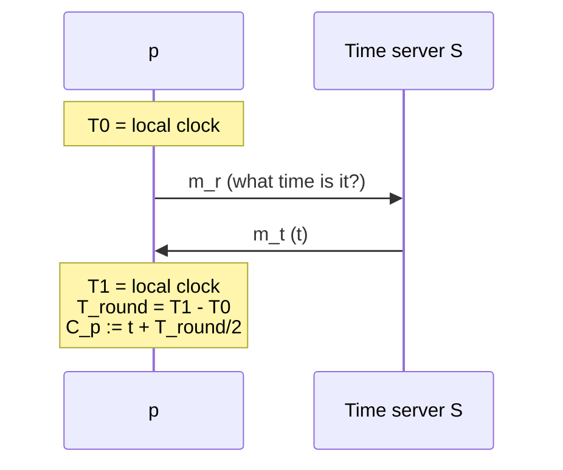

# Time in Distributed Systems — Physical Clocks and Clock Synchronization

> [!abstract] Purpose of this lecture
> Many distributed algorithms need to **order events** that happen on different machines. The most natural idea is to stamp every event with the local **physical clock**, but clocks on different machines never agree exactly. This lecture explains how hardware clocks work, how far apart they can drift (**skew**, **drift rate**), what it means for clocks to be **externally** or **internally synchronized**, and three classic synchronization algorithms: **Cristian**, **Berkeley** and **NTP**. Its conclusion — in an asynchronous system clocks can be synchronized only *approximately* — is the motivation for the **logical clocks** of [[4 - DDS - Logical Clocks|the next lecture]].
>
> It builds on the system model of [[2 - DDS - Modelling Distributed Systems and Abstracting Communications#Timing assumptions|Lecture 3&4 (timing assumptions)]]. Course map: [[MOC - Dependable Distributed Systems]].

## Introduction

In a distributed system:

- processes run on **different nodes** connected by a network (LAN or WAN);
- processes **cooperate** to complete a computation;
- processes communicate **only by exchanging messages** — there is no shared memory and no shared clock.

Many applications need to **order events** and to **synchronize** in order to terminate correctly: air-traffic control, network monitoring/measurement/control, the stock market (which buy order arrived first?), and so on.

> [!important] Time is a critical factor for distributed systems
> In a centralized system "which event happened first?" is answered by reading one clock. In a distributed system every node has its own clock, so the same question has no obvious answer.

## Why time is so important

Time is first of all a **quantity we want to measure** (e.g. how long did a transaction take?). But a lot of algorithms also **depend on time**:

- **data consistency** — which write is the most recent one?
- **authentication** — protocols like Kerberos use timestamps to reject old (replayed) tickets (see [[11 CS Lower Level - Kerberos|Cybersecurity — Kerberos]]);
- **avoiding double processing** — has this request already been executed?

The slides show a client issuing `update(a, x)` while two other clients issue `read(a)` on a data store. With a single data store the order is given by the store itself. When the store is **replicated**, every replica must apply the update and the reads **in the same order**, otherwise two clients can see different values of `a`:

![[DDS-L03-p04.png]]

*Left: one centralized data store. Right: the same store replicated on two replicas. The update reaches replica 1 and replica 2 at different moments, so a `read(a)` on replica 2 may return the old value. Ordering events consistently is what solves these problems.*

## Why using time in a distributed system is difficult

The slide summary is: **"We need to agree on a common time reference"**. Each node has its own clock and the network adds unknown delays, so no process can directly observe the clock of another one at the same instant.

## System model

The model is the one already used in [[2 - DDS - Modelling Distributed Systems and Abstracting Communications#Processes|Lecture 3&4]]:

- a set $\Pi = \{p_1, \dots, p_n\}$ of $n$ processes;
- each process runs on a **single mono-processor machine** with **no shared memory**;
- each process $p_i$ has a **state** $s_i$ (all the values of the variables it maintains), changed by the actions it takes during the algorithm;
- processes communicate **only by exchanging messages**.

## Computation model

Each process generates a sequence of **events**:

- **internal events** — transform the local state (e.g. `a = a + 1`);
- **external events** — `send` or `receive` of a message;
- $e_i^k$ denotes the $k$-th event generated by $p_i$.

The evolution of a computation is drawn as a **space-time diagram**: one horizontal line per process (time flows to the right), a dot per event, an arrow per message from the send event to the receive event.

![[DDS-L03-p07.png]]

*Space-time diagram with three processes. Each dot is an event $e_i^k$; diagonal arrows are messages. Note how the arrows are slanted: a message is received strictly after it is sent, and the delay varies.*

## History of computations

The events of a single process are **totally ordered** by the local order $\to_i$:

$$e \to_i e' \iff e \text{ happened before } e' \text{ in } p_i$$

- **Local history** — the sequence of events produced by a process: $h_1 = \langle e_1^1, e_1^2, \dots, e_1^6 \rangle$.
- **Partial local history** — a prefix of the local history: $h_i^m = e_i^1 \dots e_i^m$.
- **Global history** — the set of all local histories: $H = \bigcup_i h_i$, $1 \le i \le n$.

![[DDS-L03-p08.png]]

*The blue ellipse around $p_1$'s events is the whole local history $h_1$; the small ellipse on $p_3$ is the partial history $h_3^3$ (its first three events).*

> [!note] What is missing
> The global history is just a **set**: it tells us the order of the events *inside* each process, but nothing about the order of events of **different** processes. The whole lecture (and the next one) is about how to recover that order.

## Time in distributed systems

**Timestamping.** Each process attaches a label (**timestamp**) to each event. If the timestamps were globally meaningful we could merge all local histories into one ordered global history.

**Naïve solution.** Each process timestamps events with its **physical clock**.

**Is it really a solution?**

- Inside **one process** it always works: the local clock gives a total order of local events.
- Across **different processes on different PCs** it fails: with network delays, processing delays, etc. **it is impossible to realize a common clock shared among every process.**

What *is* possible: using messages that carry timestamps, physical clocks can be **synchronized with a certain degree of approximation** by appropriate algorithms. A process can then label events with its local physical clock, knowing that it is synchronized up to a certain **synchronization accuracy** (or **synchronization error**).

## Physical computer clocks

Applications read a **software clock** maintained by the operating system, which in turn reads a **hardware clock**:

- the hardware clock is an **oscillator** (usually a quartz crystal) plus a **counting register** incremented at every tick of the oscillator;
- at real time $t$ the OS reads the hardware clock $H_i(t)$ and produces the software clock

$$C_i(t) = \alpha\, H_i(t) + \beta$$

where $\alpha$ scales ticks into time units and $\beta$ is an offset. Synchronization algorithms correct the clock by acting on $\alpha$ and $\beta$.

$C_i(t)$ **approximates** the physical time $t$ at $p_i$; for example it may be a 64-bit word counting the nanoseconds elapsed at time $t$. In general it is **not accurate**: it differs from real time, and it differs from process to process because each approximation is different. Still, $C_i$ can be used as a timestamp for the events of $p_i$.

> [!tip] Resolution
> To distinguish two events by their timestamps the clock must tick fast enough: the **resolution** (time between two consecutive increments of the software clock) must be smaller than the time between two notable events:
> $$T_{\text{resolution}} < \Delta T_{\text{between two notable events}}$$
> If two events happen within the same tick they get the same timestamp and their order is lost.

## Parameters affecting clock synchronization accuracy

Local clocks can have different values. Two parameters describe how much:

- **Skew** — "the difference in time between two clocks" at the same instant: $|C_i(t) - C_j(t)|$.
- **Drift rate** — "the gradual misalignment of once synchronized clocks caused by the slight inaccuracies of the time-keeping mechanisms": the difference **per unit of time** with respect to an ideal clock.

> [!example] Drift in practice
> - A drift rate of $2\,\mu s/s$ means that for every real second the clock advances by $1\,s + 2\,\mu s$.
> - Ordinary quartz clocks drift by about $10^{-6}$ s/s, i.e. about **1 second every 11–12 days**: $10^{-6} \cdot 86\,400 \approx 0.086$ s/day, so $1 / 0.086 \approx 11.6$ days.
> - High-precision quartz clocks: $10^{-7}$–$10^{-8}$ s/s.

Skew is a *snapshot* (how far apart now), drift is a *rate* (how fast they move apart). Even two clocks with zero skew right after synchronization will have non-zero skew later because of drift — which is why synchronization must be **repeated periodically**.

## Universal Time Coordinated (UTC)

**UTC** is the international standard time, the base of every civil time measure. It is based on **International Atomic Time** (TAI), where $1\,s$ is the time a caesium-133 atom needs for $9\,192\,631\,770$ state transitions. Physical clocks based on atomic oscillators are the most accurate (drift rate around $10^{-13}$). UTC is broadcast by radio stations and satellites (GPS), and is the reference used by *external* synchronization.

## Internal and external synchronization

Let $D > 0$ be the **synchronization bound** and $I$ a time interval.

| | External synchronization | Internal synchronization |
|---|---|---|
| Who synchronizes with whom | each $C_i$ with an authoritative **external source** $S$ (e.g. UTC) | the processes **among themselves** |
| Condition, $\forall t \in I$ | $\lvert S(t) - C_i(t)\rvert < D$ for $i = 1..N$ | $\lvert C_i(t) - C_j(t)\rvert < D$ for $i, j = 1..N$ |
| Name of the property | clocks are **accurate** within $D$ | clocks **agree** within $D$ |

> [!important] Relation between the two
> - Internally synchronized clocks are **not necessarily** externally synchronized: they can agree with each other while drifting *collectively* away from UTC.
> - Clocks externally synchronized within $D$ are **also internally synchronized within $2D$**. Proof from the definitions (triangle inequality):
> $$|C_i - C_j| \le |C_i - S| + |S - C_j| < D + D = 2D$$

## Correct clock

A hardware clock $H$ is **correct** if its drift rate is within a known bound $\rho > 0$ (e.g. $10^{-6}$ s/s):

$$1 - \rho \le \frac{dH}{dt} \le 1 + \rho$$

With a correct clock any interval $[t, t']$ is measured with a bounded error:

$$(1 - \rho)(t' - t) \le H(t') - H(t) \le (1 + \rho)(t' - t)$$

![[DDS-L03-p19.png]]

*Clock time versus real time. The dashed diagonal is the perfect clock ($dC/dt = 1$); a fast clock lies above it, a slow clock below. A correct clock stays inside the cone between slopes $1-\rho$ and $1+\rho$.*

> [!tip] How often to resynchronize
> Two correct clocks can drift apart at most at rate $2\rho$ (one fast by $\rho$, the other slow by $\rho$). To keep their skew below $D$ they must be resynchronized at least every
> $$\frac{D}{2\rho} \text{ seconds.}$$
> Example: $\rho = 10^{-6}$, $D = 1$ ms $\Rightarrow$ resynchronize every $10^{-3} / (2\cdot 10^{-6}) = 500$ s.

**Monotonicity.** Software clocks must be **monotone**:

$$t' > t \Rightarrow C(t') > C(t)$$

Monotonicity can be guaranteed by choosing $\alpha$ and $\beta$ appropriately (they may themselves be functions of time). This matters for synchronization: a clock that is *ahead* must not be set back, because time would run backwards (see [[#Slowing down a clock|Berkeley's algorithm]]).

**Clock failures:**

- **crash failure** — the clock simply stops;
- **arbitrary failure** — the clock behaves arbitrarily, e.g. the Y2K bug.

> [!warning] Correzione
> The slide says that with the Y2K bug "the day after the **31/1/1999** becomes 1/1/1900 rather than 1/1/2000". The day in question is **31/12/1999**: with two-digit years, the year after "99" became "00", read as 1900 instead of 2000.

> [!important] Correctness is not accuracy
> A *correct* clock only has a bounded drift rate. It can still be far away from real time (e.g. it was set wrong at boot). Correctness bounds how fast the error *grows*; accuracy is about the error itself.

## Synchronization algorithms

The algorithms are classified by who provides the reference time:

- **Centralized time service**
  - *request-driven*: **Cristian's algorithm** (external synchronization);
  - *broadcast-based*: **Berkeley Unix algorithm** — Gusella & Zatti (1989) (internal synchronization).
- **Distributed time service**: **Network Time Protocol (NTP)**.

## Cristian's algorithm

Vedi [[Cristian's Algorithm]].

> [!note] About the name
> The slides write "Christian's algorithm" in the titles but "Cristian" in the text: the algorithm is by **Flaviu Cristian** (1989), so the right spelling is *Cristian*.

- **External** synchronization algorithm.
- Uses a **time server** $S$ that receives the time from a UTC source.
- Works (**probabilistically**) also in an **asynchronous** system: it is based on the message **round-trip time (RTT)**, and synchronization is reached only if the RTTs are small compared to the required accuracy.

**The protocol.** Process $p$ asks for the current time with a request message $m_r$ and receives the time $t$ in the reply $m_t$ from $S$. Then $p$ sets its clock to

$$C_p = t + \frac{T_{round}}{2}$$

where $T_{round}$ is the round-trip time measured by $p$ with its own clock. The idea: the reply was produced roughly in the middle of the round trip, so by the time it arrives $S$'s clock has advanced by about half the RTT.

Notes from the slides:

- a time server **can crash** → Cristian suggests a **cluster of synchronized time servers**;
- a time server **can be attacked** (it can send wrong times on purpose).

### Accuracy

Let $min$ be the **minimum transmission delay** of a message. The estimate $t + RTT/2$ assumes that the reply travelled for exactly $RTT/2$. The real travel time of $m_t$ is somewhere between $min$ (fastest) and $RTT - min$ (when $m_r$ was as fast as possible).

![[DDS-L03-p25.png]]

*Two extreme executions with the same RTT. Red: $m_r$ takes $min$, so $m_t$ takes $RTT - min$. Blue: $m_r$ is slow and $m_t$ takes only $min$.*

- **Case 1** — the real reply time is $RTT - min$ (longer than the estimate):
  $\Delta = \frac{RTT}{2} - (RTT - min) = -\frac{RTT}{2} + min = -\left(\frac{RTT}{2} - min\right)$
- **Case 2** — the real reply time is $min$ (shorter than the estimate):
  $\Delta = \frac{RTT}{2} - min = +\left(\frac{RTT}{2} - min\right)$

> [!warning] Correzione
> In Case 2 the slide says the reply time "is equal to (RTT-min)": it is equal to **min**, as the formula on the same line uses ($\Delta = RTT/2 - min$).

> [!important] Accuracy of Cristian's algorithm
> $$\pm\left(\frac{RTT}{2} - min\right)$$
> The smaller the RTT is compared to $2\cdot min$, the better the accuracy. In an asynchronous system the RTT has no upper bound, so the accuracy is guaranteed only *probabilistically*: a process can retry until it observes a small RTT.

### Example

![[DDS-L03-p26.png]]

*$p_1$ sends $m_r$ at real time 100; $S$ answers with its clock value 130; $p_1$ receives the answer at 170, so $RTT_1 = 70$ and $p_1$ sets $T_{p_1} = 130 + 70/2 = 165$. $p_2$ sends at 115, $S$ answers 155, the answer arrives at 185: $RTT_2 = 70$, $T_{p_2} = 155 + 70/2 = 190$.*

With these RTTs:

- if the minimum transmission time is $t_{min} = 30$, the accuracy is $\pm(70/2 - 30) = \pm 5$;
- if $t_{min} = 20$, the accuracy is $\pm(70/2 - 20) = \pm 15$.

The same RTT gives very different guarantees depending on how well we know the minimum delay: a larger known $t_{min}$ leaves less room for uncertainty.

> [!tip] Exercises
> An exercise computing the synchronization bound of Cristian's algorithm is in [[DDS - Exercises 1]].

### Discussion

- The synchronization server is a **single point of failure**: there can be periods where synchronization is impossible → ask **multiple servers at the same time** (a *synchronization group*).
- Servers in the group may be **arbitrarily faulty or malicious** → add **redundancy** (and take e.g. the median of the answers) and use **authentication** of the time messages.

## Berkeley's algorithm

Vedi [[Berkeley Algorithm]].

An **internal** synchronization algorithm (Gusella & Zatti, Berkeley Unix):

- **master-slave** structure;
- based on two steps:
  1. **gathering** all clocks from the other processes and computing the differences;
  2. **computing the correction** for every process.

Since it is internal, nobody needs a UTC receiver: the goal is only that the machines agree with each other.

### Measuring the difference between clocks

1. The master $p_m$ sends a message with timestamp $t_1$ (its local clock) to each process, **itself included**.
2. When $p_i$ receives it, it replies with its own timestamp $t_2$ (local clock of $p_i$).
3. When the master receives the reply it reads its clock again ($t_3$) and computes the difference
$$\Delta = \frac{t_1 + t_3}{2} - t_2$$

This is the same trick as Cristian: $(t_1 + t_3)/2$ is the master's clock value in the middle of the round trip, i.e. the master's estimate of "now" when $p_i$ read $t_2$. $\Delta$ is the offset between the two clocks.

### The synchronization algorithm

**Master:**

- computes the differences $\Delta p_i$ between its clock and the clock of every process (itself included);
- computes the **average** $avg$ of all $\Delta p_i$, **ignoring faulty processes** — a process is *faulty* if its clock differs from the master's by more than a given threshold;
- computes the **correction** of each process (faulty ones included): $Adj_{p_i} = avg - \Delta p_i$, and sends it.

**Slaves:**

- when a process receives its correction, it applies it to its local clock;
- if the correction is **negative**, the process does **not** set the clock back: it **slows the clock down** instead.

### Example

![[DDS-L03-p32.png]]

*Measuring the differences: the master reads 3:05, slave 1 2:55, slave 2 3:00, slave 3 3:25. Slave 3 is more than the threshold away from the master, so it is marked faulty and left out of the average.*

- $\Delta p_m = 3{:}05 - 3{:}05 = 0$
- $\Delta p_1 = 3{:}05 - 2{:}55 = -10$
- $\Delta p_2 = 3{:}05 - 3{:}00 = -5$
- $\Delta p_3 = 3{:}05 - 3{:}25 = 20$ *(faulty)*
- $avg = (0 - 10 - 5)/3 = -5$

> [!warning] Correzione
> The subtractions on the slide are written the wrong way round: $3{:}05 - 2{:}55$ is $+10$, not $-10$. The numbers used afterwards ($-10$, $-5$, $+20$) are the differences **slave − master** ($2{:}55 - 3{:}05 = -10$, $3{:}25 - 3{:}05 = +20$), i.e. $\Delta p_i = C_i - C_m$. With this sign convention the rest of the example is correct, and every clock ends up at 3:00. (Note also that the formula $\Delta = (t_1+t_3)/2 - t_2$ of the previous slide gives the opposite sign, master − slave; what matters is using the same convention in the average and in the correction.)

![[DDS-L03-p33.png]]

*Computing and sending the corrections, then applying them.*

- $Adj_m = avg - \Delta p_m = -5 - 0 = -5$ → master 3:05 becomes **3:00**
- $Adj_1 = -5 - (-10) = +5$ → slave 1 2:55 becomes **3:00**
- $Adj_2 = -5 - (-5) = 0$ → slave 2 stays at **3:00**
- $Adj_3 = -5 - 20 = -25$ → slave 3 3:25 becomes **3:00**

The faulty process is excluded from the average (so it cannot pull everyone towards its wrong value) but **still receives a correction**, so it is brought back in line. The negative corrections (master, slave 3) are applied by slowing down, not by jumping back.

### Accuracy and fault tolerance

- **Accuracy** depends on the **maximum round-trip time**: the master ignores clock values associated with an RTT larger than the maximum one (they would carry too much uncertainty).
- **Fault tolerance:**
  - if the master crashes, **another master is elected** (in an unknown time — leader election is the topic of [[6 - DDS - Failure Detection and Leader Election|Lecture 7]]);
  - it tolerates **arbitrary behaviour** (e.g. slaves sending wrong values): the master considers only a certain number of clock values that do not differ from each other by more than a threshold (a *fault-tolerant average*).

### Slowing down a clock

**What does slowing down a clock mean?** A slave whose clock is *ahead* of the new average cannot be set into the past: this could **violate the cause/effect order** of the events it already timestamped and the **monotonicity** of time (a later event would get a smaller timestamp).

So the clock is slowed down by **hiding interrupts**: the clock is incremented by the timer interrupt, so if some interrupts are ignored the clock does not advance for those ticks. To recover a slowdown of $\delta$ the OS must hide

$$\frac{\delta}{\text{interrupt period}}$$

interrupts, spread over time. E.g. to absorb $-5$ s with a 10 ms timer, 500 interrupts are skipped. (Interrupts and timers are covered in [[Interrupt|Sistemi Operativi — Interrupt]].)

## Network Time Protocol (NTP)

Vedi [[Network Time Protocol (NTP)]].

NTP is a **time service over the Internet** that synchronizes clients with UTC. Its design goals:

- **reliability** through redundant servers and redundant paths;
- **scalability** through a hierarchy:
  - **primary servers** (stratum 1) are connected to UTC sources;
  - **secondary servers** (stratum 2, 3, …) are synchronized with primary servers;
  - the **synchronization subnet** ends with the lowest-level servers in the users' computers.

![[DDS-L03-p36.png]]

*The NTP synchronization subnet: a tree of servers where the number is the stratum. Accuracy decreases going down the tree, since each level adds the uncertainty of one more synchronization.*

- NTP is the **de facto standard** for **external** clock synchronization on the Internet.
- It uses **security mechanisms** (e.g. authentication of time references), usually not needed inside a LAN. Attacks on NTP are discussed in [[NTP|Cybersecurity — NTP]].
- It is based on a **remote reading procedure like Cristian's algorithm**, to which the specification adds mechanisms for **clustering, filtering and evaluating data quality** to minimize the synchronization error.

**Server synchronization.** The NTP hierarchy is **reconfigurable in presence of faults**:

- a primary server that loses its UTC signal can become a **secondary** server;
- a secondary server that loses its primary (e.g. the primary crashes) can **connect to another primary**.

**Synchronization modes:**

| Mode | How it works | Accuracy / use |
|---|---|---|
| **Multicast** | the server periodically sends its time to the leaves in the LAN; they set their clock assuming a certain delay | low accuracy; fast LANs |
| **Procedure call** | the server replies to requests with its timestamp (like Cristian) | high accuracy; when hardware multicast is not available |
| **Symmetrical** | pairs of time servers exchange messages with timing information | the most accurate; only in the high levels of the hierarchy |

## Time in asynchronous systems

Is physical time — a *global* property — **observable** in a distributed asynchronous system? **No**: different clocks can be synchronized **only with a certain probability**.

- The impossibility of perfect accuracy comes from the **unpredictability of communication delays** (all the algorithms above have an error depending on RTT and $min$).
- A **bound** on the accuracy can be given only when **upper and lower bounds on communication delays** are known, i.e. in a synchronous system.

> [!summary] From physical to logical time
> Physical clocks give an approximate total order with an error that depends on the network. But many algorithms do not need *when* events happened, only **in which order**, and in particular whether one event **could have caused** another. This is what **logical clocks** capture without any synchronization: see [[4 - DDS - Logical Clocks]].

## Core ideas to retain

- In a distributed system there is **no common clock**; events of the same process are ordered, events of different processes are not.
- Clocks differ by **skew** (instant difference) and diverge with the **drift rate**; a correct clock has drift bounded by $\rho$ and must be resynchronized every $D/2\rho$.
- **External** sync (with UTC, accuracy $D$) implies **internal** sync (agreement $2D$), not vice versa.
- **Cristian**: $C = t + RTT/2$, accuracy $\pm(RTT/2 - min)$.
- **Berkeley**: master averages the non-faulty clock differences and sends corrections; negative corrections slow the clock down to preserve monotonicity.
- **NTP**: hierarchical (strata), redundant, reconfigurable, Cristian-like remote reading.
