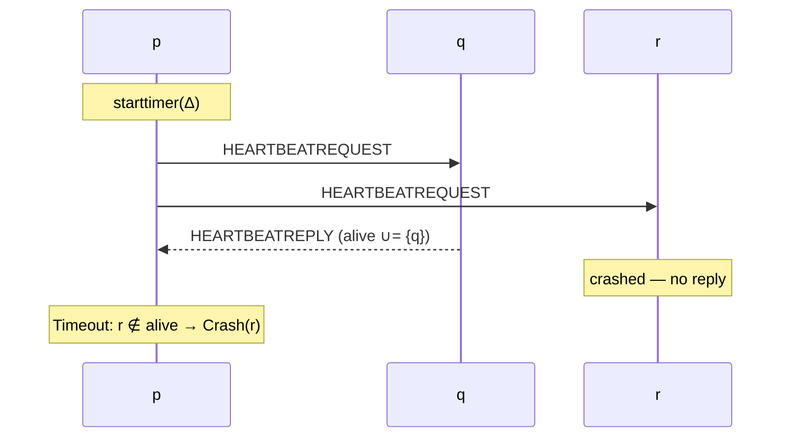

# Failure Detection and Leader Election

> [!abstract] Purpose of this lecture
> Up to now ([[5 - DDS - Distributed Mutual Exclusion|mutual exclusion]]) processes never failed. As soon as they can crash, every algorithm needs to know *who is still alive*: the coordinator may be dead, a vote may never arrive. In an asynchronous system this is impossible to know for sure, so we **encapsulate the timing assumptions in an oracle**, the **failure detector**, instead of spreading timeouts inside every algorithm.
> - **Lecture 7A** classifies failure detectors (accuracy × completeness) and implements the **perfect** one $\mathcal{P}$ (synchronous system) and the **eventually perfect** one $\Diamond\mathcal{P}$ (partial synchrony).
> - **Lecture 7B** looks at the dual problem: instead of knowing who crashed, know **one process that is alive** — the **leader**. We build **leader election** (LE) on top of $\mathcal{P}$ and **eventual leader election** ($\Omega$) on top of $\Diamond\mathcal{P}$, and finally $\Omega$ with crash-recovery and fair-loss links.
>
> These abstractions are the building blocks for [[7 - DDS - Broadcast Communications|reliable broadcast]] and [[8 - DDS - Consensus|consensus]]. Course map: [[MOC - Dependable Distributed Systems]].
>
> Book: Cachin, Guerraoui, Rodrigues, §2.6.1–2.6.5 (pp. 48–60).

## Lecture 7A — Failure detection

### Recap on timing assumptions

(See [[2 - DDS - Modelling Distributed Systems and Abstracting Communications#Timing assumptions|Lecture 3 — Timing assumptions]].)

- **Synchronous** — timing assumptions are **explicit**:
  - upper bounds on process execution time;
  - upper bounds on communication time;
  - existence of a common global clock (or bounded clock drift).
- **Asynchronous** — there are **no** timing assumptions.
- **Partial synchrony** — **abstract** timing assumptions: after an **unknown** time $t$ the system becomes synchronous.

Manipulating time inside a protocol is complex, and the correctness proof can become very involved and error prone. There are two ways to manage time:

![[DDS-L06-p03.png]]

*Time management can be **explicit** — put the assumptions in the system model (links and processes) and manage them directly in each algorithm — or **implicit** — create a **separate abstraction that encapsulates** the timing assumptions. The failure detector is the implicit choice: the algorithm above only sees events like `Crash(p)`, never timeouts.*

### Failure detector abstraction

Vedi [[Failure Detector]].

A **failure detector** is an **oracle** that provides information about the failure state of processes.

- It is a software module used **together with the process and link abstractions**.
- It **encapsulates the timing assumptions** of a partially synchronous or fully synchronous system.
- The **stronger the timing assumptions, the more accurate** the information it provides.

A failure detector is described by two properties:

- **Accuracy** — informally, the ability to **avoid mistakes** (do not suspect correct processes). It is a *safety*-like property.
- **Completeness** — informally, the ability to **detect all failures** (eventually suspect every crashed process). It is a *liveness* property.

> [!tip] Why both are needed
> Each property alone is trivial: a detector that suspects **everybody** is complete but not accurate; a detector that suspects **nobody** is accurate but not complete. The difficulty is having both.

### Failure detector classification

The classification comes from Chandra and Toueg (1996).

![[DDS-L06-p05.png]]

| | **Strong completeness**: eventually every crashed process is permanently suspected by **every** correct process | **Weak completeness**: eventually every crashed process is permanently suspected by **some** correct process |
|---|---|---|
| **Strong accuracy**: correct processes are **never** suspected | $\mathcal{P}$ — Perfect | $\mathcal{Q}$ — Quasi-perfect |
| **Weak accuracy**: **some** correct process is never suspected | $\mathcal{S}$ — Strong | $\mathcal{W}$ — Weak |

**Observation:** even $\mathcal{W}$ guarantees that at least one correct process is **never** suspected, from the beginning. In practice this is hard to achieve (a single slow message at the start is enough to break it), so it is worth considering accuracy properties that hold **eventually**:

- **Eventual strong accuracy** — there is a time after which correct processes are not suspected.
- **Eventual weak accuracy** — there is a time after which some correct process is not suspected.

This gives four more classes, marked with $\Diamond$ ("eventually"):

![[DDS-L06-p07.png]]

*The highlighted classes are the two studied in the course: $\mathcal{P}$ (strong accuracy + strong completeness) and $\Diamond\mathcal{P}$ (eventual strong accuracy + strong completeness).*

> [!note] Beyond the slides — why $\Diamond\mathcal{W}$ matters
> Chandra and Toueg showed that weak completeness can be turned into strong completeness by gossiping suspicions, so the "weak completeness" column adds no real power. Chandra, Hadzilacos and Toueg then proved that $\Diamond\mathcal{W}$ is the **weakest failure detector to solve consensus** with a majority of correct processes, and it is equivalent to $\Omega$ (eventual leader election, seen below in Lecture 7B). This is why [[8 - DDS - Consensus|consensus]] and [[9 - DDS - Paxos|Paxos]] rely on an eventual leader.

### Perfect failure detector ($\mathcal{P}$)

Vedi [[Perfect Failure Detector]].

**System model:**

- **synchronous** system;
- **crash** failures (crash-stop).

Using its own clock and the bounds of the synchrony model, a process can **infer** that another process has crashed: if the reply to a message does not arrive within (worst-case processing + 2 × worst-case transmission delay), the destination is dead.

#### Specification

```text
Module: PerfectFailureDetector, instance P
Events:
  Indication: ⟨P, Crash | p⟩   — detects that process p has crashed
Properties:
  PFD1 Strong completeness: eventually, every process that crashes is
       permanently detected by every correct process.
  PFD2 Strong accuracy: if a process p is detected by any process,
       then p has crashed.
```

A detection is **permanent**: $\mathcal{P}$ never changes its mind.

#### Implementation: Exclude on Timeout

$\mathcal{P}$ sits on top of perfect point-to-point links. Every process periodically sends a heartbeat request to everybody and waits for the replies; at every timeout, those who did not reply are declared crashed.

```text
Algorithm 2.5: Exclude on Timeout
Implements: PerfectFailureDetector, instance P
Uses:       PerfectPointToPointLinks, instance pl

upon event ⟨P, Init⟩ do
  alive := Π
  detected := ∅
  starttimer(Δ)

upon event ⟨Timeout⟩ do
  forall p ∈ Π do
    if (p ∉ alive) ∧ (p ∉ detected) then
      detected := detected ∪ {p}
      trigger ⟨P, Crash | p⟩
    trigger ⟨pl, Send | p, [HEARTBEATREQUEST]⟩
  alive := ∅
  starttimer(Δ)

upon event ⟨pl, Deliver | q, [HEARTBEATREQUEST]⟩ do
  trigger ⟨pl, Send | q, [HEARTBEATREPLY]⟩

upon event ⟨pl, Deliver | p, [HEARTBEATREPLY]⟩ do
  alive := alive ∪ {p}
```

- `alive` collects who replied during the current period; it starts as $\Pi$ so nobody is detected at the first timeout.
- $\Delta$ must be large enough to cover: sending the heartbeat to all, its delivery, the processing at the destination, the reply and its delivery.



#### Correctness

To prove correctness we must prove both **strong completeness** and **strong accuracy**.

- **Strong completeness** — if $p$ crashes it stops replying; perfect links create no messages, so no correct process delivers a reply from $p$ and every correct process detects it.
- **Strong accuracy** — $q$ detects $p$ only if no reply from $p$ arrived before the timeout; by synchrony, a reply from an alive $p$ always arrives within $\Delta$, so $p$ must have crashed.

The slides leave three questions open:

| Question | Answer |
|---|---|
| What if links are **fair-loss**? | A heartbeat or reply can be lost, so a correct process can miss a period and be detected: **strong accuracy is violated**. $\mathcal{P}$ needs reliable (perfect) links. |
| What if the timeout is **too long**? | Still correct, but detection is **slow**: the algorithm above reacts to failures late. |
| What if the timeout is **too short**? | A slow but correct process is detected as crashed: **strong accuracy is violated**, and since detections are permanent the mistake is never fixed. |

> [!quote] Dal libro — the timeout trade-off (p. 51)
> "A large timeout, say ten times the expected delay needed to send a message and deliver it to all processes, would reasonably cope with situations where the delay would be slightly extended. However, one would want to detect and react to failures earlier, with a shorter timeout. The risk here is that the probability to falsely detect a crash is higher. One way to cope with such a trade-off is to assume an imperfect failure detector."

### Eventually perfect failure detector ($\Diamond\mathcal{P}$)

Vedi [[Eventually Perfect Failure Detector]].

**System model:**

- **partial synchrony**;
- **crash** failures;
- **perfect point-to-point links**.

Crashes can be detected accurately only after an **unknown time $t$**:

- before $t$ the system behaves as an asynchronous one;
- the failure detector **may make mistakes** before $t$, considering correct processes as crashed;
- the notion of *detection* becomes **suspicion**.

#### Specification

```text
Module: EventuallyPerfectFailureDetector, instance ◇P
Events:
  Indication: ⟨◇P, Suspect | p⟩   — p is suspected to have crashed
  Indication: ⟨◇P, Restore | p⟩   — p is not suspected anymore
Properties:
  EPFD1 Strong completeness: eventually, every process that crashes is
        permanently suspected by every correct process.
  EPFD2 Eventual strong accuracy: eventually, no correct process is
        suspected by any correct process.
```

Strong completeness reads almost like PFD1, but here "permanently" matters: $\Diamond\mathcal{P}$ can **restore** a process, so a crashed process must eventually be suspected and never restored again.

#### Basic construction rules

- Use **timeouts** to suspect processes that did not send the expected messages.
- A suspicion **may be wrong**: $p_i$ may suspect $p_j$ only because the current timeout is too short.
- $\Diamond\mathcal{P}$ is ready to **change its judgment** as soon as it receives a message from $p_j$; in this case the **timeout is increased**.
- If $p_j$ has actually crashed, $p_i$ never changes its judgment again.

#### Implementation: Increasing Timeout

```text
Algorithm 2.7: Increasing Timeout
Implements: EventuallyPerfectFailureDetector, instance ◇P
Uses:       PerfectPointToPointLinks, instance pl

upon event ⟨◇P, Init⟩ do
  alive := Π
  suspected := ∅
  delay := Δ
  starttimer(delay)

upon event ⟨Timeout⟩ do
  if alive ∩ suspected ≠ ∅ then          // someone I suspected is alive:
    delay := delay + Δ                    // my timeout was too short
  forall p ∈ Π do
    if (p ∉ alive) ∧ (p ∉ suspected) then
      suspected := suspected ∪ {p}
      trigger ⟨◇P, Suspect | p⟩
    else if (p ∈ alive) ∧ (p ∈ suspected) then
      suspected := suspected \ {p}
      trigger ⟨◇P, Restore | p⟩
    trigger ⟨pl, Send | p, [HEARTBEATREQUEST]⟩
  alive := ∅
  starttimer(delay)

upon event ⟨pl, Deliver | q, [HEARTBEATREQUEST]⟩ do
  trigger ⟨pl, Send | q, [HEARTBEATREPLY]⟩

upon event ⟨pl, Deliver | p, [HEARTBEATREPLY]⟩ do
  alive := alive ∪ {p}
```

The only differences from "Exclude on Timeout" are the **Restore** branch and the **growing `delay`**.

#### Correctness

- **Strong completeness** — a crashed process stops sending messages, so it is suspected by every correct process and no process will revise the judgment.
- **Eventual strong accuracy** — after time $T$ the system is synchronous: a message from a correct $p$ to $q$ is delivered within a bounded time. Since `delay` grows at every false suspicion, it eventually exceeds this bound; then if $q$ wrongly suspected $p$, it revises the suspicion and never suspects it again.

> [!quote] Dal libro — why $\Diamond\mathcal{P}$ can be aggressive (p. 56)
> "The difference here is that the initial timeout can be set more aggressively so that ◇P reacts faster to failures than P. This may lead to false suspicions, but as the specification of ◇P permits them, they do no harm, unlike in the case of P."

### References (7A)

- C. Cachin, R. Guerraoui, L. Rodrigues, *Introduction to Reliable and Secure Distributed Programming*, Springer, 2011 — Chapter 2, §2.6.1–2.6.5.
- T. Chandra, S. Toueg, *Unreliable Failure Detectors for Reliable Distributed Systems*, JACM 1996 — <https://dl.acm.org/doi/pdf/10.1145/226643.226647>.

## Lecture 7B — Leader election

### Recap on timing assumptions

- **Synchronous**: explicit bounds on process execution and communication channels, or a common global clock, or both.
- **Asynchronous**: no timing assumptions.
- **Partial synchrony**: after an unknown time $t$ the system becomes synchronous. Two choices: put the assumption in the system model, or **encapsulate it in a separate abstraction** (the failure detectors above).

### An alternative: knowing who is alive

Sometimes we are not interested in monitoring failures, but in knowing **one process that is alive** — for example, when we need a **coordinator** (as in [[5 - DDS - Distributed Mutual Exclusion#Coordinator-based mutual exclusion|coordinator-based mutual exclusion]]). We can use a different oracle, the **leader election module**, that reports a process that is alive.

> [!quote] Dal libro — primary-backup (p. 52)
> The leader election abstraction "is particularly useful in a primary-backup replication scheme": among the replicas, one is chosen as the leader (the *primary*), which handles the client requests and updates the *backups* before replying. "If the leader crashes, one of the backups is elected as the new leader." — see [[12 - DDS - Software Replication|software replication]].

### Leader election (LE)

Vedi [[Leader Election]].

#### Specification

```text
Module: LeaderElection, instance le
Events:
  Indication: ⟨le, Leader | p⟩   — process p is elected as leader
Properties:
  LE1 Eventual detection: either there is no correct process, or some
      correct process is eventually elected as the leader.
  LE2 Accuracy: if a process is leader, then all previously elected
      leaders have crashed.
```

- **LE1** (liveness) guarantees that eventually there is a correct leader. Before that, there may be no leader at all.
- **LE2** (safety) guarantees **stability**: the leader changes **only** when the old one crashes.

#### Implementation: Monarchical Leader Election

Built on the **perfect failure detector**. Processes have an a-priori **ranking**; the leader is the alive process with the highest rank — like a monarchy, where the prince becomes king only when the queen dies.

```text
Algorithm 2.6: Monarchical Leader Election
Implements: LeaderElection, instance le
Uses:       PerfectFailureDetector, instance P

upon event ⟨le, Init⟩ do
  suspected := ∅
  leader := ⊥

upon event ⟨P, Crash | p⟩ do
  suspected := suspected ∪ {p}

upon leader ≠ maxrank(Π \ suspected) do
  leader := maxrank(Π \ suspected)
  trigger ⟨le, Leader | leader⟩
```

`maxrank(S)` returns the process of $S$ with the highest rank; in the examples the rank is the **identifier**, so the leader is the alive process with the **highest id**. All processes must use the **same** deterministic function, otherwise they would elect different leaders.

- **Correctness:** LE1 follows from the strong completeness of $\mathcal{P}$, LE2 from its strong accuracy.
- **Performance:** becoming leader is a **local** operation (no messages); the reaction time to a crash is the latency of the failure detector.

> [!important] Simone's notes (from last year's notes)
> "as we can see, we implemented de Perfect Failure Detector. It's important that every process uses the exact method on how to recognise the leader"
>
> "Notice that when $p_3$ fails, there's a period of time in which there isn't any leader. When another process doesn't know that, simply it fails when tries to communicate with the current crashed leader."

#### Examples

**Example 1** — $p_3$ crashes:

![[DDS-L06-p24.png]]

*At init all processes elect $p_3$ (the highest id). $p_3$ crashes; $p_1$ and $p_2$ receive `Crash(p3)` from $\mathcal{P}$ at different times, and each one elects $p_2$ (`suspected = {p3}`, `leader = p2`). Due to the **latency of the failure detector** in revealing $p_3$'s crash, $p_1$ and $p_2$ temporarily have different leaders (one correct and one faulty). This does not violate LE2: $p_3$ has really crashed.*

**Example 2** — the crash of a non-leader is irrelevant:

![[DDS-L06-p25.png]]

*$p_2$ crashes first: $p_1$ and $p_3$ add it to `suspected`, but the leader stays $p_3$. Then $p_3$ crashes: $p_1$ is the only one left, `suspected1 = {p2, p3}`, and it elects itself.*

**Example 3** — two consecutive leader crashes:

![[DDS-L06-p26.png]]

*$p_3$ crashes → $p_1$ elects $p_2$. Then $p_2$ crashes → $p_1$ elects $p_1$. The leader moves down the ranking one step at a time.*

**Example 4** — the leader survives a crash of another process:

![[DDS-L06-p27.png]]

*$p_3$ crashes and $p_1$, $p_2$ elect $p_2$. Then $p_1$ crashes: $p_2$ now has `suspected2 = {p1, p3}`, but `maxrank` is still $p_2$, so it re-confirms itself as leader.*

#### What if the failure detector is not perfect?

With $\Diamond\mathcal{P}$, a correct leader can be **falsely suspected**: some processes would elect a new leader while the old one is still alive, violating **LE2** (and two processes could act as leader at the same time). The book notes that LE **cannot be implemented** with $\Diamond\mathcal{P}$. We must weaken the specification: the leader is unique only **eventually**.

### Eventual leader election ($\Omega$)

Vedi [[Eventual Leader Election (Omega)]].

#### Specification

```text
Module: EventualLeaderDetector, instance Ω
Events:
  Indication: ⟨Ω, Trust | p⟩   — process p is trusted to be leader
Properties:
  ELD1 Eventual accuracy: there is a time after which every correct
       process trusts some correct process.
  ELD2 Eventual agreement: there is a time after which no two correct
       processes trust different correct processes.
```

#### Observations on $\Omega$

- $\Omega$ ensures that **eventually** the correct processes elect the **same correct** process as their leader.
- $\Omega$ does **not** guarantee that:
  - leaders do not change — they may change **arbitrarily** and for an **arbitrary period** of time;
  - there is a single leader — **many leaders** might be elected during the same period without having crashed.
- Once a unique leader is determined and does not change anymore, we say that the leader has **stabilized**.

| | LE | $\Omega$ |
|---|---|---|
| Built on | $\mathcal{P}$ (synchronous) | $\Diamond\mathcal{P}$ or timeouts (partial synchrony) |
| Event | `Leader(p)` | `Trust(p)` |
| Leader changes only on crash | yes (LE2) | only **eventually** |
| Two leaders at the same time | no (except FD latency) | possible before stabilization |
| Process abstractions | crash-stop only | crash-stop and crash-recovery |

#### $\Omega$ with crash-stop processes: Monarchical Eventual Leader Detection

$\Omega$ is obtained directly from $\Diamond\mathcal{P}$ with a **deterministic rule** on the non-suspected processes: **trust the process with the highest identifier among those not suspected by $\Diamond\mathcal{P}$**. It is the same algorithm as LE, except that "deaths in the royal family are not final".

> [!important] Important assumption
> There always exists **at least one correct process**, otherwise $\Omega$ cannot be built.

```text
Algorithm 2.8: Monarchical Eventual Leader Detection
Implements: EventualLeaderDetector, instance Ω
Uses:       EventuallyPerfectFailureDetector, instance ◇P

upon event ⟨Ω, Init⟩ do
  suspected := ∅
  leader := ⊥

upon event ⟨◇P, Suspect | p⟩ do
  suspected := suspected ∪ {p}

upon event ⟨◇P, Restore | p⟩ do
  suspected := suspected \ {p}

upon leader ≠ maxrank(Π \ suspected) do
  leader := maxrank(Π \ suspected)
  trigger ⟨Ω, Trust | leader⟩
```

**Correctness:** ELD1 follows from the strong completeness of $\Diamond\mathcal{P}$ (crashed processes are eventually suspected forever, so they are not trusted); ELD2 follows from its eventual strong accuracy (eventually every correct process suspects **exactly** the crashed ones, so all compute the same `maxrank`).

**Example 1** — a false suspicion:

![[DDS-L06-p33.png]]

*$p_1$ wrongly suspects $p_3$ and trusts $p_2$; when $\Diamond\mathcal{P}$ restores $p_3$, $p_1$ trusts $p_3$ again. During this period $p_1$ and $p_2$ trust different correct processes: allowed by $\Omega$, not by LE.*

**Example 2** — false suspicion, then a real crash:

![[DDS-L06-p34.png]]

*$p_1$ suspects $p_3$ (trusts $p_2$), restores it (trusts $p_3$), then $p_3$ really crashes: both $p_1$ and $p_2$ suspect it and trust $p_2$. The leader has stabilized on $p_2$.*

#### $\Omega$ with crash-recovery processes: Elect Lower Epoch

**System model:**

- **crash-recovery** processes;
- **partial synchrony**;
- **fair-loss** point-to-point links (no failure detector underneath: the algorithm uses timeouts directly).

With crash-recovery, a **correct** process is (see [[2 - DDS - Modelling Distributed Systems and Abstracting Communications#Crash-stop versus crash-recovery|Lecture 3]]):

1. a process that never crashes, **or**
2. a process that crashes, eventually recovers, and **never crashes again**.

A process that keeps crashing and recovering forever is faulty, and it must not be the leader forever. Idea: every process keeps an **epoch** number counting **how many times it crashed and recovered** (in **stable storage**, so it survives crashes), and the leader is the process with the **lowest epoch**.

```text
Algorithm 2.9: Elect Lower Epoch
Implements: EventualLeaderDetector, instance Ω
Uses:       FairLossPointToPointLinks, instance fll

upon event ⟨Ω, Init⟩ do
  epoch := 0
  store(epoch)
  candidates := ∅
  trigger ⟨Ω, Recovery⟩            // recovery procedure completes the init

upon event ⟨Ω, Recovery⟩ do
  leader := maxrank(Π)
  trigger ⟨Ω, Trust | leader⟩
  delay := Δ
  retrieve(epoch)
  epoch := epoch + 1                // one more (re)start
  store(epoch)
  forall p ∈ Π do
    trigger ⟨fll, Send | p, [HEARTBEAT, epoch]⟩
  candidates := ∅
  starttimer(delay)

upon event ⟨Timeout⟩ do
  newleader := select(candidates)
  if newleader ≠ leader then
    delay := delay + Δ
    leader := newleader
    trigger ⟨Ω, Trust | leader⟩
  forall p ∈ Π do
    trigger ⟨fll, Send | p, [HEARTBEAT, epoch]⟩
  candidates := ∅
  starttimer(delay)

upon event ⟨fll, Deliver | q, [HEARTBEAT, ep]⟩ do
  if exists (s, e) ∈ candidates such that s = q ∧ e < ep then
    candidates := candidates \ {(q, e)}
  candidates := candidates ∪ {(q, ep)}
```

- `candidates` contains the pairs $\langle epoch, id \rangle$ heard during the last period; it is emptied at every timeout. A process whose heartbeats stop arriving disappears from it.
- `select(candidates)` is a **deterministic function**: among the candidates with the **lowest epoch number**, it returns the one with the lowest identifier (slides) / highest rank (book).
- The heartbeats are re-sent at every period: over fair-loss links, a message sent infinitely often is eventually delivered.
- `delay` grows every time the leader changes: if leaders keep changing because the timeout is too short, it eventually becomes large enough for the leader to stabilize.

> [!note] Highest or lowest identifier?
> The slides use the **highest** identifier for the monarchical algorithms (initial leader $p_3$) but, in "Elect Lower Epoch", the **lowest** identifier among those with the lowest epoch (initial leader $p_1$). Both are fine: what matters is that the rule is **deterministic and the same for everyone**. In the book, `maxrank` is used everywhere and `select` returns the highest-ranked process among those with the lowest epoch.

**Example 1** — a lost heartbeat:

![[DDS-L06-p38.png]]

*All processes start with epoch 1 and trust $p_1$ (`maxrank(Π)`). The heartbeat $\langle 1,1 \rangle$ from $p_1$ to $p_3$ is lost (lightning). At $p_3$'s timeout `candidates3 = {⟨1,2⟩, ⟨1,3⟩}`, so $p_3$ trusts $p_2$ and increases its `delay`. In the next period $p_1$'s heartbeat arrives, `candidates3 = {⟨1,1⟩, ⟨1,2⟩, ⟨1,3⟩}`, and $p_3$ trusts $p_1$ again. $p_1$ and $p_2$ always see all three candidates and keep trusting $p_1$.*

> [!warning] Correzione
> The last label on the slide says "candidates3 = {<1,1>, <1,2>, <1,3>} — **Leader = p2**", but with those candidates `select` returns $p_1$ (all have epoch 1, $p_1$ has the lowest id), and indeed the slide shows `Trust(p1)` at that point. The leader at the end is **$p_1$**.

**Example 2** — a process that crashed is penalized:

![[DDS-L06-p39.png]]

*$p_1$ crashes right after sending its first heartbeat. $p_3$ does not receive it and trusts $p_2$. $p_1$ recovers: it retrieves the epoch, increments it (`epoch1 = 2`), trusts `maxrank(Π)` = $p_1$ and sends $\langle 2,1 \rangle$. At the next timeouts everyone has `candidates = {⟨1,2⟩, ⟨1,3⟩, ⟨2,1⟩}`: the lowest epoch is 1, held by $p_2$ and $p_3$, so everybody (including $p_1$) trusts **$p_2$**. Having crashed once, $p_1$ loses the leadership.*

> [!quote] Dal libro — why the epoch works (p. 59)
> "This choice guarantees that when a process p is elected leader, but keeps on crashing and recovering forever, then p will eventually be replaced by a correct process. By definition, the epoch number of a correct process will eventually stop growing."
>
> In the correctness proof (pp. 59–60), a faulty $q$ either crashes forever — then fair-loss links stop delivering its heartbeats and $q$ leaves `candidates` — or keeps crashing and recovering — then its epoch grows past that of every correct process. In both cases it stops being trusted.

### References (7B)

C. Cachin, R. Guerraoui, L. Rodrigues, *Introduction to Reliable and Secure Distributed Programming*, Springer, 2011 — Chapter 2, §2.6.1–2.6.5.

## Exercises

- [[DDS - Exercises 2]] — leader election on a ring and a leader-based mutual exclusion.

## Core ideas to retain

- A failure detector **encapsulates timing assumptions**; it is judged by **accuracy** (no false suspicions) and **completeness** (all crashes detected).
- $\mathcal{P}$: synchronous, heartbeats + fixed timeout, detections are permanent. $\Diamond\mathcal{P}$: partial synchrony, **suspect/restore** + **increasing timeout**.
- **LE** on $\mathcal{P}$: leader = `maxrank` of the non-crashed; leader changes only on a real crash.
- **$\Omega$** on $\Diamond\mathcal{P}$: same rule on the non-suspected; the leader is unique only **eventually**. Needs at least one correct process.
- **Crash-recovery $\Omega$**: lowest **epoch** (number of recoveries, kept in stable storage) wins; delay increases at every leader change.
