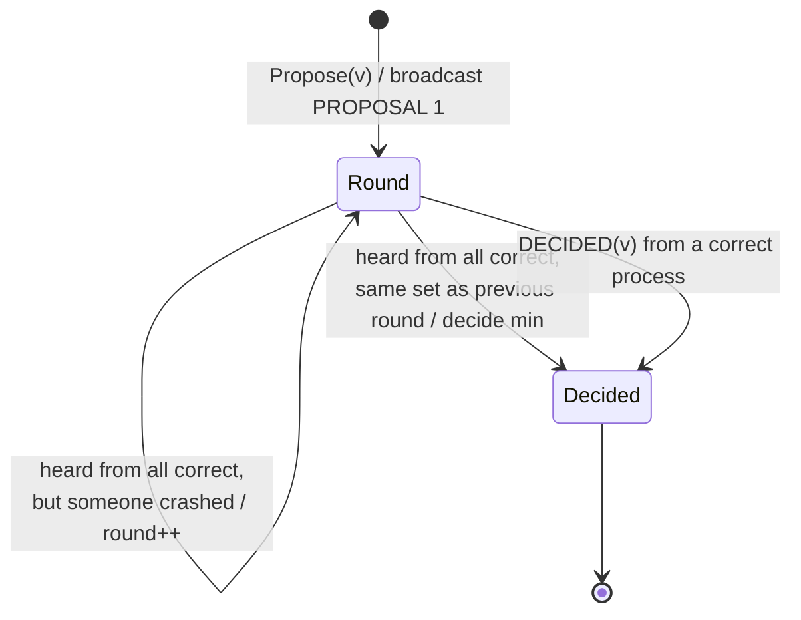

# Consensus

> [!abstract] Purpose of this lecture
> **Consensus** is the central problem of fault-tolerant distributed computing: a group of processes, each with its own opinion, must agree on **one** value. Many problems reduce to it — atomic commit, total order broadcast ([[11 - DDS - Total Order Broadcast|Lecture 13]]), state machine replication ([[12 - DDS - Software Replication|Lecture 14]]), leader election, group membership.
> The lecture: (1) defines consensus, (2) recalls the **FLP impossibility** — no deterministic algorithm solves it in a purely asynchronous system with even one crash — and therefore (3) solves it in a **synchronous** system, with the [[Perfect Failure Detector|perfect failure detector]] and [[7 - DDS - Broadcast Communications#Best Effort Broadcast (BEB)|best-effort broadcast]]: **Flooding Consensus**. Then (4) it strengthens the problem to **uniform consensus**, like [[7 - DDS - Broadcast Communications#Uniform Reliable Broadcast (URB)|URB]] strengthens RB, and gives **Flooding Uniform Consensus**.
> How to escape FLP in partially synchronous systems is the topic of [[9 - DDS - Paxos|Paxos]]. See also the general note [[Consensus]] (blockchain context).
>
> Course map: [[MOC - Dependable Distributed Systems]]. Book: Cachin, Guerraoui, Rodrigues, Chapter 5, §5.1.1–5.1.2, §5.2.1–5.2.2 (pp. 204–213).

## The consensus problem

Vedi [[Consensus Abstraction]].

- A group of processes must **agree on a value that has been proposed by one of them** (e.g., commit/abort of a transaction: every participant must take the same decision).
- It is an **abstraction of a class of problems** where processes start with their own opinion and then converge on one of them.
- It is a **fundamental problem**: if you can solve consensus, you can build most other fault-tolerant abstractions on top of it.
- We study algorithms working on **weak models**, i.e. with as few assumptions as possible about timing and failures.

> [!important] Simone's notes (from the old version of this lecture)
> "So the consensus blocks the flow in any situation. If we want mutal exclusion, consensus is one way."

### Example: the generals

![[DDS-L08-p03.png]]

*Four generals, each with an army, surround a city. They communicate only by messengers and must reach consensus between **attack** and **get back**. If only some armies attack, they lose. The decision must be the same for all, and it must be one of the opinions actually proposed.*

> [!note] Crash vs Byzantine
> This picture recalls the famous *Byzantine Generals* problem (Lamport, Shostak, Pease, 1982), where some generals may be **traitors** sending contradictory messages. In this lecture we only consider **crash** failures: a general may die, but never lies.

### Definition

![[DDS-L08-p04.png]]

*Binary consensus. Six processes start with initial values in $\{0,1\}$ ($0,1,0,1,0,0$). After the consensus protocol every process that decides outputs the **same** value — here $1$, which was proposed by $p_2$ and $p_4$. $p_5$ shows an **X**: it crashed and decided nothing.*

- Set of initial values $\in \{0,1\}$.
- Every process has to **decide the same value** $\in \{0,1\}$ based on the initial proposals.

Note that the decided value need not be the majority value ($0$ here): any **proposed** value is fine. What matters is that everybody agrees.

### Specification

![[DDS-L08-p05.png]]

*Module 5.1 of the book: the consensus box receives `Propose(v)` from above and outputs `Decide(v)`.*

```text
Module: Consensus, instance c
Events:
  Request:    ⟨c, Propose | v⟩   — proposes value v for consensus
  Indication: ⟨c, Decide | v⟩    — outputs a decided value v
Properties:
  C1 Termination: every correct process eventually decides some value.
  C2 Validity:    if a process decides v, then v was proposed by some process.
  C3 Integrity:   no process decides twice.
  C4 Agreement:   no two correct processes decide differently.
```

| Property | Type | What it excludes |
|---|---|---|
| Termination | liveness | waiting forever |
| Validity | safety | trivial solutions like "always decide 0" |
| Integrity | safety | changing one's mind |
| Agreement | safety | two correct processes with different decisions |

> [!tip] Why validity matters
> Without validity, consensus is trivial: every process decides a constant, without any communication. Validity forces the decision to depend on the inputs.

## The FLP impossibility result

> **No algorithm can guarantee to reach consensus in an asynchronous system, even with one process crash failure.**
> — Fischer, Lynch and Paterson (FLP result), *Journal of the ACM*, Vol. 32, No. 2, April 1985.

> [!important] Simone's notes
> "notice that some people spent all their life to study the consensus"

**Intuition.** In an asynchronous system there is no bound on message delays or on relative process speeds. A process waiting for a message from $p$ cannot tell whether $p$ has **crashed** or is just **slow**:
- if it waits, and $p$ crashed, it waits forever (no **termination**);
- if it decides without $p$, and $p$ was only slow, $p$ may decide differently (no **agreement**).

FLP proves that, for every deterministic algorithm, there is always an execution in which the system stays forever **undecided** ("bivalent"), even though every message is eventually delivered.

> [!note] How to get around FLP
> FLP does not say that consensus is never solvable, only that a deterministic algorithm cannot **guarantee termination** in a fully asynchronous system. The usual escape routes:
> - **synchrony** — e.g. assume a perfect failure detector (this lecture);
> - **partial synchrony** — the system is eventually synchronous ($\Diamond\mathcal{P}$, $\Omega$): safety always, termination once the system stabilizes ([[9 - DDS - Paxos|Paxos]]);
> - **randomization** — termination with probability 1.

## Flooding Consensus (synchronous systems)

Vedi [[Flooding Consensus]].

### Basic idea

- Processes **exchange their values**.
- When all the proposals from correct processes are available, **one value can be chosen** — with a deterministic function known to all, e.g. $\min$.

**Problem:** due to failures, some values can be lost. A process can crash after sending its proposal to some processes only: they end up with different sets, hence different $\min$.

**Solution:** a value can be selected **only when no failures happen during the communication** — i.e. when a process sees that, in a round, it heard from the same set of processes as in the previous round.

> [!important] Simone's notes
> "if someone failed and doesn't respond anymore, we simply exclude him"

### The algorithm

![[DDS-L08-p08.png]]

*The architecture: the Consensus module is built on BEB (to broadcast proposals) and the perfect failure detector $\mathcal{P}$ (to know whom to wait for).*

```text
Algorithm 5.1: Flooding Consensus
Implements: Consensus, instance c
Uses:       BestEffortBroadcast, instance beb
            PerfectFailureDetector, instance P

upon event ⟨c, Init⟩ do
  correct := Π
  round := 1
  decision := ⊥
  receivedfrom := [∅]^N            // receivedfrom[r] = who sent me a round-r proposal
  proposals := [∅]^N               // proposals[r] = values I know in round r
  receivedfrom[0] := Π

upon event ⟨P, Crash | p⟩ do
  correct := correct \ {p}

upon event ⟨c, Propose | v⟩ do
  proposals[1] := proposals[1] ∪ {v}
  trigger ⟨beb, Broadcast | [PROPOSAL, 1, proposals[1]]⟩

upon event ⟨beb, Deliver | p, [PROPOSAL, r, ps]⟩ do
  receivedfrom[r] := receivedfrom[r] ∪ {p}
  proposals[r] := proposals[r] ∪ ps

upon correct ⊆ receivedfrom[round] ∧ decision = ⊥ do       // end of round
  if receivedfrom[round] = receivedfrom[round − 1] then    // no new failure
    decision := min(proposals[round])
    trigger ⟨beb, Broadcast | [DECIDED, decision]⟩
    trigger ⟨c, Decide | decision⟩
  else                                                     // someone crashed:
    round := round + 1                                     // one more round
    trigger ⟨beb, Broadcast | [PROPOSAL, round, proposals[round − 1]]⟩

upon event ⟨beb, Deliver | p, [DECIDED, v]⟩ such that p ∈ correct ∧ decision = ⊥ do
  decision := v
  trigger ⟨beb, Broadcast | [DECIDED, decision]⟩
  trigger ⟨c, Decide | decision⟩
```

How it works, step by step:

1. **Rounds.** Each `PROPOSAL` message carries a round number. A round ends at $p$ when $p$ has received the round-$r$ message from every process it still considers correct (`correct ⊆ receivedfrom[round]`). Thanks to strong completeness of $\mathcal{P}$, it never waits forever for a crashed process.
2. **Flooding.** In each round a process broadcasts **all** the values it knows (not only its own), so values held by a process that later crashes can survive through others.
3. **Decision rule.** If the set of senders is **the same in two consecutive rounds** (`receivedfrom[round] = receivedfrom[round − 1]`), no one crashed during the round, so all messages of the round arrived everywhere: the process has seen every value any correct process could see, and decides $\min$. Initially `receivedfrom[0] = Π`, so in a run without failures everybody decides at the end of round 1.
4. **Otherwise** a crash happened in this round: maybe the crashed process sent its values only to some processes. Go to the next round.
5. **`DECIDED` messages.** A process that decides tells everyone. A process still in a later round adopts the decision: this is needed because processes that detected a crash would otherwise compute $\min$ over a different set.



### Examples

**No failures:**

![[DDS-L08-p09.png]]

*$p_1, p_2, p_3$ propose $5, 3, 7$. Each one receives the proposals of everybody in round 1 (green arrows: "From p2", "From p1", "From p3") and builds `Proposal[1] = {5, 3, 7}`, with `receivedFrom[1] = {p1, p2, p3} = receivedFrom[0]`. Same set as round 0 → each decides $\min\{5,3,7\} = 3$ (purple arrows: the `DECIDED` broadcasts).*

**$p_2$ crashes, but $p_1$ received its proposal:**

![[DDS-L08-p10.png]]

*$p_2$ crashes after sending its proposal, which reaches $p_1$ but not $p_3$. $p_1$ has `receivedFrom[1] = {p2, p1, p3}` and decides $3$. $p_3$ has only `{p1, p3}` and is still waiting for $p_2$ (the crash is not yet detected). It receives `DECIDED(3)` from $p_1$ and decides $3$.*

![[DDS-L08-p11.png]]

*Same run, with the crash detection drawn: $p_3$ gets `Crash(p2)`, so `correct = {p1, p3} ⊆ receivedFrom[1]`, but `receivedFrom[1] ≠ receivedFrom[0]`: it moves to round 2 (`round3 = 2`). Before round 2 ends, the `DECIDED(3)` from $p_1$ arrives and $p_3$ decides $3$. Without the `DECIDED` message it would have decided $\min\{5,7\} = 5$: the decision messages are what keep agreement.*

**$p_2$'s proposal reaches nobody:**

![[DDS-L08-p12.png]]

*Neither $p_1$ nor $p_3$ receives the proposal of $p_2$. Both detect `Crash(p2)` and go to round 2 with $\{5, 7\}$. In round 2 the set of senders is $\{p_1, p_3\}$ again, so both decide $\min\{5,7\} = 5$. The value $3$ is lost, but validity is fine: $5$ was proposed.*

### Correctness and performance

**Correctness**
- **Validity and integrity** follow from the properties of the communication channels (BEB: no creation, no duplication) and from the `decision = ⊥` guards.
- **Termination.** At most after $N$ rounds processes decide: a round without decision requires at least one new crash, and there are only $N$ processes.
- **Agreement.** The same deterministic function is applied to the same values by correct processes. If some process decides $v$ in round $r$ with no new failure, every proposal set that reaches the end of round $r$ contains the same values (strong accuracy: nobody was wrongly excluded); processes that detected a crash in round $r$ will receive the `DECIDED` message of a correct decider.

**Performance**
- **Best case** (no failures): **one communication round** — $N^2$ `PROPOSAL` messages + $N^2$ `DECIDED` messages $= 2N^2$.
- **Worst case** ($n-1$ failures): $N^2$ messages exchanged for each communication step and at most $N$ rounds $\Rightarrow O(N^3)$ messages.

> [!quote] Dal libro — sample execution (p. 207, Fig. 5.1)
> "Process p crashes during round 1 after broadcasting its proposal. Only process q sees that proposal. […] As process q receives proposals in round 1 from all processes […] q can decide. It selects the minimum value among the proposals and decides value w. Processes r and s detect the crash of p and cannot decide in round 1. So they advance to round 2. If process r or s would decide based on the proposal set after round 1, they would have decided differently […]. But as q has decided, it disseminates its decision through best-effort broadcast."

### When the early decider crashes

![[DDS-L08-p14.png]]

*$p_2$ receives all three proposals, decides $\min\{5,3,7\} = 3$ and then **crashes** before its `DECIDED` message reaches anyone. $p_1$ and $p_3$ never received $p_2$'s proposal: they detect `Crash(p2)`, move to round 2 with $\{5,7\}$ and decide $5$.*

This run **satisfies** consensus: agreement only talks about **correct** processes, and $p_1, p_3$ agree. But $p_2$ decided $3$ before crashing, and if it had already acted on that decision (e.g. committed a transaction), the system is now inconsistent. Same issue as RB vs URB in [[7 - DDS - Broadcast Communications#Why RB is not enough|Lecture 8]].

> [!warning] Correzione
> On the slide, the label under $p_2$ reads "Decision₁=3". It is $p_2$'s variable, so it should be **Decision₂ = 3** (the decision of $p_2$; $p_1$ decides 5).

## Uniform consensus

Vedi [[Uniform Consensus]].

### Specification

![[DDS-L08-p15.png]]

*Module 5.2 of the book.*

```text
Module: UniformConsensus, instance uc
Events:
  Request:    ⟨uc, Propose | v⟩
  Indication: ⟨uc, Decide | v⟩
Properties:
  UC1–UC3: same as C1–C3 (termination, validity, integrity)
  UC4 Uniform agreement: no two processes decide differently.
```

The only change is in agreement: "no two **correct** processes" becomes "no two **processes**" — a process that decides and then crashes must have decided the same value as everybody else.

> [!important] Simone's notes
> "As we can see, we removed the *agreement* property and implemented the *UC4: uniform agreement (we are not considering anymore only correct processes but we consider in general*. For doing so, we implement a way to take time."

### Does Flooding Consensus satisfy uniform consensus?

**No.** The run above is the counterexample: $p_2$ decides $3$ at the end of round 1 and crashes; $p_1$ and $p_3$ decide $5$. Flooding Consensus decides **too early**: a process decides without making sure that its decision has been seen by anyone else.

> [!quote] Dal libro (p. 211)
> "None of the consensus algorithms we presented so far ensure uniform agreement. Roughly speaking, this is because some of the processes decide too early, without making sure that their decision has been seen by enough processes. Should such an early deciding process crash, other processes might have no choice but to decide a different value."

## Flooding Uniform Consensus (synchronous systems)

Vedi [[Flooding Uniform Consensus]].

![[DDS-L08-p17.png]]

*Algorithm 5.3 with the slide's three callouts: (1) `proposalset` and `receivedfrom` are **no more related to the round** — a single set instead of an array; (2) **decision only at the end**, at round $N$; (3) `receivedfrom` is **cleaned at the beginning of each round**.*

```text
Algorithm 5.3: Flooding Uniform Consensus
Implements: UniformConsensus, instance uc
Uses:       BestEffortBroadcast, instance beb
            PerfectFailureDetector, instance P

upon event ⟨uc, Init⟩ do
  correct := Π
  round := 1
  decision := ⊥
  proposalset := ∅                 // not per round any more
  receivedfrom := ∅                // only for the current round

upon event ⟨P, Crash | p⟩ do
  correct := correct \ {p}

upon event ⟨uc, Propose | v⟩ do
  proposalset := proposalset ∪ {v}
  trigger ⟨beb, Broadcast | [PROPOSAL, 1, proposalset]⟩

upon event ⟨beb, Deliver | p, [PROPOSAL, r, ps]⟩ such that r = round do
  receivedfrom := receivedfrom ∪ {p}
  proposalset := proposalset ∪ ps

upon correct ⊆ receivedfrom ∧ decision = ⊥ do
  if round = N then                // decision only at the end
    decision := min(proposalset)
    trigger ⟨uc, Decide | decision⟩
  else
    round := round + 1
    receivedfrom := ∅              // cleaned at the beginning of each round
    trigger ⟨beb, Broadcast | [PROPOSAL, round, proposalset]⟩
```

**Key idea:** always run **$N$ rounds**, and decide only at round $N$. With at most $N-1$ crashes, at least one round is **crash-free**; in that round every surviving process receives the full set of every other one, so from then on all proposal sets are identical. No `DECIDED` message is needed: everybody computes $\min$ over the same set.

> [!note] Why the `r = round` guard
> Messages from a future round (a faster process) are not delivered until the receiver reaches that round — the event handler only fires for messages of the current round, the others wait. This keeps the "who did I hear from in this round" bookkeeping exact.

> [!important] Simone's notes
> "What happens if the Perfect FDP doesn't work properly (so is not perfect but Eventually Perfect)? We use the uniform broadcast agreement, we need to switch the philosophy, work with majority (we will see it later)"

### Example

![[DDS-L08-p18.png]]

*$p_2$ crashes during round 1: its proposal reaches nobody but itself (it collects $\{5,3,7\}$ but then dies). $p_1$ and $p_3$ detect `Crash(p2)`, close round 1 with $\{5, 7\}$, run round 2 and round 3 ($N = 3$) — nothing new arrives — and decide $\min\{5,7\} = 5$.*

![[DDS-L08-p19.png]]

*Variant: $p_2$ has collected $\{5,3,7\}$ and reaches round 2 before crashing. With Flooding Consensus it would have decided $3$ at the end of round 1. Here it **cannot decide before round 3**, so it crashes undecided, and uniform agreement holds: $p_1$ and $p_3$ decide $5$, and no process ever decided $3$.*

### Correctness and performance

**Correctness**
- The **validity** and **integrity** properties follow from the algorithm and from the properties of best-effort broadcast.
- The **termination** property is ensured as all correct processes reach round $N$ and decide in that round: the **strong completeness** property of the failure detector implies that no correct process waits indefinitely for a message from a process that has crashed, as the crashed process is eventually removed from `correct`.
- The **uniform agreement** holds because all processes that reach round $N$ have the same set of values in their variable `proposalset`.

> [!tip] Why "the same set" at round $N$
> $N$ rounds, at most $N-1$ crashes ⇒ some round $r \leq N$ has no crash. In that round every process that completes it received the set of every other live process (strong accuracy: nobody is wrongly removed from `correct`), so all sets become equal and remain equal afterwards. Any process deciding at round $N$ — even one that crashes right after — decides on that common set.

**Performance:** $N$ communication steps and $O(N^3)$ messages for all correct processes to decide — always, even without failures. The price of uniformity is **latency**: regular flooding decides in 1 round when nothing fails.

| | Flooding Consensus | Flooding Uniform Consensus |
|---|---|---|
| Agreement | regular (correct processes) | uniform (all processes) |
| Decision | as soon as a round has no new crash | only at round $N$ |
| `DECIDED` messages | yes | no |
| Steps, no failures | 1 | $N$ |
| Messages | $2N^2$ best, $O(N^3)$ worst | $O(N^3)$ |

> [!note] Other algorithms in the book (not on the slides)
> §5.1.3 and §5.2.3 present **Hierarchical Consensus** and **Hierarchical Uniform Consensus** (pp. 208–214): in round $i$ the process with rank $i$ imposes its value. They use $O(N)$ messages per round instead of $O(N^2)$, but always need $N$ steps.

## References

C. Cachin, R. Guerraoui, L. Rodrigues, *Introduction to Reliable and Secure Distributed Programming*, Springer, 2011 — Chapter 5, Sections 5.1.1, 5.1.2, 5.2.1, 5.2.2 (pp. 204–213).

M. J. Fischer, N. A. Lynch, M. S. Paterson, "Impossibility of Distributed Consensus with One Faulty Process", *Journal of the ACM*, 32(2), 1985.

## Core ideas to retain

- Consensus = **termination + validity + integrity + agreement**; uniform consensus replaces agreement with **uniform agreement**.
- **FLP**: impossible to guarantee in an asynchronous system with even one crash → we need synchrony, a failure detector or randomization.
- **Flooding Consensus** ($\mathcal{P}$ + BEB): flood the proposal sets round by round; decide $\min$ when two consecutive rounds have the same senders; propagate the decision with `DECIDED`.
- It is **not uniform**: an early decider can crash before telling anyone.
- **Flooding Uniform Consensus**: always $N$ rounds, decide only at the end → $N$ steps, $O(N^3)$ messages.
