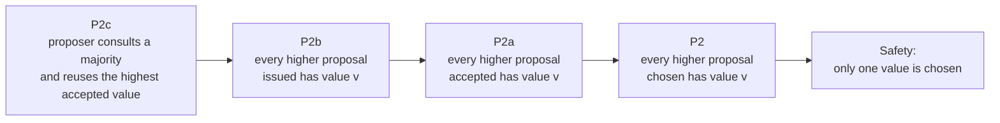
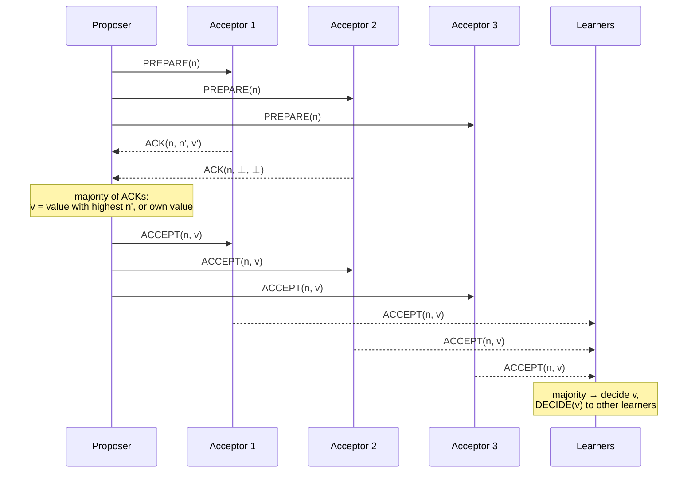

# Paxos

> [!abstract] Purpose of this lecture
> The [[8 - DDS - Consensus|previous lecture]] solved consensus only in a **synchronous** system, with a perfect failure detector, because of the **FLP impossibility**. **Paxos** (Leslie Lamport) is the classic answer for the **asynchronous** world: it gives up *guaranteed* termination, but never violates safety.
> - **Safety is always guaranteed**: only a proposed value is chosen, only one value is chosen — whatever the delays, losses, crashes and restarts.
> - **Liveness** only when the network behaves "well" for long enough (**partial synchrony**), and in practice when a single [[6 - DDS - Failure Detection and Leader Election#Lecture 7B — Leader election|leader]] drives the protocol.
>
> The lecture follows Lamport's *Paxos Made Simple*: it derives the protocol step by step from the properties it must satisfy (P1, P2, P2a, P2b, P2c), then presents the two phases (prepare/promise, accept/accepted) and the learners. Paxos is the basis of [[12 - DDS - Software Replication|replication]] and of [[11 - DDS - Total Order Broadcast|total order broadcast]] in practice.
>
> Course map: [[MOC - Dependable Distributed Systems]].

## The impossibility result, again

> **Impossibility of consensus in asynchronous systems in the presence also of a single crash.**
> — Fischer, Lynch and Paterson (FLP result), *Journal of the ACM*, Vol. 32, No. 2, April 1985.

See [[8 - DDS - Consensus#The FLP impossibility result|Lecture 10]]. FLP says that a deterministic algorithm cannot guarantee **both** safety and termination in an asynchronous system with one crash. Paxos makes a precise choice: **sacrifice termination, never safety**.

## Paxos

Vedi [[Paxos]].

The Paxos family of algorithms was introduced to provide a viable solution to consensus in **asynchronous** settings:
- **safety is always guaranteed**;
- the algorithm makes some **progress (liveness) only when the network behaves in a "good way" for long enough periods of time** (partial synchrony).

> [!warning] Correzione
> The slide says that Paxos "was introduced in **1999**". The paper that introduced it, *The Part-Time Parliament* (reference [2] at the end of this lecture), was published in *ACM TOCS* in **May 1998** (it was written around 1989–1990). *Paxos Made Simple*, reference [1], is from 2001.

### What the protocol should do (recap about properties)

Let us think about what the protocol should do (these are the safety requirements of consensus, in Lamport's words):
- **Only a value that has been proposed may be chosen** → validity.
- **Only a single value is chosen** → (uniform) agreement.
- **A process never learns that a value has been chosen unless it actually has been** → no "false" decision.

Liveness (some value is eventually chosen, and learned) is not guaranteed in all runs, only in "good" ones.

### System model and basic assumptions

- **Agents** operate at **arbitrary speed**, may **fail by stopping**, and **may restart** (crash-recovery).
  - **Observation:** since all agents may fail after a value is chosen and then restart, a solution is impossible unless **some information can be remembered** by an agent that has failed and restarted. → Acceptors keep their state (promised and accepted numbers) in **stable storage**.
- **Messages** can take **arbitrarily long** to be delivered, can be **duplicated**, and can be **lost**, but they are **not corrupted** (no Byzantine faults).

This is much weaker than the model of [[8 - DDS - Consensus#Flooding Consensus (synchronous systems)|Flooding Consensus]]: no perfect failure detector, no reliable links, asynchrony, recoveries.

### Actors

Actors in the basic Paxos protocol (roles — the same process can play several of them):
- **Proposers**: propose a value.
- **Acceptors**: processes that must commit on a final decided value — they "vote".
- **Learners**: passively assist to the decision and obtain the final decided value.

## Choosing a value: deriving the protocol

### A single acceptor

![[DDS-L09-p07.png]]

*Proposers P send their values $v_1, v_2, \dots, v_n$ to a single acceptor A.*

The easiest way to solve the problem is to have a **single acceptor**:
- a proposer sends a proposal to the acceptor;
- the acceptor **chooses the first proposed value it receives** and informs everybody about its choice.

**What if the only acceptor fails?** The whole system blocks: it is a single point of failure. ⇒ **We must have more than one acceptor.**

### Multiple acceptors

![[DDS-L09-p08.png]]

*Three acceptors A and many proposers P: each proposer sends its value to a set of acceptors.*

- Each proposer sends a proposal to a set of acceptors.
- Each acceptor needs to choose a value.

> [!warning] Problem
> Each acceptor may receive a **different set of proposals**, in a different order.

![[DDS-L09-p09.png]]

*$p_1, p_2, p_3$ send $v_1, v_2, v_3$; some messages are lost (the stars). So far $a_1$ received $v_1, v_2, v_3$; $a_2$ received $v_2$ and $v_1$; $a_3$ received only $v_3$. **How can we guarantee that acceptors do not choose different values?***

### A possible solution: majorities

![[DDS-L09-p10.png]]

- An acceptor may **accept at most one value**.
- A value is **chosen** when a **majority of acceptors** accept it.

> [!important] The majority is needed to guarantee that only one value is chosen
> Any two majorities of the same set **intersect** in at least one acceptor. Since an acceptor accepts at most one value, two different values cannot both reach a majority. Vedi [[Majority Quorum]].
> $$|Q_1| > \tfrac{N}{2},\ |Q_2| > \tfrac{N}{2} \;\Rightarrow\; Q_1 \cap Q_2 \neq \emptyset$$

### P1: accept the first proposal

Which value should be accepted by every acceptor? Since a value must be chosen even if only one value is ever proposed (by a single proposer), we need:

> **P1: An acceptor must accept the first proposal it receives.**

**Problem:** if several values are concurrently proposed by different proposers, **none of them could reach the needed majority**. We have a sort of **deadlock**.

![[DDS-L09-p12.png]]

*Given P1: $a_1$ received $v_1$ first, $a_2$ received $v_2$ first, $a_3$ received $v_3$ first. Each acceptor accepts a different value, no value has a majority, and — since each acceptor may accept only one value — nothing can ever be chosen. Conclusion: **an acceptor should accept multiple proposals!***

### Numbered proposals and P2

**Solution:**
- We keep track of different proposals by assigning them a **proposal number that is unique** (a **total order** of proposals). A proposal is a pair (number, value).
- A value is **chosen** when a single proposal with that value has been accepted by a majority of the acceptors (**chosen proposal**).
- We can allow **multiple proposals to be accepted**, but **all accepted proposals must have the same value**.

> **P2: if a proposal with value $v$ is chosen, every higher-numbered proposal that is chosen has value $v$.**

P2 guarantees that only one *value* is chosen, even if many *proposals* are chosen.

> [!tip] How to make proposal numbers unique
> A common trick: number = (counter, proposer id), compared lexicographically; or proposer $i$ out of $k$ uses only numbers $\equiv i \pmod k$. Each proposer must also remember (in stable storage) the highest number it has used.

### P2a: a constraint on acceptors

For a value $v$ to be chosen, a proposal containing it must have been accepted by at least one acceptor… thus, it is enough that:

> **P2a: if a proposal with value $v$ is chosen, every higher-numbered proposal that is accepted by any acceptor has value $v$.**

> [!warning] Correzione
> The slide writes P2a as "if a proposal with value v is **accepted**, every higher-numbered proposal…". In *Paxos Made Simple* (and logically, since it must strengthen P2) the premise is "is **chosen**": if it said "accepted", an acceptor that accepted a value no majority will ever choose would freeze that value forever. The same holds for P2b below, which the slide correctly states with "chosen".

**One more problem:** what if a proposal with value $v$ is chosen while an acceptor $c$ **never saw it** (messages are asynchronous and can be lost)? A new proposer could wake up and propose to $c$ a **different value $v'$** with a higher number, and $c$ **must accept it due to P1** — violating P2a.

### P2b: a constraint on proposers

We must slightly modify P2a to take this case into account — move the constraint from the acceptors to the **proposers**:

> **P2b: if a proposal with value $v$ is chosen, every higher-numbered proposal issued by any proposer has value $v$.**

Since a proposal must be issued before it can be accepted, P2b ⇒ P2a ⇒ P2. **How can we guarantee P2b?**

### Proving P2b by induction

- Assume a proposal **$m$** with value **$v$** has been chosen.
- We should guarantee that any proposal **$n$**, with $n > m$, has value $v$.
- We could prove it **by induction on $n$**, assuming that every proposal with number in $[m, n-1]$ has value $v$.
- For $m$ to be chosen there is a set **$C$** of acceptors (**a majority**) that accept it.

Therefore, the assumption that $m$ has been chosen implies that:
- every acceptor in $C$ has accepted a proposal with number in $[m, n-1]$, and
- every proposal in this range accepted by an acceptor has value $v$ (inductive hypothesis).

### P2c: the invariant

Given the **intersection among majorities** — any majority $S$ contains at least one acceptor of $C$ — we can conclude that a proposal numbered $n$ has value $v$ by ensuring that the following invariant is maintained:

> **P2c: For any $v$ and $n$, if a proposal with value $v$ and number $n$ is issued, then there is a set $S$ consisting of a majority of acceptors such that either**
> **(a) no acceptor in $S$ has accepted any proposal numbered less than $n$, or**
> **(b) $v$ is the value of the highest-numbered proposal among all proposals numbered less than $n$ accepted by the acceptors in $S$.**

**By maintaining P2c we satisfy P2b.** Intuitively: if some value $v$ was already chosen by majority $C$, the set $S$ consulted by the new proposer intersects $C$, so case (a) is impossible and case (b) forces the proposer to reuse the value of the highest accepted proposal — which, by induction, is $v$.



## How to ensure P2c

P2c can be maintained by asking a proposer that wants to propose a value numbered $n$ to **learn the highest-numbered value with number less than $n$** that
- **has been accepted**, or
- **will be accepted**

by any acceptor in a majority.

### Learning about proposed values

- Learning **already accepted** values is easy: ask the acceptors.
- Predicting **future** acceptances is impossible. Instead of trying to predict the future, **ask acceptors to promise they will not accept proposals numbered less than $n$**.

The protocol has two main phases:
- **Phase 1:** prepare request ↔ response (promise);
- **Phase 2:** accept request ↔ response.

## The Paxos protocol

### Phase 1 — prepare

**1) Proposer.** A proposer chooses a **new proposal version number $n$**, and sends a prepare request `(PREPARE, n)` to a **majority** of acceptors, asking:
- (a) Can I make a proposal with number $n$?
- (b) If yes, do you suggest some value for my proposal?

![[DDS-L09-p23.png]]

*$p_1$ sends `(PREPARE, 1)` to the acceptors; the message to $a_3$ is lost (star).*

**2) Acceptor.** If an acceptor receives a prepare request `(PREPARE, n)` (with $n$ higher than any prepare it has already answered), it answers:
- (a) with a **promise not to accept any more proposals numbered less than $n$**;
- (b) **suggesting the value $v'$** of the **highest-numbered proposal that it has accepted**, if any, else $\bot$.

In particular, it will reply with the highest number less than $n$ that it has accepted:
- `(ACK, n, n', v')` if it exists,
- or `(ACK, n, ⊥, ⊥)` if not.

![[DDS-L09-p25.png]]

*$a_1$ and $a_2$ receive `(PREPARE, 1)` and, having accepted nothing, answer `(ACK, 1, ⊥, ⊥)`: $p_1$ has a majority (2 of 3) of promises.*

**2') Rejection.** If an acceptor receives a prepare request `(PREPARE, n)` with $n$ **lower than $n'$** from any prepare request it has already responded to, it sends out `(NACK, n')`:
- a **denial** to proceed with the agreement, as the proposal is **too old**. (Telling $n'$ helps the proposer pick a higher number next time.)

![[DDS-L09-p27.png]]

*Two concurrent proposers. $p_3$ sends `(PREPARE, 2)`: $a_1$ and $a_3$ answer `(ACK, 2, ⊥, ⊥)`. $p_1$'s `(PREPARE, 1)` reaches $a_1$ **after** it promised 2, so $a_1$ replies `(NACK, 2)`; $a_2$ had promised nothing and answers `(ACK, 1, ⊥, ⊥)`. $p_3$ has a majority, $p_1$ has not.*

### Phase 2 — accept

**3) Proposer.** If the proposer receives responses from a **majority** of the acceptors, then it can issue an accept request `(ACCEPT, n, v)` with number $n$ and value $v$:
- (a) $n$ is the number that appears in the prepare request;
- (b) $v$ is the **value of the highest-numbered proposal among the responses** (or the **proposer's own proposal** if none was received).

Point (b) is exactly what maintains **P2c**: the proposer is "forced" to continue a value that may already have been chosen.

![[DDS-L09-p29.png]]

*$p_3$ collected `(ACK, 2, ⊥, ⊥)` from $a_1$ and $a_3$ (its prepare to $a_2$ was lost). No accepted values in the answers, so it can choose its own value $v$, and sends `(ACCEPT, 2, v)` to the acceptors — including $a_2$, which never answered: it accepts anyway, because it has promised nothing higher than 2.*

**4) Acceptor.** If the acceptor receives an accept request `(ACCEPT, n, v)`, it **accepts the proposal unless it has already responded to a prepare request having a number greater than $n$**.

### Learning the decided value

- Whenever an acceptor accepts a proposal, it sends to all learners `(ACCEPT, n, v)` (the *accepted* notification).
- A learner that receives `(ACCEPT, n, v)` from a **majority of acceptors** decides $v$, and sends `(DECIDE, v)` to all other learners.
- Learners that receive `(DECIDE, v)` decide $v$.

![[DDS-L09-p32.png]]

*The complete run: $p_3$'s Phase 1 with number 2, then `(ACCEPT, 2, v)` to $a_1, a_2, a_3$. Each acceptor accepts and forwards `(ACCEPT 2, v)` to the learners (here the acceptors themselves); once a majority of these is collected, `(DECIDE v)` is delivered everywhere.*

### Pseudocode summary

```text
Proposer (wants to propose value myv):
  choose a unique n, higher than any n used before
  send (PREPARE, n) to a majority of acceptors
  wait for (ACK, n, n', v') from a majority          // else (NACK): retry with higher n
  if some ACK carries a value: v := value of the ACK with the highest n'
  else                          v := myv
  send (ACCEPT, n, v) to the acceptors

Acceptor (stable storage: promised, acceptedN, acceptedV; initially ⊥):
  on (PREPARE, n):
    if n > promised: promised := n; reply (ACK, n, acceptedN, acceptedV)
    else             reply (NACK, promised)
  on (ACCEPT, n, v):
    if n ≥ promised: promised := n; acceptedN := n; acceptedV := v
                     send (ACCEPT, n, v) to all learners
    else             ignore / (NACK, promised)

Learner:
  on (ACCEPT, n, v) from a majority of acceptors (same n): decide v; send (DECIDE, v)
  on (DECIDE, v): decide v
```



### Run example

![[DDS-L09-p33.png]]

*Seven processes. $P_1$ sends `(PREPARE, n)` to $P_2, P_3, P_5, P_6$ — 4 of 7, a majority. The answers are `(ACK, n, n1, v1)`, `(ACK, n, ⊥, ⊥)`, `(ACK, n, n2, v2)`, `(ACK, n, n3, v3)`: some acceptors had already accepted older proposals. Among them, $n_3$ is the highest, so $P_1$ must propose **$v_3$**, not its own value: `(ACCEPT, n, v3)`. The four acceptors accept and send `(ACCEPT, n, v3)` to every process (all are learners); each learner, having seen a majority, decides and sends `(DECIDE, v3)`.*

## Liveness

![[DDS-L09-p34.png]]

*$p_1$ issues `(PREPARE, 1)` and gets an ACK, but before its Phase 2 completes $p_2$ issues `(PREPARE, 2)`: the acceptors promise 2, so $p_1$'s accept is refused. $p_1$ retries with `(PREPARE, 3)`, which invalidates $p_2$'s proposal (`NACK, 2`), then $p_2$ retries with `(PREPARE, 4)` (`NACK, 3`)… **Competing proposers may prevent Paxos from terminating.***

This **dueling proposers** scenario is the concrete face of FLP: safety is never at risk, but nothing is ever chosen.

**Solution:** proposers are **"elected" using a leader election protocol** — only the leader (distinguished proposer) issues proposals. Leader election needs some synchrony: an [[Eventual Leader Election (Omega)|eventual leader detector $\Omega$]] is enough. Before the leader stabilizes Paxos may not progress; it **remains safe even if two processes think they are the leader**.

The slide adds: the protocol "**becomes a 2-phase commit with a 3-phase commit when the leader fails**".

> [!note] What this means
> With a **stable leader** that runs many consensus instances in sequence (Multi-Paxos), Phase 1 can be done **once** for all future instances; each new value then needs only Phase 2 (accept + accepted), which resembles a **two-phase commit**. When the leader fails, the new leader must first run Phase 1 again (prepare/promise) to learn what the old leader may have got accepted, and then Phase 2: an extra round trip, like a three-phase protocol. The analogy is informal: unlike 2PC, Paxos needs only a **majority**, not all participants, so it does not block when a minority fails.

> [!quote] Dal libro — Leader-Driven Consensus (§5.3, pp. 216–228; bibliographic notes p. 277)
> The book does not call any algorithm "Paxos" in Chapter 5, but its **Leader-Driven Consensus** (uniform consensus in the fail-noisy model, with $\Omega$ and a majority of correct processes) "is a modular formulation of the 'Paxos' consensus algorithm". It splits Paxos into an **epoch-change** abstraction (driven by the eventual leader detector) and **epoch consensus** instances (one per leader, i.e. per proposal number), and notes that "a majority of correct processes is necessary for any fail-noisy algorithm that implements consensus" (p. 217).

## Is Paxos just a theoretical exercise?

- It is **used, but not widely**. For example, **Google uses Paxos in their lock server** (Chubby); **Yahoo for ZooKeeper**.
- One issue is that Paxos **gets complex if we need to reconfigure it** to change the set of nodes running the protocol.
- Another problem is that **other more scalable alternatives** are available.

> [!note] About ZooKeeper
> ZooKeeper (developed at Yahoo!) does not run Paxos as such: it uses **Zab** (ZooKeeper Atomic Broadcast), a Paxos-like leader-based atomic broadcast protocol. Another widely used alternative is **Raft** (etcd, Consul, CockroachDB), designed to be easier to understand than Paxos.

## References

[1] L. Lamport, "Paxos Made Simple", 2001 — https://www.microsoft.com/en-us/research/wp-content/uploads/2016/12/paxos-simple-Copy.pdf

And for very brave students…

[2] L. Lamport, "The Part-Time Parliament", *ACM Transactions on Computer Systems*, 16(2):133–169, May 1998.

## Core ideas to retain

| Concept | Key point |
|---|---|
| Goal | consensus in an **asynchronous** system with crash-recovery and lossy links |
| Trade-off | **safety always**, liveness only with partial synchrony / a stable leader |
| Roles | proposers, acceptors, learners |
| Quorums | **majorities**: any two intersect |
| Proposal numbers | unique, totally ordered; acceptors can accept several proposals |
| Invariant | **P2c** ⇒ P2b ⇒ P2a ⇒ P2: once chosen, the value never changes |
| Phase 1 | `PREPARE(n)` → promise + highest accepted `(n', v')`, or `NACK` |
| Phase 2 | `ACCEPT(n, v)` with $v$ = highest-numbered value received (or own) |
| Learning | majority of `ACCEPT(n, v)` → decide, `DECIDE(v)` |
| Liveness issue | dueling proposers → elect a leader ($\Omega$) |
