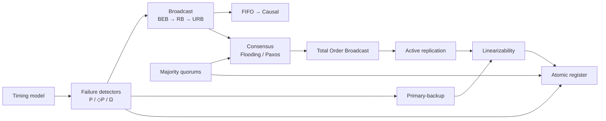

# MOC - Dependable Distributed Systems

> [!abstract] Mappa del corso
> Punto di ingresso per le note di **Dependable Distributed Systems**: le lezioni in ordine, i concetti di ripasso raggruppati per tema e i percorsi che li collegano. Libro di riferimento: Cachin, Guerraoui, Rodrigues, *Introduction to Reliable and Secure Distributed Programming* (`1 part/0- BOOK - ….pdf`).

## Lezioni — parte 1

| # | Lezione | Argomenti |
|---|---|---|
| 1 | [[1- DDS - Introduction]] | distributed systems, dependability, fault/error/failure |
| 2 | [[2 - DDS - Modelling Distributed Systems and Abstracting Communications]] | process and link models, timing assumptions, safety/liveness |
| 3 | [[3 - DDS - Time in Distributed Systems]] | physical clocks, Cristian, Berkeley, NTP |
| 4 | [[4 - DDS - Logical Clocks]] | happened-before, scalar and vector clocks |
| 5 | [[5 - DDS - Distributed Mutual Exclusion]] | Lamport, Ricart-Agrawala, coordinator, token ring, Maekawa |
| 6 | [[6 - DDS - Failure Detection and Leader Election]] | P, ◇P, leader election, Ω |
| 7 | [[7 - DDS - Broadcast Communications]] | BEB, RB, URB, probabilistic broadcast |
| 8 | [[8 - DDS - Consensus]] | consensus, FLP, flooding (uniform) consensus |
| 9 | [[9 - DDS - Paxos]] | Paxos, majorities, Ω for liveness |
| 10 | [[10 - DDS - Ordered Communications]] | FIFO, causal, total order broadcast |
| 11 | [[11 - DDS - Total Order Broadcast]] | TO specifications, consensus-based TO |
| 12 | [[12 - DDS - Software Replication]] | linearizability, primary-backup, active replication |
| 13 | [[13 - DDS - Registers]] | regular and atomic registers, ROWA, majority voting, read-impose |

## Parte 2 e altro materiale

- [[0 - Trust Matters - Introduction to Trust in Distributed Systems]] · [[1 - Introduction to Blockchain and Dependability]] · [[2 - Blockchain Tech Ingredients]]
- General stuff: [[Consensus]] · [[Distributed Ledger (DLT)]] · [[Peer-To-Peer (P2P)]] · [[Proof of Work (PoW)]] · [[Proof of Stake (PoS)]] · [[Threats]]
- Esercizi: [[DDS - Exercises 1]] · [[DDS - Exercises 2]] · [[DDS - Exercises 3]]

## Concetti per tema

### Modello e proprietà
- [[Liveness]]

### Tempo e clock
- Fisici: [[Cristian's Algorithm]] · [[Berkeley Algorithm]] · [[Network Time Protocol (NTP)]]
- Logici: [[Happened-Before Relation]] · [[Scalar Logical Clock]] · [[Vector Clock]]

### Mutua esclusione
- [[Mutual Exclusion Abstraction]]
- Permission-based: [[Lamport's Mutual Exclusion Algorithm]] · [[Ricart-Agrawala Algorithm]] · [[Maekawa's Voting Algorithm]]
- Centralizzato / token: [[Coordinator-based Mutual Exclusion]] · [[Token Ring Mutual Exclusion]]

### Failure detection e leader election
- [[Failure Detector]] · [[Perfect Failure Detector]] · [[Eventually Perfect Failure Detector]]
- [[Leader Election]] · [[Eventual Leader Election (Omega)]]

### Broadcast
- Affidabilità: [[Best Effort Broadcast (BEB)]] · [[Reliable Broadcast (RB)]] · [[Uniform Reliable Broadcast (URB)]] · [[Probabilistic Broadcast (Gossip)]]
- Ordine: [[FIFO Reliable Broadcast]] · [[Causal Order Broadcast]] · [[Waiting Causal Broadcast]] · [[No-Waiting Causal Broadcast]] · [[Total Order Broadcast]]

### Consenso
- [[Consensus Abstraction]] · [[Uniform Consensus]]
- [[Flooding Consensus]] · [[Flooding Uniform Consensus]] · [[Paxos]] · [[Majority Quorum]]

### Replicazione
- [[Linearizability]] · [[Primary-Backup Replication]] · [[Active Replication]]

### Registri
- Specifiche: [[Regular Register]] · [[Atomic Register]]
- Algoritmi: [[Read-One Write-All]] · [[Majority Voting Regular Register]] · [[Regular to Atomic Register Transformation]] · [[Read-Impose Write-All]] · [[Read-Impose Write-Majority]]

## Percorsi trasversali

- **Fail-stop vs fail-silent**: [[Perfect Failure Detector]] → [[Reliable Broadcast (RB)|Lazy RB]] / [[Flooding Consensus]] / [[Read-One Write-All]] / [[Read-Impose Write-All]] ↔ [[Majority Quorum]] → [[Uniform Reliable Broadcast (URB)|Majority-Ack URB]] / [[Paxos]] / [[Majority Voting Regular Register]] / [[Read-Impose Write-Majority]]
- **Dal tempo all'ordine**: [[Happened-Before Relation]] → [[Vector Clock]] → [[Causal Order Broadcast]] → [[Waiting Causal Broadcast]]
- **Dal consenso alla replicazione**: [[Consensus Abstraction]] → [[Uniform Consensus]] → [[Total Order Broadcast]] → [[Active Replication]] → [[Linearizability]]
- **Uniformità** (cosa può fare un processo prima di crashare): [[Reliable Broadcast (RB)]] → [[Uniform Reliable Broadcast (URB)]] · [[Flooding Consensus]] → [[Flooding Uniform Consensus]]
- **Registri**: [[Regular Register]] → [[Regular to Atomic Register Transformation]] → [[Atomic Register]] = [[Linearizability]] per i registri
- **Quorum ovunque**: [[Maekawa's Voting Algorithm]] → [[Majority Quorum]] → [[Paxos]] → [[Read-Impose Write-Majority]]
