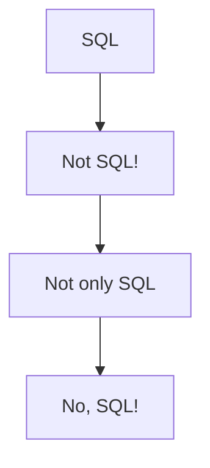
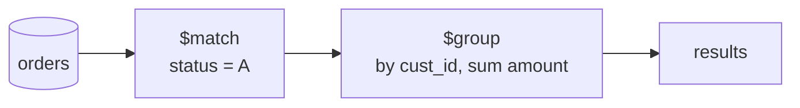

# Document Databases

> [!abstract] Purpose of this lecture
> After [[03 - DM - Graph Databases - RDF, SPARQL e Knowledge Graphs|graph databases]], the course looks at the second big NoSQL family: **aggregate-oriented** databases. The first part (slides *Aggregate data models — Document-based DBs*, R. M. Delfino, adapted from D. Lembo) explains why the relational model was challenged (distribution, impedance mismatch, rigid schema), introduces the notion of **aggregate**, and compares the three aggregate data models: **key-value**, **column-family** and **document**. It also gives a formal definition of **JSON** and discusses data modelling with aggregates. The second part (slides *MongoDB — Applications of Document-based DBs*) shows how these ideas are realized in **MongoDB**: BSON, collections, schema validation, indexes, CRUD and the aggregation pipeline.
>
> Course map: [[00 - Data Management MOC]]. Base triennale: [[07 - BD - NoSQL#7.2 Document-oriented database, MongoDB|Basi di Dati 7.2 — MongoDB]] already introduced JSON, collections, `find` and `$lookup`; this lecture adds the motivation, the comparison among aggregate models and the formal side. Lines starting with "Base triennale:" point to the matching undergraduate section or concept.

The main reference for the first part is *NoSQL Distilled: A Brief Guide to the Emerging World of Polyglot Persistence* (P. J. Sadalage, M. Fowler, Addison-Wesley 2013). The formal part on JSON is adapted from Bourhis, Reutter, Suárez, Vrgoč, *JSON: data model, query languages and schema specification*, PODS 2017.

---

## Why the relational model was challenged

### Quick recap: why relational databases dominated

For several decades relational databases have been the default choice for storing data. The slides list four reasons:

- data is kept in storage in a **structured** way (tables with a declared schema);
- the data model is **simple and general**: everything is a relation, so the same tools work for any domain;
- **concurrency management** is efficient (transactions, see [[05 - DM - Concurrency Control]]);
- there is a **standardized query language**, SQL.

The slide shows a "bucolic relational landscape": a peaceful picture of a world where one technology fits everything. The rest of the lecture explains why that peace ended.

Base triennale: [[Modello Relazionale]] · [[SQL]] · [[Transazione]]

### Good things don't last forever

Several objections were raised against the relational model:

1. **Big Data requires distribution.** Volume and velocity force data onto clusters of machines, and the relational model was not originally designed for distributed computing (joins and transactions across machines are expensive).
2. **Impedance mismatch** between the in-memory data structures of object-oriented programs and the tables of the database (see [[#Impedance mismatch]]).
3. **Costly query processing**: reconstructing an object from many normalized tables requires many joins.
4. **Rigid schema**: a schema declared in advance does not fit well with **variety**, i.e. data whose structure is irregular or changes often.

These and other reasons led to the **NoSQL** movement, already met in [[03 - DM - Graph Databases - RDF, SPARQL e Knowledge Graphs#Dal modello relazionale al movimento NoSQL|Lecture 3]].

### A useful naming confusion

There was no agreement on what "NoSQL" meant, even inside the movement itself. The slides show its evolution as a little chain:



From "SQL" (the default) the reaction was first "Not SQL!" (reject SQL entirely), then the more moderate "**Not only SQL**", which is today's accepted meaning, and finally, ironically, "No, SQL!", referring to the return of SQL-like languages on top of NoSQL systems. A comic on the slide ("How to write a CV — leverage the NoSQL boom") jokes about people claiming NoSQL expertise because they *don't* know SQL.

### Scaling up vs scaling out

Managing more and more data requires more computational power. There are two approaches.

| | Scaling up (vertical) | Scaling out (horizontal) |
|---|---|---|
| What | a more powerful single machine: more CPU, RAM, storage | more, less powerful machines organized in a **cluster** |
| Cost | very expensive at the high end | cheaper commodity hardware |
| Limits | physical limits of one machine | coordination among nodes |
| Failures | the single machine is a single point of failure | resilience: one node failing does not stop the system |

NoSQL aggregate-oriented systems are designed for **scaling out**. See [[Scaling Up vs Scaling Out]].

### Sharding

Vedi [[Sharding]].

**Sharding** is the technique used to partition data among the machines of a cluster. Each portion, called a **shard**, is a subset of the whole database. Since each node only handles its own shard, the workload is divided and performance can improve.

Sharding raises some problems:

- **granularity**: how large should a shard be, and what is the unit that goes into a shard (a row? a customer with all its orders?);
- **location**: how do we keep track of which node holds which part of the database?
- **referential integrity and consistency**: if two related pieces of data are on different nodes, how are foreign keys and transactions enforced?

The notion of [[#From tuples to aggregates|aggregate]] is essentially the answer to the first question.

> [!note] Link with the relational world
> Splitting a table by rows is called *horizontal decomposition* in logical design; sharding is horizontal decomposition **across machines**. Base triennale: [[06 - BD - Progettazione Logica#Decomposizione orizzontale|BD — Decomposizione orizzontale]].

### Impedance mismatch

Vedi [[Impedance Mismatch]].

The **impedance mismatch** arises when two cooperating systems adopt different data models, data structures or communication interfaces. In object-oriented programming data is represented as **objects with complex structures** (nested objects, collections, references), whereas the very same data in the relational model is represented by flat **tables and records**. Mapping from one representation to the other every time a query is executed is complex and error-prone.

Possible solutions:

- **object-oriented databases**, which store objects directly;
- **object-relational mapping (ORM)** frameworks (e.g. Hibernate), which automate the translation;
- **different data models**, i.e. NoSQL aggregates, which are closer to program objects.

Base triennale: [[04 - BD - Accesso ai Dati da Software#Il framework JDBC|BD — JDBC]] shows the manual version of this mapping (reading a `ResultSet` and building objects).

#### Example

![[DM-L04-p011.png]]

On the left there is the **in-memory data structure** (a UML class diagram): an `Employee` class with `SSN` and `salary`, a `Project` class with `prName` and `Budget`, and a many-to-many association `worksFor` (`1..*` on both sides). On the right the **actual data stored in the database** is spread over three relations:

- `D1[Code: Int, Salary: Int, SSN: String]`: employee code with salary and SSN;
- `D2[Code: Int, PrName: String]`: which employees work for which projects;
- `D3[PrName: String, Budget: Float]`: project name and budget.

Conceptually an employee is identified by her **SSN** and a project by its **name**; so (i) an employee object should be created from her SSN and (ii) a project object from its `PrName`. But the database uses an internal `Code` to link `D1` and `D2`: the program has to join `D1` and `D2` on `Code`, then `D2` and `D3` on `PrName`, and build objects identified by different keys from the ones used in storage. This translation is exactly the mismatch.

### Avoiding joins

Two slides, titled "Avoiding JOINS", contain a meme ("Why do NoSQL developers eat lunch alone? — I don't know, why? — They don't know how to join tables"). Behind the joke there is the real design principle: aggregate-oriented systems try to **avoid joins** by storing together the data that is used together.

### Main NoSQL characteristics

NoSQL systems are, in general:

- **schemaless**: no schema must be declared before inserting data;
- not relying (only) on SQL;
- driven by the need to **run on clusters** (graph databases typically do *not* fall in this class);
- generally **not handling consistency through ACID transactions** (but graph databases *do* support transactions).

For these reasons NoSQL needed data models different from the relational one.

Base triennale: [[NoSQL]] · [[ACID]] · [[07 - BD - NoSQL#7.1 Introduzione ai sistemi NoSQL|BD 7.1 — Introduzione ai sistemi NoSQL]]

> [!tip] Beyond the slides: the CAP theorem
> The trade-off between distribution and consistency mentioned here is usually summarized by the [[CAP Theorem]]: when the network is partitioned, a distributed system must choose between consistency and availability. Many aggregate-oriented systems choose availability with *eventual consistency* (the BASE approach). The slides do not name the theorem, but it explains why "running on clusters" and "ACID transactions" are in tension.

---

## From tuples to aggregates

Vedi [[Aggregate Data Model]].

The relational model organizes information into **tuples**, which are very simple mathematical structures: the value of an attribute is atomic, it cannot be a list or another tuple (first normal form).

The concept of **aggregate** was introduced as an alternative providing more complex structures. Intuitively, an aggregate is a **record that may contain lists and nested records**. There is no universally formalized definition; generally speaking:

> an aggregate is a complex structure used to collect and group data that we want to **treat as a unit**.

### Example of aggregate

![[DM-L04-p016.png]]

The figure shows an **order** aggregate on the left: it contains the order ID (1001), the customer (Ann), the list of **line items** (product code, quantity, unit price, total) and the **payment details** (card type, number, expiry). On the right the same information is shown in the relational way, split among four tables: `Orders`, `Customers`, `Order Lines`, `Credit Cards`. The coloured stripes show where each part of the aggregate ends up: one aggregate corresponds to rows scattered across several tables, reconstructed with joins.

### Consequences of aggregate orientation

**Aggregation is not a logical property of data.** In the relational model, "an order consists of order items, a shipping address and a payment" is expressed with foreign keys, but nothing distinguishes relationships representing aggregation from those that do not. So the DBMS cannot use the aggregate structure to decide how to store and distribute data. Aggregation is about **how applications use the data**, a concern often outside data modelling.

A given aggregate structure **helps some interactions and hinders others**. With orders as aggregates, displaying an order is one read; but to compute the **sales history of a product** one has to dig into every order aggregate in the database.

**Aggregates and clusters.** The decisive reason for aggregate orientation is that it greatly helps running on a cluster: the aggregate is a **natural unit of distribution** (all its data stays on one node), which fits scaling out. On the other hand, slicing aggregates for more fine-grained access becomes difficult.

**Aggregates and transactions.** Relational DBMSs allow manipulating any combination of rows from any tables in a single **ACID** transaction (Atomic, Consistent, Isolated, Durable). It is often said that NoSQL databases do not support ACID transactions and sacrifice consistency; this is not true for graph databases which, like relational ones, are **aggregate-agnostic**. In general:

- aggregate-oriented databases do not have ACID transactions spanning **multiple aggregates**;
- they support **atomic manipulation of a single aggregate** at a time;
- if several aggregates must be modified atomically, this has to be handled **in the application code**.

In practice most atomicity needs can be kept within one aggregate, and this is one of the criteria for deciding how to divide data into aggregates.

> [!important] Design rule
> The boundaries of an aggregate should coincide with (1) what is read together, (2) what must be updated atomically, (3) what can live on the same node.

---

## Aggregate data models

Among NoSQL data models, three are based on aggregates: **key-value store**, **column-family** and **document-based**. They differ in how much of the aggregate's structure the database can see.

![[DM-L04-p020.png]]

The slide recalls the four NoSQL families with icons: key-value (a single list of keys), graph DB (nodes and edges, not aggregate-based), column family (a grid of rows and column groups) and document (keys pointing to documents).

### Key-value data model

Vedi [[Key-Value Store]].

In a key-value database the aggregate is just a **blob of bits**: the application can store anything in it, but the database does not know what is inside. The aggregate is accessed and managed **as a whole**; single portions cannot be retrieved. It is the application's responsibility to interpret the content.

Key-value stores always use **primary-key access** and are therefore very performant: they behave like large, distributed **hash maps**.

![[DM-L04-p021.png]]

The table shows keys such as `employee_1`, `employee_2`, `office_41` and values that are opaque strings such as `name@Tom-surn@Smith-off@41-buil@A4-tel@45798`. The structure (fields separated by `-` and `@`) exists only in the application's head: the database sees a single value and can only answer "give me the value of key `employee_1`".

### Column-family data model

Vedi [[Column-Family Store]].

The column-family model is a **two-level aggregate structure**:

1. the first key is a **row identifier** that selects the aggregate of interest (as in key-value stores);
2. the row aggregate is a **map of more detailed values**, the **columns**, each being a key-value pair.

Columns are organized into **column families**: groups of related data typically accessed together. Each column belongs to exactly one column family.

![[DM-L04-p023.png]]

The row key `1234` identifies a customer. Its data is split into two column families: `profile` (columns `name = "martin"`, `billingAddress`, `payment`) and `orders` (columns `ODR1001`, `ODR1002`, `ODR1003`, `ODR1004`, each containing an order). The labels point out the three levels: **row key**, **column family**, **column key / column value**.

There are two ways to think about this structure:

- **Row-oriented**: each row is an aggregate (customer 1234) and the column families are useful portions of it (profile, orders). Here a row plays the same role as a document in a document database.
- **Column-oriented**: each column family defines a record type (e.g. profile); a row is the join of the records in all column families. Column families resemble relational tables, **but** a column family can have **different columns for each row**.

#### Supercolumn family

In some systems a column can itself consist of a name and a **map of other columns**: it is then a **supercolumn**, and a column family containing supercolumns is a **supercolumn family**. Supercolumns may seriously slow down queries: to read a single sub-column, all the sub-columns of the supercolumn must be deserialized. They should be used with care.

![[DM-L04-p026.png]]

The supercolumn family `Employees` contains three rows (`employee_1`, `employee_3`, `employee_2`) with columns `id`, `name`, `surname`. The column `office` is a supercolumn: it contains the sub-columns `id`, `buil.` (building) and `tel.`. Notice that the rows do not have the same columns: `employee_3` has no office, and `employee_2`'s office has no telephone. This sparsity is natural in column-family stores.

### Document-based data model

Vedi [[Document Database]].

Document-based systems rely on aggregates called **documents**, which are more expressive than key-value blobs and column families. A document is a **set of key-value pairs where values can be complex structures themselves**. Structurally a document is like an object in object-oriented programming: arbitrary nesting is allowed. Documents are typically represented in **JSON**.

![[DM-L04-p028.png]]

The same employee and office data of the key-value example, now as documents: the key `employee_1` points to a document with fields `id: "1"`, `name: "Tom"`, `surname: "Smith"` and a nested `office` document (`id`, `building`, `telephone`); the key `office_41` points to the office document. Unlike the key-value case, the database **sees** the fields and can query them.

Base triennale: [[Database Documentale MongoDB]] · [[JSON]]

---

## JSON

### JavaScript Object Notation

JSON documents are **dictionaries** of key-value pairs where a value can again be a JSON document, allowing arbitrary nesting:

```json
{
  "name": { "first": "John", "last": "Doe" },
  "age": 32,
  "hobbies": ["fishing", "yoga"]
}
```

JSON supports **arrays** and atomic types such as integers and strings.

Base triennale: [[07 - BD - NoSQL#JSON|BD — JSON]]

### JSON formalization (simplified)

Let $\Sigma$ be the set of all Unicode characters. JSON values are defined inductively:

- any signed real number $n$ is a JSON value, called **number**;
- if $s$ is a string over $\Sigma$, then `"s"` is a JSON value, called **string**;
- the symbols `true` and `false` are JSON values, called **Booleans**;
- the symbol `null` is a JSON value;
- if $v_1,\ldots,v_n$ are JSON values and $s_1,\ldots,s_n$ are **pairwise distinct** strings, then $\{s_1:v_1,\ldots,s_n:v_n\}$ is a JSON value, called **object** (or document); each $s_i:v_i$ is a **key-value pair**. No object can have two pairs with the same key. With $n=0$ we get the empty object `{}`;
- if $v_1,\ldots,v_n$ are JSON values, then $[v_1,\ldots,v_n]$ is a JSON value called **array**, whose **elements** are $v_1,\ldots,v_n$.

> [!note] Why a formal definition
> Defining JSON inductively (like terms in logic or relational algebra expressions) makes it possible to define query languages and schema languages for JSON precisely, as done in the PODS paper. The key constraint is the **uniqueness of keys** inside an object: it makes an object a *function* from keys to values, while an array is an *ordered* sequence.

### JSON trees

Vedi [[JSON Tree]].

Every JSON document can be seen as a **tree** via a transformation $\varphi$:

![[DM-L04-p031.png]]

- the empty object `{}` becomes a single node;
- an atomic value $v$ (number, string, Boolean, `null`) becomes a leaf labeled $v$;
- an object $\{s_1:v_1,\ldots,s_n:v_n\}$ becomes a root with $n$ children, the edge to the $i$-th child is labeled with the **key** $s_i$ and the child is the tree $\varphi(v_i)$;
- an array $[v_1,\ldots,v_n]$ becomes a root with $n$ children, the edges are labeled with the **positions** $1,\ldots,n$.

So objects produce **key-labeled** edges (unordered) and arrays produce **position-labeled** edges (ordered).

#### Example

![[DM-L04-p032.png]]

The document of the previous example becomes a tree whose root has three edges, `"name"`, `"age"` and `"hobbies"`. Under `"name"` there is a node with edges `"first"` → `"John"` and `"last"` → `"Doe"`; `"age"` leads to the leaf `32`; `"hobbies"` leads to a node with edges `1` → `"fishing"` and `2` → `"yoga"`. A path from the root such as `name.first` is exactly what MongoDB's dot notation addresses.

---

## Key-value vs document databases

With a key-value store, an aggregate can only be accessed by **lookup on its key**.

In document databases, documents can also be stored and retrieved by ID, but in general we can submit **queries referring to fields inside the aggregate**: we can retrieve **part** of the aggregate instead of the whole, and the database can build **indexes on the contents** of documents. Indexes speed up reads but slow down writes, so they must be designed carefully (see [[07 - DM - File Organization and Indexing]]).

In practice the line between the two is blurry:

- document databases are often used for simple key-value lookups;
- some key-value stores allow some structure: **Redis** can split an aggregate into lists or sets; **Riak** puts aggregates into buckets; others support search tools.

### Aggregate DBs: wrapping up

All aggregate data models are based on an **aggregate indexed by a key** used for lookup. In a cluster all data of an aggregate should be stored on **one node**, and the aggregate is the **atomic unit** of management.

| Model | Aggregate is… | Pros | Cons |
|---|---|---|---|
| Key-value | **opaque** whole | great performance | structure handled by the application |
| Document | **transparent** | queries and partial retrieval on fields | no schema, so the DB cannot optimize storage much |
| Column-family | divided into column families | DB can exploit that structure for access | imposes some structure |

---

## Implications of schemaless models

Schemaless systems are flexible, but there is a catch. A program that accesses data almost always relies on an **implicit schema**: it assumes that certain field names exist, carry a certain meaning, and contain data of a certain type.

If the schema lives only in the application:

- to understand what data is present one has to **read the application code**;
- the database cannot use the schema to decide how to **store and retrieve** data efficiently;
- the database cannot impose **integrity constraints** to keep information coherent.

This is why MongoDB later reintroduces optional [[#"Schema" of a schemaless system|schema validation]].

Base triennale: [[Vincolo di Integrità]] · [[Schema e Istanza]]

---

## Data modelling with aggregates

Despite many NoSQL tools, there are still **no established methodologies** for designing a NoSQL database, unlike the well-established conceptual → logical → physical methodology of relational design. This is justified because NoSQL is more recent and because schemalessness makes "design" inherently blurry. Methodologies are needed both to (i) **model data**, e.g. decide the form of aggregates, and (ii) **distribute data** on a cluster.

Base triennale: [[Metodologia di Progettazione Concettuale]] · [[06 - BD - Progettazione Logica#6.1 Introduzione alla progettazione logica|BD — Progettazione logica]]

When modelling aggregates, the main criterion is **how the data is going to be accessed**, and what side effects the chosen aggregates have.

### All data embedded in one key-value aggregate

![[DM-L04-p038.png]]

Start with a key-value store where everything about a customer is embedded under the key `CustomerID`: the value object contains `Customer`, `BillingAddress` and `Orders`, and each `Order` contains `ShippingAddress`, `OrderPayment` and `OrderItem`s with their `Product`.

- The application reads the customer **and all related data** with one key lookup.
- But to read orders or the products sold in each order, the **whole object** must be read and parsed on the client side.

### Splitting into customer and order aggregates

![[DM-L04-p039.png]]

It can be convenient to split the value into **Customer** and **Order** objects that reference each other: the customer stores the list of its `OrderID`s, the order stores its `CustomerID`.

- Orders can now be found **independently** of the customer, and the customer can be reached from an order via `CustomerID`; from the customer's `OrderID`s all its orders can be found.
- In a key-value store this navigation **cannot be done on the server**: the client reads the reference and issues further lookups.
- This organization optimizes reads, but every new order requires **pushing its `OrderID` into the customer** aggregate, again done client-side.

### The document-based version

![[DM-L04-p040.png]]

In a document store we **can query inside documents**, so we can find all orders of a customer with a query on `customerId` even after **removing the list of order references** from the customer object. The figure shows the two documents:

```json
// Customer object
{ "customerId": 1, "name": "Martin",
  "billingAddress": [{"city": "Chicago"}],
  "payment": [{"type": "debit", "ccinfo": "1000-1000-1000-1000"}] }

// Order object
{ "orderId": 99, "customerId": 1, "orderDate": "Nov-20-2011",
  "orderItems": [{"productId": 27, "price": 32.45}],
  "orderPayment": [{"ccinfo": "1000-1000-1000-1000", "txnId": "abelif879rft"}],
  "shippingAddress": {"city": "Chicago"} }
```

The advantage: placing an order **no longer requires updating the customer** document. This is the document-store analogue of a foreign key: the relationship lives in the order and is resolved by a query (or by `$lookup`, see [[#Aggregation as a means for joins]]).

> [!example] Embedding vs referencing
> | | Embed | Reference |
> |---|---|---|
> | Read related data | one access | several accesses or a lookup |
> | Update shared data | must update every copy | one place |
> | Document growth | can become huge (16 MB limit in MongoDB) | bounded |
> | Atomicity | the whole aggregate is atomic | multi-document updates are not (by default) atomic |

---

## Tools

**Key-value stores**: Riak, Redis (also called a *data structure server*), Memcached DB, Oracle Berkeley DB (embedded), Amazon DynamoDB (not open source), Project Voldemort (an open-source implementation of DynamoDB).

**Column-family stores** are modelled on Google's **BigTable**: a sparsely populated table whose rows can contain arbitrary columns. Examples: Cassandra, HBase, Hypertable, Amazon SimpleDB.

> [!warning] Column family ≠ column store
> These databases are often called *column stores*, but that name already denoted something else: DBMSs like **MonetDB** or **Vertica** are relational and use SQL, but **physically store data by columns** instead of rows, which speeds up read-intensive (OLAP) workloads. Column-family is a *logical data model*; column store is a *physical storage strategy*. See [[07 - DM - File Organization and Indexing]] for row-oriented page layouts.

**Document stores**: MongoDB, Couchbase, CouchDB, Terrastore, OrientDB (also a graph DBMS), RavenDB, and Lotus Notes, which adopts document storage.

---

# MongoDB

**MongoDB** is an open-source NoSQL DBMS based on aggregates, i.e. documents. The tools used in the lab are **MongoDB Community Server**, **MongoDB Compass** (GUI client) and the **pymongo** Python library. The demo material (`MongoDB Demo Material.zip`) contains a Jupyter notebook that loads the *MovieLens* dataset from CSV files into MongoDB.

Base triennale: [[07 - BD - NoSQL#Server, database e collezioni|BD — Server, database e collezioni]]

## JSON vs BSON

MongoDB represents documents in **BSON** (Binary JSON). BSON keeps the key-value structure of JSON but adds data types: `Date`, `Timestamp`, `ObjectId`, `Double`, `Long int`, regular expressions.

```javascript
{
  _id: ObjectId("5099803df3f4948bd2f98391"),
  name: { first: "Alan", last: "Turing" },
  birth: new Date("1912-06-23"),
  death: new Date("1954-06-07"),
  contribs: [ "Turing machine", "Turing test", "Turingery" ],
  views : NumberLong("1250000")
}
```

Vedi [[BSON]].

### Data types

- The shell (**mongosh**) treats numbers as **64-bit floating-point doubles** by default: an integer typed in the shell is stored as a double.
- `NumberLong` returns 64-bit signed integers; the value is passed **in quotes** (`NumberLong("200")`) so that the shell does not first parse it as a double, which could lose precision for very large numbers.
- `NumberInt` returns 32-bit signed integers.
- `NumberDecimal` returns 128-bit decimal floating-point values, useful when exact decimal rounding is required (money, scientific computations).
- `Date` is stored as a **64-bit integer** counting milliseconds since the Unix epoch (1 January 1970), covering a range of about 585 million years.
- `ObjectId` is a **12-byte** value: 4 bytes of seconds since the epoch, 5 bytes of (pseudo)random value, 3 bytes of a counter starting from a random value. `ObjectId()` generates one; it can also take a hexadecimal or integer value.

> [!tip] Check the 585 million years
> $2^{64}$ ms $\approx 1.8\times10^{19}$ ms; one year is $\approx 3.15\times10^{10}$ ms, so $2^{64}$ ms $\approx 5.8\times10^{8}$ years. Since the integer is signed, dates before and after 1970 share this range.

Because the first 4 bytes of an `ObjectId` are a timestamp, ObjectIds generated later are (roughly) larger: sorting by `_id` approximates sorting by insertion time.

## Databases and collections

### Managing databases

There is no explicit "create database" command. A database is created when referenced:

```javascript
use mydatabase
show dbs          // or: show databases
```

MongoDB actually creates the database only when **data is inserted** into it.

### Collections

Documents are grouped into **collections**, which play a role similar to **tables**. A database contains multiple collections, each containing documents. MongoDB does not enforce a real schema, but documents in a collection should typically share similar structures because they serve similar purposes.

```javascript
db.createCollection("mycollection")
```

A collection is also created implicitly when first referenced.

### Capped collections

A **capped collection** has a limit on its size in bytes and, optionally, on the number of documents:

```javascript
db.createCollection("col", {capped: true, size: 6142800, max: 10000})
```

When the limit of 6,142,800 bytes or 10,000 documents is reached, the oldest documents are **overwritten in FIFO order**. `size` is mandatory and has priority over `max`. Capped collections do not allow deleting single documents, and updates that would make the collection exceed the limits fail. Typical use: logs and caches, where only the most recent entries matter.

### Documents

- A document has a **maximum** size of **16 MB**; larger data such as media must use **GridFS**, which splits files into chunks.
- The field `_id` is reserved and acts as the **primary key**: unique in the collection, of any type except array.
- Field names should not start with `$` (reserved for operators) and should not contain `.` (reserved for dot notation on nested fields).
- Every document must have a primary key: if `_id` is not given, it is added automatically with an `ObjectId`.

> [!warning] Correzione
> The slide says "A document in MongoDB has a **fixed** size of 16MB". The 16 MB value is a **maximum** size (the BSON document size limit), not a fixed one: documents are as large as their content.

Base triennale: [[07 - BD - NoSQL#Documenti e _id|BD — Documenti e _id]] · [[Chiave Primaria]]

## "Schema" of a schemaless system

Although there is no relational-style schema, MongoDB offers **collection-wide constraints**:

- **Schema validation**: constraints on the structure of the documents of a collection (types, mandatory fields, allowed values, …);
- **unique indexes**: B-tree indexes over chosen fields, optionally enforcing uniqueness.

This answers the problem raised in [[#Implications of schemaless models]]: part of the implicit schema can be made explicit and enforced by the DBMS.

### Schema validator

Constraints are specified with the `$jsonSchema` operator:

```javascript
db.createCollection("students", {
  validator: { $jsonSchema: {
    required: [ "name", "year", "major", "address" ],
    properties: {
      name:  { bsonType: "string" },
      year:  { bsonType: "int", minimum: 1900, maximum: 3017 },
      major: { enum: [ "Math", "English", "CS", "History", null ] },
      address: { bsonType: "object",
                 required: [ "city" ],
                 properties: {
                   street: { bsonType: "string" },
                   city:   { bsonType: "string" } } } } } } } )
```

Every student must have `name`, `year`, `major` and `address`; `name` must be a string, `year` an integer between 1900 and 3017, `major` one of the listed values or `null`, and `address` a nested object that must contain a string `city` (the `street` is optional). The nested `properties` show that constraints follow the [[#JSON trees|tree structure]] of the document.

Base triennale: [[Vincolo di Integrità]] · [[03 - BD - SQL#Vincoli in SQL|BD — Vincoli in SQL]] (the relational analogues: `NOT NULL`, `CHECK`, domains)

### Indexes

By default each collection has an index on `_id`. Additional **B-tree** indexes can be created:

```javascript
db.mycollection.createIndex({field1: 1, field2: 1})
```

This creates a composite index ascending (`1`) on `field1` and `field2` (`-1` means descending). An index can be declared **unique**, acting like a key in an RDBMS:

```javascript
db.mycollection.createIndex({field: -1}, {unique: true})
```

The index on `_id` is unique. How B-trees work is the subject of [[07 - DM - File Organization and Indexing]].

> [!note] Typo in the slide
> The slide writes `{unique: true)` with a round closing parenthesis; the correct syntax is `{unique: true}`.

Base triennale: [[03 - BD - SQL#Indici|BD — Indici]]

## SQL to MongoDB mapping

| SQL | MongoDB |
|---|---|
| database | database |
| table | collection |
| row | document |
| column | field |
| index | index |
| primary key | unique index (`_id`) |
| table join | embedded documents and linking / `$lookup` |
| aggregation (e.g. `GROUP BY`) | aggregation pipeline |

## CRUD operations

### Create

```javascript
db.mycollection.insertOne(<document>)
db.mycollection.insertMany([<d1>, <d2>, ..., <dn>])

db.books.insertOne({ item: "Divine Comedy", author: "Dante Alighieri" })
```

If the collection does not exist, it is created.

Base triennale: [[07 - BD - NoSQL#Inserimento e cancellazione|BD — Inserimento e cancellazione]]

### Read

```javascript
db.mycollection.find(<criteria>, <projection>)
```

- `<criteria>` is a document of query operators acting like SQL's **`WHERE`**; omitted, all documents are returned.
- `<projection>` selects the fields to return, like SQL's **`SELECT`** list; omitted, all fields are returned.

```javascript
db.products.find({ qty: { $gt: 25 } })
// SELECT * FROM products WHERE qty > 25

db.products.find({ qty: { $gt: 25 } }, { item: 1, qty: 1 })
// SELECT _id, item, qty FROM products WHERE qty > 25   (_id is included implicitly)

db.products.find({ qty: { $gt: 25 } }, { _id: 0, qty: 0 })
// all fields except _id and qty
```

A projection is either an **inclusion** list (`1`) or an **exclusion** list (`0`); the only field that may be excluded in an inclusion projection is `_id`.

Base triennale: [[07 - BD - NoSQL#Interrogazioni, find|BD — Interrogazioni, find]] · [[07 - BD - NoSQL#Selettori|BD — Selettori]] · [[Selezione e Proiezione]]

### Update

```javascript
db.mycollection.updateOne(<query>, <update>, {upsert: <boolean>})
```

`updateOne` and `updateMany` modify existing documents. `<query>` selects the documents like the `find` criteria; `<update>` specifies the modification; `upsert: true` (default `false`) inserts a new document if none matches.

```javascript
db.books.updateOne({item: "Divine Comedy"},
                   { $set: {price: 18}, $inc: {stock: 5} })
```

This sets `price` to 18 and increments `stock` by 5. The slide also shows the document being modified by "explicitly declaring the new values":

```javascript
db.books.updateOne({item: "Divine Comedy"},
                   {item: "Divina Commedia", author: "Dante Alighieri", price: 18, stock: 5})
```

> [!warning] Correzione
> In current MongoDB versions `updateOne` requires **update operators** (`$set`, `$inc`, …) in its second argument; passing a plain document raises an error. Replacing a whole document is done with `db.books.replaceOne({item: "Divine Comedy"}, {item: "Divina Commedia", ...})`. The slide's second example reflects the older `update()` method.

Base triennale: [[07 - BD - NoSQL#Aggiornamento|BD — Aggiornamento]]

### Delete

```javascript
db.mycollection.deleteOne(<query>)
db.mycollection.deleteMany(<query>)

db.mycollection.deleteMany({salary: {$lt: 180}})
```

If the query is empty (`{}`), **all** documents are deleted.

> [!warning] Correzione
> The slide says this "removes all the documents having **180 or less**" as salary. `$lt` means *strictly less than*, so documents with salary exactly 180 are **kept**; "180 or less" would be `{$lte: 180}`.

## Aggregation pipeline

Vedi [[MongoDB Aggregation Pipeline]].

Aggregations process documents and return computed results. They are built from operators combined into an **aggregation pipeline**: a sequence of **stages** where each stage's input is the previous stage's output.

```javascript
db.mycollection.aggregate([<stage1>, ..., <stageN>])
```

### Example

```javascript
db.orders.aggregate([
  { $match: { status: "A" } },
  { $group: { _id: "$cust_id", total: { $sum: "$amount" } } }
])
```

- `$match` keeps the orders whose `status` is `"A"` and passes them to the next stage;
- `$group` groups them by `cust_id` and computes `total` as the sum of `amount`.

The SQL equivalent is:

```sql
SELECT cust_id AS _id, SUM(amount) AS total
FROM orders
WHERE status = 'A'
GROUP BY cust_id;
```

![[DM-L04-mongo-p023.png]]

The figure follows the documents through the pipeline: four orders enter (`A123` with amount 500 and 250, `B212` with 200, all with status `A`, and another `A123` with 300 but status `D`). `$match` discards the `D` order; `$group` merges the remaining ones by customer, giving `{_id: "A123", total: 750}` and `{_id: "B212", total: 200}`.



Base triennale: [[Group By e Having]] · [[Operatori Aggregati]]

### Aggregation as a means for joins

Given

```javascript
{_id: 7, name: "John Lennon", city: "NY"}      // collection people
{_id: 3, cityName: "NY", state: "New York"}    // collection places
```

the two collections can be joined with the `$lookup` stage:

```javascript
db.people.aggregate([
  { $lookup: { from: "places",
               localField: "city",
               foreignField: "cityName",
               as: "city_details" } } ])
```

For each `people` document, `$lookup` finds the `places` documents whose `cityName` equals its `city` and puts them in the **array** `city_details`:

```javascript
{ _id: 7, name: "John Lennon", city: "NY",
  city_details: [ { _id: 3, cityName: "NY", state: "New York" } ] }
```

> [!warning] Correzione
> The slide shows the result as `{ _id : 1.0, ..., city_details : [ { _id : 1, ... } ] }`. With the documents given in the slide the ids must be preserved: the person keeps `_id: 7` and the embedded place keeps `_id: 3`, as written above. The slide's output probably comes from a run on different sample data.

The result is like a **left outer join** that nests the matching rows instead of flattening them: a person without a matching city gets `city_details: []`.

Base triennale: [[07 - BD - NoSQL#Il join con $lookup|BD — Il join con $lookup]] · [[Join Esterno]]

## Demo

The lecture ends with a live demo (MongoDB Compass and pymongo on the MovieLens data). The demo material is in `Slides Lenzerini/4 - NoSQL the case of document-oriented databases/MongoDB Demo Material.zip`; the book *BookMongoDB.pdf* in the same folder is the reference for further details.

---

## Summary

> [!summary]
> - The relational model was challenged by distribution (scaling out, sharding), impedance mismatch, join cost and rigid schemas.
> - An **aggregate** is a unit of data treated together: unit of distribution, of atomic update, of retrieval.
> - **Key-value**: opaque aggregate, lookup by key. **Column-family**: row key + column families. **Document**: transparent aggregate (JSON), queryable and indexable.
> - JSON has a precise inductive definition and a **tree** representation (key-labeled edges for objects, position-labeled edges for arrays).
> - Designing aggregates depends on **access patterns**; embedding speeds reads, referencing eases updates.
> - **MongoDB**: BSON, collections, optional schema validation, B-tree indexes, CRUD (`insert`, `find`, `update`, `delete`) and the **aggregation pipeline** (`$match`, `$group`, `$lookup`, …).

### Self-assessment questions

1. Why does aggregate orientation fit scaling out?
2. Which kind of transaction do aggregate-oriented databases guarantee?
3. What is the difference between a key-value store and a document database?
4. Draw the JSON tree of `{"a": [1, {"b": null}]}`.
5. When would you embed orders inside the customer document, and when would you reference them?
6. Translate `SELECT item FROM products WHERE qty > 25` into `find`.
7. Write an aggregation pipeline returning, for each customer, the number of orders with status `"A"`.
