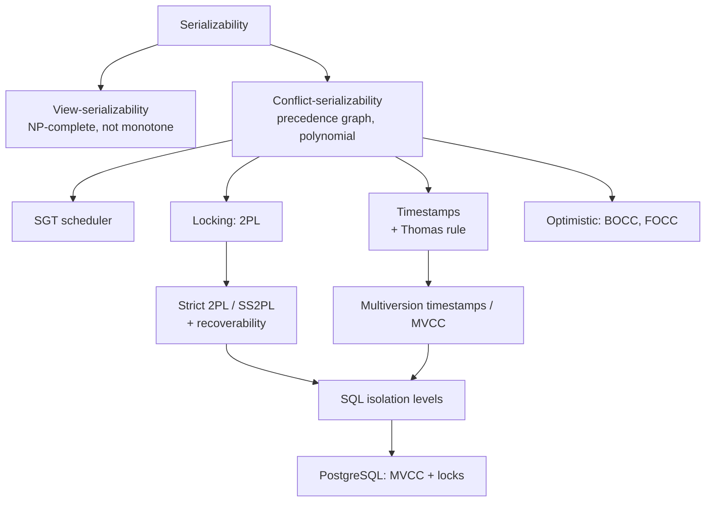

# Transaction Management and Concurrency Control

> [!abstract] Purpose of this lecture
> This lecture (Part 5 of the course, M. Lenzerini) opens the "inside the DBMS" half of the course announced in [[01 - DM - Introduction#Transaction management|Lecture 1]]. It studies the **transaction manager**: how a DBMS lets many transactions run at the same time while each of them behaves *as if it were alone*. The slides follow nine steps: (5.1) transactions, schedules and serializability; (5.2) view-serializability; (5.3) conflict-serializability; (5.4) locks and two-phase locking; (5.5) recoverability; (5.6) timestamps; (5.7) multiversion control; (5.8) optimistic control; (5.9) concurrency in SQL. The companion document *Notes on concurrency control in PostgreSQL* shows the same ideas on a real system, scenario by scenario.
>
> The next lectures go down the DBMS architecture: [[06 - DM - Buffer Management]], [[07 - DM - File Organization and Indexing]], [[08 - DM - Evaluation of Relational Operators]]. Course map: [[00 - Data Management MOC]].
>
> Base triennale: transactions, `commit`/`rollback` and isolation were introduced in [[03 - BD - SQL#Transazioni|Basi di Dati — Transazioni]] (see [[Transazione]]). There they were *used*; here we study *how the DBMS guarantees them*. Lines starting with "Base triennale:" point to the matching undergraduate section or concept.

---

## Architecture of a DBMS

![[DM-L05-p002.png]]

The slide places the topic inside the DBMS. SQL commands arrive at the **SQL engine**, which relies on the **access file manager** (access methods, see [[07 - DM - File Organization and Indexing]]), the **buffer manager** ([[06 - DM - Buffer Management]]) and the **disk manager**, which finally reads and writes the data. Two modules cross all layers: the **transaction manager** (this lecture) and the **security and recovery manager**.

Base triennale: [[DBMS]] · [[01 - BD - Introduzione#Il DBMS|BD — Il DBMS]]

---

# 5.1 Transactions, concurrency, serializability

## Transactions

Vedi [[Transaction]].

A **transaction** models the execution of a software procedure made of instructions that **read from** and **write on** a database and that form a **single logical unit**. Syntactically every transaction contains:

- one `begin` instruction;
- one `end` instruction;
- one between `commit` (confirm what has been done so far; sometimes equivalent to `end`) and `rollback` (undo what has been done so far).

Each transaction should enjoy the **ACID** properties, described below.

## Concurrency

The **throughput** of a system is the number of **transactions per second (tps)** it accepts. Real applications (banks, flight reservations, e-commerce) require roughly 100–1000 tps, so the DBMS must run many transactions **concurrently**.

> [!example] Why concurrency is unavoidable
> If each transaction needs on average 0.1 s, a throughput of 100 tps requires $100 \times 0.1 = 10$ transactions running concurrently on average (this is Little's law: concurrency = throughput × duration).

### Concurrency: example

The same booking program is run by two applications for the same flight:

| time | Application 1 | Application 2 |
|---|---|---|
| 1 | Find seat | |
| 2 | | Find seat |
| 3 | Book seat | |
| 4 | | Book seat |

Both "Find seat" operations find the **same free seat**, so the seat is booked twice. Each program is correct alone; the error comes from the **interleaving**.

## Isolation of transactions

One desirable way to deal with the problem is **isolation**: a transaction $T$ is executed **as if it were the only one in the system**. Concurrency still exists, but it is harmless, because no user can notice it. Isolation is essential, but other properties matter too.

## ACID properties

Vedi [[ACID]].

1. **Atomicity**: for each execution, either **all or none** of its actions have effect.
2. **Consistency**: each execution brings the database to a **correct state** (integrity constraints hold).
3. **Isolation**: each execution is **independent** of concurrent executions.
4. **Durability**: if an execution succeeds, its effects are **permanent**.

From now on we assume that every single transaction enjoys ACID. The problem becomes:

> even if every single transaction is ACID, how can we be sure that the **concurrent (interleaved) execution** of a set of transactions behaves correctly?

This is the problem of **concurrency control**.

Base triennale: [[Transazione]] · [[03 - BD - SQL#Transazioni|BD — Transazioni]]

## Schedules and serial schedules

Vedi [[Schedule (Concurrency)]].

- Given transactions $\{T_1,\ldots,T_n\}$, a **schedule** is a sequence $S$ of their actions that **respects the order inside each transaction** (if $a$ precedes $b$ in $T_i$, then $a$ precedes $b$ in $S$).
- A prefix of a schedule is a **partial schedule**; a schedule containing all actions is **total** (or complete).
- A total schedule is **serial** if the actions of each transaction come before every action of another transaction: **no interleaving**.

### Examples

$T_1: a_1,a_2,a_3$ · $T_2: b_1,b_2$ · $T_3: c_1,c_2,c_3,c_4$

| Sequence                          | Classification     | Why                                    |
| --------------------------------- | ------------------ | -------------------------------------- |
| $S_1$: a1 a2 b1 c1 c2 b2 c3 a3 c4 | total schedule     | all actions, internal orders respected |
| $S_2$: a1 a2 c3 c4 b1 c1 c2 b2 a3 | **not** a schedule | $c_3, c_4$ come before $c_1, c_2$      |
| $S_3$: b1 a1 b2 a2 a3 c1 c2       | partial schedule   | $c_3, c_4$ missing                     |
| $S_4$: c1 c2 c3 c4 a1 a2 a3 b1 b2 | serial schedule    | $T_3$, then $T_1$, then $T_2$          |

## Serializability

Given $T_1$ ($x=x+x$; $x=x+3$) and $T_2$ ($x=x^2$; $x=x+2$), the two serial schedules are $T_1T_2$ and $T_2T_1$. A serial schedule is obviously correct with respect to concurrency. A non-serial schedule is intuitively correct if it is **equivalent** to some serial schedule of the same transactions.

> [!note] Serial schedules can give different results
> With $x=1$: $T_1T_2$ gives $((1+1)+3)^2+2 = 27$; $T_2T_1$ gives $(1^2+2)\cdot 2+3 = 9$. Both are "correct": the scheduler does not prefer one order (see [[#Scheduler]]).

**Definition (serializable schedule).** A schedule $S$ on $\{T_1,\ldots,T_n\}$ is **serializable** if there is a serial schedule on $\{T_1,\ldots,T_n\}$ equivalent to $S$.

**Definition (equivalent schedules).** $S_1$ and $S_2$ are **equivalent** if, for **every** database state $D$, executing $S_1$ from $D$ gives the same outcome as executing $S_2$ from $D$. The "outcome" is the final state of the process, including both the database and the **local store** of the transactions.

### Notation

A successful transaction is a sequence of:

- `begin` / `commit` commands;
- actions that **read** a database element (attribute, record, table) into the local store, `READ(A,t)`, or **write** a local value into the database, `WRITE(A,t)`;
- actions that **process** elements of the local store (e.g. `t := t+100`).

Example: $T_1$ adds 100 to $A$ and to $B$; $T_2$ doubles $A$ and $B$.

### A serial schedule and its execution

Starting from $A=B=25$, the serial schedule $T_1T_2$ produces: $T_1$ writes $A=125$, $B=125$; then $T_2$ writes $A=250$, $B=250$.

### A serializable schedule

```text
T1                    T2                    A     B
begin                 begin                 25    25
READ(A,t); t:=t+100
WRITE(A,t)                                  125
                      READ(A,s); s:=s*2
                      WRITE(A,s)            250
READ(B,t); t:=t+100
WRITE(B,t)                                        125
commit
                      READ(B,s); s:=s*2
                      WRITE(B,s)                  250
                      commit
```

The final values are the same as for $T_1T_2$. More strongly, for any initial values $a_1, b_1$, both this schedule and $T_1T_2$ leave $(a_1+100)\cdot2$ in $A$ and $(b_1+100)\cdot2$ in $B$: they are equivalent, so the schedule is serializable.

### A non-serializable schedule

```text
T1                    T2                    A     B
begin                 begin                 25    25
READ(A,t); t:=t+100
WRITE(A,t)                                  125
                      READ(A,s); s:=s*2
                      WRITE(A,s)            250
                      READ(B,s); s:=s*2
                      WRITE(B,s)                  50
READ(B,t); t:=t+100
WRITE(B,t)                                        150
commit                commit
```

The final state is $A=250$, $B=150$. $T_1T_2$ gives $A=B=250$, $T_2T_1$ gives $A=B=150$. Neither matches, so the schedule is **not serializable**.

> [!warning] Correzione
> The slide states that "the execution of T2,T1 leaves the value 50 for A and 50 for B". Executing $T_2$ then $T_1$ from $A=B=25$ gives $A = 25\cdot2+100 = 150$ and $B = 150$; the value 50 is only the intermediate result after $T_2$. The conclusion (the schedule is not serializable) is unchanged.

**Where is the problem?** $T_2$ works on a value of $A$ **produced by** $T_1$, but on a value of $B$ **not yet produced by** $T_1$. In any serial execution $T_2$ sees either both updates of $T_1$ or none.

## Anomalies

To characterize problematic behaviours, the literature singles out recurrent incorrect patterns called **anomalies**. They do not cover *all* possible problems.

Vedi [[Concurrency Anomalies]].

### Anomaly 1: reading temporary data (Dirty Read)

```text
T1                    T2
READ(A,x); x:=x-1
WRITE(A,x)
                      READ(A,x); x:=x*2; WRITE(A,x)
                      READ(B,x); x:=x*2; WRITE(B,x)
                      commit
READ(B,x); x:=x+1
WRITE(B,x)
commit
```

$T_2$ reads $A$ **after** $T_1$ wrote it but $B$ **before** $T_1$ writes it. $T_2$ reads an element written by a transaction that has not finished and that can still interfere with it.

### Anomaly 2: update loss

$T_1$ and $T_2$ both do `READ(A,x); x:=x+1; WRITE(A,x)`. Serially, from $A=2$ we get $A=4$.

```text
T1                    T2
READ(A,x)
x:=x+1
                      READ(A,x)
                      x:=x+1
                      WRITE(A,x)
                      commit
WRITE(A,x)
commit
```

Both read 2, both write 3: the final result is $A=3$ and one update is **lost**. The anomaly arises because a transaction changes an object read by another transaction still in progress, which then works on a stale value.

### Anomaly 3: unrepeatable read

$T_1$ reads $A$ twice (initially 20); between the two reads $T_2$ writes $A=100$ and commits. $T_1$ reads two different values of the same element.

### Anomaly 4: ghost update

Integrity constraint $A=B$. $T_1$ sets $A=B=1$, $T_2$ sets $A=B=2$:

```text
T1              T2
WRITE(A,1)
                WRITE(B,2)
WRITE(B,1)
commit
                WRITE(A,2)
                commit
```

The final state is $A=2$, $B=1$: the constraint is violated though each transaction respects it alone. $T_1$ "sees" $A$ change to 2 as a surprise, $T_2$ sees $B$ change to 1.

| Anomaly | Pattern (abstract) | SQL name |
|---|---|---|
| Reading temporary data | $T_2$ reads $T_1$'s writes partially | dirty read (with rollback, see [[#5.5 Recoverability of transactions]]) |
| Update loss | $r_1(A)\,r_2(A)\,w_2(A)\,w_1(A)$ | lost update |
| Unrepeatable read | $r_1(A)\,w_2(A)\,r_1(A)$ | nonrepeatable read |
| Ghost update | $w_1(A)\,w_2(B)\,w_1(B)\,w_2(A)$ | (write skew / inconsistency) |

## Simplifying the notion of schedule

Is checking the equivalence of two schedules **decidable**? For general schedules, whose local computations are written in any programming language, the answer is **no** (it would require deciding the equivalence of programs). So we **simplify**: a transaction is characterized only by its **read, write, commit, rollback** actions, written $r_i(A)$, $w_i(A)$, $c_i$, $a_i$ (the subscript identifies $T_i$). Operations on the local store are ignored.

```text
T1: r1(A) r1(B) w1(A) w1(B) c1        T2: r2(A) r2(B) w2(A) w2(B) c2
S : r1(A) r1(B) w1(A) r2(A) r2(B) w2(A) w1(B) c1 w2(B) c2
```

## Scheduler

The **scheduler** is the part of the transaction manager that manages the schedule:

- it receives new transactions and assigns them an identifier;
- it instructs the buffer manager to read and write in a (generally serializable) order derived from the input, according to the **concurrency control method** of the system;
- it is **not** concerned with operations on the local store;
- it is **not** concerned with constraints on the order of transactions: **every** serial order is acceptable.

The last point is crucial: if two transactions are submitted concurrently, nothing in the application imposes an order between them. If the order mattered, the application would submit the second only after the first completed.

### Example

- Application 1: (T1) check whether product #10 is available; (T2) if so, sell it and update the database. T1 and T2 are executed **in sequence** by design.
- Application 2: (T3) add one item of product #10 to the storage.
- Application 3: (T4) list all unavailable products.

Every interleaving is possible except the concurrent execution of T1 and T2: T1‖T3, T1‖T4, T2‖T3, T2‖T4, T3‖T4, T1‖T3‖T4, T2‖T3‖T4.

## Serializability and equivalence of schedules

Different abstraction levels of the effects of transactions give different notions of **equivalence**, hence of **serializability**. For each notion $D$ we want:

- an algorithm to check whether two schedules are **equivalent** under $D$;
- an algorithm to check whether a schedule is **serializable** under $D$;
- **rules** (protocols) that guarantee serializability under $D$.

### Two important assumptions

1. No transaction reads or writes the same element twice, and no transaction reads an element it has written.
2. No transaction executes `rollback` (all executions are successful).

The first is sometimes removed; the second is removed in [[#5.5 Recoverability of transactions]].

### Classes of schedules

![[DM-L05-p034.png]]

The basic idea is to single out **classes of serializable schedules** for which the check is **decidable** and has **reasonable complexity**. The diagram shows serial ⊂ serializable ⊂ all schedules. We define view-serializability and conflict-serializability.

---

# 5.2 View-serializability

Vedi [[View-Serializability]].

## View-equivalence

- $r_i(x)$ **READS-FROM** $w_j(x)$ in $S$ if $w_j(x)$ precedes $r_i(x)$ and there is no $w_k(x)$ between them. $\text{READS-FROM}(S)=\{\langle r_i(x),w_j(x)\rangle\}$.
- $w_i(x)$ is a **FINAL-WRITE** if it is the last write on $x$ in $S$. $\text{FINAL-WRITE}(S)$ is the set of final writes.

**Definition.** Two total schedules on the same transactions are **view-equivalent** if they have the same READS-FROM relation and the same FINAL-WRITE set.

**Definition.** A total schedule is **view-serializable** if it is view-equivalent to some serial schedule on the same transactions.

Intuition: if every read sees the same write and the last write of each element is the same, then each transaction computes on the same values and leaves the same final database.

## Serializable but not view-serializable

```text
read1(A,t) read2(A,s) s:=100 write2(A,s) t:=100 write1(A,t)
```

Both transactions write the constant 100, ignoring what they read. The final state is $A=100$ whatever the order, so the schedule is **serializable**. But it is **not view-serializable**: both reads read from the initial state, whereas in $T_1T_2$ the read of $T_2$ reads from $w_1$ (and in $T_2T_1$ the read of $T_1$ reads from $w_2$).

To see that it is serializable we had to look at the local store (`s:=100`). In the abstract model, where only reads and writes count and the outcome is the database state, view-serializability is the **most general** notion: view-serializable ⊆ serializable.

## Complexity of view-serializability

| Problem | Complexity |
|---|---|
| Are two schedules view-equivalent? | decidable, **polynomial** (compare two relations) |
| Is a schedule view-serializable? | decidable, **NP-complete** |

Membership in NP: guess a serial schedule nondeterministically and check view-equivalence in polynomial time. NP-hardness is much harder to prove. Consequently the best known deterministic algorithm is exponential in the worst case: one reason why view-serializability is **not used in practice**.

## Monotone classes of schedules

Notation:

- $Tran(S)$: the transactions of $S$;
- $P_T(S)$, for $T\subseteq Tran(S)$: the **projection** of $S$ on $T$ (delete actions of other transactions);
- $CP(S)$: the **commit projection**, i.e. projection on the committed transactions.

Example: $S = w_1(x)\,r_2(x)\,w_2(y)\,r_1(y)\,r_3(x)\,w_1(y)\,w_3(x)\,w_3(y)\,c_1\,a_2$ and $T=\{t_1,t_2\}$ give $P_T(S)= w_1(x)\,r_2(x)\,w_2(y)\,r_1(y)\,w_1(y)\,c_1\,a_2$ and $CP(S)=w_1(x)\,r_1(y)\,w_1(y)$.

**Definition.** A class $E$ is **monotone** if $S\in E$ implies $P_T(S)\in E$ for every $T\subseteq Tran(S)$ (closed under projection).

Why it matters: with a monotone class, if a projection of a partial schedule is not in $E$, no extension of it can be in $E$, so the scheduler can **reject early**.

View-serializability is **not monotone**:

$$S = w_1(x)\,w_2(x)\,w_2(y)\,c_2\,w_1(y)\,c_1\,w_3(x)\,w_3(y)\,c_3$$

$S$ is view-equivalent to $T_1T_2T_3$ and to $T_2T_1T_3$ ($T_3$ blindly overwrites everything). But $P_{\{t_1,t_2\}}(S)=w_1(x)\,w_2(x)\,w_2(y)\,w_1(y)$ is not view-serializable: final write on $x$ by $T_2$ requires $T_1$ before $T_2$, final write on $y$ by $T_1$ requires $T_2$ before $T_1$. Non-monotonicity is a second reason not to use view-serializability.

## Exercises 1a and 1b

> [!question]- Exercise 1a — which schedules are view-serializable?
> 1. $w_0(x)\,r_2(x)\,r_1(x)\,w_2(x)\,w_2(z)$ — both reads read from $w_0$; final writes $w_2(x)$, $w_2(z)$. View-equivalent to $T_0T_1T_2$: **yes**.
> 2. $w_1(y)\,r_2(x)\,w_2(x)\,r_1(x)\,w_2(z)$ — $r_2(x)$ reads the initial value, $r_1(x)$ reads from $w_2$; equivalent to $T_2T_1$: **yes**.
> 3. $w_1(x)\,r_2(x)\,w_2(y)\,r_1(y)$ — $r_2(x)$ reads from $T_1$ (so $T_1$ before $T_2$) and $r_1(y)$ reads from $T_2$ (so $T_2$ before $T_1$): **no**.
> 4. $w_0(x)\,r_1(x)\,w_1(x)\,w_2(z)\,w_1(z)$ — equivalent to $T_0T_2T_1$: **yes**.
>
> Non-view-serializable schedules and their anomalies (solution on the slide):
> 1. $r_1(x)\,w_2(x)\,r_1(x)$ — unrepeatable read;
> 2. $r_1(x)\,r_2(x)\,w_1(x)\,w_2(x)$ — lost update;
> 3. $w_1(x)\,w_2(y)\,w_1(y)\,w_2(x)$ — ghost update.

> [!question]- Exercise 1b — $S = r_1(x)\,w_3(x)\,w_3(z)\,w_2(x)\,w_2(y)\,r_4(x)\,w_4(z)\,w_1(y)$
> - $r_1(x)$ reads the initial value → $T_1$ before both writers of $x$, in particular before $T_2$.
> - Final write on $y$ is $w_1(y)$ → $T_2$ (the other writer of $y$) before $T_1$.
>
> The two constraints contradict each other, so $S$ is **not view-serializable**.

---

# 5.3 Conflict-serializability

Vedi [[Conflict-Serializability]].

## Conflicts and the commutativity rule

Assume we know which pairs of action types (of different transactions) are **conflicting**. The **conflict relation** of a sequence $S$ is

$$conf(S)=\{\langle p,q\rangle \mid p,q \text{ conflicting and } p \text{ precedes } q \text{ in } S\}$$

**Commutativity rule:** if $p,q$ are **adjacent** actions of **different** transactions and $\langle p,q\rangle\notin conf(S)$, then $p\,q$ can be replaced by $q\,p$. $S\rightsquigarrow S'$ means that $S'$ is obtained from $S$ by finitely many such swaps.

### Example

Red actions ($q_1, s_2, t_1$… in the slide) conflict with blue ones; subscripts are transactions:

```text
S1: p1 q1 m2 s2 t1 v1 v2 t2
S2: p1 q1 m2 t1 s2 v1 v2 t2     (swap s2, t1)
S3: p1 q1 t1 m2 s2 v1 v2 t2     (swap m2, t1)
S4: p1 q1 t1 m2 v1 s2 v2 t2     (swap s2, v1)
S5: p1 q1 t1 v1 m2 s2 v2 t2     (swap m2, v1)
```

$S_1\rightsquigarrow S_2$, $S_2\rightsquigarrow S_3$, $S_1\rightsquigarrow S_3$, and so on. The relation is symmetric: if $S\rightsquigarrow S'$, then $S'\rightsquigarrow S$ (undo the swaps in reverse order).

## Conflict-equivalence

**Definition.** Two sequences on the same transactions are **conflict-equivalent** if $S_1\rightsquigarrow S_2$. In the example, all of $S_1,\ldots,S_5$ are pairwise conflict-equivalent.

### Conflicts in schedules

For read/write schedules: **two actions conflict if they belong to different transactions, operate on the same element, and at least one is a write.**

- Swapping actions on **different** elements, or two **reads**, does not change the effect → not conflicting.
- Swapping $w_1(A)\,w_2(A)$ may change the final value of $A$ → conflicting.
- Swapping $r_1(A)\,w_2(A)$ changes the value $T_1$ reads → conflicting.

| | $r_j(A)$ | $w_j(A)$ |
|---|:---:|:---:|
| $r_i(A)$ | — | conflict |
| $w_i(A)$ | conflict | conflict |

**Example.** $S = r_1(A)\,w_1(A)\,r_2(A)\,w_2(A)\,r_1(B)\,w_1(B)\,r_2(B)\,w_2(B)$ is conflict-equivalent to the serial $S'=r_1(A)\,w_1(A)\,r_1(B)\,w_1(B)\,r_2(A)\,w_2(A)\,r_2(B)\,w_2(B)$, via four swaps of non-conflicting actions (each swap moves a $B$-action of $T_1$ before an $A$-action of $T_2$).

### A very important property

**Theorem.** $S_1$ and $S_2$ are conflict-equivalent **iff** $conf(S_1)=conf(S_2)$, i.e. every pair of conflicting actions appears in the same relative order in both.

This gives a direct **polynomial** check of conflict-equivalence, without trying sequences of swaps.

## Conflict-serializability and the precedence graph

**Definition.** $S$ is **conflict-serializable** if it is conflict-equivalent to some serial schedule.

Enumerating all serial schedules would be exponential. Instead we use the **precedence graph** (or conflict graph) $P(S)$. Vedi [[Precedence Graph]].

- nodes: the transactions of $S$;
- edge $T_i\to T_j$ iff there are actions $p_i(A)$, $q_j(A)$ of different transactions on the same object with $p_i(A)$ before $q_j(A)$ and at least one of them a write.

### Example of precedence graph

![[DM-L05-p060.png]]

$S = w_3(A)\,w_2(C)\,r_1(A)\,w_1(B)\,r_1(C)\,w_2(A)\,r_4(A)\,w_4(D)$. The brackets under the schedule mark the conflicting pairs:

| Pair | Edge |
|---|---|
| $w_3(A)$ – $r_1(A)$, $w_3(A)$ – $w_2(A)$, $w_3(A)$ – $r_4(A)$ | $3\to1$, $3\to2$, $3\to4$ |
| $w_2(C)$ – $r_1(C)$ | $2\to1$ |
| $r_1(A)$ – $w_2(A)$ | $1\to2$ |
| $w_2(A)$ – $r_4(A)$ | $2\to4$ |

> [!note] Reading the example
> The graph contains both $1\to2$ and $2\to1$ (the curved arrow): it has a **cycle**, so by the theorem below this schedule is **not** conflict-serializable. The slide does not say it explicitly. The acyclic graph used just after to illustrate topological orders is a different one.

**Theorem (conflict-serializability).** $S$ is conflict-serializable **iff** $P(S)$ is **acyclic**.

The proof uses three facts.

1. If $S$ is serial, $P(S)$ is acyclic (all edges go from earlier to later transactions).
2. **Lemma.** If $S_1$ and $S_2$ are conflict-equivalent, then $P(S_1)=P(S_2)$. *Proof:* if an edge $T_i\to T_j$ were in $P(S_1)$ but not in $P(S_2)$, a conflicting pair would be ordered $p_i(A)<q_j(A)$ in $S_1$ and the opposite in $S_2$, so $conf(S_1)\neq conf(S_2)$, contradicting conflict-equivalence.
3. The converse of the lemma is **false**: $S_1=w_1(A)\,r_2(A)\,w_2(B)\,r_1(B)$ and $S_2=r_2(A)\,w_1(A)\,r_1(B)\,w_2(B)$ have the same graph (a cycle $1\leftrightarrow2$) but different conflict orders.

### Topological order

![[DM-L05-p065.png]]

A **topological order** of a graph $G$ is a sequence of its nodes such that if $T_i\to T_j$ is an edge, $T_i$ comes before $T_j$. For the graph with edges $3\to1$, $2\to1$, $2\to4$ the possible orders are 3214, 3241, 2341, 2314. Two easy facts (Exercise 3):

- an **acyclic** graph has at least one topological order (repeatedly remove a node without incoming edges);
- if there is a path $n_1\leadsto n_2$, then $n_1$ precedes $n_2$ in every topological order.

### Proof of the theorem

- (⇐ direction of the slide: conflict-serializable ⇒ acyclic) $S$ is conflict-equivalent to a serial $S'$; $P(S')$ is acyclic; by the lemma $P(S)=P(S')$.
- (acyclic ⇒ conflict-serializable) Take a topological order of $P(S)$ and the corresponding serial schedule $S'$. If $S'$ were not conflict-equivalent to $S$, there would be conflicting $a_h, b_k$ with $a_h<_{S'}b_k$ but $b_k<_S a_h$. The latter gives the edge $T_k\to T_h$, so $T_k$ precedes $T_h$ in $S'$, contradicting $a_h<_{S'}b_k$.

### Algorithm

```text
build P(S); return "conflict-serializable" iff P(S) is acyclic
```

Building the graph is quadratic in the length of $S$ and cycle detection is linear in the graph: the algorithm is **polynomial**. Moreover any topological order gives an equivalent serial schedule.

> [!question]- Exercise 4 — $w_1(x)\,r_2(x)\,w_1(z)\,r_2(z)\,r_3(x)\,r_4(z)\,w_4(z)\,w_2(x)$
> Edges: on $x$: $1\to2$, $1\to3$, $3\to2$ ($r_3(x)$ before $w_2(x)$); on $z$: $1\to2$, $1\to4$, $2\to4$ ($r_2(z)$ before $w_4(z)$). The graph is acyclic, a topological order is $T_1T_3T_2T_4$: the schedule is **conflict-serializable**.

> [!question]- Exercise 4a — $S = r_1(x)\,w_3(x)\,w_3(z)\,w_2(x)\,w_2(y)\,r_4(x)\,w_1(v)\,r_4(v)$
> $r_1(x)$ reads the initial $x$ → $T_1$ first among those touching $x$; $r_4(x)$ reads from $w_2$ → $T_3$ before $T_2$ before $T_4$; $r_4(v)$ reads from $w_1$ → $T_1$ before $T_4$. The serial schedule $T_1T_3T_2T_4$ has the same READS-FROM and FINAL-WRITE ($w_2(x)$, $w_3(z)$, $w_2(y)$, $w_1(v)$): **view-serializable** (it is also conflict-serializable).

## Comparison with view-serializability

**Theorem.** Conflict-equivalent ⇒ view-equivalent. **Corollary.** Conflict-serializable ⇒ view-serializable.

(Intuition: if all conflicting pairs keep their order, every read still follows the same last write, and the last write of each element stays last.)

The converse does not hold: $r_1(x)\,w_2(x)\,w_1(x)\,w_3(x)$ is view-serializable (equivalent to $T_1T_2T_3$, since $T_3$ overwrites $x$ blindly) but not conflict-serializable ($r_1\,w_2$ gives $1\to2$, $w_2\,w_1$ gives $2\to1$).

> [!question]- Exercise 6 — $w_1(y)\,w_2(y)\,w_2(x)\,w_1(x)\,w_3(x)$
> - Conflict graph: $1\to2$ (on $y$), $2\to1$ (on $x$), $1\to3$, $2\to3$: cycle → **not conflict-serializable**.
> - No reads; final writes are $w_2(y)$ and $w_3(x)$; the serial $T_1T_2T_3$ has the same final writes → **view-serializable**.

## Monotonicity and closure properties

**Theorem.** (1) The class of conflict-serializable schedules (**CSR**) is **monotone**. (2) $S\in CSR$ iff $P_T(S)$ is view-serializable for **every** $T\subseteq Tran(S)$.

So CSR is the **largest monotone subclass** of the view-serializable schedules.

Monotonicity matters because a failure can stop a schedule anywhere: each prefix of a correct schedule should be correct too.

- $E$ is **prefix closed** if every prefix of $S\in E$ is in $E$;
- $E$ is **commit closed** if $CP(S)\in E$ for every $S\in E$.

**Theorem.** CSR is prefix closed and commit closed. Hence if $S\in CSR$, then for every prefix $S'$, $CP(S')\in CSR$.

## Order-preserving variants

- **OCSR** (order-preserving CSR): $S$ is conflict-equivalent to a serial $S'$ and, whenever $t$ **completely precedes** $t'$ in $S$, $t$ precedes $t'$ in $S'$. OCSR ⊂ CSR. Example in CSR but not OCSR: $w_1(x)\,r_2(x)\,c_2\,w_3(y)\,c_3\,w_1(y)\,c_1$ — the only equivalent serial order is $T_3T_1T_2$, but $T_2$ finished before $T_3$ started.
- **COCSR** (commit-order-preserving CSR): whenever conflicting $p\in t_i$ precedes $q\in t_j$, then $c_i$ precedes $c_j$. Equivalently, the commit order is a valid serialization order. COCSR ⊂ OCSR ⊂ CSR. Example in OCSR but not COCSR: $w_3(y)\,c_3\,w_1(x)\,r_2(x)\,c_2\,w_1(y)\,c_1$ — $w_1(x)$ precedes $r_2(x)$, but $c_2$ comes before $c_1$.

![[DM-L05-p083.png]]

The final diagram nests the classes: serial ⊂ COCSR ⊂ OCSR ⊂ conflict-serializable ⊂ view-serializable ⊂ serializable ⊂ all schedules.

## Algorithms for concurrency control

Serializability notions characterize **correctness**; a DBMS needs an **algorithm** (protocol) implemented by the **scheduler**, which takes the requested interleaving and outputs the schedule actually executed. From now on we consider schedulers producing **conflict-serializable** schedules.

![[DM-L05-p085.png]]

The **transaction manager** sits between the clients, each sending its requests (numbered boxes 1, 2, 3), and the data server layers: it reorders and delays requests before passing them down to the database.

![[DM-L05-p086.png]]

For each transaction the scheduler behaves like a **finite-state automaton**: after `begin` the transaction is *active*, alternating between *running* and *blocked* (`block` / `resume`); it ends as *committed* (`commit`) or *aborted* (`reject`), possibly followed by `restart`. $Gen(s)$ is the set of schedules a scheduler $s$ can output. A scheduler is **CSR safe** if $Gen(s)\subseteq CSR$.

![[DM-L05-p087.png]]

**Scheduler classification**: **pessimistic** protocols prevent situations that may hinder serializability; **optimistic** ones let transactions run and act when something goes wrong; **hybrid** ones mix the two. Pessimistic protocols are non-locking (SGT, TB = timestamp based) or locking (two-phase: 2PL, AL = altruistic locking, O2PL = ordered 2PL; non-two-phase: WTL, RWTL = (read-)write tree locking). Optimistic: BOCC, FOCC. Highlighted in green are those studied: SGT, TB, 2PL, BOCC, FOCC.

## Serialization graph testing (SGT)

A pessimistic scheduler based directly on conflict-serializability:

1. it receives the actions of the active transactions;
2. it maintains the precedence graph of the current (partial) schedule;
3. when a new action is added, if a **cycle** appears it **aborts** the transaction of that action (a complex process); otherwise it accepts it.

$Gen(SGT)=CSR$. But the graph can have thousands of nodes, so maintaining it is costly and SGT is not used in commercial systems; it can be used in specialized applications with a dedicated concurrency module.

> [!question]- Exercise 6a — removing nodes from the SGT graph
> 1. *Removing a node when the transaction commits is wrong.* A committed $T_k$ performs no new actions, but a new action of an active $T_j$ conflicting with an old action of $T_k$ adds the edge $T_k\to T_j$. If $T_j\to T_k$ already existed, there is a cycle, which goes undetected if $T_k$ was removed.
> 2. *A correct strategy*: remove a committed transaction only when it has **no incoming edges**. New edges can only leave it (its actions are all in the past), so it can never lie on a cycle.

> [!question]- Exercise 6b — $r_1(A),\,t{-}{=}50,\,w_1(A),\,r_2(B),\,s{-}{=}10,\,w_2(B),\,r_1(B),\,v{+}{=}50,\,w_1(B),\,r_2(A),\,u{+}{=}10,\,w_2(A)$
> 1. **Serializable**: final $A = A_0-50+10$, $B = B_0-10+50$, the same as $T_1T_2$ (the additions commute).
> 2. **Not conflict-serializable**: on $A$, $T_1\to T_2$; on $B$, $T_2\to T_1$.
> 3. **Not view-serializable**: $r_1(B)$ reads from $T_2$ and $r_2(A)$ reads from $T_1$, which no serial order allows.
>
> This shows serializable ⊋ view-serializable when local computations are considered.

> [!question]- Exercise 6c — $T_i = r_i(A)\,w_i(A)$
> 1. Non-serial schedules on $T_1,T_2$ that are conflict-serializable: **none**. In every interleaving both reads precede the other transaction's write ($r_1<w_2$ and $r_2<w_1$), giving the cycle $1\leftrightarrow2$.
> 2. For $T_1,T_2,T_3$ the slide asks whether a non-serial view-serializable schedule exists. Hint: in a serial schedule every read reads from the write that immediately precedes it, and the reads form a chain initial → $T_a$ → $T_b$ → $T_c$; check whether an interleaving can reproduce such a chain and the same final write (blind writes are absent here, so the trick of [[#Comparison with view-serializability|$r_1(x)\,w_2(x)\,w_1(x)\,w_3(x)$]] is not available).

---

# 5.4 Concurrency control through locks

View- and conflict-serializability are not used in commercial systems. Real systems use **locks** and **locking schedulers**: a transaction must obtain a **permission** (lock) to operate on an element. We first consider only **exclusive** locks, then **shared and exclusive** locks.

## Primitives for exclusive locks

Two new operations appear in **lock-extended schedules**:

- $l_i(A)$: $T_i$ asks for the **exclusive** use of $A$;
- $u_i(A)$: $T_i$ releases $A$.

## Well-formed transactions and legal schedules

- **Rule 1 (well-formed transaction):** no $l_i(x)$ or $u_i(x)$ issued twice, and every action $p_i(A)$ is inside a **critical section** $l_i(A)\ldots p_i(A)\ldots u_i(A)$.
- **Rule 2 (legal schedule):** no transaction locks $A$ while another transaction holds the lock on $A$ (between $l_i(A)$ and $u_i(A)$ there is no $l_j(A)$).

### Examples

```text
S1: l1(A) l1(B) r1(A) w1(B) l2(B) u1(A) u1(B) r2(B) w2(B) u2(B) l3(B) r3(B) u3(B)
    → transactions well-formed, S1 NOT legal (l2(B) while T1 holds B)
S2: l1(A) r1(A) w1(B) u1(A) u1(B) l2(B) r2(B) w2(B) l3(B) r3(B) u3(B)
    → T1 ill-formed (w1(B) without lock), T2 ill-formed (no u2(B)), S2 not legal (l3(B) while T2 holds B)
S3: l1(A) r1(A) u1(A) l1(B) w1(B) u1(B) l2(B) r2(B) w2(B) u2(B) l3(B) r3(B) u3(B)
    → well-formed and legal
```

## Locking scheduler

The scheduler records granted locks in a **lock table**. A **passive** locking scheduler processes an input schedule already containing locks:

- on $o_i(x)$ ($o\in\{r,w\}$): if $x$ is locked by $T_i$ the action proceeds, otherwise $T_i$ is blocked;
- on $l_i(x)$: if $x$ is locked by another $T_j$, $T_i$ is blocked (and resumed later), otherwise the lock is granted and the table updated;
- on $u_i(x)$: the lock table is updated;
- before dismissing $T_i$ it ensures that every $l_i(x)$ has a matching $u_i(x)$.

The output is legal and all its transactions are well-formed.

### Example

```text
Input: l1(A) r1(A) w1(A) l2(A) l1(B) r1(B) u1(A) r2(A) w2(A) u2(A) w1(B) u1(B) l2(B) r2(B) w2(B) u2(B)

T1                        T2
l1(A); r1(A); w1(A)
                          l2(A) — blocked
l1(B); r1(B); u1(A)
                          l2(A) — resumed; r2(A); w2(A); u2(A)
w1(B); u1(B)
                          l2(B); r2(B); w2(B); u2(B)
```

### The risk of deadlock

```text
l1(A) r1(A) l2(B) r2(B) w1(A) w2(B) l1(B) l2(A)
```

$T_1$ holds $A$ and waits for $B$; $T_2$ holds $B$ and waits for $A$: neither can proceed. This is a **deadlock** ([[#Deadlock management]]).

## Active locking schedulers

In practice lock/unlock commands may be inserted **by the scheduler itself**, which is then **active**. Examples:

```text
Input : l1(x) r1(x) w2(x) l2(y) w2(y) u2(y) c1 c2
Output: l1(x) r1(x) u1(x) l2(x) w2(x) l2(y) w2(y) u2(y) u2(x) c1 c2

Input : r1(x) w2(x) w2(y) c1 c2
Output: l1(x) r1(x) u1(x) l2(x) l2(y) w2(x) u2(x) w2(y) u2(y) c1 c2
```

The input may contain some (not necessarily all) lock commands, and the output is **not uniquely determined**. From now on all locking schedulers are active.

$DT(S)$, the **data action projection**, keeps only $r,w,c,a$ actions. For a locking scheduler, $Gen(s)=\{DT(S)\mid S \text{ output of } s\}$.

## Locks alone do not ensure serializability

```text
T1                              T2                         A    B
l1(A); r1(A); A:=A+100; w1(A); u1(A)                       125
                                l2(A); r2(A); A:=A*2; w2(A); u2(A)   250
                                l2(B); r2(B); B:=B*2; w2(B); u2(B)        50
l1(B); r1(B); B:=B+100; w1(B); u1(B)                            150
```

The schedule is legal and well-formed, yet it is exactly the non-serializable schedule seen before ($A=250$, $B=150$): a **ghost update**. Locks prevent simultaneous access but not bad interleavings.

## Two-Phase Locking (2PL)

Vedi [[Two-Phase Locking]].

**Definition (2PL, exclusive locks).** A locking scheduler follows the **two-phase locking protocol** if, in every output and for every transaction, **all lock operations precede all unlock operations**.

```text
S: ……… li(A) ……… ui(A) ………
   (no unlock of Ti before)   (no lock of Ti after)
```

![[DM-L05-p106.png]]

The number of locks held by $T_i$ grows during the **growing phase** and decreases during the **shrinking phase**: once $T_i$ releases a lock it cannot acquire any other.

### Example: 2PL avoids the ghost update

```text
T1                              T2
l1(A); r1(A); A:=A+100; w1(A)
l1(B); u1(A)
                                l2(A); r2(A); A:=A*2; w2(A)
                                l2(B) — blocked
r1(B); B:=B+100; w1(B); u1(B)
                                l2(B) — resumed; u2(A); r2(B); B:=B*2; w2(B); u2(B)
```

$T_1$ locks $B$ *before* releasing $A$ (lock anticipation), so $T_2$ cannot touch $B$ before $T_1$ updated it. The schedule is legal, allows concurrency on $A$, and is equivalent to $T_1T_2$.

### Deadlock is still possible with 2PL

```text
T1: l1(A); r1(A); A:=A+100; w1(A); l1(B) — blocked
T2: l2(B); r2(B); B:=B*2;   w2(B); l2(A) — blocked
```

### Schedules generated by 2PL

A 2PL scheduler generates exactly the lock-extended schedules that (1) are legal, (2) have well-formed transactions, (3) have all locks before all unlocks in each transaction.

An active 2PL scheduler can exploit its knowledge of the transactions to **anticipate locks** and avoid blocking:

```text
r1(X) w2(X) w1(Y) c1 ...   →   l1(X) r1(X) l1(Y) u1(X) l2(X) w2(X) w1(Y) u1(Y) c1 ...
```

Anticipation is not always possible. In `r1(X) w2(X) w3(Y) c3 w1(Y) c1 c2` either $T_2$ or $T_3$ must be blocked; blocking $T_2$:

```text
l1(X) r1(X) l3(Y) w3(Y) u3(Y) c3 l1(Y) w1(Y) u1(X) u1(Y) c1 l2(X) w2(X) u2(X) c2
```

The class **"2PL schedule with exclusive locks"** is $\{DT(S)\mid S \text{ output of a 2PL scheduler}\}$. A schedule in this class is "accepted": given as input, it is output unchanged (ignoring locks). Deciding membership requires checking whether lock/unlock commands **can be inserted** so that the result satisfies 2PL.

> [!question]- Exercise 7a — are these 2PL schedules with exclusive locks?
> 1. $S_1 = r_1(x)\,w_2(z)\,w_2(x)\,r_3(y)\,w_1(z)\,w_3(z)\,r_2(t)$: on $x$, $r_1 < w_2$ gives $1\to2$; on $z$, $w_2 < w_1$ gives $2\to1$. The precedence graph has a cycle, so $S_1$ is not conflict-serializable and therefore **not 2PL** (by the theorem below).
> 2. $S_2 = r_1(x)\,w_2(x)\,w_3(y)\,w_3(z)\,w_1(z)\,w_3(x)$: on $x$, $1\to3$; on $z$, $w_3(z)<w_1(z)$ gives $3\to1$: cycle, **not 2PL**.

### 2PL and conflict-serializability

**Theorem.** If $S\in Gen(2PL)$, then $DT(S)$ is conflict-serializable.

*Proof (induction on the number $N$ of transactions).* $N=1$: serial. Inductive step: let $T_i$ be the **first** transaction that unlocks something, say $u_i(X)$. No action $w_i(Y)$ (or $r_i(Y)$) can be preceded by a conflicting $w_j(Y)$: that would require $\ldots w_j(Y)\ldots u_j(Y)\ldots l_i(Y)\ldots w_i(Y)$, and since $u_i(X)$ comes before $u_j(Y)$, it would come before $l_i(Y)$, violating 2PL. So all actions of $T_i$ can be moved to the front without swapping conflicting pairs. The rest is a 2PL schedule on $N-1$ transactions, conflict-serializable by hypothesis; prefixing $T_i$ gives a serial schedule conflict-equivalent to $DT(S)$.

**Intuition.** $DT(S)$ is equivalent to the serial schedule that orders transactions by their **first unlock**: first the transaction that unlocks first, then, among the remaining, the one that unlocks first, and so on. This is the transaction's **lock point**.

**Theorem.** The converse is false: $S = w_1(x)\,r_2(x)\,r_3(y)\,w_1(y)$ is conflict-serializable ($T_3T_1T_2$) but not 2PL. $T_1$ must release $x$ before $r_2(x)$, and can lock $y$ only after $r_3(y)$ (which needs the lock on $y$); so $u_1(x)$ precedes $l_1(y)$, violating 2PL.

> [!note] Typo in the slide
> The proof says "the command $l_1(y)$, which is necessary for executing $w_3(y)$". It should be $w_1(y)$: $T_3$ only reads $y$.

![[DM-L05-p119.png]]

2PL with exclusive locks is a strict subset of the conflict-serializable schedules, containing the serial schedules and partly overlapping OCSR/COCSR.

## Adding shared locks

With exclusive locks only, two readers of $A$ must take turns: `l1(A) r1(A) u1(A) … l2(A) r2(A) u2(A)`, which is too restrictive since reads do not conflict. **Shared locks** fix this: `sl1(A) r1(A) sl2(A) r2(A) … u1(A) u2(A)`.

| Primitive | Meaning |
|---|---|
| $xl_i(A)$ | exclusive (write) lock |
| $sl_i(A)$ | shared (read) lock |
| $u_i(A)$ | unlock |

**Rule 1 (well-formed)**: every $r_i(A)$ preceded by $sl_i(A)$ or $xl_i(A)$ without $u_i(A)$ in between; every $w_i(A)$ preceded by $xl_i(A)$ without $u_i(A)$ in between; every lock followed by an unlock. Passing from $sl_i(A)$ to $xl_i(A)$ without unlocking is a **lock upgrade** (lock conversion).

**Rule 2 (legal)**: an $xl_i(A)$ is not followed by any $xl_j(A)$ or $sl_j(A)$ without $u_i(A)$ in between; an $sl_i(A)$ is not followed by an $xl_j(A)$ without $u_i(A)$ in between.

### Compatibility matrix

Vedi [[Lock Compatibility Matrix]].

| Held by $T_i$ \ requested by $T_j$ | S | X |
|---|:---:|:---:|
| **S** | yes | no |
| **X** | no | no |

### 2PL with shared and exclusive locks

All lock operations ($sl$ or $xl$) of $T_i$ precede all its unlocks: no $sl_i(X)$ or $xl_i(X)$ is preceded by a $u_i(Y)$.

When an unlock is issued, several transactions may be waiting and the scheduler must choose: first-come-first-served (default, avoids **starvation**), priority to shared requests, or priority to upgrades.

> [!question]- Exercise 7b — $r_1(A)\,r_2(A)\,r_2(B)\,w_1(A)\,w_2(D)\,r_3(C)\,r_1(C)\,w_3(B)\,c_2\,r_4(A)\,c_1\,c_4\,c_3$
> It **is** a 2PL schedule with shared and exclusive locks (slide solution):
> ```text
> sl1(A) r1(A) sl2(A) r2(A) sl2(B) r2(B) xl2(D) u2(A) xl1(A) w1(A) w2(D)
> sl3(C) r3(C) sl1(C) r1(C) u1(C) u1(A) u2(B) u2(D) xl3(B) w3(B) u3(B)
> u3(C) c2 sl4(A) r4(A) u4(A) c1 c4 c3
> ```
> The key move is **lock anticipation**: $T_2$ acquires $xl_2(D)$ *before* releasing $A$, so it can release $A$ (letting $T_1$ upgrade) and still be two-phase. Lock anticipation needs knowledge of the transactions' future actions (e.g. their code).

**Properties.** If $S\in Gen(2PL)$ then $DT(S)$ is conflict-serializable; some conflict-serializable schedules are not 2PL; deadlock is still possible: $sl_1(A)\,sl_2(B)\,xl_1(B)\,xl_2(A)$.

![[DM-L05-p132.png]]

2PL with shared locks accepts more schedules than 2PL with exclusive locks only, but is still strictly inside the conflict-serializable class.

## Deadlock management

Vedi [[Deadlock Management in DBMS]] (and the operating-systems view in [[Deadlock]]).

A deadlock occurs when $T_1$ and $T_2$ each hold an element and request a lock on the element of the other. Its probability grows **linearly** with the number of transactions and **quadratically** with the number of lock requests per transaction.

```text
T1: xl1(A); r1(A); A:=A+100; w1(A); sl1(B) — blocked!
T2: xl2(B); r2(B); B:=B*2;   w2(B); sl2(A) — blocked!
```

Three techniques: **timeout**, **recognition and resolution**, **prevention**.

### Timeout

A transaction waiting for a lock longer than $t$ is killed. Very simple; but if $t$ is high, deadlocks are resolved late; if low, too many transactions are killed; and the same transaction may be killed repeatedly (**individual block**).

### Deadlock recognition

![[DM-L05-p136.png]]

The scheduler maintains a **wait-for graph**: nodes are transactions, an edge $T_i\to T_j$ means $T_i$ waits for $T_j$ to release a lock. A **cycle** means deadlock, solved by killing one transaction in it (e.g. the one with fewer operations; individual block is a risk). In the example $sl_1(X)\,sl_2(Y)\,r_1(X)\,r_2(Y)\,xl_1(Y)\,xl_2(X)$: $T_1$ waits for $T_2$ (on $Y$) and $T_2$ waits for $T_1$ (on $X$).

### Deadlock prevention: wait-die

Each transaction gets a unique **priority**, e.g. its age (older = higher). On a lock conflict, $T_i$ may wait for $T_j$ **only if** $pr(T_i)>pr(T_j)$; otherwise $T_i$ is killed. Since waits only go from higher to lower priority, the wait-for graph can never contain a cycle.

![[DM-L05-p138.png]]

$xl_1(Y)$ ($T_1$ uses $Y$), $xl_3(X)$ ($T_3$ uses $X$), $xl_2(X)$: $T_2$ (20) waits for $T_3$ (10), allowed; $xl_1(X)$: $T_1$ (25) waits for $T_2$ (20), allowed; $xl_3(Y)$: $T_3$ (10) would wait for $T_1$ (25), forbidden, so **$T_3$ is killed**.

![[DM-L05-p139.png]]

A subtler case: $T_3$ (20) holds $X$, $T_2$ (25) waits for $T_3$, and $T_1$ (22) requests $X$. $pr(T_1)>pr(T_3)$ but $pr(T_1)<pr(T_2)$. If $T_1$ waits for $T_3$, when $T_3$ releases $X$ either (1) $T_1$ proceeds and $T_2$ then waits for $T_1$ (risk of starvation), or (2) $T_2$ proceeds and $T_1$ waits for $T_2$, violating the rule. So the right choice is to **kill $T_1$**: it must be allowed to wait for **all** the transactions ahead of it in the queue.

> [!tip] Wound-wait
> The symmetric scheme (not in the slides) is *wound-wait*: an older transaction requesting a lock held by a younger one **kills** ("wounds") it, while a younger one waits for an older one. Both schemes avoid starvation if a restarted transaction keeps its original timestamp.

---

# 5.5 Recoverability of transactions

So far no transaction rolled back. Removing this assumption shows that serializability alone is **not sufficient** for ACID: there is a new anomaly.

## Dirty read (WR anomaly)

```text
T1                    T2
READ(A,x); x:=x+1
WRITE(A,x)
                      READ(A,x); x:=x+1
rollback
                      WRITE(A,x)
                      commit
```

$T_2$ reads a value written by $T_1$ **before $T_1$ commits or rolls back**. After the rollback that value never existed, yet $T_2$'s result depends on it.

At the end of $T_i$: if it committed, its effects must be **permanent**; if it rolled back, it must have **no effect**.

## Cascading rollback

If $T_1$ read a value written by $T_2$ and $T_2$ rolls back, $T_1$ must roll back too; anyone who read from $T_1$ must then roll back, and so on. This **cascading rollback** hurts performance and should be avoided.

## Recoverable schedules

Vedi [[Recoverable Schedule]].

If $T_i$ read from $T_j$ and **commits before** $T_j$, and then $T_j$ rolls back, the effect of $T_i$ depends on something that never existed and cannot be undone ($T_i$ is durable). $T_i$ is then **not recoverable**.

**Definition.** $S$ is **recoverable** if no transaction commits before all the transactions it has read from have committed.

```text
recoverable    : w1(A) w1(B) w2(A) r2(B) c1 c2           (T2 reads B from T1, commits after T1)
not recoverable: w1(A) w1(B) w2(A) r2(B) r3(A) c1 c3 c2  (T3 reads A from T2, commits before T2)
```

### Serializability and recoverability

The two notions are **orthogonal**; every serial schedule is recoverable.

![[DM-L05-p146.png]]

- $S_1 = w_2(A)\,w_1(B)\,w_1(A)\,r_2(B)\,c_1\,c_2$ is recoverable but not serializable: $r_2(B)$ reads from $T_1$ ($T_1$ before $T_2$) while the final write on $A$ is $w_1$ ($T_2$ before $T_1$).
- $S_2 = w_1(A)\,w_1(B)\,w_2(A)\,r_2(B)\,c_2\,c_1$ is conflict-serializable but not recoverable ($T_2$ reads from $T_1$ and commits first).

## Avoiding cascading rollback (ACR)

Recoverable schedules may still cascade: in $w_2(A)\,w_1(B)\,w_1(A)\,r_2(B)$, if $T_1$ rolls back, $T_2$ must be killed.

**Definition.** $S$ is **ACR** (avoids cascading rollback) if every transaction reads only values written by **already committed** transactions. Example: $w_2(A)\,w_1(B)\,w_1(A)\,c_1\,r_2(B)\,c_2$. ACR blocks the dirty read anomaly.

![[DM-L05-p149.png]]

ACR ⊂ recoverable; ACR schedules need not be serializable; serial schedules are both.

## Strict schedules

When $T_i$ aborts, the value written before $w_i(X)$ should be restored. In `… w1(X) … w2(X) … a2` we restore the value of $w_1(X)$. But in `… w1(X) … w2(X) … w3(X) … a2` we must leave $w_3$'s value: the "before image" is not simply the value before $T_2$. This complicates rollback.

- $T_i$ **writes on** $T_j$ if $w_j(A)$ is followed by $w_i(A)$ with no other write on $A$ in between.
- $S$ is **strict** if every transaction reads only values written by committed transactions **and writes only on committed transactions**.

Every strict schedule is ACR, hence recoverable. On rollback of $T_i$ it is immediate to know what to restore: the before-image of each write, since nobody wrote after $T_i$.

![[DM-L05-p152.png]]

serial ⊂ strict ⊂ ACR ⊂ recoverable; not all ACR schedules are strict.

## Rigorous schedules

Strict schedules do not guarantee conflict-serializability. (Example: $r_1(x)\,w_2(x)\,c_2\,w_1(x)\,c_1$ is strict, since $T_1$ writes on $T_2$ after $c_2$, but $r_1\,w_2$ and $w_2\,w_1$ form a cycle.)

**Definition.** $S$ is **rigorous** if for every pair of conflicting actions $a_i$ before $b_j$, the commit $c_i$ appears between them. Rigorous ⇒ strict and **commit-order conflict-serializable** (COCSR).

![[DM-L05-p154.png]]

serial ⊂ rigorous ⊂ strict ⊂ ACR ⊂ recoverable.

### Membership with missing commits

A schedule belongs to class $C$ (recoverable, ACR, strict, rigorous) if commit commands can be inserted (for unterminated transactions) so that the result is in $C$. E.g. $r_1(y)\,w(y)\,w_1(x)\,w_2(x)$ is strict: $r_1(y)\,w(y)\,w_1(x)\,c_1\,w_2(x)\,c_2$. Instead $w_1(x)\,w_2(x)\,r_1(y)$ is not strict: $c_1$ would have to come before $w_2(x)$, but $r_1(y)$ follows.

> [!note] Slide notation
> In "$r_1(y)\,w(y)\,w_1(x)\,w_2(x)$" the subscript of $w(y)$ is missing in the slide (probably $w_1(y)$).

## Recoverability and 2PL

### Strict 2PL

Vedi [[Strict Two-Phase Locking]].

**Strict 2PL**: 2PL **plus** every transaction keeps all its **exclusive** locks until it commits or rolls back.

- Every strict 2PL schedule is **strict** (nobody can read or overwrite uncommitted data, since writes hold X locks until commit).
- Every strict 2PL schedule is **serializable** (it is 2PL).

### Strong strict 2PL (SS2PL)

**SS2PL**: 2PL **plus** every transaction keeps **all** its locks (shared too) until commit or rollback.

- Every SS2PL schedule is **rigorous**.
- It is conflict-equivalent to the serial schedule obtained by dropping rolled-back transactions and ordering the others by **commit order**.

> [!question]- Exercises 8 and 9
> - *Every strict 2PL schedule is strict*: **true** (X locks held until commit prevent reading from or writing on uncommitted transactions).
> - *Every strict schedule that follows 2PL also follows strict 2PL*: **false** as stated for *schedules*. Strictness constrains only reads and writes; a 2PL lock placement may release an X lock before commit when no one accesses the element afterwards, and the schedule stays strict. (Membership in the class depends on how locks are placed.)
> - *Every SS2PL schedule is rigorous*: **true** (any conflicting later action must wait for the release, which happens at commit).
> - *Every rigorous 2PL schedule follows SS2PL*: **false** for the same reason as above (locks not needed by anyone can be released early).

![[DM-L05-p163.png]]

The complete picture: strong strict 2PL ⊂ strict 2PL ⊂ 2PL ⊂ conflict-serializable; SS2PL is inside rigorous, strict 2PL inside strict, and so on toward ACR and recoverable.

---

# 5.6 Concurrency control through timestamps

Vedi [[Timestamp-Based Concurrency Control]].

## Basic idea

- Each transaction $T$ gets a **timestamp** $ts(T)$, unique among active transactions, increasing with arrival order. We assume $ts(T_i)=i$.
- Timestamps define a total order; any schedule respecting it is conflict-equivalent to the serial schedule in timestamp order, hence conflict-serializable.
- No locks are needed, although **deadlock can still occur** (see below).

For each element $X$ the scheduler keeps:

| Field | Meaning |
|---|---|
| $rts(X)$ | highest timestamp among active transactions that **read** $X$ |
| $wts(X)$ | highest timestamp among active transactions that **wrote** $X$ (= last writer) |
| $wts\text{-}c(X)$ | timestamp of the last **committed** writer of $X$ |
| $cb(X)$ | **commit bit**: false if the last writer has not committed yet |

The actions of $T$ are logically executed **at one instant**, $ts(T)$. There are two time axes: **physical** time (when actions arrive) and **logical** time (timestamps). An action is accepted if its physical order is **compatible** with its logical time. The commit bit prevents dirty reads.

## The rules

Below, $B(T_i)$ is the begin of $T_i$ and $t_1,t_2,\ldots$ are physical times.

### Case 1a: read OK

`B(T1) B(T2) B(T3) w1(X) r3(X) r2(X)`: $r_2(X)$ comes after $w_1(X)$ physically and logically ($ts(T_2)>wts(X)=1$): compatible.

1. If $cb(X)$ is true: set $rts(X)=\max(rts(X),ts(T))$ and execute. (Here $r_2$ logically precedes $r_3$, so $rts$ stays 3.)
2. If $cb(X)$ is false: $T_2$ **waits** until the last writer commits or rolls back (in both cases $cb(X)$ becomes true).

### Case 1b: read too late

`B(T1) B(T2) w2(X) r1(X)`: physically $r_1$ follows $w_2$, but logically $ts(T_1)<wts(X)=2$: $T_1$ should have read the value before $T_2$'s write, which no longer exists. $T_1$ **rolls back** and restarts with a new timestamp.

### Case 2a: write OK

`B(T1) B(T2) B(T3) r1(X) w2(X) w3(X)`: $w_3$ is later both physically and logically than the last read and write. If $cb(X)$ is true (or no active transaction wrote $X$): $wts(X)=3$, $cb(X)=$false, execute. Otherwise wait.

### Case 2b: Thomas write rule

`B(T1) B(T2) B(T3) r1(X) w2(X) … w1(X)`: $w_1$ is compatible with the last read (same transaction), but logically $w_2$ comes **after** $w_1$, so executing $w_1$ would overwrite a "later" value (update loss). If $cb(X)$ is true, **ignore** $w_1(X)$: it is as if it happened before $w_2$ and was immediately overwritten. If $cb(X)$ is false, wait.

### Case 2c: write too late

`B(T1) B(T2) r2(X) w1(X)`: $ts(T_1)<rts(X)=2$: $T_2$ already read a value that $T_1$'s write should have changed. $T_1$ is **aborted** and restarted with a new timestamp.

## The scheduler

```text
r_i(X):
  if ts(Ti) >= wts(X)
     if cb(X) or ts(Ti) = wts(X): rts(X) := max(ts(Ti), rts(X)); execute     // 1.a.1
     else wait for commit/rollback of last writer                              // 1.a.2
  else rollback(Ti)                                                            // 1.b

w_i(X):
  if ts(Ti) >= rts(X) and ts(Ti) >= wts(X)
     if cb(X): wts(X) := ts(Ti); cb(X) := false; execute                       // 2.a.1
     else wait                                                                 // 2.a.2
  else if ts(Ti) >= rts(X) and ts(Ti) < wts(X)
     if cb(X): ignore w_i(X)                                                   // 2.b.1 (Thomas)
     else wait                                                                 // 2.b.2
  else rollback(Ti)                                                            // 2.c

commit c_i:   for each X written by Ti: cb(X) := true; wake up waiting transactions
rollback b_i: for each X written by Ti: wts(X) := wts-c(X); cb(X) := true; wake up waiters
```

### Deadlock with timestamps

The class **TS** contains the schedules the timestamp scheduler processes without blocking. Deadlock is possible because of the commit bit: in $w_1(B)\,w_2(A)\,w_1(A)\,r_2(B)$, $w_1(A)$ (case 2b with $cb(A)$ false) waits for $T_2$, and $r_2(B)$ (case 1a with $cb(B)$ false) waits for $T_1$. Deadlocks are handled as for 2PL; they are less probable than with locks.

### Example

| Action | Effect | New values |
|---|---|---|
| $r_6(A)$ | ok | $rts(A)=6$ |
| $r_8(A)$ | ok | $rts(A)=8$ |
| $r_9(A)$ | ok | $rts(A)=9$ |
| $w_8(A)$ | no: $8<rts(A)=9$ (write too late) | $T_8$ aborted |
| $w_{11}(A)$ | ok | $wts(A)=11$ |
| $r_{10}(A)$ | no: $10<wts(A)=11$ (read too late) | $T_{10}$ aborted |
| $c_{11}$ | ok | $cb(A)=$ true |

## Timestamps and serializability

- Some conflict-serializable schedules are rejected: $r_1(Y)\,r_2(X)\,w_1(X)$ (case 2c for $w_1(X)$), although it is equivalent to $T_1T_2$.
- **Without** the Thomas rule, removing the actions of rolled-back transactions yields a conflict-serializable schedule.
- **With** the Thomas rule, an accepted schedule may not be conflict-serializable, e.g. $r_1(A)\,w_2(A)\,c_2\,w_1(A)\,c_1$ (it is view-serializable). Removing ignored actions and rolled-back transactions yields a conflict-serializable one.

## Comparison between timestamps and 2PL

- Some schedules are accepted by both, e.g. the serial $r_1(A)\,w_1(A)\,r_2(A)\,w_2(A)$.
- Some SS2PL schedules are rejected by TS: $r_1(B)\,r_2(A)\,w_2(A)\,r_1(A)\,w_1(A)$ ($r_1(A)$ reads too late).

| | 2PL | Timestamps |
|---|---|---|
| Waiting | transactions wait for locks | "too late" transactions are killed and restarted; wait only for commit bits |
| Serialization order | determined by conflicts (lock points) | determined by timestamps (arrival) |
| Waiting for commits | solved by strong strict 2PL | buffering writes until $cb(X)$ is true |
| Deadlock | possible | possible but less probable |

Timestamps are better with **read-only** transactions or when concurrent transactions rarely write the same elements. 2PL is better under **many conflicts**: locking delays transactions, but timestamps cause more rollbacks, and rollbacks cost more globally.

![[DM-L05-p182.png]]

The final picture adds TS (schedules generated by the timestamp scheduler, after removing ignored and rolled-back actions): it overlaps 2PL without containing or being contained in it, and lies inside conflict-serializable.

---

# 5.7 Multiversion concurrency control

Vedi [[MVCC]].

$S = w_0(x)\,w_0(y)\,c_0\,r_1(x)\,w_1(x)\,r_2(x)\,w_2(y)\,r_1(y)\,w_1(z)\,c_1\,c_2$ is **not conflict-serializable**: $w_1(x)\,r_2(x)$ gives the edge $1\to2$ and $w_2(y)\,r_1(y)$ gives $2\to1$.

But $S$ would be tolerable if $r_1(y)$ could read the **old version** $y_0$ (written by $T_0$), coherently with $r_1(x)$ having read $x_0$. Then $S$ would be equivalent to $T_0T_1T_2$.

Principle:

- every legal write creates a **new version**;
- every read chooses which version to read, while staying coherent;
- versions are transient (garbage-collected) and transparent to applications.

## Snapshot isolation

A form of MVCC used, for instance, in PostgreSQL:

- a transaction sees a personal **snapshot** of the database taken at its start;
- at the end it commits only if the values it updated have not been changed externally since the snapshot; a **write-write conflict** aborts it ("first committer wins");
- **readers never conflict with writers**;
- snapshot isolation alone does **not** guarantee serializability (write skew, see the [[#SERIALIZABLE|SERIALIZABLE scenario]] below).

The slides do not study it further; they focus on the multiversion timestamp method. Vedi [[Snapshot Isolation]].

## Multiversion timestamp method

Idea: **never block reads**. Each element $X$ has versions $X_1,\ldots,X_n$:

- every legal write $w_i(X)$ creates version $X_i$ (subscript = writer's timestamp);
- each version has $wts(X_h)=ts(T_h)$ and $rts(X_h)$ = highest timestamp among its readers.

Rules:

- **$w_i(X)$**: if some $r_j(X_k)$ already happened with $wts(X_k)=ts(T_k)<ts(T_i)<ts(T_j)$, i.e. `B(Tk) … B(Ti) … B(Tj) … wk(X) … rj(X) … wi(X)`, the write is **refused** ("write too late": $T_j$, younger than $T_i$, already read a version older than $X_i$, so it should have seen $X_i$). Otherwise create $X_i$ with $wts(X_i)=ts(T_i)$.
- **$r_i(X)$**: read the version $X_j$ with the **largest $wts(X_j)\le ts(T_i)$**; update $rts(X_j)$. E.g. in `B(Tk) … B(Tj) … B(Ti) … wj(X) … wk(X) … ri(X)` we have $ts(T_k)<ts(T_j)<ts(T_i)$: although $X_k$ was written *physically* later, $X_j$ is the version with the largest write timestamp not greater than $ts(T_i)$, so $r_i$ reads $X_j$.
- **Garbage collection**: if no active transaction has timestamp less than $wts(X_j)$, the versions before $X_j$ are deleted, oldest first.
- **Recoverability**: the commit of $T_i$ is delayed until all transactions that wrote the versions it read have committed.

Implementation: for each version $range(X_i)=\langle wts, rts\rangle$ (if nobody read it, $rts=wts$), and $ranges(X)$ is the set of all ranges. For $r_i(X)$, find the range with the highest $wts\le ts(T_i)$ and set its $rts$ to $\max(rts, ts(T_i))$. For $w_i(X)$, find the same version; if its $rts>ts(T_i)$ reject, otherwise create $X_i$ with range $[ts(T_i), ts(T_i)]$.

### Example

Initial version $A_0$, $rts(A_0)=0$.

| Action | Effect |
|---|---|
| $r_1(A)$ | reads $A_0$, $rts(A_0)=1$ |
| $w_1(A)$ | writes $A_1$ |
| $r_2(A)$ | reads $A_1$, $rts(A_1)=2$ |
| $w_2(A)$ | writes $A_2$ |
| $r_4(A)$ | reads $A_2$, $rts(A_2)=4$ |
| $r_5(A)$ | reads $A_2$, $rts(A_2)=5$ |
| $w_3(A)$ | the version to overwrite is $A_2$ ($wts=2\le3$) but $rts(A_2)=5>3$: $T_4,T_5$ should have seen $A_3$ → **rollback $T_3$** |

Note that $r_4$ and $r_5$ were never blocked or rejected, even though younger writers might come.

---

# 5.8 Optimistic concurrency control

Vedi [[Optimistic Concurrency Control]].

Used when conflicts are **infrequent**. Each transaction has three phases:

1. **read phase**: execute, writing into a **private workspace**;
2. **validation phase** (certifier): at the commit request, test whether the schedule stays CSR if $t$ commits now, using its read set $RS(t)$ and write set $WS(t)$;
3. **write phase**: if valid, copy the workspace to the database (**deferred writes**); otherwise abort (discard the workspace).


## Backward-oriented OCC (BOCC)

Validation and write phase together form a **critical section**: while $t_j$ is in them, no other transaction can enter validation. $t_j$ is compared with all **previously committed** $t_i$ and accepted if for each one:

- $t_i$ ended before $t_j$ started, **or**
- $RS(t_j)\cap WS(t_i)=\emptyset$ and $t_i$ was validated before $t_j$.

**Theorem.** Every BOCC schedule is conflict-serializable. (Adding a newly validated transaction only adds edges **into** the new node, never out of it: it is last in the serialization order, so no cycle is created.)

![[DM-L05-p196.png]]

$t_1$ reads $x, y$ and writes $x$; $t_2$ reads $y, z$, writes $z$; $t_3$ reads $x, y$ while $t_1$ is running and validates after $t_1$ wrote $x$: $RS(t_3)\cap WS(t_1)=\{x\}\neq\emptyset$, so **$t_3$ aborts**. $t_4$ starts reading $x$ after $t_1$ has finished, so it passes and writes $x$.

## Forward-oriented OCC (FOCC)

Validation and write phase form a **strong critical section**: while $t_i$ is in them, no other transaction performs any step. $t_j$ is compared with all **concurrently active** $t_i$ (in their read phase) and accepted if for each, $WS(t_j)\cap RS^*(t_i)=\emptyset$, where $RS^*(t_i)$ is the **current** read set.

- More flexible: on failure it can abort $t_j$, abort one of the conflicting active $t_i$, or wait and retry later.
- **Read-only transactions need no validation** ($WS=\emptyset$).

**Theorem.** Every FOCC schedule is conflict-serializable. (If validating $t_j$ created a cycle, $t_j$ would need an outgoing edge to some committed $t_k$; but if $t_k$ committed before $t_j$ started no such edge exists, and if $t_j$ was reading when $t_k$ validated then $WS(t_k)\cap RS^*(t_j)=\emptyset$ and all later steps of $t_j$ follow $t_k$.)

![[DM-L05-p199.png]]

$t_1$ validates while $t_2$ (read $y$), $t_3$ (read $z$) are active: $WS(t_1)=\{x\}$ does not meet their read sets, ok. When $t_2$ validates with $WS(t_2)=\{z\}$, active $t_3$ has read $z$: conflict, and here **$t_3$ is aborted** (one of the options). $t_4$ ($WS=\{y\}$) validates while $t_5$ has read only $x$, ok; $t_5$ reads $y$ later, after $t_4$'s write.

| | BOCC | FOCC |
|---|---|---|
| Compares with | committed transactions | active transactions |
| Condition | $RS(t_j)\cap WS(t_i)=\emptyset$ | $WS(t_j)\cap RS^*(t_i)=\emptyset$ |
| On failure | abort $t_j$ | abort $t_j$, abort $t_i$, or wait |
| Read-only transactions | validated | not validated |

---

# 5.9 Concurrency control in SQL

## Transactions in SQL

- The SQL engine is used through **sessions**.
- Outside an explicit transaction, **every SQL command** is a transaction ending with the command (autocommit).
- `BEGIN` starts a transaction; it ends with `COMMIT` (or `END`) or `ROLLBACK`, which undoes all its actions.
- Explicit `LOCK` commands may be used if the DBMS uses locking.

Base triennale: [[03 - BD - SQL#Transazioni|BD — Transazioni]] · [[04 - BD - Accesso ai Dati da Software#Trigger e transazioni, valore di ritorno|BD — Trigger e transazioni]]

## Anomalies considered by SQL

- **Dirty read**: reading an element written by a transaction that has not yet committed or rolled back.
- **Nonrepeatable read**: reading the same element twice and getting different values.
- **Phantom read** (new): $T_1$ runs a **range query** (e.g. `select * from person where age > 10 and age < 40`), $T_2$ inserts or deletes tuples in the range, $T_1$ repeats the query and gets a different set. It is avoided by **range locks** (locks on all possible elements satisfying the predicate, not only existing tuples).
- The PostgreSQL notes add the **serialization anomaly**: committing a group of transactions gives a result inconsistent with every serial order.

## Isolation levels (SQL standard)

Vedi [[SQL Isolation Levels]].

| Isolation level | Dirty read | Nonrepeatable read | Phantom read |
|---|---|---|---|
| Read uncommitted | possible | possible | possible |
| Read committed | not possible | possible | possible |
| Repeatable read | not possible | not possible | possible |
| Serializable | not possible | not possible | not possible |

- Each transaction chooses its level: `SET TRANSACTION ISOLATION LEVEL <level>`; `SHOW TRANSACTION ISOLATION LEVEL` shows it.
- Serializable is the maximum level of correctness.
- The standard does not impose how the levels are implemented, and allows running a transaction at a **stronger** level than requested.

> [!note] Typo in the slide
> The slide writes `SET TRANSACTION ISALATION LEVEL`; the keyword is `ISOLATION`.

### Possible implementation with locking

| Level | Locking implementation |
|---|---|
| Read uncommitted | no concurrency control |
| Read committed | write locks until end of transaction; read locks released at the end of each `SELECT`; no range locks |
| Repeatable read | read and write locks until end of transaction; no range locks → phantoms possible |
| Serializable | read and write locks until end (strong strict 2PL) **plus range locks** |

## PostgreSQL

From the slides:

- the minimum isolation level is **read committed**, also the default;
- **repeatable read** also prevents phantoms, strengthening the standard;
- the strategy is **multiversion control combined with (implicit and explicit) locking**;
- write locks are kept until end of transaction, read locks released as soon as the `SELECT` ends;
- **reads are never blocked**: they read the value of the last committed transaction; writes go to a local snapshot and are transferred at commit;
- explicit `LOCK` commands are allowed;
- deadlocks are handled by **recognition**.

---

# Concurrency control in PostgreSQL (notes)

The notes run concrete scenarios on the table

```sql
CREATE TABLE person (
  name   character varying(40),
  age    integer,
  salary integer,
  CONSTRAINT person_pkey PRIMARY KEY (name)
);
```

with tuples Aldo (15, 25), Andrea (30, 27), Anna (20, 50), Filippo (80, 26), Franco (20, 60), Gianna (40, 50), Luigi (40, 50), Luisa (87, 75), Maria (42, 55), Olga (41, 30), Sergio (35, 85). Each transaction runs in its own session (a tab in pgAdmin). `END` commits if possible, otherwise rolls back; when the system aborts a transaction, later commands are ignored until `END` or `ROLLBACK`.

## General scenarios

| Scenario | What is done | What happens | Lesson |
|---|---|---|---|
| 1 — serial schedules | T1 reads Filippo's age (80); T2 sets it to 50; T3 reads it | T3 sees 50 | single statements are transactions with implicit commit |
| 2 — implicit locking | T1: `BEGIN; update … salary = 20` (left open); T2: `BEGIN; update … salary = 30` | T2 **waits**; after T1's `END`, T2 proceeds and the final salary is 30 | PostgreSQL uses an active locking scheduler with X locks on tuples; reading temporary data is prevented |
| 3 — locking queues | T1, T2, T3 update the same tuple (20, 30, 40) | T2 and T3 queue up; values become 20, 30, 40 in order | FIFO lock queue |
| 4 — deadlock | T1 updates Filippo, T2 updates Anna, then T1 updates Anna, T2 updates Filippo | T2 is aborted: `ERROR: deadlock detected … SQL state: 40P01`; T1 proceeds; final ages 81 and 21 | deadlock **recognition**; ghost update prevented |

## READ COMMITTED

Inside a transaction at read committed, **each `SELECT`** sees a snapshot taken when that statement starts (its own changes plus data committed before it). The **whole transaction**, however, can see changes committed by others during its execution.

| Scenario | Steps | Result | Anomaly |
|---|---|---|---|
| 5 — MVCC | T1 updates Filippo's age to 50 (open); T2 reads it | T2 sees **80** (old version), without waiting; after T1 commits, a new transaction sees 50 | readers never blocked |
| 6 — unrepeatable read | T1 reads 80; T2 updates to 50 and commits; T1 reads again | T1 sees **50** | nonrepeatable read **allowed** |
| 7 — update loss | T1 `age = age+1` (open); T2 reads 80; T1 commits (81); T2 `age = age-1` | final 80: T2's update is computed on 81, so from T2's point of view (it read 80) its own update is lost | lost update **not prevented** |
| 8 — phantom | T1 selects `age = 20` (Franco, Anna); T2 inserts Ugo (20) and commits; T1 repeats | T1 sees Ugo too | phantom **allowed** |

## REPEATABLE READ

Set with `SET TRANSACTION ISOLATION LEVEL REPEATABLE READ;`. The **whole transaction** works on a snapshot taken at its first statement.

| Scenario | Result | Anomaly |
|---|---|---|
| 9 — repeatable read | T1 reads 80 twice although T2 committed 50 in between | prevented |
| 10 — update loss | T2's update waits for T1's lock; when T1 commits, T2 fails: `ERROR: could not serialize access due to concurrent update SQL state: 40001`. If T1 had rolled back, T2 would have set 79 | prevented (first-updater-wins) |
| 11 — phantom | T1 still sees only Franco and Anna after Ugo's insert | prevented (stronger than the standard, which is allowed) |

## SERIALIZABLE

Table `mytab(class, value)` with rows (1,10), (1,20), (2,100), (2,200), and two processes:

```sql
-- P1
insert into mytab (select 2, sum(value) from mytab where class = 1);
-- P2
insert into mytab (select 1, sum(value) from mytab where class = 2);
```

Serial results: $\langle P_1,P_2\rangle$ adds (2,30) then (1,330); $\langle P_2,P_1\rangle$ adds (1,300) then (2,330).

- Under **REPEATABLE READ**, running them concurrently each sees its snapshot: T1 inserts (2,30), T2 inserts (1,300) and commits, T1 commits. The final table contains (2,30) and (1,300): **neither serial result**. This is a **write skew**: no write-write conflict, so snapshot isolation does not detect it.
- Under **SERIALIZABLE** (Serializable Snapshot Isolation in PostgreSQL), T2 commits, and T1 fails: `ERROR: could not serialize access due to read/write dependencies among transactions … Canceled on identification as a pivot … SQL state: 40001`. The system detects the read-write dependency cycle and aborts T1, which can be retried.

## Three-tier architecture

![[DM-L05-pg-p016.png]]

SERIALIZABLE gives sound concurrency control at the **data server**. In a three-tier architecture, the presentation layer adds problems. Alice (client) sends a `GET` to the web server, which runs a transaction with a `SELECT` and tells her the account has 50 €. Then a **batch job** runs `UPDATE account SET amount = amount - 30` (balance 20). Alice, believing she has 50, sends a `PUT` to withdraw 40: the web server runs `UPDATE … amount = amount - 40` and the balance becomes **−20**. From Alice's point of view this is a **lost update**, even though every single transaction was serializable.

> [!warning] Correzione
> The text of the notes says the batch job withdraws **20** euros, but the figure shows `SET amount = amount - 30` and the intermediate balance 20. With 20 the final balance would be $50-20-40=-10$, not −20; the figure (30) is consistent with the final −20.

The responsibility lies with the **application layer**, which must present the right transactions. Solutions: put all of Alice's commands in one transaction, or refuse her update telling her the balance changed since her last read (optimistic check, e.g. `UPDATE … WHERE id = 1 AND amount = 50`). The principles of concurrency control are conceptual tools for designing correct applications, not only DBMS internals.

---

## Summary



> [!summary]
> - A **schedule** is correct if **serializable**. View-serializability is the most general abstract notion but NP-complete and not monotone; **conflict-serializability** is checked in polynomial time with the **precedence graph**.
> - **2PL** (all locks before all unlocks) guarantees conflict-serializability; deadlocks are handled by timeout, wait-for graph or wait-die.
> - With rollbacks we also need **recoverability**: recoverable ⊃ ACR ⊃ strict ⊃ rigorous; **strict 2PL** gives strict schedules, **SS2PL** rigorous ones (commit order = serialization order).
> - **Timestamps** order transactions by arrival; "too late" operations cause restarts; the Thomas rule ignores obsolete writes. **Multiversion** methods never block reads.
> - **Optimistic** methods validate at commit (BOCC against committed, FOCC against active transactions).
> - SQL defines four **isolation levels** by the anomalies they forbid; PostgreSQL implements them with MVCC + locks (read committed default, repeatable read without phantoms, serializable via SSI).

### Self-assessment questions

1. Why is checking general schedule equivalence undecidable, and how does the course avoid the problem?
2. Give a schedule that is view-serializable but not conflict-serializable.
3. Why does 2PL guarantee conflict-serializability? Which serial order does it produce?
4. What is the difference between recoverable, ACR and strict schedules?
5. In the timestamp method, when is a read "too late"? When does the Thomas rule apply?
6. Why can multiversion timestamps always execute reads?
7. Which anomalies does PostgreSQL allow at READ COMMITTED? Which at REPEATABLE READ?
8. Why can a lost update happen in a three-tier application even with a SERIALIZABLE DBMS?
