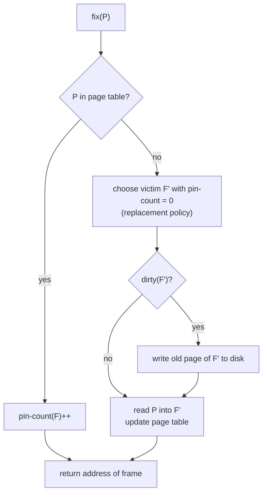
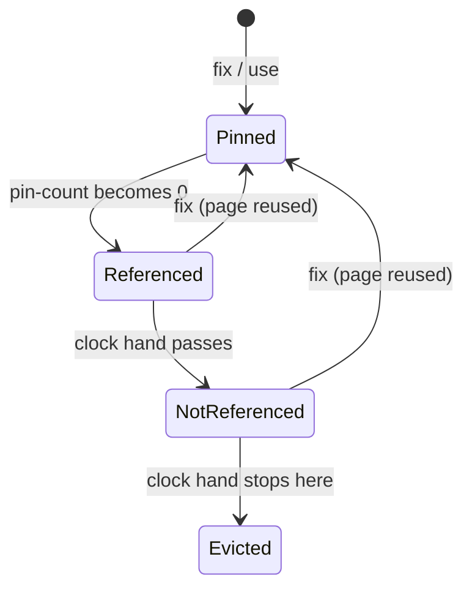

# Buffer Management

> [!abstract] Purpose of this lecture
> Part 6 of the course (M. Lenzerini) goes one level down the DBMS architecture, from the transaction manager of [[05 - DM - Concurrency Control]] to the **buffer manager**: the module that moves **pages** between secondary storage and a main-memory area, the **buffer pool**, so that the rest of the DBMS works on memory instead of disk. The lecture is short but foundational: the cost model of [[07 - DM - File Organization and Indexing]] and [[08 - DM - Evaluation of Relational Operators]] counts exactly the page transfers that the buffer manager performs. It covers secondary storage, the buffer pool and its frames, the primitives `fix`, `unfix`, `use`, `force`, `flush`, replacement policies (LRU and clock) and the force/no-force strategy.
>
> Course map: [[00 - Data Management MOC]]. Base triennale: the undergraduate course Basi di Dati stops at logical design ("progettazione fisica: non in questo corso → Data Management", [[06 - BD - Progettazione Logica#6.1 Introduzione alla progettazione logica|BD 6.1]]); this lecture starts the physical level. The same ideas appear in operating systems as page replacement: [[Page Replacement]] · [[Memoria Virtuale]] (Sistemi Operativi).

---

## Architecture of a DBMS

![[DM-L05-p002.png]]

The same architecture diagram opens this part of the slides. The **buffer manager** sits between the **access file manager** above (which reads and writes records, see [[07 - DM - File Organization and Indexing]]) and the **disk manager** below (which reads and writes physical blocks). It is also used directly by the transaction manager and by the **security and recovery manager**.

Base triennale: [[DBMS]]

---

## The secondary storage

At the physical level a database is a set of **database files**; each file is a set of **pages**, stored in physical **blocks** of secondary storage (disk, SSD).

To use a page, it must be brought into **main memory**. The size of a block, and therefore of a page, is exactly the size of the **unit of transfer** between secondary storage and main memory: the disk never reads "half a block" or "one record", it always moves whole blocks.

> [!important] Why this matters
> A main-memory operation costs nanoseconds ($10^{-9}$ s), a secondary-storage access milliseconds ($10^{-3}$ s on a hard disk): a factor of about $10^6$. Database workloads are therefore **I/O-bound**, and the number of page transfers is the dominant cost of any operation. Every later cost formula in the course counts page I/Os.

---

## The buffer

Vedi [[Buffer Pool]].

The **database buffer** (or **buffer pool**) is a **non-persistent** main-memory area used to **cache database pages**. DBMS processes request pages from the **buffer manager**, whose job is to **minimize secondary-storage accesses** by keeping the needed pages in the buffer. Because workloads are I/O-bound, the effectiveness of buffer management is critical for performance.

The buffer manager is responsible for transferring pages from secondary storage to the buffer pool and back. The buffer pool is:

- **shared** by all transactions, i.e. by all programs using the databases of the DBMS;
- used by the **system** itself, for example by the recovery manager.

> [!note] Why not just use the operating system cache?
> The OS also caches file blocks, but it does not know the DBMS's access patterns or its recovery needs: the DBMS must control **when** a modified page reaches the disk (write-ahead logging, see [[#Force or no-force strategy]]) and which pages are worth keeping (e.g. the root of an index). That is why DBMSs manage their own buffer pool.

## Architecture of the buffer manager

![[DM-L06-p006.png]]

- From **above**, the other DBMS modules call the primitives `fix`, `unfix`, `use` and `force`.
- Inside, the buffer manager keeps the **page table** and the **buffer pool** (the grid of frames).
- Toward the **disk manager** (left) it issues `create`, `delete`, `extend` (on files), `open`, `close`, and the actual `read` and `write` of blocks.
- `flush` writes pages from the pool to disk **asynchronously**, independently of requests.
- The double arrow to "other modules of the DBMS" shows that pages in the pool are read and modified directly in memory by the modules that fixed them.

## The buffer pool

- The pool is organized in **frames**. Each frame has an identifier (a number) and corresponds to one main-memory page whose size is that of a **block**, typically **2 KB to 64 KB**.
- Working on pages in the pool is far cheaper (atomic operations take on the order of a **billionth** of a second) than working on secondary storage (**thousandths** of a second).
- The pool is managed with principles similar to those of **cache memory**.

## The buffer manager

The buffer manager uses the **page table**, which associates each frame with the secondary-storage page (identified by its **Page Identifier, PID**), if any, last loaded into it: the frame is the "main-memory twin" of that page.

Primitive operations:

| Operation | Meaning |
|---|---|
| **Fix** | load a page (request it) |
| **Unfix** | release a page |
| **Use** | use (modify) a page in the buffer |
| **Force** | **synchronous** transfer to secondary storage |
| **Flush** | **asynchronous** transfer to secondary storage |

### The Fix operation

A module issues `fix` to ask the buffer manager to load a given page. For each frame $F$ the buffer manager keeps:

- which page (if any) $F$ contains (from the page table);
- **pin-count(F)**: how many transactions are using the page in $F$; initially 0;
- **dirty(F)**: whether the content of $F$ has been modified since it was loaded; initially false.

Suppose module $M$ issues `fix(P)`:

1. Using the page table, check whether some frame $F$ already contains $P$.
2. If **yes**, increment pin-count($F$).
3. If **no**:
   1. choose, with a **replacement policy**, a frame $F'$ (if possible) that can host $P$;
   2. if dirty($F'$) is true, **write** the page in $F'$ back to secondary storage, so as not to lose its modifications;
   3. **read** $P$ from secondary storage into $F'$; initialize pin-count($F'$) = 0 and dirty($F'$) = false.
4. Return to $M$ the **address** of the frame containing $P$.

> [!note] Pin-count after loading
> In the slides a freshly loaded page starts with pin-count 0, and the pin is taken by the first `use` ("if it is the first use of the frame by the transaction, pin-count is incremented", see [[#The other operations]]), whereas a `fix` on a page already present increments pin-count directly. Many textbooks (e.g. Ramakrishnan–Gehrke) set pin-count to 1 when the page is loaded, so that the requesting module holds the page from the start; in that variant a page just loaded cannot be chosen as a victim before it is used. Step 3 also implicitly includes updating the page table, so that $F'$ is registered as containing $P$.

## Replacement policy

The frame to replace, the **victim**, is chosen among the frames with **pin-count(F) = 0**: a page in use cannot be evicted. If no such frame exists, the request is **queued**, or the transaction is **aborted** and re-executed later. Otherwise there are several policies.

### LRU (least recently used)

A **queue** contains the frames with pin-count 0, ordered by when they were released; the victim is the one released longest ago. It works well for random access, but has a known weakness for databases: a **sequential scan** of a file larger than the buffer evicts every useful page and never reuses its own pages (*sequential flooding*). It also requires updating the queue on every release.

### Clock replacement

An approximation of LRU that is cheaper to maintain:

- a variable **current** points to the frames in **circular** order;
- each frame has a bit **referenced(F)**, set to true when pin-count(F) **drops to 0**: $F$ is now a candidate, but it was used recently.

To find a victim:

1. look at the frame $F$ pointed to by `current`;
2. if pin-count($F$) > 0, it cannot be the victim: advance `current` and repeat;
3. if pin-count($F$) = 0 and referenced($F$) = true, set referenced($F$) = false (time has passed since its last use: it gets a "second chance" and is considered on the next round), advance and repeat;
4. if pin-count($F$) = 0 and referenced($F$) = false, choose $F$.

Vedi [[Clock Replacement Policy]]. The same algorithm is known as *second chance* in operating systems: [[Page Replacement]].

> [!tip] Other policies
> FIFO (ignores usage), MRU (evicts the *most* recently used page, useful exactly against sequential flooding), and policies that use DBMS knowledge (e.g. keep index roots, prefetch the next pages of a scan). The query processor often knows the access pattern in advance, which the OS cannot.

## Force or no-force strategy

Vedi [[Force and No-Force]].

- **Force**: when a transaction commits, **all its active pages** are written to secondary storage.
- **No-force**: the pages of a committed transaction are written **asynchronously** later, via `flush`.

**No-force** is generally used because it allows a more efficient buffer management: a commit does not wait for many random writes, and a page modified by several transactions is written once.

> [!important] No-force and durability
> With no-force, a committed transaction's changes may still be only in memory when the system crashes. Durability ([[ACID]]) is then guaranteed by the **log**: before commit, the log records describing the changes are forced to disk (*write-ahead logging*), and after a crash the recovery manager **redoes** them. The complementary choice, whether pages of *uncommitted* transactions may be written to disk (**steal** / no-steal), decides whether recovery also needs **undo**. Most systems use **steal + no-force**.

## The other operations

- **Unfix**: the transaction certifies it no longer needs the content of a frame; its pin-count is **decremented** (when it reaches 0 the frame becomes a replacement candidate and, with the clock policy, referenced is set to true).
- **Use**: the transaction **modifies** the frame; the **dirty bit** is set to true and, if it is the transaction's first use of the frame, pin-count is incremented.
- **Force**: **synchronous** transfer of the page in a frame to secondary storage: the transaction waits for the write to complete.
- **Flush**: **asynchronous** transfer (executed when the buffer manager is not busy) of the pages used by a transaction.

---

## Exercise: clock replacement

> [!example] Text
> The buffer has 10 frames; frame $i$ contains the page with address $i$. All frames with an **odd** address have pin-count > 0; all frames with an **even** address have pin-count = 0 and referenced = true; `current` = 5. With the clock policy, describe the actions performed when page 20 is requested with `fix`, and the final configuration.

**Solution (slides, expanded).** Page 20 is not in the buffer and every frame is occupied, so a victim must be found starting from frame 5:

| Step | Frame | pin-count | referenced | Action |
|---|---|---|---|---|
| 1 | 5 | > 0 | — | skip |
| 2 | 6 | 0 | true | set referenced = false, skip |
| 3 | 7 | > 0 | — | skip |
| 4 | 8 | 0 | true | set false, skip |
| 5 | 9 | > 0 | — | skip |
| 6 | 10 | 0 | true | set false, skip |
| 7 | 1 | > 0 | — | skip (wrap around) |
| 8 | 2 | 0 | true | set false, skip |
| 9 | 3 | > 0 | — | skip |
| 10 | 4 | 0 | true | set false, skip |
| 11 | 5 | > 0 | — | skip |
| 12 | 6 | 0 | **false** | **victim** |

Frame 6 is chosen: if dirty, page 6 is written back first; page 20 is read into frame 6, the page table records that frame 6 contains page 20, pin-count(6) = 0 and dirty(6) = false, and the fix returns 6.

> [!warning] Correzione
> The slide concludes "All other frames are not changed by the operation". Their **pages** are unchanged, but during the scan the **referenced** bits of frames 2, 4, 8 and 10 have been set to **false** (and `current` now points to frame 6, or to 7 if the implementation advances it after choosing). This matters: a second fix right after would immediately evict frame 8, the next unreferenced candidate.

---

## Summary

> [!summary]
> - Data lives in **pages** = **blocks**, the unit of transfer with secondary storage; I/O dominates cost.
> - The **buffer pool** is a shared main-memory cache of pages organized in **frames**; the **page table** maps frames to PIDs.
> - `fix` returns a frame containing the page, loading it if needed; **pin-count** protects pages in use, the **dirty** bit says whether to write back.
> - The victim is chosen among unpinned frames, with **LRU** or **clock** (second chance with a referenced bit).
> - **No-force** writes committed pages asynchronously (`flush`), relying on the log for durability.

### Self-assessment questions

1. Why is the size of a page equal to the size of a block?
2. What happens when `fix` is called on a page that is already in the buffer?
3. Why can't a frame with pin-count > 0 be chosen as a victim?
4. Describe the clock algorithm. Why does it approximate LRU?
5. What are the advantages of no-force, and which other mechanism makes it safe?
