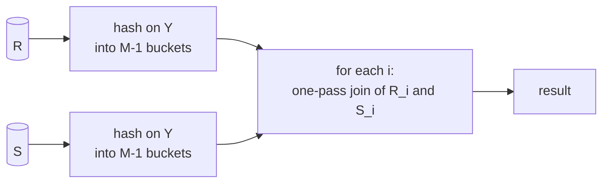

# Query Processing — Evaluation of Relational Operators

> [!abstract] Purpose of this lecture
> Part 8 of the course (M. Lenzerini) closes the tour of the DBMS architecture with the **SQL engine**: given a query, how is each **relational algebra operator** actually executed on data stored in pages? It brings together everything seen before: the operators of [[01 - DM - Introduction#The five basic operations of relational algebra|relational algebra]] and SQL (Lecture 1), the page-based cost model and external sorting of [[07 - DM - File Organization and Indexing]], and the buffer frames of [[06 - DM - Buffer Management]]. The slides cover (8.1) an overview of query processing, logical and physical plans, materialization vs pipelining and iterators; (8.2) algorithms for each operator: one-pass, nested-loop, two-pass (sort-based and hash-based), multipass, index-based and parallel algorithms, each with its **buffer requirement** and **cost in page accesses**.
>
> Course map: [[00 - Data Management MOC]]. Base triennale: the operators are the ones of [[Algebra Relazionale]] and [[SQL]] ([[Join]], [[Selezione e Proiezione]], [[Group By e Having]], [[Operatori Aggregati]]); Basi di Dati showed *what* they compute, here we see *how* and *at what cost*. Set vs bag semantics comes from [[Set Semantics vs Bag Semantics]].

> [!note] Numbering in the slides
> The slides are "Part 8" but number their sections "4.1, 4.2". This note uses 8.1 and 8.2.

---

# 8.1 Overview of query processing

## Query processing by the SQL engine

![[DM-L08-p005.png]]

A SQL query goes through two phases.

1. **Query compilation**:
   - **parsing** turns the SQL text into a parse tree;
   - **query optimization** first selects a **logical query plan** (a relational algebra expression, rewritten to be efficient), then a **physical query plan**.
2. **Query execution**: the physical plan is executed on the data (the cylinder) and produces the result.

## Logical and physical query plans

![[DM-L08-p006.png]]

The example computes the titles of movies starring someone born in 1960. The **logical plan** (left) is $\pi_{title}(\sigma_{starName=name}(StarsIn \times \pi_{name}(\sigma_{birthdate\ LIKE\ '\%1960'}(MovieStar))))$. The **physical plan** (right) is the same tree where each operator is annotated with the **algorithm** to use (alg. 1 … alg. 5):

> physical query plan = logical query plan + choice of algorithms.

The physical plan fixes both the **order of evaluation** of the subexpressions and the **method** for each operator. Here we study the algorithms for **single operators**: those of classical relational algebra plus the ones arising from SQL.

> [!tip] Selection over a product is a join
> $\sigma_{starName=name}(StarsIn\times\ldots)$ is an equijoin. An optimizer would rewrite it as $StarsIn \bowtie_{starName=name} \ldots$, so that a join algorithm (alg. 2 + alg. 3 together) can be used instead of materializing a Cartesian product. Base triennale: [[Theta-Join]].

---

# 8.2 Evaluation of relational operators

## Operators considered

- **Union, intersection, difference**, on **sets** and on **bags** (sets with duplicates). Subscript $S$: the operator works on sets and produces a set; subscript $B$: it works on bags and produces a bag.
- **Selection** and **projection**.
- **Cartesian product** and **join** (all variants).
- **Duplicate elimination** (bag → set): SQL `DISTINCT`.
- **Grouping** with aggregation (`GROUP BY`, `SUM`, `AVG`, …).
- **Sorting** (`ORDER BY`).

Base triennale: [[Set Semantics vs Bag Semantics]] · [[03 - BD - SQL#Unione, intersezione e differenza|BD — Unione, intersezione e differenza]]

## Materialization or pipeline

An operator can be applied in two modes:

- **materialization**: compute the whole result and store it in a **temporary relation**;
- **pipeline** (on-demand, tuple-by-tuple): implement the operator as an **iterator** that returns **one tuple of the result at each call**.

Pipelining avoids writing and re-reading intermediate results, and lets the next operator start before the previous one has finished.

### Iterators

Vedi [[Iterator Model]].

An iterator is manipulated through three functions:

- **Open**: initialize the data structures and prepare to produce tuples (without producing any);
- **GetNext**: return the next tuple, if any, and advance; a boolean variable `Found` is true iff a tuple was returned;
- **Close**: end the iteration.

#### ScanIterator (table scan)

```text
Open(R)   { IF R is empty THEN { Found := false; self.t := NULL }
            ELSE { self.Rel := R; self.b := first block of Rel;
                   self.t := first tuple of self.b; Found := true } }

GetNext() { IF self.t is NULL THEN
              IF (no next block in Rel OR NOT Found) THEN { Found := false; RETURN }
              ELSE { self.b := next block; self.t := first tuple of self.b }
            self.oldt := self.t;
            self.t := next tuple of self.b, or NULL if self.t was the last;
            RETURN self.oldt }

Close()   { }
```

The iterator keeps a pointer to the current block and tuple: each `GetNext` returns the current tuple and advances, moving to the next block when the current one is exhausted.

#### BagUnionIterator

```text
Open(R,S) { self.R1 := R; self.R2 := S;
            c1 := ScanIterator.Open(R1); self.current := R1 }

GetNext() { IF self.current = R1 THEN {
              self.t := c1.GetNext();
              IF Found THEN RETURN self.t;
              ELSE { c2 := ScanIterator.Open(R2); self.current := R2 } }
            RETURN c2.GetNext()     // when R2 is exhausted, c2 sets Found := false }

Close()   { c1.Close(); c2.Close() }
```

It returns all tuples of $R$, then all tuples of $S$, composing two scan iterators. Iterators **compose**: the input of an iterator is another iterator, which is how a whole plan runs in pipeline.

> [!note] Slide code
> In the slide, `Open(R,S)` also opens `c2` immediately and then reopens it in `GetNext`; opening it only when switching to $R_2$ (as above) is equivalent and avoids the duplicate `Open`. The slide also contains the typo `self.currrent`.

## Classification of algorithms

**Sequential methods**, classified by the number of passes over secondary storage:

- **one-pass**: read the data once; usually require at least one operand to fit in the buffer;
- **nested-loop**: a loop over one relation containing a loop over the same or another relation; for data too large for main memory;
- **two-pass**: read the data, process it, write intermediate data, read it again;
- **multipass**: three or more passes, generalizing two-pass algorithms;
- **index-based**: use one or more indexes.

**Parallel methods**: many processors in a **shared-nothing** architecture.

By technique: **sorting-based**, **hash-based**, **index-based** (some two-pass/multipass algorithms fall in several categories).

## Number of pages of a relation

$B(R)$ is the number of pages used to store $R$. Let $QB(R)=NR(R)\times SR(R)/SP$ be the minimum number of pages needed ($NR$ = number of records, $SR$ = average space per record, $SP$ = page size).

| Storage | $B(R)$ |
|---|---|
| Pages only for $R$, no reserved free space (**clustered relation**) | $QB(R)$ |
| Pages only for $R$, $C\%$ free space | $QB(R)\times\frac{100}{100-C}$ |
| Clustered file, $R$ is the **child**, $C\%$ of each page not used by $R$ | $QB(R)\times\frac{100}{100-C}$ |
| Clustered file, $R$ is the **father**, occupying $C\%$ of each page | $QB(R)\times\frac{100}{C}$ |

By default relations are assumed **clustered**.

### The many meanings of "cluster"

| Term | Meaning |
|---|---|
| Clustered-file organization | records of two relations share pages: a "father" record followed by its "child" records ([[07 - DM - File Organization and Indexing#Another application: clustered files|Lecture 7]]) |
| Clustered relation | stored in pages devoted (exclusively or mainly) to it |
| Strongly clustering index | index sorted coherently with the order of the records (the main meaning) |
| Weakly clustering index | tuples with the same search-key value are on as few pages as possible |

## The algorithms studied

One-pass (unsorted and sorted relations), nested-loop, two-pass (sort- and hash-based), multipass, index-based. Costs **ignore writing the result**. We mostly assume **materialization**, so an output frame is counted when needed (in tuple-by-tuple mode it is not always needed). $M$ denotes the number of available buffer frames.

---

## One-pass algorithms

Vedi [[One-Pass Algorithms]].

### Unary operators

- **Projection** (no index on the projected attributes): read the pages of $R$ one at a time into an input frame, project each tuple into an output frame, write the output frame when full. Buffer: 2 frames. Cost: $B$ (table scan).
- **Selection**, $R$ not sorted, no index: same scheme. Buffer: 2. Cost: $B$.
- **Selection**, $R$ sorted on the searched attributes: binary or interpolation search. Buffer: 2 (the output frame is needed especially if the sort key is not a key). Cost: $O(\log_2B)$ to find the first record, plus the pages of interest if the search key is not a key.
- **Duplicate elimination**, $R$ not sorted: read $R$ one page at a time; for each tuple check whether it was already seen. Keep one copy of each distinct tuple in the buffer in a structure $T$ (hash table or balanced binary tree; a list would cost $O(N^2)$ comparisons). At the end write the pages of $T$. Buffer: possible if the distinct tuples fit in $M-1$ frames. Cost: $B$.
- **Duplicate elimination**, $R$ sorted on any attributes: keep in the buffer only the **current group** (tuples with the last value of the sort attributes, without duplicates); write it when a new group starts. Buffer: the largest group (without duplicates) must fit in $M-1$ frames; if the sort attributes are all the attributes, 2 frames suffice. Cost: $B$.
- **Grouping**, $R$ not sorted: one entry per group in the buffer (grouping values + accumulated values: min/max so far, count, sum, sum and count for AVG), in a hash table or balanced tree. Output only after the last tuple, so in the iterator **all the work is in `Open`**. Buffer: the entries must fit in $M-1$ frames. Cost: $B$.
- **Grouping**, $R$ sorted on the grouping attributes: keep only the current group's accumulators. Buffer: 2. Cost: $B$.

### Binary operators

- **Bag union**: read every page of $R$ and write it, then every page of $S$. Buffer: 1. Cost: $B(R)+B(S)$.
- **Other binary operators**, unsorted: read the **smaller** operand into the buffer, building a structure (hash table or balanced tree) for fast search and insertion; then read the other one page at a time. Buffer: $\min(B(R),B(S))\le M-2$ (one input and one output frame). Cost: $B(R)+B(S)$. From now on $B(S)\le B(R)$.
  - **Set union**: load $S$ into $M-2$ frames, copy it to the result and build the structure; read $R$ one page at a time and output each tuple $t$ **not in** $S$.
  - **Set intersection**: load $S$; for each tuple of $R$, output it if it **is** in $S$ (and delete it from the structure, so it is output once).
  - **Cartesian product**: load $S$ into $M-2$ frames; for each tuple of $R$, concatenate it with every tuple of $S$.
  - **Natural join** $R(X,Y)\bowtie S(Y,Z)$: load $S$ into a structure with search key $Y$; for each tuple $t$ of $R$, find the tuples of $S$ agreeing with $t$ on $Y$ and output the joined tuples.

> [!question]- Exercise 1 — set difference, bag difference, bag intersection
> Load the smaller relation $S$ in a structure; for bags, store each distinct tuple with a **counter**.
> - $R-_SS$: output each tuple of $R$ that is **not** in $S$ (if $S$ is the larger one, load $R$ instead, and at the end output the tuples of $R$ never matched).
> - $S-_SR$: for each tuple of $R$ found in the structure, delete it; at the end output what remains.
> - $R\cap_BS$: for each tuple $t$ of $R$, if its counter in $S$ is $>0$, output $t$ and decrement.
> - $R-_BS$: for each $t$ of $R$, if its counter is $>0$ decrement it (that copy is cancelled), otherwise output $t$.
> - $S-_BR$: for each $t$ of $R$ decrement its counter if positive; at the end output each tuple as many times as its counter.

> [!question]- Exercise 2 — sorted inputs and iterators
> (a) If both inputs are sorted on all attributes, union, intersection and difference become **merges**: advance the two inputs in parallel comparing the current tuples, with only 3 frames and no in-memory structure (cost still $B(R)+B(S)$). Product and join still need the smaller relation in memory (unless sorted on $Y$ with small groups: then a merge join).
> (b) For example, the selection iterator: `Open` opens the child; `GetNext` calls the child's `GetNext` until a tuple satisfies the condition and returns it; `Close` closes the child.

### Summary (relations not sorted)

| Operator | Frames $M$ | Cost |
|---|---|---|
| selection, projection | 2 | $B$ |
| bag union | 1 | $B$ |
| duplicate elimination | $B$ | $B$ |
| grouping | $B+1$ | $B$ |
| union, intersection, difference, product, join | $\min(B(R),B(S))+1$ or $+2$ | $B(R)+B(S)$ |

(Worst cases: duplicate elimination needs room for all distinct tuples, at most $B$ pages; grouping needs room for all groups.)

### Summary (sorted relations)

| Operator | Frames $M$ | Cost |
|---|---|---|
| selection on the sort key | 2 | $\log_2B$ |
| selection not on the sort key, projection | 2 | $B$ |
| bag union | 1 | $B$ |
| duplicate elimination | 2 (sort key = all attributes), $B+1$ worst case | $B$ |
| grouping | 2 | $B$ |
| union, intersection, difference | 3 | $B(R)+B(S)$ |
| product, join | $\min(B(R),B(S))+2$ | $B(R)+B(S)$ |

---

## Nested-loop algorithms

Vedi [[Nested-Loop Join]].

A loop over one relation containing a loop over the same or another relation. Selection and projection do not need it.

### Duplicate elimination

Order the pages of $R$. Read each page $P$ in one input frame and, in another input frame, all the **subsequent** pages, one at a time. Output each tuple $t$ of $P$ once (ignoring duplicates within $P$) only if it does not appear in any subsequent page; otherwise skip it (its last occurrence will be output). Buffer: 3 frames. Cost: $B + (B-1) + \ldots + 1 = \frac{B(B+1)}{2}$.

### Block nested-loop

With $M$ frames besides the outer-input and output frames, load the outer relation in **blocks of $M$ pages**: for each block, scan the subsequent pages. For duplicate elimination this costs

$$M(1+2+\ldots+\lceil B/M\rceil)=\frac M2\lceil B/M\rceil(\lceil B/M\rceil+1)\approx B\left(\frac32+\frac{B}{2M}\right)+M$$

(approximating $\lceil B/M\rceil$ with $B/M+1$). For binary operators, with $S$ the smaller relation as the outer one:

$$B(S)+B(R)\lceil B(S)/M\rceil\approx B(S)+B(R)\left(1+\frac{B(S)}M\right)$$

These algorithms are expensive and used in special situations, e.g. when the system realizes that fewer frames are free than estimated. But they **always work**, with no condition on $M$ (beyond $M>3$), which is why the engine sometimes chooses them, especially for joins.

> [!question]- Exercise 3 — nested-loop union, intersection, difference
> With 3 frames: for each page of $S$ (outer), scan $R$; a tuple of $S$ is in the intersection if found in $R$; for difference $S-R$ output the tuples of the page never found. Union: output all of $R$, then the tuples of $S$ not found in $R$. Cost $B(S)+B(S)B(R)$. With $M$ frames: blocks of $M$ pages of $S$, cost $B(S)+B(R)\lceil B(S)/M\rceil$. The block technique also applies to bag intersection/difference (keep counters for the block) and to aggregation (process groups of the block, scanning the rest of the relation for the other tuples of those groups), with similar costs.

### Nested-loop join

One relation is read once, the other repeatedly: technically a "**one and a half** pass" algorithm. Running example: $B(R)=1000$, $B(S)=500$, $p_R=100$ tuples per page of $R$, $p_S=10$ tuples per page of $S$, 10 ms per page access, cost of writing the result ignored.

**1. Tuple-based nested-loop join.** Scan the outer relation $S$; for each tuple $E$ of $S$, scan $R$ looking for tuples joining $E$. Cost $B(S)+p_S\,B(S)\,B(R)$.

> [!warning] Correzione
> The slide computes $500+(100\times500\times1000)=500+5\times10^7$ ("about 140 hours"), using 100 tuples per page. But the outer relation is $S$, with $p_S=10$: the cost is $500+10\times500\times1000\approx5\times10^6$ page accesses, about **14 hours**. (The slide's figure would be right with $R$ as outer relation if its tuples were joined against $S$: $1000+100\cdot1000\cdot500=5\times10^7$.) The conclusion is the same: never use it.

Its iterator:

```text
Open(R,S)    { R.Open(); S.Open(); s := S.GetNext() }
GetNext(R,S) { REPEAT { r := R.GetNext();
                        IF NOT Found { R.Close(); s := S.GetNext();
                                       IF NOT Found RETURN;
                                       R.Open(); r := R.GetNext() } }
               UNTIL (r and s join);
               RETURN join of r and s }
Close(R,S)   { R.Close(); S.Close() }
```

**2. Page-based nested-loop join.** For each **page** $G$ of $S$, scan $R$ looking for tuples joining those in $G$. Cost $B(S)+B(S)\,B(R)=500+500{,}000=500{,}500$, about 1.4 hours.

**Block nested-loop with $S$ in memory.** If $S$ fits in the buffer with 2 extra frames, it is the one-pass join: $B(R)+B(S)=1500$, 15 seconds, obviously optimal.

**3. Block nested-loop join.**

```text
FOR each chunk of M pages of S DO {
    read them into the buffer, organize their tuples in a structure with search key Y;
    FOR each page b of R DO {
        read b; for each tuple t of b find the joining tuples of S in the buffer;
        output the joins } }
```

Cost $B(S)+B(R)\lceil B(S)/M\rceil\approx B(S)+B(R)(1+B(S)/M)$. With 102 frames ($M=100$ for $S$ plus 2): $500+1000\times5=5{,}500$, about one minute.

> [!note] $M$ in the example
> The slide says "$M=102$" but computes $500/100$: the 102 frames are $M=100$ frames for the chunks of $S$ plus the 2 extra frames (input page of $R$ and output).

### Summary of block nested-loop algorithms ($M+2$ frames available)

| Operator | $M$ | Cost |
|---|---|---|
| duplicate elimination | 1 | $B(B+1)/2$ |
| union, intersection, difference, product, join | 1 | $B(S)+B(R)\,B(S)$ |
| duplicate elimination | $>1$ | $B(3/2+B/2M)+M$ |
| union, intersection, difference, product, join | $>1$ | $B(S)+B(R)(1+B(S)/M)$ |

> [!warning] Correzione
> The summary table in the slide gives $B\times(3/2+B/M)+M$ for block nested-loop duplicate elimination, while the derivation two slides earlier gives $B(3/2+B/2M)+M$. The derivation is correct: $\frac M2(\frac BM+1)(\frac BM+2)=\frac{B^2}{2M}+\frac{3B}2+M$.

---

## Two-pass algorithms

Two-pass algorithms extend one-pass algorithms to relations too large for them: read the data, process it, write it, read it again. Two families: **sort-based** and **hash-based**.

### Sort-based

Vedi [[Sort-Merge Join]].

General scheme (for $R$, and for $S$ too if binary):

1. **Pass 1**: repeatedly read $M$ pages, sort them in memory into a **sorted sublist** (a run of [[07 - DM - File Organization and Indexing#External sorting|external sorting]]), write it.
2. **Pass 2**: process the sorted sublists, one frame per sublist plus an output frame, to compute the operation.

#### Duplicate elimination

Keep one page of each sublist in the buffer (reloading from the same sublist when a frame empties); repeatedly output the **minimum** tuple among the fronts and skip all its copies.

- Buffer: at most $M-1$ sublists of $M$ pages: $\lceil B/M\rceil\le M-1$, i.e. roughly $B\le M(M-2)\approx(M-2)^2$: about $\sqrt B+2$ frames.
- Cost: $3B$ ($B$ to read and $B$ to write the sublists, $B$ to read them again).

> [!example] Duplicate elimination with sorting
> Two integers per page, $M=4$, relation 20, 50, 20, 10, 20, 20, 40, 50, 40, 30, 40, 20, 10, 50, 20, 10, 30 (17 tuples, 9 pages).
>
> Pass 1 (sublists of 4 pages = 8 tuples):
>
> | Sublist | Pages |
> |---|---|
> | R1 | 10 20 · 20 20 · 20 40 · 50 50 |
> | R2 | 10 10 · 20 20 · 30 40 · 40 50 |
> | R3 | 30 |
>
> Pass 2: the fronts are 10, 10, 30 → output 10 and skip all 10s (R2 reloads its next page); then output 20 (R1 and R2 consume several pages of 20s), 30, 40, 50. Result 10, 20, 30, 40, 50 in 3 pages.

#### Grouping and aggregation

Pass 1 sorts on the **grouping attributes**. In pass 2, repeatedly take the least sort-key value $v$ among the fronts: it is the next group; accumulate the aggregates (sum and count for AVG) over all tuples with value $v$, reloading frames as needed; then emit the group's tuple. Buffer $\approx\sqrt B+2$; cost $3B$.

#### Set and bag operations

Pass 1 builds sorted sublists for $R$ and $S$; pass 2 keeps one frame per sublist and repeatedly takes the first remaining tuple $t$:

| Operation | Output for $t$ |
|---|---|
| $R\cup_SS$ | $t$ once, then skip all copies (at most 2) |
| $R\cap_SS$ | $t$ if it appears in both |
| $R\cap_BS$ | $t$ $\min(n_R,n_S)$ times |
| $R-_SS$ | $t$ if it is in $R$ but not in $S$ |
| $R-_BS$ | $t$ $\max(0,n_R-n_S)$ times |

($n_R$, $n_S$ = occurrences in $R$ and $S$.) Buffer: $\lceil B(R)/M\rceil+\lceil B(S)/M\rceil\le M-1$, sufficient $\sqrt{B(R)+B(S)}+3$ frames. Cost $3(B(R)+B(S))$.

> [!example] Bag difference with sorting
> Two integers per page; $R$ = 2, 5, 2, 1, 2, 2, 4, 5, 4, 3, 4, 2; $S$ = 1, 5, 2, 1, 3.
>
> | Sublist | Pages |
> |---|---|
> | R1 | 1 2 · 2 2 · 2 5 |
> | R2 | 2 3 · 4 4 · 4 5 |
> | S1 | 1 1 · 2 3 · 5 |
>
> - 1: once in $R$, twice in $S$ → not output.
> - 2: five times in $R$, once in $S$ → **4 copies**.
> - 3: once in each → not output.
> - 4: three times in $R$, none in $S$ → **3 copies**.
> - 5: twice in $R$, once in $S$ → **1 copy**.
>
> Result 2, 2, 2, 2, 4, 4, 4, 5 (4 pages). In this example the sublists are 3 pages long, not $M=4$ (perhaps to leave one frame for the output while merging three sublists): the procedure is the same.

#### Simple sort-based join

Pass 1 **fully sorts** $R(X,Y)$ and $S(Y,Z)$ on $Y$ with two-pass multiway merge sort ($B(R),B(S)\le M(M-1)$). Pass 2, assuming that for no value $y$ the tuples of $R$ or $S$ with $Y=y$ occupy more than $M-1$ frames, with one frame for $R$ and one for $S$:

1. find the least value $y$ at the front of $R$ and $S$;
2. if $y$ appears in only one relation, skip its tuples; otherwise load all tuples of both with $Y=y$ (using the other $M-3$ frames), output all their combinations, and skip them.

If for some $y$ the tuples exceed $M-1$ frames:

1. if the tuples of one relation with $Y=y$ fit in $M-2$ frames, load them and stream the other relation's tuples with $Y=y$ (one-pass join on that value);
2. otherwise do a nested-loop join on the tuples with $Y=y$ using the $M-1$ frames.

Some pages may have to be read, set aside and re-read.

Buffer: $\sqrt{\max(B(R),B(S))}+1$ frames. Cost: sorting $4(B(R)+B(S))$ (read and write each page in each of the two sort passes), plus a fifth read in the join phase: $5(B(R)+B(S))$, if no special handling is needed.

> [!example] Simple sort join on the running example
> $M=102$: $5\times1500=7{,}500$ accesses (1 min 15 s), worse than block nested-loop (5,500). But with $B(R)=10{,}000$ and $B(S)=5{,}000$, block nested-loop costs $B(S)+B(R)(B(S)/(M-2)+1)=5{,}000+10{,}000\times51=515{,}000$, while the simple sort join costs $5\times15{,}000=75{,}000$.

> [!warning] Correzione
> The slide gives **72,500** for the simple sort-based join with $B(R)=10{,}000$, $B(S)=5{,}000$. The formula $5(B(R)+B(S))$ gives $5\times15{,}000=$ **75,000**. The comparison with 515,000 is unaffected.

#### Sort-merge join

If many tuples sharing a $Y$-value are known to be rare, avoid fully sorting: create sorted sublists on $Y$ for both relations, then

1. bring the first page of each sublist into the buffer (at most $M-1$ sublists in total);
2. repeatedly find the least $Y$-value $y$ among all fronts, collect the tuples of both relations with $Y=y$ (possibly using spare frames), output their join, and reload exhausted frames.

Buffer: $\sqrt{B(R)+B(S)}+3$ frames. Cost: $3(B(R)+B(S))$ (2 accesses per page for the sublists, 1 for the join).

> [!example] Sort-merge join on the running example
> $R$ in 10 sublists and $S$ in 5, each of 100 pages: 15 frames hold the current pages, the other frames are available for tuples sharing a $Y$-value. Cost $3\times1500=4{,}500$, 45 seconds.

Many tuples with the same $Y$-value are the weak point:

1. if $Y$ is a **key** of $R$, each $y$ appears at most once in $R$: keep that tuple and stream all matching tuples of $S$, with no extra space;
2. if $M\gg\sqrt{B(R)+B(S)}$, there are many spare frames;
3. otherwise, fall back to a nested-loop join on the tuples with that $Y$-value.

#### Summary of sort-based two-pass algorithms

| Operator | Frames $M$ | Cost |
|---|---|---|
| duplicate elimination, grouping | $\sqrt B+1$ | $3B$ |
| union, intersection, difference | $\sqrt{B(R)+B(S)}+3$ | $3(B(R)+B(S))$ |
| simple sort join | $\sqrt{\max(B(R),B(S))}+1$ | $5(B(R)+B(S))$ |
| sort-merge join | $\sqrt{B(R)+B(S)}+3$ | $3(B(R)+B(S))$ |

(The detailed slides give $\sqrt B+2$ for duplicate elimination and grouping; the table rounds to $+1$.)

### Hash-based

Vedi [[Hash Join]].

Idea: if the data is too big for one pass, **hash** the tuples of the operand(s) on a suitable key so that all tuples that must be considered together fall in the **same bucket** (or the same pair of buckets for binary operators); then process one bucket (or pair) at a time. With $M$ frames we use $M-1$ buckets, gaining a factor of about $M$ over one-pass algorithms.

#### Partitioning a relation by hashing

```text
initialize M-1 buckets using M-1 empty frames
FOR each page b of R DO
    read b into the M-th frame
    FOR each tuple t in b DO
        IF the frame of bucket h(t) is full THEN
            write it to secondary storage; start a new empty page in that frame
        copy t into the frame of bucket h(t)
FOR each bucket whose frame is not empty: write the frame
```

#### Duplicate elimination

Hash on **all** attributes: copies of a tuple end up in the same bucket, so each bucket $R_i$ is deduplicated in isolation with the one-pass algorithm; the answer is the union of the results.

- Buffer: each bucket has about $B/(M-1)$ pages and must fit in $M$: $B\le M(M-1)\approx(M-1)^2$.
- Cost: $3B$ (read and write during hashing, read again in the one-pass phase).

#### Grouping and aggregation

Hash on the **grouping attributes** only; then group each bucket with the one-pass algorithm. Since only **one tuple per group** is needed in memory, a bucket can be larger than $M$ as long as its groups fit: with $A$ tuples per group on average, $\frac{B/(M-1)}{A}\le M$, i.e. $B\le M(M-1)/A$. Cost $3B$.

#### Union, intersection, difference

Partition $R$ and $S$ with the **same** hash function into $M-1$ buckets each; for each $i$ apply the one-pass algorithm to $R_i$ and $S_i$. Buffer: the smaller bucket must fit in $M-2$ frames: $\min(B(R),B(S))\le(M-1)(M-2)\approx(M-2)^2$. Cost $3(B(R)+B(S))$.

#### Hash join

Partition $R$ and $S$ on the **join attributes**; tuples that join are in buckets with the same index. Join each pair $R_i, S_i$ with the one-pass join. Same buffer condition, cost $3(B(R)+B(S))$.

> [!example] Hash join on the running example
> $M=102$: 100 buckets, on average 10 pages per bucket of $R$ and 5 of $S$; 5 is far below the available frames, so each one-pass join is easy. Cost: 1500 to read while hashing + 1500 to write the buckets + 1500 to read them for the join = **4,500**, 45 seconds.



#### Summary of hash-based two-pass algorithms

| Operator | Frames $M$ | Cost |
|---|---|---|
| duplicate elimination, grouping | $\sqrt B+1$ | $3B$ |
| union, intersection, difference | $\sqrt{\min(B(R),B(S))}+2$ | $3(B(R)+B(S))$ |
| hash join | $\sqrt{\min(B(R),B(S))}+2$ | $3(B(R)+B(S))$ |

### Sort-based vs hash-based

1. For binary operations, hash-based algorithms need memory depending only on the **smaller** argument; sort-based on the **sum** of the sizes.
2. Sort-based algorithms produce a **sorted result**, useful later in the same query or for `ORDER BY`; but sorting costs more CPU.
3. Hash-based algorithms assume **equal-sized buckets**; in practice buckets vary, so they must be kept somewhat smaller than $M$ pages. This is critical with few distinct hash values (few groups, or few join values).

> [!question]- Exercise 4 — when is block nested-loop better than two-pass?
> Block nested-loop costs about $B(S)+B(R)B(S)/M$, two-pass about $3(B(R)+B(S))$. When $S$ fits in memory ($B(S)\le M$) the block nested-loop is the one-pass algorithm, with cost $B(R)+B(S)$, better than two-pass. More generally it wins when $B(R)B(S)/M<3B(R)+2B(S)$, roughly when $B(S)<3M$: the smaller relation is at most a few times larger than the buffer.

---

## Multipass algorithms

Two-pass algorithms have size limits; generalizing them with as many passes as needed handles relations of any size.

### Multipass sort-based

Recall the recursive multipass merge sort: if $B(R)\le M$, sort in memory; otherwise split $R$ into $M-1$ groups, sort each recursively, and merge the $M-1$ runs with one output frame.

- **Unary operations**: (1) partition $R$ into $M-1$ parts and sort each with multipass merge sort; (2) read the sorted sublists one page at a time and compute the operation on the fronts (one copy per distinct tuple for duplicate elimination, sorted on all attributes; accumulated aggregates for grouping, sorted on the grouping attributes).
- **Binary operations**: partition $R$ into $M_R$ parts and $S$ into $M_S$ parts with $M_R+M_S\le M-1$, sort each part, then compute on the fronts. To minimize passes, split the frames proportionally: $M_R=(M-1)\frac{B(R)}{B(R)+B(S)}$.

With $K$ passes ($K-1$ for partitioning/sorting, reading and writing every page, plus a final reading pass):

- unary: $2(K-1)B+B=(2K-1)B$;
- binary: $(2K-1)(B(R)+B(S))$.

Space: a unary operation in $K$ passes needs $B\le(M-1)^{K-1}M$, sufficient $B\le(M-1)^K$, i.e. $M\ge B^{1/K}+1$; a binary one needs $M\ge(B(R)+B(S))^{1/K}+1$.

| Operator | Frames $M$ | Cost |
|---|---|---|
| duplicate elimination, grouping | $B^{1/K}+1$ | $(2K-1)B$ |
| union, intersection, difference, join | $(B(R)+B(S))^{1/K}+1$ | $(2K-1)(B(R)+B(S))$ |

### Multipass hash-based

Recursive formulation:

- **Base**: unary operation, if $R$ fits in $M$ frames, read it and compute; binary operation, if either relation fits in $M-1$ frames, load it and stream the other through the $M$-th frame.
- **Step**: otherwise hash each relation into $M-1$ buckets and recursively compute the operation on each bucket (or pair of buckets), **with a different hash function at each level**, accumulating the results.

Cost, assuming even distribution: $(2K-1)B$ for unary and $(2K-1)(B(R)+B(S))$ for binary operations.

Largest relation handled in $K$ passes, unary: $u(M,1)=M-1$ and $u(M,K)=(M-1)\,u(M,K-1)$, so $u(M,K)\approx(M-1)^K$ (the slide writes $M(M-1)^{K-1}$ before approximating): condition $B^{1/K}+1\le M$. For the join, with $j(M,K)$ the maximum size of the **smaller** relation: $j(M,1)=M-1$, $j(M,K)=(M-1)j(M,K-1)$, so $j(M,K)=(M-1)^K$: condition $\min(B(R),B(S))^{1/K}+1\le M$.

| Operator | Frames $M$ | Cost |
|---|---|---|
| duplicate elimination, grouping | $B^{1/K}+1$ | $(2K-1)B$ |
| union, intersection, difference, join | $\min(B(R),B(S))^{1/K}+1$ | $(2K-1)(B(R)+B(S))$ |

> [!question]- Exercise 5 — block nested-loop vs 3-pass algorithms
> A 3-pass algorithm costs $5(B(R)+B(S))$. Block nested-loop beats it when $B(S)+B(R)(1+B(S)/M)<5(B(R)+B(S))$, i.e. roughly $B(S)<4M$ (ignoring lower-order terms). But a 3-pass algorithm is only needed when the relations are much larger than $M^2$, while this condition requires $S$ to be small, so the case arises when $R$ is huge and $S$ is small: then block nested-loop (or one-pass, if $S$ fits) is the better choice.

---

## Index-based algorithms

Vedi [[Index Conformance]].

### Conformance of an index to a condition

An index **conforms** to a condition $C$ when it can be used effectively to evaluate $C$. A simple index conforms to `attr op value` if

- it is a **tree** index on `attr` and `op` is one of `<, <=, =, <>, >=, >`;
- it is a **hash** index on `attr` and `op` is `=`.

A **prefix** of a composite search key $\langle a,b,c\rangle$ is an initial segment: $\langle a\rangle$, $\langle a,b\rangle$ (not $\langle a,c\rangle$ or $\langle b,c\rangle$).

An index conforms to a conjunction `(att op value) AND …` if

- it is a **tree** index and there is a prefix $P$ of its search key such that every attribute of $P$ has a term in the conjunction (the **primary terms**);
- it is a **hash** index and every attribute of its search key has an **equality** term.

Examples:

- hash index on $\langle r,b,s\rangle$: conforms to `r='J' AND b=5 AND s=3`, not to `r='J' AND b=7` (hash needs all attributes);
- tree index on $\langle r,b,s\rangle$: conforms to `r>'J' AND b=7 AND s=5` and to `r='H' AND s=9` (prefix $\langle r\rangle$), not to `b=8 AND s=10` (no prefix);
- any index on $\langle b,s\rangle$ conforms to `d>1000 AND b=5 AND s=7`: use the primary terms, then filter `d>1000` on the retrieved tuples;
- with an index on $\langle b,s\rangle$ and a tree index on $d$, both conform to that condition; whichever is used, the other terms are checked on the retrieved tuples.

### Index-based selection

`select * from R where <att op value>`, alternative 2, relations clustered.

**Case 1: key attribute, `=`.** Hash index: cost 1 (2 with an overflow page). Tree index: the cost of an equality search; if leaves and fan-out are unknown, assume **3–4** accesses (2–3 if the root is in the buffer).

> [!note] About "3–4 accesses"
> The slide justifies 3–4 accesses with fan-out 100 as covering 100,000–100,000,000 leaves. With the convention of [[07 - DM - File Organization and Indexing#Search|Lecture 7]] (height $h$ = edges from root to leaf, $F^h$ leaves, $h+1$ page accesses), 3 accesses reach $100^2=10^4$ leaves and 4 accesses $100^3=10^6$ leaves. Either way 3–4 is a realistic bound for real tables.

**Case 2: non-key attribute, `=`, weakly clustering hash index.** $T(R)$ = number of tuples; $V(R,A)$ = number of distinct values of $A$ ($=T(R)$ if $A$ is a key). Tuples per page $T(R)/B(R)$, tuples per value $T(R)/V(R,A)$, so pages per value

$$\frac{T(R)/V(R,A)}{T(R)/B(R)}=\frac{B(R)}{V(R,A)}$$

Cost: (1 or 2) $+\,B(R)/V(R,A)$; in practice a bit more, if the tuples are spread over more pages.

**Case 3: non-key attribute, `=`, clustering tree index.** Cost $\log_F(1.5B)+B(R)/V(R,A)$ ($B$ = required leaf pages); or 3–4 $+B(R)/V(R,A)$.

**Case 4: non-key attribute, `=`, non-weakly-clustering index.** Each data entry may point to a different page: potentially **one access per qualifying record**. Better: **sort the rids by page id** first, so each page is read once: the cost becomes the number of pages containing qualifying records. Example: 1,000 qualifying tuples on 100 of the 1,000 pages: clustered tree index 3–4 + 100; non-clustering 3–4 + 1,000 (as much as a scan!); with sorted rids better, but the records are probably on more than 100 pages, and sorting costs too.

**Case 5: range (`<`, `>`, between) with a clustering tree index**: as in the tree index analysis of Lecture 7.

**Case 6: complex condition**: split it into atomic conditions, e.g. $a=v \wedge C'$ becomes a cascade $\sigma_{C'}(\sigma_{a=v}(R))$; the inner selection may use an index.

> [!example] Costs of index-based selection
> $B(R)=1000$, $T(R)=20{,}000$ (20 tuples per page), index on $A$, condition $A=0$.
> 1. $V(R,A)=100$, clustering index: index accesses (≈2) $+1000/100=10$ pages.
> 2. $V(R,A)=100$, non-clustering, rids not sorted: index accesses (≈2, plus more leaves) $+20{,}000/100=200$ data accesses (one per matching tuple).
> 3. $A$ is a key ($V(R,A)=20{,}000$): index (≈2) $+1$, clustering or not.

> [!warning] Correzione
> For case 2 the slide writes "$20.000/100=2000$ data page accesses. Note that this cost is higher than scanning the entire relation". $20{,}000/100=$ **200** (the matching tuples), which is **less** than the 1,000 pages of a scan, though 20 times the clustered case. The non-clustering index would become worse than a scan only with more than 1,000 matching tuples, e.g. $V(R,A)<20$.

### Index-only scan (projection)

To compute $\pi_{A_1..A_n}(R)$ with a dense index (e.g. a B+-tree) whose search key includes $A_1..A_n$, **scan the leaves** instead of the data file: the leaves are much smaller. If $A_1..A_n$ are a **prefix** of the search key, the leaves are sorted on them, so the other attributes can be dropped and duplicates removed on the fly (one-pass algorithm for sorted relations).

### Other index-based algorithms

Index-based selection and projection are special one-pass algorithms. Duplicate elimination, aggregation, union, intersection, difference and join can also profit from a suitable index; we describe the join (a special nested-loop join) and leave the others as an exercise.

> [!question]- Exercise 5 (index-based) — duplicate elimination, aggregation, set operations
> With a tree index whose search key includes all attributes (dedup) or the grouping attributes (aggregation), scan the leaves in order: equal values are adjacent, so dedup and grouping become the one-pass algorithms for sorted input, index-only if all needed attributes are in the key. For union/intersection/difference with tree indexes on all attributes of both relations, merge the two leaf sequences (as in the zig-zag join below); with a hash index on $S$, scan $R$ and probe $S$ for each tuple.

### Index-based join

**Index nested-loop join.** $R(X,Y)\bowtie S(Y,Z)$ with an index on $S.Y$: read $R$ one page at a time; for each tuple $t$, use the index to find the tuples of $S$ with $Y=t[Y]$.

Cost: $B(R)+T(R)\times$(cost of one index lookup + pages $P$ of $S$ holding the $T(S)/V(S,Y)$ matching tuples):

- non-clustering index: $|P|=T(S)/V(S,Y)$ in the worst case;
- clustering index: $|P|=\frac{T(S)/V(S,Y)}{T(S)/B(S)}=B(S)/V(S,Y)$, so the cost is $B(R)+T(R)\,(\text{lookup}+B(S)/V(S,Y))$.

> [!example] Index nested-loop on the running example
> 10 tuples per page: $T(R)=10{,}000$, $T(S)=5{,}000$; $V(S,Y)=100$; clustering tree index on $S.Y$ with lookup cost 2. Cost $1000+10{,}000\times(2+500/100)=1000+70{,}000=71{,}000$.
>
> High compared to the other joins. But it wins when $R$ is **very small** and $V(S,Y)$ is high (e.g. $Y$ is a key of $S$): only a fraction of $S$ is accessed, since most $Y$-values do not appear in $R$, while sort- and hash-based joins read all of $S$ at least once.

> [!warning] Correzione
> The slide gives $1000+10{,}000\times(2+500/100)=$ **70,000**. Since $10{,}000\times7=70{,}000$, the total is **71,000**.

**Join with sorted (tree) indexes.** If one relation has a sorted or tree index on $Y$, run the sort-based join without sorting (or building sublists for) that relation, working on the index and accessing the data only when needed. If **both** have one, do only the final step of the simple sort join: the **zig-zag join**, which jumps back and forth **between the indexes** to find the shared $Y$-values; tuples whose $Y$-value does not appear in the other relation are never retrieved.

- With a clustering index, retrieving the tuples with a given value costs as many pages as hold them; with a non-clustering one, possibly as many as the tuples.
- If, for some value, the data entries of both indexes do not fit in the buffer, adapt the algorithm as in the second formulation of the simple sort join; this is rare, because indexes are smaller than relations.

> [!example] Sort join using an index on $S$
> Clustering sorted index on $S.Y$, none on $R$, 101 frames: build 10 sorted sublists of $R$ (2,000 accesses); then merge using 11 frames (10 for $R$'s sublists, 1 for $S$ via the index). With 50 leaf pages: $2{,}000+1{,}000$ (reading $R$'s sublists) $+50$ (leaves) $+500$ (reading $S$) $=3{,}550$. With clustering sorted indexes on both, $R$ need not be sorted: $1{,}000+500+50=1{,}550$ (the slide ignores the leaf pages of $R$'s index).

---

## Parallel algorithms

Vedi [[Parallel Query Processing]].

![[DM-L08-p110.png]]

Of the architectures shown (shared memory, shared disk, shared nothing), the course refers to **shared-nothing**: every processor has its own memory and disks and shares nothing. Processors communicate by **messages** over the network: to read tuples from another processor's disk, a processor asks for them and receives them over the network. Communication is assumed much cheaper than disk I/O and is often neglected.

### Horizontal data partitioning

A relation $R$ is split into $P$ chunks $R_0..R_{P-1}$ stored at the $P$ nodes:

| Strategy | Rule | Pros / cons |
|---|---|---|
| Round robin | tuple $t_i$ → chunk $i \bmod P$ | perfect balance, but every operation reads all data |
| Range-based on $A$ | $t$ → chunk $i$ if $v_{i-1}<t.A<v_i$ | good for range predicates, but **data skew** |
| Hash-based | $t$ → bucket $h(t)$ | good balance; helps only equality predicates and full scans |

For hash partitioning, $h$ should depend on **all** components of the tuple (changing one component can change the bucket arbitrarily): e.g. map each component to an integer in $0..P-1$, sum, take the remainder modulo $P$; processor $i$ gets bucket $i$.

### Unary operators

- **Selection** $\sigma_{A=v}(R)$ or $\sigma_{v_1<A<v_2}(R)$: if $R$ is evenly distributed, elapsed time $B(R)/P$ for every partitioning. Who works: round robin, all servers; hash on $A$, one server for $A=v$ (otherwise all), all servers for ranges; range partitioning, one server. The result stays where it is computed (we do not count shipping it), so its distribution may differ greatly from $R$'s.
- **Projection**: like selection, time $B(R)/P$, but it cannot change the distribution of tuples.
- **Duplicate elimination**: with hash partitioning on all attributes, duplicates are on the same processor; each runs a standard algorithm on its part: $B(R)/P$ if one-pass locally, otherwise the maximum local cost on $B(R)/P$ pages.
- **Grouping**: with hash partitioning on the grouping attributes, each group is on one processor: local grouping, same costs.

### Binary operators

If $R$ and $S$ were distributed with the **same** hash function, union, intersection and difference are computed locally in parallel. Otherwise first **re-hash** both in parallel with a single (new, or $R$'s) hash function.

- **Set union** (and intersection, difference, bag variants): each processor $j$ hashes its tuples as in the first pass of the two-pass algorithm, but when the frame of bucket $i$ is full, it **ships** it to processor $i$ instead of writing it locally (possibly batching several pages). Processor $i$ receives all tuples of bucket $i$ of $R$ and $S$ and computes the union locally. With a good hash function the result is evenly spread.
- **Natural join**: the same, with a hash function on $Y$ only, so joining tuples meet on the same processor; then any local join algorithm.

### Performance

The **total work** cannot be smaller than with one processor, but the **elapsed time** is much smaller: unary operations take $1/P$ of the time if $R$ is evenly distributed.

**Equi-join with $R$ and $S$ initially on one processor $p$**: read all tuples and hash them, $B(R)+B(S)$ accesses; ship $(B(R)+B(S))\frac{P-1}{P}$ pages (the $1/P$ already belonging to $p$ stays). If each receiver stores its data and runs a two-pass sort-merge join:

- $B(R)+B(S)$ to read and hash;
- $(B(R)+B(S))/P$ per processor to write the received tuples;
- $3(B(R)+B(S))/P$ per processor for the local join.

Elapsed time goes from $3(B(R)+B(S))$ to $(B(R)+B(S))+4(B(R)+B(S))/P=(B(R)+B(S))\frac{P+4}{P}$.

It can be even lower:

- if every local join can be done in one pass: $B(R)+B(S)+2(B(R)+B(S))/P$;
- if one bucket (say of $S$) fits in memory while being received: store and re-read only the $R$ bucket: $B(R)+B(S)+2B(R)/P$;
- if both buckets fit in memory: $B(R)+B(S)$.

---

## Summary

| Join algorithm | Frames | Cost | Running example ($M=102$) |
|---|---|---|---|
| Tuple nested-loop | 3 | $B(S)+p_SB(S)B(R)$ | ≈ 5,000,000 |
| Page nested-loop | 3 | $B(S)+B(S)B(R)$ | 500,500 |
| One-pass ($S$ fits) | $B(S)+2$ | $B(R)+B(S)$ | 1,500 |
| Block nested-loop | $M+2$ | $B(S)+B(R)(1+B(S)/M)$ | 5,500 |
| Simple sort join | $\sqrt{\max}+1$ | $5(B(R)+B(S))$ | 7,500 |
| Sort-merge join | $\sqrt{B(R)+B(S)}+3$ | $3(B(R)+B(S))$ | 4,500 |
| Hash join | $\sqrt{\min}+2$ | $3(B(R)+B(S))$ | 4,500 |
| Index nested-loop (clustering) | — | $B(R)+T(R)(\text{lookup}+B(S)/V(S,Y))$ | 71,000 |
| Sort join with index on $S$ | — | | 3,550 (1,550 with both indexes) |

> [!summary]
> - The SQL engine compiles a query into a **logical plan** and then a **physical plan** that chooses an algorithm for each operator; operators run materialized or **pipelined** via iterators (`Open`, `GetNext`, `Close`).
> - **One-pass** algorithms cost $B$ (or $B(R)+B(S)$) but need the (smaller) operand in memory.
> - **Nested-loop** algorithms always work; the **block** variant costs $B(S)+B(R)\lceil B(S)/M\rceil$.
> - **Two-pass** algorithms (sort- or hash-based) cost $3\times$ the input with about $\sqrt{B}$ frames; hash-based ones need memory proportional to the smaller relation, sort-based ones give sorted output.
> - **Multipass** algorithms cost $(2K-1)\times$ the input with $B^{1/K}+1$ frames.
> - **Indexes** help when they **conform** to the condition; clustering matters enormously; index nested-loop wins for small outer relations.
> - **Parallel** shared-nothing evaluation divides elapsed time by about $P$ through partitioning (round robin, range, hash).

### Self-assessment questions

1. What is the difference between a logical and a physical query plan?
2. Why does grouping on an unsorted relation do all its work in `Open`?
3. Derive the cost of block nested-loop join. Which relation should be the outer one?
4. How many frames does a two-pass sort-based duplicate elimination need, and why?
5. Why do hash-based binary algorithms depend only on the smaller relation?
6. When does an index on $\langle a,b,c\rangle$ conform to a condition?
7. When is an index nested-loop join better than a hash join?
8. In a shared-nothing system, why does hash partitioning on $Y$ make the natural join local?
