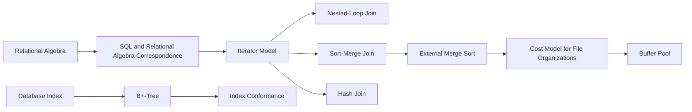

# Data Management - Map of Content

> [!abstract]
> Entry point for the Data Management course (M. Lenzerini, Sapienza): the lecture notes and the atomic review notes in `Altro/`. The course starts from the relational model and SQL, moves to data warehousing and NoSQL (graph and document databases), and then goes inside the DBMS: transactions and concurrency, buffer management, file organization and indexes, and the evaluation of relational operators.
>
> Base triennale: the undergraduate course is mapped in [[MOC - Basi di Dati]]; lecture notes contain "Base triennale:" lines pointing to the matching sections.

## Lectures

| # | Lecture | Topics |
|---|---|---|
| 1 | [[01 - DM - Introduction]] | course roadmap, relational model, relational algebra, SQL, aggregation, window functions |
| 2 | [[02 - DM - Data Warehouses]] | DSS, OLTP/OLAP, DW architectures, ETL, multidimensional model, DFM, star and snowflake schemas |
| 3 | [[03 - DM - Graph Databases - RDF, SPARQL e Knowledge Graphs]] | NoSQL, graph databases, RPQ, property graphs, RDF, SPARQL, RDFS knowledge graphs, certain answers |
| 4 | [[04 - DM - Document Databases]] | aggregates, key-value, column-family and document stores, JSON, MongoDB |
| 5 | [[05 - DM - Concurrency Control]] | schedules, view/conflict serializability, 2PL, recoverability, timestamps, MVCC, optimistic CC, SQL isolation levels, PostgreSQL |
| 6 | [[06 - DM - Buffer Management]] | buffer pool, fix/unfix, replacement policies, force/no-force |
| 7 | [[07 - DM - File Organization and Indexing]] | pages and records, heap/sorted/hashed files, cost model, external sorting, indexes, ISAM, B+-tree |
| 8 | [[08 - DM - Evaluation of Relational Operators]] | query plans, iterators, one-pass, nested-loop, sort- and hash-based, index-based and parallel algorithms |

# Lecture 1 — Relational model and SQL

## Foundations

1. [[Relational Data Model]]
2. [[Relational Algebra]]
3. [[Relational Calculus]]
4. [[Codd's Theorem]]
5. [[Set Semantics vs Bag Semantics]]

## Relational algebra operators

6. [[Selection in Relational Algebra]]
7. [[Projection in Relational Algebra]]
8. [[Cartesian Product]]
9. [[Union in Relational Algebra]]
10. [[Difference in Relational Algebra]]
11. [[Intersection in Relational Algebra]]
12. [[Theta Join]]
13. [[Equijoin]]
14. [[Natural Join]]
15. [[Derived Operators in Relational Algebra]]

## Query patterns

16. [[Existential Queries in Databases]]
17. [[Queries Expressing Absence]]
18. [[Universal Quantification in Databases]]
19. [[Finding Minimum or Maximum Rows per Group]]
20. [[Renaming in Relational Algebra]]

## SQL core

21. [[SQL and Relational Algebra Correspondence]]
22. [[Logical Order of SQL Query Evaluation]]
23. [[SQL Aliases and Attribute Qualification]]
24. [[NULL and Three-Valued Logic]]

## Aggregation and grouping

25. [[SQL Aggregate Functions]]
26. [[COUNT in SQL]]
27. [[NULL and Aggregate Functions]]
28. [[GROUP BY]]
29. [[Homogeneous Target List]]
30. [[WHERE vs HAVING]]
31. [[SQL Query Granularity]]

## Window functions

32. [[SQL Window Functions]]
33. [[GROUP BY vs Window Functions]]
34. [[OVER Clause]]
35. [[PARTITION BY]]
36. [[Window ORDER BY]]
37. [[Window Frames]]
38. [[ROWS vs RANGE]]
39. [[ROW_NUMBER]]
40. [[RANK vs DENSE_RANK vs ROW_NUMBER]]
41. [[Aggregate Window Functions]]
42. [[LAG and LEAD]]
43. [[Running Totals]]
44. [[Moving Averages]]
45. [[Top-N per Group]]

# Lecture 2 — Data warehousing

- **Context**: [[DSS]] · [[OLTP]] · [[OLAP]] · [[Data Warehouse]] · [[ETL]]
- **Modelling**: [[Multidimensional Data Model]] · [[Dimensional Fact Model]] · [[Additivity of Measures]] · [[Functional Dependency]] · [[Functional Dependency vs Key Constraint]]
- **Logical design**: [[ROLAP and MOLAP]] · [[Star Schema]] · [[Snowflake Schema]] · [[Surrogate Key]] · [[Third Normal Form 3NF]]

# Lecture 3 — Graph databases, RDF, SPARQL and knowledge graphs

- **Graph databases**: [[Graph Database Management System]] · [[Index-Free Adjacency]] · [[Property Graph]] · [[ACID]]
- **Paths**: [[Regular Expressions]] · [[Finite Automaton]] · [[Formal Language]] · [[Pumping Lemma]] · [[Regular Path Query]] (Basi di Dati) · [[YARA]]
- **RDF and SPARQL**: [[RDF]] · [[Blank Node]] · [[RDF Reification]] · [[SPARQL]] · [[Basic Graph Pattern]]
- **Knowledge graphs**: [[RDFS Knowledge Graph]] · [[Open World Assumption]] · [[Instance-Based Completion]] · [[Certain Answers]]

# Lecture 4 — Document databases

- **Why NoSQL**: [[Scaling Up vs Scaling Out]] · [[Sharding]] · [[Impedance Mismatch]] · [[CAP Theorem]]
- **Aggregate models**: [[Aggregate Data Model]] · [[Key-Value Store]] · [[Column-Family Store]] · [[Document Database]]
- **JSON and MongoDB**: [[JSON Tree]] · [[BSON]] · [[MongoDB Aggregation Pipeline]]

# Lecture 5 — Transactions and concurrency control

- **Foundations**: [[Transaction]] · [[ACID]] · [[Schedule (Concurrency)]] · [[Concurrency Anomalies]]
- **Serializability**: [[View-Serializability]] · [[Conflict-Serializability]] · [[Precedence Graph]]
- **Locking**: [[Two-Phase Locking]] · [[Lock Compatibility Matrix]] · [[Deadlock Management in DBMS]] · [[Strict Two-Phase Locking]]
- **Recovery**: [[Recoverable Schedule]]
- **Other protocols**: [[Timestamp-Based Concurrency Control]] · [[MVCC]] · [[Snapshot Isolation]] · [[Optimistic Concurrency Control]]
- **SQL**: [[SQL Isolation Levels]]

# Lecture 6 — Buffer management

[[Buffer Pool]] · [[Clock Replacement Policy]] · [[Force and No-Force]]

# Lecture 7 — File organization and indexing

- **Storage**: [[Record Identifier]] · [[Heap File]] · [[Hashed File]] · [[Cost Model for File Organizations]] · [[External Merge Sort]]
- **Indexes**: [[Database Index]] · [[Data Entry Alternatives]] · [[Clustering Index]] · [[Dense and Sparse Index]] · [[Inverted List]]
- **Tree indexes**: [[ISAM]] · [[B+-Tree]]

# Lecture 8 — Evaluation of relational operators

[[Iterator Model]] · [[One-Pass Algorithms]] · [[Nested-Loop Join]] · [[Sort-Merge Join]] · [[Hash Join]] · [[Index Conformance]] · [[Parallel Query Processing]]

## Suggested learning paths

### Formal foundations

[[Relational Data Model]] -> [[Relational Algebra]] -> [[Relational Calculus]] -> [[Codd's Theorem]]

### From algebra to SQL

[[Selection in Relational Algebra]] -> [[Projection in Relational Algebra]] -> [[Theta Join]] -> [[SQL and Relational Algebra Correspondence]]

### Negation and difficult queries

[[Difference in Relational Algebra]] -> [[Queries Expressing Absence]] -> [[Universal Quantification in Databases]]

### Aggregation

[[SQL Aggregate Functions]] -> [[GROUP BY]] -> [[WHERE vs HAVING]] -> [[SQL Query Granularity]]

### Window functions

[[SQL Window Functions]] -> [[OVER Clause]] -> [[PARTITION BY]] -> [[Window ORDER BY]] -> [[Window Frames]]

### Ranking and time-oriented analysis

[[ROW_NUMBER]] -> [[RANK vs DENSE_RANK vs ROW_NUMBER]] -> [[LAG and LEAD]] -> [[Running Totals]] -> [[Moving Averages]]

### From data model to physical execution

### Transactions end to end

[[Transaction]] -> [[Concurrency Anomalies]] -> [[Conflict-Serializability]] -> [[Precedence Graph]] -> [[Two-Phase Locking]] -> [[Strict Two-Phase Locking]] -> [[Recoverable Schedule]] -> [[SQL Isolation Levels]]

[[Timestamp-Based Concurrency Control]] -> [[MVCC]] -> [[Snapshot Isolation]] -> [[SQL Isolation Levels]]

### Physical level

[[Record Identifier]] -> [[Heap File]] -> [[Cost Model for File Organizations]] -> [[Database Index]] -> [[Clustering Index]] -> [[B+-Tree]] -> [[Index Conformance]]

[[Buffer Pool]] -> [[Clock Replacement Policy]] -> [[Force and No-Force]] -> [[ACID]]

### NoSQL and the relational model

[[Impedance Mismatch]] -> [[Aggregate Data Model]] -> [[Sharding]] -> [[CAP Theorem]] -> [[ACID]]

[[Graph Database Management System]] -> [[Property Graph]] -> [[RDF]] -> [[SPARQL]] -> [[RDFS Knowledge Graph]] -> [[Certain Answers]]

### Analytical workloads

[[OLTP]] -> [[OLAP]] -> [[Data Warehouse]] -> [[Multidimensional Data Model]] -> [[Star Schema]] -> [[Snowflake Schema]] -> [[Window Frames]]
