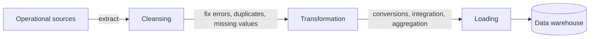

# ETL

> [!summary] In short
> The process that moves data from operational sources to the warehouse: **Extraction, Cleansing, Transformation, Loading**.

- **Extraction**: static (first full load) or incremental (only changes, from logs, timestamps or triggers).
- **Cleansing**: duplicates, inconsistent values, missing data, wrong formats.
- **Transformation**: conversion to the warehouse format, reconciliation of identifiers, derived measures, aggregation.
- **Loading**: refresh (rewrite) or update (append changes), usually in batch windows.

## Links

- **Related concepts**: [[Data Warehouse]] · [[Surrogate Key]]
- **Base triennale (Basi di Dati)**: [[Valore Nullo]] · [[Vincolo di Integrità]]
- **Map**: [[00 - Data Management MOC]]

> [!info] In depth
> - [[02 - DM - Data Warehouses#ETL: Extraction, Cleansing, Transformation, and Loading|Lecture 2 — ETL: Extraction, Cleansing, Transformation, and Loading]]
> - [[02 - DM - Data Warehouses#Extraction|Lecture 2 — Extraction]]
> - [[02 - DM - Data Warehouses#Cleansing|Lecture 2 — Cleansing]]
> - [[02 - DM - Data Warehouses#Transformation|Lecture 2 — Transformation]]
> - [[02 - DM - Data Warehouses#Loading|Lecture 2 — Loading]]
