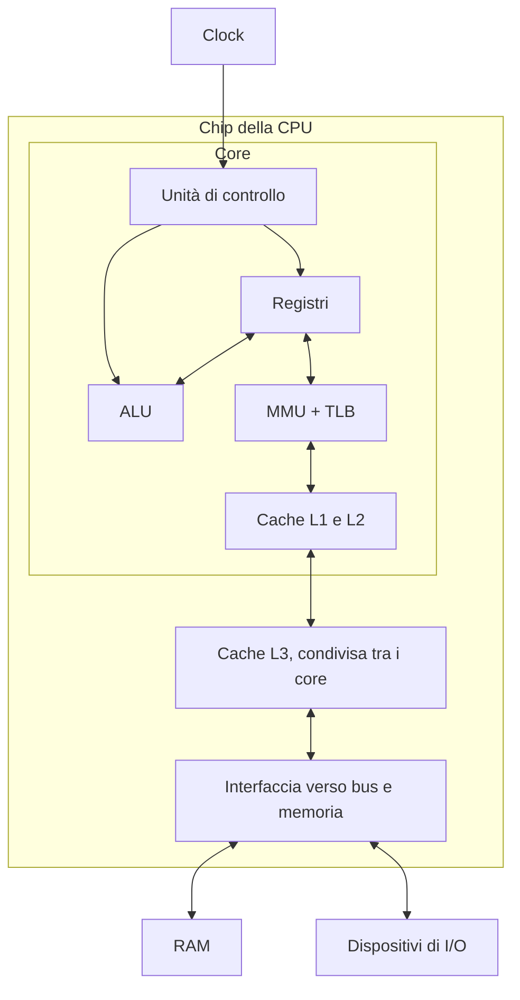
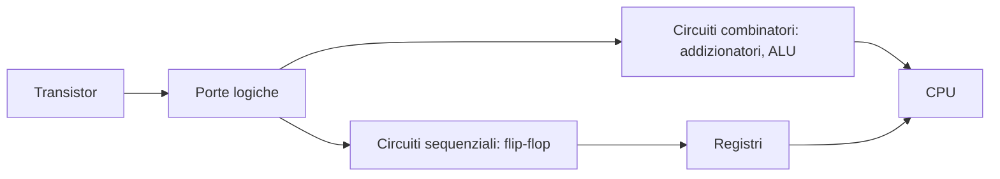
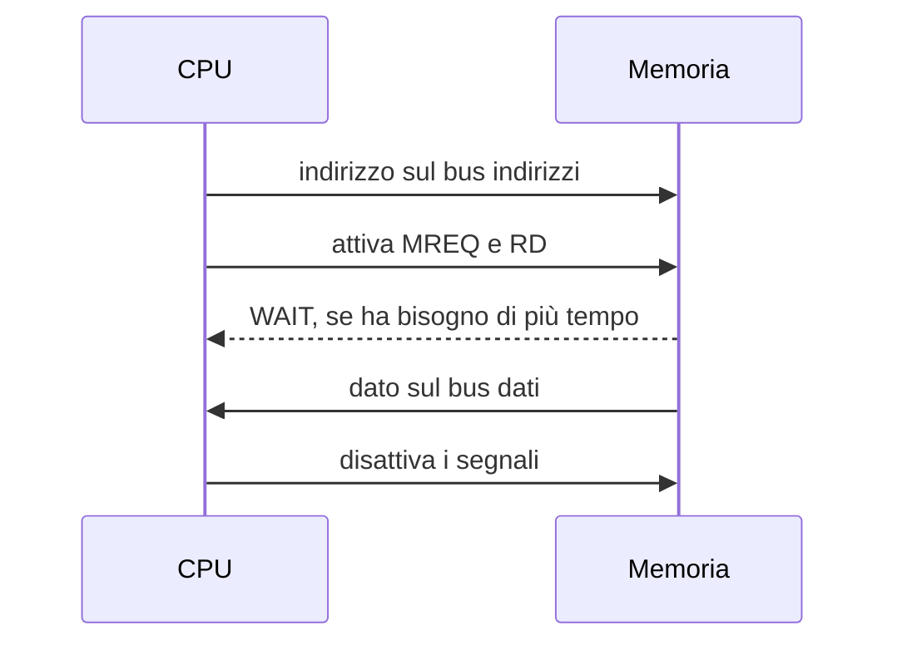

# CPU

> [!abstract] Di cosa parla questa nota
> Questa nota raccoglie in un unico posto ciò che i vari corsi dicono sulla CPU: da cosa è formata, come esegue un'istruzione, come parla con la memoria e come il sistema operativo la controlla. Parte dai transistor e arriva ai multicore e alle macchine virtuali. Ogni sezione rimanda alle note in cui l'argomento è trattato per esteso.
>
> I riquadri **Oltre gli appunti** aggiungono informazioni che non compaiono nel materiale dei corsi.

## Cos'è una CPU

La **CPU** (*Central Processing Unit*), o **processore**, è il circuito che esegue i programmi. È un chip che comunica con il resto del computer attraverso dei fili che trasportano segnali binari: tensione alta per 1, tensione bassa per 0.

Il suo lavoro, ripetuto miliardi di volte al secondo, è semplice:

1. prende dalla memoria la prossima istruzione;
2. capisce cosa chiede;
3. la esegue;
4. ricomincia.

Le istruzioni sono **codice macchina**, cioè sequenze di byte. Si dividono in tre famiglie:

| Famiglia | Cosa fa | Esempio x86 |
| --- | --- | --- |
| **Trasferimento dati** | copia valori tra registri e memoria | `mov eax, [ebx]` |
| **Aritmetico-logiche** | calcola con la ALU | `add eax, ecx` |
| **Salto** | sceglie quale istruzione eseguire dopo | `jmp`, `je`, `call` |

La CPU si colloca nella [[Macchina di Von Neumann]]: una **memoria** contiene sia i dati sia i programmi, la CPU esegue le istruzioni, e i dispositivi di **I/O** collegano la macchina all'esterno.

> [!note] CPU, core, chip
> Questi termini vengono spesso confusi.
> - **Chip** (o *processore* in senso commerciale): il componente fisico che si monta sulla scheda madre.
> - **Core**: un'unità che esegue autonomamente un flusso di istruzioni, con registri propri. Un chip moderno ne contiene diversi.
> - **CPU**: a seconda del contesto indica il chip o il singolo core. Gli appunti di Sistemi Operativi, per esempio, parlano di "più CPU (core) in un singolo chip".

## Da cosa è formata

| Componente | Che cosa fa | Di che cosa è fatto |
| --- | --- | --- |
| **ALU** (*Arithmetic Logic Unit*) | calcoli aritmetici e logici | circuiti combinatori |
| **Unità di controllo** (*Control Unit*) | decodifica le istruzioni e coordina gli altri componenti | logica combinatoria e sequenziale |
| **Registri** | contengono i dati su cui si sta lavorando | flip-flop |
| **Cache** | conserva copie dei dati usati di recente | SRAM |
| **MMU** e **TLB** | traducono gli indirizzi logici in fisici | logica e una piccola cache associativa |
| **Interfaccia verso il bus** | scambia dati con memoria e I/O | logica di controllo e pin del chip |
| **Clock** | sincronizza i componenti | onda quadra generata da un oscillatore |

### ALU

La **ALU** riceve gli operandi e il tipo di operazione, e produce il risultato. Esegue somme, sottrazioni, AND, OR, XOR, shift e confronti.

Durante il calcolo aggiorna anche i **flag**: per esempio, indica se il risultato è zero o negativo, oppure se c'è stato un riporto. I salti condizionati decidono in base a questi flag (vedi [[Istruzioni di Salto e Condition Code]]).

### Unità di controllo

L'**unità di controllo** dirige l'esecuzione. Legge l'istruzione, stabilisce cosa chiede e attiva i componenti necessari al momento giusto: quali registri leggere, quale operazione far svolgere alla ALU, se accedere alla memoria.

Non calcola i risultati: coordina chi li calcola.

### Registri

I **registri** sono piccole memorie interne alla CPU, le più veloci del sistema. Un programma può avere moltissime variabili, ma la CPU lavora direttamente su pochi registri e prende il resto dalla memoria.

| Tipo | A cosa serve | IA32 | x86-64 |
| --- | --- | --- | --- |
| **Uso generale** | contengono valori o indirizzi | `EAX`, `EBX`, `ECX`, `EDX`, `ESI`, `EDI`, `EBP`, `ESP` | `RAX`…`RSP`, `R8`…`R15` |
| **Instruction pointer** (*program counter*) | indica la prossima istruzione | `EIP` | `RIP` |
| **Stack pointer** | indica la cima dello stack | `ESP` | `RSP` |
| **Flag** | contengono i bit di stato | `EFLAGS` | `RFLAGS` |

Vedi [[Registri IA32]] e [[x86-64]].

> [!important] Un registro contiene solo bit
> La CPU non sa se un registro contiene "un numero" o "un indirizzo". Il valore diventa un indirizzo solo quando un'istruzione lo usa come tale, per esempio `mov eax, [ebx]`.

### Cache

La **cache** è una memoria SRAM veloce che conserva le copie dei dati usati di recente, così la CPU non deve attendere la RAM. Di solito è organizzata in tre livelli: **L1** e **L2** per ogni core, **L3** condivisa. Funziona grazie alla [[Località dei Riferimenti]]. Vedi [[Memoria Cache]].

### MMU e TLB

La [[MMU]] traduce a ogni accesso l'indirizzo logico prodotto dal programma nell'indirizzo fisico, e solleva un'eccezione se l'accesso non è valido. Configurarla è un'operazione privilegiata: è così che un processo viene isolato dagli altri.

Consultare ogni volta la page table sarebbe lento, quindi la [[TLB]] tiene una piccola cache delle ultime traduzioni.

## Dal transistor al processore

Una CPU si costruisce per strati, ciascuno fatto dei componenti dello strato sotto.

1. **Transistor**: un interruttore comandato da un segnale elettrico.
2. **[[Porte Logiche]]**: pochi transistor collegati calcolano una funzione booleana. Per esempio, AND si ottiene con due transistor in serie e OR con due in parallelo.
3. **[[Circuiti Combinatori e Addizionatori|Circuiti combinatori]]**: l'output dipende solo dagli input attuali. Un **full adder** somma due bit e un riporto. Mettendone $n$ in cascata si sommano numeri di $n$ bit: è il cuore della ALU.
4. **Circuiti sequenziali**: l'output dipende anche dalla storia degli input, quindi il circuito ha una memoria. Il [[Flip-Flop SR]] è fatto di due porte NOR collegate in feedback e conserva un bit. I registri si costruiscono con questi elementi.

Con la **VLSI** (*Very Large Scale Integration*) questi circuiti vengono realizzati su un **wafer** di silicio, poi ritagliato in singoli chip.

![[SDC-p017-2.png]]

La dispensa di Sistemi di Calcolo cita circa 17 milioni di transistor per mm² e circa 3 miliardi di transistor in un Core i7. Oggi i processori più grandi ne hanno decine di miliardi.

## ISA e microarchitettura

L'**ISA** (*Instruction Set Architecture*) è il contratto tra hardware e software: definisce registri, istruzioni e il loro effetto. Un programma compilato per una ISA gira su qualunque CPU che la implementa.

La **microarchitettura** è il modo in cui una certa CPU realizza quella ISA. Due processori Intel e AMD hanno circuiti diversi, ma eseguono lo stesso codice x86-64.

| | **RISC** | **CISC** |
| --- | --- | --- |
| Istruzioni | poche e semplici | molte e complesse |
| Istruzioni per un compito | di più | di meno |
| Dimensione | spesso fissa (32 bit in ARM classico) | variabile (da 1 a 15 byte in x86) |
| Esempi | ARM, MIPS, PowerPC, SPARC | x86 |

L'**ABI** è un'altra cosa: stabilisce le convenzioni tra programmi compilati, come il passaggio dei parametri. Non dipende solo dalla CPU, ma anche dal sistema operativo e dai compilatori. Vedi [[ABI e ISA]].

Quando si dice che una CPU è "a 64 bit" di solito ci si riferisce alla dimensione dei registri di uso generale. Il termine **word** invece è ambiguo: in x86 indica 16 bit per motivi storici, anche sulle CPU a 64 bit (vedi [[2 - MA - X86 Assembly#Word size and endianness|la lezione di Malware Analysis]]). L'ordine dei byte in memoria dipende dall'architettura: vedi [[Big-Endian and Little-Endian]].

## Il ciclo di un'istruzione

In forma minima, il ciclo è **fetch → decode → execute**. Sistemi di Calcolo usa uno schema RISC più dettagliato, a cinque stadi:

| Stadio | Cosa succede |
| --- | --- |
| **Fetch** (F) | preleva l'istruzione dalla memoria e calcola l'indirizzo della successiva |
| **Decode** (D) | interpreta l'istruzione e legge operandi immediati e registri di input |
| **Execute** (E) | la ALU esegue l'operazione, se serve |
| **Memory** (M) | legge o scrive la memoria, se serve |
| **Write-back** (W) | aggiorna i registri di output, se serve |

Istruzioni diverse usano stadi diversi:

- `mov eax, 0`: F, D, W;
- `add ecx, eax`: F, D, E, W;
- `mov eax, [ebx]`: F, D, E (calcolo dell'indirizzo), M, W.

> [!example] L'instruction pointer è già avanti
> L'aggiornamento avviene già in fase di fetch, quindi mentre un'istruzione è in esecuzione l'instruction pointer indica già quella successiva. In x86 le istruzioni hanno lunghezza variabile, quindi l'avanzamento dipende dalla lunghezza dell'istruzione.
>
> Un salto, una `call`, una `ret` o un'eccezione sostituiscono questo valore e cambiano il percorso del programma. Se un'analisi parte dal byte sbagliato, gli stessi byte vengono letti come istruzioni diverse: su questo si basa l'[[2 - MA - X86 Assembly#Anti-disassembly|anti-disassembly]] visto in Malware Analysis.

## Clock

Il **clock** è un'onda quadra che sincronizza i componenti: le operazioni avvengono sui fronti del segnale. La **frequenza** $f$ indica i cicli al secondo, e la durata di un ciclo è:

$$T = \frac{1}{f}$$

A 3 GHz, quindi, un ciclo dura circa $0{,}33$ ns.

La frequenza ha un limite. Il segnale deve attraversare il circuito e stabilizzarsi prima del fronte successivo, e il calore prodotto cresce con la velocità. Oltre una certa soglia il sistema diventa instabile. Nelle CPU moderne la frequenza varia dinamicamente per controllare calore e consumi.

> [!warning] Correzione
> Gli appunti di Sistemi di Calcolo riportano come riferimento "circa 10 ns per 15 cm di conduttore metallico". Il valore comunemente citato per una pista su scheda è circa **1 ns per 15 cm**, cioè dieci volte più veloce. Sui fili sottilissimi dentro un chip il segnale è invece molto più lento. Conviene controllare il dato sulla dispensa.

> [!note] Oltre gli appunti: la frequenza non basta
> Il tempo di esecuzione di un programma dipende da tre fattori:
>
> $$T_{\text{programma}} = N_{\text{istruzioni}} \times \text{CPI} \times T_{\text{clock}}$$
>
> dove CPI indica i cicli medi per istruzione. Per questo una CPU a frequenza più bassa può essere più veloce di una a frequenza più alta.

## Pipeline

Gli stadi usano parti diverse della CPU. Quando un'istruzione passa dal fetch al decode, si può già prelevare la successiva, come in una **catena di montaggio**. Questa tecnica è il [[Pipelining]].

![[SDC-p127-1.png]]

Senza pipeline tre istruzioni richiedono 15 stadi in sequenza; con la pipeline ne bastano 7.

- La **latenza** della singola istruzione non migliora.
- Il **throughput** può crescere, idealmente, di un fattore pari al numero di stadi.

La pipeline non può sempre restare piena. Gli ostacoli si chiamano **hazard**:

| Hazard | Problema | Soluzioni |
| --- | --- | --- |
| **Strutturale** | due istruzioni vogliono lo stesso componente | hardware duplicato (come le cache separate per dati e istruzioni), stallo |
| **Sui dati** | serve un risultato non ancora scritto | stallo con "bolle", riordino delle istruzioni |
| **Sul controllo** | dopo un salto condizionato non si sa quale istruzione viene dopo | **branch prediction**, istruzioni *branchless* come `CMOV` |

Se la predizione è sbagliata (**branch misprediction**), la CPU svuota la pipeline e riparte dal ramo corretto, perdendo il lavoro già fatto.

> [!note] Oltre gli appunti: le CPU moderne
> Le CPU per PC e server vanno oltre il modello a cinque stadi.
> - **Forwarding**: il risultato passa subito all'istruzione che lo aspetta, senza attendere il write-back. Molti stalli sui dati vengono così evitati.
> - **Superscalare**: il core esegue più istruzioni per ciclo.
> - **Out-of-order**: le istruzioni vengono eseguite appena i loro dati sono pronti, ma i risultati vengono resi visibili nell'ordine del programma.
> - **Micro-operazioni**: x86 traduce internamente le istruzioni complesse in operazioni semplici. Per questo `add eax, [ebx]` funziona, anche se nello schema a cinque stadi la memoria viene letta dopo la ALU.
> - **Esecuzione speculativa**: la CPU esegue in anticipo il ramo previsto e scarta il lavoro se la previsione era sbagliata. Le tracce lasciate in cache da questo lavoro sono alla base di attacchi come Spectre.
> - **SMT** (*Simultaneous Multithreading*, in Intel *Hyper-Threading*): un core fisico si presenta come due **core logici**, con due insiemi di registri che condividono le unità di esecuzione.

## Come comunica con la memoria

La CPU è collegata agli altri componenti tramite il [[Bus di Sistema]], formato da tre gruppi di fili.

| Bus | Trasporta | Se è largo $n$ bit |
| --- | --- | --- |
| **Indirizzi** | l'indirizzo della cella a cui accedere | può indirizzare $2^n$ celle |
| **Dati** | il dato letto o scritto | trasferisce $n$ bit alla volta |
| **Controllo** | segnali come `RD`, `WR`, `MREQ`, `IORQ`, `WAIT`, `INT` | |

Lo **Z80**, una CPU a 8 bit, mostra bene come appaiono questi bus sui pin del chip. Ha 16 fili di indirizzo, quindi indirizza $2^{16}$ byte = 64 KB, e 8 fili di dati, quindi trasferisce un byte alla volta.

![[SO-L04-01.png]]

Una lettura dalla memoria si svolge così (vedi [[Ciclo di Lettura e Scrittura in Memoria]]):

La CPU comunica con le periferiche allo stesso modo: con il [[Memory Mapped IO]] i loro registri appaiono come celle di memoria. Il [[DMA]] permette invece a un dispositivo di trasferire dati in memoria senza far copiare ogni byte alla CPU: il dispositivo richiede il bus con `BUSRQ` e la CPU lo concede con `BUSACK`.

### Organizzazione del sistema

Lo schema classico degli appunti collega la CPU a un **Northbridge** (o *I/O bridge*) per i componenti veloci, come memoria e grafica, e a un **Southbridge** per quelli lenti, come dischi e USB.

> [!note] Oltre gli appunti: i sistemi attuali
> Oggi il controller della memoria e parte dei collegamenti PCIe sono integrati nel chip della CPU. Il Northbridge non esiste più come chip separato, e le sue funzioni sono passate al processore. I core e la cache L3 comunicano attraverso un'interconnessione interna, invece che su un singolo bus condiviso.

## Gerarchia di memoria

La CPU è molto più veloce della RAM. Per colmare il divario si usa una [[Gerarchia di Memoria]], in cui ogni livello è più lento e più capiente di quello sopra.

| Livello | Latenza indicativa | Dimensione indicativa | Posizione |
| --- | --- | --- | --- |
| **Registri** | meno di 1 ns | centinaia di byte | core |
| **L1** | circa 1 ns | circa 64 KB | core |
| **L2** | circa 4 ns | circa 256 KB | core |
| **L3** | circa 16 ns | circa 6 MB | chip, condivisa |
| **RAM** | circa 100 ns | circa 16 GB | scheda madre |
| **SSD** / **disco** | circa 16 µs / circa 3 ms | terabyte | periferica |

Un accesso alla RAM costa quindi circa cento volte un accesso alla L1. Di conseguenza, l'ordine in cui un programma accede ai dati influisce molto sulle prestazioni. Un dato assente dalla cache causa un **miss**: si parla di miss *cold*, *capacity* o *conflict* in base al motivo. Vedi [[Memoria Cache]].

## Interrupt ed eccezioni

La CPU non si limita a eseguire istruzioni in sequenza: deve anche reagire agli eventi. Dopo ogni istruzione controlla se ci sono [[Interrupt]] da servire.

| Tipo | Origine | Intenzionale | Dopo la gestione | Esempio |
| --- | --- | --- | --- | --- |
| **Interrupt hardware** (asincrono) | segnale IRQ su un pin | no | riprende il programma | tasto premuto, timer |
| **Trap** | istruzione apposita | sì | riprende dall'istruzione **successiva** | `int 0x80` |
| **Fault** | errore dell'istruzione | no | **riesegue** l'istruzione | page fault |
| **Abort** | errore grave | no | non si riprende | errore hardware |

Quando arriva un interrupt, la CPU:

1. completa l'istruzione corrente;
2. salva `PC` e `FLAGS`;
3. usa il numero dell'interrupt come indice nell'[[Interrupt Vector]] (la **IDT** su x86) per trovare il gestore;
4. esegue il gestore;
5. con `iret` ripristina lo stato salvato.

Vedi anche [[Eccezioni]].

## Modalità di privilegio

La CPU impedisce ai programmi normali di eseguire operazioni pericolose, come configurare la MMU o disabilitare gli interrupt. A questo serve la [[Dual Mode]]:

- **kernel mode**: tutte le istruzioni sono permesse;
- **user mode**: le istruzioni privilegiate causano un'eccezione.

Il passaggio tra le due avviene solo attraverso ingressi controllati: interrupt, eccezioni e system call. Per questo un programma non può alzarsi i privilegi da solo. x86 realizza questo meccanismo con i [[Protection Rings]]: ring 0 per il kernel e ring 3 per gli utenti. Si entra nel kernel con `int 0x80` o `int 0x2e`, `sysenter` e `syscall`.

> [!note] Oltre gli appunti: dove si trova il livello corrente su x86
> Il modello generale parla di un *mode bit*. Su x86, il livello di privilegio corrente (CPL) è contenuto nei due bit bassi del registro di segmento `CS`.

## La CPU e il sistema operativo

Un core esegue un solo flusso di istruzioni alla volta. L'impressione che più programmi girino insieme è creata dal sistema operativo con il **time-sharing**.

1. Un **timer** genera periodicamente un interrupt e il controllo passa al kernel.
2. Il [[CPU Scheduler e Dispatcher|CPU scheduler]] sceglie il prossimo processo tra quelli pronti.
3. Il [[Context Switch]] salva i registri del processo interrotto e carica quelli del nuovo.

Il context switch è **puro overhead**: lascia inoltre cache e TLB "fredde" per il nuovo processo. Per questo il quanto di tempo deve essere molto più lungo del context switch.

Lo scheduler sfrutta anche il comportamento dei programmi, che alternano [[CPU Burst e IO Burst|CPU burst e I/O burst]]. Mentre un processo attende l'I/O, la CPU può eseguirne un altro.

## Dal singolo core al multicore

Per decenni l'aumento della frequenza ha reso i programmi più veloci senza doverli modificare. Intorno al **2004** questa tendenza si è interrotta a causa del calore. I transistor però continuavano ad aumentare, e i produttori li hanno usati per mettere più core nello stesso chip.

![[SDC-p096-1.png]]

> [!warning] Correzione
> Gli appunti di [[01 - SO - Introduzione e Git#Multicore e Symmetric Multiprocessing|Sistemi Operativi]] attribuiscono lo stop della frequenza anche al fatto che "non si riesce a rimpicciolire ulteriormente i componenti". Il grafico qui sopra, di Sistemi di Calcolo, mostra però che nel 2004 il numero di transistor continuava a crescere. Il limite principale era il **calore**.

> [!warning] Correzione
> La [[05 - SDC - Ottimizzazione dei programmi#Quanto conta ottimizzare le prestazioni|nota di Sistemi di Calcolo]] attribuisce a Moore, negli anni '70, la previsione di un raddoppio ogni 18 mesi, poi corretta a 24. Moore aveva previsto nel 1965 un raddoppio circa annuale e nel 1975 lo corresse a **due anni**. I 18 mesi vengono di solito attribuiti a David House di Intel e si riferiscono alle prestazioni.

Un programma non diventa più veloce da solo con più core: va scritto in modo **parallelo**, e il guadagno è limitato dalla sua parte sequenziale (vedi [[Speedup e Legge di Amdahl]]).

![[SO-L01-03.png]]

Ogni core ha i propri registri e cache private, mentre la memoria principale è comune. Questa organizzazione comporta due conseguenze:

- l'accesso alla memoria condivisa può diventare un **collo di bottiglia**;
- le cache private possono contenere copie diverse dello stesso dato, e l'hardware deve garantirne la **coerenza**.

I core possono essere identici, nel [[Symmetric Multiprocessing]], e il sistema operativo distribuisce il lavoro tra di loro con lo [[Scheduling Multiprocessore]]. L'**affinità** tende a mantenere un processo sullo stesso core, per riusare la sua cache.

### Tipi di parallelismo

La [[Tassonomia di Flynn]] classifica i sistemi in base ai flussi di istruzioni e di dati.

| Categoria | Istruzioni | Dati | Esempio |
| --- | --- | --- | --- |
| **SISD** | una | uno | uniprocessore classico |
| **SIMD** | una | molti | SSE/AVX, GPU |
| **MISD** | molte | uno | praticamente non usata |
| **MIMD** | molte | molti | multicore, cluster |

Lo stesso processore combina più livelli: pipeline all'interno del core (parallelismo tra istruzioni), SIMD nelle istruzioni vettoriali, MIMD tra i core. I [[Thread]] di un processo sono il modo con cui il software sfrutta i vari core: condividono memoria e codice, ma ognuno ha i propri registri e il proprio stack.

## Virtualizzare la CPU

Una macchina virtuale vede delle **CPU virtuali** (vCPU), che l'hypervisor assegna ai core reali. Ci sono due casi principali:

- **emulazione**: se le architetture sono diverse (ARM su x86), ogni istruzione va tradotta, quindi è lenta;
- **esecuzione diretta**: se le architetture sono uguali, la maggior parte delle istruzioni gira direttamente sulla CPU reale.

Con la virtualizzazione assistita dall'hardware (**Intel VT-x**, **AMD-V**), quando la VM tenta un'operazione privilegiata la CPU la intrappola e passa il controllo all'hypervisor, che la emula (*trap-and-emulate*). Vedi [[1 - Cloud Computing, Virtualizzazione e Containerization]].

## CPU e Malware Analysis

Conoscere la CPU serve anche per analizzare un malware, che spesso ne sfrutta i dettagli.

| Dettaglio della CPU | Uso nel malware |
| --- | --- |
| Istruzioni a lunghezza variabile | [[2 - MA - X86 Assembly#Anti-disassembly\|anti-disassembly]] con istruzioni sovrapposte |
| Istruzione `cpuid` | [[CPUID Hypervisor Detection\|rilevare l'hypervisor]], anche dal tempo di un VM exit |
| Contatore di cicli `rdtsc` | [[Timing Attacks]] per accorgersi di debugger e VM |
| Istruzione `sidt`, che legge la posizione della IDT | [[Red Pill]] per riconoscere una VM |
| Ring di protezione | passaggio da user a kernel con le [[Protection Rings\|system call]] |

## Riepilogo

> [!summary] In sintesi
> - La CPU esegue istruzioni in ciclo: **fetch, decode, execute**.
> - È formata da **unità di controllo**, **ALU**, **registri**, **cache**, **MMU/TLB** e **interfaccia verso il bus**, sincronizzati dal **clock**.
> - È costruita a strati: transistor, porte logiche, circuiti combinatori e sequenziali.
> - L'**ISA** è il contratto con il software, la microarchitettura è la sua realizzazione.
> - La **pipeline** aumenta il throughput, ma è limitata dagli **hazard**.
> - La **gerarchia di memoria** riduce il divario di velocità con la RAM.
> - **Interrupt** e **modalità di privilegio** permettono al sistema operativo di mantenere il controllo.
> - Dal 2004 circa, le prestazioni crescono soprattutto aggiungendo **core**.

## Collegamenti

- **Sistemi di Calcolo**: [[01 - SDC - Cosa è un sistema di calcolo]] · [[05 - SDC - Ottimizzazione dei programmi]] · [[06 - SDC - Esecuzione dei programmi]] · [[MOC - Sistemi di Calcolo]]
- **Sistemi di Calcolo 2**: [[01 - SDC2 - Processi e Thread]] · [[MOC - Sistemi di Calcolo 2]]
- **Sistemi Operativi**: [[01 - SO - Introduzione e Git]] · [[04 - SO - Hardware e AVR]] · [[05 - SO - Stack e Context Switch]] · [[09 - SO - CPU Scheduling]] · [[10 - SO - Gestione della Memoria]] · [[Microcontrollore e Bootloader]] · [[MOC - Sistemi Operativi]]
- **Malware Analysis**: [[2 - MA - X86 Assembly]] · [[5 - MA - Malware Evasion]] · [[MOC - Malware Analysis]]
