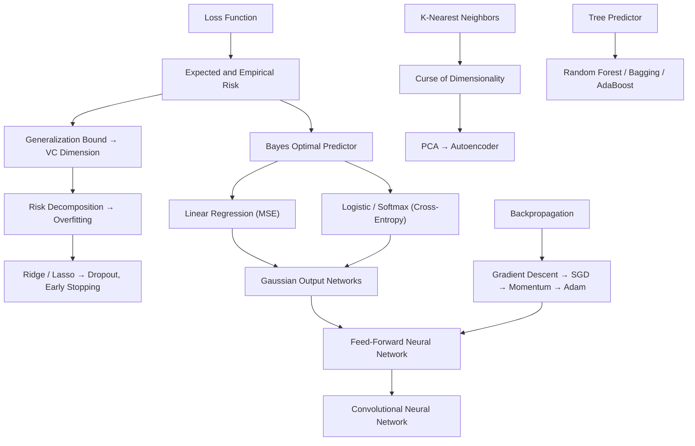

# MOC — Machine Learning

> [!abstract]
> Map of the Machine Learning course (Master's, Sapienza, 2025/26). **Part 1** (prof. Federico Fusco) covers classical ML and learning theory, from decision theory to trees. **Part 2** (prof. Fabio Patrizi) starts with kNN and clustering, then neural networks (FNN, training, CNN), dimensionality reduction and ensembles. Each lecture has a full note; each concept has a short review note in `Concetti/`.
>
> The older notes on Part 1 (`0 - ML - …` to `6 - ML - …`, with Simone's comments, the extra explanations in `Exercises/Extra/` and the generated videos) are kept unchanged and linked from the new ones.

## Part 1 — Fusco

| # | Lecture | Topics |
|---|---|---|
| 1 | [[01 - ML - Decision Theory and Naive Bayes]] | loss, expected risk, Bayes predictor, likelihood ratio, TPR/FPR, ROC, Neyman–Pearson, Naive Bayes |
| 2 | [[02 - ML - Linear Regression and OLS]] | 1-D regression, feature maps, OLS, projection, linear assumption, bias/variance, risk of OLS |
| 3 | [[03 - ML - Overfitting, Regularization and Gradient Descent]] | polynomial regression, overfitting, Ridge/Lasso/Elastic Net, cost of OLS, convexity, GD convergence, SGD |
| 4 | [[04 - ML - Logistic Regression and Softmax]] | sigmoid, KL divergence, cross-entropy, gradient ascent, softmax, concavity |
| 5 | [[05 - ML - Perceptron, SVM and Kernels]] | Perceptron and Novikoff bound, margin, hard/soft-margin SVM, hinge loss, sub-gradients, kernel trick |
| 6 | [[06 - ML - Generalization Bounds and Tree Predictors]] | union bound, Hoeffding, finite classes, VC dimension, risk decomposition, trees, Gini/entropy, random forests |

Older versions: [[0 - ML - Requirements to understand ML]] · [[1 - ML - Decision Theory]] · [[2 - ML - Linear Regression Part 1]] · [[3 - ML - Linear Regression Part 2]] · [[4 - ML - Logistic and Softmax Regression]] · [[5 - ML - Perceptron and SVM]] · [[6 - ML - Statistical Learning and Tree Predictors]] · [[Sintesi Fusco]]

## Part 2 — Patrizi

| # | Lecture | Topics |
|---|---|---|
| 7 | [[07 - ML - K-Nearest Neighbors]] | parametric vs non-parametric, kNN, normalisation, 1-NN bound, curse of dimensionality, kNN regression |
| 8 | [[08 - ML - Clustering]] | unsupervised learning, linkage-based clustering, dendrogram, k-means and variants, Kleinberg |
| 9 | [[09 - ML - Feed-Forward Neural Networks]] | neuron, ReLU, shallow/deep networks, universal approximation, loss recipe (Gaussian/Bernoulli/Categorical), matrix notation |
| 10 | [[10 - ML - Training Neural Networks]] | GD, SGD, mini-batch/epoch, momentum, Adam, backpropagation, initialisation, regularisation, tensors |
| 11 | [[11 - ML - Convolutional Neural Networks]] | 1-D/2-D convolution, stride/dilation/padding, channels, receptive field, pooling, upsampling, AlexNet/VGG, segmentation |
| 12 | [[12 - ML - Dimensionality Reduction]] | PCA (reconstruction error, variance maximisation), autoencoders |
| 13 | [[13 - ML - Ensemble Methods]] | weak learnability, AdaBoost, bagging, exercise session on linear regression |

## Concepts by theme

### Decision theory and evaluation
[[Loss Function]] · [[Expected and Empirical Risk]] · [[Bayes Optimal Predictor]] · [[Likelihood Ratio Test]] · [[Classification Metrics]] · [[ROC Curve]] · [[Neyman-Pearson Lemma]] · [[Naive Bayes Classifier]]

### Linear models
[[Linear Regression]] · [[Linear-in-Parameters Model]] · [[Ordinary Least Squares]] · [[OLS as Orthogonal Projection]] · [[Linear Assumption]] · [[Bias and Variance of OLS]] · [[Polynomial Regression]] · [[Logistic Regression]] · [[Sigmoid Function]] · [[Softmax Regression]] · [[Kullback-Leibler Divergence]] · [[Cross-Entropy Loss]]

### Margins and kernels
[[Perceptron Algorithm]] · [[Margin]] · [[Hard-Margin SVM]] · [[Soft-Margin SVM]] · [[Hinge Loss]] · [[Kernel Trick]]

### Overfitting, regularisation and learning theory
[[Overfitting]] · [[Ridge Regression]] · [[Lasso Regression]] · [[Elastic Net]] · [[Generalization Bound]] · [[Union Bound]] · [[Hoeffding Inequality]] · [[VC Dimension]] · [[Risk Decomposition]]

### Optimisation
[[Gradient Descent]] · [[Stochastic Gradient Descent]] · [[Mini-Batch and Epoch]] · [[Momentum]] · [[Adam Optimizer]] · [[Backpropagation]]

### Trees and ensembles
[[Tree Predictor]] · [[Impurity Measures]] · [[Random Forest]] · [[Weak Learnability]] · [[AdaBoost]] · [[Bagging]]

### Instance-based and unsupervised learning
[[Parametric vs Non-Parametric Models]] · [[K-Nearest Neighbors]] · [[Feature Normalization]] · [[Curse of Dimensionality]] · [[Clustering]] · [[Linkage-Based Clustering]] · [[K-Means]] · [[Kleinberg Impossibility Theorem]] · [[Principal Component Analysis]] · [[Autoencoder]]

### Neural networks
[[Feed-Forward Neural Network]] · [[Activation Function]] · [[ReLU]] · [[Universal Approximation Theorem]] · [[Deep Neural Network]] · [[Gaussian Output Networks]] · [[Weight Initialization]] · [[Vanishing and Exploding Gradients]] · [[Early Stopping]] · [[Dropout]] · [[Tensor]] · [[Convolutional Neural Network]] · [[Receptive Field]] · [[Pooling]] · [[Upsampling and Transposed Convolution]]

## Cross-cutting paths

- **From loss to network output**: [[Loss Function]] → [[Bayes Optimal Predictor]] (squared loss → conditional mean) → [[Linear Regression]] → [[Gaussian Output Networks]] (MSE = Gaussian negative log-likelihood).
- **Probabilistic classification**: [[Sigmoid Function]] → [[Logistic Regression]] → [[Kullback-Leibler Divergence]] → [[Cross-Entropy Loss]] → [[Softmax Regression]] → output layers of [[Feed-Forward Neural Network]].
- **Why complex models overfit**: [[Polynomial Regression]] → [[Overfitting]] → [[Bias and Variance of OLS]] ($\sigma^2d/n$) → [[VC Dimension]] → [[Risk Decomposition]].
- **Fighting overfitting everywhere**: [[Ridge Regression]] / [[Lasso Regression]] → [[Soft-Margin SVM]] (L2 term) → [[Early Stopping]] / [[Dropout]] → [[Bagging]] / [[Random Forest]].
- **Optimisation chain**: [[Gradient Descent]] (convexity, condition number) → [[Stochastic Gradient Descent]] → [[Mini-Batch and Epoch]] → [[Momentum]] → [[Adam Optimizer]], with gradients from [[Backpropagation]] and stable scales from [[Weight Initialization]].
- **Linear classifiers**: [[Perceptron Algorithm]] → [[Margin]] → [[Hard-Margin SVM]] → [[Soft-Margin SVM]] + [[Hinge Loss]] → [[Kernel Trick]]; stacking perceptrons → [[Feed-Forward Neural Network]].
- **Distances and dimension**: [[Feature Normalization]] → [[K-Nearest Neighbors]] → [[Curse of Dimensionality]] → [[Principal Component Analysis]] → [[Autoencoder]]; distances again in [[Clustering]] and [[K-Means]].
- **Projections**: [[OLS as Orthogonal Projection]] ↔ [[Principal Component Analysis]] ($UU^T$).
- **Weak to strong**: [[Tree Predictor]] → [[Weak Learnability]] → [[AdaBoost]]; [[Tree Predictor]] → [[Bagging]] → [[Random Forest]].

## Exams and material

- Past exams in `Exercises/`: Erasmus session 17-12-25, First Session 28-01-26, Second Session 17-02-26, sample exam questions (Patrizi). The exam questions referenced in the notes are marked "Exam check".
- Related courses: [[MOC - Probabilità e Statistica]] (probability background), [[Convex Function]] (Geometria), [[1 - Data Mining - Introduction to Data Mining and Big Data|Data Mining]].
- Generated videos (Part 1): see the *Video* sections of [[05 - ML - Perceptron, SVM and Kernels]] and [[06 - ML - Generalization Bounds and Tree Predictors]].
