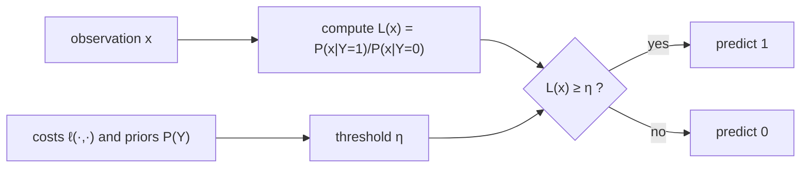
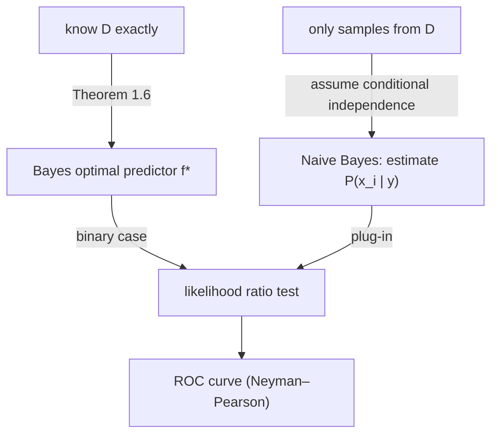

# Decision Theory and Naive Bayes

> [!abstract]
> First week of Part 1 (prof. Federico Fusco). Before studying *any* learning algorithm we need a language to say what a "good" predictor is. Decision theory gives it: a **loss function** measures a single mistake, the **expected risk** averages it over the data distribution, and the **Bayes optimal predictor** is the best we could ever do *if we knew the distribution*. We then specialise everything to **binary classification** (likelihood ratio, TPR/FPR, ROC curve) and finally drop the unrealistic "we know everything" assumption with the **Naive Bayes classifier**, our first estimator.
>
> Everything that follows in the course (linear regression in [[02 - ML - Linear Regression and OLS|Week 2]], generalization bounds in [[06 - ML - Generalization Bounds and Tree Predictors|Week 6]], the losses used to train neural networks in [[09 - ML - Feed-Forward Neural Networks|Part 2]]) is phrased in this framework.
>
> Index: [[MOC - Machine Learning]] · Previous version of these notes: [[1 - ML - Decision Theory]]

---

## 1. The setting

See [[Loss Function]] and [[Expected and Empirical Risk]].

The world is modelled by a **joint distribution** $D$ over $\mathcal{X}\times\mathcal{Y}$:

- $\mathcal{X}$ is the **input / feature space** (e.g. $\mathbb{R}^d$: a vector of measurements);
- $\mathcal{Y}$ is the **label space** (e.g. $\{0,1\}$ for spam / not spam, $\mathbb{R}$ for a price).

A sample $(X,Y)\sim D$ is a random pair "observation + correct answer". We want a **predictor** $f:\mathcal{X}\to\mathcal{Y}$ that, given $x$, guesses the corresponding $y$.

To say whether $f$ is good we need a number that scores each guess: the **loss function** $\ell:\mathcal{Y}\times\mathcal{Y}\to\mathbb{R}$, where $\ell(a,b)$ is the price paid when we predict $a$ and the truth is $b$.

> [!example] Example 1.1 — the most common losses
> | Loss | Formula | Typical task |
> |---|---|---|
> | 0-1 loss | $\ell(a,b)=\mathbb{1}\{a\neq b\}$ | classification (counts mistakes) |
> | squared loss | $\ell(a,b)=(a-b)^2$ | regression (punishes big errors a lot) |
> | absolute loss | $\ell(a,b)=\lvert a-b\rvert$ | regression (more robust to outliers) |

> [!example] Example 1.2 — binary classification
> With $\mathcal{Y}=\{0,1\}$ there are only four possible (prediction, truth) pairs, so **any** loss is fully described by four numbers:
> $\ell(1,1)$ (true positive), $\ell(0,0)$ (true negative), $\ell(1,0)$ (false positive), $\ell(0,1)$ (false negative).
> Choosing them differently encodes *which mistake is worse*: in a malware detector a missed attack (FN) usually costs far more than a false alarm (FP).

> [!important] Who chooses what
> The distribution $D$ is **given by the environment**: we cannot change it. The loss is a **modelling choice** of the designer, and it should reflect the application (medical test, fraud detection, recommender…).

### Expected risk

> [!note] Definition 1.3 — Expected risk
> Given $D$ on $\mathcal{X}\times\mathcal{Y}$ and a loss $\ell$, the **expected risk** of $f$ is
> $$R(f)=\mathbb{E}_{(X,Y)\sim D}\big[\ell(f(X),Y)\big].$$
> For discrete spaces this is simply $R(f)=\sum_{x}\sum_{y}\ell(f(x),y)\,\mathbb{P}(X=x,Y=y)$: every possible mistake weighted by how often it happens.

> [!warning] Correzione
> The handout writes "Given distribution $D$ on $\mathcal{X}\times\mathcal{X}$". It is a typo: the distribution is on $\mathcal{X}\times\mathcal{Y}$ (features **and** labels).

The randomness is in the sampling of $(X,Y)$, **not** in $f$: $f$ is a fixed function.

> [!example] Example 1.4 — computing a risk by hand
> $\mathcal{X}=\{1,2,3\}$, $\mathcal{Y}=\{0,1\}$, 0-1 loss, $f(1)=f(3)=1$, $f(2)=0$.
>
> | | $Y=0$ | $Y=1$ |
> |---|---|---|
> | $X=1$ | $0$ | $1/6$ |
> | $X=2$ | $1/2$ | $1/12$ |
> | $X=3$ | $1/12$ | $1/6$ |
>
> $f$ is wrong exactly when $(X,Y)=(2,1)$ (predicts 0, truth 1) or $(X,Y)=(3,0)$ (predicts 1, truth 0); the case $(1,0)$ would also be a mistake but has probability 0. So
> $$R(f)=\tfrac{1}{12}\cdot 1+\tfrac{1}{12}\cdot 1=\tfrac16 .$$
> Simone's step-by-step explanation: [[Spiegazione Example 1.4 ML]].

---

## 2. The Bayes optimal predictor

See [[Bayes Optimal Predictor]].

It is natural to call "best" the predictor with the smallest expected risk.

> [!note] Definition 1.5 — (Bayes) optimal predictor
> $f^*$ is **optimal** if it minimises $R(f)$ among all functions $\mathcal{X}\to\mathcal{Y}$.

> [!important] Theorem 1.6 — closed form of $f^*$
> $$f^*(x)\in\arg\min_{z\in\mathcal{Y}}\ \mathbb{E}\big[\ell(z,Y)\mid X=x\big]\qquad\forall x\in\mathcal{X}.$$
> The expectation is **only over $Y$**, conditioned on the observed $x$. The arg min can contain several elements, so $f^*$ need not be unique.

**Why it is true (proof idea).** By the law of iterated expectation (see [[Teorema del Valore Atteso Iterato]])
$$R(f)=\mathbb{E}_X\Big[\underbrace{\mathbb{E}\big[\ell(f(X),Y)\mid X\big]}_{\text{depends on }f\text{ only through }f(X)}\Big].$$
The outer expectation is an average of non-negative quantities indexed by $x$; if for **each** $x$ we pick the value $f(x)$ that minimises the inner term, the average is also minimised. That pointwise choice is exactly $f^*$. (Simone's detailed version: [[Spiegazione theroem 1.6 ML]].)

The formula becomes concrete once the distribution is specified:

- $\mathcal{Y}$ **discrete**: $\displaystyle f^*(x)=\arg\min_{z\in\mathcal{Y}}\sum_{y\in\mathcal{Y}}\ell(z,y)\,\mathbb{P}(Y=y\mid X=x)$
- $Y\mid X=x$ with **density** $p_{Y|X=x}$: $\displaystyle f^*(x)=\arg\min_{z\in\mathcal{Y}}\int_{\mathcal{Y}}\ell(z,y)\,p_{Y|X=x}(y)\,dy$

> [!example] Example 1.7
> The predictor of Example 1.4 *is* optimal. Check with the discrete formula and 0-1 loss: $f^*(x)$ is the label with the largest $\mathbb{P}(Y=y\mid X=x)$, i.e. the largest entry in each row of the table: row 1 → 1, row 2 → 0, row 3 → 1. Exactly $f$.

> [!warning] Correzione
> The handout says "The predictor studied in **Exercise** 1.4"; it is **Example** 1.4.

> [!important] Two take-aways
> - Computing $f^*$ requires **exact knowledge of $D$** — which in practice we never have. Learning = approximating $f^*$ from samples.
> - Even $f^*$ has in general $R(f^*)>0$: there is an **irreducible risk** (the *Bayes risk*), due to the fact that $x$ does not determine $y$ perfectly. No algorithm can beat it.

### Exercises of this section

| Exercise | Statement | Answer (sketch) | Simone's solution |
|---|---|---|---|
| 1.8 | regression, squared loss | $f^*(x)=\mathbb{E}[Y\mid X=x]$ (conditional mean) | [[Soluzione Exercise 1.8 ML]] |
| 1.9 | regression, absolute loss | $f^*(x)=$ conditional **median** of $Y\mid X=x$ | [[Soluzione Exercise 1.9 ML]] |
| 1.10 | $k$ classes, uniformly random predictor, 0-1 loss | $R=1-\frac1k$ | [[Soluzione Exercise 1.10 ML]] |
| 1.11 | $\mathcal{Y}=\{-1,1\}$, relate $R(f)$ and $R(-f)$ | $R(-f)=1-R(f)$ | [[Soluzione Exercise 1.11 ML]] |
| 1.12 | independent Gaussians per class | $f^*(x)=\arg\max_j\ \mathbb{P}(Y=j)\prod_i \mathcal{N}(x_i;\mu_i^j,\sigma_i^j)$ | [[Soluzione Exercise 1.12 ML]] |

> [!tip] Why the mean for squared loss and the median for absolute loss
> $\mathbb{E}[(z-Y)^2]$ is a parabola in $z$, minimised where its derivative $2(z-\mathbb{E}Y)$ vanishes. $\mathbb{E}\lvert z-Y\rvert$ has derivative $\mathbb{P}(Y<z)-\mathbb{P}(Y>z)$, which vanishes when half of the mass is on each side: the median. This is why the choice of loss changes *what* the best predictor estimates.

---

## 3. Binary classification

Now $\mathcal{Y}=\{0,1\}$ (true/false, accept/reject, positive/negative). The four numbers of Example 1.2 are all we need.

### The optimal predictor is a threshold

> [!important] Proposition 2.1
> $$f^*(x)=\mathbb{1}\left\{\mathbb{P}(Y=1\mid X=x)\ \ge\ \frac{\ell(1,0)-\ell(0,0)}{\ell(0,1)-\ell(1,1)}\ \mathbb{P}(Y=0\mid X=x)\right\}$$

**Proof.** Fix $x$ and compare the expected loss of the two possible answers:
$$\begin{cases}
\text{predict }1: & \ell(1,1)\,\mathbb{P}(Y=1\mid x)+\ell(1,0)\,\mathbb{P}(Y=0\mid x)\\
\text{predict }0: & \ell(0,1)\,\mathbb{P}(Y=1\mid x)+\ell(0,0)\,\mathbb{P}(Y=0\mid x)
\end{cases}$$
Predict 1 when the first is $\le$ the second; moving terms around (assuming $\ell(0,1)>\ell(1,1)$, i.e. a false negative costs more than a true positive) gives the statement. See also [[Spiegazione Binary Classification 2.1]].

With the 0-1 loss the ratio is $1$ and we get the intuitive rule "predict the more likely class".

### Likelihood ratio

Applying Bayes' rule, $\mathbb{P}(Y=y\mid X=x)=\frac{\mathbb{P}(X=x\mid Y=y)\mathbb{P}(Y=y)}{\mathbb{P}(X=x)}$; the denominator cancels and
$$f^*(x)=\mathbb{1}\left\{\frac{\mathbb{P}(X=x\mid Y=1)}{\mathbb{P}(X=x\mid Y=0)}\ \ge\ \frac{[\ell(1,0)-\ell(0,0)]\ \mathbb{P}(Y=0)}{[\ell(0,1)-\ell(1,1)]\ \mathbb{P}(Y=1)}\right\}.$$
The right-hand side **does not depend on $x$** (it is a constant threshold $\eta$ built from costs and priors); the left-hand side deserves a name.

See [[Likelihood Ratio Test]].

> [!note] Definition 2.2 — Likelihood ratio and test
> $$L(x)=\frac{\mathbb{P}(X=x\mid Y=1)}{\mathbb{P}(X=x\mid Y=0)},\qquad\text{LRT: } f(x)=\mathbb{1}\{L(x)\ge\eta\},\ \eta>0.$$
> $L(x)$ says "how many times more likely is this observation under class 1 than under class 0".

> [!tip] Taking logs
> For any strictly increasing $h$, $\mathbb{1}\{L(x)\ge\eta\}=\mathbb{1}\{h(L(x))\ge h(\eta)\}$. With Gaussian likelihoods one uses $h=\log$: products of exponentials become sums of quadratics and the test becomes a simple inequality on $x$.

> [!example] Exercises 2.3 – 2.5
> - **2.3** 0-1 loss, equal priors → $\eta=1$: predict 1 iff $\mathbb{P}(x\mid 1)\ge \mathbb{P}(x\mid 0)$ (maximum likelihood). [[Spiegazione Exercise 2.3 ML]]
> - **2.4** $\mathbb{P}(Y=1)=10^{-6}$, $X\mid Y=0\sim\mathcal{N}(0,1)$, $X\mid Y=1\sim\mathcal{N}(s,1)$, $\ell(1,1)=-10^6$, $\ell(1,0)=100$, others 0. Then $\eta=\frac{100\cdot(1-10^{-6})}{10^6\cdot 10^{-6}}\approx 100$ and $\log L(x)=sx-\frac{s^2}{2}$, so (for $s>0$) predict 1 iff $x\ge \frac{s}{2}+\frac{\log 100}{s}$. A rare but very valuable event: the threshold is pushed to the right of the midpoint $s/2$. [[Spiegazione Exercise 2.4 ML]]
> - **2.5** 2-D Gaussians $\mathcal{N}(0,I)$ vs $\mathcal{N}((1,1),\frac12 I)$, equal priors, 0-1 loss: comparing log-densities gives a **quadratic** (circular) decision boundary, because the two covariances differ. [[Spiegazione Exercise 2.5 ML]]

### Confusion matrix and rates

See [[Classification Metrics]].

A binary classifier can only make four kinds of outcome:

| | $Y=0$ | $Y=1$ |
|---|---|---|
| $f(X)=0$ | true negative (TN) | false negative (FN) |
| $f(X)=1$ | false positive (FP) | true positive (TP) |

Normalising by the size of each true class gives rates:

| Rate | Definition | Other names |
|---|---|---|
| **TPR** | $\mathbb{P}(f(X)=1\mid Y=1)$ | power, sensitivity, **recall** |
| **FNR** $=1-\text{TPR}$ | $\mathbb{P}(f(X)=0\mid Y=1)$ | type II error, prob. of missed detection |
| **FPR** | $\mathbb{P}(f(X)=1\mid Y=0)$ | size, type I error, prob. of false alarm |
| **TNR** $=1-\text{FPR}$ | $\mathbb{P}(f(X)=0\mid Y=0)$ | **specificity** |

Derived metrics, widely used in practice:

- **Precision** $=\mathbb{P}(Y=1\mid f(X)=1)$: among the alarms, how many are real.
- **F1-score**: harmonic mean of precision and recall,
  $$F_1=\frac{2\,\text{Prec}\cdot\text{Rec}}{\text{Prec}+\text{Rec}}=\frac{2\,\text{TPR}}{1+\text{TPR}+\frac{\mathbb{P}(Y=0)}{\mathbb{P}(Y=1)}\text{FPR}}.$$
- **False discovery rate**: expected fraction of false positives among the predicted positives ($=1-$ precision).

> [!warning] Correzione
> Three typos in the handout:
> - the second bullet is labelled "False Negative Rate: **FPR**$=1-$TPR"; it should read **FNR**$=1-$TPR;
> - precision is written $\mathbb{P}(Y=1\mid f(\mathbf{Y})=1)$; it is $\mathbb{P}(Y=1\mid f(\mathbf{X})=1)$;
> - F1 is called "harmonic mean of **prediction** and recall"; it is of **precision** and recall.
>
> I checked the closed form of $F_1$: writing $\text{Prec}=\frac{\text{TPR}\,p_1}{\text{TPR}\,p_1+\text{FPR}\,p_0}$ (with $p_y=\mathbb{P}(Y=y)$) and substituting in $2/(1/\text{Prec}+1/\text{Rec})$ gives exactly the formula above, so that part is correct.

> [!tip] Why these metrics matter
> With very unbalanced classes (attacks are $10^{-6}$ of the traffic) a classifier that always says "benign" has accuracy $\approx 1$ and is useless. TPR/FPR and precision/recall look at each class separately and expose it.

### Neyman–Pearson and the ROC curve

See [[Neyman-Pearson Lemma]] and [[ROC Curve]].

Sometimes we do not know the right costs, but we know how many false alarms we can tolerate. The problem becomes
$$\max\ \text{TPR}\quad\text{subject to}\quad \text{FPR}\le\alpha .$$

> [!important] Theorem 2.6 — Neyman–Pearson lemma (not proved in class)
> If the conditional densities $f(x\mid y)$ are continuous, the predictor that maximises TPR under the constraint FPR $\le\alpha$ is a **likelihood ratio test** (for a suitable threshold $\eta$).

So the LRT is optimal *both* when we know the costs (Proposition 2.1) and when we only have a constraint on false alarms. Plotting, for every $\alpha\in[0,1]$, the best TPR achievable with FPR $\le\alpha$ gives the **ROC curve** (Receiver Operating Characteristic).

![[ML-L01-01.png]]

*Figure 1 of the handout.* The orange curve is a ROC curve: on the x-axis the false positive rate, on the y-axis the true positive rate. Each point corresponds to a threshold $\eta$ of the LRT: $\eta=+\infty$ never says "positive" (point $(0,0)$), $\eta\to 0$ always says positive (point $(1,1)$). The dashed diagonal is a **random classifier**, which has TPR $=$ FPR whatever its bias. The more the curve bends towards the top-left corner $(0,1)$, the better the classifier; the area under it (AUC) is a common one-number summary.

> [!note] Remark 2.7
> By Neyman–Pearson, the ROC curve is obtained by sweeping the threshold of the LRT from $-\infty$ to $+\infty$ (on the log scale).

> [!example] Exercise 2.8
> For Exercise 2.4, predict 1 iff $x\ge t$. Then $\text{FPR}(t)=1-\Phi(t)$ and $\text{TPR}(t)=1-\Phi(t-s)$ (with $\Phi$ the standard normal CDF, see [[Normale Standard]]). Letting $t$ vary from $+\infty$ to $-\infty$ traces the curve $\text{TPR}=1-\Phi\big(\Phi^{-1}(1-\text{FPR})-s\big)$; the larger $s$ (the more separated the two Gaussians), the closer it gets to the top-left corner.

---

## 4. Naive Bayes classifier

See [[Naive Bayes Classifier]].

Up to now we assumed to **know** $D$. That is unrealistic ("what's the use of learning if we know everything?"). We must *estimate* from data the quantities that appear in $L(x)$, namely $\mathbb{P}(X=x\mid Y=y)$ — but $x$ is a $d$-dimensional object, and estimating a full $d$-dimensional distribution needs an enormous amount of data (the [[Curse of Dimensionality]]).

The **Naive Bayes** trick is an optimistic (naive) modelling assumption:

> [!important] Naive Bayes assumption
> The coordinates $X_1,\dots,X_d$ are **independent conditionally on the class** $Y=y$:
> $$\mathbb{P}\big(X=(x_1,\dots,x_d)\mid Y=y\big)=\prod_{i=1}^d \mathbb{P}(X_i=x_i\mid Y=y).$$
> (Conditional independence, see [[Variabili Aleatorie Indipendenti]].)

> [!example] Example 3.1 — discrete features
> $\mathcal{Y}=\{0,1\}$, each $X_i$ takes $n$ values. Without assumptions we would have to learn $2\cdot n^d$ probabilities (one per full configuration and class). With Naive Bayes we only need $\mathbb{P}(X_i=v\mid Y=y)$ for every coordinate, value and class: $2\cdot d\cdot n$ numbers. **Exponentially fewer!**
> E.g. $d=20$ binary features: $2\cdot 2^{20}\approx 2\cdot 10^6$ vs $2\cdot 20\cdot 2=80$.

> [!warning] Correzione
> In Example 3.1 the handout writes $\mathbb{P}(X=(x_1,\dots,x_{\mathbf n})\mid Y=y)$; the vector has $d$ coordinates, so it is $(x_1,\dots,x_{\mathbf d})$ ($n$ is the number of values per coordinate).

> [!example] Example 3.2 — continuous features (Gaussian Naive Bayes)
> With $\mathcal{X}=\mathbb{R}^d$ we cannot "count" probabilities. Classical statistical workaround: assume a **parametric shape** and estimate only its parameters. If $X\mid Y=y$ is a multivariate Gaussian we must estimate a mean $\mu\in\mathbb{R}^d$ and a covariance $\Sigma\in\mathbb{R}^{d\times d}$: $O(d^2)$ numbers per class. Under Naive Bayes the covariance is **diagonal**, so we only need $d$ means and $d$ variances: $O(d)$ numbers. This is the Gaussian Naive Bayes classifier used, for instance, on the Iris dataset, and its optimal predictor is exactly the one of Exercise 1.12.

> [!warning] Correzione
> The handout says the covariance matrix is $\Sigma\in\mathbb{R}^{2d}$. A covariance matrix of a $d$-dimensional vector is $d\times d$, i.e. $\Sigma\in\mathbb{R}^{d\times d}$ — consistent with the "$O(d^2)$ numbers" stated right after.

> [!important] What Naive Bayes really is
> It is **not one classifier** but a **method to estimate the optimal predictor**: plug the estimated (factorised) likelihoods into the Bayes rule. The independence assumption can give poor results when features are strongly (and asymmetrically) correlated, but it **avoids the curse of dimensionality** and works surprisingly well in practice (spam filters, text classification).

---

## Pointers (from the handout)

The notes follow Bach, *Learning Theory from First Principles* (2024), Ch. 2.2–2.3; part of the material (and a proof of Neyman–Pearson) is in Hardt & Recht, *Patterns, Predictions, and Actions* (2022), Ch. 2; see also Shalev-Shwartz & Ben-David, *Understanding Machine Learning* (2014), Ch. 24.2.

## Video

- [ROC and AUC, Clearly Explained! — StatQuest](https://www.youtube.com/watch?v=4jRBRDbJemM)
- [Bayes' Theorem, Clearly Explained — StatQuest](https://www.youtube.com/watch?v=9wCnvr7Xw4E)
- [Naive Bayes, Clearly Explained — StatQuest](https://www.youtube.com/watch?v=O2L2Uv9pdDA)
- [Gaussian Naive Bayes, Clearly Explained — StatQuest](https://www.youtube.com/watch?v=H3EjCKtlVog)
