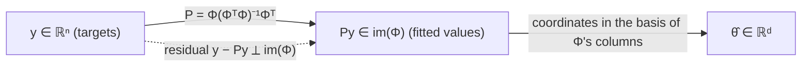

# Linear Regression and OLS

> [!abstract]
> Second week of Part 1. After the abstract framework of [[01 - ML - Decision Theory and Naive Bayes|Week 1]] we meet the first real learning algorithm: **linear regression** with the **Ordinary Least Squares (OLS)** estimator. We start from the 1-D case (fit a line), generalise to **feature maps** (models linear in the parameters, not in $x$), derive the closed form $\hat\theta=(\Phi^T\Phi)^{-1}\Phi^Ty$, interpret it as an **orthogonal projection**, and finally go back to decision theory: under the **linear assumption** OLS is unbiased and its excess risk decreases like $1/n$.
>
> Next: [[03 - ML - Overfitting, Regularization and Gradient Descent|Week 3]] shows what goes wrong when the model is too rich (overfitting) and how to compute OLS when $n$ and $d$ are huge (gradient descent).
>
> Index: [[MOC - Machine Learning]] · Previous version: [[2 - ML - Linear Regression Part 1]]

---

## 1. Warm-up — linear regression in 1-D

See [[Linear Regression]].

**Task.** Given $n$ pairs $(x_1,y_1),\dots,(x_n,y_n)$ of real numbers, find the line $y=mx+q$ minimising the **empirical mean squared error**
$$\hat R(m,q)=\frac1n\sum_{i=1}^n (mx_i+q-y_i)^2 .$$

This is the empirical counterpart of the expected risk with squared loss from Week 1: we replace the unknown distribution with the average over the samples (see [[Expected and Empirical Risk]]).

$\hat R$ is a degree-2 polynomial in $(m,q)$ and goes to $+\infty$ when $|m|,|q|\to\infty$, so its minimum is at a point where the gradient vanishes.

**Derivative w.r.t. $q$:**
$$\frac{\partial\hat R}{\partial q}=\frac2n\sum_i (mx_i+q-y_i)=0\ \Longrightarrow\ q=\bar y-m\bar x,\qquad \bar x=\tfrac1n\textstyle\sum_i x_i,\ \bar y=\tfrac1n\sum_i y_i .$$
So the best line always passes through the "centre of mass" $(\bar x,\bar y)$.

**Derivative w.r.t. $m$:**
$$\frac{\partial\hat R}{\partial m}=\frac2n\sum_i x_i(mx_i+q-y_i)=0 .$$
Plugging $q=\bar y-m\bar x$: $\sum_i x_i\big(m(x_i-\bar x)-(y_i-\bar y)\big)=0$, hence $m=\dfrac{\sum_i x_i(y_i-\bar y)}{\sum_i x_i(x_i-\bar x)}$.

**Cleaner form.** Since $\sum_i(y_i-\bar y)=0$ and $\sum_i (x_i-\bar x)=0$, we can subtract $\bar x\sum_i(y_i-\bar y)=0$ from the numerator and $\bar x\sum_i(x_i-\bar x)=0$ from the denominator (the "$\pm$" trick of the handout):

> [!important] 1-D OLS
> $$\hat m=\frac{\sum_{i=1}^n (x_i-\bar x)(y_i-\bar y)}{\sum_{i=1}^n (x_i-\bar x)^2},\qquad \hat q=\bar y-\hat m\bar x .$$
> $\hat m$ is the empirical covariance of $(x,y)$ divided by the empirical variance of $x$ (see [[Coefficiente di Correlazione]]).

![[ML-L02-01.png]]

*Figure 1 of the handout.* 100 noisy points (blue) roughly following an increasing trend, and the OLS regression line (red). The line does not pass through the points, it balances the vertical errors so that the sum of their squares is minimal.

> [!example] Worked example (from the in-class exercise session, see [[13 - ML - Ensemble Methods#Appendix — exercise session on linear regression|appendix of note 13]])
> Points $(1,1),(1,3),(2,3),(3,5),(3,3)$: $\bar x=2$, $\bar y=3$. Numerator $=(-1)(-2)+(-1)(0)+0+(1)(2)+(1)(0)=4$; denominator $=1+1+0+1+1=4$. So $\hat m=1$, $\hat q=3-2=1$: the line $y=x+1$.

---

## 2. The linear regression framework

See [[Linear-in-Parameters Model]].

We generalise in two directions at once: (i) inputs in any space $\mathcal{X}$ (e.g. $\mathbb{R}^p$), (ii) functions that are **linear in the parameters**, not necessarily in $x$.

We are given $d$ **feature maps** $\phi_j:\mathcal{X}\to\mathbb{R}$ (fixed in advance, chosen by us) and consider
$$f_\theta(x)=\sum_{j=1}^d \phi_j(x)\,\theta_j=\phi(x)^T\theta,\qquad \theta\in\mathbb{R}^d, \tag{1}$$
where $\phi(x)=(\phi_1(x),\dots,\phi_d(x))^T$.

> [!important] Why it is still called *linear* regression
> $f_\theta(x)$ can be wildly non-linear in $x$ (a polynomial, a sine…) but it is **linear in $\theta$**. All the algebra below only uses linearity in $\theta$. Geometrically, $y=\phi(x)^T\theta$ is a hyperplane in the space of $\phi(x)$, not of $x$. (Simone's extra note: [[Feature Maps]].)

**Optimisation problem.** Find $\theta$ minimising
$$\hat R(\theta)=\frac1n\sum_{i=1}^n\big(y_i-\phi(x_i)^T\theta\big)^2=\frac1n\lVert y-\Phi\theta\rVert_2^2 ,$$
where

- $y\in\mathbb{R}^n$ is the vector of targets ($i$-th entry $y_i$);
- $\Phi\in\mathbb{R}^{n\times d}$ is the **design matrix**: its $i$-th row is $\phi(x_i)^T$, i.e. $\Phi_{ij}=\phi_j(x_i)$ (one row per sample, one column per feature). See [[Design Matrix]].

> [!example] Example 2.1 — 1-D regression again
> $\phi_0(x)=1$, $\phi_1(x)=x$ gives $f_\theta(x)=\theta_0+\theta_1x$, i.e. $q=\theta_0$, $m=\theta_1$. The constant feature $\phi_0=1$ is how an intercept (bias) enters the model.

> [!example] Example 2.2 — polynomial regression
> $\phi_k(x)=x^k$ for $k=0,\dots,\ell$: $f_\theta(x)=\sum_{k=0}^{\ell}\theta_k x^k$. A polynomial of degree $\ell$ needs an $(\ell+1)$-dimensional $\theta$. This is the model studied in [[03 - ML - Overfitting, Regularization and Gradient Descent#2. Polynomial regression and overfitting|Week 3]].

> [!warning] Correzione
> The handout writes $f_\theta(x)=\sum_{j=0}^{\ell}\theta_j\,\phi_k(x)$, mixing two indices; it should be $\sum_{k=0}^{\ell}\theta_k\,\phi_k(x)$.

> [!example] Example 2.3 — Fourier regression
> If the target looks periodic with period $T$, use $\phi(x)=\big(1,\sin\frac{2\pi x}{T}i,\cos\frac{2\pi x}{T}i\big)_{i=1,2,\dots}$: the model is a truncated Fourier series.

---

## 3. The Ordinary Least Squares estimator

See [[Ordinary Least Squares]].

> [!important] Theorem 2.4 — OLS estimator
> If $\Phi^T\Phi$ is invertible, then
> $$\hat\theta=(\Phi^T\Phi)^{-1}\Phi^Ty \tag{2}$$
> is a minimiser of $\hat R(\theta)$.

**Proof.** $\hat R$ is a degree-2 polynomial in $\theta$ and is **coercive** ($\hat R(\theta)\to+\infty$ when $\lVert\theta\rVert\to\infty$, given $\Phi^T\Phi$ invertible), so it suffices to find where its gradient vanishes. Expand using $\lVert v\rVert^2=v^Tv$, $(A+B)^T=A^T+B^T$, $(AB)^T=B^TA^T$:
$$\hat R(\theta)=\frac1n(y-\Phi\theta)^T(y-\Phi\theta)=\frac1n\big(\lVert y\rVert^2-\theta^T\Phi^Ty-y^T\Phi\theta+\lVert\Phi\theta\rVert^2\big)=\frac1n\big(\lVert y\rVert^2-2\theta^T\Phi^Ty+\theta^T\Phi^T\Phi\theta\big). \tag{3}$$
($\theta^T\Phi^Ty$ and $y^T\Phi\theta$ are the same scalar $\sum_{i,j}\theta_j\Phi_{ij}y_i$.) Using $\nabla_\theta(\theta^Tb)=b$ and $\nabla_\theta(\theta^TA\theta)=2A\theta$ for symmetric $A$:
$$\nabla\hat R(\theta)=\frac2n\big(\Phi^T\Phi\,\theta-\Phi^Ty\big).$$
Setting it to zero gives the **normal equations**
$$\Phi^T\Phi\,\theta=\Phi^Ty, \tag{4}$$
whose unique solution (by invertibility) is $\hat\theta$. A coercive function with a unique critical point is minimised there. $\blacksquare$ (More on this in Simone's note [[OLS estimator]].)

> [!note] When is $\Phi^T\Phi$ invertible?
> $\Phi^T\Phi$ ($d\times d$) is invertible iff the columns of $\Phi$ are linearly independent. A **necessary** condition is $d\le n$: with more features than samples the kernel of $\Phi$ is non-trivial ($\Phi v=0$ for some $v\neq 0$), so $\Phi^T\Phi v=0$ and the matrix is singular. In that case there are infinitely many minimisers — one of the reasons for regularisation in Week 3.

> [!tip] Sanity check with 1-D
> With $\phi=(1,x)$, $\Phi^T\Phi=\begin{pmatrix}n&\sum x_i\\\sum x_i&\sum x_i^2\end{pmatrix}$, $\Phi^Ty=\begin{pmatrix}\sum y_i\\\sum x_iy_i\end{pmatrix}$, and solving (4) gives back exactly $\hat q,\hat m$ of Section 1.

---

## 4. A geometric interpretation

See [[OLS as Orthogonal Projection]].

**Linear-algebra recap.** In a finite-dimensional space $V$, every subspace $S$ has an orthogonal complement $S^\perp=\{v: v^Ts=0\ \forall s\in S\}$ and $V=S\oplus S^\perp$: every $v$ splits uniquely as $v=v_\parallel+v_\perp$ with $v_\parallel\in S$ (the **projection** of $v$ onto $S$) and $v_\perp\in S^\perp$.

> [!important] Proposition 2.5 — OLS as projection
> The linear map $P=\Phi(\Phi^T\Phi)^{-1}\Phi^T:\mathbb{R}^n\to\mathbb{R}^n$ is the orthogonal projection onto $\operatorname{im}(\Phi)$, the subspace spanned by the columns of $\Phi$.

**Proof in three steps.**
1. If $v\in\operatorname{im}(\Phi)$, then $v=\Phi\lambda$ for some $\lambda\in\mathbb{R}^d$ and $Pv=\Phi(\Phi^T\Phi)^{-1}(\Phi^T\Phi)\lambda=\Phi\lambda=v$: vectors already in the subspace are left unchanged.
2. If $v\perp\operatorname{im}(\Phi)$, then $v$ is orthogonal to every column of $\Phi$, i.e. $\Phi^Tv=0$, hence $Pv=0$.
3. For a generic $v=v_\parallel+v_\perp$, by linearity $Pv=Pv_\parallel+Pv_\perp=v_\parallel$. $\blacksquare$

**Meaning.** The vector of predictions on the training set is $\Phi\hat\theta=Py$:

1. OLS first **projects $y$** onto the $d$-dimensional subspace $\operatorname{im}(\Phi)\subseteq\mathbb{R}^n$ of all prediction vectors the model can produce — the closest one to $y$ in Euclidean distance;
2. $\hat\theta$ is then the vector of **coordinates** of this projection in the basis given by the columns of $\Phi$, i.e. the solution of $\Phi\theta=Py$.

The residual $y-\Phi\hat\theta$ is orthogonal to every column of $\Phi$: this is exactly the normal equation (4), $\Phi^T(y-\Phi\hat\theta)=0$.

> [!warning] Correzione
> - At the end of the proof the handout writes $v_\perp\in\operatorname{im}(\Phi)^{T}$; it should be $\operatorname{im}(\Phi)^{\perp}$.
> - The second bullet says $\hat\theta$ solves "$\Phi(\Phi^T\Phi)^{-1}\Phi^Ty=\Phi^{T}\theta$"; dimensions do not match ($\Phi^T\theta$ is not even defined for $\theta\in\mathbb{R}^d$ unless $n=d$). The correct system is $\Phi\theta=\Phi(\Phi^T\Phi)^{-1}\Phi^Ty$.

---

## 5. The linear assumption

See [[Linear Assumption]].

Now we look at regression through the lens of [[01 - ML - Decision Theory and Naive Bayes|Week 1]]: the samples come from a distribution $D$, and we want a small **expected** risk, not just a small training error.

> [!note] Definition 3.1 — Linear assumption
> $D$ over $\mathcal{X}\times\mathbb{R}$ respects the linear assumption if there are $\theta^\star\in\mathbb{R}^d$ and feature maps $\phi_1,\dots,\phi_d$ such that
> - $Y=\phi(X)^T\theta^\star+\varepsilon$;
> - $\varepsilon$ is independent of $X$, $\mathbb{E}[\varepsilon]=0$, $\mathbb{E}[\varepsilon^2]=\sigma^2$.

Nothing is required of $X$; $Y$ is a deterministic function of $X$ plus independent, unbiased noise. When $\sigma^2\to 0$ the samples lie closer and closer to the curve $y=\phi(x)^T\theta^\star$ (which is linear in $\phi(x)$, not in $x$).

> [!important] Proposition 3.2 — Optimal predictor
> Under the linear assumption and the squared loss, $f^*(x)=\mathbb{E}[Y\mid X=x]=\phi(x)^T\theta^\star$.

**Proof.** In Week 1 (Exercise 1.8) we saw that with squared loss $f^*(x)=\mathbb{E}[Y\mid X=x]$. Here $\mathbb{E}[\phi(x)^T\theta^\star+\varepsilon\mid X=x]=\phi(x)^T\theta^\star+\mathbb{E}[\varepsilon]=\phi(x)^T\theta^\star$, using independence of $\varepsilon$ from $X$ and $\mathbb{E}[\varepsilon]=0$. $\blacksquare$

> [!important]
> To minimise the expected risk it is enough to know $\theta^\star$. It is unknown, so we **estimate** it from data — and OLS is the natural candidate: we minimise the empirical MSE $\sum_i(\phi(x_i)^T\theta-y_i)^2$ as a proxy for the expected one $\mathbb{E}[(Y-\phi(X)^T\theta)^2]$, because we do not have access to $D$. (See also [[The Empirical vs Expected Dilemma ML]].)

---

## 6. Estimating θ⋆ — bias and variance of OLS

See [[Bias and Variance of OLS]].

> [!important] Proposition 3.3
> For $\hat\theta$ computed on $n$ i.i.d. samples from a $D$ satisfying the linear assumption:
> - **unbiased**: $\mathbb{E}[\hat\theta]=\theta^\star$;
> - **variance**: $\mathbb{V}[\hat\theta]=\dfrac{\sigma^2}{n}\,\mathbb{E}\big[\hat\Sigma^{-1}\big]$, with $\hat\Sigma=\frac1n\Phi^T\Phi$.

> [!warning] Correzione
> The handout states $\mathbb{V}[\hat\theta]=\frac{\sigma^2}{n}\mathbb{E}[\hat\Sigma]$, without the inverse. The proof itself ends with $\sigma^2\,\mathbb{E}[(\Phi^T\Phi)^{-1}]=\sigma^2\,\mathbb{E}[(n\hat\Sigma)^{-1}]=\frac{\sigma^2}{n}\mathbb{E}[\hat\Sigma^{-1}]$, so the inverse is needed. (Intuitively: more spread-out inputs, i.e. a "bigger" $\hat\Sigma$, give a *more* precise estimate, so the variance must decrease with $\hat\Sigma$.) The proof also writes $\mathbb{V}[\theta^\star]$ where it means $\mathbb{V}[\hat\theta]$ ($\theta^\star$ is deterministic).

**Proof — unbiasedness.** Condition on the inputs $x_1,\dots,x_n$ (so $\Phi$ is fixed). With $\mathbf{Y}=\Phi\theta^\star+\boldsymbol\varepsilon$:
$$\mathbb{E}[\hat\theta\mid x_{1:n}]=(\Phi^T\Phi)^{-1}\Phi^T\,\mathbb{E}[\Phi\theta^\star+\boldsymbol\varepsilon]=(\Phi^T\Phi)^{-1}\Phi^T\Phi\,\theta^\star+(\Phi^T\Phi)^{-1}\Phi^T\underbrace{\mathbb{E}[\boldsymbol\varepsilon]}_{0}=\theta^\star .$$
Taking the expectation over the inputs too gives $\mathbb{E}[\hat\theta]=\theta^\star$.

**Proof — variance.** First, the error of the estimator:
$$\hat\theta-\theta^\star=(\Phi^T\Phi)^{-1}\Phi^T(\Phi\theta^\star+\boldsymbol\varepsilon)-\theta^\star=(\Phi^T\Phi)^{-1}\Phi^T\boldsymbol\varepsilon. \tag{5}$$
The variance (covariance matrix) of a random vector $Z$ is $\mathbb{E}[(Z-\mathbb{E}Z)(Z-\mathbb{E}Z)^T]$: variances on the diagonal, covariances off it. So
$$\mathbb{V}[\hat\theta]=\mathbb{E}\big[(\Phi^T\Phi)^{-1}\Phi^T\boldsymbol\varepsilon\boldsymbol\varepsilon^T\Phi(\Phi^T\Phi)^{-1}\big]=\mathbb{E}_X\big[(\Phi^T\Phi)^{-1}\Phi^T\,\mathbb{E}_\varepsilon[\boldsymbol\varepsilon\boldsymbol\varepsilon^T]\,\Phi(\Phi^T\Phi)^{-1}\big]=\sigma^2\,\mathbb{E}\big[(\Phi^T\Phi)^{-1}\big],$$
because the noises of different samples are independent with variance $\sigma^2$, i.e. $\mathbb{E}[\boldsymbol\varepsilon\boldsymbol\varepsilon^T]=\sigma^2 I$, and $(\Phi^T\Phi)^{-1}$ is symmetric. $\blacksquare$

> [!note] Remark 3.4 — the $1/n$ rate
> By the law of large numbers ([[Legge Debole dei Grandi Numeri]]) $\hat\Sigma=\frac1n\sum_i\phi(x_i)\phi(x_i)^T\to\Sigma:=\mathbb{E}[\phi(X)\phi(X)^T]$, a deterministic matrix depending only on the marginal of $X$. Hence $\mathbb{V}[\hat\theta]\approx\frac{\sigma^2}{n}\Sigma^{-1}$: the variance **decreases like $1/n$**. Doubling the data halves the variance.

---

## 7. The risk of the OLS estimator

> [!important] Proposition 3.5
> Under the linear assumption, for every $\theta\in\mathbb{R}^d$:
> $$R(\theta)=(\theta^\star-\theta)^T\Sigma\,(\theta^\star-\theta)+R(\theta^\star),\qquad R(\theta^\star)=\sigma^2,\quad \Sigma=\mathbb{E}[\phi(X)\phi(X)^T].$$

**Proof.**
$$\begin{aligned}
R(\theta)&=\mathbb{E}\big[(Y-\phi(X)^T\theta)^2\big]=\mathbb{E}\big[(\phi(X)^T(\theta^\star-\theta)+\varepsilon)^2\big]\\
&=\mathbb{E}\big[(\phi(X)^T(\theta^\star-\theta))^2\big]+2\,\mathbb{E}[\varepsilon]\,\mathbb{E}\big[\phi(X)^T(\theta^\star-\theta)\big]+\mathbb{E}[\varepsilon^2]\qquad(\varepsilon\perp X)\\
&=(\theta^\star-\theta)^T\,\mathbb{E}[\phi(X)\phi(X)^T]\,(\theta^\star-\theta)+\sigma^2 .
\end{aligned}$$
With $\theta=\theta^\star$ only $\sigma^2$ remains: the noise is the **irreducible (Bayes) risk** of Week 1. $\blacksquare$

So the risk of any $\theta$ = Bayes risk + an **excess risk** that is a quadratic form measuring the distance from $\theta^\star$ in the geometry given by $\Sigma$.

> [!warning] Correzione
> The handout writes $R(\hat\theta^\star)$ in the statement; it is $R(\theta^\star)$.

> [!important] Proposition 3.6 — expected risk of OLS
> $$\mathbb{E}\big[R(\hat\theta)\big]=R(\theta^\star)+\frac{\sigma^2}{n}\,\mathbb{E}\Big[\operatorname{Tr}\big(\Sigma\hat\Sigma^{-1}\big)\Big].$$

**Proof sketch.** Fix the training samples, so $\hat\theta$ is a fixed vector, and apply Proposition 3.5:
$$R(\hat\theta)-R(\theta^\star)=(\theta^\star-\hat\theta)^T\Sigma(\theta^\star-\hat\theta)=\big((\Phi^T\Phi)^{-1}\Phi^T\boldsymbol\varepsilon\big)^T\Sigma\big((\Phi^T\Phi)^{-1}\Phi^T\boldsymbol\varepsilon\big)\quad\text{by (5)}.$$
A scalar equals its own trace, and $\operatorname{Tr}(ABC)=\operatorname{Tr}(CAB)$, so this is $\operatorname{Tr}\big((\Phi^T\Phi)^{-1}\Phi^T\boldsymbol\varepsilon\boldsymbol\varepsilon^T\Phi(\Phi^T\Phi)^{-1}\Sigma\big)$. Now average over the training samples: $\mathbb{E}_\varepsilon[\boldsymbol\varepsilon\boldsymbol\varepsilon^T]=\sigma^2I$ gives $\sigma^2\,\mathbb{E}\big[\operatorname{Tr}((\Phi^T\Phi)^{-1}\Sigma)\big]=\frac{\sigma^2}{n}\mathbb{E}\big[\operatorname{Tr}(\Sigma\hat\Sigma^{-1})\big]$. $\blacksquare$

> [!warning] Correzione
> - The statement in the handout reads $R(\hat\theta)=R(\theta)+\frac{\sigma^2}{n}\mathbb{E}[\Sigma\hat\Sigma^{-1}]$: the first term should be $R(\theta^\star)$, and a **trace** is missing (the right-hand side must be a number, not a matrix). Also the left-hand side is an expectation over the training set.
> - In the proof, $\mathbb{E}_\varepsilon[\boldsymbol\varepsilon^{T}\boldsymbol\varepsilon]$ should be $\mathbb{E}_\varepsilon[\boldsymbol\varepsilon\boldsymbol\varepsilon^{T}]=\sigma^2I$ (the outer product, a matrix; $\boldsymbol\varepsilon^T\boldsymbol\varepsilon$ is a scalar equal to $n\sigma^2$ in expectation).
> - At the very end, $\hat\Sigma=\frac1n\Phi(X)\Phi(X)^{T}$ should be $\frac1n\Phi(X)^{T}\Phi(X)$ (a $d\times d$ matrix).

> [!tip] The famous $\sigma^2 d/n$
> When $n$ is large, $\hat\Sigma\approx\Sigma$ and $\operatorname{Tr}(\Sigma\hat\Sigma^{-1})\approx\operatorname{Tr}(I_d)=d$. Therefore
> $$\mathbb{E}[R(\hat\theta)]-\sigma^2\approx\frac{\sigma^2 d}{n}.$$
> The excess risk grows with the number of features $d$ and shrinks with the number of samples $n$: a first quantitative glimpse of the complexity-vs-data trade-off formalised in [[06 - ML - Generalization Bounds and Tree Predictors|Week 6]].

> [!note] $\Sigma$ vs $\hat\Sigma$
> $\Sigma=\mathbb{E}[\phi(X)\phi(X)^T]$ is **deterministic** (one expectation over a single fresh sample). $\hat\Sigma=\frac1n\Phi^T\Phi$ is **random**: it depends on the $n$ training samples.

---

## Pointers

Based mainly on Bach, *Learning Theory from First Principles* (2024), Ch. 3.

## Video

- [Linear Regression, Clearly Explained — StatQuest](https://m.youtube.com/watch?v=7ArmBVF2dCs)
- [Multiple Regression — StatQuest Linear Models Pt.1.5](https://www.youtube.com/watch?v=zITIFTsivN8)
- [Design Matrices for Linear Models, Clearly Explained — StatQuest](https://www.youtube.com/watch?v=LoocDAbgwlM)
