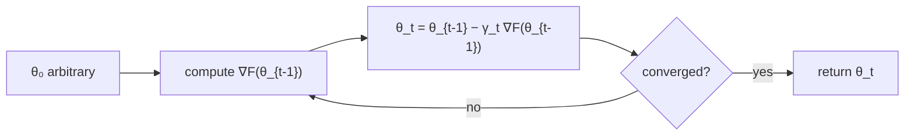

# Overfitting, Regularization and Gradient Descent

> [!abstract]
> Third week of Part 1, still on linear regression. [[02 - ML - Linear Regression and OLS|Week 2]] gave us the closed-form OLS estimator; here we discover its two weak points.
> 1. **Statistical**: with rich feature maps (high-degree polynomials) the training error goes to zero but the predictions on new data get worse — **overfitting**. Remedies: more data, or a **regulariser** (Ridge, Lasso, Elastic Net).
> 2. **Computational**: the closed form costs $O(nd^2+d^3)$. **Gradient descent** reaches a good approximation iteratively; for linear regression we prove it converges *linearly* with a rate set by the **condition number**. **Stochastic gradient descent** makes each step independent of $n$.
>
> Gradient descent and its stochastic variants are the workhorse for everything that follows: logistic regression in [[04 - ML - Logistic Regression and Softmax|Week 4]] and neural networks in [[10 - ML - Training Neural Networks|Part 2]] (momentum, Adam).
>
> Index: [[MOC - Machine Learning]] · Previous version: [[3 - ML - Linear Regression Part 2]]

---

## 1. Recap

We have $n$ points $(x_i,y_i)$, feature maps $\phi_1,\dots,\phi_d$, models $f_\theta(x)=\phi(x)^T\theta$ and the empirical risk, now normalised with $\frac{1}{2n}$ (the $\frac12$ only makes the gradient prettier):
$$\hat R(\theta)=\frac1{2n}\sum_{i=1}^n\big(y_i-\phi(x_i)^T\theta\big)^2=\frac1{2n}\lVert y-\Phi\theta\rVert_2^2 .$$
If $\Phi^T\Phi$ is invertible the minimiser is $\hat\theta=(\Phi^T\Phi)^{-1}\Phi^Ty$.

> [!warning] Correzione
> The recap in the handout writes $\hat\theta=(\Phi^T\Phi)\Phi^Ty$, forgetting the inverse; the correct formula is the one of [[02 - ML - Linear Regression and OLS#3. The Ordinary Least Squares estimator|Week 2]].

---

## 2. Polynomial regression and overfitting

See [[Polynomial Regression]] and [[Overfitting]].

Take $\phi_i(x)=x^i$ for $i=0,\dots,M$: $f_\theta(x)=\sum_{i=0}^M\theta_ix^i$, $\theta\in\mathbb{R}^{M+1}$. The degree $M$ is ours to choose — a measure of **model complexity**. The experiment: a synthetic dataset obtained from a smooth base function (the green dashed sinusoid $\sin 2\pi x$) plus noise, with only $n=10$ training points.

![[ML-L03-01.png]]

*(a) $M=0$.* A constant: it predicts the average of the targets and ignores $x$ completely. Far from the green curve — **underfitting**: the model is too poor to represent the data.

![[ML-L03-02.png]]

*(b) $M=1$.* A straight line: it captures the decreasing trend but cannot bend. Still underfitting.

![[ML-L03-03.png]]

*(c) $M=3$.* A cubic: the blue curve follows the green one closely. This is a good fit: it explains the data without chasing the noise.

![[ML-L03-04.png]]

*(d) $M=9$.* With 10 coefficients and 10 points, the polynomial passes **exactly** through every red point (zero training error), but oscillates wildly between them and shoots off at the borders. It has learnt the noise.

> [!note] Why zero training error at $M=n-1$
> A polynomial of degree $n-1$ has $n$ free coefficients, and through $n$ points with distinct $x_i$ passes exactly one such polynomial (Lagrange interpolation). So with $M=9$ and $n=10$ the training error is $0$.

> [!warning] Correzione
> The handout says "it is generally possible to find a $d$-dimensional polynomial that passes through $d-1$ points". The right count is: a polynomial with $d$ coefficients (degree $d-1$) passes through $d$ points — consistent with $M=n-1$ giving zero error.

The **training error** (the error on the very data used to compute $\hat\theta$) always decreases when $M$ grows — a richer family contains the poorer ones. But our goal is **generalization**: good predictions on *future* points. If the model gets too tailored to the training set it loses predictive power: this is **overfitting**.

![[ML-L03-05.png]]

*Figure 2a — train vs test error for $n=10$.* Blue: training RMSE, monotonically decreasing, exactly $0$ at $M=9$. Orange: RMSE on fresh test points. It decreases until $M\approx 6$–$7$ (the sweet spot for this tiny dataset), then explodes at $M=8,9$. The gap between the two curves is the signature of overfitting.

There are standard tools to fight it.

### Remedy 1 — more data

Rule of thumb: **more data points buy you the right to use more complex models.**

![[ML-L03-06.png]]

*Figure 2b — $M=9$ with $n=100$.* Same degree as Figure 1d, but now with 100 points the polynomial cannot wiggle through all of them; to keep the squared error low it has to follow the trend, and it ends up very close to the true sinusoid.

![[ML-L03-07.png]]

*Figure 2c — train vs test error for $n=100$.* Training and test errors now stay close for every $M$; both drop sharply at $M=3$ (when the model becomes rich enough to represent a sine wave) and then stay flat. No explosion at $M=9$: with enough data the extra flexibility does not hurt.

### Remedy 2 — regularization

See [[Ridge Regression]], [[Lasso Regression]] and [[Elastic Net]].

Add to the objective a penalty on "complicated" $\theta$:
$$\hat R_\lambda(\theta)=\frac1{2n}\lVert\Phi\theta-y\rVert_2^2+\lambda\,\Psi(\theta),$$
where $\Psi$ is the **regulariser** and $\lambda\ge 0$ an **hyperparameter** balancing fit vs simplicity.

> [!warning] Correzione
> The handout writes $\lVert\Phi\theta\mathbf{+}y\rVert_2^2$ (twice); it is $\lVert\Phi\theta-y\rVert_2^2$.

| Regulariser | $\Psi(\theta)$ | Effect | Properties |
|---|---|---|---|
| **Ridge** (L2) | $\lVert\theta\rVert_2^2=\sum_j\theta_j^2$ | shrinks all coefficients towards 0 | convex **and** differentiable; closed form $\hat\theta=(\Phi^T\Phi+2n\lambda I)^{-1}\Phi^Ty$ |
| **Lasso** (L1) | $\lVert\theta\rVert_1=\sum_j\lvert\theta_j\rvert$ | sets some coefficients **exactly to 0** → implicit **feature selection** | convex, not differentiable at 0 |
| **Elastic Net** | $\alpha\lVert\theta\rVert_1+(1-\alpha)\lVert\theta\rVert_2^2$ | a convex combination of the two | convex |

> [!tip] Ridge also fixes invertibility
> $\Phi^T\Phi$ is only positive *semi*-definite, but $\Phi^T\Phi+cI$ with $c>0$ has all eigenvalues $\ge c>0$, so it is always invertible — even when $d>n$. (The closed form above comes from setting $\nabla\hat R_\lambda=\frac1n(\Phi^T\Phi\theta-\Phi^Ty)+2\lambda\theta=0$.)

> [!tip] Why L1 gives zeros and L2 does not
> Geometrically, minimising the loss under $\lVert\theta\rVert_1\le t$ means touching the loss level sets with a "diamond" whose corners lie on the axes, so the optimum is often at a corner (some $\theta_j=0$). The L2 ball is round: the contact point is generically off the axes.

The hyperparameter $\lambda$ still has to be tuned (typically on a validation set):

![[ML-L03-08.png]]

*Figure 2d — Ridge, $M=9$, $\lambda=0.1$.* Too much regularisation: the curve is very smooth but too flat, it misses the peaks of the sine (it is pushed back towards underfitting).

![[ML-L03-09.png]]

*Figure 2e — Ridge, $M=9$, $\lambda=10^{-2}$.* Less penalty: the curve follows the shape better, still smooth.

![[ML-L03-10.png]]

*Figure 2f — Ridge, $M=9$, $\lambda=10^{-3}$.* Very close to the true sine, with the same $n=10$ points that made the unregularised degree-9 fit explode in Figure 1d. Regularisation lets us use a complex model with little data.

---

## 3. Computational complexity of OLS

Assume each $\phi_j(x)$ costs $O(1)$. Computing $\hat\theta=(\Phi^T\Phi)^{-1}\Phi^Ty$ requires:

| Step | Cost |
|---|---|
| all features on all points (build $\Phi$) | $O(nd)$ |
| $\Phi^T\Phi$: $d^2$ entries, each a dot product of length $n$ | $O(nd^2)$ |
| inverting $\Phi^T\Phi$ (e.g. Gaussian elimination) | $O(d^3)$ |
| $\Phi^Ty$: $d$ dot products of length $n$ | $O(nd)$ |
| $(\Phi^T\Phi)^{-1}\cdot\Phi^Ty$ | $O(d^2)$ |

> [!important] Proposition 3.1
> Computing $\hat\theta$ with the closed formula costs $O(nd^2+d^3)$.

> [!note] Remark 3.2 — numerical issues
> Besides time, inverting **ill-conditioned** matrices (eigenvalues of wildly different scale, i.e. directions with very different scales) amplifies rounding errors. Both problems motivate an iterative method that gives a "good enough" solution cheaply.

---

## 4. Gradient descent

See [[Gradient Descent]].

To minimise a differentiable $F:\mathbb{R}^d\to\mathbb{R}$:

1. start from an arbitrary $\theta_0\in\mathbb{R}^d$;
2. for $t=1,2,\dots$: compute $\nabla F(\theta_{t-1})$ and set
$$\theta_t=\theta_{t-1}-\gamma_t\,\nabla F(\theta_{t-1}).$$

The sequence $\gamma_t$ is the **learning rate** (step size). The gradient points towards the steepest *increase*, so we move in the opposite direction.

![[ML-L03-11.png]]

*Figure 3 — local vs global minima* of $f(x)=\sin(3x)+0.5x^2$. The orange point (around $x\approx-2.3$) is a **local minimum**: gradient descent started on its left gets stuck there, because the gradient is zero. The red point (around $x\approx-0.5$) is the **global minimum**. In general GD can be trapped arbitrarily far from the best solution.

### Convexity

A property that rules out bad local minima is convexity (see also [[Convex Function]] from Geometria and Simone's [[Convexity and Optimization ML]]).

> [!note] Definition 4.1 — Convex function
> $F:\mathbb{R}^d\to\mathbb{R}$ is convex if for all $x,y$ and $\alpha\in[0,1]$:
> $$F(\alpha x+(1-\alpha)y)\le\alpha F(x)+(1-\alpha)F(y).$$
> (The chord between two points of the graph lies above the graph.) $F$ is **concave** if $-F$ is convex.

- For a convex function on all of $\mathbb{R}^d$, **every local minimum is global**.
- For $F\in C^2(\mathbb{R}^d)$: $F$ is convex **iff its Hessian is positive semi-definite** everywhere (analogous statements for concavity with negative semi-definite).

> [!note] Definition 4.2 — Positive (semi-)definite matrix
> A symmetric $A$ is positive **semi**-definite if $v^TAv\ge 0$ for all $v$; positive **definite** if $v^TAv>0$ for all $v\neq 0$. Negative (semi-)definite if $-A$ is positive (semi-)definite.

> [!warning] Correzione
> The handout says "If the inequality is strict only for $v=0$, then $A$ is positive definite". It is the other way round: the inequality must be strict for every $v\neq 0$ (for $v=0$ it is always an equality).

> [!important] Proposition 4.3
> If $A$ is symmetric and $\lambda_{\max}$ is its eigenvalue of largest absolute value, then $v^TAv\le\lvert\lambda_{\max}\rvert\,\lVert v\rVert_2^2$ for all $v$.

**Proof.** A symmetric matrix has an orthonormal basis of eigenvectors $v_1,\dots,v_d$ with eigenvalues $\lambda_i$. Write $v=\sum_i\alpha_iv_i$. Then $Av=\sum_j\alpha_j\lambda_jv_j$ and, by orthonormality ($v_i^Tv_j=\mathbb{1}\{i=j\}$),
$$v^TAv=\sum_{i,j}\alpha_i\alpha_j\lambda_jv_i^Tv_j=\sum_i\alpha_i^2\lambda_i\le\max_i\lvert\lambda_i\rvert\sum_i\alpha_i^2=\lvert\lambda_{\max}\rvert\,\lVert v\rVert_2^2.\ \blacksquare$$

### Gradient descent for linear regression

For $\hat R(\theta)=\frac1{2n}\lVert\Phi\theta-y\rVert^2$:
$$\nabla\hat R(\theta)=\frac1n(\Phi^T\Phi\theta-\Phi^Ty),\qquad H=\nabla^2\hat R=\frac1n\Phi^T\Phi .$$

> [!important] Proposition 4.4
> $H=\frac1n\Phi^T\Phi$ is symmetric with eigenvalues $0<\mu=\lambda_1\le\dots\le\lambda_d=L$. Hence $\hat R$ is convex.

**Proof.** Symmetry: $(\Phi^T\Phi)_{ij}=\sum_\ell\phi_i(x_\ell)\phi_j(x_\ell)=(\Phi^T\Phi)_{ji}$. If $\Phi^T\Phi v=\lambda v$ with $v\ne0$ then $\lVert\Phi v\rVert^2=v^T\Phi^T\Phi v=\lambda\lVert v\rVert^2$, so $\lambda=\lVert\Phi v\rVert^2/\lVert v\rVert^2\ge 0$, and $>0$ when $\Phi$ has full column rank ($\Phi v\neq 0$ for $v\neq0$, i.e. $\Phi^T\Phi$ invertible, the standing assumption). $\blacksquare$

> [!warning] Correzione
> The handout concludes $\lambda>0$ directly from $\lambda=\lVert\Phi v\rVert^2/\lVert v\rVert^2$. That ratio is only $\ge 0$ in general; strict positivity needs the assumption that $\Phi^T\Phi$ is invertible (full column rank). Convexity holds anyway, since PSD is enough.

**The update.** With constant $\gamma$:
$$\theta_t=\theta_{t-1}-\frac{\gamma}{n}\big(\Phi^T\Phi\theta_{t-1}-\Phi^Ty\big).$$
Subtract $\hat\theta$ and use $\frac1n\Phi^Ty=H\hat\theta$ (normal equations):
$$\theta_t-\hat\theta=(I-\gamma H)\theta_{t-1}+\gamma H\hat\theta-\hat\theta=(I-\gamma H)(\theta_{t-1}-\hat\theta)=\dots=(I-\gamma H)^t(\theta_0-\hat\theta).$$
So the error is multiplied at each step by the same matrix $I-\gamma H$. Moreover, since $\hat R$ is quadratic, $\hat R(\theta)-\hat R(\hat\theta)=\frac12(\theta-\hat\theta)^TH(\theta-\hat\theta)$, hence
$$\lVert\theta_t-\hat\theta\rVert^2=(\theta_0-\hat\theta)^T(I-\gamma H)^{2t}(\theta_0-\hat\theta),\qquad \hat R(\theta_t)-\hat R(\hat\theta)=\tfrac12(\theta_0-\hat\theta)^T(I-\gamma H)^{2t}H(\theta_0-\hat\theta)$$
($H$ commutes with $I-\gamma H$).

Let $\kappa=L/\mu\ge1$ be the **condition number** of $H$.

> [!important] Theorem 4.5 — convergence of GD for least squares, $\gamma=1/L$
> $$\lVert\theta_t-\hat\theta\rVert^2\le\Big(1-\frac1\kappa\Big)^{2t}\lVert\theta_0-\hat\theta\rVert^2$$
> $$\hat R(\theta_t)-\hat R(\hat\theta)\le\Big(1-\frac1\kappa\Big)^{2t}\big(\hat R(\theta_0)-\hat R(\hat\theta)\big)$$
> $$\hat R(\theta_t)-\hat R(\hat\theta)\le\frac{L}{4t}\lVert\theta_0-\hat\theta\rVert^2$$

**Proof (main ideas).**
- $I-\gamma H$ is symmetric with eigenvalues $1-\lambda_i/L\in[0,1-\frac1\kappa]$ (non-negative because $\lambda_i\le L$, at most $1-\mu/L$). By Proposition 4.3 applied to $(I-\gamma H)^{2t}$, whose eigenvalues are $(1-\lambda_i/L)^{2t}\le(1-1/\kappa)^{2t}$, we get the first bound.
- **Third bound:** the eigenvalues of $H(I-\gamma H)^{2t}$ are $\lambda(1-\gamma\lambda)^{2t}\le\lambda e^{-2t\gamma\lambda}$ (since $1-u\le e^{-u}$) $=\frac{1}{2t\gamma}(2t\gamma\lambda)e^{-2t\gamma\lambda}\le\frac{1}{2t\gamma}\sup_{\alpha\ge0}\alpha e^{-\alpha}=\frac1{2et\gamma}\le\frac1{4t\gamma}$. With $\gamma=1/L$ this gives $L/(4t)$ (the $\frac12$ in front would even give $L/(8t)$).
- **Second bound:** expand $\theta_0-\hat\theta=\sum_j\alpha_jv_j$ in the eigenbasis of $H$: $\hat R(\theta_t)-\hat R(\hat\theta)=\frac12\sum_j\alpha_j^2(1-\gamma\lambda_j)^{2t}\lambda_j\le(1-\frac1\kappa)^{2t}\frac12\sum_j\alpha_j^2\lambda_j=(1-\frac1\kappa)^{2t}(\hat R(\theta_0)-\hat R(\hat\theta))$. $\blacksquare$

> [!tip] Reading the theorem
> - The first two bounds are **linear (geometric) convergence**: the error shrinks by a constant factor each step. The factor depends on $\kappa$: well-conditioned problems ($\kappa\approx1$, all directions with similar curvature) converge in a handful of steps; ill-conditioned ones ($\kappa\gg1$, a long narrow valley) zig-zag and are slow.
> - The third bound does **not** depend on $\mu$: it holds even if $\mu$ is tiny, but it only gives a $1/t$ rate.

**Running time of GD.** Precompute $\Phi^T\Phi$ ($O(nd^2)$) and $\Phi^Ty$ ($O(nd)$); each step is then a matrix–vector product, $O(d^2)$. Total $O(nd^2+d^2N)$ for $N$ iterations.

> [!important] Corollary 4.6
> After $N=\frac{\kappa}{2}\log\frac1\varepsilon$ iterations, $\lVert\theta_N-\hat\theta\rVert^2\le\varepsilon\,\lVert\theta_0-\hat\theta\rVert^2$.

*Proof:* $(1-\frac1\kappa)^{2t}\le e^{-2t/\kappa}$, and $e^{-2t/\kappa}\le\varepsilon\iff t\ge\frac\kappa2\log\frac1\varepsilon$.

So reducing the error by a factor $\varepsilon$ costs $O(nd^2+d^2\kappa\log\frac1\varepsilon)$ — no $d^3$ any more. Alternatively, recompute the gradient from scratch at each step ($O(nd)$ per step, never forming $\Phi^T\Phi$): total $O(nd\,\kappa\log\frac1\varepsilon)$, linear in $d$.

---

## 5. Stochastic gradient descent

See [[Stochastic Gradient Descent]].

The bottleneck of GD: **each step is a full pass over the dataset**. This happens for every loss of the form $L(\theta)=\sum_{i=1}^n\ell_i(\theta)$ ($\ell_i$ = loss of sample $i$), because $\nabla L=\sum_i\nabla\ell_i$ (one gradient per data point).

**Idea:** replace the exact gradient with a cheap **random proxy**. At step $t$ pick an index $i_t$ uniformly at random and use
$$g(\theta_t)=n\,\nabla\ell_{i_t}(\theta_t)\qquad\Big(\text{or }\nabla\ell_{i_t}(\theta_t)\text{ if }L\text{ is defined as an average } \tfrac1n\textstyle\sum_i\ell_i\Big).$$
It is **unbiased**: $\mathbb{E}[g(\theta_t)]=\sum_i\frac1n\cdot n\nabla\ell_i(\theta_t)=\nabla L(\theta_t)$ — in expectation it points in the right direction. Each step now costs $O(d)$ instead of $O(nd)$.

> [!warning] Correzione
> The handout defines $g(\theta_t)=\ell_{i_t}(\theta_t)$: it should be the **gradient** $\nabla\ell_{i_t}(\theta_t)$ (a vector, not a scalar loss value), and to have exactly $\mathbb{E}[g]=\nabla L$ with $L=\sum_i\ell_i$ one must multiply by $n$ (or define $L$ as the average, which is what the $\frac1{2n}$ normalisation of linear regression effectively does — see footnote † of the handout).

**Mini-batch.** One sample gives a very noisy estimate. To reduce the **variance**, average the gradients of a small random subset $B$ of points (a *mini-batch*): still unbiased, variance divided by $\lvert B\rvert$, and naturally parallel on GPUs. This is the version used to train neural networks, where the notions of mini-batch and **epoch** (one full pass over the data) come back in [[10 - ML - Training Neural Networks#2. SGD, mini-batches and epochs|note 10]].

| | Cost per step | Gradient | Typical use |
|---|---|---|---|
| Closed form OLS | $O(nd^2+d^3)$ once | exact solution | small $d$ |
| Gradient descent | $O(nd)$ | exact | moderate $n$ |
| SGD | $O(d)$ | unbiased, noisy | huge $n$ |
| Mini-batch SGD | $O(\lvert B\rvert d)$ | unbiased, less noisy | deep learning |

Simone's extra notes on these sections: [[3.4 ML Details]], [[3.5 ML Details]].

---

## Pointers

Polynomial regression and overfitting: Bishop, *Pattern Recognition and Machine Learning* (2007), Ch. 1.1. Gradient descent and SGD: Bach (2024). Linear algebra reference: Axler, *Linear Algebra Done Right* (2025).

## Video

- [Regularization Part 1: Ridge (L2) Regression — StatQuest](https://www.youtube.com/watch?v=Q81RR3yKn30)
- [Ridge vs Lasso Regression, Visualized — StatQuest](https://www.youtube.com/watch?v=Xm2C_gTAl8c)
- [Gradient Descent, Step-by-Step — StatQuest](https://www.youtube.com/watch?v=sDv4f4s2SB8)
- [Stochastic Gradient Descent, Clearly Explained — StatQuest](https://www.youtube.com/watch?v=vMh0zPT0tLI)
