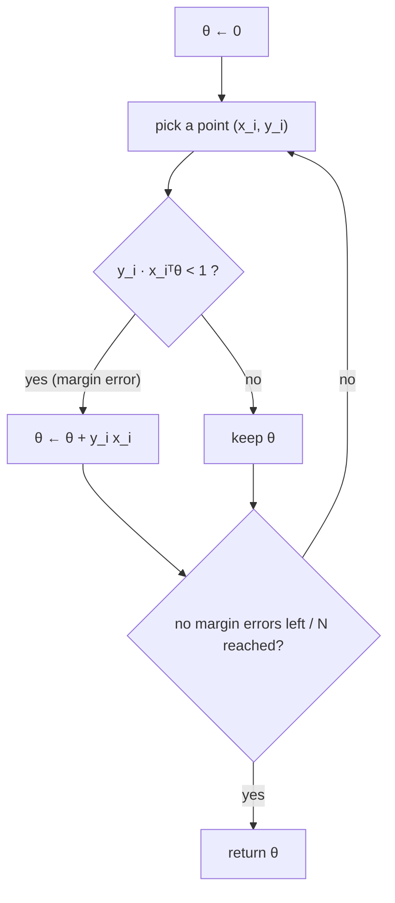

# Perceptron, SVM and Kernels

> [!abstract]
> Fifth week of Part 1. Back to binary classification with **separating hyperplanes**, but from a geometric point of view instead of the probabilistic one of [[04 - ML - Logistic Regression and Softmax|Week 4]]. The **Perceptron** (one of the first ML algorithms ever) finds *some* separating hyperplane if one exists, and Novikoff's theorem bounds its mistakes by $(2+D^2)/\gamma^{\star2}$: the larger the **margin**, the easier the problem. The **hard-margin SVM** looks for the hyperplane with the *largest* margin; the **soft-margin SVM** tolerates errors through slack variables, which turn into the **hinge loss**, optimised by stochastic sub-gradient descent. Finally the **kernel trick** gives non-linear boundaries at a cost depending on $n$, not on the (possibly infinite) feature dimension.
>
> The Perceptron is the "neuron" that, stacked in layers, becomes the multi-layer perceptron of [[09 - ML - Feed-Forward Neural Networks|Part 2]].
>
> Index: [[MOC - Machine Learning]] · Previous version: [[5 - ML - Perceptron and SVM]]

> [!warning] Correzione
> The handout of this week is titled "Week 5: **Logistic and Softmax Regression**" (copy-paste from Week 4). The content is the Perceptron and SVM.

## Video

The video Simone generated for this week:

![[5_-_ML_-_Dal_Perceptron_alle_SVM.mp4]]

---

## 1. The Perceptron

See [[Perceptron Algorithm]] and [[Margin]].

**Setting.** $n$ points $(x_i,y_i)$, $x_i\in\mathbb{R}^d$, labels $y_i\in\{-1,+1\}$. Assumption: the dataset is **linearly separable** — some hyperplane has all the $+1$ points on one side and all the $-1$ points on the other.

A (homogeneous) hyperplane is $H_\theta=\{x: x^T\theta=0\}$, the set of points orthogonal to the non-zero vector $\theta$ (the **normal vector**). The prediction is
$$\hat y(x)=\begin{cases}+1&x^T\theta\ge0\\-1&x^T\theta<0\end{cases}$$
(points exactly on the hyperplane get $+1$ by convention).

> [!warning] Correzione
> The handout first declares $y_i\in\mathcal{Y}=\{0,1\}$ and says the predicted label is $0$ if $x^T\theta<0$, but everything afterwards (the error definition $y\,x^T\theta<0$, the pseudocode, "label 1 and those with label $-1$") uses $\{-1,+1\}$. With $\{0,1\}$ the products $y\,x^T\theta$ would not make sense, so labels are $\pm1$ throughout.

> [!note] Geometry of $x^T\theta$
> $x^T\theta=\lVert x\rVert\lVert\theta\rVert\cos\alpha$, where $\alpha$ is the angle between them. $\cos\alpha>0$: $x$ is on the same side as $\theta$; $<0$: opposite side; $=0$: $x$ lies on $H_\theta$. (Simone's extra: [[5 ML more about the hyperplane]].)

> [!note] Definition 1.1 — classification and margin errors
> $H_\theta$ makes a **classification error** on $(x,y)$ if $y\,x^T\theta<0$, and a **margin error** if $y\,x^T\theta<1$.

The margin error is stricter: the point must be correct *with some slack*. If a point is correctly classified but with a margin error, rescaling $\theta$ by a positive constant fixes it without changing the hyperplane or its orientation. Requiring $y\,x^T\theta\ge1$ is a way to **fix the scale** of $\theta$.

> [!note] Remark 1.2 — homogeneous hyperplanes are enough
> As in linear regression, an affine hyperplane $\theta^Tx+b=0$ becomes homogeneous by adding a constant coordinate: $(x^{(1)},x^{(2)})\mapsto(x^{(1)},x^{(2)},1)$, so a line in $\mathbb{R}^2$ is a plane through the origin in $\mathbb{R}^3$ with $\theta^{(3)}=b$.

### The algorithm

```
The Perceptron Algorithm
Input: {(x_i, y_i)}_{i=1..n}, x_i ∈ ℝ^d, y_i ∈ {−1,+1}
Hyperparameter: max number of iterations N
θ_0 ← 0
for t = 1..N:
    pick i_t uniformly at random in {1..n}
    if y_{i_t} · x_{i_t}ᵀ θ_t < 1:        ▷ margin error
        θ_{t+1} ← θ_t + y_{i_t} x_{i_t}   ▷ move θ towards the point (if y=+1) or away (if y=−1)
    else:
        θ_{t+1} ← θ_t
return θ
```

The points can be visited cyclically or at random. **Why the update helps:** after the update $y\,x^T\theta_{t+1}=y\,x^T\theta_t+y^2\lVert x\rVert^2=y\,x^T\theta_t+\lVert x\rVert^2$, so the "score" of the misclassified point strictly increases.



### Margin and Novikoff's theorem

**Distance point–hyperplane.**
$$\operatorname{dist}(x,H_\theta)=\min_{z\in H_\theta}\lVert x-z\rVert=\frac{\lvert x^T\theta\rvert}{\lVert\theta\rVert}$$
(the closest point is reached along the direction of $\theta$, which is orthogonal to $H_\theta$).

> [!note] Definition 1.3 — margin
> For a hyperplane $H_\theta$ that classifies all points correctly,
> $$\gamma(\theta)=\min_{i}\operatorname{dist}(x_i,H_\theta),$$
> the distance of the closest point. $\gamma^\star$ denotes the **largest** margin achievable by a separating hyperplane. Let also $D=\max_i\lVert x_i\rVert$ (the "diameter").

> [!important] Theorem 1.4 — mistake bound (Novikoff)
> If the points are linearly separable, the Perceptron makes at most
> $$\frac{2+D^2}{(\gamma^\star)^2}$$
> margin mistakes.

**Proof.** Let $m_t$ be the number of margin errors up to time $t$.

*Upper bound on $\lVert\theta\rVert$.* At an error step, since $y\,x^T\theta_t<1$ and $\lVert x\rVert\le D$:
$$\lVert\theta_{t+1}\rVert^2=\lVert\theta_t\rVert^2+2y\,x^T\theta_t+\lVert x\rVert^2\le\lVert\theta_t\rVert^2+2+D^2 .$$
Iterating from $\theta_0=0$: $\lVert\theta_{t+1}\rVert^2\le m_t(2+D^2)$. (1)

*Lower bound on $\lVert\theta\rVert$.* Let $\theta^\star$ be the **unit-norm** normal vector of the max-margin hyperplane. At an error step
$$(\theta^\star)^T(\theta_{t+1}-\theta_t)=y\,(\theta^\star)^Tx=\lvert(\theta^\star)^Tx\rvert=\frac{\lvert(\theta^\star)^Tx\rvert}{\lVert\theta^\star\rVert}\ge\gamma^\star$$
($\theta^\star$ classifies $x$ correctly, so the sign of $(\theta^\star)^Tx$ is $y$). At the other steps the difference is $0$. Summing (telescoping) and using Cauchy–Schwarz ($a^Tb\le\lVert a\rVert\lVert b\rVert$):
$$\lVert\theta_{t+1}\rVert\ge(\theta^\star)^T\theta_{t+1}=\sum_s(\theta^\star)^T(\theta_{s+1}-\theta_s)\ge m_t\gamma^\star .\qquad(2)$$

*Combine:* $m_t^2(\gamma^\star)^2\le\lVert\theta_{t+1}\rVert^2\le m_t(2+D^2)$, hence $m_t\le(2+D^2)/(\gamma^\star)^2$. $\blacksquare$

> [!tip] Intuition
> $\lVert\theta\rVert$ grows at least **linearly** in the number of mistakes (each mistake pushes $\theta$ by at least $\gamma^\star$ in the right direction) but at most like a **square root** (each push adds at most $2+D^2$ to the squared norm). These two growth rates are compatible only for a bounded number of mistakes. A wide margin = few mistakes. The bound does **not** depend on $n$ or $d$.

**Running time.** The theorem bounds mistakes, not iterations. If points are visited cyclically and we stop after a full pass without margin errors, the worst case is $O(nM)$ visits ($M$ = number of mistakes): at most $n$ visits between consecutive mistakes. With random visits, the same $O(nM)$ holds in expectation.

Simone's extra notes: [[Perceptron]], [[Original 5 ML]], [[5 ML theta cazzè]].

---

## 2. Support Vector Machines

See [[Hard-Margin SVM]].

The Perceptron returns *any* separating hyperplane with no margin errors. A natural alternative: among the hyperplanes satisfying $y_i\theta^Tx_i\ge1$, pick the one with **smallest norm**.

> [!important] Hard-margin SVM
> $$\min_\theta\ \frac12\lVert\theta\rVert^2\qquad\text{subject to}\quad y_i\theta^Tx_i\ge1\quad\forall i. \tag{3}$$

Two reasons to minimise $\lVert\theta\rVert$:
- **simplicity**: as with Ridge in [[03 - ML - Overfitting, Regularization and Gradient Descent#Remedy 2 — regularization|Week 3]], a small norm is a way to prefer simple solutions;
- **margin**: $\lVert\theta\rVert$ and $\gamma(\theta)$ are tightly linked, as the next proposition shows.

> [!important] Proposition 2.1
> Any solution $\hat\theta$ of (3) has optimal margin: $\gamma(\hat\theta)=\gamma^\star$.

**Proof.** For any $\theta$ without margin errors, $y_i x_i^T\theta\ge1$ so
$$\gamma(\theta)=\min_i\frac{\lvert x_i^T\theta\rvert}{\lVert\theta\rVert}=\min_i\frac{y_ix_i^T\theta}{\lVert\theta\rVert}\ge\frac1{\lVert\theta\rVert}. \tag{4}$$
Take the max-margin hyperplane and scale its normal $\theta^\star$ so that $\min_iy_ix_i^T\theta^\star=1$; then
$$\gamma^\star=\gamma(\theta^\star)=\min_i\frac{y_ix_i^T\theta^\star}{\lVert\theta^\star\rVert}=\frac1{\lVert\theta^\star\rVert}. \tag{5}$$
$\theta^\star$ is feasible for (3), and $\hat\theta$ has the smallest norm among feasible vectors, so $\gamma(\hat\theta)\ge\frac1{\lVert\hat\theta\rVert}\ge\frac1{\lVert\theta^\star\rVert}=\gamma^\star$. Since $\gamma^\star$ is the maximum, equality holds. $\blacksquare$

> [!warning] Correzione
> In equation (5) of the handout the last term is $\frac1{\lVert\theta\rVert}$; it should be $\frac1{\lVert\theta^\star\rVert}$.

So **maximising the margin = minimising $\lVert\theta\rVert$** under the constraints $y_i\theta^Tx_i\ge1$: the geometric margin is $1/\lVert\theta\rVert$, the gap between the two parallel hyperplanes $\theta^Tx=\pm1$ is $2/\lVert\theta\rVert$.

### Soft-margin SVM

See [[Soft-Margin SVM]] and [[Hinge Loss]].

If the data are **not** separable, (3) has no feasible point. Introduce a **slack variable** $\xi_i\ge0$ for each point, relaxing the constraint to $y_i\theta^Tx_i\ge1-\xi_i$, and pay for it:
$$\min_{\theta,\xi}\ \frac12\lVert\theta\rVert^2+C\sum_{i=1}^n\xi_i\qquad\text{s.t.}\quad y_i\theta^Tx_i\ge1-\xi_i,\ \ \xi_i\ge0\ \ \forall i .$$

- $\xi_i=0$: the point respects the margin;
- $0<\xi_i\le1$: inside the margin but correctly classified;
- $\xi_i>1$: misclassified.

$C$ is a hyperparameter trading off a wide margin (small $\lVert\theta\rVert$) against margin violations: large $C$ ≈ hard margin, small $C$ = more tolerant.

For a fixed $\theta$, the best slacks are the smallest feasible ones: $\xi_i=(1-y_i\theta^Tx_i)_+$, with $(a)_+=\max\{a,0\}$. Substituting gives an **unconstrained** problem:

> [!important] Soft-margin SVM (hinge loss form)
> $$\min_\theta\ \frac12\lVert\theta\rVert^2+\frac Cn\sum_{i=1}^n\big(1-y_i\theta^Tx_i\big)_+ \tag{6}$$
> $h(z)=(1-z)_+$ is the **hinge function**: $0$ when $z\ge1$ (point beyond the margin), growing linearly otherwise.

Read as *regulariser + loss*: an L2 (Ridge-like) penalty plus the empirical average of the hinge loss. The hinge is convex, so (6) is convex and we can use (stochastic) gradient descent — with one caveat: $h$ has a kink at $z=1$, where it is not differentiable.

> [!note] Definition 2.2 — sub-gradient
> For a convex $F:\mathbb{R}^d\to\mathbb{R}$, $g$ is a **sub-gradient** at $x$ if for all $y$:
> $$F(y)\ge F(x)+g^T(y-x).$$
> (The linear function with slope $g$ through $(x,F(x))$ stays below $F$ everywhere. Where $F$ is differentiable the only sub-gradient is $\nabla F$; at a kink there are many.)

A sub-gradient of the objective (6) at $\theta$:
$$g(\theta)=\theta-\frac Cn\sum_iy_ix_i\,\mathbb{1}\{y_i\theta^Tx_i<1\}.$$

> [!warning] Correzione
> The handout writes the indicator as $\mathbb{1}\{y_i\theta^Tx_i\ge1\}$. The hinge term contributes $-y_ix_i$ exactly when it is active, i.e. on the margin errors $y_i\theta^Tx_i<1$; for $y_i\theta^Tx_i>1$ it is flat (zero gradient). The pseudocode below indeed updates with $-Cy_ix_i$ only on margin errors. (Also, Definition 2.2 names the function $F$ and then writes $f$ in the inequality.)

```
Stochastic (sub-)Gradient Descent for SVM
Input: {(x_i, y_i)}, y_i ∈ {−1,+1}; hyperparameters N, learning rates η_t, C
θ_0 ← 0
for t = 1..N:
    pick i_t uniformly at random
    if y_{i_t} · x_{i_t}ᵀ θ_t < 1:                  ▷ margin error
        θ_{t+1} ← θ_t − η_t (θ_t − C y_{i_t} x_{i_t})
    else:
        θ_{t+1} ← θ_t (1 − η_t)                     ▷ only shrink (regulariser)
return θ
```

A natural choice is $\eta_t=\frac1{Ct}$.

> [!note] Perceptron vs SVM
> The stochastic sub-gradient SVM is extremely similar to the Perceptron: both add $y_ix_i$ (scaled) on margin errors. The differences: SVM also **shrinks** $\theta$ at every step (the $\frac12\lVert\theta\rVert^2$ term) and uses a decreasing learning rate; it solves a well-defined optimisation problem that also makes sense for non-separable data.
> The name **Support Vector Machine**: the solution depends only on the points where margin errors occur (the points on or inside the margin) — the **support vectors**. Moving any other point (without crossing the margin) does not change the boundary.

Simone's extra: [[Support Vector Machine (SVM)]].

---

## 3. The kernel trick

See [[Kernel Trick]].

To go beyond linear separators, map the points with a feature map $\psi:\mathbb{R}^d\to\mathbb{R}^{d'}$ and run the linear algorithm in the new space (exactly what feature maps did for regression in [[02 - ML - Linear Regression and OLS#2. The linear regression framework|Week 2]]). Problem: $d'$ may be huge — or infinite. We want an algorithm whose cost does **not** depend on $d'$.

To include infinite-dimensional spaces we need the general notion of scalar product.

> [!note] Definition 2.3 — scalar (inner) product
> $\langle\cdot,\cdot\rangle:V\times V\to\mathbb{R}$ with
> - **linearity**: $\langle\alpha v,z\rangle=\alpha\langle v,z\rangle$, $\langle v+w,z\rangle=\langle v,z\rangle+\langle w,z\rangle$;
> - **symmetry**: $\langle v,w\rangle=\langle w,v\rangle$;
> - **positivity**: $\langle v,v\rangle\ge0$, with equality only for $v=0$.

A **Hilbert space** is (essentially) a vector space with a scalar product (formally it must also be complete w.r.t. the induced metric).

Two observations make the trick work:

1. **$\theta_t$ always lives in the span of the data.** Both the Perceptron and the SGD-SVM start at $0$ and only add multiples of $\psi(x_i)$ (and rescale). So $\theta_t=\sum_{i=1}^n\alpha_i^t\psi(x_i)$: we just store the $n$ coefficients $\alpha^t\in\mathbb{R}^n$.
2. **We only need scalar products.** The algorithm only ever evaluates $\langle\psi(x_i),\theta_t\rangle$:
$$\langle\psi(x_i),\theta_t\rangle=\Big\langle\psi(x_i),\sum_j\alpha_j^t\psi(x_j)\Big\rangle=\sum_{j=1}^n\alpha_j^t\,\langle\psi(x_i),\psi(x_j)\rangle .$$

> [!important] Kernel trick
> Store the $n$ coefficients $\alpha$ and the **kernel (Gram) matrix** $K\in\mathbb{R}^{n\times n}$, $K_{ij}=K(x_i,x_j)=\langle\psi(x_i),\psi(x_j)\rangle$. Everything is computed from $K$; $\psi$ never has to be written down explicitly, as long as we can evaluate $K(x,z)$.

> [!warning] Correzione
> In the handout the formula reads $\langle x_i,\theta_t\rangle=\langle x_i,\sum_j\alpha_j^t\psi(v_j)\rangle$: it should be $\langle\psi(x_i),\theta_t\rangle$ (the point must be mapped before taking the product with $\theta_t$, which lives in the feature space), and $\psi(v_j)$ should be $\psi(x_j)$.

> [!example] Example 2.4 — polynomial kernel
> $d=1$, $\psi_i(x)=x^i$ for $i=0,\dots,D$: $\langle\psi(x),\psi(z)\rangle=\sum_{i=0}^Dx^iz^i$. It generalises to many dimensions and any degree (e.g. $K(x,z)=(1+x^Tz)^D$ corresponds to all monomials up to degree $D$, with suitable weights). Only the $n\times n$ kernel matrix and the $n$ coordinates of $\theta_t$ are needed.

> [!warning] Correzione
> The handout writes $\sum_{i=0}^Dx^iy^i$; the second argument is $z$, so it is $\sum_i x^iz^i$.

> [!example] Example 2.5 — Gaussian (RBF) kernel
> $$K(x,z)=\langle\psi(x),\psi(z)\rangle=e^{-\lVert x-z\rVert^2/2}.$$
> It corresponds to a map into an **infinite-dimensional** Hilbert space, yet each kernel evaluation costs $O(d)$. $K(x,z)\approx1$ for nearby points and $\approx0$ for distant ones: the classifier becomes a weighted vote of the training points close to $x$ — reminiscent of [[07 - ML - K-Nearest Neighbors|KNN]].

| | Explicit features | Kernel trick |
|---|---|---|
| store | $\theta\in\mathbb{R}^{d'}$ | $\alpha\in\mathbb{R}^n$, $K\in\mathbb{R}^{n\times n}$ |
| cost of a prediction | $O(d')$ | $O(n\cdot\text{cost of }K)$ |
| works for $d'=\infty$ | no | yes |

---

## Pointers

Perceptron: Hardt & Recht (2022). SVM: Shalev-Shwartz & Ben-David (2014) and Géron (2019).

## More videos

- [Support Vector Machines Part 1 (of 3): Main Ideas — StatQuest](https://www.youtube.com/watch?v=efR1C6CvhmE)
- [Support Vector Machines Part 2: The Polynomial Kernel — StatQuest](https://m.youtube.com/watch?v=Toet3EiSFcM)
