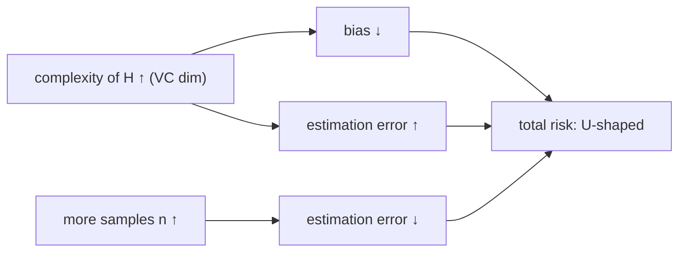
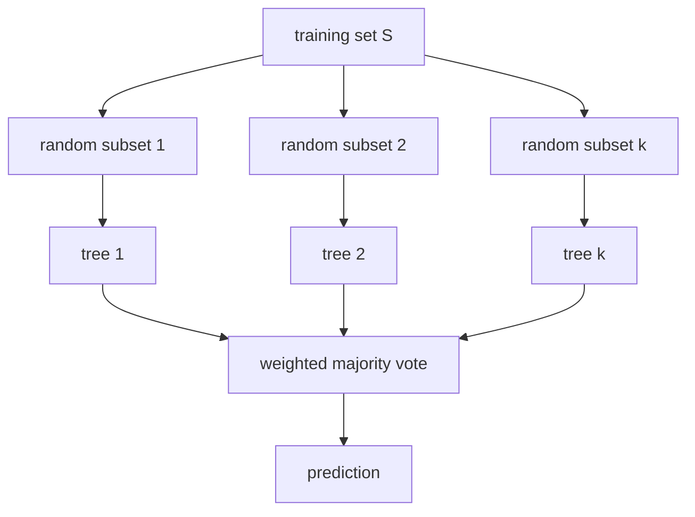

# Generalization Bounds and Tree Predictors

> [!abstract]
> Last week of Part 1. Since [[03 - ML - Overfitting, Regularization and Gradient Descent|Week 3]] we know empirically that "complex models need more data". Here we make it a theorem. **Generalization bounds** guarantee that, with enough samples, the empirical risk of *every* classifier in a family $\mathcal{H}$ is close to its expected risk. For finite families this follows from the **union bound** + **Chernoff/Hoeffding**; for infinite families the right measure of complexity is the **VC dimension**. The **risk decomposition** (Bayes error + bias of the class + estimation error) then explains overfitting as a trade-off.
> We apply all this to **tree predictors**: they can fit any training set (infinite VC dimension), so we limit their size, train them greedily with **impurity measures** (Gini, entropy) and combine many of them in **random forests** — the first ensemble method, developed further in [[13 - ML - Ensemble Methods|Part 2]].
>
> Index: [[MOC - Machine Learning]] · Previous version: [[6 - ML - Statistical Learning and Tree Predictors]]

## Video

The videos Simone generated for this week:

![[6_-_ML_-_Il_Paradosso_dell_Overfitting.mp4]]

![[Alberi__Paradosso_Overfitting.mp4]]

---

## 1. Generalization bounds

See [[Generalization Bound]] and [[Expected and Empirical Risk]].

**Goal:** a mathematical framework for overfitting. We focus on binary classification ($\mathcal{Y}=\{0,1\}$ or $\{-1,1\}$, 0-1 loss), but similar results hold for multiclass and regression.

We have $n$ i.i.d. samples from $D$ and a family $\mathcal{H}$ of classifiers. For each $h\in\mathcal{H}$ we estimate the expected risk with the empirical one:
$$R(h)=\mathbb{E}\big[\ell(h(X),Y)\big],\qquad \hat R(h)=\frac1n\sum_{i=1}^n\ell(h(x_i),y_i).$$
We would like $\hat R(h)\approx R(h)$ **for all $h\in\mathcal{H}$ simultaneously** — because the training algorithm picks $h$ *after* looking at the data, so a bound valid for one fixed $h$ is not enough. (Simone's notes: [[Empirical Risk]], [[Expected Risk]], [[The Empirical vs Expected Dilemma ML]].)

### Mathematical preliminaries

See [[Union Bound]] and [[Hoeffding Inequality]].

> [!important] Theorem 1.1 — union bound
> $\mathbb{P}(A_1\cup\dots\cup A_k)\le\sum_i\mathbb{P}(A_i)$.

> [!important] Theorem 1.2 — Chernoff bound (Hoeffding form)
> $Z_1,\dots,Z_n$ i.i.d. Bernoulli($\mu$), $\hat Z=\frac1n\sum_iZ_i$. For every $\varepsilon>0$:
> $$\mathbb{P}\big(\lvert\hat Z-\mu\rvert>\varepsilon\big)\le2e^{-2\varepsilon^2n}.$$

The empirical mean concentrates around the true mean **exponentially fast** in $n$ — much stronger than Chebyshev's $\frac{\mu(1-\mu)}{n\varepsilon^2}$ (see [[Disuguaglianza di Chebyshev]] and [[Legge Debole dei Grandi Numeri]]). It applies to us because for a fixed $h$ the losses $Z_i=\ell(h(x_i),y_i)\in\{0,1\}$ are i.i.d. Bernoulli with mean $R(h)$, and $\hat Z=\hat R(h)$.

> [!note] Name
> The form with $2e^{-2\varepsilon^2n}$ is usually called **Hoeffding's inequality** (a special case of the Chernoff–Hoeffding family of bounds).

### Finite families of classifiers

> [!important] Theorem 1.3
> For a finite $\mathcal{H}$, precision $\varepsilon\in(0,1)$ and $n$ i.i.d. samples:
> $$\mathbb{P}\Big(\max_{h\in\mathcal{H}}\lvert R(h)-\hat R(h)\rvert>\varepsilon\Big)\le2\lvert\mathcal{H}\rvert e^{-2\varepsilon^2n}.$$

**Proof.** Call $E_h=\{\lvert R(h)-\hat R(h)\rvert\le\varepsilon\}$ the *clean event* for $h$. "Some $h$ is badly estimated" is the union of the complements:
$$\mathbb{P}\Big(\max_h\lvert R(h)-\hat R(h)\rvert>\varepsilon\Big)=\mathbb{P}\Big(\bigcup_hE_h^C\Big)\le\sum_h\mathbb{P}(E_h^C)\le\lvert\mathcal{H}\rvert\cdot2e^{-2\varepsilon^2n}.\ \blacksquare$$

> [!important] Corollary 1.4 — sample complexity
> If $n\ge\dfrac{1}{2\varepsilon^2}\ln\dfrac{2\lvert\mathcal{H}\rvert}{\delta}$, the failure probability is at most $\delta$.

(Set $2\lvert\mathcal{H}\rvert e^{-2\varepsilon^2n}\le\delta$ and solve for $n$.) The number of samples grows only **logarithmically** with the size of the family.

> [!example] Numbers
> $\lvert\mathcal{H}\rvert=10^6$, $\varepsilon=0.05$, $\delta=0.01$: $n\ge\frac{1}{2\cdot0.0025}\ln(2\cdot10^8)\approx200\cdot19.1\approx3{,}820$ samples.

> [!important] Where is the randomness?
> The probability is over the **$n$ training samples**. With probability $\ge1-\delta$ over the draw of the training set, the performance on a *new* sample is $\varepsilon$-approximated by the empirical performance on the training set — for all $h$ at once.

### Infinite families — the VC dimension

See [[VC Dimension]].

Finite families are unsatisfactory: interesting families are infinite (all linear classifiers…), and $\lvert\mathcal{H}\rvert=\infty$ makes the bound useless. Luckily a simple **combinatorial** notion replaces $\log\lvert\mathcal{H}\rvert$.

> [!note] Definition 1.5 — shattering
> $\mathcal{H}$ **shatters** a set $S=\{x_1,\dots,x_{\lvert S\rvert}\}$ if it can realise **every** labelling of $S$: for each $(y_1,\dots,y_{\lvert S\rvert})\in\{0,1\}^{\lvert S\rvert}$ there is $h\in\mathcal{H}$ with $h(x_i)=y_i$ for all $i$.

> [!note] Definition 1.6 — VC dimension
> The **Vapnik–Chervonenkis dimension** of $\mathcal{H}$ is the size of the largest set shattered by $\mathcal{H}$; it is $\infty$ if arbitrarily large sets can be shattered.

To prove $\text{VC}(\mathcal{H})=d$ you need two things: **some** set of $d$ points that is shattered, and **no** set of $d+1$ points that is shattered.

> [!important] Theorem 1.7 — fundamental theorem (proof omitted)
> If $\mathcal{H}$ has VC dimension $d$ and $n\in\Omega\Big(\dfrac{d\log(1/\varepsilon)+\log(1/\delta)}{\varepsilon^2}\Big)$, then
> $$\mathbb{P}\Big(\sup_{h\in\mathcal{H}}\lvert R(h)-\hat R(h)\rvert>\varepsilon\Big)\le\delta .$$
> (Proof: Mitzenmacher & Upfal, *Probability and Computing*, Ch. 14.5, or Shalev-Shwartz & Ben-David, Ch. 6.)

Given $\varepsilon$ and $\delta$, the number of samples needed scales **linearly with the VC dimension**.

> [!example] Examples 1.8–1.11
> | Family | VC dim | Why |
> |---|---|---|
> | intervals $\mathbb{1}\{x\in[a,b]\}$ on $\mathbb{R}$ | 2 | 2 points: all 4 labellings ok; 3 points $x_1<x_2<x_3$: labelling $(1,0,1)$ impossible (an interval containing $x_1,x_3$ contains $x_2$) |
> | axis-aligned rectangles in $\mathbb{R}^2$ | 4 | 4 points in a "diamond" are shattered; with 5 points, the one that is not extreme in any of the 4 directions can't be excluded while including the others |
> | triangles in $\mathbb{R}^2$ | 7 | (7 points on a circle) |
> | circles (discs) in $\mathbb{R}^2$ | 3 | Second Session, Q4 |
> | half-planes in $\mathbb{R}^2$ / hyperplanes in $\mathbb{R}^d$ | 3 / $d+1$ | |
> | finite family $\mathcal{H}$ | $\le\log_2\lvert\mathcal{H}\rvert$ | shattering $k$ points needs $2^k$ distinct classifiers |
>
> The intervals one is exactly Question 5 of the First Session (answer: 2).

> [!warning] Correzione
> Example 1.11 states "The VC dimension of a finite family of classifiers is $\log(\mathcal{H})$". It is an **upper bound**, not an equality: $\text{VC}(\mathcal{H})\le\log_2\lvert\mathcal{H}\rvert$, because to shatter $k$ points you need at least $2^k$ classifiers. (Two classifiers that disagree on no point can make the VC dimension much smaller.) This is still enough to see Theorem 1.3 as a special case of Theorem 1.7, up to constants.

> [!important] A combinatorial quantity governs a probabilistic property
> The VC dimension **characterises learnability**: if it is unbounded, no bound like Theorem 1.3/1.7 can hold — there will always be classifiers whose risk is badly estimated by the empirical risk.

### Risk decomposition

See [[Risk Decomposition]].

Let $h^\star$ be the Bayes optimal classifier and $\mathcal{H}$ a fixed family. For any $h\in\mathcal{H}$:
$$R(h)=\underbrace{R(h^\star)}_{\text{Bayes error}}+\underbrace{\Big(\inf_{h'\in\mathcal{H}}R(h')-R(h^\star)\Big)}_{\text{bias of the class }\mathcal{H}}+\underbrace{\Big(R(h)-\inf_{h'\in\mathcal{H}}R(h')\Big)}_{\text{estimation error}} .$$

| Term | Meaning | Depends on |
|---|---|---|
| **Bayes error** | risk of the best possible classifier; a priori $>0$ | only $D$ — nothing to do |
| **Bias** ("approximation"/"discretisation" error) | price for restricting to $\mathcal{H}$ | only the choice of $\mathcal{H}$; not $n$, not the algorithm |
| **Estimation error** ("variance") | how far $h$ is from the best in $\mathcal{H}$ | $n$, VC dimension, how we pick $h$ |

For the third term, with $h^\star_{\mathcal{H}}$ the best in class, Theorem 1.7 gives
$$R(h)-R(h^\star_{\mathcal{H}})\le\hat R(h)-\hat R(h^\star_{\mathcal{H}})+O\left(\sqrt{\frac{d\log(n/d)+\log(1/\delta)}{n}}\right).$$
If $h$ is the empirical risk minimiser (ERM), $\hat R(h)-\hat R(h^\star_{\mathcal{H}})\le0$ and the estimation error is $O\big(\sqrt{(d\log(n/d)+\log(1/\delta))/n}\big)$: it depends only on the VC dimension $d$, on $n$ and on $\delta$.

> [!important] The trade-off behind overfitting
> - **Richer class** (larger VC dimension) → smaller bias, but larger estimation error → **overfitting**.
> - **Poorer class** → small estimation error, but large bias → **underfitting**.
>
> This is the theoretical version of the U-shaped test error of [[03 - ML - Overfitting, Regularization and Gradient Descent#2. Polynomial regression and overfitting|Week 3]]. (Simone's extras: [[spiegazione ML 6.3.1]], [[spiegazione H che cos'è ML 6.3.2]].)



---

## 2. Tree predictors

See [[Tree Predictor]].

Let $\mathcal{X}=\mathcal{X}_1\times\dots\times\mathcal{X}_d$. A **tree predictor** is a rooted tree whose **internal nodes are tests** and whose **leaves are labels**. To classify $x$, start at the root and follow the outcomes of the tests until a leaf. Typically each test looks at **one coordinate** at a time (e.g. $x^{(j)}\ge t$).

> [!example] Example 2.1
> $\mathcal{X}=[0,1]^2$. Root test $x^{(1)}\ge\frac12$: if true go left, else right.
> - Right ($x^{(1)}<\frac12$): output $+1$ if $x^{(2)}\ge\frac13$, else $-1$.
> - Left ($x^{(1)}\ge\frac12$): output $+1$ if $x^{(2)}\le\frac23$, else $-1$.
>
> ```mermaid
> flowchart TD
>   R{"x⁽¹⁾ ≥ 1/2 ?"} -- yes --> L{"x⁽²⁾ ≤ 2/3 ?"}
>   R -- no --> Rt{"x⁽²⁾ ≥ 1/3 ?"}
>   L -- yes --> A["+1"]
>   L -- no --> B["−1"]
>   Rt -- yes --> C["+1"]
>   Rt -- no --> D["−1"]
> ```
> The tree splits the square into 4 axis-aligned rectangles, each with a label: tree boundaries are always made of axis-parallel segments.

From now on: binary classification ($\{-1,1\}$), binary inputs $\mathcal{X}=\{0,1\}^d$, 0-1 loss, binary tests (each internal node has two children). Everything extends to the general case.

### Training a tree predictor

Fix the tree structure $h_T$ and send each training point down to its leaf. To minimise mistakes, label each leaf $\ell$ with its **majority class**: with $N_\ell^+$, $N_\ell^-$ the numbers of $+1$ / $-1$ points in $\ell$ and $N_\ell=N_\ell^++N_\ell^-$, the label is $+1$ iff $N_\ell^+\ge N_\ell^-$, and the leaf makes $\min\{N_\ell^+,N_\ell^-\}$ errors. Therefore
$$\hat R(h_T)=\frac1n\sum_{\ell\text{ leaf}}\min\Big\{\frac{N_\ell^+}{N_\ell},\frac{N_\ell^-}{N_\ell}\Big\}N_\ell=\frac1n\sum_{\ell\text{ leaf}}\psi\Big(\frac{N_\ell^+}{N_\ell}\Big)N_\ell,\qquad\psi(z)=\min\{z,1-z\}.$$

Trees have a property none of the previous models had:

> [!important] Theorem 2.2
> If the training inputs are distinct ($x_i\ne x_j$ for $i\ne j$), some tree predictor classifies all of them perfectly.

*Proof sketch.* Build a tree deep enough that every point ends up alone in its own leaf (e.g. split one coordinate at a time), then label each leaf with its point's label. $\blacksquare$
(This is Question 1 of the First Session: with distinct points a perfect tree exists, and there may be **many** of them — answer D.)

This wildly overfits. So we cap the complexity: look for a good tree with **at most $N$ nodes** ($N$ = hyperparameter). Finding the best such tree is hard in general; a well-known **greedy** algorithm works well in practice:

```
Training a Decision Tree (greedy)
Input: {(x_i, y_i)}, y_i ∈ {−1,+1}; hyperparameter: max number of nodes N
Start with a single leaf containing all the points
while the tree has fewer than N nodes:
    select a leaf ℓ that contains some misclassified points
    replace it with a test node and two leaves ℓ_L, ℓ_R
    move the points of ℓ to the children according to the test
```

**Splitting never increases the training error.** Splitting $\ell$ into $\ell_L,\ell_R$, the fraction of positives in $\ell$ is the weighted average of the children's fractions, so by **concavity** of $\psi$:
$$\underbrace{\psi\Big(\frac{N_\ell^+}{N_\ell}\Big)N_\ell}_{\text{contribution of }\ell}=\psi\Big(\frac{N_{\ell_L}^+}{N_{\ell_L}}\frac{N_{\ell_L}}{N_\ell}+\frac{N_{\ell_R}^+}{N_{\ell_R}}\frac{N_{\ell_R}}{N_\ell}\Big)N_\ell\ \ge\ \underbrace{\psi\Big(\frac{N_{\ell_L}^+}{N_{\ell_L}}\Big)N_{\ell_L}}_{\ell_L}+\underbrace{\psi\Big(\frac{N_{\ell_R}^+}{N_{\ell_R}}\Big)N_{\ell_R}}_{\ell_R}.$$

### Impurity measures

See [[Impurity Measures]].

> [!note] Remark 2.3 — why not just $\min\{z,1-z\}$
> $\psi$ is concave but only *piecewise linear*, so a split can leave the error **unchanged** even if it is useful. Example: $\frac{N_\ell^+}{N_\ell}=0.8$, children with fractions $0.6$ and $1$, each with half of the points. Before: $\psi(0.8)N_\ell=0.2N_\ell$. After: $\psi(0.6)\frac{N_\ell}2+\psi(1)\frac{N_\ell}{2}=0.2N_\ell+0$. No decrease, yet the right child is now pure — a good step towards a better tree that the greedy criterion cannot see.

So in practice we use **strictly concave surrogates** of $\min\{z,1-z\}$ to choose which leaf to split and how:

| Impurity | $\psi(z)$ | value at $z=\frac12$ |
|---|---|---|
| misclassification | $\min\{z,1-z\}$ | $\frac12$ |
| **Gini index** | $2z(1-z)$ | $\frac12$ |
| **scaled entropy** | $-\frac z2\log_2z-\frac{1-z}2\log_2(1-z)$ | $\frac12$ |

All are $0$ on pure leaves ($z\in\{0,1\}$) and maximal at $z=\frac12$; Gini and entropy are strictly concave, so any split that changes the class proportions strictly decreases them. (Second Session, Q3: the Gini index is used to train/balance decision trees.)

> [!important]
> A fantastic feature of trees is that they are **easy to interpret**: the prediction is a short sequence of human-readable tests.

### The VC dimension of tree predictors

The family $\mathcal{T}$ of **all** trees has **infinite** VC dimension: for any $n$ distinct points there is a deep enough tree with one point per leaf, so any labelling is realisable (Theorem 2.2). On the other hand, trees with at most $N$ nodes are **finitely many**, so Theorem 1.3 applies.

> [!important] Proposition 2.4
> The family $\mathcal{T}_N$ of tree predictors with $N$ nodes satisfies $\lvert\mathcal{T}_N\rvert\le(2ed)^N$.

**Proof.** $\lvert\mathcal{T}_N\rvert\le$ (number of tree shapes) × (ways to assign tests) × (ways to assign labels). With $M$ internal nodes: $d^M$ ways to choose the tested coordinate at each internal node, $2^{N-M}$ labellings of the leaves, and $2^{N-M}d^M\le d^N$ (for $d\ge2$). The number of full binary trees with $N$ nodes is a Catalan number:
$$\frac{2}{N+1}\binom{N-1}{\frac{N-1}2}\le\frac{2}{N+1}(2e)^{\frac{N-1}2}\le(2e)^N,$$
using $\binom nk\le\big(\frac{en}k\big)^k$. Altogether $\lvert\mathcal{T}_N\rvert\le(2ed)^N$. $\blacksquare$

> [!warning] Correzione
> The handout quotes the Stirling-type bound as $\binom nk\le(2n/k)^k$; the standard bound is $\binom nk\le(en/k)^k$. With $n=N-1$, $k=\frac{N-1}2$ it gives $(2e)^{(N-1)/2}$, which is the value actually used in the proof.

Plugging into Corollary 1.4: $\ln\lvert\mathcal{T}_N\rvert\le N\ln(2ed)$, so the number of samples needed grows **linearly in $N$** and only **logarithmically in $d$**.

### Random forests

See [[Random Forest]].

A powerful way to combine trees: train **many short trees**, each on a **different random subset** of the training set (bootstrap samples, and in practice also random subsets of the features at each split), give each a weight, and predict with the **weighted majority vote**. Individual small trees have high bias or high variance; averaging many decorrelated trees keeps the bias low while **reducing the variance** (see [[13 - ML - Ensemble Methods#3. Bagging|bagging]] in Part 2, of which random forests are the best-known instance).



---

## Pointers

Generalization bounds and VC dimension: Shalev-Shwartz & Ben-David (2014); Mitzenmacher & Upfal (2017) for a probabilistic approach; Ng's CS229 notes for a practical one. Trees and random forests: Géron (2019) Ch. 6, Shalev-Shwartz & Ben-David Ch. 18, Cesa-Bianchi's *Statistical Methods for Machine Learning* notes (2025). Simone's copy of the original handout section: [[Original 6 ML]].

## More videos

- [Lecture 07 — The VC Dimension (Caltech, Yaser Abu-Mostafa)](https://www.youtube.com/watch?v=Dc0sr0kdBVI)
- [Decision and Classification Trees, Clearly Explained — StatQuest](https://www.youtube.com/watch?v=_L39rN6gz7Y)
- [Random Forests Part 1 — Building, Using and Evaluating — StatQuest](https://www.youtube.com/watch?v=J4Wdy0Wc_xQ)
