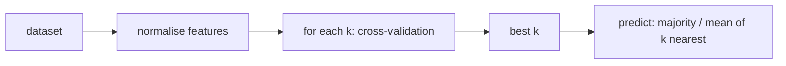

# K-Nearest Neighbors

> [!abstract]
> First lecture of Part 2 (prof. Fabio Patrizi). Every model of [[MOC - Machine Learning#Part 1 — Fusco|Part 1]] was **parametric**: learning meant finding a parameter vector $\theta$, after which the data could be thrown away. **k-Nearest Neighbors** is the prototype of the opposite family, **non-parametric / instance-based learning**: the "model" *is* the dataset, and a new point gets the majority label (or the average target) of its $k$ closest training points. We see how it works, why **feature scaling / normalisation** is crucial, its **generalization bound** (at most twice the Bayes error plus a term that explodes with the dimension), the resulting **curse of dimensionality**, its cost, its regression version and how to pick $k$.
>
> Next: [[08 - ML - Clustering|Clustering]], where distances are again the protagonist but labels disappear.
>
> Index: [[MOC - Machine Learning]] · Source: Simone's annotated slides; book chapter = Shalev-Shwartz & Ben-David, *Understanding Machine Learning*, Ch. 19.

---

## 1. Parametric vs non-parametric models

See [[Parametric vs Non-Parametric Models]].

| | Parametric | Non-parametric |
|---|---|---|
| hypothesis | defined by a fixed set of **parameters** | **induced by the dataset** itself |
| examples | linear regression, logistic regression, Perceptron, neural networks | kNN (and kernel methods, trees grown without limits…) |
| after training | keep $\theta$, discard the data | must keep the whole dataset |
| a.k.a. | — | **instance-based learning** |

> [!example] Simone's annotation
> Linear regression $h(x;w_1,w_0)=w_1x+w_0$: once squared-error minimisation has found e.g. $h(x)=1.7x+0.4$, the prediction for any $x$ depends only on $w_1,w_0$ — "when you have that function, you can throw away the dataset". In a non-parametric model "every dataset induces a hypothesis".

---

## 2. The k-NN rule

See [[K-Nearest Neighbors]].

![[ML-L07-p02.jpg]]

*Binary classification example from the slides.* Orange (circled) and green points in the plane $(x_1,x_2)$; how should we classify the new **blue** instance at about $(5.35,4.0)$? Simone's note: "I simply check if it is similar to the orange ones or to the green ones. Similar = closest one → **distance-based approach**."

**Intuition:** close-by points are likely to have the same label (they have similar features — e.g. people who like the same movies). "Close-by" needs a **distance**
$$\rho:\mathcal{X}\times\mathcal{X}\to\mathbb{R},\qquad\text{typically Euclidean: }\rho(x,x')=\lVert x-x'\rVert=\sqrt{\textstyle\sum_{i=1}^d(x_i-x_i')^2}.$$

**Algorithm.** Training sample $S=((x_1,y_1),\dots,(x_m,y_m))$ — a *sequence*, not a set: the same point may appear more than once. Given a query $x$ and $k$:

1. order the training examples by distance from $x$: $\pi_1(x),\dots,\pi_m(x)$ with $\rho(x,x_{\pi_i(x)})\le\rho(x,x_{\pi_{i+1}(x)})$;
2. return the **majority label** among $\{y_{\pi_i(x)}: i\le k\}$.

> [!note] There is no training
> Compared to the parametric predictors, "we are not constructing a predictor function, but we use everything in the dataset" at prediction time. All the work is done at **inference**.

![[ML-L07-p05.jpg]]

*$k=3$ on the same data.* The three nearest neighbours of the blue point are numbered 1 (orange), 2 and 3 (green): 2 green vs 1 orange → **green**. With $k=1$ only neighbour 1 counts and the answer is **orange**: the prediction depends on $k$.

### k = 1 — Voronoi tessellation

![[ML-L07-p06.jpg]]

For $k=1$ the instance space is partitioned into **Voronoi cells**: each training point (blue dots) owns the region of points closer to it than to any other, and a new point takes the label of the owner of its cell. The decision boundary of 1-NN is made of pieces of the perpendicular bisectors between differently labelled points.

### General classification and other distances

- **Multi-class**: just return the most common class among the $k$ neighbours.
- The distance **need not be Euclidean**; it depends on the domain:
  - **Hamming distance** for categorical features (number of coordinates that differ);
  - **Manhattan distance** $\rho(x,x')=\sum_{i=1}^d\lvert x_i-x_i'\rvert$;
  - …

> [!quote] From the book (Shalev-Shwartz & Ben-David, §19.1)
> More generally, a k-NN rule is any $h_S(x)=\varphi\big((x_{\pi_1(x)},y_{\pi_1(x)}),\dots,(x_{\pi_k(x)},y_{\pi_k(x)})\big)$ for some function $\varphi$ of the $k$ neighbours: majority vote and average are two choices; another is a **distance-weighted** average. In contrast with ERM-style methods, NN "figures out a label on any test point without searching for a predictor within some predefined class of functions".

---

## 3. Feature scale and normalisation

See [[Feature Normalization]].

![[ML-L07-p08.jpg]]

The Euclidean distance sums squared differences over **all** coordinates, so **features with larger numeric ranges dominate**. "How do age and weight compare to each other?" In the drawing the same points are plotted with one axis in cm and then in dm: after rescaling, the black query point that was closest to the blue points becomes closer to … a different set, so the **neighbours (and the prediction) change** just because of the unit of measure. Another of Simone's examples: "Age" ranges in $[0,100]$, "Annual income" in $[20{,}000, 250{,}000]$: without scaling, income completely dominates the distance.

The impact of the scale is (partly) mitigated by **data normalisation** — a general preprocessing step, not only for kNN:

> [!important] Two standard normalisations
> - **Z-score**: $z=\dfrac{x-\mu}{\sigma}$ ($\mu$ mean, $\sigma$ standard deviation of the feature). Normalised data have mean $0$ and variance $1$.
> - **Linear (min-max) scaling** to a range $[a,b]$:
> $$x'=a+\frac{(x-\min(x))\,(b-a)}{\max(x)-\min(x)}$$
> (with $[a,b]=[0,1]$: $x'=\frac{x-\min}{\max-\min}$; the max goes to $b$, the min to $a$).
>
> Both are **lossless** (invertible): we can always go back to the original values.

> [!example]
> Min-max scaling of $[1,2,4,5,7,10]$ to $[0,1]$: $x'=\frac{x-1}{9}$, giving $[0,\ 0.11,\ 0.33,\ 0.44,\ 0.67,\ 1]$. (Simone's note divides by the max, $[0.1,0.2,0.4,0.5,0.7,1]$: that is scaling by $1/\max$, which maps to $[0.1,1]$ rather than to $[0,1]$.)

**Normalisation in general** is *always recommended*, to avoid:
- undesired differences in feature importance (the most important reason);
- working with extremely large or small values, which require large approximations;
- which one to use depends on data and algorithm (e.g. **min-max is a good choice for neural networks**, see the normalisation layer in [[10 - ML - Training Neural Networks#7. TensorFlow, normalisation layer and tensors|note 10]]).

---

## 4. Generalization bound for 1-NN

![[ML-L07-p12.jpg]]

How well can kNN perform? Consider the **1-NN rule** for binary classification.

> [!important] Theorem 19.3 (Shalev-Shwartz & Ben-David)
> Let $\mathcal{X}=[0,1]^d$, $\mathcal{Y}=\{0,1\}$, $D$ a distribution over $\mathcal{X}\times\mathcal{Y}$ whose conditional probability $\eta(x)=\mathbb{P}[y=1\mid x]$ is **$c$-Lipschitz**. Let $h_S$ be the 1-NN rule on a sample $S\sim D^m$. Then
> $$\mathbb{E}_{S\sim D^m}\big[L_D(h_S)\big]\le2\,L_D(h^\star)+4c\sqrt d\,m^{-\frac1{d+1}},$$
> where $h^\star(x)=\mathbb{1}[\eta(x)>1/2]$ is the **Bayes optimal classifier** ([[01 - ML - Decision Theory and Naive Bayes#2. The Bayes optimal predictor|Week 1]]).

Symbols: $L_D$ = expected 0-1 loss (the risk $R$ of Part 1); $d$ = data dimension; $m$ = number of samples; $c$ = Lipschitz constant — "in general you don't know this number".

> [!note] $c$-Lipschitz
> $\forall x,x'\in\mathcal{X}:\ \lvert\eta(x)-\eta(x')\rvert\le c\,\lVert x-x'\rVert$.
> The probability of having label 1 cannot change faster than linearly with the distance: nearby points have similar label probabilities. It is the formal version of "close-by points have the same label", and it is what makes the nearest neighbour informative.

![[ML-L07-p13.jpg]]

*Simone's page on the meaning of the bound.*
- Even with infinitely many samples (last term $\to0$), the expected loss of 1-NN can be, in the worst case, **twice** the Bayes error.
- The second term $4c\sqrt d\,m^{-1/(d+1)}$ depends on the dimension $d$ and on $m$: that is what we can work on.
- Lipschitz example: points $x'',x',x$ on a line with $\eta(x)=1$, $\eta(x')=0.7$, $\eta(x'')=0.1$ — the farther apart, the more $\eta$ may differ.
- If the query point lies **far from all the data** (the blue point far on the right of the scatter plot), we can still apply kNN, but the information is useless: Lipschitzness only helps when the neighbour is *near*.

> [!quote] From the book (§19.2)
> The proof covers $[0,1]^d$ with $r=T^d$ boxes of side $\varepsilon=1/T$. Two points in the same box are at distance $\le\sqrt d\,\varepsilon$; the expected probability mass of the boxes **not hit** by any sample is at most $\frac{r}{me}$ (Lemma 19.2). Hence $\mathbb{E}\lVert x-x_{\pi_1(x)}\rVert\le\sqrt d\big(\frac{2^d\varepsilon^{-d}}{me}+\varepsilon\big)$, and choosing $\varepsilon=2m^{-1/(d+1)}$ gives the $4c\sqrt d\,m^{-1/(d+1)}$ term. For $k$-NN the asymptotic error is at most $(1+\sqrt{8/k})$ times the Bayes error (Theorem 19.5): larger $k$ gets closer to Bayes.

---

## 5. The curse of dimensionality

See [[Curse of Dimensionality]].

kNN assumes that close-by points have the same label; when points are **not** close-by, informativeness drops. To work well, the dataset must be **dense** over the instance space.

From the bound: to be within $\varepsilon$ of $2L_D(h^\star)$ we need $4c\sqrt d\,m^{-1/(d+1)}\le\varepsilon$, i.e.
$$m\ \ge\ \Big(\frac{4c\sqrt d}{\varepsilon}\Big)^{d+1}.$$

> [!important]
> The dataset size must grow **exponentially with the dimension** $d$. With $d$ large it is practically impossible to collect enough data. (Sample-exam question: "how should the size of the dataset grow when $d$ increases?" → exponentially.)

> [!example] Why high dimensions are empty
> To cover $[0,1]^d$ with cubes of side $0.1$ you need $10^d$ cubes: $100$ in 2-D, $10^{10}$ in 10-D. With a million points in 10-D almost every cube is empty, so the "nearest" neighbour is typically far away.

Simone's summary: "C-Lipschitz is useful to say that, for a given $x$, the more distant you are from $S$, the worse k-NN is; the nearest, the better." In the 1-NN theorem you always pay an additional error given by $d$ and $m$.

This is the same curse met by density estimation in [[01 - ML - Decision Theory and Naive Bayes#4. Naive Bayes classifier|Naive Bayes]], and one motivation for [[12 - ML - Dimensionality Reduction|dimensionality reduction]].

---

## 6. Complexity

| | Cost |
|---|---|
| memory | the **entire dataset**, $O(dm)$ (linear regression: just 2 values) |
| inference, brute force | distance from $x$ to all $m$ points: $O(dm)$ — can be extremely expensive; fine for small $m$ and $d$ |
| inference with **k-d trees** | polynomial in $d$, **logarithmic** in $m$ (e.g. $O(d\log m)$) |

- **But** k-d trees require size exponential in $d$: infeasible for large $d$.
- **Approximate** approaches can find "not too distant" neighbours (approximate nearest neighbour search).

(First Session/Erasmus Q7: kNN is **a non-parametric algorithm** — not "specifically for regression/classification", nor unsupervised.)

---

## 7. kNN regression

![[ML-L07-p15.jpg]]

kNN easily generalises to regression ($\mathcal{Y}=\mathbb{R}$): instead of the majority, take the **average** of the targets of the $k$ nearest neighbours,
$$h_S(x)=\frac1k\sum_{i=1}^ky_{\pi_i(x)} .$$
In the drawing, the blue query on the x-axis picks its neighbours (circled red points) and predicts the mean of their heights. A distance-weighted average is a common variant.

---

## 8. Choosing k

kNN still needs **hyperparameter tuning**: what is the best $k$, and how to find it?

- $k$ too small (1): very sensitive to noise, jagged Voronoi boundary → overfitting.
- $k$ too large (up to the whole dataset): "you are doing an average of everything" → always the global majority class → underfitting.
- **Empirical approach, typically cross-validation**: run several tests with different values of $k$ and different splits of the data into training and validation sets; select the $k$ giving the best results in most runs. (Prefer odd $k$ in binary classification to avoid ties.)

---

## Worked exercise (Sample exam questions, Patrizi — Exercise 1)

Dataset of 15 points $(x_1,x_2)$ with class $y_1$ and real target $y_2$; classify $x=(4,5)$ with $K=1,3,5$.

Squared Euclidean distances from $(4,5)$ of the closest points:

| point | $(x_1,x_2)$ | $y_1$ | $y_2$ | $d^2$ |
|---|---|---|---|---|
| 4 | (5, 5) | 0 | 6.2 | 1 |
| 11 | (4, 4) | 1 | 4.4 | 1 |
| 2 | (3, 5.5) | 0 | 3.5 | 1.25 |
| 10 | (5, 4) | 1 | 4.6 | 2 |
| 12 | (3, 4) | 1 | 5.0 | 2 |
| 3 | (4, 6.5) | 0 | 3.7 | 2.25 |
| 9 | (4.5, 3.5) | 1 | 3.5 | 2.5 |

- **$K=1$:** points 4 (class 0) and 11 (class 1) are **tied** at distance 1 → the answer depends on the tie-breaking rule (worth stating explicitly in the exam).
- **$K=3$:** $\{4,11,2\}$ → classes $0,1,0$ → **class 0**.
- **$K=5$:** $\{4,11,2,10,12\}$ → $0,1,0,1,1$ → **class 1**.
- **Regression on $y_2$:** $K=3$: $\frac{6.2+4.4+3.5}{3}=4.7$; $K=5$: $\frac{6.2+4.4+3.5+4.6+5.0}{5}=4.74$; $K=1$: $6.2$ or $4.4$ depending on the tie-break.
- **Complexity of classifying a point:** $O(dm)$ (here $d=2$, $m=15$), plus the selection of the $k$ smallest.

---

## Video

- [StatQuest: K-nearest neighbors, Clearly Explained](https://www.youtube.com/watch?v=HVXime0nQeI)
