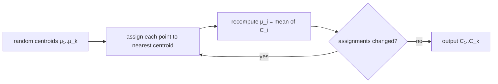

# Clustering

> [!abstract]
> Second lecture of Part 2 and our first **unsupervised** problem: there are no labels any more, only points, and we want to group similar ones. After seeing why clustering is intrinsically ill-defined, we give a formal input/output model and study two families of algorithms: **linkage-based (hierarchical) clustering**, which merges the closest clusters and outputs a **dendrogram**, and **k-means**, which treats clustering as the minimisation of an objective with **centroids** (plus the k-medoids / k-median variants). We close with **Kleinberg's impossibility theorem**: no clustering function can be scale-invariant, rich and consistent at the same time.
>
> Distances were already the core of [[07 - ML - K-Nearest Neighbors|kNN]]; the centroid/variance view of k-means comes back in [[12 - ML - Dimensionality Reduction|PCA]]. The same notes then move on to [[09 - ML - Feed-Forward Neural Networks|neural networks]].
>
> Index: [[MOC - Machine Learning]] · See also [[1 - Data Mining - Introduction to Data Mining and Big Data|Data Mining]].

---

## 1. Unsupervised learning

So far (MNIST digits example): $f:\mathcal{X}\to\mathcal{Y}$, $\mathcal{X}$ = pictures of digits, $\mathcal{Y}=\{0,\dots,9\}$, and a training set $S=\big((\text{img}_1,f(\text{img}_1)),\dots,(\text{img}_{1000},f(\text{img}_{1000}))\big)$. In **unsupervised learning** the labels $f(\text{img}_i)$ disappear: we only have the images. "This is just a bunch of data. We don't have classes, so we have to group similar objects."

See [[Clustering]].

**Clustering:** given a set, partition it into groups so as to
- **group similar objects** (points), and
- **separate dissimilar objects**.

> [!warning] The two goals can be contradictory
> Take points $x_1,\dots,x_m$ on a line where each $x_i$ is very similar (close) to $x_{i+1}$. Consecutive points are similar, but $x_1$ and $x_m$ are far apart. "Group similar points" forces us to chain everything together; "separate dissimilar points" forces $x_1$ and $x_m$ apart. **There is no unique formalisation of clustering.**

![[ML-L08-p02.jpg]]

*Two rows of points.* 1st approach: cut vertically (left half red, right half blue). 2nd approach: one cluster per row. **Both are correct!** There is no single correct approach, because there is no "ground truth": the right clustering depends on the chosen algorithm (Simone's box: the same dataset can be clustered by columns or by rows; often the same algorithm is not deterministic but stochastic).

---

## 2. Formal model for clustering

**Input**
- an **instance space** (the dataset) $X\subseteq X'$;
- a **distance function** $d:X\times X\to\mathbb{R}_+$ with
  - $d(x,x)=0$ for all $x$;
  - **symmetry**: $d(x,y)=d(y,x)$;
  - **triangle inequality**: $d(x,z)\le d(x,y)+d(y,z)$.

**Output**
- a **partition** $C=(C_1,\dots,C_k)$: $\bigcup_{i=1}^kC_i=X$ and $C_i\cap C_j=\emptyset$ for $i\ne j$;
- or a **dendrogram**: a tree-based (hierarchical) representation of nested clusterings.

For some algorithms there are several possible correct clusterings.

> [!warning] Correzione
> In the notes the triangle inequality is written $d(x,y)+d(y,z)\le d(x,z)$; the direction is reversed. The direct path is the shortest: $d(x,z)\le d(x,y)+d(y,z)$ (as the triangle in the drawing shows).

---

## 3. Linkage-based clustering

See [[Linkage-Based Clustering]].

A family of **agglomerative (bottom-up)** algorithms that outputs a dendrogram:

1. start with every point in its own cluster, $C_i=\{x_i\}$;
2. **repeat until a termination condition**: merge the two "closest" clusters of the current partition;
3. return the current partition (or the whole dendrogram).

"Closest" needs a **between-cluster distance** $D(A,B)$, built from the point distance $d$:

| Linkage | $D(A,B)$ | Picture |
|---|---|---|
| **single** | $\min\{d(x,y): x\in A, y\in B\}$ | the two closest points of the clusters |
| **average** | $\frac{1}{\lvert A\rvert\lvert B\rvert}\sum_{x\in A,y\in B}d(x,y)$ | average over all pairs |
| **max** (complete) | $\max\{d(x,y): x\in A, y\in B\}$ | the two farthest points |

The three variants differ **only in the distance** $D$. Single linkage tends to create long "chains" (exactly the contradictory example of §1); max linkage prefers compact, round clusters. As Simone notes, in practice you test several algorithms and decide which works best: theory does not always predict the winner.

### Example

![[ML-L08-p04.jpg]]

Five points $a,b,c,d,e$ with single linkage. Partition $C^0=\{a\},\{b\},\{c\},\{d\},\{e\}$; the closest pairs are $b,c$ and $d,e$, so $C^1=\{a\},\{b,c\},\{d,e\}$; then $\{b,c\}$ and $\{d,e\}$ are merged (green segment $c$–$d$ is shorter than the red ones from $a$), $C^2=\{a\},\{b,c,d,e\}$; finally $C^3=\{a,b,c,d,e\}$. The tree on the right is the **dendrogram**: cutting it at a level gives a partition. Without a termination condition you always end with $C^3$ (one cluster), but since the output is a dendrogram you can pick any $C^i$ you want. Without termination the algorithm is **very expensive**.

### Termination conditions

![[ML-L08-p05.jpg]]

- **number of clusters** $k$ provided as input: stop when $k$ clusters remain;
- **distance upper bound** $r$: stop when all between-cluster distances exceed the threshold $r$;
- …other bounds can be implemented.

In the example with threshold $r$ (green segment): after $C^1=\{a\},\{b,c\},\{d,e\}$ every remaining between-cluster distance (blue lines) passes $r$ → **stop**.

> [!note] Complexity
> Linkage-based clustering is expensive: it needs all the $O(m^2)$ pairwise distances of the $m$ points, and the naive implementation repeats a search over cluster pairs at every merge (so it is at least quadratic, cubic if implemented naively). This is a general problem of clustering large datasets.

---

## 4. k-means clustering

See [[K-Means]].

Now clustering is seen as an **optimisation problem**.

- **Input:** $(X,d)$ with $X\subseteq X'$ and a distance $d$ on $X'$ (e.g. Euclidean), and the **number of clusters $k$**.
- **Output:** a partition $C=(C_1,\dots,C_k)$ into $k$ clusters.
- **Objective function** $G$: takes the dataset $(X,d)$ and a partition $C_1,\dots,C_k$ and returns a value in $\mathbb{R}_+$ that evaluates **how bad** the partition is.

The k-means problem (and variants): find
$$C=\arg\min_{(C_1,\dots,C_k)}G\big((X,d),(C_1,\dots,C_k)\big).$$
There are many ways to cluster a dataset; for large datasets, trying them all is computationally infeasible.

### Centroids

![[ML-L08-p07.jpg]]

For a cluster $C_i$ the **centroid** is the point of $X'$ (not necessarily a data point) minimising the sum of squared distances to the points of the cluster — "a kind of centre of the cluster":
$$\mu_i=\arg\min_{\mu\in X'}\sum_{x\in C_i}d(x,\mu)^2 .$$
If $d$ is Euclidean this is the **mean**: $\mu_i=\frac{1}{\lvert C_i\rvert}\sum_{x\in C_i}x$ (set the gradient $\sum_x 2(\mu-x)$ to zero).

> [!important] k-means objective
> $$G_{k\text{-means}}\big((X,d),(C_1,\dots,C_k)\big)=\sum_{i=1}^k\sum_{x\in C_i}d\big(x,\mu_i(C_i)\big)^2$$
> Points must be **compact around their centroid** in each cluster. With Euclidean $d$ it is the total within-cluster variance (times the cluster sizes).

Minimising this exactly is very hard (NP-hard in general), so approximations are used. The standard heuristic is what people usually call "k-means" (**Lloyd's algorithm**):

```
k-MEANS
Input: k = number of clusters; X ⊆ ℝⁿ; d = Euclidean distance
Initialise: randomly choose centroids μ_1, ..., μ_k
Repeat until convergence:
    ∀i: C_i = { x ∈ X : i = argmin_j ‖x − μ_j‖ }      ▷ assign each point to its closest centroid
    ∀i: μ_i = (1/|C_i|) Σ_{x∈C_i} x                    ▷ recompute centroids as means
```

"So, you have the random centroids, you assign every $x$ based on the centroids, then you compute the new centroids based on the actual clusters, then you re-assign $x$ to the new clusters… until no change can be made → you reach convergence." The name *k-means*: each centroid is a mean.

![[ML-L08-p09.jpg]]

*Top:* two centroids $\mu_1,\mu_2$; a point is assigned to the cluster of the centroid it is closest to (green dotted distances). Adding data changes the centroids and therefore the clusters. *Bottom:* initial step with randomly chosen $\mu_1,\mu_2,\mu_3$ (red, green, yellow clusters); then compute the real centroids of these clusters — "but then we have to check again if the centroid is actually the closest to each point", which is the next assignment step.



### Variants

| Variant | Centre | Objective | Note |
|---|---|---|---|
| **k-means** | $\mu\in X'$ (any point) | $\sum d(x,\mu)^2$ | centre = mean for Euclidean $d$ |
| **k-medoids** | $\mu\in X$ (**an actual data point**) | $\sum d(x,\mu)^2$ | the squared distance "punishes more the points that are distant" |
| **k-median** | $\mu\in X$ | $\sum d(x,\mu)$ | more robust to outliers |

When computing $\mu$ for medoids/medians you must go through **every point** of the dataset (try each as candidate centre).

### Properties

> [!important] Lemma (Shalev-Shwartz & Ben-David 22.1)
> Each iteration of k-means does **not increase** the objective function.

*Why:* the assignment step gives each point its closest centroid (cannot increase the sum); the update step replaces each centre by the mean, which is the minimiser of $\sum_{x\in C_i}\lVert x-\mu\rVert^2$ (cannot increase it either). As we iterate, we find something that is surely not worse. Since there are finitely many partitions, the algorithm terminates.

But the result **depends strongly on the initial centroids**: different initial centroids lead to different clusters after convergence.

> [!warning] Non-guarantees
> - We don't know how many **iterations** are needed to converge.
> - **No approximation guarantee**: we cannot be sure to find a solution below an arbitrary bound; k-means may even converge to a point that is not a local minimum (book, Exercise 22.2).

**Improvements**
- (partial) solution: **repeated executions** with different random initialisations, keep the best objective;
- further issue: the hyperparameter $k$ — which is the right $k$? Test different values of $k$, just as for kNN. (Note that $G$ always decreases when $k$ grows, down to $0$ for $k=m$, so one looks for an "elbow" rather than the minimum.)

> [!example] Exam check
> Erasmus session Q6: "K-Means is an algorithm for… → **Unsupervised learning**."

---

## 5. Kleinberg's impossibility theorem

See [[Kleinberg Impossibility Theorem]].

"Returning to clustering, we still don't have a formalised structure for clustering. The attempts were numerous." **Kleinberg (2003)** tried an **axiomatic** approach: a clustering function $F((X,d))=(C_1,\dots,C_k)$ should satisfy three desirable properties.

| Property | Meaning |
|---|---|
| **Scale invariance** | $F(X,d)=F(X,\alpha d)$ for every $\alpha>0$: scaling all distances does not change the partition |
| **Richness** | for every partition $C$ of $X$ there is some $d$ with $F(X,d)=C$: the distance function determines the output, and any output is reachable |
| **Consistency** | if we shrink distances inside clusters and enlarge distances between clusters, the output does not change ("similar points stay together, dissimilar ones stay separated") |

> [!important] Impossibility result
> There is **no** clustering function $F$ that satisfies scale invariance, richness and consistency **at the same time**.

Simone's comment: "so basically we don't have the guarantee that the cluster is perfect and we have to find a cluster which is good with respect to what we are searching." Each property alone is reasonable, so every clustering algorithm must give up at least one (e.g. single linkage with a fixed number of clusters $k$ gives up richness; with a fixed distance threshold it gives up scale invariance).

> [!quote] From the book (§22.5)
> Formally, consistency: if $d'$ satisfies $d'(x,y)\le d(x,y)$ for $x,y$ in the same cluster of $F(X,d)$ and $d'(x,y)\ge d(x,y)$ for $x,y$ in different clusters, then $F(X,d')=F(X,d)$. The impossibility is circumvented by fixing the number of clusters: for a fixed $k$, the k-means objective-based clustering satisfies relaxed versions of all three properties.

---

## Video

- [StatQuest: K-means clustering](https://youtube.com/watch?v=4b5d3muPQmA)
- [StatQuest: Hierarchical Clustering](https://www.youtube.com/watch?v=7xHsRkOdVwo)
