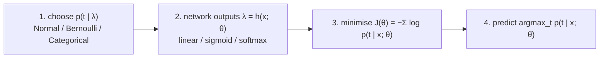
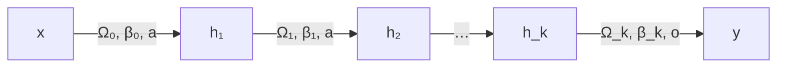

# Feed-Forward Neural Networks

> [!abstract]
> Third lecture of Part 2. We go back to **parametric** supervised learning (as in [[MOC - Machine Learning#Part 1 — Fusco|Part 1]]), but with a much more powerful hypothesis class: **feed-forward neural networks** (FNN, a.k.a. ANN or multi-layer perceptron). We build them from **neurons** (a linear combination followed by a non-linear **activation**, typically **ReLU**), see that a shallow network computes a **piecewise linear** function and, by the **universal approximation theorem**, can approximate anything; then we go **deep** (more hidden layers). The second half answers "which loss?": a network outputs the **parameters of a probability distribution**, and the loss is the **negative log-likelihood** — giving back the squared error for regression, the **binary cross-entropy** for binary classification and the **multiclass cross-entropy** with **softmax** for $K$ classes. We end with the compact **matrix notation**.
>
> How to actually *train* these networks (gradient descent, SGD, momentum, Adam, backpropagation, initialisation, regularisation) is in [[10 - ML - Training Neural Networks|note 10]]; specialised architectures for images in [[11 - ML - Convolutional Neural Networks|note 11]].
>
> Index: [[MOC - Machine Learning]] · Book: Prince, *Understanding Deep Learning* (UDL), Ch. 3 (shallow), 4 (deep), 5 (loss functions).

---

## 1. From parametric models to neural networks

Recap: in Part 1 we solved supervised learning **parametrically**, minimising an (empirical) risk. Target $f:\mathcal{X}\to\mathcal{Y}$, training set $S=\{(x_1,t_1),\dots,(x_m,t_m)\}$ with $t_i=f(x_i)$, hypothesis class e.g. $h(x;\theta)=w_1x_1+w_2x_2+w_0$, $\theta=(w_1,w_2,w_0)$, and $L(h_S)$ the loss minimised by ERM. Now we keep the same approach, but $h(x;\theta)$ will be a **neural network function**.

> [!note] Names
> **Feed-Forward Neural Networks (FNN)** — the simplest kind: information flows in a single direction (no loops, no memory) — also called **Artificial Neural Networks (ANN)** (general term) or **Multi-Layer Perceptron (MLP)** (a generalisation of the [[05 - ML - Perceptron, SVM and Kernels#1. The Perceptron|Perceptron]], combining many perceptrons in a network).

**Why something new?** With linear models + feature maps we had to choose the features by hand; kernel SVMs could change the representation, but with many limitations (who gives us the right kernel? some functions are hard to express). Neural networks **learn the representation** too. The price: the loss is **no longer convex**, so finding its minimum is harder.

---

## 2. The neuron and the shallow network

See [[Feed-Forward Neural Network]] and [[Activation Function]].

![[ML-L09-p02.jpg]]

A **neuron** (inspired by biological ones) has two stages:
1. a **linear** part: $\theta_0+\sum_{i=1}^3\theta_ix_i$, where $x_1,x_2,x_3$ are the inputs and the constant input **1** multiplies the **bias** $\theta_0$;
2. a **non-linear activation function** $a$:
$$y(x_1,x_2,x_3)=a\Big(\theta_0+\sum_{i=1}^3\theta_ix_i\Big).$$

> [!important] Why the activation must be non-linear
> A composition of linear maps is linear. Without a non-linearity, however many neurons we stack, the network would still compute a linear function — no more powerful than linear regression.

### A first network

![[ML-L09-p04.jpg]]

One input $x$, three hidden neurons, one output (the bias input $1$ is always assumed):
$$f(x;\theta)=\varphi_0+\varphi_1\,a(\theta_{10}+\theta_{11}x)+\varphi_2\,a(\theta_{20}+\theta_{21}x)+\varphi_3\,a(\theta_{30}+\theta_{31}x),$$
with parameters $\theta=\{\theta_{10},\theta_{11},\theta_{20},\theta_{21},\theta_{30},\theta_{31},\varphi_0,\varphi_1,\varphi_2,\varphi_3\}$ (10 numbers). The $\varphi$'s are the weights of the final output; for now the same activation is used in all hidden neurons.

### ReLU

See [[ReLU]].

$$\operatorname{ReLU}(z)=\begin{cases}0&z\le0\\z&\text{otherwise}\end{cases}=\max\{0,z\}$$

The **Rectified Linear Unit**: zero for negative inputs, the identity for positive ones. Different from the [[Sigmoid Function|sigmoid]] but still non-linear (it has a "kink" at 0).

**What a single hidden unit computes.** $\operatorname{ReLU}(\theta_{10}+\theta_{11}x)$ is a "hinge": flat at 0, then a ramp.
- $\theta_{10}=0,\theta_{11}=1$: $\operatorname{ReLU}(x)$, kink at $0$;
- $\theta_{10}=1,\theta_{11}=1$: $\operatorname{ReLU}(1+x)$, kink moved to $x=-1$ (the bias **shifts** the kink);
- $\theta_{10}=1,\theta_{11}=\frac12$: $\operatorname{ReLU}(1+\frac x2)$, kink at $x=-2$, smaller **slope** (the weight changes the slope).

![[ML-L09-p05.jpg]]

**Combining units.** With $\operatorname{ReLU}(1+\frac x2)$ (kink at $-2$) and $\operatorname{ReLU}(-2+\frac x3)$ (kink at $6$), and output weights $\varphi_0=0$, $\varphi_1=\varphi_2=1$, the sum (red) is a **piecewise linear** function with kinks at $-2$ and $6$: flat, then slope $\frac12$, then slope $\frac12+\frac13$.

![[ML-L09-p06.jpg]]

Adding the third unit $\operatorname{ReLU}(8-2x)$ (a decreasing ramp that is zero after $x=4$) we get a "V"-like piecewise linear function with kinks at $-2$, $4$, $6$. "By tuning the parameters, we built a piecewise linear function using a non-linear one." Bottom: with enough units we can fit a wiggly dataset (green points) with a piecewise linear curve (blue); more neurons fit even better.

![[ML-L09-p07.jpg]]

*Slide from UDL Fig. 3.5.* **3 hidden units → piecewise linear function with 4 linear regions; $n$ units → $n+1$ linear regions** (each unit adds one kink). Panels a–c approximate a smooth function (dashed) with 5, 10 and 20 linear regions: "by increasing the number of functions, it becomes even more precise".

### Layers and the general shallow network

![[ML-L09-p08.jpg]]

Terminology: **input layer** (input units), **hidden layer** (hidden units), **output layer** (output units). A **shallow** FNN has **exactly one hidden layer**. Input and output layers can have many units: in general $f:\mathbb{R}^n\to\mathbb{R}^m$. In an FNN every unit of a layer is linked to **every** unit of the next layer (*fully connected*), each link with its own parameter:
$$f(x_1,\dots,x_n;\theta)=\langle y_1,\dots,y_m\rangle .$$

![[ML-L09-p10.jpg]]

*Example $\mathbb{R}^2\to\mathbb{R}^2$:* given two points $x_1,x_2$ on a line, output their middle point and their distance. A shallow network with a few hidden units can approximate it.

### Universal approximation theorem

See [[Universal Approximation Theorem]].

> [!important] Universal approximation theorem
> A shallow FNN with a **linear output layer** and **"squashing"** hidden units can approximate any **Borel-measurable** function (e.g. any continuous function on a compact set) up to an arbitrary error $\varepsilon$, provided it has a sufficient number of hidden units.

"**Squashing**" functions constrain their output to an interval: $a:\mathbb{R}\to(a,b)$ (like the sigmoid). The theorem also holds for ReLU units. It says that you can always get a result up to a desired error *if you use the right number of units* — but it does not say how many (possibly exponentially many), nor how to find the weights.

---

## 3. Deep networks

See [[Deep Neural Network]].

Two terms:
- **capacity**: total number of hidden units;
- **width** (of a layer): number of units in the layer.

Different hidden layers can have different widths. When a network has **more than one hidden layer** it is a **deep network**.

![[ML-L09-p12.jpg]]

*A deep FNN:* input of width 3, two hidden layers of width 3 and 4 (capacity 7), output of width 1. In a **feed-forward** network the $i$-th layer is linked **only** to the $(i+1)$-th (the small sketch on the left, with connections going back or skipping layers, is not an FNN — general neural networks allow it). Real deep networks have huge numbers of parameters (billions in LLMs).

> [!important] Why deep, if shallow is already universal?
> - Deep networks can produce **many more linear regions** for the same number of parameters (each layer folds and combines the regions of the previous one: the number of regions can grow exponentially with depth).
> - For "mysterious" (not fully understood) reasons they are **faster to train** and **generalise better** on unseen examples.
>
> So they are preferred to shallow ones, although they are harder to understand and to use. (UDL §4.5: depth efficiency, large structured inputs, training and generalisation.)

**Design choices of a network**
- **width** and **depth** — there are no guidelines on how much you need: test and see how it performs;
- **activation functions** (hidden layer, output layer) and **loss function** — these are deeply problem-related (next section).

---

## 4. What does the network output? Distributions and loss functions

See [[Gaussian Output Networks]] and [[Cross-Entropy Loss]].

![[ML-L09-p13.jpg]]

So far, for a given $x$ the model output $y=h(x)\approx f(x)$ (regression) or a **probability** (classification, e.g. $h(x)=\mathbb{P}(\text{class }1)$). With neural networks we take a more general view: **for a given input, the output is a probability distribution over the possible outputs** — more precisely the network outputs the **parameters** of that distribution.

![[ML-L09-p18.jpg]]

*Simone's summary page.* "Not only can we use an FNN to construct a proper predictor, we can also use it for classification." Instead of producing a single value, the network produces the **parameters of the conditional distribution** $p(t\mid x)$:
- **FNN as Gaussian output predictor** (continuous targets: temperatures, house prices):
  - **homoscedastic regression** (only the mean $\mu$): the last layer is a pure linear combination producing $\mu$; the variance $\sigma^2$ is treated as fixed, which mathematically gives the **squared error** loss;
  - **heteroscedastic regression** (mean $\mu$ **and** variance $\sigma^2$ depending on $x$): two outputs; the one for $\sigma^2$ is **squared** (or passed through another positive function) so it is always positive.
- **FNN as classifier**: Bernoulli distribution (binary) or Categorical distribution (multiclass).

> [!example] Noisy temperatures
> At the same input $x=7$ the temperature was measured several times, giving $17.5,19.5,20.5,21$: $f$ is not a function of $x$ alone, there is noise. A network that outputs $\mu$ (and $\sigma$) for input $7$ describes the **whole distribution** of the possible measurements (a Gaussian centred at $\mu$), instead of a single number.

### Binary classification as a Bernoulli

![[ML-L09-p20.jpg]]

For binary classification the output distribution is a **Bernoulli** with parameter $\lambda=\mathbb{P}(t=1)$:
$$p(t\mid\lambda)=\begin{cases}1-\lambda&t=0\\\lambda&t=1\end{cases}=(1-\lambda)^{1-t}\lambda^t$$
(see [[Distribuzione di Bernoulli]]). The network output $y$ is interpreted as $\lambda$. Example: $y(7)=0.62=\lambda$, so $p(1\mid y(7))=(1-0.62)^0\cdot0.62^1=0.62$ and $p(0\mid y(7))=(1-0.62)^1\cdot0.62^0=0.38$. The network predicts the probability of $x$ being class 1 (Simone's note: for this to be a probability, the output activation — a sigmoid — must return a value in $[0,1]$).

### Maximum likelihood → negative log-likelihood

Given the training set $S=\{(x_1,t_1),\dots,(x_m,t_m)\}$, choose the parameters that make the observed targets **most probable** (**maximum likelihood principle**), assuming independent samples:
$$\hat\theta=\arg\max_\theta\prod_{i=1}^mp(t_i\mid x_i;\theta).$$
A product of many probabilities becomes **tiny** (numerical underflow), so take the logarithm (monotone: the arg max does not change, and $\log\prod=\sum\log$):
$$\hat\theta=\arg\max_\theta\log\prod_{(x,t)\in S}p(t\mid x;\theta)=\arg\min_\theta\sum_{(x,t)\in S}-\log p(t\mid x;\theta)=\arg\min_\theta J(\theta).$$

> [!important] Loss = negative log-likelihood
> $$J(\theta)=-\sum_{(x,t)\in S}\log p(t\mid x;\theta)$$
> This is the function we minimise to fit the data. (Exactly the derivation of the cross-entropy in [[04 - ML - Logistic Regression and Softmax#Cross-entropy and log-likelihood|Week 4]], now for any distribution.)

### The recipe for constructing loss functions

> [!important] Recipe (UDL §5.2)
> 1. **Fix a parametrised distribution** $p(t\mid\lambda)$ over the predictions, suited to the domain of $t$.
> 2. **Set the network to predict (some of) the parameters** of the distribution: $\lambda=h(x;\theta)$, so $p(t\mid\lambda)=p(t\mid x;\theta)$. ("Some": e.g. only $\mu$ and not $\sigma$.)
> 3. **Train** the model to minimise the negative log-likelihood: $\hat\theta=\arg\min_\theta J(\theta)$.
> 4. **Inference**: for a new $x$ return the most likely value, $y(x)=\arg\max_tp(t\mid x;\hat\theta)$.

(Simone also pasted an AI-generated summary of these 4 steps in Italian, p. 16 of the notes: it maps Normal → linear output, Bernoulli → sigmoid, Categorical → softmax.)

### Regression

![[ML-L09-p21.jpg]]

1. **Distribution:** normal, $p(t\mid\mu,\sigma)=\mathcal{N}(t;\mu,\sigma^2)$ (multivariate: $p(t\mid\mu,\Sigma)$ with a diagonal $\Sigma$).
2. **Network:** predicts just the mean, $\mu=h(x;\theta)$, with a **linear output** unit $a(z)=z$ (no constraint is needed, $\mu$ can be any real number).
3. **Loss:**
$$J(\theta)=\sum_{(x,t)\in S}-\log\mathcal{N}\big(t;h(x;\theta),\sigma^2\big)=\sum_{(x,t)}\Big[\log\sqrt{2\pi\sigma^2}+\frac{(t-h(x;\theta))^2}{2\sigma^2}\Big].$$
The first term and the factor $\frac1{2\sigma^2}$ do not depend on $\theta$, so $\sigma$ is not even needed:
$$\arg\min_\theta J(\theta)=\arg\min_\theta J'(\theta),\qquad J'(\theta)=\sum_{(x,t)\in S}\lVert h(x;\theta)-t\rVert^2 .$$
**This is exactly the least-squares loss of linear regression** ([[02 - ML - Linear Regression and OLS|Week 2]]) — now justified as maximum likelihood under Gaussian noise.

With $m$ outputs: a distribution over a vector ($\mu\to\vec\mu$, $\sigma\to\vec\sigma$), every output unit still linear, and $J'(\theta)=\sum\sum\lVert h(x;\theta)-t\rVert^2$.

### Binary classification

1. $p(t\mid\lambda)=(1-\lambda)^{1-t}\lambda^t$ (Bernoulli).
2. The output must be in $[0,1]$: **sigmoid** output unit, $\lambda=\sigma(h(x;\theta))=\frac1{1+e^{-h(x;\theta)}}$, so $p(t\mid x)=\big(1-\sigma(h(x;\theta))\big)^{1-t}\sigma(h(x;\theta))^t$.
3. Loss:
$$J(\theta)=-\log\prod_{(x,t)\in S}p(t\mid x)=\sum_{(x,t)\in S}-(1-t)\log\big(1-\sigma(h(x;\theta))\big)-t\log\sigma(h(x;\theta)) \quad\textbf{(binary cross-entropy)}.$$

> [!warning] Correzione
> In the notes the sigmoid is written $\frac{e}{1+e^{-z}}$; it is $\sigma(z)=\frac{1}{1+e^{-z}}$. Also the output of the sigmoid unit is in $(0,1)$, not in $\{0,1\}$: it is a probability, the label is obtained by thresholding (step 4).

### Multi-class classification

See [[Softmax Regression]].

![[ML-L09-p23.jpg]]

$K$ classes: the output layer has $K$ units $h_1,\dots,h_K$, and $\lambda_k=p(y=k\mid x)$ must be non-negative and sum to 1 (**Categorical** distribution). Pass the outputs through a **softmax layer**:
$$y_i=\operatorname{softmax}_i(h)=\frac{e^{h_i}}{\sum_{j=1}^Ke^{h_j}},\qquad p(y=k\mid x)=\operatorname{softmax}_k\big(h(x;\theta)\big).$$
Loss (**multiclass cross-entropy**):
$$J(\theta)=-\sum_{(x,t)\in S}\log\operatorname{softmax}_t\big(h(x;\theta)\big)=-\sum_{(x,t)\in S}\Big[h_t(x;\theta)-\log\sum_{j=1}^Ke^{h_j(x;\theta)}\Big].$$

- The exponentials **amplify the differences** between classes (other normalisations would be possible).
- The outputs of the softmax layer **depend on each other** (they share the denominator), unlike independent sigmoids.

> [!summary] Output layer and loss, by task
> | Task | Distribution | Output activation | Loss |
> |---|---|---|---|
> | regression | Normal | **linear** (no activation) | sum of squared errors |
> | binary classification | Bernoulli | **sigmoid** (a squashing function) | binary cross-entropy |
> | multiclass classification | Categorical | **softmax** | multiclass (categorical) cross-entropy |
>
> First Session Q6: regression FNN → hidden units **ReLU**, output **linear**.

### Activation functions for hidden units

What remains are the activations of the **hidden** units; they depend on the architecture. In fully connected networks the most common choice is **ReLU** (you can always test others, e.g. sigmoid, tanh).

Its derivative is a **step**: $0$ for $z<0$, $1$ for $z>0$; at $z=0$ it is not differentiable, but in practice the input is almost never exactly 0, so we just pick a value. Activation functions must be (almost everywhere) **differentiable**, otherwise we cannot use gradient descent to minimise the loss. (Simone's note: we saw gradient descent on convex functions, but in non-convex ones you might only find a local minimum.)

---

## 5. Matrix notation

See [[Deep Neural Network]].

Graphs become unreadable with many units; matrix notation represents networks compactly. Inputs $x\in\mathbb{R}^3$, first hidden layer $h_1$ with units $h_1^1,h_1^2,\dots$, activation $a$:
$$h_1^1=a\big(\Omega_{11}x_1+\Omega_{12}x_2+\Omega_{13}x_3+\beta_0^1\big)=a\left(\begin{bmatrix}\Omega_{11}&\Omega_{12}&\Omega_{13}\end{bmatrix}\begin{bmatrix}x_1\\x_2\\x_3\end{bmatrix}+\beta_0^1\right)$$
and similarly for $h_1^2$ with the second row. Stacking all units (the activation is applied **element-wise**):
$$h_1=a(\Omega_0x+\beta_0),\qquad\Omega_0\in\mathbb{R}^{4\times3},\ \beta_0\in\mathbb{R}^4 .$$
For the following layers:
$$h_2=a(\Omega_1h_1+\beta_1),\ \dots,\ h_k=a(\Omega_{k-1}h_{k-1}+\beta_{k-1}),\qquad y=o(\Omega_kh_k+\beta_k),$$
where $o$ is the **output activation function** (identity, sigmoid or softmax depending on the problem, as in the table above). The hidden activation can differ from layer to layer, but in general it is ReLU.

---

## Video

- [But what is a neural network? — 3Blue1Brown, Deep Learning ch. 1](https://www.youtube.com/watch?v=aircAruvnKk)
- [Gradient descent, how neural networks learn — 3Blue1Brown, ch. 2](https://www.youtube.com/watch?v=IHZwWFHWa-w)
