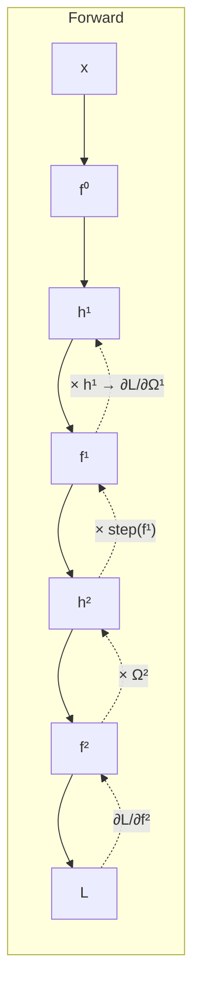

# Training Neural Networks

> [!abstract]
> [[09 - ML - Feed-Forward Neural Networks|Note 09]] defined the networks and their loss (negative log-likelihood). Here we **fit** them. The loss is non-convex and has millions of parameters, so we use **gradient descent** and its practical versions: **stochastic gradient descent** with **mini-batches** and **epochs**, **momentum**, and **Adam** (the standard optimiser). The gradient itself is computed efficiently by **backpropagation** (the chain rule applied backwards, reusing intermediate results). Then: how to **initialise** the weights to avoid **vanishing / exploding gradients**, and how to **regularise** (L1/L2, **early stopping**, **dropout**). Finally a pointer to TensorFlow/PyTorch, the **normalisation layer** and **tensors**.
>
> The optimisation background (GD, convexity, SGD) is [[03 - ML - Overfitting, Regularization and Gradient Descent#4. Gradient descent|Week 3 of Part 1]]; the regularisers are those of [[03 - ML - Overfitting, Regularization and Gradient Descent#Remedy 2 — regularization|Ridge/Lasso]].
>
> Index: [[MOC - Machine Learning]] · Book: UDL Ch. 6 (fitting), 7 (gradients and initialisation), 9 (regularisation).

---

## 1. Fitting a model with gradient descent

See [[Gradient Descent]].

Our objective is to minimise the loss: $\hat\varphi=\arg\min_\varphi L(\varphi)$. Example — linear regression with three inputs:
$$f(x;\varphi)=\varphi_0+\varphi_1x_1+\varphi_2x_2+\varphi_3x_3,\qquad L(\varphi)=\sum_{(x,y)\in S}\big(f(x;\varphi)-y\big)^2 .$$
The training set is fixed: only the parameters change. The gradient
$$\frac{\partial L}{\partial\varphi}=\Big(\frac{\partial L}{\partial\varphi_0},\dots,\frac{\partial L}{\partial\varphi_3}\Big)$$
is a formula valid for any $\varphi$; at each step we evaluate it at the **current** values $\bar\varphi=(\bar\varphi_0,\dots,\bar\varphi_3)$ and update
$$\varphi\leftarrow\bar\varphi-\alpha\,\frac{\partial L}{\partial\varphi}(\bar\varphi),\qquad\alpha=\textbf{learning rate}.$$

Two problems with neural networks:

![[ML-L10-p25.jpg]]

1. The loss is **not convex**: gradient descent can get **trapped in a local minimum**, depending on the starting point.
2. **Computing the partial derivatives is not easy**: we need $\partial L/\partial\varphi$ w.r.t. **all** parameters, through all the nested functions of the hidden units (solved by backpropagation, §4).

We partially solve the first problem by adding some **random noise** to the descent: a noisy gradient (green vs red tangent in the drawing) gives a chance to **skip a local minimum**. Instead of computing the loss on the whole $S$, we apply **stochastic gradient descent** with random mini-batches.

## 2. SGD, mini-batches and epochs

See [[Stochastic Gradient Descent]] and [[Mini-Batch and Epoch]].

![[ML-L10-p26.jpg]]

Let $\mathcal{B}\subset S$ be a **mini-batch**. At each iteration we use only
$$L(\varphi)=\sum_{(x,y)\in\mathcal{B}}\lvert f(x;\varphi)-y\rvert^2 .$$
When the iteration is over, a new mini-batch is picked at random **without** the elements already used. When the full $S$ has been used once we have completed an **epoch**. Training runs for several epochs, which increases the chances of reaching a good minimum.

## 3. Momentum and Adam

### Momentum

See [[Momentum]].

SGD can oscillate a lot. **Momentum** smooths the update with a running average of past gradients:
$$m_{t+1}\leftarrow\beta\,m_t+(1-\beta)\sum_{i\in\mathcal{B}_t}\frac{\partial\ell_i(\varphi_t)}{\partial\varphi},\qquad\varphi_{t+1}\leftarrow\varphi_t-\alpha\,m_{t+1},\qquad\beta\in[0,1).$$
- $\beta=0$: plain (stochastic) gradient descent.
- Larger $\beta$: more importance to the previous gradients (an exponentially weighted average, computed batch by batch). Like a ball rolling downhill that keeps its velocity: oscillations in opposite directions cancel out, consistent directions accumulate.

### Normalised gradients

See [[Adam Optimizer]].

![[ML-L10-p27.jpg]]

Plain gradient descent has a **stability** problem tied to the shape of the function: where it is steep the steps are large, where it is flat they are tiny, and with directions of very different steepness no single learning rate works. Compute the gradient and the (pointwise) squared gradient,
$$m_{t+1}\leftarrow\frac{\partial L(\varphi_t)}{\partial\varphi},\qquad v_{t+1}\leftarrow\Big(\frac{\partial L(\varphi_t)}{\partial\varphi}\Big)^2,$$
and take a **normalised** step:
$$\varphi_{t+1}\leftarrow\varphi_t-\alpha\,\frac{m_{t+1}}{\sqrt{v_{t+1}}+\epsilon}.$$
Dividing by $\sqrt{v}$ (pointwise) keeps only the **sign** of each gradient component (norm 1): we use the descent direction, and the learning rate alone decides how far to step. $\epsilon$ is a tiny constant avoiding division by zero.

*Figure (UDL Fig. 6.9), loss of a linear regression with 2 parameters $\varphi_0,\varphi_1$ (darker = higher):*
- **(a)** gradient descent, $\alpha=0.05$: **too short steps**, it reaches the valley but crawls along it;
- **(b)** gradient descent, $\alpha=1.0$: **too large steps**, it zig-zags violently across the valley;
- **(c)** normalised gradients, $\alpha=0.05$: fixed-size steps downhill in both directions, but it ends up bouncing around the minimum without converging;
- **(d)** **Adam** ($\alpha=0.05,\beta=0.9,\gamma=0.99$): a smooth path to the minimum.

### Adam

Adam (*adaptive moment estimation*) mixes **momentum** and **normalised gradients**: momentum on both statistics.

> [!important] Adam
> $$m_{t+1}\leftarrow\beta\,m_t+(1-\beta)\frac{\partial L(\varphi_t)}{\partial\varphi},\qquad\beta\in[0,1)$$
> $$v_{t+1}\leftarrow\gamma\,v_t+(1-\gamma)\Big(\frac{\partial L(\varphi_t)}{\partial\varphi}\Big)^2,\qquad\gamma\in[0,1)$$
> $$\varphi_{t+1}\leftarrow\varphi_t-\alpha\,\frac{m_{t+1}}{\sqrt{v_{t+1}}+\epsilon}$$
> **Hyperparameters:** learning rate $\alpha$, and $\beta,\gamma$ (how much the history of the gradient and of the squared gradient matters). Typical: $\alpha=10^{-3}$, $\beta=0.9$, $\gamma=0.999$.

Now the normalised step has norm $\neq1$: it behaves like SGD but with per-parameter adaptive step sizes. These algorithms are also called **optimisers**. Empirically Adam works very well (the theoretical guarantees are poor, though): **Adam is the general standard algorithm to fit a neural network**. (Second Session Q6: Adam is *an algorithm for training neural networks* — not a gradient computation method, not an architecture.)

> [!quote] From the book (UDL §6.4)
> At the start $m$ and $v$ are initialised at $0$, so the running averages are biased towards zero. Adam corrects them: $\tilde m_{t+1}=\frac{m_{t+1}}{1-\beta^{t+1}}$, $\tilde v_{t+1}=\frac{v_{t+1}}{1-\gamma^{t+1}}$, and uses $\tilde m,\tilde v$ in the update. The correction fades away as $t$ grows. In practice the gradients are computed on mini-batches.

> [!note] Differentiability
> Fitting neural networks this way relies on the **differentiability** of the loss: without it we cannot use gradient descent, which moves in the direction where the loss decreases.

---

## 4. Backpropagation

See [[Backpropagation]].

![[ML-L10-p28.jpg]]

**Example network:** one input $x$, two hidden layers with 2 units each (ReLU), one output. In each unit $f$ is the **pre-activation** (a linear combination of the inputs) and $h$ the **activation**. Parameters: biases $\beta$ and weights $\Omega$.

**Forward pass** (matrix form):
$$f^0=\beta^0+\Omega^0x=\begin{bmatrix}\beta_1^0+\Omega_{11}^0x\\\beta_2^0+\Omega_{21}^0x\end{bmatrix},\qquad h^1=\operatorname{ReLU}(f^0)$$
$$f^1=\beta^1+\Omega^1h^1=\begin{bmatrix}\beta_1^1+\Omega_{11}^1h_1^1+\Omega_{12}^1h_2^1\\\beta_2^1+\Omega_{21}^1h_1^1+\Omega_{22}^1h_2^1\end{bmatrix},\qquad h^2=\operatorname{ReLU}(f^1)$$
$$f^2=\beta^2+\Omega_{11}^2h_1^2+\Omega_{12}^2h_2^2=\beta^2+\Omega^2h^2\qquad\text{(regression: linear output)}$$
For one sample $S=\{(x,y)\}$ the loss is
$$L(\Omega,\beta)=\tfrac12(f^2-y)^2,$$
a function of **all** the $\Omega$'s and $\beta$'s ($x,y$ are given). Here there are a dozen parameters; imagine LLMs with billions.

![[ML-L10-p30.jpg]]

Expanding $f^2=\beta^2+\Omega^2\operatorname{ReLU}(\beta^1+\Omega^1\operatorname{ReLU}(\beta^0+\Omega^0x))$ gives a huge expression. $f^2$ is a **composition of functions**, so we use the chain rule
$$\frac{\partial f(g(x))}{\partial x}=\frac{\partial f}{\partial g}\cdot\frac{\partial g}{\partial x}.$$
**Backpropagation** is the algorithm that computes the gradient this way, efficiently.

**Step by step**, for the weight $\Omega_{11}^1$ (linking $h_1^1$ to $f_1^1$):
1. **Loss w.r.t. output** — always needed, in every partial derivative:
$$\frac{\partial L}{\partial f^2}=\tfrac12\cdot2(f^2-y)=f^2-y .$$
2. **Through the linear output** ($\Omega_{11}^1$ only reaches $f^2$ through $h_1^2$):
$$\frac{\partial f^2}{\partial\Omega_{11}^1}=\frac{\partial(\beta^2+\Omega_{11}^2h_1^2+\Omega_{12}^2h_2^2)}{\partial\Omega_{11}^1}=\Omega_{11}^2\,\frac{\partial h_1^2}{\partial\Omega_{11}^1}.$$
3. **Through the ReLU** (its derivative is the **step function**: 1 if the input was positive, 0 otherwise):
$$\frac{\partial h_1^2}{\partial\Omega_{11}^1}=\frac{\partial\operatorname{ReLU}(f_1^1)}{\partial f_1^1}\cdot\frac{\partial f_1^1}{\partial\Omega_{11}^1}=\operatorname{step}(f_1^1)\cdot\frac{\partial f_1^1}{\partial\Omega_{11}^1}.$$
4. **W.r.t. the target weight:** $\dfrac{\partial f_1^1}{\partial\Omega_{11}^1}=\dfrac{\partial(\beta_1^1+\Omega_{11}^1h_1^1+\Omega_{12}^1h_2^1)}{\partial\Omega_{11}^1}=h_1^1$.
5. **Assemble:**
$$\frac{\partial L}{\partial\Omega_{11}^1}=(f^2-y)\cdot\Omega_{11}^2\cdot\operatorname{step}(f_1^1)\cdot h_1^1 .$$
All these numbers are **already known** from the forward pass.

**Reuse.** For the neighbouring weight $\Omega_{12}^1$ the chain shares the first three factors:
$$\frac{\partial L}{\partial\Omega_{12}^1}=\underbrace{(f^2-y)\cdot\Omega_{11}^2\cdot\operatorname{step}(f_1^1)}_{\text{already computed}}\cdot h_2^1 .$$

> [!warning] Correzione
> In the notes this last formula is written $(f^2-y)\cdot\Omega_{12}^2\cdot\operatorname{step}(f_1^1)\cdot h_2^1$. $\Omega_{12}^1$ enters $f_1^1$ (first unit of the second hidden layer), which feeds $h_1^2$ and then the output through $\Omega_{11}^2$, so the weight in the product is $\Omega_{11}^2$, as in the derivative of $\Omega_{11}^1$ — that is precisely why the first part can be reused. (The AI explanation pasted on p. 32 of the notes has the correct version.) Also, the loss is sometimes written $\frac12(f^2-y^2)^2$ in the notes; it is $\frac12(f^2-y)^2$.

> [!important] Backpropagation in one sentence
> Do a **forward pass** storing all pre-activations $f$ and activations $h$; then go **backwards** from the loss, multiplying local derivatives, so each partial derivative is computed once and reused for all the parameters below it. Its cost is of the same order as the forward pass. It is highly parallel, which is why GPUs are used.

---

## 5. Parameter initialisation

See [[Weight Initialization]] and [[Vanishing and Exploding Gradients]].

![[ML-L10-p34.jpg]]

We start by initialising the parameters **randomly** (each run starts from a different point, because of local minima). A simple way: draw each weight from a normal distribution with $\mu=0$ and a variance $\sigma^2_{\Omega_i}$ chosen for each weight matrix. But moving from one hidden layer to the next, the scale of the values changes: $f_k=\beta_k+\Omega_kh_k$, $h_{k+1}=a(f_k)$.

- **$\sigma^2$ too small** (e.g. $0.002$): $\Omega_kh_k$ is tiny, and layer after layer the activations become tinier and tinier (the multiplications chain); the gradients too → **vanishing gradient problem**: approximation errors and very **slow convergence**.
- **$\sigma^2$ too large**: values blow up both in the forward pass and in the backward pass → **exploding gradient problem**: overflows, representation errors, **unstable learning** (a non-smooth learning curve, even divergence in extreme cases).

![[ML-L10-p35.jpg]]

To initialise randomly while avoiding both problems, choose a **fixed variance** depending on the layer sizes. With $D_h$ units in layer $h$ and $D_{h+1}$ in the next:
$$\sigma^2_\Omega=\frac{2}{D_h}\quad\text{(two layers of the same size — **He initialisation**)},\qquad\sigma^2_\Omega=\frac{4}{D_h+D_{h+1}}\quad\text{(empirical rule, sizes differ)}.$$
Applied to more hidden layers, each matrix $\Omega_k$ between $h_{k-1}$ and $h_k$ gets its own $\sigma^2=\frac{4}{D_{h_{k-1}}+D_{h_k}}$. Every library has its own initialisers.

> [!quote] From the book (UDL §7.5)
> For ReLU, with zero biases and weights $\mathcal{N}(0,\sigma^2_\Omega)$, the variance of the next pre-activations is $\sigma^2_{f'}=\frac12D_h\sigma^2_\Omega\sigma^2_f$ (half the inputs are zeroed by the ReLU). Keeping it equal to $\sigma_f^2$ in the forward pass requires $\sigma^2_\Omega=2/D_h$; in the backward pass we multiply by $\Omega^T$ and need $2/D_{h'}$; the compromise using the mean $(D_h+D_{h'})/2$ gives $4/(D_h+D_{h'})$.

> [!example] Exam check
> Second Session Q7: exploding gradients may cause… the options describe *vanishing* (weights becoming very small, learning stalls) or saturation — none describes explosion (huge updates, overflow, divergence) → **D. None of the above**.

---

## 6. Regularisation

See [[Early Stopping]] and [[Dropout]].

![[ML-L10-p36.jpg]]

As for linear regression, a regulariser can be added to neural networks (both L1-Lasso and L2-Ridge):
$$J(\theta)=\underbrace{E(\theta)}_{\text{empirical risk}}+\lambda\underbrace{R(\theta)}_{\text{penalty}},\qquad R(\theta)=\lvert\theta\rvert\ (L_1)\ \text{ or }\ \lvert\theta\rvert^2\ (L_2)\ \text{ or Elastic Net}.$$
$\lambda$ is a hyperparameter: the larger, the more importance to $R$ ("we are pulling the handbrake"). Regularisation mitigates **overfitting** (Erasmus Q8: dropout is *a regularisation technique*; First Session Q7: regularisation is *an approach to prevent overfitting*).

Two specific approaches:

**Early stopping.** Stop training **before** reaching the minimum of the training loss. To find the right moment use a **validation set**: stop when the **validation loss starts growing** — exactly when the training loss is approaching its minimum, so the model is starting to overfit (inset: train loss keeps going down, validation loss goes up after some point).

![[ML-L10-p37.jpg]]

**Dropout.** Fix a probability $p$ of **removing a link** (setting its parameter to 0). At every iteration some links are dropped (red) according to $p$; at the end of the iteration they come back, and so on until a stopping criterion. Like the noise of SGD, it prevents the network from learning "too much" from the training data (no unit can rely on a specific other unit). (In the standard formulation, dropout removes **units** — all their links — and rescales the remaining activations; at test time nothing is dropped.)

These regularisers can be **combined**.

> [!quote] From the book (UDL Ch. 9)
> Besides explicit regularisers, SGD itself acts as an **implicit regulariser**; other heuristics: early stopping, **ensembling** (see [[13 - ML - Ensemble Methods|note 13]]), dropout, adding noise, data augmentation.

---

## 7. TensorFlow, normalisation layer and tensors

See [[Tensor]].

TensorFlow (by Google) and PyTorch are two Python libraries to define and train neural networks (the course tutorial is online); knowing one, learning the other is simple.

- **Normalisation layer.** To normalise the inputs, a (non-trained) layer is placed after the input: it computes $z=\frac{x-\mu}{\sigma}$ for each feature (e.g. MPG, …, Origin of the *Auto MPG* dataset), so the distribution is centred in 0 (the [[07 - ML - K-Nearest Neighbors#3. Feature scale and normalisation|z-score]] seen for kNN). $\mu$ and $\sigma$ are computed from the data ("adapted"), not learnt by gradient descent.
- **Linear regression as a network.** Start with a single input variable, "Horsepower": $x\to$ normalisation $\to h$ (a linear transformation, a single unit) $\to y$.

![[ML-L10-p38.jpg]]

**Tensors** generalise arrays (1-D), vectors and matrices (2-D) to higher dimensions: e.g. a **3-D tensor** is a grid whose cells are arrays. They are used to represent objects like images (height × width × channels), video frames, batches of samples, etc. — the data structure of [[11 - ML - Convolutional Neural Networks|CNNs]].

---

## Video

- [Backpropagation, intuitively — 3Blue1Brown, Deep Learning ch. 3](https://www.youtube.com/watch?v=Ilg3gGewQ5U)
- [Backpropagation calculus — 3Blue1Brown, Deep Learning ch. 4](https://www.youtube.com/watch?v=tIeHLnjs5U8)
- [Stochastic Gradient Descent, Clearly Explained — StatQuest](https://www.youtube.com/watch?v=vMh0zPT0tLI)
- [Optimization for Deep Learning (Momentum, RMSprop, AdaGrad, Adam)](https://www.youtube.com/watch?v=NE88eqLngkg)
- [Tensors for Neural Networks, Clearly Explained — StatQuest](https://www.youtube.com/watch?v=L35fFDpwIM4)
