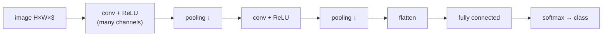

# Convolutional Neural Networks

> [!abstract]
> Fourth lecture of Part 2. The fully connected networks of [[09 - ML - Feed-Forward Neural Networks|note 09]] treat every input independently and need a weight for every input–unit pair: for images this means huge numbers of parameters and no notion that a pattern means the same thing wherever it appears. **Convolutional neural networks** replace dense layers with **convolutional layers**: a small **kernel / filter** slides over the input and the **same weights** are reused at every position. We study 1-D convolution and its hyperparameters (**kernel size, stride, dilation, padding**), **channels**, **receptive fields**, an MNIST-1D comparison with a fully connected network, 2-D convolution on images, **downsampling** (stride, max/mean **pooling**), **upsampling** (duplication, max unpooling, **transposed convolution**), $1\times1$ convolutions, and the main applications: **image classification** (AlexNet, VGG), **object detection** and **semantic segmentation**.
>
> Training uses exactly the tools of [[10 - ML - Training Neural Networks|note 10]]. Next: [[12 - ML - Dimensionality Reduction|dimensionality reduction]] (PCA, autoencoders), which starts at the end of these same notes.
>
> Index: [[MOC - Machine Learning]] · Book: UDL Ch. 10.

---

## 1. Why convolutions

See [[Convolutional Neural Network]].

![[ML-L11-p01.jpg]]

So far: dense layers, every unit linked to every unit of the next layer. Between layers of sizes $n$ and $m$ we need an $n\times m$ weight matrix: FNNs can have a huge amount of parameters, which is extremely inefficient.

Imagine classifying images as "person included" / "dog included". A $28\times28$ image is **flattened** into a vector of $784$ inputs. Now take a new image with the **same person moved to the right**: in the flattened vector completely different inputs are lit up, and every pixel is relevant to the output, so if something moves the network has to re-learn it.

![[ML-L11-p02.jpg]]

In both images the **pixel position is not what matters** for the inspection of the image — yet a dense network has to analyse every single pixel independently, making training and testing long and complex. A CNN instead **moves region by region** (a window sliding over the image) analysing it until the goal is reached (e.g. identifying whether a person is there).

> [!note] Invariance and equivariance (UDL §10.1)
> We want the network to be **equivariant** to translations in its hidden layers (if the person moves, the detected features move the same way) and **invariant** at the output (the class "person" does not change). Sharing weights across positions builds this in.

The name comes from the mathematical **convolution** $(f*g)(t)=\int_{-\infty}^{+\infty}f(\tau)g(t-\tau)\,d\tau$: like sliding a filter over an image.

> [!note]
> Not all layers need to be convolutional; if at least one layer is, the network is called convolutional. Biases are there but are omitted in the drawings.

---

## 2. 1-D convolution

We start from a **1-D input** (a vector, e.g. an audio signal) with 8 inputs. The idea: a **window** that looks at only a few inputs at a time.

![[ML-L11-p04.jpg]]

*Left:* a window of 3 weights $(w_1,w_2,w_3)$ is applied to $x_1,x_2,x_3$ to compute $z_2$, then slides to compute $z_4$ from $x_3,x_4,x_5$, etc. — the window always uses the same three weights. These windows are the **filters** (or **kernels**). *Right:* drawn as a network, each output $z_i$ is connected only to a few neighbouring inputs, and **all connections share the same 3 weights** (with a zero-padded $x_9=0$ at the border).

**The two differences from a dense layer:**
1. **local connectivity**: each output depends only on a few inputs;
2. **weight sharing**: the same weights are used at every position.

Full computation of one unit (kernel size 3):
$$z_i=a\big[\beta+w_1x_{i-1}+w_2x_i+w_3x_{i+1}\big].$$
This sliding operation is the **convolution operator** and the window is the **kernel / filter**. It is just a **special case of a fully connected layer**, in which the weights of non-connected inputs are set to 0 and the remaining ones are tied — but it is much easier to train. Parameter count in the example: **3** weights (+1 bias) instead of $8\times8=64$ (+8 biases) for a dense layer.

### Feature maps and hyperparameters

![[ML-L11-p05.jpg]]

Another example: classify an **audio fragment** as 1 if there is a *honk*, 0 otherwise. Each convolutional layer computes **feature maps**: it "maps" some local properties of the input into single features, typically reducing the dimension layer after layer, down to the output. For every layer we have to decide how much we stride and how many features each window looks at.

*Figure (UDL 10.3):*
- **(a)** size 3, **stride 2**, dilation 1: the window moves by 2 → half as many outputs; at the border the missing input is filled with a **0** (*zero padding*).
- **(b)** same, next position: $z_2$ uses $x_2,x_3,x_4$.
- **(c)** **size 5**, stride 1, dilation 1: each output sees 5 inputs.
- **(d)** size 3, stride 1, **dilation 2**: the kernel takes one input every two ($x_3,x_5,x_7$).

| Hyperparameter | Meaning |
|---|---|
| **kernel size** | number of inputs a window takes (padding included, as in (a)) |
| **stride** | how much the window shifts each time; stride $>1$ shrinks the output |
| **dilation** | distance between the chosen inputs (1 = adjacent, 2 = one every two): a larger field of view with the same number of weights |
| **padding** | how borders are handled: *zero padding* adds zeros so the output keeps the size; *valid padding* adds nothing and only places the window where it fully fits (the output is smaller) |

> [!note] Output size
> For input length $n$, kernel size $k$, stride $s$, padding $p$ on each side: $\left\lfloor\frac{n+2p-k}{s}\right\rfloor+1$ outputs. E.g. $n=8,k=3,s=2,p=1$ → $4$ outputs (panel a).

Typically a kernel has an **odd** size: it helps **centring** the window on a specific component.

### Channels

![[ML-L11-p06.jpg]]

With one filter, the weights do not change from a position to another. To make the layer more powerful we use **several filters with different parameters** on the same input: each one produces its own feature map, called a **channel**. In the drawing, three filters (black, green, red, with weights $v_1..v_3$, $v_4..v_6$, $v_7..v_9$) are applied to the same inputs: the layer becomes a **2-D tensor** (positions × channels).

![[ML-L11-p07.jpg]]

A unit of the next layer combines a window **across all the channels** of the previous layer (red and yellow units in the drawing). The filters must be trained; using several filters at the same time lets one detect eyes, another a nose, …

---

## 3. Receptive fields

See [[Receptive Field]].

*Bottom of the same page (UDL Fig. 10.6).* The **receptive field** of a hidden unit is the region of the **original input** that influences it.
- **(a)** $\Omega\in\mathbb{R}^{1\times3\times3}$: each unit of $H_1$ sees 3 inputs.
- **(b)** a unit of $H_2$ combines 3 units of $H_1$ (kernel $\Omega\in\mathbb{R}^{3\times4\times3}$, i.e. 3 input channels, 4 output channels, size 3), so it sees **5** inputs.
- **(c)** with a stride-2 layer the receptive field grows faster.

![[ML-L11-p08.jpg]]

- **(d)** deeper in the network the receptive field covers the whole input: the last layers combine information from everywhere. Deep CNNs therefore go from **local** features (edges) to **global** ones (objects).

### Example — MNIST-1D

Each "digit" is a 1-D curve represented by a vector of **40** values (the height of the line at each point); we classify it into $0,\dots,9$, so $x\in\mathbb{R}^{40}\to\mathbb{R}^{10}$. Of course we could use a feed-forward network (exercise: build one yourself); here we build a CNN.

![[ML-L11-p09.jpg]]

*Architecture (UDL Fig. 10.7):* three convolutional layers, each with kernel size 3, stride 2 and 15 channels: $x\in\mathbb{R}^{40}\to H_1\in\mathbb{R}^{19\times15}\to H_2\in\mathbb{R}^{9\times15}\to H_3\in\mathbb{R}^{4\times15}$; then **flattening** ($4\times15=60$ values) and a fully connected layer to $f\in\mathbb{R}^{10}$, then softmax. Parameters: $\Omega_0\in\mathbb{R}^{1\times15\times3}$, $\Omega_1,\Omega_2\in\mathbb{R}^{15\times15\times3}$, $\Omega_3\in\mathbb{R}^{10\times60}$ + biases.

> [!tip] Softmax and logits
> As for FNNs, it is common to leave the softmax **out** of the model during training and let the loss compute it from the raw scores (the *logits*): numerically more stable (in Keras: `from_logits=True` in the loss).

**Comparison** (both trained the same way):
- **CNN, 2,050 parameters**: the train error goes to ~0 and the **test error** settles at a low value.
- **Fully connected, 59,065 parameters**: the train error reaches 0 even faster, but the **test error stays much higher** (~40%) — it overfits.

The fully connected network is *more expressive* (its hypothesis space contains the CNN one), but this power does not turn into efficiency: in the huge hypothesis space it does not find the good solutions. The CNN searches a **smaller space** that already contains the right **inductive bias** (local, translation-equivariant features), so it generalises better with ~30× fewer parameters.

---

## 4. 2-D convolution

![[ML-L11-p10.jpg]]

The real power of CNNs shows up on 2-D (and multi-dimensional) inputs. *Top (UDL Fig. 10.9):* a $3\times3$ kernel $\Omega$ slides over the 2-D input $X$; each position gives one unit of the hidden layer $H_1$ (with zero padding at the borders, panels c–d).

*Bottom (UDL Fig. 10.10):* an **RGB image** is a 2-D input with **3 channels** (a 3-D tensor: a matrix whose elements are vectors of 3 colours). A $3\times3$ kernel then has $3\times3\times3$ weights: each pre-activation is the sum of the pointwise products of the kernel with the $3\times3\times3$ patch, plus the bias. Sliding the kernel horizontally and vertically gives a 2-D layer; with **several kernels** we get several output channels, i.e. a 3-D tensor $H_1$.

In 2-D convolutional layers the **spatial position matters** (which is why flattening is not applied there). The process is the same as in 1-D, with a different arrangement.

> [!important] Parameters do not depend on the input size
> The number of parameters depends **only on the filter dimensions** (and channels): e.g. a set of $11\times11\times3\times96$ weights (96 filters of size $11\times11$ on an RGB input) can be applied to an image of any size.

---

## 5. Downsampling

See [[Pooling]].

![[ML-L11-p11.jpg]]

**Downsampling** reduces the spatial dimension from a layer to the next. With **stride 2** the kernel "skips" one position each time:
$$z_1=a(0+w_2x_1+w_3x_2+\beta),\quad z_2=a(w_1x_2+w_2x_3+w_3x_4+\beta),\quad z_3=a(w_1x_4+w_2x_5+w_3x_6+\beta),\quad z_4=a(w_1x_6+w_2x_7+w_3x_8+\beta).$$

Methods:
- **stride > 1**;
- **pooling**: **max pooling** or **mean pooling**.

![[ML-L11-p12.jpg]]

*Example:* to detect a dog in a 4K image we could reduce it to a $20\times20$ grid: each output "pixel" summarises a whole region of the input. **Pooling** keeps one value per region: the **maximum** of the detections (max pooling — "is the feature present anywhere in the region?") or the **mean** (mean pooling).

*UDL Fig. 10.11*, on the $4\times4$ input $\begin{smallmatrix}1&3&5&3\\6&2&0&8\\4&6&1&4\\2&8&0&3\end{smallmatrix}$ with $2\times2$ blocks:
- **(a) sub-sampling** (keep every other input): $\begin{smallmatrix}1&5\\4&1\end{smallmatrix}$ — what a stride-2 kernel does;
- **(b) max pooling**: $\begin{smallmatrix}6&8\\8&4\end{smallmatrix}$;
- **(c) mean pooling**: $\begin{smallmatrix}3&4\\5&2\end{smallmatrix}$ (e.g. $(1+3+6+2)/4=3$).

Pooling has **no parameters** and makes the representation more robust to small translations.

## 6. Upsampling

See [[Upsampling and Transposed Convolution]].

![[ML-L11-p13.jpg]]

**Upsampling** is the opposite: increase the spatial size (needed e.g. to output an image, as in segmentation).
- **(a) duplication**: copy each value into a $2\times2$ block.
- **(b) max unpooling**: if a max pooling was applied earlier, put each value back **where the maximum came from** (the network must remember those positions) and zeros elsewhere. Simone's drawing: max pooling $d\to d/2$, then max unpooling $d/2\to d$.
- **(c) bilinear interpolation** between the input values.

**Transposed convolution** (UDL Fig. 10.13): a downsampling convolution (kernel 3, stride 2) can be written as a sparse weight matrix (b); in the **transposed** convolution each input *spreads* to three outputs and the layer has **twice as many outputs as inputs** — its weight matrix is the transpose of (b). Unlike duplication, it is **learnt**.

![[ML-L11-p14.jpg]]

**Changing the number of channels.** Down/upsampling also apply to channels. A **$1\times1$ convolution** (UDL Fig. 10.14) computes, at each position, a weighted sum of **all the channels** at that position (+ bias, + activation): it changes the number of channels without touching the spatial size.

---

## 7. Applications

- **Image classification**: assign the image to one class.
- **Object detection**: detect all the objects in an image, locate them (bounding boxes) and classify them by labels (e.g. "human", "bike").
- **Semantic segmentation**: classify **every single pixel** of the input (classes: background, human, bike).

![[ML-L11-p15.jpg]]

**Image classification — ImageNet** (UDL Fig. 10.15): assign an image to one of **1000** classes. It is hard because images vary in rigidity, number of instances, clutter, size, texture, colour and shape distinctiveness.

**AlexNet** (Krizhevsky et al., 2012, UDL Fig. 10.16): maps a $224\times224$ RGB image (3 channels) to a 1000-dimensional vector. Conv $11\times11$ stride 4 → 96 channels ($55\times55\times96$), max pool, conv $5\times5$ ($27\times27\times256$), max pool, three conv $3\times3$ ($13\times13\times384$, …, $13\times13\times256$), max pool, then **flatten** and three fully connected layers (4096, 4096, 1000): the last FC outputs the **logits**, the softmax turns them into probabilities. About **60M parameters**, ~16.4% top-5 error.

![[ML-L11-p16.jpg]]

**VGG** (Simonyan & Zisserman, 2014, UDL Fig. 10.17): a long sequence of $3\times3$ convolutions and max poolings in which the **spatial size gradually decreases while the number of channels increases** ($224\times224\times64\to112\times112\times128\to\dots\to14\times14\times512$), then three FC layers and softmax. About **144M parameters**, ~6.8% top-5 error.

> [!warning] Correzione
> In the notes VGG is annotated "~114M" parameters; VGG-16 has about **138M** and VGG-19 about **144M** (UDL quotes 144M). AlexNet's ~60M and the top-5 errors are correct.

**Semantic segmentation** (Noh et al., 2015, UDL Fig. 10.19): an **encoder** (a VGG network down to a 4096-vector describing the whole image) followed by a mirror-image **decoder** that upsamples with **max unpooling** and **deconvolutions** (transposed convolutions) back to $224\times224\times21$: the probabilities of 21 classes **for each pixel**.

The page then continues with *Dimensionality reduction* (Fig. 10.20 shows the segmentation results: horse / car / cow masks close to the ground truth) — see [[12 - ML - Dimensionality Reduction|note 12]].

---

## Video

- [Neural Networks Part 8: Image Classification with Convolutional Neural Networks — StatQuest](https://www.youtube.com/watch?v=HGwBXDKFk9I)
