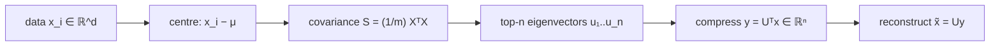

# Dimensionality Reduction

> [!abstract]
> Fifth lecture of Part 2. High-dimensional data are expensive to process and, as the [[07 - ML - K-Nearest Neighbors#5. The curse of dimensionality|curse of dimensionality]] showed, they need exponentially many samples. **Dimensionality reduction** maps $\mathbb{R}^d\to\mathbb{R}^n$ with $n\ll d$ while losing as little information as possible. It is a general approach, independent of neural networks. We see two methods: **PCA** (linear: compress with $W$, decompress with $U$, minimise the reconstruction error; the solution uses the top eigenvectors of the data's scatter matrix, and is equivalent to **maximising the variance** of the projections) and **autoencoders** (non-linear: a neural network encoder $f$ and decoder $g$ trained to reproduce the input through a **bottleneck**; the decoder alone is a first example of generative AI).
>
> PCA relies on the eigen-decomposition already met in [[03 - ML - Overfitting, Regularization and Gradient Descent#Convexity|Week 3]]; autoencoders are FNNs trained as in [[10 - ML - Training Neural Networks|note 10]]. Next: [[13 - ML - Ensemble Methods|ensemble methods]], which start at the end of these notes.
>
> Index: [[MOC - Machine Learning]]

---

## 1. Why reduce the dimension

![[ML-L12-p01.jpg]]

*(Top: UDL Fig. 10.20, the semantic segmentation results from the end of [[11 - ML - Convolutional Neural Networks#7. Applications|note 11]]: input, ground truth and predicted masks for a horse and for a car with a cow in front of it.)*

Take a high-dimensional dataset (e.g. images): we can move it to a much smaller dimension, $\mathbb{R}^d\to\mathbb{R}^n$ with $n\ll d$ (think of resizing images). Reasons (book, Ch. 23): computational cost, better generalisation (e.g. for nearest neighbours), interpretability and visualisation. It is closely related to **lossy compression**.

Two techniques:
- **PCA (Principal Component Analysis)** — linear approach;
- **Autoencoders** — non-linear approach.

---

## 2. PCA

See [[Principal Component Analysis]].

![[ML-L12-p02.jpg]]

**Setting.** $S=\{x_1,\dots,x_m\}$, $x_i\in\mathbb{R}^d$ (column vectors). We look for a **compression matrix** $W\in\mathbb{R}^{n\times d}$:
$$x\mapsto y=Wx\in\mathbb{R}^n\qquad\text{(the compressed version of }x).$$
To get back to the original space we also need a **decompression (recovery) matrix** $U\in\mathbb{R}^{d\times n}$:
$$\tilde x=Uy=UWx\in\mathbb{R}^d .$$
In general, exact recovery is impossible ($W$ has a non-trivial kernel when $n<d$). We want the chain $x\to Wx\to UWx=\tilde x$ to return something **as similar as possible** to $x$.

> [!warning] Correzione
> In the notes the dimensions are sometimes swapped: "$x\in\mathbb{R}^m$, $W\in\mathbb{R}^{m\times d}$" and later "$U\in\mathbb{R}^{d,m}$, $W\in\mathbb{R}^{md}$" with $m$ used both for the number of points and for the target dimension. Following the book: $m$ = number of points, $d$ = original dimension, $n$ = reduced dimension, $W\in\mathbb{R}^{n\times d}$, $U\in\mathbb{R}^{d\times n}$.

![[ML-L12-p03.jpg]]

> [!example] Perfectly correlated data
> $\langle2,4\rangle,\langle3,6\rangle,\langle4,8\rangle,\langle8,16\rangle,\langle20,40\rangle\in\mathbb{R}^2$. The second coordinate is always twice the first, so we can store only one number per point ($2,3,4,8,20\in\mathbb{R}^1$) and recover $x$ exactly. As soon as some components depend on others (linearly or not — very likely in high dimensions), compressed and decompressed inputs can be very close.

**Reconstruction error** and the PCA problem:
$$\sum_{i=1}^m\lVert x_i-UWx_i\rVert^2,\qquad (U,W)=\arg\min_{U\in\mathbb{R}^{d\times n},\,W\in\mathbb{R}^{n\times d}}\sum_{i=1}^m\lVert x_i-UWx_i\rVert^2 .\tag{1}$$

![[ML-L12-p04.jpg]]

$U$ and $W$ are strictly related, so we don't need to look for both:

> [!important] Lemma (S-S & B-D 23.1)
> If $(U,W)$ solves (1), then the columns of $U$ are **orthonormal** ($U^TU=I_n$) and $W=U^T$. So (1) is equivalent to
> $$\arg\min_{U\in\mathbb{R}^{d\times n},\ U^TU=I}\ \sum_{i=1}^m\lVert x_i-UU^Tx_i\rVert^2 .\tag{2}$$

($UU^T$ is the orthogonal projection onto the column space of $U$, just like OLS was a projection in [[02 - ML - Linear Regression and OLS#4. A geometric interpretation|Week 2]].)

> [!important] Theorem (S-S & B-D 23.2)
> Let $A=\sum_{i=1}^mx_ix_i^T$ and let $u_1,\dots,u_n$ be the eigenvectors of $A$ corresponding to its $n$ **largest eigenvalues**. Then the solution of (2) is $U=[u_1\ \cdots\ u_n]$, and $W=U^T$ solves (1).

So: **compress** with $x\mapsto U^Tx$ (the coordinates of $x$ along the top-$n$ eigenvectors, the **principal components**), **decompress** with $y\mapsto Uy$. $A$ is symmetric and PSD, so it has an orthonormal basis of eigenvectors with non-negative eigenvalues.

> [!example] PCA as preprocessing for binary classification
> $x\in\mathbb{R}^d\to W=U^T$ (rows $u_1,\dots,u_n$) $\to$ PCA output in $\mathbb{R}^n$ $\to$ a neural network classifier with $n$ inputs. The network does not "know" that its input is compressed. The purpose is to represent the data in an optimised version, keeping track of the reconstruction error.

### Variance maximisation

![[ML-L12-p05.jpg]]

Reconstruction-error minimisation can be read as **variance maximisation**. Reduce $S\subset\mathbb{R}^2$ to $\mathbb{R}^1$ by projecting the points on a line: if the projections have **low variance** (projection on the $z_1$ axis, blue), many points **collapse** on each other and their differences are lost; projecting on the direction of the elongated cloud (yellow/red) gives **high variance** and the points stay well separated. So we search for the projection that maximises variance.

With $\mu=\frac1m\sum_ix_i$ (mean), $u^Tx_i$ (projected point) and $u^T\mu$ (projected mean), for a unit vector $u$:
$$\sigma_S^2=\frac1m\sum_{i=1}^m\big(u^Tx_i-u^T\mu\big)^2=u^TSu,\qquad S=\frac1m\sum_{i=1}^m(x_i-\mu)(x_i-\mu)^T=\frac1mX^TX,$$
where $X$ is the $m\times d$ matrix whose rows are $(x_i-\mu)^T$. $S$ is the **covariance matrix** of the data.

![[ML-L12-p06.jpg]]

**Centring.** Subtracting $\mu$ from every point centres the data at $0$ (PCA is normally applied to centred data; then $A=mS$ and the two formulations coincide). Now maximise
$$\max_{u\in\mathbb{R}^d}u^TSu\quad\text{subject to}\quad u^Tu=1 .$$
With a Lagrange multiplier, the optimum satisfies $Su=\lambda u$: **$u$ is an eigenvector of $S$**, and then $u^TSu=\lambda$. So the variance is maximal when $u$ is the eigenvector with the **highest eigenvalue**; the next principal components are the following eigenvectors (orthogonal to the previous ones). In general ($n$ directions): $\max\operatorname{tr}(U^TSU)$ with $U^TU=I_n$.

> [!warning] Correzione
> The notes write $u\in\mathbb{R}$ / $u\in\mathbb{R}^m$ for the direction and "$u^Tu=I\in\mathbb{R}^m$": a single direction is $u\in\mathbb{R}^d$ with $u^Tu=1$; for $n$ directions $U\in\mathbb{R}^{d\times n}$ with $U^TU=I_n$.

> [!tip] Why both views agree
> For centred data and unit $u$, $\lVert x\rVert^2=\lVert uu^Tx\rVert^2+\lVert x-uu^Tx\rVert^2$ (Pythagoras). The left side is fixed, so **minimising** the reconstruction error (second term) is the same as **maximising** the projected squared length (first term), i.e. the variance.

**Example (S-S & B-D Fig. 23.2, Yale faces).** Top-left: original $50\times50$ face images ($\mathbb{R}^{2500}$); top-right: the same images after reduction to $\mathbb{R}^{10}$ and reconstruction — still clearly recognisable. Middle: one face before and after. Bottom: reduction to $\mathbb{R}^2$; the marks (o, x, +, *) are different people and they form separate groups: even 2 numbers per image keep the identity information.

---

## 3. Autoencoders

See [[Autoencoder]].

![[ML-L12-p07.jpg]]

Non-linear dimensionality reduction: $x\in\mathbb{R}^d\mapsto f(x)\in\mathbb{R}^n$, $n<d$.
- **encoding function** $f:\mathbb{R}^d\to\mathbb{R}^n$;
- **decoding function** $g:\mathbb{R}^n\to\mathbb{R}^d$, giving $\tilde x=g(f(x))$.

**Reconstruction error:**
$$L=\sum_{x\in S}\lVert x-g(f(x))\rVert^2 .$$
The problem is to find $f$ and $g$; the most useful model is a **neural network**: a network whose layers first shrink ($x\to$ encoder $\to f(x)$, with $n<d$ units) and then expand back (decoder $\to g(f(x))=\tilde x$, $d$ units). The **desired output is the same as the input**, so no labels are needed (unsupervised); we train it with the reconstruction error as loss.

![[ML-L12-p08.jpg]]

**Using the encoder.** If the goal is just the reduced version $f(x)$: train the full network, then **remove** the decoder layers. This works because the whole network depends on how $f$ encodes (if some information is lost during encoding, $g$ cannot recover it), so after training $f(x)$ is a good compressed representation. $f(x)$ must be a **bottleneck** — a layer where the dimension is actually reduced (the **latent variable** / code). (Second Session Q8: the primary purpose of the bottleneck is to force a compressed representation.)

**Using the decoder.** Can it be used the same way? Give the decoder an **arbitrary input** in the latent space and it outputs something in the data space.

![[ML-L12-p09.jpg]]

Indeed, it is possible to give the decoder a random input and **generate** an output similar to the training inputs — a generic example of **generative AI** (to make it work well more training/constraints are needed, e.g. variational autoencoders). Covered in Ch. 14.1 of *Deep Learning* by Goodfellow, Bengio, Courville.

> [!note] Autoencoders vs PCA
> If $f$ and $g$ are **linear** and the loss is the squared error, the autoencoder is basically $W$ and $U$ of PCA: an undercomplete linear autoencoder learns to span **the same subspace as PCA** (book, §14.1). With non-linear $f,g$ it is a more powerful non-linear generalisation of PCA. (Simone's note: in the linear case PCA is way more convenient — it has a closed form.)

> [!quote] From the book (Goodfellow et al., Ch. 14)
> An autoencoder that simply learnt $g(f(x))=x$ everywhere would be useless; it is designed to be **unable to copy perfectly**. **Undercomplete** autoencoders ($n<d$) achieve this with the bottleneck; **regularised** autoencoders use other constraints (sparsity, denoising, small derivatives) even with a large code. If encoder and decoder have too much capacity, the autoencoder can learn to copy without extracting useful information.

---

## Video

- [StatQuest: PCA main ideas in only 5 minutes](https://www.youtube.com/watch?v=HMOI_lkzW08)
- [StatQuest: Principal Component Analysis (PCA), Step-by-Step](https://youtu.be/FgakZw6K1QQ)
- [Autoencoders — Explained](https://www.youtube.com/watch?v=xFOnqNbCQ9o)
