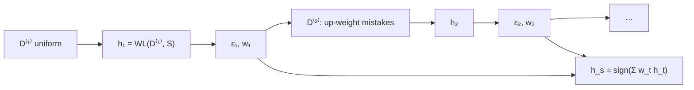

# Ensemble Methods

> [!abstract]
> Last lecture of Part 2. **Ensemble methods** combine several models, each one possibly weak, into a more powerful predictor. We formalise a "slightly better than random" learner (**γ-weak learnability**), then study **boosting** with **AdaBoost**: weak learners trained in sequence on re-weighted data, each focusing on the mistakes of the previous ones, combined by a weighted vote; its training error decreases **exponentially** in the number of rounds. Then **bagging**: independent models trained on bootstrap samples and averaged / voted, which mitigates overfitting. Random forests from [[06 - ML - Generalization Bounds and Tree Predictors#Random forests|Week 6]] are bagging applied to trees.
>
> The notes end with an exercise session on **linear regression** (MSE, line through the origin, line with intercept, OLS with a quadratic feature map), solved here in the appendix with the tools of [[02 - ML - Linear Regression and OLS|Week 2]].
>
> Index: [[MOC - Machine Learning]] · Book: Shalev-Shwartz & Ben-David, *Understanding Machine Learning*, Ch. 10 (Boosting).

---

## 1. Weak learnability

See [[Weak Learnability]].

![[ML-L12-p09.jpg]]

*(Top of the page: the end of the autoencoders part, see [[12 - ML - Dimensionality Reduction#3. Autoencoders|note 12]].)* Ensemble methods combine methods introduced before into a more powerful approach to learning. First, formalise the idea of a **weak learner**.

> [!note] Definition — γ-weak learnability (S-S & B-D 10.1)
> A learning algorithm $A$ is a **$\gamma$-weak learner** for a class $\mathcal{H}$ if there exists $m_{\mathcal{H}}:(0,1)\to\mathbb{N}$ such that for every $\delta\in(0,1)$, every distribution $D$ over $\mathcal{X}$ and every labelling function $f:\mathcal{X}\to\{-1,+1\}$, if the realisability assumption holds (w.r.t. $D,\mathcal{H},f$), then running $A$ on $m\ge m_{\mathcal{H}}(\delta)$ i.i.d. examples generated by $D$ and labelled by $f$ returns a hypothesis $h$ such that, **with probability at least $1-\delta$**,
> $$L_{(D,f)}(h)\le\frac12-\gamma .$$

![[ML-L13-p02.jpg]]

A $\gamma$-weak learner performs **slightly better than a random guess** on a binary classification problem (a random guess has error $\frac12$):
- $\delta$: confidence parameter;
- $\gamma$: **advantage** w.r.t. the random classifier;
- $m\ge m_{\mathcal{H}}(\delta)$: the number of samples must be large enough to make the comparison with a random classifier meaningful.

> [!warning] Correzione
> The notes write "with probability $p\ge\delta$" / "with confidence $\delta$". In the definition $\delta$ is the **failure** probability: the guarantee holds with probability at least $1-\delta$.

Compared with (strong) PAC learning — error at most $\varepsilon$ for any $\varepsilon$ — a weak learner only needs error $\frac12-\gamma$. Weak learners are often much easier (and cheaper) to build, e.g. **decision stumps** (one-test trees, like those of [[06 - ML - Generalization Bounds and Tree Predictors#2. Tree predictors|Week 6]]). **Goal:** combine several $\gamma$-weak learners into a **strong** learner. This is **boosting**.

---

## 2. AdaBoost (Adaptive Boosting)

See [[AdaBoost]].

Training set $S=\{(x_1,y_1),\dots,(x_m,y_m)\}$, $y_i=f(x_i)\in\{-1,+1\}$. Iterative algorithm; at iteration $t$:

1. **Produce a distribution $D^{(t)}$ over $S$** (a weight for each sample). Initially $D^{(1)}=\big(\frac1m,\dots,\frac1m\big)$, uniform.
2. **Train the weak learner** $A(S,D^{(t)})\mapsto h_t$ and compute its weighted error
$$\varepsilon_t=L_{D^{(t)}}(h_t)=\sum_{i=1}^mD_i^{(t)}\,\mathbb{1}[h_t(x_i)\ne y_i]\le\frac12-\gamma .$$
   Assign to $h_t$ the weight
$$w_t=\frac12\log\Big(\frac1{\varepsilon_t}-1\Big)=\frac12\log\frac{1-\varepsilon_t}{\varepsilon_t}.$$
3. **Update the distribution** so that the samples misclassified by $h_t$ get a **higher probability** of being picked in the next round.

![[ML-L13-p03.jpg]]

> [!example] Simone's example
> $S$ has 4 samples, $D^{(1)}=\langle\frac14,\frac14,\frac14,\frac14\rangle$. The learner gets a sample $X^{(1)}$ of 4 examples drawn according to $D^{(1)}$ (with replacement, so replicas are possible) and returns $h_1,w_1$. Say $h_1$ misclassifies only sample 4, $((3,2),\cdot)$. Then $\varepsilon_1=\frac14$, $w_1=\frac12\log3$, and the update multiplies correct samples by $e^{-w_1}=\frac1{\sqrt3}$ and the wrong one by $e^{w_1}=\sqrt3$; normalising:
> $$D^{(2)}=\Big\langle\tfrac16,\tfrac16,\tfrac16,\tfrac12\Big\rangle .$$
> (Check: $3\cdot\frac{1}{4\sqrt3}+\frac{\sqrt3}{4}=\frac{\sqrt3}2$, and $\frac{\sqrt3/4}{\sqrt3/2}=\frac12$.) The new sample $X^{(2)}$ contains sample 4 three times: $h_2$ will give much more importance to classifying it correctly.
>
> Note that $w_t$ is a **decreasing** function of $\varepsilon_t$: better weak hypotheses get a larger say in the vote ($w_t>0$ iff $\varepsilon_t<\frac12$).

> [!warning] Correzione
> In the drawing the labels are not consistent: in $S$ sample 3 is $((2,1),-)$ and sample 4 is $((3,2),+)$, while in $X^{(1)}$, $X^{(2)}$ they appear as $((2,1),+)$ and $((3,2),-)$. The labels of a sample do not change when it is resampled; only the weights do. The numbers of the example do not depend on the labels.

After $T$ rounds we have $(h_1,\varepsilon_1,w_1),\dots,(h_T,\varepsilon_T,w_T)$ and the final hypothesis is the **weighted vote**
$$h_s(x)=\operatorname{sign}\Big(\sum_{t=1}^Tw_th_t(x)\Big)\qquad(\text{sign returns }+1\text{ or }-1).$$

![[ML-L13-p04.jpg]]

```
AdaBoost
input: training set S = (x_1,y_1),...,(x_m,y_m); weak learner WL; number of rounds T
initialize D^(1) = (1/m, ..., 1/m)
for t = 1..T:
    invoke weak learner h_t = WL(D^(t), S)
    compute ε_t = Σ_i D_i^(t) · 1[y_i ≠ h_t(x_i)]
    let w_t = ½ log(1/ε_t − 1)
    update D_i^(t+1) = D_i^(t) exp(−w_t y_i h_t(x_i)) / Σ_j D_j^(t) exp(−w_t y_j h_t(x_j))   for all i
output h_s(x) = sign(Σ_t w_t h_t(x))
```

**The update.** $y_ih_t(x_i)=+1$ if $h_t$ is right, $-1$ if wrong. So a misclassified sample is multiplied by $e^{+w_t}$ (more weight), a correct one by $e^{-w_t}$ (less weight); the denominator is a **normalisation factor** making the weights a distribution — similar to a **softmax**.

> [!important] Theorem (S-S & B-D 10.2)
> If at every iteration the weak learner returns $h_t$ with $\varepsilon_t\le\frac12-\gamma$, then the training error of the output is
> $$L_S(h_s)=\frac1m\sum_{i=1}^m\mathbb{1}[h_s(x_i)\ne y_i]\le e^{-2\gamma^2T}.$$

The training error **decreases exponentially** with the number of rounds $T$. (Proof idea: since $\mathbb{1}[h(x)\ne y]\le e^{-yh(x)}$, it suffices to bound $Z_T=\frac1m\sum_ie^{-y_if_T(x_i)}$ with $f_T=\sum_tw_th_t$, and each round multiplies $Z$ by at most $e^{-2\gamma^2}$.)

![[ML-L13-p05.jpg]]

**Computational cost.** Per round: the weak learner costs $c_{WL}(m)$, computing $\varepsilon_t$ is $O(m)$, $w_t$ is $O(1)$, updating all the weights is $O(m)$. Total
$$O\big(T\cdot(m+c_{WL}(m))\big)\approx O(T\cdot m)$$
if the weak learner is efficient (linear).

**Regression.** $\operatorname{sign}$ only works for classification; for regression use the weighted sum directly, $h_s(x)=\sum_{t=1}^Tw_th_t(x)$. AdaBoost can be applied on top of many algorithms.



---

## 3. Bagging

See [[Bagging]].

![[ML-L13-p06.jpg]]

A simpler approach (**B**ootstrap **agg**regat**ing**). Given a dataset $S$:
1. generate $M$ datasets $X_1,\dots,X_M$ by **random sampling $S$ with replacement** (replicas of an element can be extracted) — *bootstrap samples*;
2. train a model $h_i$ on each dataset $X_i$ (it doesn't have to be a weak learner, and a different model can even be used for each dataset);
3. predict on new instances with a **combination scheme**:
$$y_S(x)=\frac1M\sum_{i=1}^Mh_i(x)\quad\text{(regression)},\qquad y_S(x)=\arg\max_c\sum_{i=1}^M\frac1M\mathbb{1}[h_i(x)=c]\quad\text{(classification: majority vote)}.$$

Each model makes its own prediction, and the most frequent output (or the average) is the final result. The prediction of each model is **independent** of the others (they are trained on different datasets), which reduces the variance; it is a more powerful way of training a single kind of model and **mitigates overfitting**.

> [!warning] Correzione
> The notes write "generate $m$ datasets $X_1,\dots,X_m$", then train on "$D_i$" and average with $\frac1M\sum_{i=1}^m$: the number of bootstrap datasets is one symbol, say $M$, and model $h_i$ is trained on $X_i$. (Also, averaging reduces mainly the **variance**, not the bias: the note "avoids bias" should read "avoids correlated errors / reduces variance".)

| | Boosting (AdaBoost) | Bagging |
|---|---|---|
| models trained | **sequentially**, each depends on the previous | **independently** (parallelisable) |
| data for each model | re-weighted $S$ (focus on mistakes) | bootstrap samples of $S$ |
| combination | weighted vote $\operatorname{sign}\sum w_th_t$ | plain average / majority vote |
| base models | weak learners (high bias) | usually strong, high-variance models (deep trees) |
| mainly reduces | **bias** (training error → 0 exponentially) | **variance** (overfitting) |
| famous instance | AdaBoost with decision stumps | **random forests** |

---

## Appendix — exercise session on linear regression

![[ML-L13-p07.jpg]]

Data (the same points as the worked example in [[02 - ML - Linear Regression and OLS#1. Warm-up — linear regression in 1-D|Week 2]]): $(1,1),(1,3),(2,3),(3,5),(3,3)$.

**1. MSE of $f(x)=x$.**
$$R=\frac15\big[(1-1)^2+(1-3)^2+(2-3)^2+(3-5)^2+(3-3)^2\big]=\frac15(0+4+1+4+0)=\frac95 .$$

**2. Best line through the origin, $f(x)=mx$.** Minimise $\hat R(m)=\frac1n\sum_i(mx_i-y_i)^2$:
$$\frac{d\hat R}{dm}=\frac1n\sum_i\big(2mx_i^2-2x_iy_i\big)=0\ \Longrightarrow\ m=\frac{\sum_ix_iy_i}{\sum_ix_i^2}=\frac{1+3+6+15+9}{1+1+4+9+9}=\frac{34}{24}=\frac{17}{12}.$$
So $y=\frac{17}{12}x$ minimises the MSE among lines through the origin.

![[ML-L13-p08.jpg]]

**3. Best line $f(x)=mx+q$.**
$\partial\hat R/\partial q=0\Rightarrow q=\bar y-m\bar x=3-2m$ (with $\bar x=2$, $\bar y=3$). Then
$$m=\frac{\sum_i(x_i-\bar x)(y_i-\bar y)}{\sum_i(x_i-\bar x)^2}=\frac{(-1)(-2)+(-1)(0)+0+(1)(2)+(1)(0)}{1+1+0+1+1}=\frac44=1,\qquad q=3-2=1 .$$
So $y=x+1$.

**4. OLS with the feature map $\phi(x)=(1,x,x^2)$.**
$$\Phi=\begin{pmatrix}1&1&1\\1&1&1\\1&2&4\\1&3&9\\1&3&9\end{pmatrix},\qquad\Phi^T\Phi=\begin{pmatrix}5&10&24\\10&24&64\\24&64&180\end{pmatrix},\qquad\det(\Phi^T\Phi)=16,$$
$$(\Phi^T\Phi)^{-1}=\frac1{16}\begin{pmatrix}224&-264&64\\-264&324&-80\\64&-80&20\end{pmatrix},\qquad\Phi^Ty=\begin{pmatrix}15\\34\\88\end{pmatrix},\qquad\hat\theta=(\Phi^T\Phi)^{-1}\Phi^Ty=\begin{pmatrix}1\\1\\0\end{pmatrix}.$$
The quadratic coefficient is $0$: the best parabola is again the line $y=1+x$.

> [!warning] Correzione
> In the notes the inverse is written $\begin{pmatrix}224&+264&64\\-264&324&-80\\64&-80&20\end{pmatrix}$: the factor $\frac1{\det}=\frac1{16}$ is missing and the $(1,2)$ entry must be $-264$ (the inverse of a symmetric matrix is symmetric). I recomputed $\det$, the adjugate and $\hat\theta$; the notes stop before computing $\hat\theta$.

---

## Video

- [AdaBoost, Clearly Explained — StatQuest](https://www.youtube.com/watch?v=LsK-xG1cLYA)
- [Bootstrapping Main Ideas — StatQuest](https://www.youtube.com/watch?v=Xz0x-8-cgaQ)
- [StatQuest: Random Forests Part 1 — Building, Using and Evaluating](https://www.youtube.com/watch?v=J4Wdy0Wc_xQ)
