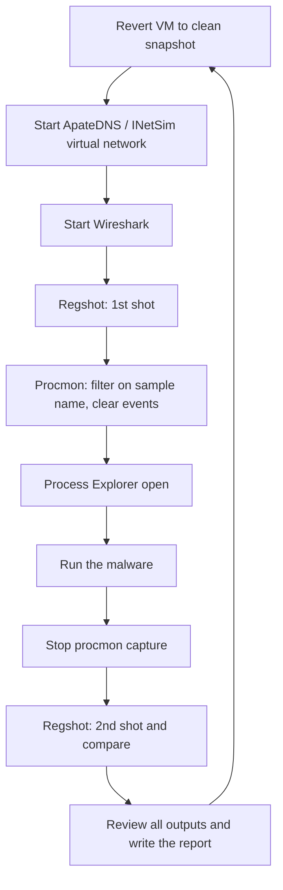

# Basic Dynamic Analysis

> [!abstract] Purpose and scope
> [[3 - MA - Basic Static Analysis]] inspects a sample without running it, and it can get stuck on packing or obfuscation. This lecture takes the next step: **run the malware on purpose, in a safe environment, and observe what it does**. We cover the four approaches (diffing, monitoring, API tracing, debugging), how the observation is technically possible (program, OS or hardware instrumentation), sandboxes and family naming, how to build the lab (VMs, snapshots, isolated networking), and then the tools: Process Monitor, Process Explorer, Regshot, Wireshark, ApateDNS, ncat and INetSim. Along the way we introduce the **Windows Registry** and the main **persistence** techniques. Its limits lead to [[5 - MA - Malware Evasion]] (the sample notices the analysis) and [[7 - MA - Advanced Dynamic Analysis]] (the debugger, only named here); the API-level view is in [[6 - MA - Advanced Static Analysis]]. Concept summaries are collected in [[MOC - Malware Analysis]].
>
> The book is *Practical Malware Analysis* (PMA); as in Lecture 5, I cite the **PDF pages** of the copy in `pdf/`. The slides of this lecture still report A.Y. 2025/2026, unlike the others.

## What dynamic analysis is

**Dynamic analysis** means deliberately running a malware sample while monitoring the results. Executing hostile code has an obvious consequence:

- it **requires a controlled, safe environment**;
- it **must not spread to production machines**;
- real machines can be **air-gapped**, i.e. with no network connection to the Internet or to other machines.

## Why static analysis is not enough

Static analysis can reach a **dead end**, because of:

- **obfuscation**;
- **packing** (see [[3 - MA - Basic Static Analysis#Obfuscation through packing|packing in Lecture 3]]);
- the examiner having simply **exhausted the available static techniques**.

The idea is that dynamic analysis will show you exactly what the malware does. The slide immediately adds: *"Not really…"*. You only see what happens in **this** run, in **this** environment (see [[#Limits of dynamic analysis]]).

The **main goal** is to understand the malware **behavior**. See also [[3 - MA - Basic Static Analysis#Static v. dynamic analysis|static v. dynamic analysis]].

## Approaches to behavioral analysis

Vedi [[Dynamic Analysis Approaches]].

### Diffing

Take a snapshot of a **clean** system state and a snapshot of the **compromised** state, then compare before and after.

- **Pro**: artifacts can be observed easily.
- **Con**: it can miss evidence that the malware creates during its activity and **purposely erases** (a temporary dropper that deletes itself never appears in the "after" snapshot).
- **Tools**: regshot, autoruns.

### System monitoring

Starting from a clean state, record **every individual change** in the system and in the network traffic that appears after executing the suspicious file.

- **Pro**: it can collect all manifested changes, including those diffing misses.
- **Con**: often too much information, and irrelevant data must be weeded out.
- **Tools**: procmon, Wireshark.

### API tracing

**Hook** and record the important API calls made by the suspicious process.

- **Pro**: visibility into activity beyond the typical file/process/registry/network view of the other tools. It gets you a little closer to the kind of interpretation required by static analysis.
- **Con**: again too much information, and API-specific interpretation can take a lot of time (but still less than static analysis).
- **Tools**: Rohitab API Monitor, WinApiOverride.

### Debugging

Set **breakpoints** inside the suspicious file to stop its execution at a given location and inspect its state. This is the subject of [[7 - MA - Advanced Dynamic Analysis]].

- **Pro**: it provides a **superset** of the functionality of an API monitor.
- **Con**: it typically must be done together with some basic static analysis and assembly reading ([[2 - MA - X86 Assembly]]). Malware often changes its behavior or refuses to run when debugged ([[Anti-Debugging]]), which may require workarounds.
- **Tools**: IDA, OllyDbg, Immunity Debugger, WinDbg.

### Choosing a technique

The four approaches are a trade-off.

![[MA-L04-01.png]]

Going **down** the stack (diffing → monitoring → API tracing → debugging), the analysis gets **more powerful**. Going **up**, **ease of use and abstraction level** increase. In practice you start from the top and go down only when the cheaper technique no longer answers your question.

## Limits of dynamic analysis

There are limits you need to be aware of:

- **in general, a single path (execution trace) is examined**: a branch that needs a specific date, command or file does not run, so its behavior stays invisible;
- **the analysis environment is possibly not invisible**: the sample can detect it, see [[Sandbox Evasion]];
- **the analysis environment is possibly not comprehensive**: it may not record everything;
- **scalability issues**: each run takes real time and resources.

How is it performed technically? By **instrumenting** the program, the operating system or the hardware.

## Instrumentation levels

Vedi [[Analysis Instrumentation Levels]].

### Program instrumentation

The analysis operates **in the same address space** as the sample.

- Manual analysis with a debugger, or **Detours** (a Windows API hooking mechanism).
- The binary under analysis is **modified**: breakpoints are inserted, functions are rewritten, debug registers are used.
- It is **not invisible**: malware can detect the analysis artifacts.
- It may require significant manual effort.

### OS instrumentation

The analysis operates **in the OS** where the sample runs, for instance with Windows **system call hooks**.

- It is somewhat invisible to **user-mode** malware.
- It can cause problems when malware runs **in the OS kernel**, at the same privilege as the monitor.
- It has **limited visibility of activity inside the program**: for example, you cannot set function breakpoints.

### Hardware instrumentation

The analysis provides **virtual hardware** (a processor) on which the sample executes, sometimes including the OS.

- Example: **software emulation** of the executed instructions.
- The analysis observes the activity **"from the outside"**.
- It is **transparent** to the sample and to the guest OS.
- An **OS environment needs to be provided**: a *limited* environment could be detected but is faster, while a *complete* one is more comprehensive but slower.
- This is the approach behind **sandboxes**, discussed next.

> [!note] "Transparent" is an ideal
> Nothing inside the guest is modified, so this level has no in-guest artifacts. It is still not undetectable: [[5 - MA - Malware Evasion#Virtualization artifacts|Lecture 5]] shows how [[Red Pill]], [[CPUID Hypervisor Detection]] and [[Timing Attacks]] reveal the virtual hardware itself.

| Level | Where the analysis lives | Visibility inside the program | Main weakness |
|---|---|---|---|
| Program | Same address space as the sample | Highest | Leaves artifacts the sample can detect |
| OS | OS where the sample runs | Limited (calls, not functions) | Kernel-mode malware |
| Hardware | Outside the guest | Needs reconstruction ([[Semantic Gap]]) | Environment and speed trade-off |

## What to observe: system calls and Windows APIs

A process interacts with the OS via **system calls** (see [[System Call]]): it needs the OS for every interaction with the environment, such as the file system, network and registry. So monitoring system calls is a natural choice, with a Windows-specific catch:

- many Windows system calls (**Native APIs**) are **undocumented and can change without notice**;
- developers are expected to use the **Windows APIs**, a collection of stable user-mode shared libraries;
- of course, **Windows APIs can be bypassed** (malware can call the [[Native API]] directly), so hooking only the upper layer can miss activity.

## What an analysis report contains

The typical output is organized by activity:

- **File** activity: read, write, create, open, …
- **Registry** activity.
- **Service** activity: start/stop of Windows services, via the Service Manager.
- **Process** activity: start and terminate processes, inter-process communication.
- **Network** activity: API calls and packet logs.

These are the same categories as the [[3 - MA - Basic Static Analysis#Expected behaviors|expected behaviors]] guessed during static triage: dynamic analysis confirms or refutes them.

## Sandboxes

Vedi [[Malware Sandbox]].

A **sandbox** is all-in-one software for basic dynamic analysis: a virtualized environment that also simulates network services.

- Examples: Norman Sandbox, GFI Sandbox, Anubis, Joe Sandbox, ThreatExpert, BitBlaze, Comodo Instant Malware Analysis.
- They are **expensive but easy to use**; some offer a free tier.
- They **automate** dynamic analysis, which is why they scale to the daily flood of samples.
- They produce a nice **PDF report** of results (example: [Joe Sandbox reports](https://www.joesecurity.org/joe-sandbox-reports)).

## Malware classification

Vedi [[Malware Naming]].

A nice by-product of sandboxes is a (tentative) **family classification**. Naming conventions derive from the **CARO** (Computer Antivirus Research Organization) Malware Naming Scheme.

![[MA-L04-02.png]]

The name `Worm:Win32/Taterf.K!dll` splits into **type** (`Worm`), **platform** (`Win32`), **family name** (`Taterf`), **variant** (`K`) and **additional information** (`dll`). The table below it shows that each vendor uses its own variation:

| Vendor | Name convention | Example |
|---|---|---|
| Symantec | `Prefix.Name.Suffix` | `Infostealer.Banker.C` |
| Avira | `Prefix:Name [Type]` | `Win32:Zbot-BS [Trj]` |
| Kaspersky | `[Prefix:]Behaviour.Platform.Name[.Variant]` | `Trojan.Win32.Genome.taql` |

> [!warning] Correzione
> The slide attributes `Win32:Zbot-BS [Trj]` to **Avira**. That format looks like **Avast**'s: in the next slide's table, Avast reports `Win32:Rootkit-gen [Rtk]` (same shape), while AntiVir, the Avira engine, reports `Worm/Conficker.Z.43`.

**Classification schemes are hardly coherent.** Here is the same sample as seen by different antivirus engines:

![[MA-L04-03.png]]

The same specimen is called `Kido` (AhnLab, Antiy, Comodo), `Conficker` (AntiVir, CAT-QuickHeal, Commtouch), `Downadup` (AVG), `Rootkit-gen` (Avast) and even `Trojan.Dropper` (ClamAV), while ByteHero does not detect it at all. So a vendor label is a **hint** rather than an identity: engines disagree on both the family and the type.

## Real machines

Analysis can also run on physical hardware.

- **Disadvantages**:
  - no Internet connection (it is air-gapped), so parts of the malware may not work;
  - malware can be difficult to remove, so **re-imaging** the machine will be necessary.
- **Advantage**: some malware detects virtual machines and will not run properly in one.

## Virtual machines

Vedi [[Analysis Lab Setup]].

VMs are **the most common method**:

- they protect the host machine from the malware;
  - **VM-escape** attacks remain possible (but are currently unlikely);
  - **naive VM usage is way more dangerous** (shared folders and a bridged network, for example, connect the sample to the host and to the LAN);
- you can easily **snapshot** the VM and revert to a clean state at the end of each analysis job.

### Oracle VirtualBox

The tool used in the course:

- it is free;
- it can read/write VMware disks;
- it has reasonable performance for the goals of this course;
- you can take several snapshots and revert to them if needed.

![[MA-L04-04.png]]

The VirtualBox Manager shows the list of VMs on the left (several OS versions) and, on the right, the **snapshot tree** of the selected Windows XP machine: each node is a saved state (for example with a specific Internet Explorer version), and `Current State` is where the VM is now. Snapshots therefore form a tree, not a line.

### Configuring the network

- You can **disable networking** by disconnecting the virtual network adapter while the VM is running.
- **Host-only networking** allows traffic to the host but not to the Internet.

![[MA-L04-05.png]]

In host-only mode the VM's NIC talks to a virtual NIC on the host. The host keeps its own separate NIC for the external network, and the VM cannot reach that one.

More complex setups are possible. **Ad-hoc networking** can fake external services, for example with host-only networking and a second VM acting as "the Internet".

![[MA-L04-06.png]]

The **analysis VM** and a **services VM** share the same virtual switch (`VMNet`), while the host stays connected to the external network through a different interface. The malware believes it is online, but it can reach only the fake services (see [[#INetSim]]).

> [!quote] Dal libro
> PMA describes this as the configuration that "combines the best of all options": multiple VMs linked by a LAN but disconnected from the Internet and the host (PDF p. 66).

### Snapshots

Use snapshots to:

- **protect** a clean installation of the analysis environment;
- **keep track of ongoing progress** during the analysis;
- **hop instantly** from job to job when analyzing several samples at the same time.

![[MA-L04-07.png]]

The timeline is the standard analysis cycle: at 8:00 the snapshot is taken, at 8:30 the malware is launched, it runs until about 10:00, then the VM reverts to the snapshot. Whatever the sample did is discarded along with that run.

### Risks of using a VM

- Malware may **detect that it is in a VM** and run differently ([[Sandbox Evasion]]).
- Virtualization environments may have **bugs**: in some cases malware may exploit them to spread and/or affect the host.
- All the samples analyzed in this course are harmless.

## The Windows analysis VM

Most malware you will typically encounter is Windows based, so the course uses a **Windows 10 VM** for analysis:

- some old malware may not run without **admin privileges**;
- internal safety protections (e.g. **Windows Defender**) need to be disabled to prevent samples from being automatically quarantined or deleted, using `gpedit.msc`.

## Launching DLLs

EXE files can be run directly, but DLLs can't. Use the Windows tool **Rundll32.exe**:

```
rundll32.exe DLLname, Export arguments
```

`Export` is one of the exported functions found with Dependency Walker, PEview or PE Explorer (the [[3 - MA - Basic Static Analysis#Imports|import/export view of Lecture 3]]). But many malicious DLLs **do not have an export**: launching them is covered in a hands-on session later in the course.

## Process Monitor

Vedi [[Process Monitor]].

**Process Monitor** (procmon) monitors registry, file system, network, process and thread activity.

- **All recorded events are kept**, but you can filter the display to make it easier to find items of interest.
- **Do not run it too long**, or it will fill up all RAM and crash the machine.

> [!quote] Dal libro
> Procmon "doesn't capture everything": it can miss a user-mode component talking to a rootkit via device I/O controls and certain GUI calls such as `SetWindowsHookEx`. It "usually should not be used for logging network activity" (PDF p. 81). Also, filters change only the **display**, so a filter does not stop procmon from consuming memory (PDF p. 82).

### Launching calc.exe

![[MA-L04-08.png]]

This is the capture after launching `calc.exe`, filtered on that process. Even the calculator generates a long list of `RegOpenKey`, `RegCloseKey`, `CreateFile` and `QueryBasicInformationFile` events, each with its time, PID, path and result. The status bar shows **128,723 of 250,268 events** displayed, which demonstrates both the con of monitoring ("too much information") and why filters are essential.

### Toolbar

![[MA-L04-09.png]]

The toolbar icons used most often are:

- **Start/Stop Capture** (magnifying glass);
- **Erase** the displayed events;
- **Filter**;
- **Default filters** by category: Registry, File system, Network, Processes.

### Filtering with Exclude

One technique is to **hide normal activity before launching malware**: right-click each Process Name and click **Exclude**. The most useful filters are **Process Name**, **Operation** and **Detail**.

![[MA-L04-10.png]]

The Filter dialog builds rules in the form *column, relation, value, then Include/Exclude*. Here `Process Name is calc.exe` is being added as an Include, while the default rules exclude noise such as `Procmon.exe`, `System`, operations beginning with `IRP_MJ_` or `FASTIO_`, and paths ending in `pagefile.sys`.

## Process Explorer

Vedi [[Process Explorer]].

**Process Explorer** is an advanced task manager: it shows the process **tree** with parent/child relationships and details for each process.

![[MA-L04-11.png]]

The tree shows `services.exe` with its many `svchost.exe` children in pink, and the interactive desktop processes elsewhere. Each row reports PID, CPU, private bytes, working set, description and company name.

### Process colors

| Color | Meaning |
|---|---|
| Pink | Services |
| Blue | Processes |
| Green (briefly) | New processes |
| Red | Terminated processes |

The green and red flashes are useful during analysis, because they show a sample spawning a child that exits quickly.

### Loaded DLLs

Information on loaded DLLs is available.

![[MA-L04-12.png]]

**View → Lower Pane View → DLLs** lists the libraries mapped into the selected process (here Chrome), with their path. A DLL with an unusual name or path, or one that was not among the static imports, is worth a closer look ([[3 - MA - Basic Static Analysis#Dynamic linking|dynamic linking]]).

### Properties and signature verification

The Properties window shows:

- **DEP** and **ASLR** status (see [[ASLR]] and [[7 - MA - Advanced Dynamic Analysis#Debugging and ASLR|debugging with ASLR]]);
- a **Verify** button, which checks the **disk file's** Windows signature;
- **but not the memory image**, so it **will not detect process replacement**.

![[MA-L04-13.png]]

The Image tab of `chrome.exe` shows version, path, command line, current directory, parent and user. At the bottom: `DEP (permanent)` and `Address Space Load Randomization: Enabled`. The **Verify** and **Kill Process** buttons are on the right.

> [!quote] Dal libro
> **Process replacement** overwrites the memory space of a running process with a malicious executable, to disguise malware as a legitimate process. The user would see `svchost.exe` running from `C:\Windows\System32` and "probably think nothing of it". The key is creating the process in a suspended state (PDF p. 367). See [[Process Replacement]].

### Strings: image vs memory

Compare **Image** strings to **Memory** strings: if they are very different, it can indicate process replacement.

![[MA-L04-14.png]]

The Strings tab of `sppsvc.exe` has two radio buttons at the bottom. **Image** shows the strings of the file on disk, **Memory** those of the running process. This closes the gap left by Verify: the signature concerns the disk, while this comparison also looks at memory. It works for packed samples too, since the unpacked strings appear only in memory ([[3 - MA - Basic Static Analysis#Strings|strings in Lecture 3]]).

## Detecting malicious documents

Documents can be tested with the same tools:

1. open the document (e.g. a PDF) on a system with a **vulnerable application** (e.g. an old version of Adobe Reader);
2. watch Process Explorer to see if it **launches a process**;
3. the **Image** tab of that process's Properties shows **where the malware is**.

## The Windows Registry

Vedi [[Windows Registry]].

The **registry** is the repository for the configuration and control of Windows systems.

- **System-wide**: which device drivers to load, how to configure the memory manager, process manager, etc. Applications also read system-wide settings.
- **Per-user**: user preferences, most-recently accessed documents.

It matters for malware analysis because it holds configuration **and** many persistence locations.

### Keys, values and root keys

- A **registry key** is a container of other keys (**subkeys**) or values. Think of a folder.
- A **registry value** stores data of a given type: `REG_SZ`, `REG_DWORD`, `REG_BINARY`, etc. Think of a file.

| Root key | Stored information | Link |
|---|---|---|
| `HKEY_CLASSES_ROOT` (HKCR) | File association and COM object registration (e.g. ProgID and CLSID) | Merged |
| `HKEY_CURRENT_USER` (HKCU) | Data associated with the currently logged-on user | Yes |
| `HKEY_LOCAL_MACHINE` (HKLM) | Global settings for the machine | No |
| `HKEY_USERS` (HKU) | All the accounts on the machine | No |
| `HKEY_CURRENT_CONFIG` (HKCC) | Current hardware profile | Yes |

The HKCR entry returns in [[6 - MA - Advanced Static Analysis#Component Object Model (COM)|Lecture 6, with COM]].

### Links and hives

**REG_LINK**: some keys are only links to others.

- `HKEY_CURRENT_USER` → `HKEY_USERS\<SID of the current user>`.
- `HKEY_CURRENT_CONFIG` → `HKLM\SYSTEM\CurrentControlSet\Hardware Profiles\Current`.
- `HKLM\SYSTEM\CurrentControlSet` → `HKLM\SYSTEM\ControlSet00X`, where X is a number.

A **registry hive** is a "logical group of keys, subkeys and values in the registry that has a set of supporting files containing backups of its data". For example, `HKLM\SAM` is stored in `c:\windows\system32\config\SAM`. Other hives are constructed dynamically in memory.

## Regshot

Vedi [[Regshot]].

**Regshot** checks how a process modified the registry. It is the classic **diffing** tool.

![[MA-L04-15.png]]

The usage is simple: press **1st shot** before running the sample and **2nd shot** after, then **Compare**. The output below shows, for each category, what changed:

```
Regshot
Comments:
Datetime: <date>
Computer: MALWAREANALYSIS
Username: username
----------------------------------
Keys added: 0
----------------------------------

----------------------------------
Values added:3
----------------------------------
HKLM\SOFTWARE\Microsoft\Windows\CurrentVersion\Run\ckr:
C:\WINDOWS\system32\ckr.exe
...
----------------------------------
Values modified:2
----------------------------------
HKLM\SOFTWARE\Microsoft\Cryptography\RNG\Seed: 00 43 7C 25
9C 68 DE 59 C6 C8 9D C3 1D E6 DC 87 1C 3A C4 E4 D9 0A B1 BA
...
----------------------------------
Total changes:5
----------------------------------
```

Reading it critically:

- the new value under `...\CurrentVersion\Run` is the signal: `ckr.exe` will restart at every logon, so this is **persistence**;
- the modified `RNG\Seed` is noise: Windows updates it regularly, so not every change in the diff is the malware's doing. This is why you weed out results with care.

## Persistence

Vedi [[Registry Persistence]].

**Persistence** means techniques to **survive a reboot**. See also [[3 - MA - Basic Static Analysis#Persistence|persistence in Lecture 3]]. The main locations are:

- **Registry keys**;
- **File system**: startup locations, DLL search order hijacking, trojanizing system files;
- **Master Boot Record (MBR)**;
- **Basic Input/Output System (BIOS)**.

### Frequently used registry keys

Neither list below is comprehensive, and the listed keys are not more important than others.

**Administrator** privilege is required to update HKLM:

```
HKLM\SOFTWARE\Microsoft\Windows\CurrentVersion\Run
HKLM\SOFTWARE\Microsoft\Windows NT\CurrentVersion\Winlogon\"Shell" and "UserInit"
HKLM\SOFTWARE\Microsoft\Windows NT\CurrentVersion\Windows\"Appinit_Dlls"
HKLM\System\CurrentControlSet\Control\Session Manager\KnownDlls
HKLM\System\CurrentControlSet\Services
HKLM\Software\Microsoft\Windows NT\CurrentVersion\Image File Execution Options
HKLM\Software\Microsoft\Windows\CurrentVersion\Explorer\Browser Helper Objects
```

**Without administrator** privileges, malware can persist with:

```
HKCU\Software\Microsoft\Windows\CurrentVersion\Run
HKCU\Software\Policies\Microsoft\Windows\System\Scripts\Logon
HKCU\SOFTWARE\Microsoft\Windows NT\CurrentVersion\Winlogon\Shell
```

### Persistence through the file system

Startup locations:

- for the logged-in user: `%USERPROFILE%\Start Menu\Programs\Startup`
- for all users: `%ALLUSERSPROFILE%\Start Menu\Programs\Startup`

> [!warning] Correzione
> These are the **Windows XP** paths. On the Windows 10 VM used in the course, the folders are `%APPDATA%\Microsoft\Windows\Start Menu\Programs\Startup` (user) and `%ProgramData%\Microsoft\Windows\Start Menu\Programs\Startup` (all users).

### Windows services

**Services** are long-running executables without user interaction, like a \*nix daemon.

- They can be started automatically when the computer boots.
- `CreateService()` is the Windows API that registers a service.
- Registered services are found under `HKLM\System\CurrentControlSet\Services`.

More in [[6 - MA - Advanced Static Analysis#Services|Lecture 6]] and [[Windows Services]].

### Svchost

Vedi [[Svchost]].

`C:\Windows\System32\svchost.exe` is a generic **host process** for services that run from DLLs.

- Multiple instances are often running, and one instance contains a group of services.
- Groups are listed in `HKLM\Software\Microsoft\Windows NT\CurrentVersion\Svchost`.
- It is common for malware to **name itself svchost.exe** but run from somewhere other than `C:\Windows\System32` (e.g. `C:\Windows`).
- Alternatively, it just **adds a new DLL for the real svchost** to run as a service.

So the two questions to ask about any `svchost.exe` are: *where does it run from?* and *which DLLs does it host?*

## Network analysis

Vedi [[Fake Network Services]].

Most malware communicates, but the analysis network is isolated. These tools observe the traffic and give the sample something to talk to.

### Packet sniffing with Wireshark

![[MA-L04-16.png]]

**Wireshark** captures the traffic on an interface, here with the display filter `http`. The window has three panes: packet list, the protocol layers of the selected packet, and raw bytes. Network IoCs (domains, URLs, User-Agent) come from here.

### Follow TCP stream

**Follow TCP Stream** rebuilds a whole conversation from the individual packets. You can also **save files** from streams here.

![[MA-L04-17.png]]

The two directions appear in different colors: the client's `GET /cgi/counter/sbowne HTTP/1.1` with its headers (in red) and the server's `HTTP/1.1 200 OK` with a PNG body (in blue). The buttons at the bottom save the data or filter out this stream.

### Redirecting DNS with ApateDNS

**ApateDNS** answers DNS requests with an IP of your choice, so the sample's connections are redirected to a machine you control.

![[MA-L04-18.png]]

The capture window lists the time and the domain requested, including several random-looking names under `.localdomain`. The log at the bottom shows the setup: the reply IP is set and the local DNS is pointed to `127.0.0.1`. It also has a **DNS Reply IP** field and a **# of NXDOMAINs** field. The domain list is itself an IoC, and a burst of random names is typical of generated domains.

### Monitoring with ncat

**ncat** (included with Nmap) listens on a port and prints whatever arrives.

![[MA-L04-19.png]]

`ncat -l 80` opens port 80. When the browser visits `127.0.0.1`, its full HTTP request appears in the console. The browser keeps waiting and finally reports an error, because ncat does not answer. This reveals what a sample sends, but only until it expects a real reply. That limit is solved by INetSim.

### INetSim

**INetSim** simulates common Internet services, so that the sample gets plausible replies.

![[MA-L04-20.png]]

The screenshot shows the setup. INetSim runs on a **Kali Linux** VM (`ifconfig` shows `192.168.1.132`), and the Windows VM has that same address as its **preferred DNS server**. All name resolutions therefore lead to the fake services.

> [!quote] Dal libro
> INetSim is "a free, Linux-based software suite for simulating common Internet services"; if the base OS is Windows, the easiest way to run it is on a Linux VM on the same virtual network (PDF p. 99).

**INetSim fools a browser**:

![[MA-L04-21.png]]

Visiting `fred.com` returns INetSim's default HTML page. There is no such page on the real site: any name resolves to the fake server, which answers with a default file.

**INetSim fools nmap**:

![[MA-L04-22.png]]

Zenmap scanning `fred.com` (`nmap -T4 -A -v`) finds many open ports on `192.168.1.132`: from the outside, that host looks like a full server. Likewise, a sample looking for HTTP, FTP or SMTP will find what it expects and keep running, revealing more behavior.

## Using the tools together

A typical analysis session combines them:



- **Procmon**: filter on the malware executable name and **clear all events just before running it**.
- **Process Explorer**.
- **Regshot**.
- **Virtual network** with ApateDNS/INetSim.
- **Wireshark**.

Linux has analogous monitoring tools, such as [[strace]] for system calls.

> [!summary] Key points
> - Dynamic analysis observes behavior, but usually along a **single path** and in an environment that may be **detected**.
> - Diffing → monitoring → API tracing → debugging: increasing power, decreasing ease of use.
> - Use isolated VMs with snapshots, and fake the Internet instead of connecting to it.
> - Process Explorer's **Verify** checks only the disk: compare **Image and Memory strings** to catch process replacement.
> - Check the registry autostart keys, startup folders, services and `svchost.exe` paths for persistence.

## Credits

Some of these slides come from [OpenSecurityTraining: Malware Dynamic Analysis](http://opensecuritytraining.info/MalwareDynamicAnalysis.htm).
