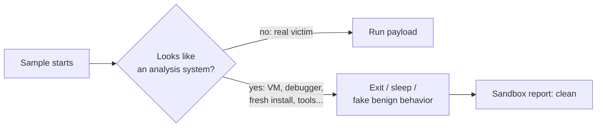
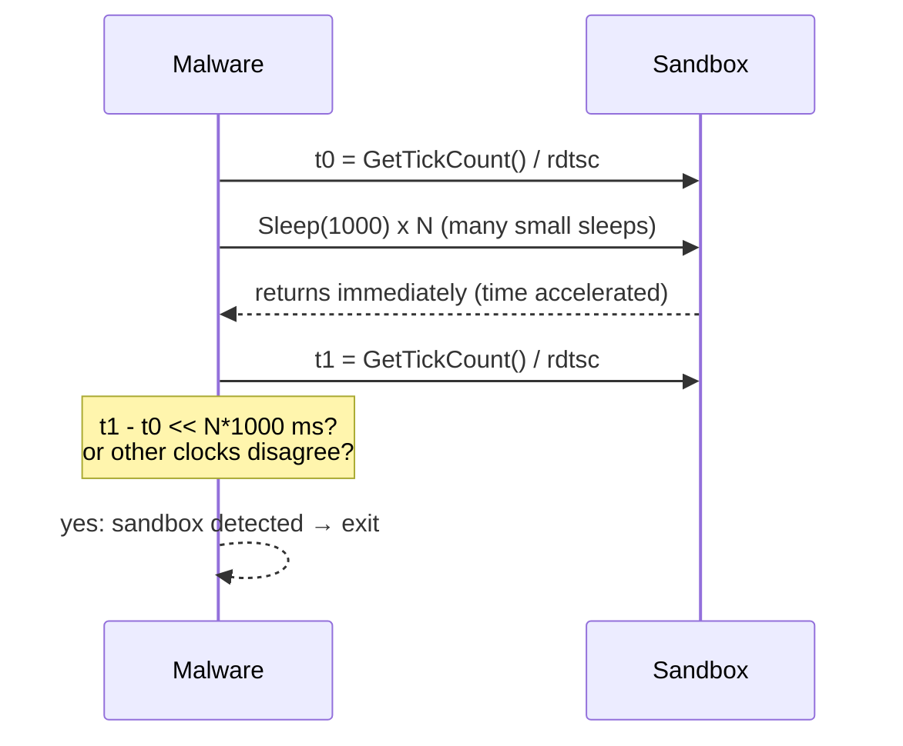
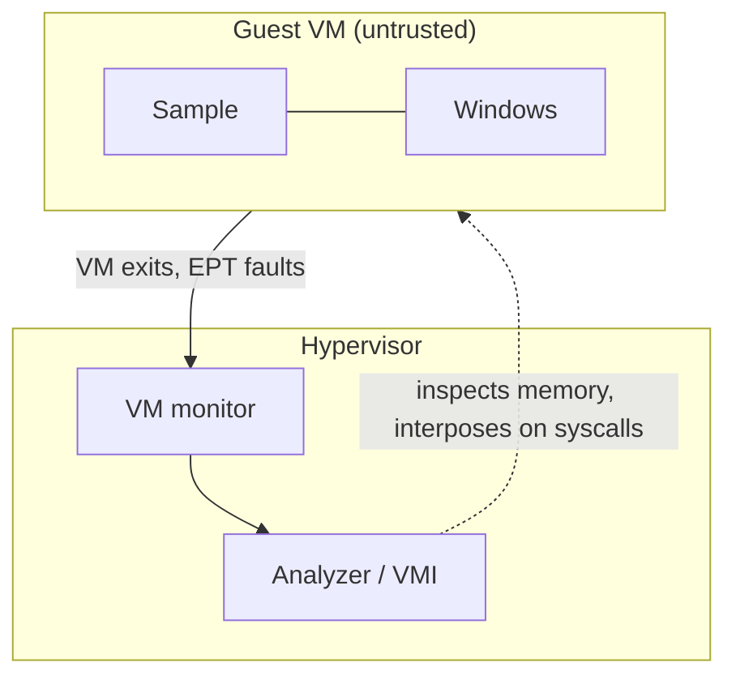

# Malware Evasion

> [!abstract] Purpose and scope
> Dynamic analysis (running a sample inside a sandbox) is the answer to the flood of new samples that static analysis cannot handle. This lecture shows the other side of the coin: **malware that notices it is being analyzed and hides its behavior**. We go through the *discrepancies* that distinguish an analysis system from a real victim (virtualization, hardware, Windows installation, applications, user artifacts, time), then through the *defensive* answer (monitoring evasive code, in-guest agents vs. **virtual machine introspection**, Ether, DRAKVUF) and finally through **anti-debugging**. It builds on [[1 - MA - Introduction#Obfuscation and evasion|evasion as an expected behavior]], on the static triage of [[3 - MA - Basic Static Analysis]] and on the x86 knowledge of [[2 - MA - X86 Assembly]] (`cpuid`, `rdtsc`, `int`, PEB access through `fs:[30h]`). Concept summaries are collected in [[MOC - Malware Analysis]].
>
> The reference book is *Practical Malware Analysis* (PMA, Sikorski & Honig): the chapters on anti-debugging and anti-virtual-machine techniques are used here to explain the slides better. The PDF cited is the one in `pdf/`; its running chapter headings are shifted by one with respect to the lab numbering inside the same book, so below I cite **PDF pages** and section names, not chapter numbers.

## Why evasion matters

Vedi [[Sandbox Evasion]].

- **Staying undetected is vital for malware**: once a sample is recognised as malicious, antivirus signatures, blocklists and analysts shut it down.
- **Dynamic analysis is necessary** because new samples surface every day:
  - static analyses have **limited capabilities** (packing, obfuscation, see [[3 - MA - Basic Static Analysis#Obfuscation through packing]]);
  - the **externally observable behavior** (files written, registry keys, network traffic, processes created) is what allows threat identification and classification;
  - only a **few samples** (for instance new strains) undergo *manual* analysis: the vast majority is only seen by automated sandboxes.
- The consequence is the point of the whole lecture: **once the malware detects an execution or environmental artifact, it can deceive even the most sophisticated analysis system.** It can simply exit, sleep, or behave as a harmless program, and the sandbox report will say "clean".

> [!warning] A clean sandbox report is weak evidence
> As already noted for [[1 - MA - Introduction#Targeting|targeting]], a sample that does nothing in a sandbox has **not** been shown to be benign: its trigger (or its victim) may simply be absent.



## Discrepancies

> [!question] What makes an analysis system different from a victim machine?

An analysis environment is built to be **controlled, reproducible and instrumented**, and each of these properties leaves a trace. The slides group the differences in six families, which are also the structure of the next sections:

| Family | Typical tell |
| --- | --- |
| Virtualization artifacts | special instructions, CPUID data, firmware tables, I/O ports |
| Hardware characteristics | few cores, tiny disk, vendor MAC, missing audio device, no sensors |
| Windows installation | timezone, language, uptime, registry keys of guest additions |
| Applications | analysis tools or missing "normal" software |
| User artifacts | a "fresh" machine with no history |
| Time overheads and memory footprint | slower instructions, accelerated sleeps, injected agent |

## Virtualization artifacts

Vedi [[Virtualization Artifacts]] e [[Red Pill]].

A **red pill** is an instruction sequence that detects whether the code is running in a virtual machine (the name comes from *The Matrix*: take it and you see reality). Where can the evidence come from?

- **Instructions that take longer to execute**, mainly `cpuid` (see below);
- **instruction errata**: incomplete emulation of some instructions by emulators such as QEMU, which then behave differently from real silicon;
- **information leaked by the machine**:
  - CPU identification data from `cpuid`;
  - system firmware tables (SMBIOS strings, ACPI tables);
  - contents and **position in memory of specific structures** (for example the Interrupt Descriptor Table);
  - the **micro-architectural state** of the machine (caches, branch predictors...);
- **I/O ports** (some hypervisors expose a backdoor channel through the `in` instruction).

> [!quote] From the book
> PMA explains why this works: the x86 has instructions such as `sidt`, `sgdt`, `sldt`, `smsw`, `str` that read hardware state **without being privileged** and without trapping. A VMM would have to translate every instruction to virtualize them, with a huge performance cost, so it lets them run natively. The registers they read therefore contain values valid for the **host**, which diverge from what a guest on bare metal would see. The original *Red Pill* ran `sidt` and compared the 5th byte of the returned IDT base with `0xFF` (the VMware signature); it works reliably only on single-processor machines. *No Pill* does the same with `sldt` (the LDT is zero on Windows hosts but non-zero in VMware). The "Anti-VM x86 instructions" list in the book is `sidt`, `sgdt`, `sldt`, `smsw`, `str`, `in` (with `VX`) and `cpuid`. _(PMA, anti-VM chapter, PDF pp. 515–520)_

### Example: `cpuid`

`cpuid` retrieves **processor identification and feature information**:

- it reads from `EAX` the requested record type (the *leaf*) and writes an information record to `{EAX, EBX, ECX, EDX}`;
- for `EAX = 0x1` it writes feature information in `ECX`: the **31st bit** (the *hypervisor bit*) equal to 1 reveals the presence of a hypervisor;
- for `EAX = 0x40000000` it writes the **hypervisor brand** in `{EBX, ECX, EDX}` as ASCII bytes forming 12-byte strings.

> [!warning] Correzione
> The slide writes the output registers as `{EAX, EBC, ECX, EDX}`: `EBC` does not exist, the register is **`EBX`**.

| Brand string | Hypervisor |
| --- | --- |
| `"KVMKVMKVM\0\0\0"` | KVM |
| `"Microsoft Hv"` | Microsoft Hyper-V |
| `"VMwareVMware"` | VMware |
| `"XenVMMXenVMM"` | Xen |
| `"prl hyperv   "` | Parallels |
| `"VboxVboxVbox"` | VirtualBox |

Note that this is a *polite* feature: it is designed so that guests can discover the hypervisor and use paravirtualized services. Malware just reads it for another purpose. Hyper-V is also what Windows itself runs on when *VBS* is enabled (see [[VBS - Virtualization-Based Security (VBS)]]), so "a hypervisor is present" does **not** by itself mean "this is a sandbox".

#### The hypervisor bit

The slide's check sets `EAX = 1` and inspects bit 31 of `ECX`:

```c
size_t eax, ebx, ecx, edx;
__asm__ volatile (
     "cpuid"
     : "=a"(eax), "=b"(ebx), "=c"(ecx), "=d"(edx)
     : "a"(1)
     : "memory" );
printf("%d\n", (int)(ecx >> 31));
```

The GCC extended-asm constraints bind the C variables to the registers: `"a"(1)` puts 1 in `EAX` before the instruction, `"=a"`, `"=b"`, `"=c"`, `"=d"` read the results back. `ecx >> 31` isolates the top bit: 1 on a hypervisor, 0 on bare metal (and on hypervisors configured to hide it).

#### The hypervisor brand

![[MA-L05-01.png]]

The screenshot (a small MASM-style C++ program, from the *rayanfam* article cited on the slide) detects VMware by leaf `0x40000000`:

1. `xor eax, eax; mov eax, 0x40000000; cpuid` asks for the hypervisor vendor leaf;
2. `cmp ecx, 0x4D566572` and `cmp edx, 0x65726177` compare the returned registers with constants. Because x86 is **little-endian** ([[2 - MA - X86 Assembly#Word size and endianness|endianness]]), the string `"VMwareVMware"` is returned as three dwords: `EBX = "VMwa"` (0x61774D56), `ECX = "reVM"` (0x4D566572), `EDX = "ware"` (0x65726177). The program checks only the last two;
3. if both match, `IsUnderVM` is set to 1 and printed.

Anti-VM checks in real samples look exactly like this: a handful of `cpuid` calls and `cmp` with magic constants, which makes them easy to spot (`cpuid` is useless in normal user-mode code).

#### Execution time of `cpuid`

Under a hypervisor, `cpuid` is a **sensitive instruction that always causes a VM exit**: the CPU stops the guest and gives control to the **virtual machine monitor** (VMM) component of the hypervisor, which emulates the answer and resumes the guest. That detour costs many hundreds or thousands of cycles, compared to some tens on bare metal. Measuring the latency does not even need to read the brand, so it works if the hypervisor **lies** about the bit or the string. The slide measures the time with `rdtsc` (read time-stamp counter):

```c
int elapsed; // gcc -masm=intel
__asm__ volatile (
         "rdtsc ;"
         "mov %0, %%eax ;"
         "mov %%eax, 1;"
         "cpuid ;"
         "rdtsc ; "
         "sub %0, %%eax ;"
         "neg %0 ;"
         : "=r"(elapsed) :
         : "rax", "rbx", "rcx", "rdx");
```

> [!warning] Correzione
> The snippet is a sketch and is not valid as written: `mov %%eax, 1` would write to an immediate (the intent is `mov $1, %%eax`, i.e. the AT&T form that matches the `%%` register syntax, while the comment `-masm=intel` selects the *Intel* syntax where `%%eax` is wrong); the first timestamp is not saved before `cpuid` overwrites `EAX`. What it means to do is: *read TSC → save low 32 bits → execute `cpuid` → read TSC → subtract.* The Al-Khaser version below is the working implementation.

![[MA-L05-02.png]]

**Al-Khaser: `rdtsc_diff_vmexit`.** [[Al-Khaser]] implements the idea carefully: the loop runs 10 times "in case of small fluctuations", each time it reads `rdtsc`, calls `__cpuid(cpuInfo, 0)`, reads `rdtsc` again and accumulates `tsc2 - tsc1`; finally `avg /= 10` and the verdict is `(avg < 1000 && avg > 0) ? FALSE : TRUE`. So an average **below 1000 cycles is "bare metal"**, above it the function reports a VM. The `avg > 0` test excludes a pathological zero (e.g. a virtualized TSC that does not advance). Averaging is needed because a single measurement is noisy (interrupts, scheduling, caches).

> [!tip] Why this is a hard check to defeat
> The hypervisor cannot make the VM exit disappear without giving up its own control, and cheating on the TSC (offsetting it so that the time spent in the VMM is subtracted) is itself detectable by cross-checking other time sources. See [[#Timing attacks 101]] and [[Ether Analyzer]].

## Hardware characteristics

Some hardware details reveal a VM or a sandbox:

- **CPU model and number of cores** (a sandbox often gives 1–2 cores);
- **number of network adapters** and the **MAC address family** (vendor prefix, see below);
- **disk size and serial number** (a 40 GB virtual disk is unusual on a modern laptop);
- **peripherals**, e.g. audio capabilities;
- **sensor measurements**: fan speed, temperature (a VM has none).

> [!important] Not every VM is a sandbox
> These features are clearly relevant for evasive malware, but the use of virtualization may **indicate a sandbox and also be legitimate** (cloud servers, developers, VDI). Moreover, **targeted malware** may inspect the same properties to check **whether it has reached the intended victim** (for instance a specific model of machine in an industrial network), so the same check can be an *anti-analysis* check or a *targeting* check ([[1 - MA - Introduction#Targeting|targeting]]).

### Example: MAC address

The first three bytes of a MAC address are the vendor identifier (OUI). A hypervisor must invent MAC addresses for its virtual NICs and typically uses its own assigned prefix:

| Prefix | Hypervisor |
| --- | --- |
| `08:00:27` | VirtualBox |
| `00:05:69`, `00:0C:29`, `00:1C:14`, `00:50:56` | VMware |
| `00:1C:42` | Parallels |
| `00:16:3E` | Xen |

A malware author only has to compare the first three bytes with this table. The cheap defense is to **change the MAC** of the guest NIC to one with a real vendor's OUI. _(PMA, anti-VM chapter, PDF p. 512)_

### Example: speaker check

![[MA-L05-03.png]]

The **TeslaCrypt** ransomware performs a COM-based **DirectShow** audio check: not only the presence of an audio device, but it also invokes APIs like `AddFilter` to expose **inaccurate emulation** of the device by a malware sandbox (source on the slide: Joe Security blog). Reading the code:

1. `CoCreateInstance(CLSID_FilterGraph ...)` creates a DirectShow *graph builder* and `AddFilter(NULL, L"random_name")`;
2. `CoCreateInstance(CLSID_AudioRender ...)` creates the **audio renderer**. The comment says it all: *in case of no audio device `CoCreateInstance` returns `VFW_E_NO_AUDIO_HARDWARE` (0x80040256)*, but the result is not checked and "it fails later". This already catches machines without a sound card;
3. `pGraph->AddFilter(pBaseFilter, filterName)` adds the renderer, then `FindFilterByName` retrieves it and `QueryFilterInfo` compares the **filter name** with the one that was given;
4. `GetSyncSource` must return a valid **reference clock** and `GetClassID` must return a non-zero CLSID; `EnumPins` must yield pins and `AddRef` must succeed.

Every one of these steps is trivial on a real driver stack, but a sandbox that *fakes* an audio device by returning a canned success from the first call usually does not implement the whole object model coherently, and the malware calls `ExitProcess` as soon as something is off. The lesson is the "fidelity" problem: it is not enough to *have* a device, it must *behave* like one.

## Windows installation

**Context information** distinguishes a real user machine from a template image: timezone, language, **uptime** (a sandbox that was just started has a few minutes of uptime), install date, product keys (sandboxes often share a key or use evaluation images).

**Hypervisors and their guest additions also leave traces**: registry entries, processes, drivers. For VMware, PMA lists processes `VMwareService.exe`, `VMwareTray.exe`, `VMwareUser.exe`, the services of VMware Tools, a registry value `Identifier = "VMware Virtual IDE Hard Drive"`, and the `VMware` strings in mouse and NIC driver entries; the book's cheap fix is to uninstall VMware Tools or run `net stop "VMware Tools Service"`. _(PMA, PDF pp. 510–513)_

### Example: VirtualBox & registry

Key **values** under `HKEY_LOCAL_MACHINE`:

| Path | Value | Content on VirtualBox |
| --- | --- | --- |
| `HARDWARE\DEVICEMAP\Scsi\Scsi Port 0\Scsi Bus 0\Target Id 0\Logical Unit Id 0` | `Identifier` | `"VBOX"` |
| `HARDWARE\Description\System` | `SystemBiosVersion` | `"VBOX"` |
| `HARDWARE\Description\System` | `VideoBiosVersion` | `"VIRTUALBOX"` |
| `HARDWARE\Description\System` | `SystemBiosDate` | `"06/23/99"` |

Key **existence** under `HKEY_LOCAL_MACHINE`: `HARDWARE\ACPI\DSDT\VBOX__`, `HARDWARE\ACPI\FADT\VBOX__`, `HARDWARE\ACPI\RSDT\VBOX__`, `SOFTWARE\Oracle\VirtualBox Guest Additions`, and the services `SYSTEM\ControlSet001\Services\VBoxGuest`, `VBoxMouse`, `VBoxService`, `VBoxSF`, `VBoxVideo`.

![[MA-L05-04.png]]

**Al-Khaser: `vbox_reg_keys`.** The function declares an array `szKeys[]` of blacklisted registry keys (exactly the list above), computes the number of entries with `sizeof(szKeys) / sizeof(szKeys[0])` and loops: for every key it calls `Is_RegKeyExists(HKEY_LOCAL_MACHINE, szKeys[i])` and prints the result. A real malware would simply `exit` on the first hit. The same pattern (array of known artifacts, loop, existence test) is used for files, processes and drivers.

> [!tip] Detection from the analyst's point of view
> A binary that contains many strings such as `VBOX`, `VBoxGuest`, `VMware`, `SOFTWARE\Oracle\VirtualBox Guest Additions` is almost certainly performing anti-VM checks: this is a very cheap static IoC (see [[3 - MA - Basic Static Analysis#Strings]]).

## Applications

The presence of a software program may be:

1. a **necessary condition** to trigger a payload (e.g. a banking trojan that activates only if a specific banking app or browser is installed);
2. an **adversary to disarm** (e.g. anti-virus products: the malware kills or evades them);
3. a **sufficient condition for evasion** (e.g. an analysis tool like IDA is found: the malware assumes an analyst is at work and stops).

Analysts dissect malware using **multiple VM images, each with different applications and versions**, precisely because the set of installed programs changes what the sample does. Vedi [[Application Artifacts]].

![[MA-L05-05.png]]

**Al-Khaser: applications.** The code is a long array `szProcesses[]` of process names with comments: `ollydbg.exe`, `ProcessHacker.exe`, the Sysinternals suite (`tcpview.exe`, `autoruns.exe`, `filemon.exe`, `procmon.exe`, `regmon.exe`, `procexp.exe`), IDA (`idaq.exe`, `idaq64.exe`), `ImmunityDebugger.exe`, `Wireshark.exe`, `dumpcap.exe`, `HookExplorer.exe`, `ImportREC.exe`, `PETools.exe`, `LordPE.exe`, `SysInspector.exe`, `proc_analyzer.exe`, `sysAnalyzer.exe`, `sniff_hit.exe`, `windbg.exe`, the Joe Sandbox processes (`joeboxcontrol.exe`, `joeboxserver.exe`), `ResourceHacker.exe`, `x32dbg.exe`, `x64dbg.exe`, `Fiddler.exe`, `httpdebugger.exe`. The malware enumerates running processes and compares names against this list.

> [!example] Furtim: frustrating the analyst
> The **Furtim** malware first detects and bypasses a wide range of anti-virus products. Then it searches for **29 tools that analysts launch manually**. But instead of exiting *immediately* when one is present, it **delays the termination until a later stage of the fingerprinting process**, intentionally causing frustration for the analyst: the sample seems to progress and then silently dies, which makes it hard to understand which check killed it. (Reference: SentinelOne blog on *SFG, Furtim's parent*.)

## User artifacts

**Fresh Windows installations are suspicious.** A real user machine has accumulated wear:

- recently opened files;
- navigation history;
- applications and their install dates;
- recently connected USB devices;
- number and type of files in `Documents` and `Desktop`.

**VM sandboxes shall exhibit a realistic wear-and-tear state.** The key reference (listed at the end of the slide references) is *Spotless Sandboxes: Evading Malware Analysis Systems Using Wear-and-Tear Artifacts* (IEEE S&P 2017): it trains a classifier on such artifacts to separate real and sandbox machines. The countermeasure is therefore not to hide one artifact but to **age** the image. See [[Wear-and-Tear Artifacts]].

## Timing attacks 101

Vedi [[Timing Attacks]].

> [!important] Playing with time is one of the oldest, yet still one of the most effective ways to detect malware analysis systems.

Different options:

1. **Time an instruction sequence and compare it with a baseline.** We already discussed this with red pills (`cpuid` under VMs); the method can **also detect binary instrumentation schemes** (dynamic binary translation, single-stepping, tracing), which slow code down.
2. **Make the analysis run out of budget with sleeps.** Sandboxes run each sample for a few minutes, so the malware simply sleeps through it.
   - use **multiple sleep actions** instead of just one with a large value: sandboxes often *accelerate* a single big `Sleep()` (patching it to return immediately), so the malware issues many small ones and checks the elapsed time;
   - check **whether time has been accelerated** and whether the different **time sources are consistent** with each other (e.g. `GetTickCount` vs. `rdtsc` vs. network time): Windows offers plenty of time sources;
   - the sample can also run **long computations in the initial stages**, which burn the sandbox's budget without involving any sleep.



> [!quote] From the book
> The same idea is used against **debuggers** (single-stepping slows execution): PMA's examples are two `rdtsc` readings compared with a threshold (the sample compares the difference with `0xFFF`; on failure it jumps to a random address by `push eax; ret`), `QueryPerformanceCounter`, and `GetTickCount` (with threshold `0x1A` ms in its example), plus timing the handling of a raised exception. The recommended workaround is to run past the check and set a breakpoint just after it. _(PMA, anti-debugging chapter, PDF pp. 495–497)_

## What could one monitor?

> [!important] There is no such thing as a transparent sandbox.

We may learn from **what imperfections the samples look for**, and either fix these issues or come up with designs unaffected by them. The analysis system itself can also **look for evasive sequences** and flag the sample (an evasion attempt is a strong IoC even if the payload is never seen). How do you spot an evasive sequence?

| Observable | Examples |
| --- | --- |
| **Special instructions** | `cpuid`, `int`, `rdtsc` |
| **Library calls** | files, registry, GUI events, hardware features, drivers, processes, pipes, DLL handling, network, IPC objects, time sources |
| **System calls** | the sample "talks" to the kernel directly, bypassing the hooked user-mode APIs |
| **WMI** | queries to the OS through the Windows Management Instrumentation system |
| **Process environment** | data structures like the **PEB** (Process Environment Block) may expose relevant information (e.g. CPU cores, presence of debuggers) |

The PEB is the per-process user-mode structure holding environment, loaded modules and debugger status (see [[2 - MA - X86 Assembly#Memory map of a process (WINDOWS EDITION)|process memory map]]). Because reading it is a plain memory access, **no API call is visible to the sandbox**: that is why malware prefers to inspect it manually. _(PMA, PDF p. 489)_

### WMI queries

Vedi [[WMI Fingerprinting]].

The Windows Management Instrumentation subsystem supports **SQL-style queries** (WQL) to the OS about hardware and software. Some examples of what can be checked:

| `SELECT * FROM` | Properties |
| --- | --- |
| `Win32_Bios` | `SerialNumber` |
| `Win32_PnPEntity` | `DeviceId` |
| `Win32_NetworkAdapterConfiguration` | `MACAddress` |
| `Win32_Processor` | `NumberOfCores`, `ProcessorId` |
| `Win32_LogicalDisk` | `Size` |
| `Win32_ComputerSystem` | `Model`, `Manufacturer` |
| `Win32_NTEventLogFile` | `FileName` (related to VBOX) |
| `MSACPI_ThermalZoneTemperature` | `CurrentTemperature` |

Everything in the previous sections (hardware, MAC, disk size, BIOS) can therefore be read **through one uniform and high-level interface**, with no `cpuid` and no registry access in the code.

![[MA-L05-06.png]]

**Al-Khaser: WMI `Win32_Bios`.** After a WQL query, the code calls `pclsObj->Get(L"SerialNumber", ...)` and, if the variant is a string (`VT_BSTR`), compares it with the **common BIOS serial numbers in hypervisors/emulators**: it contains `"VMware"`, equals `"0"` (VirtualBox's serial is just `"0"`, as the comment says), contains `"Xen"`, contains `"Virtual"` or contains `"A M I"` (the American Megatrends string used by some VMs). On a match it sets `bFound = TRUE` and breaks. `StrStrI` is a case-insensitive substring search; `wcscmp` an exact comparison.

## In-guest agents

We discussed two main **attack surfaces**: artifacts of the *execution technology* (imperfections, overheads) and of the *software setup* (what is installed). However, for sandboxes and general dynamic analysis systems, **operating inside a virtualized guest is already a weakness**:

- monitoring agents are often implemented in **user space**, frequently as an **injected DLL** that hooks APIs: the DLL, the hooks (modified function prologues), and the extra processes are all visible to the sample;
- agents implemented in **kernel space** are more rare now: **PatchGuard** (Windows Kernel Patch Protection) forbids modifying kernel structures.

We can always study fingerprinting techniques and fix/randomize the implementation accordingly, but in the end **these systems will always share the execution context with the sample under analysis**. See [[In-Guest Agents]]; compare with the [[3 - MA - Basic Static Analysis#Time date stamp|usual arms race]] of static IoCs.

## Virtual machine introspection

Vedi [[Virtual Machine Introspection]].

**Idea: perform the analysis from outside the guest VM.** It was pioneered in **intrusion detection systems** (Garfinkel & Rosenblum, NDSS 2003) for greater attack resistance while retaining visibility, and it **requires cooperation from the hypervisor's VM monitor**. Three capabilities are crucial to support good visibility while offering resistance to evasion and subversion:

| Capability | Meaning |
| --- | --- |
| **Isolation** | the program cannot access the code/state of the monitoring system |
| **Inspection** | the monitoring system has full access to the state of the analyzed machine (memory, registers, disk) |
| **Interposition** | the monitoring system can interpose on specific operations, such as the kernel transitions caused when issuing a system call |



For the background on hypervisors and virtualization see [[1 - Cloud Computing, Virtualizzazione e Containerization]].

### Ether [CCS'08]

Vedi [[Ether Analyzer]]. The **Ether** malware analyzer pioneered the use of the **VT-x** hardware virtualization extensions to build a **transparent** analysis system. The analyzer **resides in the VM monitor**. Its authors identified **5 requirements** for a system that wants to hide the memory and CPU changes inevitably caused by its very presence:

1. **Higher privilege**: the analyzer runs at a privilege level that the analyzed code cannot reach;
2. **Privileged access to side effects**: if side effects are introduced, they should be visible only with a privilege level that analyzed code cannot reach;
3. **Same basic instruction semantics**: side effects are allowed only during exceptions (normal instructions must behave as on real hardware);
4. **Transparent exception handling**: when an exception occurs, the analyzer can reconstruct the expected context where needed;
5. **Identical timing information**: access to time sources is *shepherded* (the analyzer forges the values so that elapsed time looks native, i.e. defeats [[#Timing attacks 101]]).

The slide's closing remark is that the design was **undermined by practical limitations: the imperfections of VT-x** (e.g. VM exits cost time that cannot be fully hidden, so the timing checks of this lecture still work).

### The semantic gap problem

![[MA-L05-07.png]]

VMI methods incur a **semantic gap** when trying to inspect high-level concepts of the guest system such as **API calls or threads** (figure from Ajay Kumar et al., ICPADS 2015). The figure shows the two views: the **internal view** (inside the guest) sees applications, a process name and a PID; the **external view** (hypervisor) only sees raw memory (CPU, RAM, NIC as bits such as `0101...`). The VMM must **reconstruct meaning from raw bytes**: "converting binary (0, 1) into meaningful form at VMM; example PID = 920". That requires knowing the guest OS kernel data structures (offsets and layouts of `EPROCESS`, thread lists...) and walking them in the guest's memory, which is fragile and version-dependent. Vedi [[Semantic Gap]].

### Automatic and manual analysis

- **VMI-based systems face higher implementation complexity** than in-guest agents but **offer better transparency**. Sandbox vendors have started adopting VMI-based or **hybrid** approaches. **DRAKVUF** is the reference system in academic research (ACSAC 2014).
- **Automatic analysis is only one part of the story.** When dissection is required, **VMI is no lifeboat for your conspicuous manual work**: analysts still work on **their own laptops with classic virtualization products**, so they have to dismantle evasions again, this time **manually** (patching the checks, hiding artifacts).
- **Latest trend**: **out-of-VM debugging** of a process running in the VM (the debugger runs outside the guest, so that anti-debugging checks for in-guest tools find nothing).

> [!quote] From the book
> PMA covers the manual side for VMware: first look for *strings* (`VMwareTray.exe`, `VMMouse`, `net start | findstr VMware`) and follow the cross-reference to the check; then **patch** the conditional jump so it is never taken, or edit the string (`XXXareTray.exe`), or uninstall VMware Tools; NOP out `sidt`/`in`; run on a multicore host; or add the undocumented `.vmx` options (they are listed in the book, but it advises against them as they disable VMware Tools). It also gives an IDAPython script that highlights `sidt`, `sgdt`, `sldt`, `smsw`, `str`, `in`, `cpuid`, and mentions the tool **ScoopyNG** (seven VMware checks). _(PMA, PDF pp. 512–523)_

## References

The slides contain two reference slides at this point (before the anti-debugging block); I keep them together here.

- **Al-Khaser**: <https://github.com/LordNoteworthy/al-khaser/> (see [[Al-Khaser]]).
- *A fistful of red-pills: How to automatically generate procedures to detect CPU emulators*, WOOT 2009.
- *A Virtual Machine Introspection Based Architecture for Intrusion Detection*, NDSS 2003.
- *Ether: Malware Analysis via Hardware Virtualization Extensions*, ACM CCS 2008.
- *Scalability, Fidelity and Stealth in the DRAKVUF Dynamic Malware Analysis System*, ACM ACSAC 2014.
- *Spotless Sandboxes: Evading Malware Analysis Systems Using Wear-and-Tear Artifacts*, IEEE S&P 2017.
- *On the Dissection of Evasive Malware*, IEEE TIFS 2020.
- *BluePill: Neutralizing Anti-Analysis Behavior in Malware Dissection*, Black Hat Europe 2019.
- *My Ticks Don't Lie: New Timing Attacks for Hypervisor Detection*, Black Hat Europe 2020.
- Check Point Research: evasion techniques <https://evasions.checkpoint.com/> (PoCs in `CheckPointSW/Evasions`) and anti-debug tricks <https://anti-debug.checkpoint.com/> (PoCs in `CheckPointSW/showstopper`).
- *Defeating evasive malware*, VMRay whitepaper, Winter 2020.
- *PoW-How: An Enduring Timing Side-Channel to Evade Online Malware Sandboxes*, ESORICS 2021.

## Anti-debugging 101

Vedi [[Anti-Debugging]].

**The presence of a debugger alters the normal working of a process.** The OS reflects such effects, both **directly and indirectly**, and the malware can read them. Where? The slide lists:

| Mechanism | Detail |
| --- | --- |
| **Library functions** | `IsDebuggerPresent()`, `CheckRemoteDebuggerPresent()` |
| **System calls** | e.g. `NtQueryInformationProcess` |
| **PEB flags** | `BeingDebugged` (checked by `IsDebuggerPresent`), `NtGlobalFlag` |
| **`int 2d` and other low-level tricks** | e.g. `sti` |
| **API semantics** | e.g. `CloseHandle` on an invalid handle |

and notes that **Peter Ferrie wrote a guide with ~80 red pills to expose debuggers**.

> [!quote] From the book
> - `IsDebuggerPresent` reads the PEB field (`BeingDebugged`, at **offset 2**; PMA's text calls it `IsDebugged`) and returns non-zero under a debugger. `CheckRemoteDebuggerPresent` is the same for *another* process on the *local* machine (despite the name, it is not about remote machines). `NtQueryInformationProcess` with class `ProcessDebugPort` (0x7) returns a port number if a debugger is attached.
> - The **manual** version loads the PEB address from `fs:[30h]` and tests `byte [eax+2]`; it avoids the API calls, which a rootkit-style hook could falsify.
> - Besides `BeingDebugged`, **ProcessHeap** flags (`ForceFlags`/`Flags` of the first heap) and **NtGlobalFlag** are manual PEB-based checks. Bypass: set the flag to zero, force the conditional jump, or use a "hide debugger" plug-in. _(PMA, anti-debugging chapter, PDF pp. 487–492)_
> - Other families: scanning your own code for `0xCC` (INT 3 software breakpoints) or **checksums** over the code, **TLS callbacks** (code run before the entry point), exceptions and inserted interrupts (`int 3`, `int 2d`, `icebp`), and bugs in the debugger itself (PE header and `OutputDebugString("%s%s...")` crashes in OllyDbg 1.1). _(PMA, PDF pp. 494–506)_

> [!tip] Hardware breakpoints
> Software breakpoints work by **overwriting an instruction with `0xCC`**, which is exactly what the `0xCC` scans and the checksums detect. **Hardware breakpoints** (debug registers) do not modify the code and avoid both, while the analyst should also configure the debugger to pass exceptions to the program. See also [[GDB]] for a debugger on the Linux side.

### `NtGlobalFlag` check

`NtGlobalFlag` is a field of the PEB set from system and image settings at process creation. When a process is **started under a debugger**, Windows enables heap debugging flags, so the field holds `0x70`: this value is the OR of `FLG_HEAP_ENABLE_TAIL_CHECK` (`0x10`), `FLG_HEAP_ENABLE_FREE_CHECK` (`0x20`) and `FLG_HEAP_VALIDATE_PARAMETERS` (`0x40`). Without a debugger it is **likely 0**. Note it detects a debugger *attached at process creation*, not one attached later.

![[MA-L05-08.png]]

**Al-Khaser: `NtGlobalFlag` on the 32-bit PEB (and also the 64-bit PEB).** On a real 32-bit OS the code reads the TEB self pointer with `__readfsdword(0x18)`, adds `0x30` to get the PEB and `0x68` to get `NtGlobalFlag` (the `pNtGlobalFlag` pointer). On **64-bit Windows a 32-bit process (WOW64)** has *two* PEBs: the 32-bit one and a 64-bit one, so the code derives the 64-bit TEB as `_teb32 - 0x2000`, the 64-bit PEB at `+0x60`, and the flag at `+0xBC`. The verdict is `normalDetected || wow64Detected`, where each is `*pNtGlobalFlag & 0x70`.

![[MA-L05-09.png]]

The IDA graph is taken from **Challenge 7 of the Flare-On series 2014** (a reverse-engineering CTF) and is the same check written directly in assembly. Reading the blocks from the top:

1. the function `CHECK_PEB_NtGlobalFlag` first sets the local `var_4 = 1` (the "debugger present" default), then loads the PEB with `mov eax, large fs:30h`. The stray `db 3Eh` is a `ds:` segment-override prefix that does nothing (it is the reason why the book shows `ds:[eax+68h]`) and may also confuse a naive disassembler;
2. `cmp dword ptr [eax+68h], 70h` compares `NtGlobalFlag` with `0x70`. If it is **equal** (`jz`) the jump skips the next block, so `var_4` stays 1; if it is **different** the red arrow executes `mov [ebp+var_4], 0` ("no debugger");
3. at `loc_401411` the code tests `var_4`: when it is non-zero (debugger) the green branch loads a **taunt string** (*"Feel the sting of the Monarch!"*, the message the challenge shows to an analyst who runs the program in a debugger) and calls `sub_401000`; otherwise the other branch runs with different data (the real behavior);
4. the function returns `var_4` in `EAX`.

The slide's remark compares it with the C example: here the code **accesses the 32-bit PEB directly** (`fs:30h`) but **does not check the Wow64 PEB**. This is the pattern to look for during static analysis: `fs:[30h]` followed by a comparison with a constant. _(PMA, PDF p. 492, `mov eax, large fs:30h; cmp dword ptr ds:[eax+68h], 70h`)_

> [!example] Reading the graph as a predicate
> The function is a pure *predicate* `BOOL is_debugged()`; the caller (here the two data paths) uses the result to change its control flow, which is why the book's bypass applies directly: force the `jz`, or set `NtGlobalFlag` to 0 before the `cmp`.

### `CloseHandle` check

![[MA-L05-10.png]]

The Al-Khaser snippet is introduced by a comment: *APIs making use of the `ZwClose` syscall (such as `CloseHandle`, indirectly) can be used to detect a debugger. When a process is debugged, calling `ZwClose` with an invalid handle will generate a `STATUS_INVALID_HANDLE` (0xC0000008) exception. As with all anti-debugs that rely on information made directly available.* Two functions are shown:

1. `NtClose_InvalideHandle()` resolves `NtClose` dynamically (`API::GetAPI(API_IDENTIFIER::API_NtClose)`) and calls it with the bogus handle `0x99999999` inside `__try`. If an exception is raised the `__except(EXCEPTION_EXECUTE_HANDLER)` block returns `TRUE` (debugger present), otherwise `FALSE`;
2. `CloseHandle_InvalideHandle()` tries first with the **user-mode** API `CloseHandle`; if an exception is raised it returns `TRUE`. Otherwise it calls `NtClose_InvalideHandle()` directly "to **bypass user mode hooks**".

Why it works: with no debugger, `CloseHandle` on an invalid handle just returns `FALSE` (and sets the last error), silently. With a debugger attached, the kernel raises the exception, normally delivered to the debugger first and then handled by the process's `__except`. The second function is a good example of the cat-and-mouse game: if a sandbox or anti-anti-debug tool hooked `CloseHandle` in user mode to hide the exception, calling the native function (a direct syscall path) bypasses the hook.

> [!warning] Typos in the source
> The function names `NtClose_InvalideHandle` and `CloseHandle_InvalideHandle` are the original Al-Khaser spelling (*"Invalide"*): this is not a transcription mistake in these notes.

---

> [!summary] How the pieces fit together
> Evasion is the reason why **a sandbox verdict never proves the absence of malicious behavior**. Malware compares the environment with what a *real victim* looks like along six axes: virtualization (`cpuid`, hypervisor bit/brand, red pills), hardware (MAC, disk, audio), Windows installation (registry, guest additions), applications (analysis tools), user wear-and-tear, and **time** (which also exposes instrumentation). The analyst's answers are (1) fixing artifacts one by one (an endless game, "no transparent sandbox"), (2) moving the analyzer **out of the guest** with **VMI** (isolation, inspection, interposition; Ether, DRAKVUF), paying with the **semantic gap**, and (3) for manual work, recognizing and neutralizing the checks: `fs:[30h]`, `NtGlobalFlag == 0x70`, `IsDebuggerPresent`, `CloseHandle` exceptions. Next lectures will extend this block; the concept summaries are linked from [[MOC - Malware Analysis]].
